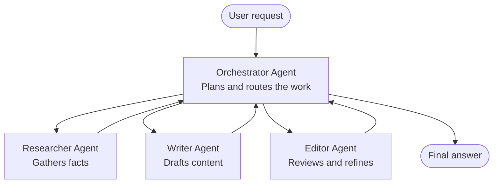

# Noțiuni de bază despre sisteme multi-agent - Lansează-ți primul sistem AI coordonat

**Navigarea capitolului:**
- **📚 Acasă curs**: [AZD Pentru Începători](../../README.md)
- **📖 Capitolul curent**: Capitolul 5 - Soluții AI Multi-Agent
- **⬅️ Anterior**: [Capitolul 4: Infrastructură](../chapter-04-infrastructure/README.md)
- **➡️ Următor**: [Modele de coordonare](../chapter-06-pre-deployment/coordination-patterns.md)

> Ghidul de comenzi verificat în raport cu referința lansată `azd 1.37.2`. Implementările în cloud nu au fost executate.

## Introducere

În capitolele anterioare ai lansat o singură aplicație — iar în Capitolul 2 ai lansat un singur agent AI. Această lecție face următorul pas: lansarea unui **sistem multi-agent**, în care mai mulți agenți specializați colaborează pentru a rezolva o problemă pe care niciun agent singur nu ar putea să o gestioneze bine de unul singur.

Vestea bună pentru începători: **nu ai nevoie de comenzi noi.** O soluție multi-agent este tot un proiect azd. Vei `azd init`, `azd up`, testa și `azd down` — exact fluxul de lucru pe care îl cunoști deja. Schimbarea este în *structura* aplicației din interior.

## Obiective de învățare

La sfârșitul acestei lecții, vei:
- Înțelege ce înseamnă "multi-agent" și când merită complexitatea suplimentară
- Recunoaște rolurile comune într-un sistem multi-agent (orchestrator + specialiști)
- Lansa un șablon multi-agent real, funcțional, cu `azd up`
- Înțelege resursele Azure care susțin o aplicație multi-agent
- Ști cum să verifici, personalizezi și elimini soluția în siguranță

## Rezultate de învățare

După finalizarea acestei lecții, vei putea să:
- Explici diferența dintre un agent singur și un sistem multi-agent
- Alegi între un agent singular cu unelte și un design real multi-agent
- Lansezi și testezi un șablon multi-agent de la început până la sfârșit cu azd
- Identifici unde rulează fiecare agent și cum comunică
- Curăți toate resursele pentru a evita costuri în curs

---

## Ce este un sistem multi-agent?

Un singur agent AI este un model cu un set de instrucțiuni și (opțional) unele unelte. Asta funcționează bine pentru sarcini concentrate. Dar pe măsură ce o sarcină crește — cercetare, apoi scris, apoi editare, apoi verificare de fapte — încapsularea tuturor în un singur prompt încetinește agentul, îl face mai puțin de încredere și mai greu de depanat.

Un **sistem multi-agent** împarte munca între specialiști care fac fiecare o singură sarcină bine, coordonați de un orchestrator:



### Cele două roluri pe care le vei vedea mereu

| Rol | Sarcină | Exemplu |
|------|-----|---------|
| **Orchestrator** | Decide *ce se întâmplă apoi* și direcționează munca între agenți | "Mai întâi cercetare, apoi scris, apoi editare" |
| **Specialist** | Face o singură sarcină concentrată și returnează un rezultat | Un "cercetător" care doar adună fapte |

### Ai chiar nevoie de mai mulți agenți?

Începe simplu. Apelează la multi-agent **numai** când unul dintre următoarele este adevărat:

- ✅ Sarcina are **etape distincte** care beneficiază de instrucțiuni diferite (cercetare vs. scris vs. revizuire)
- ✅ Vrei ca specialiștii să ruleze **în paralel** pentru a economisi timp
- ✅ Pașii diferiți necesită **unelte sau surse de date diferite**
- ✅ Ai nevoie ca fiecare pas să fie **testabil și depanabil independent**

Dacă sarcina ta este o simplă întrebare-răspuns sau un apel simplu la o unealtă, un **agent singular cu unelte** (Capitolul 2) este mai simplu, mai ieftin și mai ușor de operat.

> **Sfat pentru începători:** "Mai mulți agenți" nu înseamnă "mai bine." Fiecare agent adaugă latență, cost și un element nou de supravegheat. Adaugă agenți doar când problema se împarte clar în părți.

---

## Două moduri de a construi un multi-agent pe Azure

| Abordare | Ce este | Cel mai potrivit pentru |
|----------|-----------|----------|
| **Agent singular + unelte** | Un agent Foundry care apelează funcții/unelete | Fluxuri de lucru simple, început |
| **Mai mulți agenți coordonați** | Mai mulți agenți cu un orchestrator | Etape distincte, muncă paralelă, specializare |

Această lecție se concentrează pe a doua abordare folosind un **șablon gata făcut**, astfel încât să poți vedea un sistem multi-agent real în funcțiune înainte să-ți construiești propriul.

---

## Practic: Lansează o aplicație multi-agent funcțională

Vom lansa **Contoso Creative Writer**, un exemplu oficial Azure care coordonează agenți de cercetare, produs, scris și editare pentru a produce un articol. Înainte să continui, verifică [cerințele și costurile exemplului](https://github.com/Azure-Samples/contoso-creative-writer#azure-account-requirements): are nevoie de cotă pentru modele, Azure AI Search, acces Bing Grounding, Python, Docker și hook-uri compatibile cu Bash. Disponibilitatea modelelor și regiunea depind de abonamentul tău; lansarea nu este garantată doar prin alegerea unei regiuni anume.

### Pasul 1: Initializează șablonul

```bash
# Create a working folder
mkdir creative-writer && cd creative-writer

# Initialize from the official multi-agent template
azd init --template Azure-Samples/contoso-creative-writer .
```

> Răsfoiește mai multe șabloane multi-agent oricând în [galeria Awesome AZD AI](https://azure.github.io/awesome-azd/?tags=ai). Alte opțiuni prietenoase pentru începători includ `get-started-with-ai-agents` și `azure-ai-travel-agents`.

### Pasul 2: Autentificare

```bash
# Required for azd workflows
azd auth login

# Also required by this sample's Azure CLI hooks
az login
```

### Pasul 3: Verifică mediul

```bash
# init normally creates/selects an environment; confirm it before proceeding
azd env list
# Only if you need an additional environment:
# azd env new dev
```

### Pasul 4: Previzualizează, apoi lansează

```bash
# See what will be created before spending anything (recommended)
azd provision --preview

# Provision infrastructure and deploy all agents in one step
azd up
```

`azd up` va cere setările lipsă de abonament și regiune, apoi va provisiona resursele și va lansa aplicația. Previzualizarea nu rezervă cotă și nu garantează succes; hook-urile șablonului pot rula în continuare în timpul previzualizării provisioning, deci inspectează-le prima dată. Pentru a extinde cât timp așteaptă azd pentru fiecare **lansare a serviciului** (nu provisioning model):

```bash
azd deploy --timeout 1800
```

Un timeout oprește azd din a aștepta; nu anulează lansarea în Azure. Inspectează starea resursei înainte să încerci din nou.

> **Atenție la cost și capacitate:** Aplicațiile multi-agent lansează modele AI care consumă cotă și generează cost. Dacă `azd up` eșuează din cauza cotei de model, vezi [Depanare AI](../chapter-07-troubleshooting/ai-troubleshooting.md) pentru remedieri legate de regiune și cotă, și Capitolul 6 [Planificarea capacității](../chapter-06-pre-deployment/capacity-planning.md).

---

## Înțelegerea a ceea ce ai lansat

O aplicație tipică multi-agent ca aceasta provisionează un set de resurse Azure care corespund direct responsabilităților din diagrama de mai sus:

| Resursă | De ce este acolo |
|----------|----------------|
| **Microsoft Foundry / Modele** | Găzduiește modelele lingvistice pe care le folosește fiecare agent |
| **Azure AI Search** | Oferă agentului de cercetare date fundamentale de căutat |
| **Container Apps** (sau App Service) | Găzduiește codul orchestratorului și al agenților |
| **Cosmos DB** (în unele exemple) | Stochează starea/memoria partajată transmisă între agenți |
| **Application Insights** | Urmărește cererile *printre* agenți pentru depanarea fluxului |

### Cum comunică agenții între ei

În majoritatea exemplelor azd multi-agent, **orchestratorul rulează în codul aplicației tale** (de exemplu, folosind un cadru precum Semantic Kernel sau Microsoft Agent Framework). Orchestratorul apelează fiecare agent specialist pe rând, transmite rezultatele și asamblează răspunsul final. Agenții împart context prin:

- **Apeluri de funcție/unealtă** — orchestratorul invocă un specialist și primește înapoi un rezultat
- **Memorie partajată** — o bază de date (adesea Cosmos DB) deține starea pe care o pot citi ambii agenți
- **Mesaje/evenimente** — pentru un cuplaj mai slab, agenții comunică printr-o coadă sau Service Bus

> **De ce contează asta pentru depanare:** pentru că fiecare pas este separat, Application Insights îți arată *care* agent a fost lent sau a eșuat. Acesta este un motiv major pentru a împărți munca între agenți în primul rând.

---

## Verifică implementarea

Confirmă că sistemul funcționează efectiv înainte să continui:

```bash
# Show the deployed endpoints
azd show

# Open the app's monitoring dashboard
azd monitor

# Open Application Insights Logs (not a terminal log stream)
azd monitor --logs
```

Apoi deschide adresa URL a aplicației din `azd show` și solicită un articol scurt. Folosește vizualizarea de depanare a exemplului pentru a inspecta fluxul de lucru al agentului. Căutarea în tranzacții Application Insights poate arăta pașii individuali doar dacă exemplul îi instrumentează și corelează; azd nu adaugă automat span-uri ale agenților.

**Criterii de succes:**
- ✅ `azd show` listează un endpoint accesibil
- ✅ O cerere produce un rezultat care a trecut clar prin mai multe etape
- ✅ Vizualizarea de depanare arată mai mulți pași ai agenților; dacă urmărirea este activată, verifică telemetria corespunzătoare după ingestie

---

## Personalizează: Adaugă sau ajustează un agent

Deoarece fiecare agent este doar instrucțiuni plus unelte, personalizarea este accesibilă:

1. **Găsește definițiile agentului** în șablon (adesea un set de fișiere `prompts/`, `agents/` sau `*.prompty`).
2. **Ajustează instrucțiunile unui agent** — de exemplu, spune agentului editor să impună un anumit ton sau număr de cuvinte.
3. **Redeplasează doar codul** (infrastructura rămâne neschimbată):

   ```bash
   azd deploy
   ```

Pentru a merge mai departe cu propriul proiect de agent Foundry, folosește inițializarea interactivă a extensiei agent:

```bash
azd extension install azure.ai.agents
azd ai agent init
azd up
azd ai agent invoke      # test, with response timing
```

Vezi [Capitolul 2: Agenți](../chapter-02-ai-development/agents.md) și [referința AZD AI CLI](../chapter-08-production/production-ai-practices.md#azd-ai-cli-commands-and-extensions) pentru ciclul complet de viață: `invoke` agent, fluxul de lucru al extensiei separate de evaluări `azd ai eval`, `optimize` agent, și `delete` agent.

---

## Curățare

Aplicațiile multi-agent rulează mai multe servicii facturabile. Demolează tot când ai terminat:

```bash
# Review the resources and confirm deletion interactively
azd down
```

Ștergerea este distructivă. Pentru un laborator de unică folosință, `azd down --force --purge` sare peste confirmările ștergerii și cele soft-delete; purgarea este ireversibilă unde este suportată și poate fi blocată de protecția la purgare. Ștergerea soft este o problemă de recuperare/reposibilitate a numelui, nu în sine dovadă a costurilor în curs. Verifică resursele reținute și facturarea după curățare.

---

## O notă despre sistemele multi-agent în producție

Soluția [Retail Multi-Agent](../../examples/retail-scenario.md) din acest repo este un **plan arhitectural**, nu un șablon cu o singură comandă — documentează modul în care un sistem de retail de producție *ar fi* construit (și este explicit că o construcție completă este un efort substanțial). Folosește-o ca referință de proiectare *după ce* ai implementat un exemplu funcțional aici. Pentru aspecte de producție (reziliență, costuri, monitorizare, guvernanță), continuă cu [Capitolul 8: Practici AI de Producție](../chapter-08-production/production-ai-practices.md).

---

## Rezumat

- Un sistem multi-agent împarte sarcinile între specialiști coordonați de un orchestrator.
- Folosește-l doar când sarcina are etape distincte, paralelism sau diferite unelte pentru fiecare pas — în caz contrar, preferă un singur agent.
- Fluxul de lucru azd rămâne neschimbat: `azd init` → `azd up` → test → `azd down`.
- Un șablon real precum `contoso-creative-writer` îți permite să vezi și să personalizezi o aplicație multi-agent funcțională astăzi.
- Tracing-ul cu Application Insights între agenți este unul dintre cele mai mari beneficii practice ale design-ului multi-agent.

---

## 🔗 Navigare

| Direcție | Lecție |
|-----------|--------|
| **Anterior** | [Capitolul 4: Infrastructură](../chapter-04-infrastructure/README.md) |
| **Următor** | [Modele de Coordoonare](../chapter-06-pre-deployment/coordination-patterns.md) |

## 📖 Resurse Asemănătoare

- [Ghidul Agenților AI](../chapter-02-ai-development/agents.md)
- [Modele de Coordoonare](../chapter-06-pre-deployment/coordination-patterns.md)
- [Practici AI de Producție](../chapter-08-production/production-ai-practices.md)
- [Depanare AI](../chapter-07-troubleshooting/ai-troubleshooting.md)

---

<!-- CO-OP TRANSLATOR DISCLAIMER START -->
**Declinare a responsabilității**:
Acest document a fost tradus folosind serviciul de traducere AI [Co-op Translator](https://github.com/Azure/co-op-translator). În timp ce ne străduim pentru acuratețe, vă rugăm să rețineți că traducerile automate pot conține erori sau inexactități. Documentul original în limba sa nativă trebuie considerat sursa autorizată. Pentru informații critice, se recomandă traducerea profesională realizată de un om. Nu ne asumăm responsabilitatea pentru eventualele neînțelegeri sau interpretări greșite care decurg din utilizarea acestei traduceri.
<!-- CO-OP TRANSLATOR DISCLAIMER END -->