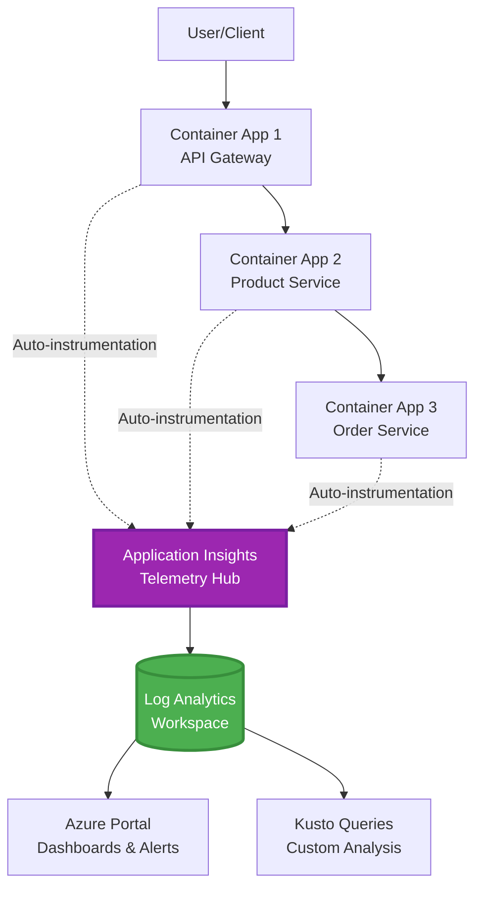
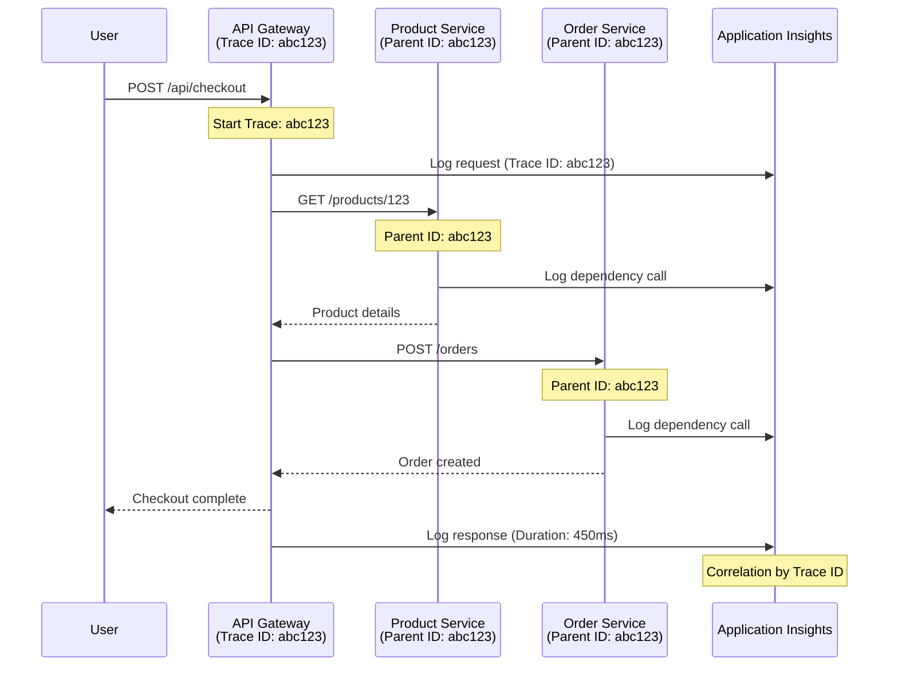

# Integrarea Application Insights cu AZD

⏱️ **Timp estimat**: 40-50 minute | 💰 **Impact costuri**: ~5-15 USD/lună | ⭐ **Complexitate**: Intermediar

**📚 Parcurs de învățare:**
- ← Anterior: [Verificări preliminare](preflight-checks.md) - Validare pre-deploy
- 🎯 **Ești aici**: Integrarea Application Insights (Monitorizare, telemetrie, depanare)
- → Următor: [Ghid de implementare](../chapter-04-infrastructure/deployment-guide.md) - Implementare în Azure
- 🏠 [Pagina cursului](../../README.md)

---

## Ce vei învăța

Parcurgând această lecție, vei:
- Declara **Application Insights** în infrastructura AZD și să configurezi instrumentarea SDK
- Configurezi **tracing distribuit** pentru microservicii
- Implementezi **telemetrie personalizată** (metrice, evenimente, dependențe)
- Configurezi **metrice live** pentru monitorizare în timp real
- Creezi **alerte și dashboard-uri** din implementările AZD
- Depanezi problemele din producție cu **interogări de telemetrie**
- Optimizezi **costurile și strategiile de eșantionare**
- Monitorizezi **aplicații AI/LLM** (tokenuri, latență, costuri)

## De ce contează Application Insights cu AZD

### Provocarea: Observabilitatea în producție

**Fără Application Insights:**
```
❌ No visibility into production behavior
❌ Manual log aggregation across services
❌ Reactive debugging (wait for customer complaints)
❌ No performance metrics
❌ Cannot trace requests across services
❌ Unknown failure rates and bottlenecks
```

**Cu Application Insights + AZD:**
```
✅ Automatic telemetry collection
✅ Centralized logs from all services
✅ Proactive issue detection
✅ End-to-end request tracing
✅ Performance metrics and insights
✅ Real-time dashboards
✅ AZD provisions the monitoring declared in your templates
```

**Analogie**: Application Insights este ca un înregistrator de zbor „black box” + bordul din cockpit pentru aplicația ta. Vezi tot ce se întâmplă în timp real și poți revedea orice incident.

---

## Privire de ansamblu asupra arhitecturii

### Application Insights în arhitectura AZD



### Ce se monitorizează automat

Instrumentarea automată suportată capturează cereri/dependențe pentru bibliotecile instrumentate. Evenimentele și metricele personalizate necesită cod aplicație; testele de disponibilitate trebuie configurate separat. Nu colectează toate rândurile de mai jos doar pentru că resursa există.

| Tip Telemetrie | Ce Capturează | Caz de Utilizare |
|----------------|------------------|----------|
| **Cereri** | Cereri HTTP, coduri de stare, durată | Monitorizarea performanței API-ului |
| **Dependențe** | Apeluri externe (BD, API-uri, stocare) | Identificarea blocajelor |
| **Excepții** | Erori negestionate cu trace-uri de stivă | Depanarea eșecurilor |
| **Evenimente personalizate** | Evenimente de afaceri (înregistrare, cumpărare) | Analize și funnel-uri |
| **Metrice** | Contoare de performanță, metrice personalizate | Planificare capacitate |
| **Trace-uri** | Mesaje de log cu severitate | Depanare și auditare |
| **Disponibilitate** | Teste uptime și timp răspuns | Monitorizarea SLA |

---

## Cerințe preliminare

### Unelte necesare

```bash
# Verify Azure Developer CLI
azd version
# Command reference baseline: azd 1.37.2

# Verify Azure CLI
az --version
# ✅ Expected: azure-cli 2.50.0 or higher
```

### Cerințe Azure

- Abonament Azure activ
- Permisiuni pentru a crea:
  - Resurse Application Insights
  - Workspace-uri Log Analytics
  - Container Apps
  - Grupuri de resurse

### Cunoștințe preliminare

Ar trebui să fi parcurs:
- [Bazele AZD](../chapter-01-foundation/azd-basics.md) - Concepte de bază AZD
- [Configurare](../chapter-03-configuration/configuration.md) - Setare mediu
- [Primul proiect](../chapter-01-foundation/first-project.md) - Implementare de bază

---

## Lecția 1: Application Insights automat cu AZD

### Cum AZD furnizează Application Insights

AZD va furniza Application Insights **numai dacă infrastructura proiectului îl declară**. `azure.yaml` singur nu creează monitorizarea sau instrumentează codul aplicației.

> **Exemplu de scop:** Această lecție conține fragmente de integrare, nu un `monitored-app` complet în acest depozit. Trebuie să furnizați un șablon principal și maparea parametrilor, un mediu Container Apps, configurarea registrului/imaginei și identitate, Dockerfile și etichete serviciu înainte de implementare. Lecțiile viitoare vor arăta fragmente alternative/extensii, nu fișiere care pot fi lipite toate împreună nemodificate. Începeți cu un [exemplu microservicii funcțional](../../../../examples/microservices) dacă aveți nevoie de o bază rulabilă.

### Structura proiectului

```
monitored-app/
├── azure.yaml                     # AZD configuration
├── infra/
│   ├── main.bicep                # Main infrastructure
│   ├── core/
│   │   └── monitoring.bicep      # Application Insights + Log Analytics
│   └── app/
│       └── api.bicep             # Container App with monitoring
└── src/
    ├── app.py                    # Application with telemetry
    ├── requirements.txt
    └── Dockerfile
```

---

### Pasul 1: Configurarea AZD (azure.yaml)

**Fișier: `azure.yaml`**

```yaml
name: monitored-app
metadata:
  template: monitored-app@1.0.0

services:
  api:
    project: ./src
    language: python
    host: containerapp

# Monitoring must be declared in infra/ and enabled in application code.
```

Aceasta declară serviciul care poate fi implementat. Configurările Bicep și SDK de mai jos furnizează monitorizarea; azd nu le adaugă implicit.

---

### Pasul 2: Infrastructura de monitorizare (Bicep)

**Fișier: `infra/core/monitoring.bicep`**

```bicep
param logAnalyticsName string
param applicationInsightsName string
param location string = resourceGroup().location
param tags object = {}

// Log Analytics Workspace (required for Application Insights)
resource logAnalytics 'Microsoft.OperationalInsights/workspaces@2022-10-01' = {
  name: logAnalyticsName
  location: location
  tags: tags
  properties: {
    sku: {
      name: 'PerGB2018'  // Pay-as-you-go pricing
    }
    retentionInDays: 30  // Keep logs for 30 days
    features: {
      enableLogAccessUsingOnlyResourcePermissions: true
    }
  }
}

// Application Insights
resource applicationInsights 'Microsoft.Insights/components@2020-02-02' = {
  name: applicationInsightsName
  location: location
  tags: tags
  kind: 'web'
  properties: {
    Application_Type: 'web'
    WorkspaceResourceId: logAnalytics.id
    IngestionMode: 'LogAnalytics'
    publicNetworkAccessForIngestion: 'Enabled'
    publicNetworkAccessForQuery: 'Enabled'
  }
}

// Outputs for Container Apps
output logAnalyticsWorkspaceId string = logAnalytics.id
output logAnalyticsWorkspaceName string = logAnalytics.name
output applicationInsightsConnectionString string = applicationInsights.properties.ConnectionString
output applicationInsightsInstrumentationKey string = applicationInsights.properties.InstrumentationKey
output applicationInsightsName string = applicationInsights.name
output applicationInsightsId string = applicationInsights.id
```

---

### Pasul 3: Conectează Container App la Application Insights

**Fișier: `infra/app/api.bicep`**

```bicep
param name string
param location string
param tags object = {}
param containerAppsEnvironmentId string
param containerImage string
param applicationInsightsConnectionString string

resource containerApp 'Microsoft.App/containerApps@2023-05-01' = {
  name: name
  location: location
  tags: tags
  properties: {
    managedEnvironmentId: containerAppsEnvironmentId
    configuration: {
      ingress: {
        external: true
        targetPort: 8000
      }
      secrets: [
        {
          name: 'appinsights-connection-string'
          value: applicationInsightsConnectionString
        }
      ]
    }
    template: {
      containers: [
        {
          name: 'api'
          image: containerImage // Supply an accessible image and registry authentication
          resources: {
            cpu: json('0.5')
            memory: '1Gi'
          }
          env: [
            {
              name: 'APPLICATIONINSIGHTS_CONNECTION_STRING'
              secretRef: 'appinsights-connection-string'
            }
            {
              name: 'APPLICATIONINSIGHTS_ENABLED'
              value: 'true'
            }
          ]
        }
      ]
    }
  }
}

output uri string = 'https://${containerApp.properties.configuration.ingress.fqdn}'
```

---

### Pasul 4: Cod aplicație cu telemetrie

**Fișier: `src/app.py`**

```python
from flask import Flask, request, jsonify
from azure.monitor.opentelemetry import configure_azure_monitor
import logging
import os

app = Flask(__name__)

# Get Application Insights connection string
connection_string = os.environ.get('APPLICATIONINSIGHTS_CONNECTION_STRING')

if connection_string:
    # Azure Monitor OpenTelemetry instruments supported libraries, including Flask.
    configure_azure_monitor(
        connection_string=connection_string,
        logger_name=__name__,
        enable_live_metrics=True
    )
    logger = logging.getLogger(__name__)
    logger.setLevel(logging.INFO)
    
    print("✅ Application Insights enabled")
else:
    logger = logging.getLogger(__name__)
    logger.setLevel(logging.INFO)
    print("⚠️ Application Insights not configured")

@app.route('/health')
def health():
    logger.info('Health check endpoint called')
    return jsonify({'status': 'healthy', 'monitoring': 'enabled' if connection_string else 'disabled'})

@app.route('/api/products')
def get_products():
    logger.info('Fetching products')
    
    # In-memory fixture: this is not a database dependency call.
    products = [
        {'id': 1, 'name': 'Laptop', 'price': 999.99},
        {'id': 2, 'name': 'Mouse', 'price': 29.99},
        {'id': 3, 'name': 'Keyboard', 'price': 79.99}
    ]
    
    logger.info(f'Returned {len(products)} products')
    return jsonify(products)

@app.route('/api/error-test')
def error_test():
    """Test error tracking"""
    logger.error('Testing error tracking')
    try:
        raise ValueError('This is a test exception')
    except Exception as e:
        logger.exception('Exception occurred in error-test endpoint')
        return jsonify({'error': str(e)}), 500

@app.route('/api/slow')
def slow_endpoint():
    """Test performance tracking"""
    import time
    logger.info('Slow endpoint called')
    time.sleep(3)  # Simulate slow operation
    logger.warning('Endpoint took 3 seconds to respond')
    return jsonify({'message': 'Slow operation completed'})

if __name__ == '__main__':
    app.run(host='0.0.0.0', port=8000)
```

**Fișier: `src/requirements.txt`**

```txt
Flask
azure-monitor-opentelemetry
gunicorn
requests
openai
```

Rezolvă aceste dependențe în proiectul tău, testează-le împreună și blochează versiunile rezultate. Proiectele noi ar trebui să folosească Azure Monitor OpenTelemetry, nu exportatoare OpenCensus Python retrase.

---

### Pasul 5: Implementare și verificare

```bash
# Deploy only after completing and wiring the infrastructure fragments above
azd up

# Get app URL
APP_URL=$(azd env get-value API_URL) # Requires this output in main.bicep

# Generate telemetry
curl $APP_URL/health
curl $APP_URL/api/products
curl $APP_URL/api/error-test
curl $APP_URL/api/slow
```

**✅ Rezultat așteptat:**
```json
{
  "status": "healthy",
  "monitoring": "enabled"
}
```

---

### Pasul 6: Vizualizează telemetria în Azure Portal

```bash
# Get Application Insights details
azd env get-values | grep APPLICATIONINSIGHTS

# Open in Azure Portal
az monitor app-insights component show \
  --app $(azd env get-values | grep APPLICATIONINSIGHTS_NAME | cut -d '=' -f2 | tr -d '"') \
  --resource-group $(azd env get-values | grep AZURE_RESOURCE_GROUP | cut -d '=' -f2 | tr -d '"') \
  --query "appId" -o tsv
```

**Navighează în Azure Portal → Application Insights → Transaction Search**

Ar trebui să vezi:
- ✅ Cereri HTTP cu coduri de stare
- ✅ Durată cerere (3+ secunde pentru `/api/slow`)
- ✅ Detalii excepții din `/api/error-test`
- ✅ Mesaje de log personalizate

---

## Lecția 2: Telemetrie și evenimente personalizate

### Urmărește evenimente de business

Hai să adăugăm telemetrie personalizată pentru evenimente critice business.

**Fișier: `src/telemetry.py`**

```python
from contextlib import contextmanager
from azure.monitor.opentelemetry import configure_azure_monitor
from opentelemetry import metrics, trace
from opentelemetry.trace import SpanKind
import logging
import os

class TelemetryClient:
    """Custom telemetry client for Application Insights"""
    
    def __init__(self, connection_string=None):
        self.connection_string = connection_string or os.environ.get('APPLICATIONINSIGHTS_CONNECTION_STRING')
        
        # Configure once per process. If app.py already calls this, keep only
        # one configure_azure_monitor call and use logger_name='telemetry'.
        if self.connection_string:
            configure_azure_monitor(
                connection_string=self.connection_string,
                logger_name=__name__,
                enable_live_metrics=True
            )
        self.logger = logging.getLogger(__name__)
        self.logger.setLevel(logging.INFO)
        self.tracer = trace.get_tracer(__name__)
        self.meter = metrics.get_meter(__name__)
        self.instruments = {}
    
    def track_event(self, event_name: str, properties: dict = None):
        """Track custom business event"""
        properties = properties or {}
        self.logger.info(
            f"CustomEvent: {event_name}",
            extra={
                # OTel log attributes become customDimensions in App Insights.
                    'event_name': event_name,
                    **properties
            }
        )
    
    def track_metric(self, metric_name: str, value: float, properties: dict = None):
        """Track custom metric"""
        properties = properties or {}
        if metric_name not in self.instruments:
            self.instruments[metric_name] = self.meter.create_histogram(metric_name)
        self.instruments[metric_name].record(value, attributes=properties)
    
    @contextmanager
    def track_dependency(self, name: str):
        """Time the real operation inside a client span; exceptions mark failure."""
        with self.tracer.start_as_current_span(name, kind=SpanKind.CLIENT) as span:
            yield span

# Global telemetry client
telemetry = TelemetryClient()
```

### Actualizează aplicația cu evenimente personalizate

**Fișier: `src/app.py` (enhanced)**

Adaugă aceste rute aplicației Flask existente; păstrează rutele anterioare de sănătate/test. Blocul prescurtat de mai jos arată o aplicație separată pentru claritate. Inițializarea telemetriei trăiește acum în `telemetry.py`—nu inițializa exportatoare de două ori.

```python
from flask import Flask, request, jsonify
from telemetry import telemetry
import time
import random
import os

app = Flask(__name__)

@app.route('/api/purchase', methods=['POST'])
def purchase():
    """Track purchase event with custom telemetry"""
    data = request.get_json(silent=True) or {}
    product_id = data.get('product_id')
    quantity = data.get('quantity', 1)
    price = data.get('price', 0)
    if not isinstance(quantity, int) or quantity < 1 or \
       not isinstance(price, (int, float)) or price < 0:
        return jsonify({'error': 'quantity and price must be non-negative numbers; quantity >= 1'}), 400
    
    # Track business event
    telemetry.track_event('Purchase', {
        'product_id': product_id,
        'quantity': quantity,
        'total_amount': price * quantity,
        'user_id': request.headers.get('X-User-Id', 'anonymous')
    })
    
    # Track revenue metric
    telemetry.track_metric('Revenue', price * quantity, {
        'product_id': product_id,
        'currency': 'USD'
    })
    
    return jsonify({
        'order_id': f'ORD-{random.randint(1000, 9999)}',
        'status': 'confirmed',
        'total': price * quantity
    })

@app.route('/api/search')
def search():
    """Track search queries"""
    query = request.args.get('q', '')
    
    start_time = time.time()
    
    # Simulate search (would be real database query)
    results = [{'id': 1, 'name': f'Result for {query}'}]
    
    duration = (time.time() - start_time) * 1000  # Convert to ms
    
    # Track search event
    telemetry.track_event('Search', {
        'query': query,
        'results_count': len(results),
        'duration_ms': duration
    })
    
    # Track search performance metric
    telemetry.track_metric('SearchDuration', duration, {
        'query_length': len(query)
    })
    
    return jsonify({'results': results, 'count': len(results)})

@app.route('/api/external-call')
def external_call():
    """Track external API dependency"""
    import requests
    
    try:
        # Set an actual test endpoint; api.example.com is not a working API.
        with telemetry.track_dependency('ExternalAPI'):
            response = requests.get(os.environ['EXTERNAL_API_URL'], timeout=5)
            response.raise_for_status()
            result = response.json()
    except Exception as e:
        return jsonify({'error': 'External dependency failed'}), 502
    
    return jsonify(result)

if __name__ == '__main__':
    app.run(host='0.0.0.0', port=8000)
```

### Testează telemetria personalizată

```bash
# Track purchase event
curl -X POST $APP_URL/api/purchase \
  -H "Content-Type: application/json" \
  -H "X-User-Id: user123" \
  -d '{"product_id": 1, "quantity": 2, "price": 29.99}'

# Track search event
curl "$APP_URL/api/search?q=laptop"

# Track external dependency
curl $APP_URL/api/external-call
```

**Vizualizează în Azure Portal:**

Navighează la Application Insights → Logs, apoi execută:

```kusto
// View purchase events
traces
| where customDimensions.event_name == "Purchase"
| project 
    timestamp,
    product_id = tostring(customDimensions.product_id),
    total_amount = todouble(customDimensions.total_amount),
    user_id = tostring(customDimensions.user_id)
| order by timestamp desc

// Revenue recorded in Purchase events (not a billing ledger)
traces
| where customDimensions.event_name == "Purchase"
| summarize TotalRevenue = sum(todouble(customDimensions.total_amount)) by bin(timestamp, 1h)
| render timechart

// View search performance
traces
| where customDimensions.event_name == "Search"
| summarize 
    AvgDuration = avg(todouble(customDimensions.duration_ms)),
    SearchCount = count()
  by bin(timestamp, 5m)
| render timechart
```

---

## Lecția 3: Tracing distribuit pentru microservicii

### Activează tracing cross-service

Cu instrumentație compatibilă și propagarea contextului trace W3C, Application Insights corelează cererile între servicii. Simplul sharing al unui connection string nu stabilește span-uri părinte-copil. Fragmentul de arhitectură următor face referire la module pe care trebuie să le implementezi.

**Fișier: `infra/main.bicep`**

```bicep
targetScope = 'subscription'

param environmentName string
param location string = 'eastus'

var tags = { 'azd-env-name': environmentName }

resource rg 'Microsoft.Resources/resourceGroups@2021-04-01' = {
  name: 'rg-${environmentName}'
  location: location
  tags: tags
}

// Monitoring (shared by all services)
module monitoring './core/monitoring.bicep' = {
  name: 'monitoring'
  scope: rg
  params: {
    logAnalyticsName: 'log-${environmentName}'
    applicationInsightsName: 'appi-${environmentName}'
    location: location
    tags: tags
  }
}

// API Gateway
module apiGateway './app/api-gateway.bicep' = {
  name: 'api-gateway'
  scope: rg
  params: {
    name: 'ca-gateway-${environmentName}'
    location: location
    tags: union(tags, { 'azd-service-name': 'gateway' })
    applicationInsightsConnectionString: monitoring.outputs.applicationInsightsConnectionString
  }
}

// Product Service
module productService './app/product-service.bicep' = {
  name: 'product-service'
  scope: rg
  params: {
    name: 'ca-products-${environmentName}'
    location: location
    tags: union(tags, { 'azd-service-name': 'products' })
    applicationInsightsConnectionString: monitoring.outputs.applicationInsightsConnectionString
  }
}

// Order Service
module orderService './app/order-service.bicep' = {
  name: 'order-service'
  scope: rg
  params: {
    name: 'ca-orders-${environmentName}'
    location: location
    tags: union(tags, { 'azd-service-name': 'orders' })
    applicationInsightsConnectionString: monitoring.outputs.applicationInsightsConnectionString
  }
}

output APPLICATIONINSIGHTS_CONNECTION_STRING string = monitoring.outputs.applicationInsightsConnectionString
output GATEWAY_URL string = apiGateway.outputs.uri
```

### Vizualizează tranzacția end-to-end



**Interoghează tracing-ul end-to-end:**

```kusto
// Find complete request flow
let traceId = "abc123...";  // Copy operation_Id from a request in Application Insights
dependencies
| union requests
| where operation_Id == traceId
| project 
    timestamp,
    type = itemType,
    name,
    duration,
    success,
    cloud_RoleName
| order by timestamp asc
```

---

## Lecția 4: Metrice live și monitorizare în timp real

### Activează Live Metrics Stream

Live Metrics oferă telemetrie aproape în timp real atunci când este suportat și activat de SDK. Nu este un SLA de latență. Configurarea OpenTelemetry Python de mai sus activează opțiunea cu `enable_live_metrics=True`.

**Accesează Live Metrics:**

```bash
# Get Application Insights resource
APPI_NAME=$(azd env get-values | grep APPLICATIONINSIGHTS_NAME | cut -d '=' -f2 | tr -d '"')

# Get resource group
RG_NAME=$(azd env get-values | grep AZURE_RESOURCE_GROUP | cut -d '=' -f2 | tr -d '"')

echo "Navigate to: Azure Portal → Resource Groups → $RG_NAME → $APPI_NAME → Live Metrics"
```

**Ce vezi în timp real:**
- ✅ Rata cererilor primite (cereri/sec)
- ✅ Apeluri dependențe externe
- ✅ Număr excepții
- ✅ Utilizare CPU și memorie
- ✅ Număr servere active
- ✅ Telemetrie exemplu

### Generează încărcare pentru testare

```bash
# Generate load to see live metrics
for i in {1..100}; do
  curl --silent --max-time 10 "$APP_URL/api/products"
  curl --silent --max-time 10 "$APP_URL/api/search?q=test$i"
done

# Watch live metrics in Azure Portal
# You should see request rate spike
```

---

## Exerciții practice

### Exercițiul 1: Configurează alerte ⭐⭐ (Mediu)

**Scop**: Creează alerte pentru rate mari de erori și răspunsuri lente.

**Pași:**

1. **Creează alertă pentru rata de erori:**

```bash
# Get Application Insights resource ID
APPI_ID=$(az monitor app-insights component show \
  --app $APPI_NAME \
  --resource-group $RG_NAME \
  --query "id" -o tsv)

# Create metric alert for failed requests
az monitor metrics alert create \
  --name "High-Error-Rate" \
  --resource-group $RG_NAME \
  --scopes $APPI_ID \
  --condition "count requests/failed > 10" \
  --window-size 5m \
  --evaluation-frequency 1m \
  --description "Alert when failed request count exceeds 10 per 5 minutes"
```

2. **Creează alertă pentru răspunsuri lente:**

```bash
az monitor metrics alert create \
  --name "Slow-Responses" \
  --resource-group $RG_NAME \
  --scopes $APPI_ID \
  --condition "avg requests/duration > 3000" \
  --window-size 5m \
  --evaluation-frequency 1m \
  --description "Alert when average response time exceeds 3 seconds"
```

3. **Creează alertă prin Bicep (preferat pentru AZD):**

**Fișier: `infra/core/alerts.bicep`**

```bicep
param applicationInsightsId string
param actionGroupId string = ''
param location string = resourceGroup().location

// High error rate alert
resource errorRateAlert 'Microsoft.Insights/metricAlerts@2018-03-01' = {
  name: 'high-error-rate'
  location: 'global'
  properties: {
    description: 'Alert when error rate exceeds threshold'
    severity: 2
    enabled: true
    scopes: [
      applicationInsightsId
    ]
    evaluationFrequency: 'PT1M'
    windowSize: 'PT5M'
    criteria: {
      'odata.type': 'Microsoft.Azure.Monitor.SingleResourceMultipleMetricCriteria'
      allOf: [
        {
          name: 'Error rate'
          metricName: 'requests/failed'
          operator: 'GreaterThan'
          threshold: 10
          timeAggregation: 'Count'
        }
      ]
    }
    actions: actionGroupId != '' ? [
      {
        actionGroupId: actionGroupId
      }
    ] : []
  }
}

// Slow response alert
resource slowResponseAlert 'Microsoft.Insights/metricAlerts@2018-03-01' = {
  name: 'slow-responses'
  location: 'global'
  properties: {
    description: 'Alert when response time is too high'
    severity: 3
    enabled: true
    scopes: [
      applicationInsightsId
    ]
    evaluationFrequency: 'PT1M'
    windowSize: 'PT5M'
    criteria: {
      'odata.type': 'Microsoft.Azure.Monitor.SingleResourceMultipleMetricCriteria'
      allOf: [
        {
          name: 'Response duration'
          metricName: 'requests/duration'
          operator: 'GreaterThan'
          threshold: 3000
          timeAggregation: 'Average'
        }
      ]
    }
  }
}

output errorAlertId string = errorRateAlert.id
output slowResponseAlertId string = slowResponseAlert.id
```

4. **Testează alertele:**

```bash
# Generate errors
for i in {1..20}; do
  curl $APP_URL/api/error-test
done

# Generate slow responses
for i in {1..10}; do
  curl $APP_URL/api/slow
done

# Check rule configuration (not fired/resolved alert-instance history)
az monitor metrics alert list \
  --resource-group $RG_NAME \
  --query "[].{Name:name, Enabled:enabled}" \
  --output table
```

**✅ Criterii de succes:**
- ✅ Alertele create cu succes
- ✅ Alertele se declanșează când pragurile sunt depășite
- ✅ Istoricul alertelor poate fi vizualizat în Azure Portal
- ✅ Integrat cu implementarea AZD

**Timp**: 20-25 minute

---

### Exercițiul 2: Creează dashboard personalizat ⭐⭐ (Mediu)

**Scop**: Construiește un dashboard care să afișeze metricele cheie ale aplicației.

**Pași:**

1. **Creează dashboard prin Azure Portal:**

Navighează la: Azure Portal → Dashboards → New Dashboard

2. **Adaugă widgeturi pentru metrice cheie:**

- Numărul cererilor (ultimele 24 ore)
- Timp mediu răspuns
- Rata erorilor
- Primele 5 operațiuni cele mai lente
- Distribuția geografică a utilizatorilor

3. **Creează dashboard prin Bicep:**

**Fișier: `infra/core/dashboard.bicep`**

```bicep
param dashboardName string
param applicationInsightsId string
param location string = resourceGroup().location

resource dashboard 'Microsoft.Portal/dashboards@2020-09-01-preview' = {
  name: dashboardName
  location: location
  properties: {
    lenses: [
      {
        order: 0
        parts: [
          // Request count
          {
            position: {
              x: 0
              y: 0
              rowSpan: 4
              colSpan: 6
            }
            metadata: {
              type: 'Extension/Microsoft_OperationsManagementSuite_Workspace/PartType/LogsDashboardPart'
              inputs: [
                {
                  name: 'resourceId'
                  value: applicationInsightsId
                }
                {
                  name: 'query'
                  value: '''
                    requests
                    | summarize RequestCount = count() by bin(timestamp, 1h)
                    | render timechart
                  '''
                }
              ]
            }
          }
          // Error rate
          {
            position: {
              x: 6
              y: 0
              rowSpan: 4
              colSpan: 6
            }
            metadata: {
              type: 'Extension/Microsoft_OperationsManagementSuite_Workspace/PartType/LogsDashboardPart'
              inputs: [
                {
                  name: 'resourceId'
                  value: applicationInsightsId
                }
                {
                  name: 'query'
                  value: '''
                    requests
                    | summarize 
                        Total = count(),
                        Failed = countif(success == false)
                    | extend ErrorRate = (Failed * 100.0) / Total
                    | project ErrorRate
                  '''
                }
              ]
            }
          }
        ]
      }
    ]
  }
}

output dashboardId string = dashboard.id
```

4. **Implementare dashboard:**

```bicep
// Add to a subscription-scoped main.bicep with rg and monitoring declared
module dashboard './core/dashboard.bicep' = {
  name: 'dashboard'
  scope: rg
  params: {
    dashboardName: 'dashboard-${environmentName}'
    applicationInsightsId: monitoring.outputs.applicationInsightsId
    location: location
  }
}
```

```bash
# Deploy
azd up
```

**✅ Criterii de succes:**
- ✅ Dashboard afișează metrice cheie
- ✅ Poate fi fixat pe pagina principală Azure Portal
- ✅ Se actualizează în timp real
- ✅ Deployabil prin AZD

**Timp**: 25-30 minute

---

### Exercițiul 3: Monitorizează aplicația AI/LLM ⭐⭐⭐ (Avansat)

**Scop**: Urmărește utilizarea modelelor Microsoft Foundry (tokenuri, costuri, latență).

**Pași:**

1. **Creează un wrapper pentru monitorizarea AI:**

**Fișier: `src/ai_telemetry.py`**

```python
from telemetry import telemetry
from openai import AzureOpenAI
import time

class MonitoredAzureOpenAI:
    """Microsoft Foundry Models client with automatic telemetry"""
    
    def __init__(self, api_key, endpoint, input_usd_per_million,
                 output_usd_per_million, api_version="2024-10-21"):
        self.client = AzureOpenAI(
            api_key=api_key,
            api_version=api_version,
            azure_endpoint=endpoint
        )
        self.input_rate = input_usd_per_million
        self.output_rate = output_usd_per_million
    
    def chat_completion(self, model: str, messages: list, **kwargs):
        """Track chat completion with telemetry"""
        start_time = time.time()
        
        try:
            # Call Microsoft Foundry Models
            response = self.client.chat.completions.create(
                model=model,
                messages=messages,
                **kwargs
            )
            
            duration = (time.time() - start_time) * 1000  # ms
            
            # Extract usage
            usage = response.usage
            prompt_tokens = usage.prompt_tokens
            completion_tokens = usage.completion_tokens
            total_tokens = usage.total_tokens
            
            # Approximation: supply actual deployment/region/contract rates.
            # Cached input, batch, provisioned and other charges need separate accounting.
            prompt_cost = (prompt_tokens / 1_000_000) * self.input_rate
            completion_cost = (completion_tokens / 1_000_000) * self.output_rate
            total_cost = prompt_cost + completion_cost
            
            # Track custom event
            telemetry.track_event('OpenAI_Request', {
                'model': model,
                'prompt_tokens': prompt_tokens,
                'completion_tokens': completion_tokens,
                'total_tokens': total_tokens,
                'duration_ms': duration,
                'cost_usd': total_cost,
                'success': True
            })
            
            # Track metrics
            telemetry.track_metric('OpenAI_Tokens', total_tokens, {
                'model': model,
                'type': 'total'
            })
            
            telemetry.track_metric('OpenAI_Cost', total_cost, {
                'model': model,
                'currency': 'USD'
            })
            
            telemetry.track_metric('OpenAI_Duration', duration, {
                'model': model
            })
            
            return response
            
        except Exception as e:
            duration = (time.time() - start_time) * 1000
            
            telemetry.track_event('OpenAI_Request', {
                'model': model,
                'duration_ms': duration,
                'success': False,
                'error': str(e)
            })
            
            raise
```

2. **Folosește clientul monitorizat:**

```python
from flask import Flask, request, jsonify
from ai_telemetry import MonitoredAzureOpenAI
import os

app = Flask(__name__)

# Initialize monitored OpenAI client
openai_client = MonitoredAzureOpenAI(
    api_key=os.environ['AZURE_OPENAI_API_KEY'],
    endpoint=os.environ['AZURE_OPENAI_ENDPOINT'],
    input_usd_per_million=float(os.environ['INPUT_USD_PER_MILLION']),
    output_usd_per_million=float(os.environ['OUTPUT_USD_PER_MILLION'])
)

@app.route('/api/chat', methods=['POST'])
def chat():
    data = request.json
    user_message = data.get('message')
    
    # Call with automatic monitoring
    response = openai_client.chat_completion(
        model=os.environ['AZURE_OPENAI_DEPLOYMENT'], # Deployment name, not catalog ID
        messages=[
            {'role': 'user', 'content': user_message}
        ]
    )
    
    return jsonify({
        'response': response.choices[0].message.content,
        'tokens': response.usage.total_tokens
    })
```

3. **Interoghează metricele AI:**

```kusto
// Total AI spend over time
traces
| where customDimensions.event_name == "OpenAI_Request"
| where tobool(customDimensions.success) == true
| summarize TotalCost = sum(todouble(customDimensions.cost_usd)) by bin(timestamp, 1h)
| render timechart

// Token usage by model
traces
| where customDimensions.event_name == "OpenAI_Request"
| summarize 
    TotalTokens = sum(toint(customDimensions.total_tokens)),
    RequestCount = count()
  by Model = tostring(customDimensions.model)

// Average latency
traces
| where customDimensions.event_name == "OpenAI_Request"
| summarize AvgDuration = avg(todouble(customDimensions.duration_ms))
| project AvgDurationSeconds = AvgDuration / 1000

// Cost per request
traces
| where customDimensions.event_name == "OpenAI_Request"
| extend Cost = todouble(customDimensions.cost_usd)
| summarize 
    TotalCost = sum(Cost),
    RequestCount = count(),
    AvgCostPerRequest = avg(Cost)
```

**✅ Criterii de succes:**
- ✅ Fiecare apel OpenAI urmărit automat
- ✅ Utilizarea și costurile tokenurilor vizibile
- ✅ Latența monitorizată
- ✅ Pot fi setate alerte bugetare

**Timp**: 35-45 minute

---

## Optimizarea costurilor

### Strategii de eșantionare

Controlează costurile prin eșantionarea telemetriei:

```python
import os

# Configure before the one configure_azure_monitor() call in your process.
os.environ["OTEL_TRACES_SAMPLER"] = "microsoft.fixed_percentage"
os.environ["OTEL_TRACES_SAMPLER_ARG"] = "0.1" # 10% trace sampling
```

Eșantionarea trace-urilor nu reduce toate categoriile de telemetrie cu 90%. Metricele și logurile emise independent au propriile controluri volumetrice. Alege rata folosind nevoile de observabilitate, nu o interdicție generală de producție.

Setează eșantionarea explicit în SDK; proprietatea `SamplingPercentage` a componentului nu este un substitut pentru configurarea eșantionatorului OpenTelemetry Python.

### Păstrarea datelor

```bicep
resource logAnalytics 'Microsoft.OperationalInsights/workspaces@2022-10-01' = {
  name: logAnalyticsName
  properties: {
    retentionInDays: 30  // Minimum (cheapest)
    // Options: 30, 31, 60, 90, 120, 180, 270, 365, 550, 730
  }
}
```

### Estimări ale costurilor lunare

| Volum date | Păstrare | Cost lunar |
|-------------|-----------|--------------|
| 1 GB/lună | 30 zile | ~2-5 USD |
| 5 GB/lună | 30 zile | ~10-15 USD |
| 10 GB/lună | 90 zile | ~25-40 USD |
| 50 GB/lună | 90 zile | ~100-150 USD |

Aceste cifre sunt ilustrative, nu oferte finale. Verifică prețurile pentru ingestie, păstrare, alerte și teste în regiunea ta și conform acordului; alocațiile gratuite sunt partajate/limită conform prețurilor Azure Monitor, nu un SKU gratuit garantat pe resursa Application Insights.

---

## Verificare cunoștințe

### 1. Integrare de bază ✓

Testează-ți înțelegerea:

- [ ] **Î1**: Cum furnizează AZD Application Insights?
  - **R**: Implementează resursele de monitorizare declarate explicit de șabloanele Bicep/Terraform ale proiectului.

- [ ] **Î2**: Ce variabilă de mediu activează Application Insights?
  - **R**: `APPLICATIONINSIGHTS_CONNECTION_STRING`

- [ ] **Î3**: Care sunt cele trei tipuri principale de telemetrie?
  - **R**: Cereri (apeluri HTTP), Dependențe (apeluri externe), Excepții (erori)

**Verificare practică:**
```bash
# Check if Application Insights is configured
azd env get-values | grep APPLICATIONINSIGHTS

# Verify telemetry is flowing
az monitor app-insights metrics show \
  --app $APPI_NAME \
  --resource-group $RG_NAME \
  --metric "requests/count"
```

---

### 2. Telemetrie personalizată ✓

Testează-ți înțelegerea:

- [ ] **Î1**: Cum urmărești evenimentele personalizate de business?
  - **R**: Wrapper-ul acestei lecții scrie loguri OTel structurate cu atribute `event_name`, interogabile în `traces`; acestea nu sunt `customEvents` automat.

- [ ] **Î2**: Care este diferența dintre evenimente și metrice?
  - **R**: Evenimentele sunt apariții discrete, metricele sunt măsurători numerice

- [ ] **Î3**: Cum corelezi telemetria între servicii?
  - **R**: Application Insights folosește automat `operation_Id` pentru corelare

**Verificare practică:**
```kusto
// Verify custom events
traces
| where customDimensions.event_name != ""
| summarize count() by tostring(customDimensions.event_name)
```

---

### 3. Monitorizare în producție ✓

Testează-ți înțelegerea:

- [ ] **Î1**: Ce este eșantionarea și de ce se folosește?
  - **R**: Eșantionarea reduce volumul datelor (și costul) prin capturarea doar a unui procentaj din telemetrie

- [ ] **Î2**: Cum configurezi alerte?
  - **R**: Folosește alerte pe metrice în Bicep sau Azure Portal bazate pe metricele Application Insights

- [ ] **Î3**: Care este diferența dintre Log Analytics și Application Insights?
  - **R**: Application Insights stochează date în workspace-ul Log Analytics; Application Insights oferă vederi specifice aplicației

**Verificare practică:**
```bash
# Check the sampler configured for the running application, not only the ARM component.
az containerapp show --name "$APP_NAME" --resource-group "$RG_NAME" \
  --query "properties.template.containers[].env[?starts_with(name, 'OTEL_TRACES_SAMPLER')]"
```

---

## Cele mai bune practici

### ✅ FA:

1. **Folosește ID-uri de corelare**
   ```python
   logger.info('Processing order', extra={
           'order_id': order_id,
           'user_id': user_id
   })
   ```

2. **Configurează alerte pentru metrice critice**
   ```bicep
   // Error rate, slow responses, availability
   ```

3. **Folosește logare structurată**
   ```python
   # ✅ GOOD: Structured
   logger.info('User signup', extra={'user_id': 'pseudonymous-id'})
   
   # ❌ BAD: Unstructured
   logger.info(f'User 123 signed up')
   ```

4. **Monitorizează dependențele**
   ```python
   # Automatically track database calls, HTTP requests, etc.
   ```

5. **Folosește Live Metrics în timpul implementărilor**

### ❌ NU FACE:

1. **Nu înregistra date sensibile**
   ```python
   # ❌ BAD
   logger.info(f'Login: {username}:{password}')
   
   # ✅ GOOD
   logger.info('Login attempt', extra={'result': 'failed'})
   ```

2. **Nu alege eșantionarea fără a măsura volumul și nevoile de diagnosticare**
   ```python
   # ❌ Expensive
   # 100% traces may be appropriate for a small workload or investigation.
   
   # ✅ Cost-effective
   # A lower trace rate reduces visibility; validate coverage before enabling.
   ```

3. **Nu ignora cozile pentru mesaje nereușite**

4. **Nu uita să setezi limitele de păstrare a datelor**

---

## Remedierea problemelor

### Problemă: Nu apare nicio telemetrie

**Diagnostic:**
```bash
# Check connection string is set
azd env get-values | grep APPLICATIONINSIGHTS

# Check application logs via Azure Monitor
azd monitor --logs

# Or use Azure CLI for Container Apps:
az containerapp logs show --name $APP_NAME --resource-group $RG_NAME --tail 50
```

**Soluție:**
```bash
# Verify connection string in Container App
az containerapp show \
  --name $APP_NAME \
  --resource-group $RG_NAME \
  --query "properties.template.containers[0].env" \
  | grep -i applicationinsights
```

---

### Problemă: Costuri mari

**Diagnostic:**
```bash
# Query ingestion volume in the linked Log Analytics workspace.
# WORKSPACE_ID is the workspace customer ID (GUID), not its ARM resource ID.
az monitor log-analytics query --workspace "$WORKSPACE_ID" \
  --analytics-query "Usage | where TimeGenerated > ago(30d) | where IsBillable == true | summarize IngestedMB=sum(Quantity) by DataType"
```

**Soluție:**
- Reduce rata de eșantionare
- Micșorează perioada de retenție
- Elimină înregistrarea verbose

---

## Aflați mai multe

### Documentație oficială
- [Prezentare generală Application Insights](https://learn.microsoft.com/azure/azure-monitor/app/app-insights-overview)
- [Configurare Azure Monitor OpenTelemetry](https://learn.microsoft.com/azure/azure-monitor/app/opentelemetry-enable?tabs=python)
- [Limbajul de interogare Kusto](https://learn.microsoft.com/azure/data-explorer/kusto/query/)
- [Monitorizare AZD](https://learn.microsoft.com/azure/developer/azure-developer-cli/monitor-your-app)

### Pașii următori în acest curs
- ← Anterior: [Verificări pre-zbor](preflight-checks.md)
- → Următor: [Ghid de implementare](../chapter-04-infrastructure/deployment-guide.md)
- 🏠 [Pagina principală a cursului](../../README.md)

### Exemple conexe
- [Exemplu Microsoft Foundry Models](../../../../examples/azure-openai-chat) - Telemetrie AI
- [Exemplu Microservicii](../../../../examples/microservices) - Tracing distribuit

---

## Rezumat

**Ai învățat:**
- ✅ Provisionarea automată Application Insights cu AZD
- ✅ Telemetrie personalizată (evenimente, metrici, dependențe)
- ✅ Tracing distribuit între microservicii
- ✅ Metrici live și monitorizare în timp real
- ✅ Alerte și tablouri de bord
- ✅ Monitorizarea aplicațiilor AI/LLM
- ✅ Strategii de optimizare a costurilor

**Concluzii cheie:**
1. **Declară monitorizarea explicit** - AZD implementează șabloanele; instrumentarea SDK trimite telemetrie
2. **Folosește logare structurată** - Face interogarea mai ușoară
3. **Urmărește evenimentele de afaceri** - Nu doar metrici tehnici
4. **Monitorizează costurile AI** - Urmărește tokenii și cheltuielile
5. **Configurează alerte** - Fii proactiv, nu reactiv
6. **Optimizează costurile** - Folosește eșantionarea și limitele de retenție

**Pașii următori:**
1. Finalizează exercițiile practice
2. Adaugă Application Insights în proiectele tale AZD
3. Creează tablouri de bord personalizate pentru echipa ta
4. Învață [Ghidul de implementare](../chapter-04-infrastructure/deployment-guide.md)

---

<!-- CO-OP TRANSLATOR DISCLAIMER START -->
**Declinare a responsabilității**:
Acest document a fost tradus folosind serviciul de traducere AI [Co-op Translator](https://github.com/Azure/co-op-translator). În timp ce ne străduim pentru acuratețe, vă rugăm să rețineți că traducerile automate pot conține erori sau inexactități. Documentul original în limba sa nativă trebuie considerat sursa autorizată. Pentru informații critice, se recomandă traducerea profesională realizată de un om. Nu ne asumăm responsabilitatea pentru eventualele neînțelegeri sau interpretări greșite care decurg din utilizarea acestei traduceri.
<!-- CO-OP TRANSLATOR DISCLAIMER END -->