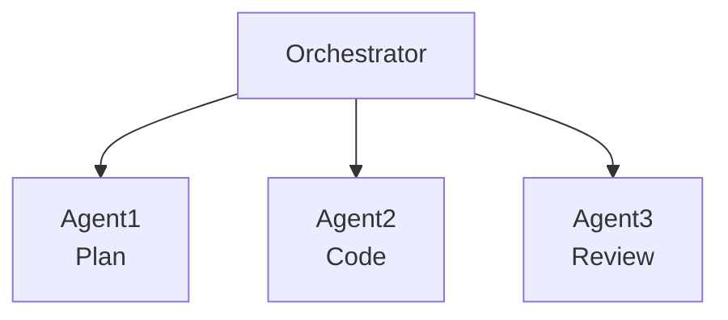
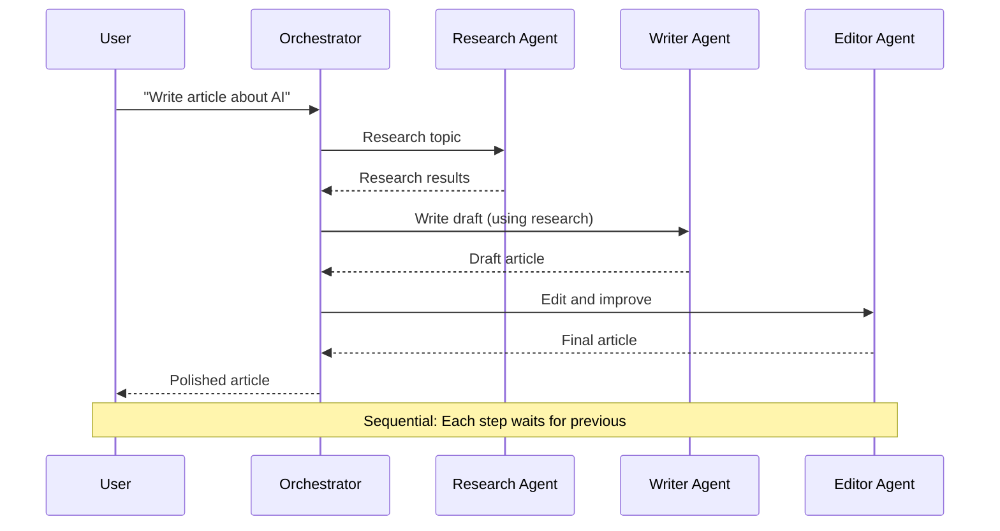
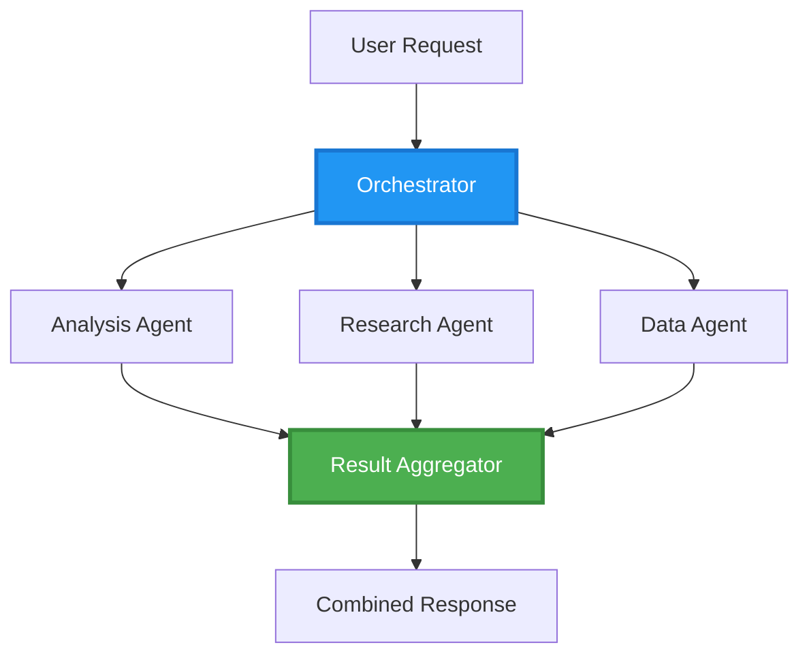
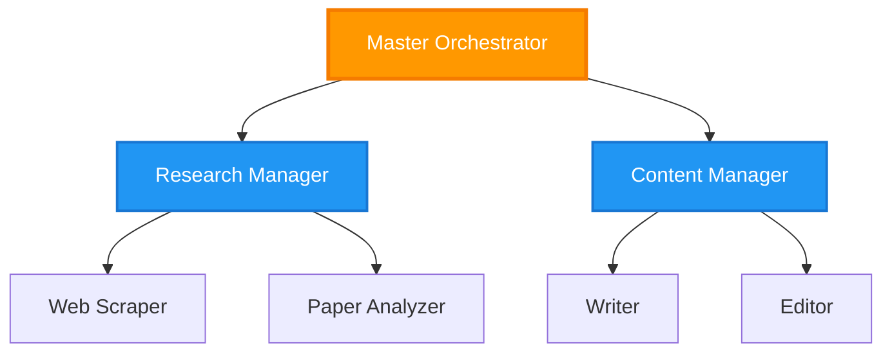
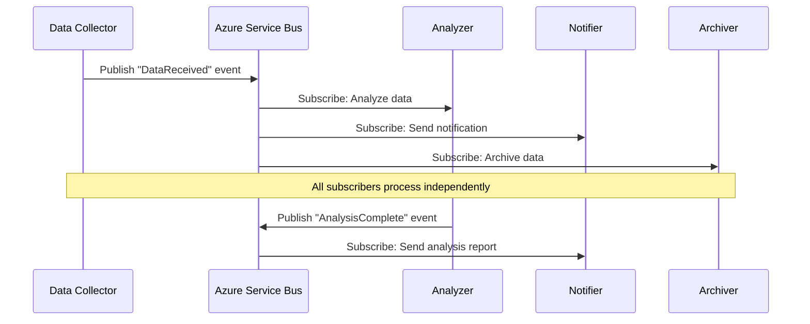
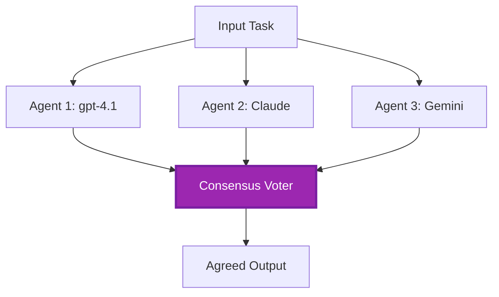
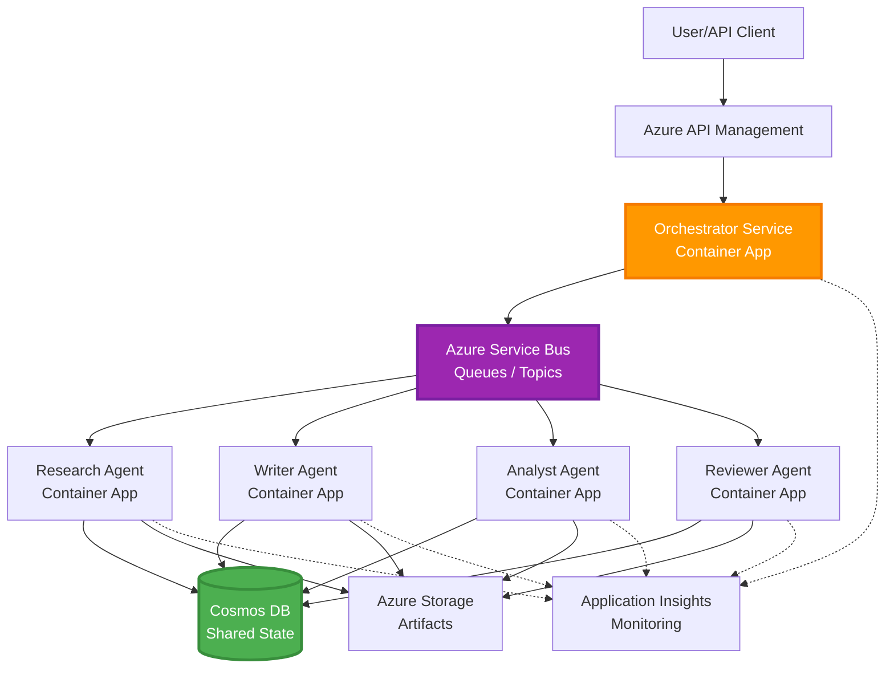

# Modele de coordonare multi-agent

⏱️ **Timp estimat**: 60-75 minute pentru lectură; câteva ore pentru implementare | 💰 **Cost estimat**: în funcție de volum de muncă | ⭐ **Complexitate**: Avansat

**📚 Parcurs de învățare:**
- ← Anterior: [Planificarea capacității](capacity-planning.md) - Strategii de dimensionare și scalare a resurselor
- 🎯 **Ești aici**: Modele de coordonare multi-agent (Orchestrare, comunicare, gestionare a stării)
- → Următor: [Selectarea SKU](sku-selection.md) - Alegerea serviciilor Azure potrivite
- 🏠 [Pagina cursului](../../README.md)

---

## Ce vei învăța

După finalizarea acestei lecții, vei:
- Înțelege **modelele de arhitectură multi-agent** și când să le folosești
- Implementa **modele de orchestrare** (centralizate, descentralizate, ierarhice)
- Proiecta strategii de **comunicare între agenți** (sincron, asincron, bazat pe evenimente)
- Gestiona **starea partajată** între agenții distribuiți
- Implementa **sisteme multi-agent** pe Azure cu AZD
- Aplică **modele de coordonare** pentru scenarii reale AI
- Monitoriza și depana sisteme distribuite de agenți

## De ce contează coordonarea multi-agent

### Evoluția: de la Agent Unic la Multi-Agent

**Agent unic (simplu):**
```
User → Agent → Response
```
- ✅ Ușor de înțeles și implementat
- ✅ Rapid pentru sarcini simple
- ❌ Limitat de capabilitățile modelului unic
- ❌ Nu poate paraleliza sarcini complexe
- ❌ Fără specializare

**Sistem multi-agent (avansat):**

- ✅ Agenți specializați pentru sarcini specifice
- ✅ Executare paralelă pentru viteză
- ✅ Modular și ușor de întreținut
- ✅ Mai bun la fluxuri de lucru complexe
- ⚠️ Necesită logică de coordonare

**Analogie**: Agentul unic e ca o singură persoană care face toate sarcinile. Sistemul multi-agent e ca o echipă unde fiecare membru are abilități specializate (cercetător, programator, recenzor, scriitor) care lucrează împreună.

---

## Modele principale de coordonare

### Model 1: Coordonare secvențială (Lanțul responsabilității)

**Când se folosește**: Sarcinile trebuie să se finalizeze într-o ordine specifică, fiecare agent construind pe baza rezultatului anterior.



**Beneficii:**
- ✅ Flux clar de date
- ✅ Ușor de depanat
- ✅ Ordine de execuție previzibilă

**Limitări:**
- ❌ Mai încet (fără paralelism)
- ❌ O singură eroare blochează întreg lanțul
- ❌ Nu poate gestiona sarcini interdependente

**Exemple de utilizare:**
- Flux de creare conținut (cercetare → scriere → editare → publicare)
- Generare cod (planificare → implementare → testare → implementare)
- Generare raport (colectare date → analiză → vizualizare → rezumat)

---

### Model 2: Coordonare paralelă (Fan-Out/Fan-In)

**Când se folosește**: Sarcini independente pot rula simultan, rezultatele se combină la final.



**Beneficii:**
- ✅ Rapid (execuție paralelă)
- ✅ Tolerant la erori (rezultate parțiale acceptabile)
- ✅ Scalabil horizontal

**Limitări:**
- ⚠️ Rezultatele pot sosi în ordine diferită
- ⚠️ Necesită logică de agregare
- ⚠️ Gestionarea stării este complexă

**Exemple de utilizare:**
- Colectare date din surse multiple (APIs + baze de date + web scraping)
- Analiză competitivă (mai multe modele generează soluții, se selectează cea mai bună)
- Servicii de traducere (traduceri simultane în mai multe limbi)

---

### Model 3: Coordonare ierarhică (Manager - Lucrător)

**Când se folosește**: Fluxuri complexe cu sub-sarcini, este necesară delegarea.



**Beneficii:**
- ✅ Gestionează fluxuri complexe
- ✅ Modular și ușor de întreținut
- ✅ Limite clare de responsabilitate

**Limitări:**
- ⚠️ Arhitectură mai complexă
- ⚠️ Latentă mai mare (mai multe straturi de coordonare)
- ⚠️ Necesită orchestrare sofisticată

**Exemple de utilizare:**
- Procesarea documentelor enterprise (clasificare → rutare → procesare → arhivare)
- Pipeline-uri de date în mai multe etape (ingestie → curățare → transformare → analiză → raport)
- Fluxuri automate complexe (planificare → alocare resurse → execuție → monitorizare)

---

### Model 4: Coordonare bazată pe evenimente (Publicare - Abonare)

**Când se folosește**: Agenții trebuie să reacționeze la evenimente, se dorește un cuplaj slab.



**Beneficii:**
- ✅ Cuplaj slab între agenți
- ✅ Ușor de adăugat noi agenți (doar se abonează)
- ✅ Procesare asincronă
- ✅ Reziliență (persistența mesajelor)

**Limitări:**
- ⚠️ Consistență eventuală
- ⚠️ Depanare complexă
- ⚠️ Provocări în ordonarea mesajelor

**Exemple de utilizare:**
- Sisteme de monitorizare în timp real (alerte, panouri, jurnale)
- Notificări multi-channel (email, SMS, push, Slack)
- Pipeline-uri de procesare date (consumatori multipli pentru aceleași date)

---

### Model 5: Coordonare bazată pe consens (Vot / Cvorum)

**Când se folosește**: Este nevoie de acordul mai multor agenți înainte de a continua.



**Beneficii:**
- ✅ Precizie mai mare (mai multe opinii)
- ✅ Tolerant la erori (eșecuri minoritare acceptabile)
- ✅ Asigurarea calității integrată

**Limitări:**
- ❌ Costisitor (apeluri multiple către modele)
- ❌ Mai lent (așteptarea tuturor agenților)
- ⚠️ Necesită rezolvare a conflictelor

**Exemple de utilizare:**
- Moderare conținut (mai multe modele analizează conținutul)
- Revizuire cod (mai mulți linteri/analizatori)
- Diagnostic medical (mai multe modele AI, validare expert)

---

## Prezentare arhitectură

### Sistem complet multi-agent pe Azure



**Componente cheie:**

| Componentă | Scop | Serviciu Azure |
|-----------|---------|---------------|
| **API Gateway** | Punct de intrare, limitare rată, autentificare | API Management |
| **Orchestrator** | Coordonează fluxurile de lucru ale agenților | Container Apps |
| **Message Queue** | Comunicare asincronă | Service Bus / Event Hubs |
| **Agenți** | Lucrători AI specializați | Container Apps / Functions |
| **State Store** | Stare partajată, urmărire sarcini | Cosmos DB |
| **Artifact Storage** | Documente, rezultate, jurnale | Blob Storage |
| **Monitoring** | Tracing distribuit, jurnale | Application Insights |

Service Bus queues/topics și Event Hubs sunt servicii diferite cu modele diferite de livrare/consum; Event Hubs nu este un înlocuitor direct pentru codul worker Service Bus de mai jos. Paralelismul, mesajele persistente și votul pe modele nu garantează singure toleranța la erori sau acuratețe mai mare.

---

## Cerințe preliminare

### Unelte necesare

```bash
# Verify Azure Developer CLI
azd version
# Command reference baseline: azd 1.37.2

# Verify Azure CLI
az --version
# ✅ Expected: azure-cli 2.50.0 or higher

# Verify Docker (for local testing)
docker --version
# ✅ Expected: Docker version 20.10 or higher
```

### Cerințe Azure

- Abonament Azure activ
- Permisiuni pentru crearea:
  - Container Apps
  - Namespace-uri Service Bus
  - Conturi Cosmos DB
  - Conturi Storage
  - Application Insights

### Cunoștințe necesare

Ar trebui să fi finalizat:
- [Managementul configurațiilor](../chapter-03-configuration/configuration.md)
- [Autentificare și securitate](../chapter-03-configuration/authsecurity.md)
- [Exemplu Microservicii](../../../../examples/microservices)

---

## Ghid de implementare

> **Fragmente de design, nu un laborator de implementare:** Arborele proiectului și etichetele `File:` de mai jos descriu fișierele de creat în propriul proiect; acest repository nu conține o aplicație `multi-agent-system` completă. Lipsesc șabloanele principale/de parametri, mediul/registrul Container Apps, Dockerfiles și blocările de dependențe, configurarea bazei și containerului Cosmos, implementări model, configurare identitate/rol, reguli de scalare și workeri/cozi paralele. Nu te aștepta ca `azd init` să genereze aceste fișiere sau `azd up` să implementeze fragmentele nemodificate. Pentru un punct de plecare executabil, finalizează [Bazele multi-agent](../chapter-05-multi-agent/multi-agent-basics.md).

**Presupuneri la runtime:** Python 3.10+, `azure-servicebus`, `azure-cosmos`, `openai`, Flask și (pentru monitorizare) `azure-monitor-opentelemetry`; pune `shared` pe calea de import Python în fiecare imagine de serviciu. Containerul Cosmos `agent-state/tasks` trebuie să existe deja cu cheia de partiționare `/id`. Conexiunile prin chei simplifică aceste fragmente, nu sunt recomandări pentru producție: preferă identități gestionate cu roluri Service Bus/Cosmos/OpenAI pe planuri de date cu acces limitat. Nu expune cheile în outputuri sau jurnale.

Livrarea Service Bus este **cel puțin o dată**. Păstrează idempotent mesajele pe sarcină **și pas**, folosește concurență optimistă (ETags) pentru citire/modificare/scriere stare, și reînnoiește blocarea mesajului în timpul procesării lungi. Simplul manager de stare de mai jos este doar secvențial și nu implementează aceste garanții de producție.

### Structura proiectului

```
multi-agent-system/
├── azure.yaml                    # AZD configuration
├── infra/
│   ├── main.bicep               # Main infrastructure
│   ├── core/
│   │   ├── servicebus.bicep     # Message queue
│   │   ├── cosmos.bicep         # State store
│   │   ├── storage.bicep        # Artifact storage
│   │   └── monitoring.bicep     # Application Insights
│   └── app/
│       ├── orchestrator.bicep   # Orchestrator service
│       └── agent.bicep          # Agent template
└── src/
    ├── orchestrator/            # Orchestration logic
    │   ├── app.py
    │   ├── workflows.py
    │   └── Dockerfile
    ├── agents/
    │   ├── research/            # Research agent
    │   ├── writer/              # Writer agent
    │   ├── analyst/             # Analyst agent
    │   └── reviewer/            # Reviewer agent
    └── shared/
        ├── state_manager.py     # Shared state logic
        └── message_handler.py   # Message handling
```

---

## Lecția 1: Modelul de coordonare secvențială

### Implementare: Pipeline de creare conținut

Hai să proiectăm un pipeline secvențial: Cercetare → Scriere → Editare. Publicarea este în afara acestui exemplu.

### 1. Configurare AZD

**Fișier: `azure.yaml`**

```yaml
name: content-pipeline
metadata:
  template: multi-agent-sequential@1.0.0

services:
  orchestrator:
    project: ./src/orchestrator
    language: python
    host: containerapp
  
  research-agent:
    project: ./src/agents/research
    language: python
    host: containerapp
  
  writer-agent:
    project: ./src/agents/writer
    language: python
    host: containerapp
  
  editor-agent:
    project: ./src/agents/editor
    language: python
    host: containerapp
```

### 2. Infrastructură: Service Bus pentru coordonare

**Fișier: `infra/core/servicebus.bicep`**

```bicep
param name string
param location string
param tags object = {}

resource serviceBusNamespace 'Microsoft.ServiceBus/namespaces@2022-10-01-preview' = {
  name: name
  location: location
  tags: tags
  sku: {
    name: 'Standard'
    tier: 'Standard'
  }
  properties: {
    minimumTlsVersion: '1.2'
  }
}

// Queue for orchestrator → research agent
resource researchQueue 'Microsoft.ServiceBus/namespaces/queues@2022-10-01-preview' = {
  parent: serviceBusNamespace
  name: 'research-tasks'
  properties: {
    maxDeliveryCount: 3
    lockDuration: 'PT5M'
    deadLetteringOnMessageExpiration: true
  }
}

// Queue for research agent → writer agent
resource writerQueue 'Microsoft.ServiceBus/namespaces/queues@2022-10-01-preview' = {
  parent: serviceBusNamespace
  name: 'writer-tasks'
  properties: {
    maxDeliveryCount: 3
    lockDuration: 'PT5M'
  }
}

// Queue for writer agent → editor agent
resource editorQueue 'Microsoft.ServiceBus/namespaces/queues@2022-10-01-preview' = {
  parent: serviceBusNamespace
  name: 'editor-tasks'
  properties: {
    maxDeliveryCount: 3
    lockDuration: 'PT5M'
  }
}

output namespace string = serviceBusNamespace.name
// Do not output RootManageSharedAccessKey. Resolve scoped credentials
// securely or use managed identity in the application and scale rules.
```

### 3. Manager stare partajată

**Fișier: `src/shared/state_manager.py`**

```python
from azure.cosmos import CosmosClient, PartitionKey
from datetime import datetime, timezone
import os

class StateManager:
    """Manages shared state across agents using Cosmos DB"""
    
    def __init__(self):
        endpoint = os.environ['COSMOS_ENDPOINT']
        key = os.environ['COSMOS_KEY']
        
        self.client = CosmosClient(endpoint, key)
        self.database = self.client.get_database_client('agent-state')
        self.container = self.database.get_container_client('tasks')
    
    def create_task(self, task_id: str, task_type: str, input_data: dict):
        """Create a new task"""
        task = {
            'id': task_id,
            'type': task_type,
            'status': 'pending',
            'input': input_data,
            'created_at': datetime.now(timezone.utc).isoformat(),
            'steps': []
        }
        self.container.create_item(task)
        return task
    
    def update_task_step(self, task_id: str, step_name: str, result: dict):
        """Update task with completed step"""
        task = self.container.read_item(task_id, partition_key=task_id)
        
        task['steps'].append({
            'name': step_name,
            'completed_at': datetime.now(timezone.utc).isoformat(),
            'result': result
        })
        
        self.container.replace_item(task_id, task)
        return task
    
    def complete_task(self, task_id: str, final_result: dict):
        """Mark task as complete"""
        task = self.container.read_item(task_id, partition_key=task_id)
        task['status'] = 'completed'
        task['result'] = final_result
        task['completed_at'] = datetime.now(timezone.utc).isoformat()
        self.container.replace_item(task_id, task)
        return task
    
    def get_task(self, task_id: str):
        """Retrieve task state"""
        return self.container.read_item(task_id, partition_key=task_id)
```

### 4. Serviciu Orchestrator

**Fișier: `src/orchestrator/app.py`**

```python
from flask import Flask, request, jsonify
from azure.servicebus import ServiceBusClient, ServiceBusMessage
import json
import uuid
import os
from shared.state_manager import StateManager

app = Flask(__name__)
state_manager = StateManager()

# Service Bus connection
servicebus_connection_str = os.environ['SERVICEBUS_CONNECTION_STRING']
servicebus_client = ServiceBusClient.from_connection_string(servicebus_connection_str)

@app.route('/health', methods=['GET'])
def health():
    return jsonify({'status': 'healthy', 'service': 'orchestrator'})

@app.route('/create-content', methods=['POST'])
def create_content():
    """
    Sequential workflow: Research → Write → Edit (returns a draft; no publishing)
    """
    data = request.get_json(silent=True) or {}
    topic = data.get('topic')
    
    if not topic:
        return jsonify({'error': 'Topic required'}), 400
    
    # Create task in state store
    task_id = str(uuid.uuid4())
    task = state_manager.create_task(
        task_id=task_id,
        task_type='content_creation',
        input_data={'topic': topic}
    )
    
    # Send message to research agent (first step)
    sender = servicebus_client.get_queue_sender('research-tasks')
    message = ServiceBusMessage(
        body=json.dumps({
            'task_id': task_id,
            'topic': topic,
            'next_queue': 'writer-tasks'  # Where to send results
        }),
        content_type='application/json'
    )
    
    with sender:
        sender.send_messages(message)
    
    return jsonify({
        'task_id': task_id,
        'status': 'started',
        'workflow': 'sequential',
        'steps': ['research', 'write', 'edit'],
        'message': 'Content creation pipeline initiated'
    }), 202

@app.route('/task/<task_id>', methods=['GET'])
def get_task_status(task_id):
    """Check task status"""
    try:
        task = state_manager.get_task(task_id)
        return jsonify(task)
    except Exception as e:
        return jsonify({'error': str(e)}), 404

if __name__ == '__main__':
    app.run(host='0.0.0.0', port=8080)
```

### 5. Agent de cercetare

**Fișier: `src/agents/research/app.py`**

```python
from azure.servicebus import ServiceBusClient, ServiceBusMessage
from openai import AzureOpenAI
import json
import os
import time
from shared.state_manager import StateManager

# Initialize clients
state_manager = StateManager()
servicebus_client = ServiceBusClient.from_connection_string(
    os.environ['SERVICEBUS_CONNECTION_STRING']
)

openai_client = AzureOpenAI(
    api_key=os.environ['AZURE_OPENAI_API_KEY'],
    api_version="2024-10-21",
    azure_endpoint=os.environ['AZURE_OPENAI_ENDPOINT']
)

def process_research_task(message_data):
    """Process research request and pass to writer"""
    task_id = message_data['task_id']
    topic = message_data['topic']
    next_queue = message_data['next_queue']
    
    print(f"🔬 Researching: {topic}")
    
    # Call Microsoft Foundry Models for research
    response = openai_client.chat.completions.create(
        model=os.environ['AZURE_OPENAI_DEPLOYMENT'],
        messages=[
            {"role": "system", "content": "You are a research assistant. Provide comprehensive research on the given topic."},
            {"role": "user", "content": f"Research this topic thoroughly: {topic}"}
        ],
        max_tokens=1500
    )
    
    research_results = response.choices[0].message.content
    
    # Update state
    state_manager.update_task_step(
        task_id=task_id,
        step_name='research',
        result={'research': research_results}
    )
    
    # Send to next agent (writer)
    sender = servicebus_client.get_queue_sender(next_queue)
    message = ServiceBusMessage(
        body=json.dumps({
            'task_id': task_id,
            'topic': topic,
            'research': research_results,
            'next_queue': 'editor-tasks'
        }),
        content_type='application/json'
    )
    
    with sender:
        sender.send_messages(message)
    
    print(f"✅ Research complete for task {task_id}")

def main():
    """Listen to research queue"""
    receiver = servicebus_client.get_queue_receiver('research-tasks')
    
    print("🔬 Research Agent started, listening for tasks...")
    
    with receiver:
        while True:
            messages = receiver.receive_messages(max_wait_time=5)
            for message in messages:
                try:
                    message_data = json.loads(str(message))
                    process_research_task(message_data)
                    receiver.complete_message(message)
                except Exception as e:
                    print(f"❌ Error processing message: {e}")
                    receiver.abandon_message(message)

if __name__ == '__main__':
    main()
```

### 6. Agent scriitor

**Fișier: `src/agents/writer/app.py`**

```python
from azure.servicebus import ServiceBusClient, ServiceBusMessage
from openai import AzureOpenAI
import json
import os
from shared.state_manager import StateManager

state_manager = StateManager()
servicebus_client = ServiceBusClient.from_connection_string(
    os.environ['SERVICEBUS_CONNECTION_STRING']
)

openai_client = AzureOpenAI(
    api_key=os.environ['AZURE_OPENAI_API_KEY'],
    api_version="2024-10-21",
    azure_endpoint=os.environ['AZURE_OPENAI_ENDPOINT']
)

def process_writing_task(message_data):
    """Write article based on research"""
    task_id = message_data['task_id']
    topic = message_data['topic']
    research = message_data['research']
    next_queue = message_data['next_queue']
    
    print(f"✍️ Writing article: {topic}")
    
    # Call Microsoft Foundry Models to write article
    response = openai_client.chat.completions.create(
        model=os.environ['AZURE_OPENAI_DEPLOYMENT'],
        messages=[
            {"role": "system", "content": "You are a professional writer. Write engaging, well-structured articles."},
            {"role": "user", "content": f"Based on this research:\n\n{research}\n\nWrite a comprehensive article about: {topic}"}
        ],
        max_tokens=2000
    )
    
    article_draft = response.choices[0].message.content
    
    # Update state
    state_manager.update_task_step(
        task_id=task_id,
        step_name='writing',
        result={'draft': article_draft}
    )
    
    # Send to editor
    sender = servicebus_client.get_queue_sender(next_queue)
    message = ServiceBusMessage(
        body=json.dumps({
            'task_id': task_id,
            'topic': topic,
            'draft': article_draft
        }),
        content_type='application/json'
    )
    
    with sender:
        sender.send_messages(message)
    
    print(f"✅ Article draft complete for task {task_id}")

def main():
    """Listen to writer queue"""
    receiver = servicebus_client.get_queue_receiver('writer-tasks')
    
    print("✍️ Writer Agent started, listening for tasks...")
    
    with receiver:
        while True:
            messages = receiver.receive_messages(max_wait_time=5)
            for message in messages:
                try:
                    message_data = json.loads(str(message))
                    process_writing_task(message_data)
                    receiver.complete_message(message)
                except Exception as e:
                    print(f"❌ Error: {e}")
                    receiver.abandon_message(message)

if __name__ == '__main__':
    main()
```

### 7. Agent editor

**Fișier: `src/agents/editor/app.py`**

```python
from azure.servicebus import ServiceBusClient
from openai import AzureOpenAI
import json
import os
from shared.state_manager import StateManager

state_manager = StateManager()
servicebus_client = ServiceBusClient.from_connection_string(
    os.environ['SERVICEBUS_CONNECTION_STRING']
)

openai_client = AzureOpenAI(
    api_key=os.environ['AZURE_OPENAI_API_KEY'],
    api_version="2024-10-21",
    azure_endpoint=os.environ['AZURE_OPENAI_ENDPOINT']
)

def process_editing_task(message_data):
    """Edit and finalize article"""
    task_id = message_data['task_id']
    topic = message_data['topic']
    draft = message_data['draft']
    
    print(f"📝 Editing article: {topic}")
    
    # Call Microsoft Foundry Models to edit
    response = openai_client.chat.completions.create(
        model=os.environ['AZURE_OPENAI_DEPLOYMENT'],
        messages=[
            {"role": "system", "content": "You are an expert editor. Improve grammar, clarity, and structure."},
            {"role": "user", "content": f"Edit and improve this article:\n\n{draft}"}
        ],
        max_tokens=2000
    )
    
    final_article = response.choices[0].message.content
    
    # Mark task as complete
    state_manager.complete_task(
        task_id=task_id,
        final_result={
            'topic': topic,
            'final_article': final_article,
            'word_count': len(final_article.split())
        }
    )
    
    print(f"✅ Article finalized for task {task_id}")

def main():
    """Listen to editor queue"""
    receiver = servicebus_client.get_queue_receiver('editor-tasks')
    
    print("📝 Editor Agent started, listening for tasks...")
    
    with receiver:
        while True:
            messages = receiver.receive_messages(max_wait_time=5)
            for message in messages:
                try:
                    message_data = json.loads(str(message))
                    process_editing_task(message_data)
                    receiver.complete_message(message)
                except Exception as e:
                    print(f"❌ Error: {e}")
                    receiver.abandon_message(message)

if __name__ == '__main__':
    main()
```

### 8. Implementare și testare

Aceste comenzi se aplică **doar după ce implementezi fișierele lipsă din proiect**. Inițializarea agentului Foundry interactiv este un flux de lucru separat; nu generează acest design Service Bus.

```bash
# In your completed custom project
azd up

# Alternative in a SEPARATE empty folder (agents beta.23 requires azd >= 1.37)
azd extension install azure.ai.agents
azd ai agent init
azd up
```

> Vezi [Comenzi AZD AI CLI](../chapter-08-production/production-ai-practices.md#azd-ai-cli-commands-and-extensions) pentru toate steagurile și opțiunile `azd ai`.

```bash
# Get orchestrator URL
ORCHESTRATOR_URL=$(azd env get-values | grep ORCHESTRATOR_URL | cut -d '=' -f2 | tr -d '"')

# Create content
curl -X POST $ORCHESTRATOR_URL/create-content \
  -H "Content-Type: application/json" \
  -d '{"topic": "The Future of AI in Healthcare"}'
```

**✅ Rezultat așteptat:**
```json
{
  "task_id": "a1b2c3d4-e5f6-7890-abcd-ef1234567890",
  "status": "started",
  "workflow": "sequential",
  "steps": ["research", "write", "edit"],
  "message": "Content creation pipeline initiated"
}
```

**Verifică progresul sarcinii:**
```bash
TASK_ID="a1b2c3d4-e5f6-7890-abcd-ef1234567890"
curl $ORCHESTRATOR_URL/task/$TASK_ID
```

**✅ Rezultat așteptat (finalizat):**
```json
{
  "id": "a1b2c3d4-e5f6-7890-abcd-ef1234567890",
  "type": "content_creation",
  "status": "completed",
  "steps": [
    {
      "name": "research",
      "completed_at": "2025-11-19T10:30:00Z",
      "result": {"research": "..."}
    },
    {
      "name": "writing",
      "completed_at": "2025-11-19T10:32:00Z",
      "result": {"draft": "..."}
    }
  ],
  "result": {
    "topic": "The Future of AI in Healthcare",
    "final_article": "...",
    "word_count": 1500
  }
}
```

---

## Lecția 2: Modelul de coordonare paralelă

### Implementare: Agregator de cercetare multi-surse

Hai să construim un sistem paralel care colectează informații din mai multe surse simultan.

### Orchestrator paralel

**Fișier: `src/orchestrator/parallel_workflow.py`**

```python
from flask import Flask, request, jsonify
from azure.servicebus import ServiceBusClient, ServiceBusMessage
import json
import uuid
import os
from shared.state_manager import StateManager

app = Flask(__name__)
state_manager = StateManager()

servicebus_client = ServiceBusClient.from_connection_string(
    os.environ['SERVICEBUS_CONNECTION_STRING']
)

@app.route('/research-parallel', methods=['POST'])
def research_parallel():
    """
    Parallel workflow: Multiple agents work simultaneously
    """
    data = request.json
    query = data.get('query')
    
    task_id = str(uuid.uuid4())
    task = state_manager.create_task(
        task_id=task_id,
        task_type='parallel_research',
        input_data={
            'query': query,
            'agents': ['web', 'academic', 'news', 'social']
        }
    )
    
    # Fan-out: publish sequentially; workers may process concurrently.
    agents = [
        ('web-research-queue', 'web'),
        ('academic-research-queue', 'academic'),
        ('news-research-queue', 'news'),
        ('social-research-queue', 'social')
    ]
    
    for queue_name, agent_type in agents:
        sender = servicebus_client.get_queue_sender(queue_name)
        message = ServiceBusMessage(
            body=json.dumps({
                'task_id': task_id,
                'query': query,
                'agent_type': agent_type,
                'result_queue': 'aggregation-queue'
            }),
            content_type='application/json'
        )
        
        with sender:
            sender.send_messages(message)
    
    return jsonify({
        'task_id': task_id,
        'status': 'started',
        'workflow': 'parallel',
        'agents_dispatched': 4,
        'message': 'Parallel research initiated'
    }), 202

if __name__ == '__main__':
    app.run(host='0.0.0.0', port=8080)
```

### Logică de agregare

**Fișier: `src/agents/aggregator/app.py`**

```python
from azure.servicebus import ServiceBusClient
import json
import os
from collections import defaultdict
from shared.state_manager import StateManager

state_manager = StateManager()
servicebus_client = ServiceBusClient.from_connection_string(
    os.environ['SERVICEBUS_CONNECTION_STRING']
)

# Single-process demo only: not durable or shared across replicas.
# Production: use durable unique (task_id, agent_type) result records.
task_results = defaultdict(dict)
expected_agents = 4  # web, academic, news, social

def process_result(message_data):
    """Aggregate results from parallel agents"""
    task_id = message_data['task_id']
    agent_type = message_data['agent_type']
    result = message_data['result']
    
    # Store result
    task_results[task_id][agent_type] = {
        'agent': agent_type,
        'data': result
    }
    
    print(f"📊 Received result from {agent_type} agent ({len(task_results[task_id])}/{expected_agents})")
    
    # Check if all agents completed (fan-in)
    if len(task_results[task_id]) == expected_agents:
        print(f"✅ All agents completed for task {task_id}. Aggregating...")
        
        # Combine results
        aggregated = {
            'query': message_data['query'],
            'sources': list(task_results[task_id].values()),
            'summary': generate_summary(list(task_results[task_id].values()))
        }
        
        # Mark complete
        state_manager.complete_task(task_id, aggregated)
        
        # Clean up
        del task_results[task_id]
        
        print(f"✅ Aggregation complete for task {task_id}")

def generate_summary(results):
    """Generate summary from all sources"""
    summaries = [r['data'].get('summary', '') for r in results]
    return '\n\n'.join(summaries)

def main():
    """Listen to aggregation queue"""
    receiver = servicebus_client.get_queue_receiver('aggregation-queue')
    
    print("📊 Aggregator started, listening for results...")
    
    with receiver:
        while True:
            messages = receiver.receive_messages(max_wait_time=5)
            for message in messages:
                try:
                    message_data = json.loads(str(message))
                    process_result(message_data)
                    receiver.complete_message(message)
                except Exception as e:
                    print(f"❌ Error: {e}")
                    receiver.abandon_message(message)

if __name__ == '__main__':
    main()
```

**Beneficiile modelului paralel:**
- ⚡ **Potrivit pentru latență mai mică** (limitata de cel mai lent worker plus suprasarcină de coordonare)
- 🔄 **Poate susține rezultate parțiale** cu termene explicite și politică de eșec (neimplementată de agregatorul de bază)
- 📈 **Scalabil** (adaugă ușor mai mulți agenți)

---

## Exerciții practice

### Exercițiul 1: Adaugă gestionare timeout ⭐⭐ (Mediu)

**Scop**: Implementează logica de timeout astfel încât agregatorul să nu aștepte la nesfârșit agenți lenți.

**Punct de plecare:** Rulează această simulare locală de termen-limită înainte de a o integra într-un worker de coadă. Un timeout verificat doar când sosește alt mesaj nu se declanșează dacă workerul lipsă nu trimite nimic.

**Pași**:

1. **Adaugă urmărirea timeout-ului la agregator:**

```python
import asyncio

async def simulated_agent(name, delay):
    await asyncio.sleep(delay)
    return {'agent': name, 'result': 'done'}

async def main():
    tasks = [asyncio.create_task(simulated_agent(name, delay))
             for name, delay in [('web', 0.1), ('academic', 0.2),
                                 ('news', 0.3), ('social', 3)]]
    done, pending = await asyncio.wait(tasks, timeout=1)
    results = [task.result() for task in done]
    for task in pending:
        task.cancel()
    await asyncio.gather(*pending, return_exceptions=True)
    print({'completed_agents': len(results), 'timed_out': bool(pending)})
    assert len(results) == 3 and pending

asyncio.run(main())
```

2. **Rezultat așteptat:**

```text
{'completed_agents': 3, 'timed_out': True}
```

3. **Integrare sistem coadă (sarcină de design):** Păstrează deadline-ul dispecerat și agenții așteptați la crearea sarcinii, rulează sweep periodic de deadline independent de rezultatele sosite, finalizează atomic rezultatele parțiale, și ignoră mesaje întârziate/duplicate pentru sarcini finalizate. Un timeout local nu anulează workerii remoti.

Pentru proiectul tău implementat doar:

```bash
azd deploy aggregator

# Submit task
curl -X POST $ORCHESTRATOR_URL/research-parallel \
  -H "Content-Type: application/json" \
  -d '{"query": "AI safety research"}'

# Check results after 30 seconds
curl $ORCHESTRATOR_URL/task/$TASK_ID
```

**✅ Criterii de succes:**
- ✅ Testul local se termină după un termen-limită de o secundă, chiar dacă un agent nu este complet
- ✅ Răspunsul indică rezultate parțiale (`"timed_out": true`)
- ✅ Se returnează rezultatele disponibile (3 din 4 agenți)

**Timp**: 20-25 minute

---

### Exercițiul 2: Implementează logică de retry ⭐⭐⭐ (Avansat)

**Scop**: Reîncearcă automat sarcinile agenților eșuate înainte de a renunța.

**Pași**:

1. **Folosește numărul de livrări Service Bus în loc de contori de retry personalizați pentru reintroducerea în coadă:**

```python
import json
import time
# Integration fragment: use a live peek-lock ServiceBusReceiver.
# Set queue maxDeliveryCount to 4 for one attempt + up to three retries.
```

2. **Adaugă handler de retry agenților:**

```python
def process_with_retry(message, receiver, process_func):
    """Process message with automatic retry on failure"""
    try:
        message_data = json.loads(str(message))
        
        # Process the message
        process_func(message_data)
        
        # Success - complete
        receiver.complete_message(message)
        
    except Exception as e:
        if message.delivery_count < 4:
            # Bounded exponential delay: 5s, 10s, 20s.
            # Renew the lock if processing + waiting can exceed its duration.
            time.sleep(5 * 2 ** (message.delivery_count - 1))
            receiver.abandon_message(message)
        else:
            # Max retries exceeded - move to dead letter queue
            print(f"❌ Max attempts exceeded for message {message.message_id}")
            receiver.dead_letter_message(
                message,
                reason="MaxRetriesExceeded",
                error_description=str(e)
            )
```

3. **Monitorizează coada de mesaje nereușite (dead letter queue):**

```python
def monitor_dead_letters():
    """Check dead letter queue for failed messages"""
    receiver = servicebus_client.get_queue_receiver(
        'research-tasks',
        sub_queue='deadletter'
    )
    
    with receiver:
        messages = receiver.receive_messages(max_wait_time=5)
        for message in messages:
            print(f"☠️ Dead letter: {message.message_id}")
            print(f"Reason: {message.dead_letter_reason}")
            print(f"Description: {message.dead_letter_error_description}")
```

**✅ Criterii de succes:**
- ✅ Sarcinile eșuate se reîncearcă automat (până la 3 ori)
- ✅ Backoff exponențial între reîncercări (5s, 10s, 20s), cu reînnoire blocare mesaj unde este necesar
- ✅ După max. reîncercări, mesajele merg în coada dead letter
- ✅ Mesajele dead letter pot fi inspectate; rejucarea necesită workflow de recuperare idempotent separat

**Timp**: 30-40 minute

---

### Exercițiul 3: Implementează Circuit Breaker ⭐⭐⭐ (Avansat)

**Scop**: Previne căderile în cascadă oprind cererile către agenți care eșuează.

**Pași**:

1. **Creează clasa circuit breaker:**

```python
from enum import Enum
from datetime import datetime, timedelta, timezone

class CircuitState(Enum):
    CLOSED = "closed"      # Normal operation
    OPEN = "open"          # Failing, reject requests
    HALF_OPEN = "half_open"  # Testing if recovered

class CircuitBreaker:
    def __init__(self, failure_threshold=5, timeout_seconds=60):
        self.failure_threshold = failure_threshold
        self.timeout_seconds = timeout_seconds
        self.failure_count = 0
        self.last_failure_time = None
        self.state = CircuitState.CLOSED
    
    def call(self, func):
        """Execute function with circuit breaker protection"""
        if self.state == CircuitState.OPEN:
            # Check if timeout expired
            if datetime.now(timezone.utc) - self.last_failure_time > timedelta(seconds=self.timeout_seconds):
                self.state = CircuitState.HALF_OPEN
                print("🔄 Circuit breaker: HALF_OPEN (testing)")
            else:
                raise Exception(f"Circuit breaker OPEN for agent. Try again in {self.timeout_seconds}s")
        
        try:
            result = func()
            
            # Success
            self.failure_count = 0 # Count consecutive failures only
            if self.state == CircuitState.HALF_OPEN:
                self.state = CircuitState.CLOSED
                self.failure_count = 0
                print("✅ Circuit breaker: CLOSED (recovered)")
            
            return result
            
        except Exception as e:
            self.failure_count += 1
            self.last_failure_time = datetime.now(timezone.utc)
            
            if self.failure_count >= self.failure_threshold:
                self.state = CircuitState.OPEN
                print(f"🔴 Circuit breaker: OPEN (too many failures)")
            
            raise
```

2. **Aplică la apelurile agenților:**

```python
# In orchestrator
agent_circuits = {
    'web': CircuitBreaker(failure_threshold=5, timeout_seconds=60),
    'academic': CircuitBreaker(failure_threshold=5, timeout_seconds=60),
    'news': CircuitBreaker(failure_threshold=5, timeout_seconds=60),
    'social': CircuitBreaker(failure_threshold=5, timeout_seconds=60)
}

def send_to_agent(agent_type, message_data):
    """Send with circuit breaker protection"""
    circuit = agent_circuits[agent_type]
    
    try:
        circuit.call(lambda: send_message(agent_type, message_data))
    except Exception as e:
        print(f"⚠️ Skipping {agent_type} agent: {e}")
        # Continue with other agents
```

Acest circuit protejează **operațiunea de trimitere**, nu finalizarea de către lucrătorul la distanță: înscrierea cu succes a unui mesaj în coadă nu spune nimic despre dacă un agent este activ. `send_message` este funcția de expeditor a aplicației tale. Pentru circuitele de execuție, introdu eșecurile/timeout-urile observate ale sarcinii într-un coordonator durabil. Această clasă din memorie este o demonstrație single-thread, nu un circuit breaker distribuit.

3. **Testează circuit breaker local:**

```python
# Run after the class definition; no Azure changes required.
circuit = CircuitBreaker(failure_threshold=5, timeout_seconds=0)
def fail():
    raise RuntimeError("simulated failure")
for _ in range(5):
    try:
        circuit.call(fail)
    except RuntimeError:
        pass
assert circuit.state == CircuitState.OPEN
assert circuit.call(lambda: "recovered") == "recovered"
assert circuit.state == CircuitState.CLOSED
print("Circuit breaker recovery verified")
```

**✅ Criterii de succes:**
- ✅ După 5 eșecuri, circuitul se deschide (respinge cererile)
- ✅ După 60 de secunde, circuitul devine semi-deschis (testează recuperarea)
- ✅ Alți agenți continuă să funcționeze normal
- ✅ Circuitul se închide automat când agentul se recuperează

**Timp:** 40-50 minute

---

## Monitorizare și depanare

### Tracing Distribuit cu Application Insights

**Fișier: `src/shared/tracing.py`**

```python
from azure.monitor.opentelemetry import configure_azure_monitor
from opentelemetry import trace
from opentelemetry.trace import SpanKind
import logging
import os

connection_string = os.environ.get('APPLICATIONINSIGHTS_CONNECTION_STRING')

# Configure once per process. Message send/receive trace-context propagation
# and agent attributes on exceptions need explicit instrumentation.
if connection_string:
    configure_azure_monitor(connection_string=connection_string, logger_name=__name__)
tracer = trace.get_tracer(__name__)

# Configure logging
logger = logging.getLogger(__name__)
logger.setLevel(logging.INFO)

def trace_agent_call(agent_name, task_id, operation_name, operation):
    """Trace agent operations"""
    with tracer.start_as_current_span(f'agent.{agent_name}.{operation_name}', kind=SpanKind.CLIENT) as span:
        span.set_attribute('agent', agent_name)
        span.set_attribute('task_id', task_id)
        span.set_attribute('operation', operation_name)
        
        try:
            result = operation()
            span.set_attribute('status', 'success')
            logger.info('Agent operation completed', extra={
                'agent': agent_name, 'task_id': task_id, 'operation': operation_name
            })
            return result
        except Exception as e:
            span.set_attribute('status', 'error')
            logger.exception('Agent operation failed', extra={
                'agent': agent_name, 'task_id': task_id, 'operation': operation_name
            })
            raise
```

### Interogări Application Insights

**Urmărește fluxurile de lucru multi-agent:**

```kusto
// Trace complete workflow for a task
traces
| where customDimensions.task_id == "a1b2c3d4-..."
| project timestamp, message, customDimensions.agent, customDimensions.operation
| order by timestamp asc
```

**Compararea performanței agenților:**

```kusto
// Compare agent execution times
dependencies
| where name contains "agent"
| summarize 
    avg_duration = avg(duration),
    p95_duration = percentile(duration, 95),
    count = count()
  by agent = tostring(customDimensions.agent)
| order by avg_duration desc
```

**Analiza eșecurilor:**

```kusto
// Find which agents fail most
exceptions
| where customDimensions.agent != ""
| summarize 
    failure_count = count(),
    unique_errors = dcount(outerMessage)
  by agent = tostring(customDimensions.agent)
| order by failure_count desc
```

---

## Analiza Costurilor

### Costurile Sistemului Multi-Agent (Estimări lunare)

Numere ilustrative pentru planificare, nu oferte: suma de mai jos este **240-565$/lună**. Verifică tarifele regionale curente, orele active/inactive ale replicilor, mixul de tokeni input/output, stocarea și telemetria. Serverless nu are un minim de debit alocat, dar facturează cererile și stocarea.

| Componentă | Configurație | Cost |
|-----------|--------------|------|
| **Orchestrator** | 1 Container App (1 vCPU, 2GB) | 30-50$ |
| **4 Agenți** | 4 Container Apps (0.5 vCPU, 1GB fiecare) | 60-120$ |
| **Service Bus** | Nivel Standard, 10M mesaje | 10-20$ |
| **Cosmos DB** | Serverless, 5GB stocare, 1M RU | 25-50$ |
| **Blob Storage** | 10GB stocare, 100K operațiuni | 5-10$ |
| **Application Insights** | 5GB ingestie | 10-15$ |
| **Microsoft Foundry Models** | gpt-4.1, 10M tokeni | 100-300$ |
| **Total** | | **240-565$/lună** |

### Strategii de Optimizare a Costurilor

1. **Folosește serverless unde este posibil:**
   ```bicep
   // Cosmos DB serverless (no minimum cost)
   properties: {
     databaseAccountOfferType: 'Standard'
     capabilities: [{ name: 'EnableServerless' }]
   }
   ```

2. **Scalează agenții la zero când sunt inactivi:**
   ```bicep
   scale: {
     minReplicas: 0  // Requires a Service Bus/KEDA scale rule to wake workers
     maxReplicas: 10
   }
   ```

3. **Folosește batching pentru Service Bus:**
   ```python
   # Send messages in batches (cheaper)
   sender.send_messages([message1, message2, message3])
   ```

4. **Cache pentru rezultatele utilizate frecvent:**
   ```python
   # Use Azure Cache for Redis
   if cache.exists(query_hash):
       return cache.get(query_hash)
   ```

---

## Cele Mai Bune Practici

### ✅ FAC:

1. **Folosește operațiuni idempotente**
   ```python
   # Pseudocode: implement a durable, atomic per-step deduplication claim.
   def process_task(task_id):
       raise NotImplementedError("Claim (task_id, step) atomically, execute, persist outcome")
   ```

2. **Implementarea unei jurnalizări cuprinzătoare**
   ```python
   logger.info(f"Agent: {agent_name}, Task: {task_id}, Action: {action}")
   ```

3. **Folosește ID-uri de corelare**
   ```python
   # Pass task_id through entire workflow
   message_data = {
       'task_id': task_id,  # Correlation ID
       'timestamp': datetime.utcnow().isoformat()
   }
   ```

4. **Setează TTL (time-to-live) pentru mesaje**
   ```bicep
   properties: {
     defaultMessageTimeToLive: 'PT1H'  // 1 hour max
   }
   ```

5. **Monitorizează cozile dead letter**
   ```python
   # Regular monitoring of failed messages
   monitor_dead_letters()
   ```

### ❌ NU FACE:

1. **Nu crea dependențe circulare**
   ```python
   # ❌ BAD: Agent A → Agent B → Agent A (infinite loop)
   # ✅ GOOD: Define clear directed acyclic graph (DAG)
   ```

2. **Nu bloca firele agentului**
   ```python
   # ❌ BAD: Synchronous wait
   while not task_complete:
       time.sleep(1)
   
   # ✅ GOOD: Use message queue callbacks
   ```

3. **Nu ignora eșecurile parțiale**
   ```python
   # ❌ BAD: Fail entire workflow if one agent fails
   # ✅ GOOD: Return partial results with error indicators
   ```

4. **Nu folosi retrieri infinite**
   ```python
   # ❌ BAD: retry forever
   # ✅ GOOD: max_retries = 3, then dead letter
   ```

---

## Ghid de Depanare

### Problema: Mesaje blocate în coadă

**Simptome:**
- Mesajele se acumulează în coadă
- Agenții nu procesează
- Starea sarcinii rămâne "în așteptare"

**Diagnoză:**
```bash
# Check queue depth
az servicebus queue show \
  --resource-group "$RG_NAME" \
  --namespace-name mybus \
  --name research-tasks \
  --query "countDetails"

# Check agent logs using Azure CLI
az containerapp logs show --name research-agent --resource-group $RG_NAME --tail 50
```

**Soluții:**

1. **Crește replicile agentului:**
   ```bash
   az containerapp update \
     --resource-group "$RG_NAME" \
     --name research-agent \
     --min-replicas 3 \
     --max-replicas 10
   ```

2. **Verifică coada dead letter:**
   ```bash
   az servicebus queue show \
     --resource-group "$RG_NAME" \
     --namespace-name mybus \
     --name research-tasks \
     --query "countDetails.deadLetterMessageCount"
   ```

---

### Problema: Timeout sarcină/nu se finalizează niciodată

**Simptome:**
- Starea sarcinii rămâne "în progres"
- Unii agenți finalizează, alții nu
- Fără mesaje de eroare

**Diagnoză:**
```bash
# Check task state
curl $ORCHESTRATOR_URL/task/$TASK_ID

# Check Application Insights
# Run query: traces | where customDimensions.task_id == "..."
```

**Soluții:**

1. **Implementează timeout în agregator (Exercițiul 1)**

2. **Verifică eșecurile agenților folosind Azure Monitor:**
   ```bash
   # View logs via azd monitor
   azd monitor --logs
   
   # Or use Azure CLI to check specific container app logs
   az containerapp logs show --name <agent-name> --resource-group $RG_NAME --follow | grep "ERROR\|FAIL"
   ```

3. **Verifică dacă toți agenții rulează:**
   ```bash
   az containerapp list \
     --resource-group rg-agents \
     --query "[].{name:name, status:properties.runningStatus}"
   ```

---

## Află Mai Multe

### Documentație Oficială
- [Azure Service Bus](https://learn.microsoft.com/azure/service-bus-messaging/service-bus-messaging-overview)
- [Cosmos DB](https://learn.microsoft.com/azure/cosmos-db/introduction)
- [Container Apps DAPR](https://learn.microsoft.com/azure/container-apps/dapr-overview)
- [Pattern-uri de Orchestrare AI Agent](https://learn.microsoft.com/azure/architecture/ai-ml/guide/ai-agent-design-patterns)

### Următorii Pași în Curs
- ← Anterior: [Planificarea Capacității](capacity-planning.md)
- → Următor: [Selecția SKU](sku-selection.md)
- 🏠 [Acasă Curs](../../README.md)

### Exemple Relaționate
- [Exemplu Microservicii](../../../../examples/microservices) - Pattern-uri de comunicare a serviciilor
- [Exemplu Microsoft Foundry Models](../../../../examples/azure-openai-chat) - Integrare AI

---

## Rezumat

**Ai învățat:**
- ✅ Cinci pattern-uri de coordonare (secuențial, paralel, ierarhic, bazat pe evenimente, consens)
- ✅ Arhitectură multi-agent pe Azure (Service Bus, Cosmos DB, Container Apps)
- ✅ Managementul stării în agenți distribuiți
- ✅ Tratarea timeout-urilor, retrierilor și circuit breaker-elor
- ✅ Monitorizarea și depanarea sistemelor distribuite
- ✅ Strategii de optimizare a costurilor

**Concluzii Cheie:**
1. **Alege pattern-ul potrivit** - Secvențial pentru fluxuri ordonate, paralel pentru viteză, bazat pe evenimente pentru flexibilitate
2. **Gestionează starea cu grijă** - Folosește Cosmos DB sau similar pentru stare partajată
3. **Gestionează eșecurile cu eleganță** - Timeout-uri, retrieri, circuit breaker-e, cozi dead letter
4. **Monitorizează totul** - Tracing distribuit este esențial pentru depanare
5. **Optimizează costurile** - Scalează la zero, folosește serverless, implementează caching

**Următorii Pași:**
1. Finalizează exercițiile practice
2. Construiește un sistem multi-agent pentru cazul tău de utilizare
3. Studiază [Selecția SKU](sku-selection.md) pentru optimizarea performanței și costului

---

<!-- CO-OP TRANSLATOR DISCLAIMER START -->
**Declinare a responsabilității**:
Acest document a fost tradus folosind serviciul de traducere AI [Co-op Translator](https://github.com/Azure/co-op-translator). În timp ce ne străduim pentru acuratețe, vă rugăm să rețineți că traducerile automate pot conține erori sau inexactități. Documentul original în limba sa nativă trebuie considerat sursa autorizată. Pentru informații critice, se recomandă traducerea profesională realizată de un om. Nu ne asumăm responsabilitatea pentru eventualele neînțelegeri sau interpretări greșite care decurg din utilizarea acestei traduceri.
<!-- CO-OP TRANSLATOR DISCLAIMER END -->