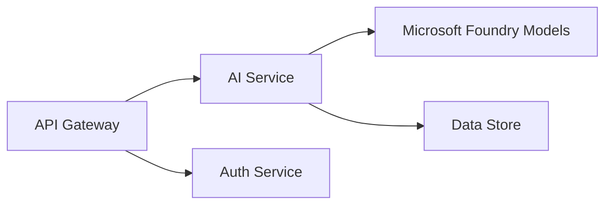
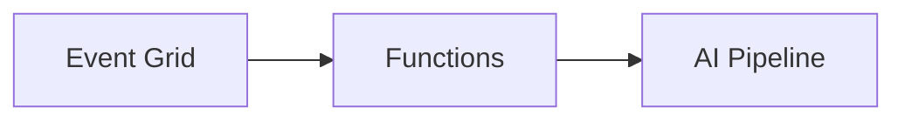

# Capitolul 8: Modele pentru Producție & Întreprinderi

**📚 Curs**: [AZD pentru Începători](../../README.md) | **⏱️ Durata**: 2-3 ore | **⭐ Complexitate**: Avansat

---

## Prezentare generală

Acest capitol acoperă modele de implementare pregătite pentru întreprindere, consolidarea securității, monitorizarea și optimizarea costurilor pentru sarcini AI de producție.

Acesta este un reper arhitectural, nu un șablon complet de producție implementabil. Exemplele omit detaliile de integrare care trebuie furnizate și testate în propria aplicație; citirea listei de verificare nu certifică pregătirea pentru producție.

> **Revizuire lansare (2026-11-04):** Ghidul AI CLI a fost verificat față de documentația/sursa `azd 1.37.2`, agenți `1.0.0-beta.23` și evaluări `1.0.0-beta.2`. Consultați [modificările și corecțiile de lansare](production-ai-practices.md#recent-release-changes-and-fixes) pentru cerințe de compatibilitate și detalii de migrare; aceasta nu este o validare în timp real a implementării.

## Obiectivele învățării

Prin finalizarea acestui capitol, veți putea:
- Implementa aplicații rezistente multi-regiune
- Implementa modele de securitate pentru întreprindere
- Configura monitorizare cuprinzătoare
- Optimiza costurile la scară
- Configura pipeline-uri CI/CD cu AZD

---

## 📚 Lecții

| # | Lecție | Descriere | Durată |
|---|--------|-------------|------|
| 1 | [Practici AI de producție](production-ai-practices.md) | Modele de implementare pentru întreprinderi | 90 min |

---

## 🚀 Lista de verificare pentru producție

- [ ] Implementare multi-regiune pentru reziliență
- [ ] Identitate gestionată pentru autentificare (fără chei)
- [ ] Application Insights pentru monitorizare
- [ ] Bugete de cost și alerte configurate
- [ ] Scanare de securitate activată
- [ ] Integrare pipeline CI/CD
- [ ] Plan de recuperare în caz de dezastru

---

## 🏗️ Modele arhitecturale

### Model 1: Microservicii AI



### Model 2: AI bazat pe evenimente



---

## 🔐 Cele mai bune practici de securitate

```bicep
// Illustrative properties from different resources, NOT a standalone Bicep file.
// Attach identity to the application host:
identity: {
  type: 'SystemAssigned'
}

// AI account properties (also require private endpoints, DNS and app connectivity):
properties: {
  publicNetworkAccess: 'Disabled'
  networkAcls: {
    defaultAction: 'Deny'
  }
}
```

---

## 💰 Optimizarea costurilor

| Strategie | Principala constrângere |
|----------|---------|
| Scalare la zero (Container Apps) | Necesită un declanșator adecvat; alte servicii generează totuși costuri |
| Utilizare nivel de consum pentru dev | Comparați prețurile serviciului selectat și încărcarea de muncă |
| Scalare programată | Scăderea prin infrastructură/automatizare suportată |
| Rezervări/capacitate asigurată | Doar când este suportat; angajamentele pot crește costurile în perioadele de inactivitate |

Utilizați [modelul complet pentru buget](production-ai-practices.md#2-cost-monitoring-and-budgets) cu o dată validă de început, domeniu de facturare, destinatari și permisiuni. Un buget trimite alerte; nu limitează cheltuielile. Economiile depind de utilizarea măsurată și nu sunt procente garantate.

---

## 📊 Configurarea monitorizării

```bash
# Open the Application Insights logs view (requires configured monitoring)
azd monitor --logs

# Check Application Insights
azd monitor --overview

# View metrics
az monitor metrics list --resource <resource-id>
```

---

## 🔗 Navigare

| Direcție | Capitol |
|-----------|---------|
| **Anterior** | [Capitolul 7: Depanare](../chapter-07-troubleshooting/README.md) |
| **Curs finalizat** | [Pagina principală a cursului](../../README.md) |

---

## 📖 Resurse conexe

- [Ghid agenți AI](../chapter-02-ai-development/agents.md)
- [Application Insights](../chapter-06-pre-deployment/application-insights.md)
- [Soluții Multi-Agent](../chapter-05-multi-agent/README.md)
- [Exemplu Microservicii](../../examples/microservices/README.md)

---

<!-- CO-OP TRANSLATOR DISCLAIMER START -->
**Declinare a responsabilității**:
Acest document a fost tradus folosind serviciul de traducere AI [Co-op Translator](https://github.com/Azure/co-op-translator). În timp ce ne străduim pentru acuratețe, vă rugăm să rețineți că traducerile automate pot conține erori sau inexactități. Documentul original în limba sa nativă trebuie considerat sursa autorizată. Pentru informații critice, se recomandă traducerea profesională realizată de un om. Nu ne asumăm responsabilitatea pentru eventualele neînțelegeri sau interpretări greșite care decurg din utilizarea acestei traduceri.
<!-- CO-OP TRANSLATOR DISCLAIMER END -->