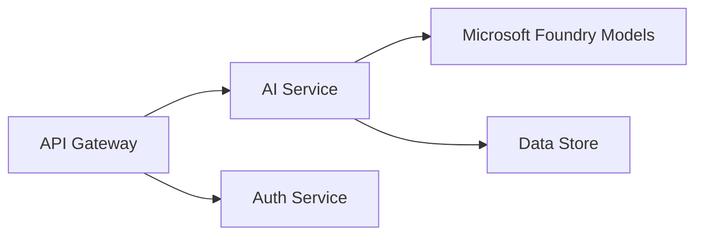
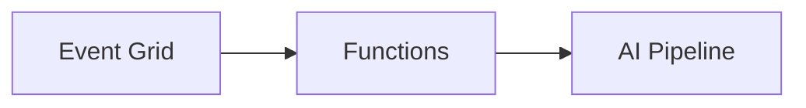

# Capitolul 8: Modele de Producție și Enterprise

**📚 Curs**: [AZD Pentru Începători](../../README.md) | **⏱️ Durată**: 2-3 ore | **⭐ Complexitate**: Avansat

---

## Prezentare generală

Acest capitol acoperă modele de implementare pregătite pentru mediul enterprise, întărirea securității, monitorizarea și optimizarea costurilor pentru sarcini AI în producție.

Acesta este un referențial arhitectural, nu un șablon complet de producție deployabil. Exemplele omit detalii de integrare care trebuie furnizate și testate în propria dvs. aplicație; parcurgerea listei de verificare nu certifică pregătirea pentru producție.

> **Actualizare Foundry GA (2026-11-09):** Folosiți `azd >= 1.37.0` și pachetul `microsoft.foundry` 1.0 disponibil în mod general pentru fluxul de lucru Foundry; evaluările se instalează separat. Consultați [scopul lansării și migrarea](production-ai-practices.md#recent-release-changes-and-fixes) și [exemplul de pipeline autentificat](production-ai-practices.md#cicd-pipeline-configuration). Aceasta este o revizuire a documentației, nu o validare în timp real a implementării sau un statut general GA pentru funcționalități opționale în previzualizare.

## Obiectivele de învățare

Parcurgând acest capitol, veți:
- Implementa aplicații reziliente multi-regiune
- Implementa modele enterprise de securitate
- Configura monitorizare cuprinzătoare
- Optimiza costurile la scară
- Configura pipeline-uri CI/CD cu AZD

---

## 📚 Lecții

| # | Lecție | Descriere | Timp |
|---|--------|-------------|------|
| 1 | [Practici AI de Producție](production-ai-practices.md) | Modele de implementare enterprise | 90 min |

---

## 🚀 Lista de verificare pentru producție

- [ ] Implementare multi-regiune pentru reziliență
- [ ] Identitate gestionată pentru autentificare (fără chei)
- [ ] Application Insights pentru monitorizare
- [ ] Bugete de cost și alerte configurate
- [ ] Scanare de securitate activată
- [ ] Integrare pipeline CI/CD
- [ ] Plan de recuperare după dezastru

---

## 🏗️ Modele arhitecturale

### Model 1: Microservicii AI



### Model 2: AI Event-Driven



---

## 🔐 Cele mai bune practici de securitate

```bicep
// Illustrative properties from different resources, NOT a standalone Bicep file.
// Attach identity to the application host:
identity: {
  type: 'SystemAssigned'
}

// AI account properties (also require private endpoints, DNS and app connectivity):
properties: {
  publicNetworkAccess: 'Disabled'
  networkAcls: {
    defaultAction: 'Deny'
  }
}
```

---

## 💰 Optimizarea costurilor

| Strategie | Principala constrângere |
|----------|---------|
| Scalare la zero (Container Apps) | Necesită un declanșator potrivit; alte servicii încă generează costuri |
| Folosirea nivelurilor de consum pentru dezvoltare | Comparați prețurile serviciului selecționat și sarcina de lucru |
| Scalare programată | Scalați prin infrastructură/automatizare acceptată |
| Rezervări/capacitate provizionată | Doar dacă este acceptată; angajamentele pot crește costurile inactivității |

Folosiți [modelul complet de buget pentru resurse](production-ai-practices.md#2-cost-monitoring-and-budgets) cu o dată de început validă, domeniul facturării, destinatarii și permisiunile. Un buget trimite alerte; nu limitează cheltuielile. Economiile depind de utilizarea măsurată și nu sunt procente garantate.

---

## 📊 Configurare monitorizare

```bash
# Open the Application Insights logs view (requires configured monitoring)
azd monitor --logs

# Check Application Insights
azd monitor --overview

# View metrics
az monitor metrics list --resource <resource-id>
```

---

## 🔗 Navigare

| Direcție | Capitol |
|-----------|---------|
| **Anterior** | [Capitolul 7: Depanare](../chapter-07-troubleshooting/README.md) |
| **Curs Finalizat** | [Pagina principală a cursului](../../README.md) |

---

## 📖 Resurse conexe

- [Ghid Agenți AI](../chapter-02-ai-development/agents.md)
- [Application Insights](../chapter-06-pre-deployment/application-insights.md)
- [Soluții Multi-Agent](../chapter-05-multi-agent/README.md)
- [Exemplu Microservicii](../../examples/microservices/README.md)

---

<!-- CO-OP TRANSLATOR DISCLAIMER START -->
**Declinare a responsabilității**:
Acest document a fost tradus folosind serviciul de traducere AI [Co-op Translator](https://github.com/Azure/co-op-translator). În timp ce ne străduim pentru acuratețe, vă rugăm să rețineți că traducerile automate pot conține erori sau inexactități. Documentul original în limba sa nativă trebuie considerat sursa autorizată. Pentru informații critice, se recomandă traducerea profesională realizată de un om. Nu ne asumăm responsabilitatea pentru eventualele neînțelegeri sau interpretări greșite care decurg din utilizarea acestei traduceri.
<!-- CO-OP TRANSLATOR DISCLAIMER END -->