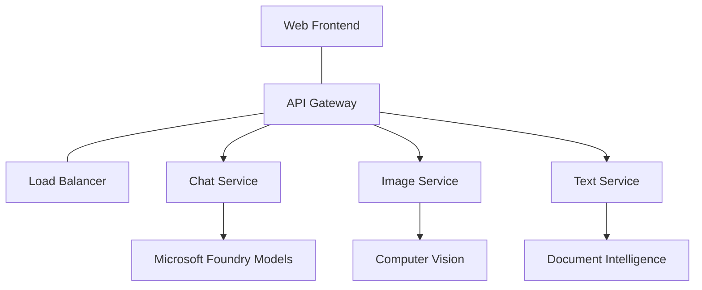

# Cele mai bune practici pentru sarcini AI în producție cu AZD

**Navigarea capitolului:**
- **📚 Acasă la curs**: [AZD Pentru Începători](../../README.md)
- **📖 Capitolul curent**: Capitolul 8 - Modele pentru Producție și Enterprise
- **⬅️ Capitolul precedent**: [Capitolul 7: Depanare](../chapter-07-troubleshooting/debugging.md)
- **⬅️ De asemenea legat**: [Laborator AI Workshop](../chapter-02-ai-development/ai-workshop-lab.md)
- **🎯 Curs complet**: [AZD Pentru Începători](../../README.md)

## Prezentare generală

Acest ghid explică modele de design AI pentru producție folosind Azure Developer CLI (AZD). Este o referință de design, nu o aplicație de implementat sau o certificare de producție.

**Limitele exemplului:** Cu excepția cazului în care este descris explicit ca fiind complet, fragmentele Bicep presupun parametri și resurse referite dintr-un șablon conținător. Ele omit imagini/gazde de host, identități, atribuiri de rol, DNS, rezultate și alte elemente necesare integrării. Căile serviciilor YAML și scripturile de hook/test sunt fișiere illustrative de creat în **propria dvs. aplicație**; nu sunt furnizate de acest curs. Utilizați un exemplu funcțional AZD ca bază, compilați infrastructura completă și testați-o într-un mediu izolat înainte de producție.

## Provocări cheie abordate

Îngrijorările obișnuite pentru producție includ implementări multi-serviciu, managementul identităților și secretelor, scalare, controlul costurilor și monitorizare. Nu se revendică prevalență măsurată aici.

## Modele arhitecturale pentru AI în producție

### Model 1: Arhitectura AI Microservicii

**Când să folosiți**: Aplicații AI complexe cu multiple capabilități



**Implementare cu AZD**:

```yaml
# azure.yaml
name: enterprise-ai-platform
services:
  web:
    project: ./web
    host: staticwebapp
  api-gateway:
    project: ./api-gateway
    host: containerapp
  chat-service:
    project: ./services/chat
    host: containerapp
  vision-service:
    project: ./services/vision
    host: containerapp
  text-service:
    project: ./services/text
    host: containerapp
```

### Model 2: Procesare AI bazată pe evenimente

**Când să folosiți**: Procesare în loturi, analiză documente, fluxuri asincrone

```bicep
// Event Hub for AI processing pipeline
resource eventHub 'Microsoft.EventHub/namespaces@2024-01-01' = {
  name: eventHubNamespaceName
  location: location
  sku: {
    name: 'Standard'
    tier: 'Standard'
    capacity: 1
  }
}

// Service Bus for reliable message processing
resource serviceBus 'Microsoft.ServiceBus/namespaces@2024-01-01' = {
  name: serviceBusNamespaceName
  location: location
  sku: {
    name: 'Premium'
    tier: 'Premium'
    capacity: 1
  }
}

// Function App for processing
resource functionApp 'Microsoft.Web/sites@2023-01-01' = {
  name: functionAppName
  location: location
  kind: 'functionapp,linux'
  properties: {
    siteConfig: {
      appSettings: [
        {
          name: 'FUNCTIONS_EXTENSION_VERSION'
          value: '~4'
        }
        {
          name: 'AZURE_OPENAI_ENDPOINT'
          value: '@Microsoft.KeyVault(VaultName=${keyVault.name};SecretName=openai-endpoint)'
        }
      ]
    }
  }
}
```

Aceasta creează fragmente de namespace, nu hub-uri, cozi, abonamente sau declanșatoare Function. O Function executabilă necesită și un plan de host, configurarea runtime/stocare, o identitate atașată, RBAC și acces la rețea. Referința Key Vault necesită permisiune pentru citirea secretului; un URL de endpoint nu este o acreditare.

## Gândirea despre sănătatea agenților AI

Când o aplicație web tradițională se strică, simptomele sunt familiare: o pagină nu se încarcă, un API returnează o eroare sau o implementare eșuează. Aplicațiile alimentate de AI se pot strica în aceleași moduri — dar se pot comporta și în moduri mai subtile care nu produc mesaje de eroare evidente.

Această secțiune vă ajută să construiți un model mental pentru monitorizarea sarcinilor AI astfel încât să știți unde să căutați când ceva nu pare în regulă.

### Cum diferă sănătatea agenților de sănătatea aplicațiilor tradiționale

Aplicațiile tradiționale pot avea și ele eșecuri subtile de corectitudine. Un agent AI adaugă calitate nedețerministă a răspunsului la preocupările obișnuite de disponibilitate și corectitudine. Gândiți-vă la sănătatea agentului în două straturi:

| Strat | Ce să urmăriți | Unde să căutați |
|-------|--------------|---------------|
| **Sănătatea infrastructurii** | Rulează serviciul? Sunt resursele alocate? Sunt endpointurile accesibile? | `azd monitor`, sănătatea resurselor în Azure Portal, jurnalele containerului/aplicației |
| **Sănătatea comportamentului** | Răspunde agentul corect? Răspunsurile sunt la timp? Modelul este apelat corect? | Urmăriri Application Insights, metriți privind latența apelurilor modelului, jurnalele calității răspunsului |

Sănătatea infrastructurii este familiară — este aceeași pentru orice aplicație azd. Sănătatea comportamentului este stratul nou introdus de sarcinile AI.

### Unde să căutați când aplicațiile AI nu se comportă așa cum vă așteptați

Dacă aplicația dvs. AI nu produce rezultatele așteptate, iată o listă conceptuală de verificare:

1. **Începeți cu elementele de bază.** Aplicația rulează? Poate accesa dependențele? Verificați `azd monitor` și sănătatea resurselor așa cum ați face pentru orice aplicație.
2. **Verificați conexiunea la model.** Aplicația dvs. apelează cu succes modelul AI? Apelurile modelului eșuate sau cu timeout sunt cea mai comună cauză a problemelor aplicațiilor AI și vor apărea în jurnalele aplicației.
3. **Inspectați inputul și fundamentarea în siguranță.** Răspunsurile greșite pot rezulta din căutare, instrucțiuni, limitări ale modelului sau execuția uneltelor. Folosiți date de diagnostic controlate și redactate; nu activați logarea necontrolată a prompturilor/răspunsurilor în producție.
4. **Revizuiți latența răspunsului.** Apelurile modelului AI sunt mai lente decât apelurile API obișnuite. Dacă aplicația pare lentă, verificați dacă timpii de răspuns ai modelului au crescut — acest lucru poate indica limitarea traficului, limite de capacitate sau congestie regională.
5. **Fiți atenți la semnale de cost.** Creșteri neașteptate în utilizarea tokenilor sau a apelurilor API pot indica un ciclu, un prompt configurat greșit sau încercări excesive.

Nu trebuie să stăpâniți imediat instrumentele de observabilitate. Principalul de reținut este că aplicațiile AI au un strat suplimentar de comportament de monitorizat, iar monitorizarea încorporată a azd (`azd monitor`) oferă un punct de plecare pentru investigarea ambelor straturi.

---

## Cele mai bune practici de securitate

### 1. Modelul de securitate Zero-Trust

**Strategia de implementare**:
- Nicio comunicare serviciu-la-serviciu fără autentificare
- Toate apelurile API folosesc identități gestionate
- Izolare de rețea cu endpoint-uri private
- Controale de acces cu drepturi minime

```bicep
// Managed Identity for each service
resource chatServiceIdentity 'Microsoft.ManagedIdentity/userAssignedIdentities@2023-01-31' = {
  name: 'chat-service-identity'
  location: location
}

// Role assignments with minimal permissions
resource openAIUserRole 'Microsoft.Authorization/roleAssignments@2022-04-01' = {
  scope: openAIAccount
  name: guid(openAIAccount.id, chatServiceIdentity.id, '5e0bd9bd-7b93-4f28-af87-19fc36ad61bd')
  properties: {
    roleDefinitionId: subscriptionResourceId('Microsoft.Authorization/roleDefinitions', '5e0bd9bd-7b93-4f28-af87-19fc36ad61bd')
    principalId: chatServiceIdentity.properties.principalId
    principalType: 'ServicePrincipal'
  }
}
```

### 2. Management securizat al secretelor

**Model de integrare cu Key Vault**:

```bicep
// Key Vault with proper access policies
resource keyVault 'Microsoft.KeyVault/vaults@2023-02-01' = {
  name: keyVaultName
  location: location
  properties: {
    tenantId: tenant().tenantId
    sku: {
      family: 'A'
      name: 'standard' // Premium is needed for HSM-backed keys, not ordinary secrets
    }
    enableRbacAuthorization: true  // Use RBAC instead of access policies
    enablePurgeProtection: true    // Prevent accidental deletion
    enableSoftDelete: true
    softDeleteRetentionInDays: 90
  }
}

// Optional legacy key-auth alternative; omit when using Entra ID.
resource openAIKeySecret 'Microsoft.KeyVault/vaults/secrets@2023-02-01' = {
  parent: keyVault
  name: 'openai-api-key'
  properties: {
    value: openAIAccount.listKeys().key1
    attributes: {
      enabled: true
    }
  }
}
```

Atribuiți identitatea runtime `Key Vault Secrets User` la scopul corespunzător și atașați-o hostului; `enableRbacAuthorization` singur nu acordă acces. Preferabil autentificarea identității gestionate OpenAI cu `disableLocalAuth: true`. Secretul opțional de cheie are sens doar pentru un cont deliberat activat cu cheie, iar principalul de aprovizionare are nevoie și de permisiune de a scrie secrete.

### 3. Securitatea rețelei

**Configurarea endpoint-ului privat**:

```bicep
// Virtual Network for AI services
resource virtualNetwork 'Microsoft.Network/virtualNetworks@2023-04-01' = {
  name: vnetName
  location: location
  properties: {
    addressSpace: {
      addressPrefixes: ['10.0.0.0/16']
    }
    subnets: [
      {
        name: 'ai-services-subnet'
        properties: {
          addressPrefix: '10.0.1.0/24'
          privateEndpointNetworkPolicies: 'Disabled'
        }
      }
      {
        name: 'app-services-subnet'
        properties: {
          addressPrefix: '10.0.2.0/24'
          delegations: [
            {
              name: 'Microsoft.Web/serverFarms'
              properties: {
                serviceName: 'Microsoft.Web/serverFarms'
              }
            }
          ]
        }
      }
    ]
  }
}

// Private endpoints for all AI services
resource openAIPrivateEndpoint 'Microsoft.Network/privateEndpoints@2023-04-01' = {
  name: '${openAIAccountName}-pe'
  location: location
  properties: {
    subnet: {
      id: virtualNetwork.properties.subnets[0].id
    }
    privateLinkServiceConnections: [
      {
        name: 'openai-connection'
        properties: {
          privateLinkServiceId: openAIAccount.id
          groupIds: ['account']
        }
      }
    ]
  }
}
```

Endpointurile private necesită și grupuri zonă DNS private/legături VNet și integrarea în VNet a aplicației. Ele nu blochează automat accesul public: dezactivați explicit accesul la rețeaua publică a contului AI după verificarea conectivității private și accesului la implementare.

## Performanță și scalare

### 1. Strategii de auto-scalare

**Auto-scalarea Container Apps**:

```bicep
resource containerApp 'Microsoft.App/containerApps@2023-05-01' = {
  name: containerAppName
  location: location
  properties: {
    configuration: {
      ingress: {
        external: true
        targetPort: 8000
        transport: 'http'
      }
    }
    template: {
      scale: {
        minReplicas: 2  // Always have 2 instances minimum
        maxReplicas: 50 // Scale up to 50 for high load
        rules: [
          {
            name: 'http-scaling'
            http: {
              metadata: {
                concurrentRequests: '20'  // Scale when >20 concurrent requests
              }
            }
          }
          {
            name: 'cpu-scaling'
            custom: {
              type: 'cpu'
              metadata: {
                type: 'Utilization'
                value: '70'  // Scale when CPU >70%
              }
            }
          }
        ]
      }
    }
  }
}
```

### 2. Strategii de caching

**Cache Redis pentru răspunsuri AI**:

```bicep
// Legacy Azure Cache for Redis example (not recommended for new deployments)
resource redisCache 'Microsoft.Cache/redis@2023-04-01' = {
  name: redisCacheName
  location: location
  properties: {
    sku: {
      name: 'Premium'
      family: 'P'
      capacity: 1
    }
    enableNonSslPort: false
    minimumTlsVersion: '1.2'
    redisConfiguration: {
      'maxmemory-policy': 'allkeys-lru'
    }
    // Sharding distributes data; replication/failover provides availability.
    shardCount: 2
  }
}

// Cache configuration in application
var cacheConnectionString = '${redisCache.properties.hostName}:6380,password=${redisCache.listKeys().primaryKey},ssl=True,abortConnect=False'
```

Azure Cache for Redis Basic/Standard/Premium este pe un [drum de retragere](https://learn.microsoft.com/azure/azure-cache-for-redis/retirement-faq). Folosiți Azure Managed Redis pentru noi proiecte și configurația sa documentată SKU, identitate și TLS, în loc să copiați această resursă moștenită într-un nou sistem de producție. Linia cu șirul de conectare este un substituent nefuncțional, nu o acreditare. Partitionați cheile cache după autorizare, model/instrucțiuni și versiunea de recuperare, cu expirare; o cache partajată doar pentru interogări poate expune datele altui utilizator.

### 3. Echilibrare de sarcină și managementul traficului

**Application Gateway cu WAF**:

```bicep
// Application Gateway with Web Application Firewall
resource applicationGateway 'Microsoft.Network/applicationGateways@2023-04-01' = {
  name: appGatewayName
  location: location
  properties: {
    sku: {
      name: 'WAF_v2'
      tier: 'WAF_v2'
      capacity: 2
    }
    webApplicationFirewallConfiguration: {
      enabled: true
      firewallMode: 'Prevention'
      ruleSetType: 'OWASP'
      ruleSetVersion: '3.2'
    }
    // Backend pools for AI services
    backendAddressPools: [
      {
        name: 'ai-services-pool'
        properties: {
          backendAddresses: [
            {
              fqdn: '${containerApp.properties.configuration.ingress.fqdn}'
            }
          ]
        }
      }
    ]
  }
}
```

Aceasta este o resursă parțială de gateway: o implementare reală necesită subrețea/configurare IP gateway, IP-uri și porturi frontend, ascultători/certificate TLS, setări HTTP backend/probe, reguli și priorități de rutare și o politică WAF revizuită. Numele gazdei TLS/SNI și autentificarea trebuie să se potrivească cu backend-ul Container App.

## 💰 Optimizarea costurilor

### 1. Dimensionarea corectă a resurselor

**Configurații specifice mediului**:

Aceste nume sunt **inputuri ilustrative pentru șabloane personalizate**, nu setări automate AZD. Maparea fiecăruia în `infra/main.parameters.json`/Bicep și configurarea hostului înainte. De exemplu, exemplul RAG folosește `AZURE_SEARCH_SERVICE_SKU` și `AZURE_OPENAI_CHATGPT_DEPLOYMENT_CAPACITY`, nu denumirile generice de mai jos. Dați memoriei Container Apps o unitate suportată precum `1Gi` în resursa efectivă. Aplicați modificările infrastructurii cu `azd up` sau `azd provision`; `azd deploy` singur nu aplică schimbările Bicep.

```bash
# Development environment
azd env new development
azd env set AZURE_OPENAI_SKU "S0"
azd env set AZURE_OPENAI_CAPACITY 10
azd env set AZURE_SEARCH_SKU "basic"
azd env set CONTAINER_CPU 0.5
azd env set CONTAINER_MEMORY 1.0

# Production environment  
azd env new production
azd env set AZURE_OPENAI_SKU "S0"
azd env set AZURE_OPENAI_CAPACITY 100
azd env set AZURE_SEARCH_SKU "standard"
azd env set CONTAINER_CPU 2.0
azd env set CONTAINER_MEMORY 4.0
```

### 2. Monitorizarea costurilor și bugete

```bicep
// Supply the first day of the current UTC month, e.g. 2026-11-01T00:00:00Z.
param budgetStartDate string

// Cost management and budgets
resource budget 'Microsoft.Consumption/budgets@2024-08-01' = {
  name: 'ai-workload-budget'
  properties: {
    timePeriod: {
      startDate: budgetStartDate
    }
    timeGrain: 'Monthly'
    amount: 2000  // In the billing currency, not necessarily USD
    category: 'Cost'
    notifications: {
      warning: {
        enabled: true
        operator: 'GreaterThan'
        threshold: 80
        contactEmails: [
          'finance@company.com'
          'engineering@company.com'
        ]
        contactRoles: [
          'Owner'
          'Contributor'
        ]
      }
      critical: {
        enabled: true
        operator: 'GreaterThan'
        threshold: 95
        contactEmails: [
          'cto@company.com'
        ]
      }
    }
  }
}
```

Înlocuiți destinatarii exemplului și verificați scopul/permisiunile. Alertarea de buget folosește date întârziate de facturare și nu impune o limită de cheltuieli.

### 3. Optimizarea utilizării tokenilor

**Managementul costurilor OpenAI**:

Aceasta este doar o euristică bazată pe caractere pentru o previzualizare UI, **nu** un validator al limitelor tokenilor modelului. Codul de producție trebuie să utilizeze un tokenizer potrivit pentru modelul implementat și să țină cont de instrucțiunile sistemului, schemele uneltelor, istoricul și bugetul de output. Respingeți un mesaj utilizator supradimensionat în loc să-l tăiați silențios.

```typescript
// Application-level token optimization
class TokenOptimizer {
  private readonly maxTokens = 4000;
  private readonly reserveTokens = 500;
  
  optimizePrompt(userInput: string, context: string): string {
    const availableTokens = this.maxTokens - this.reserveTokens;
    if (this.estimateTokens(userInput) + 8 >= availableTokens) {
      throw new Error("User input exceeds the illustrative prompt budget");
    }
    const estimatedTokens = this.estimateTokens(userInput + context) + 8;
    
    if (estimatedTokens > availableTokens) {
      // Truncate context, not user input
      context = this.truncateContext(context, Math.max(0, availableTokens - this.estimateTokens(userInput) - 8));
    }
    
    return `${context}\n\nUser: ${userInput}`;
  }
  
  private estimateTokens(text: string): number {
    // Rough estimation: 1 token ≈ 4 characters
    return Math.ceil(text.length / 4);
  }

  private truncateContext(text: string, estimatedBudget: number): string {
    return text.slice(0, Math.max(0, estimatedBudget) * 4);
  }
}
```

## Monitorizare și Observabilitate

### 1. Application Insights cuprinzător

```bicep
// Application Insights with advanced features
resource applicationInsights 'Microsoft.Insights/components@2020-02-02' = {
  name: applicationInsightsName
  location: location
  kind: 'web'
  properties: {
    Application_Type: 'web'
    WorkspaceResourceId: logAnalyticsWorkspace.id
    SamplingPercentage: 100  // Ingestion setting; review cost and SDK sampling separately
    DisableIpMasking: false  // Retain IP masking
  }
}

// Custom metrics for AI operations
resource aiMetricAlerts 'Microsoft.Insights/metricAlerts@2018-03-01' = {
  name: 'ai-high-error-rate'
  location: 'global'
  properties: {
    description: 'Alert when failed request count exceeds 10 in five minutes'
    severity: 2
    enabled: true
    scopes: [
      applicationInsights.id
    ]
    evaluationFrequency: 'PT1M'
    windowSize: 'PT5M'
    criteria: {
      'odata.type': 'Microsoft.Azure.Monitor.SingleResourceMultipleMetricCriteria'
      allOf: [
        {
          name: 'high-error-rate'
          metricName: 'requests/failed'
          operator: 'GreaterThan'
          threshold: 10
          timeAggregation: 'Count'
        }
      ]
    }
  }
}
```

### 2. Monitorizare specifică AI

**Dashboard-uri personalizate pentru metrici AI**:

```json
{
  "dashboard": {
    "name": "AI Application Monitoring",
    "tiles": [
      {
        "name": "OpenAI Request Volume",
        "query": "dependencies | where target contains 'openai' | summarize count() by bin(timestamp, 5m)"
      },
      {
        "name": "AI Response Latency",
        "query": "dependencies | where target contains 'openai' | summarize avg(duration) by bin(timestamp, 5m)"
      },
      {
        "name": "Token Usage",
        "query": "customMetrics | where name == 'openai_tokens_used' | summarize sum(value) by bin(timestamp, 1h)"
      },
      {
        "name": "Cost per Hour",
        "query": "customMetrics | where name == 'openai_cost' | summarize sum(value) by bin(timestamp, 1h)"
      }
    ]
  }
}
```

Acest JSON este o schiță definită de aplicație, nu un șablon de dashboard importabil în portalul Azure. Interogările de token/cost necesită ca aplicația dvs. să emită exact acești metrici personalizați; nu sunt creați de AZD. Adaptați filtrele de dependență pentru numele reale ale endpointului/modelului.

### 3. Verificări de sănătate și monitorizare uptime

```bicep
// Application Insights availability tests
resource availabilityTest 'Microsoft.Insights/webtests@2022-06-15' = {
  name: 'ai-app-availability-test'
  location: location
  tags: {
    'hidden-link:${applicationInsights.id}': 'Resource'
  }
  properties: {
    SyntheticMonitorId: 'ai-app-availability-test'
    Name: 'AI Application Availability Test'
    Description: 'Tests AI application endpoints'
    Enabled: true
    Frequency: 300  // 5 minutes
    Timeout: 120    // 2 minutes
    Kind: 'standard'
    Locations: [
      {
        Id: 'us-east-2-azr'
      }
      {
        Id: 'us-west-2-azr'
      }
    ]
    Request: {
      RequestUrl: 'https://${webApp.properties.defaultHostName}/health'
      HttpVerb: 'GET'
      FollowRedirects: true
      ParseDependentRequests: false
    }
    ValidationRules: {
      ExpectedHttpStatusCode: 200
      SSLCheck: true
      SSLCertRemainingLifetimeCheck: 7
    }
  }
}
```

## Recuperare după dezastre și Disponibilitate ridicată

Testul precedent presupune un App Service existent `webApp` și o resursă Application Insights. Testele standard de disponibilitate sunt taxabile și necesită un endpoint accesibil; aplicațiile doar private au nevoie de un design corespunzător de monitorizare privată. Testele ping URL sunt învechite; folosiți [teste standard de disponibilitate](https://learn.microsoft.com/azure/azure-monitor/app/availability).

### 1. Implementare multi-regiune

```yaml
# azure.yaml - Multi-region configuration
name: ai-app-multiregion
services:
  api-primary:
    project: ./api
    host: containerapp
    env:
      AZURE_REGION: eastus
  api-secondary:
    project: ./api
    host: containerapp
    env:
      AZURE_REGION: westus2
```

```bicep
// Separate App Service topology, not the Container Apps declarations above
resource trafficManager 'Microsoft.Network/trafficManagerProfiles@2022-04-01' = {
  name: trafficManagerProfileName
  location: 'global'
  properties: {
    profileStatus: 'Enabled'
    trafficRoutingMethod: 'Priority'
    dnsConfig: {
      relativeName: trafficManagerProfileName
      ttl: 30
    }
    monitorConfig: {
      protocol: 'HTTPS'
      port: 443
      path: '/health'
      intervalInSeconds: 30
      toleratedNumberOfFailures: 3
      timeoutInSeconds: 10
    }
    endpoints: [
      {
        name: 'primary-endpoint'
        type: 'Microsoft.Network/trafficManagerProfiles/azureEndpoints'
        properties: {
          targetResourceId: primaryAppService.id
          endpointStatus: 'Enabled'
          priority: 1
        }
      }
      {
        name: 'secondary-endpoint'
        type: 'Microsoft.Network/trafficManagerProfiles/azureEndpoints'
        properties: {
          targetResourceId: secondaryAppService.id
          endpointStatus: 'Enabled'
          priority: 2
        }
      }
    ]
  }
}
```

Variabilele de mediu nu aleg locațiile resurselor. IaC trebuie să aprovizioneze hosturi regionale distincte și să lege fiecare serviciu cu etichete `resourceName` sau `azd-service-name`. Exemplul Traffic Manager este o **topologie separată App Service** (`primaryAppService`/`secondaryAppService`), nu rutare pentru declarațiile Container Apps. Container Apps necesită un endpoint extern/front door configurat corespunzător, rutare TLS/domeniu personalizat și probe de sănătate.

### 2. Backup și recuperare de date

```bicep
// Backup configuration for critical data
resource backupVault 'Microsoft.DataProtection/backupVaults@2023-05-01' = {
  name: backupVaultName
  location: location
  identity: {
    type: 'SystemAssigned'
  }
  properties: {
    storageSettings: [
      {
        datastoreType: 'VaultStore'
        type: 'LocallyRedundant'
      }
    ]
  }
}

```

Vault-ul singur nu face backup nimic. Configurați o **politică specifică sarcinii acceptată și o instanță de backup**, permisiunile sursei, reținerea și testele de restaurare folosind [matricele de suport Azure Backup](https://learn.microsoft.com/azure/backup/backup-support-matrix). Nu există o politică generică Azure Backup pentru implementările găzduite Azure OpenAI model. Păstrați definițiile infrastructurii/modelului în controlul sursei; protejați documentele încărcate, datele aplicației și artefactele de fine-tuning folosind caracteristicile suportate de backup/export ale fiecărui serviciu de bază. Definiți și testați explicit RPO/RTO.

## Integrare DevOps și CI/CD

### 1. Flux de lucru GitHub Actions

```yaml
# .github/workflows/deploy-ai-app.yml
name: Deploy AI Application

on:
  push:
    branches: [main]
  pull_request:
    branches: [main]

jobs:
  test:
    runs-on: ubuntu-latest
    steps:
      - uses: actions/checkout@v4
      
      - name: Setup Python
        uses: actions/setup-python@v4
        with:
          python-version: '3.11'
          
      - name: Install dependencies
        run: |
          pip install -r requirements.txt
          pip install pytest
          
      - name: Run tests
        run: pytest tests/
        
      - name: AI Safety Tests
        run: |
          python scripts/test_ai_safety.py
          python scripts/validate_prompts.py

```

Aceasta este **porțiunea doar pentru test** a unui flux de lucru și presupune că ați creat `requirements.txt`, `tests/` și cele două scripturi de siguranță. Adăugați joburile de aprovizionare/implementare autentificate OIDC din [Configurare Pipeline CI/CD](#cicd-pipeline-configuration), cu `needs: test`, un push/triggere manual de încredere și medii GitHub protejate. Nu implementați cod din pull-request neîncrezător cu credențiale cloud. Un runner proaspăt nu are un mediu local AZD selectat; furnizați intrările environment/subscription/location și folosiți `azd auth login`, nu doar `azure/login`.

### 2. Validarea infrastructurii

```bash
# scripts/validate_infrastructure.sh
#!/bin/bash
set -euo pipefail

echo "Validating AI infrastructure deployment..."

# Requires Azure CLI login and the resource group selected explicitly.
: "${AZURE_RESOURCE_GROUP:?Set AZURE_RESOURCE_GROUP}"
: "${AZURE_OPENAI_NAME:?Set AZURE_OPENAI_NAME}"
: "${AZURE_OPENAI_CHAT_DEPLOYMENT:?Set the actual deployment name}"

# A successful empty list is not proof that resources exist.
types=("Microsoft.CognitiveServices/accounts" "Microsoft.Search/searchServices"
       "Microsoft.Storage/storageAccounts" "Microsoft.KeyVault/vaults")
for resource_type in "${types[@]}"; do
    count=$(az resource list --resource-group "$AZURE_RESOURCE_GROUP" \
        --resource-type "$resource_type" --query "length(@)" -o tsv)
    if [[ "$count" -lt 1 ]]; then
        echo "ERROR: No $resource_type found in $AZURE_RESOURCE_GROUP"
        exit 1
    fi
done

# Validate OpenAI model deployments
echo "Validating OpenAI model deployments..."
state=$(az cognitiveservices account deployment show \
  --name "$AZURE_OPENAI_NAME" --resource-group "$AZURE_RESOURCE_GROUP" \
  --deployment-name "$AZURE_OPENAI_CHAT_DEPLOYMENT" \
  --query "properties.provisioningState" -o tsv)
if [[ "$state" != "Succeeded" ]]; then
    echo "ERROR: Required model deployment is not provisioned successfully"
    exit 1
fi

echo "Infrastructure validation completed successfully!"
```

Expectativă: un exit zero și mesajul de finalizare doar atunci când toate tipurile așteptate există și implementarea modelului numit este aprovizionată. Aceasta verifică inventarul/starea de aprovizionare, **nu** sănătatea resurselor, topologia exactă, RBAC, accesibilitatea rețelei sau comportamentul modelului. Adaptați tipurile așteptate la arhitectura dvs., apoi efectuați un test separat de pregătire a aplicației autentificat.

## Lista de verificare pentru pregătirea producției

### Securitate ✅
- [ ] Toate serviciile folosesc identități gestionate
- [ ] Secrete stocate în Key Vault
- [ ] Endpoint-uri private configurate
- [ ] Grupuri de securitate de rețea implementate
- [ ] RBAC cu privilegii minime
- [ ] WAF activat pe endpointuri publice

### Performanță ✅
- [ ] Auto-scalare configurată
- [ ] Caching implementat
- [ ] Echilibrare de sarcină configurată
- [ ] CDN pentru conținut static
- [ ] Pooling conexiuni bază de date
- [ ] Optimizarea utilizării tokenilor

### Monitorizare ✅
- [ ] Application Insights configurat
- [ ] Metrici personalizate definite
- [ ] Reguli de alertă configurate
- [ ] Dashboard creat
- [ ] Verificări de sănătate implementate
- [ ] Politici de retenție pentru jurnale

### Fiabilitate ✅
- [ ] Implementare multi-regiune
- [ ] Plan de backup și recuperare
- [ ] Circuit breakers implementați
- [ ] Politici de retry configurate
- [ ] Degradare grațioasă
- [ ] Endpoint-uri de verificare a sănătății

### Managementul costurilor ✅
- [ ] Alarme de buget configurate
- [ ] Dimensionarea corectă a resurselor
- [ ] Discounturi dev/test aplicate
- [ ] Instanțe rezervate achiziționate
- [ ] Dashboard de monitorizare a costurilor
- [ ] Revizuiri regulate ale costurilor

### Conformitate ✅
- [ ] Cerințele de rezidență a datelor îndeplinite
- [ ] Logare de audit activată
- [ ] Politici de conformitate aplicate
- [ ] Baze de securitate implementate
- [ ] Evaluări regulate de securitate
- [ ] Plan de răspuns la incidente

## Repere de performanță

### Ținte ilustrative de producție

Acestea sunt exemple de SLO-uri pentru negociere și testare la încărcare, nu repere măsurate sau garanții. Latența răspunsului depinde de model/lungimea outputului; cheltuielile lunare de tokeni depind de trafic și prețuri, nu doar de numărul tokenilor.

| Metrică | Țintă | Monitorizare |
|--------|--------|------------|
| **Timp de răspuns** | < 2 secunde | Application Insights |
| **Disponibilitate** | 99,9% | Monitorizare uptime |
| **Rată de erori** | < 0,1% | Jurnalele aplicației |
| **Cheltuieli model** | < 500$ / lună (buget exemplu) | Managementul costurilor |
| **Utilizatori concurenți** | 1000+ | Testare de încărcare |
| **Timp de recuperare** | < 1 oră | Teste de recuperare după dezastru |

### Testare de încărcare

Următorul este un schiț al interfeței pentru un script de testare a încărcării **pe care trebuie să-l implementați**; acest depozit nu oferă `scripts/load_test.py`. Definiți conținutul cererilor, autentificarea, sarcinile reprezentative, aserțiunile privind latența/eroarea percentilă și o limită de cheltuieli în instrumentul dvs. ales pentru testarea încărcării înainte de rulare:

```bash
# Load testing script for AI applications
python scripts/load_test.py \
  --endpoint https://your-ai-app.azurewebsites.net \
  --concurrent-users 100 \
  --duration 300 \
  --ramp-up 60
```

## 🤝 Cele mai bune practici din comunitate

Pe baza feedback-ului comunității Microsoft Foundry Discord:

### Recomandările principale ale comunității:

1. **Începeți mic, scalați treptat**: Începeți cu SKU-uri de bază și scalați în funcție de utilizarea reală
2. **Monitorizați totul**: Configurați o monitorizare cuprinzătoare din prima zi
3. **Automatizați securitatea**: Folosiți infrastructura ca cod pentru securitate constantă
4. **Testați temeinic**: Includeți testarea specifică AI în pipeline-ul dvs.
5. **Planificați costurile**: Monitorizați utilizarea token-urilor și setați alerte de buget devreme

### Capcane frecvente de evitat:

- ❌ Hardcodarea cheilor API în cod
- ❌ Lipsa configurării unei monitorizări corespunzătoare
- ❌ Ignorarea optimizării costurilor
- ❌ Lipsa testării scenariilor de eroare
- ❌ Implementarea fără verificări de sănătate

## Comenzi și extensii AZD AI CLI

AZD include un set în creștere de comenzi și extensii specifice AI care simplifică fluxurile de lucru AI în producție. Aceste instrumente acoperă diferența dintre dezvoltarea locală și implementarea în producție pentru sarcini AI.

> **Revizuire lansare (2026-11-04):** Ghidul CLI de mai jos a fost verificat cu versiunile publicate ale `azd` **1.37.2**, `azure.ai.agents` **1.0.0-beta.23**, și `azure.ai.evaluations` **1.0.0-beta.2**. Agenții beta.23 necesită `azd >= 1.37.0`; evaluările beta.2 necesită `azd >= 1.33.0`. Folosiți cel puțin 1.37.0 pentru fluxul de lucru combinat. Aceasta este o revizuire a documentației/surselor, nu o validare live a implementării Azure.

### Extensii AZD pentru AI

AZD folosește un sistem de extensii pentru a adăuga capabilități specifice AI. Instalați și gestionați extensiile cu:

```bash
# List all available extensions (including AI)
azd extension list

# Inspect installed extension details
azd version
azd extension show azure.ai.agents

# Install the Foundry agents extension
azd extension install azure.ai.agents

# Install the separate Foundry evaluations extension
azd extension install azure.ai.evaluations

# Install the fine-tuning extension
azd extension install azure.ai.finetune

# Install the custom models extension
azd extension install azure.ai.models

# Upgrade all installed extensions
azd extension upgrade --all
```

**Extensii AI disponibile:**

| Extensie | Scop | Stare |
|-----------|---------|--------|
| `azure.ai.agents` | Gestionarea serviciului Foundry Agent | Previzualizare |
| `azure.ai.evaluations` | Seturi de date de evaluare, evaluatori, grupuri de evaluare și rulări | Previzualizare |
| `azure.ai.skills` | Abilități reutilizabile ale agenților | Previzualizare |
| `azure.ai.connections` | Conexiuni Foundry (surse de date, unelte) | Previzualizare |
| `azure.ai.finetune` | Fine-tuning modele Foundry | Previzualizare |
| `azure.ai.models` | Modele personalizate Foundry | Previzualizare |
| `azure.coding-agent` | Configurare agent de codare | Disponibilă |

> Rulați `azd extension list --installed` și `azd extension show azure.ai.evaluations` pentru a inspecta versiunile instalate. Actualizați mai întâi CLI-ul core folosind [instrucțiunile de instalare/actualizare](https://learn.microsoft.com/azure/developer/azure-developer-cli/install-azd) (pentru o instalare Windows winget: `winget upgrade Microsoft.Azd`), apoi rulați `azd extension upgrade --all`. Nu există o comandă core `azd upgrade`. Revizuiți modificările breaking înainte de a actualiza automatizarea din producție; nu presupuneți că o actualizare de extensie păstrează vechile formate de comandă sau configurație.

### Schimbări și corecții în lansările recente

| Lansare | Ce se schimbă pentru acest curs |
|---------|------------------------------|
| `azd 1.37.0` | Adaugă API-uri stabile de previzualizare a implementării și corectează editările de extensii care rescriau setări `azure.yaml` nelegate. |
| `azd 1.37.1` | Corectează propagarea Ctrl+C prin extensii și distinge anulările/timeouts de eșecurile generice. |
| `azd 1.37.2` | Îmbunătățește validarea provisioning: avertismente critice implicite la **Nu**, eșuează fără confirmare în rulări neasistate, iar anularea sare hook-urile post-provision. Corectează de asemenea valorile nerezolvate de mediu în listele de interdicție Deployment Stacks când funcția alpha este activată. |
| Agenți `beta.22` | Migrează evaluarea la `azd ai eval`, schimbă optimizarea la API GA v1, necesită forme de plural `toolboxes`, și separă acceptarea pentru managed-harness, voce și previzualizări cu rulare lungă. Corectează selecția modelului specific mediului și autentificarea toolbox-ului. |
| Agenți `beta.23` | Expune `init --harness`; corectează ieșirea răspunsului A2A 0.3, căi/module prompt-agent invalide peste straturi de infrastructură, diagnosticări activation-timeout și avertismente RBAC pentru dezvoltatori reținute. |
| Evaluări `beta.2` | Necesită configurație camelCase pentru evaluare, adaugă autorii de conversații statice/simulate și surse locale de fișiere explicite, și corectează gestionarea identității/versionii setului de date, numărătoarea calității, și diagnostice pentru rulări eșuate. |

Un timeout de activare agent NU dovedește un eșec de implementare: inspectați versiunea încercată și starea sa înainte de a reîncerca. Avertismentele RBAC dezvoltator pot persista chiar dacă provisioning-ul reușește; rezolvați accesul lipsă înainte de a invoca ca acel dezvoltator.

Surse: [Lansări AZD](https://github.com/Azure/azure-dev/releases), [lansarea agenților beta.23](https://github.com/Azure/azure-dev/releases/tag/azd-ext-azure-ai-agents_1.0.0-beta.23), [migrarea agenților beta.22](https://github.com/Azure/azure-dev/releases/tag/azd-ext-azure-ai-agents_1.0.0-beta.22), și [lansarea evaluărilor beta.2](https://github.com/Azure/azure-dev/releases/tag/azd-ext-azure-ai-evaluations_1.0.0-beta.2).

**Ce sunt extensiile mai noi `skills` și `connections`?**

Două extensii în previzualizare au apărut alături de uneltele agenților și merită înțelese chiar dacă sunteți începător:

- **`azure.ai.skills`** — O **abilitate** este o capacitate reutilizabilă (un instrument sau comportament pachetat) pe care o puteți atașa unuia sau mai multor agenți în loc să o reimplementați de fiecare dată. Gândiți-o ca pe o piesă comună de construcție: definiți o abilitate "caută în documentație" sau "verifică o comandă" o dată, apoi reutilizați-o printre agenți. Aceasta menține sistemele multi-agent (Capitolul 5) consistente și evită copierea/lipirea.
- **`azure.ai.connections`** — O **conexiune** este o legătură gestionată de la proiectul Foundry la o resursă externă de care agenții dvs. au nevoie—o sursă de date (precum Azure AI Search), un endpoint de unealtă sau un alt serviciu. Conexiunile centralizează *unde* și *cum* agenții accesează datele, astfel încât acreditările și endpoint-urile trăiesc într-un loc guvernat în loc să fie împrăștiate în cod.

Nu aveți nevoie de acestea pentru a implementa primul agent—folosiți `azure.ai.agents` în timpul învățării. Apelați la `skills` când vă regăsiți duplicând aceeași unealtă în agenți diferiți și `connections` când mai mulți agenți partajează aceeași sursă de date.

### Inițializarea proiectelor de agenți cu `azd ai agent init`

Comanda `azd ai agent init` construiește scheletul unui proiect de agent Microsoft Foundry. Folosiți un șablon de proiect `azure.yaml` curent, nu un manifest implicit al agentului moștenit:

```bash
# Initialize a new agent project from a local project template
azd ai agent init --template ./templates/support-agent/azure.yaml

# Initialize and target a specific Foundry project
azd ai agent init --template ./templates/support-agent/azure.yaml --project-id <foundry-project-id>

# Adopt the template into a different directory
azd ai agent init --template ./templates/support-agent/azure.yaml --src ./agents/my-agent
```

**Flag-uri cheie:**

| Flag | Descriere |
|------|-------------|
| `-t, --template` | Cale sau URI GitHub suportat către un document de proiect `azure.yaml` |
| `-p, --project-id` | ID-ul proiectului Microsoft Foundry existent pentru mediul azd |
| `-s, --src` | Directorul sursa pentru agenții generați sau directorul țintă când adoptați un proiect |
| `--kind` | Inițializează un agent `hosted`, `prompt` sau în previzualizarea `prompt-voice` |
| `--harness` | Executare opțională pentru `--kind prompt`; necesită opt-in în previzualizare |
| `-e, --environment` | Mediul azd de folosit |

`--manifest`/`-m` este un alias depreciat pentru `--template`/`-t`; redenumirea flag-ului nu convertește un manifest vechi într-un document de proiect curent. `--host containerapp` nu este un flag agent-init curent. Pentru o aplicație obișnuită Container Apps, folosiți `azd init --template` cu un șablon care declară `host: containerapp`.

Pentru un proiect existent cu exact un serviciu `azure.ai.project`, `azd ai agent add support-agent --file ./agents/support-agent.yaml` adaugă sau actualizează o definiție directă de agent fără provisioning sau implementare. Comenzile runtime resping definițiile vechi implicite `agent.yaml`/AgentManifest și subordonate `config:`; migrați-le către un serviciu `azure.ai.agent` curent. Când init printă o următoare etapă `cd`, rulați-o înainte de `azd up`: init nu schimbă directorul shell-ului dvs.

**Sfat pentru producție**: Folosiți `--project-id` pentru a vă conecta direct la un proiect Foundry existent, păstrând codul agentului și resursele cloud legate de la început.

#### Funcții opționale în previzualizare

Managed harness, voice și invocare pe durată lungă sunt dezactivate implicit. Puneți doar comutatorul pentru funcția de care aveți nevoie în **mediu proces shell/CI**, nu cu `azd env set`:

| Funcție | Variabilă de mediu proces |
|---------|------------------------------|
| Managed harness (`init --kind prompt --harness ...`) | `AZD_ALPHA_ENABLE_AGENTS_MANAGED_HARNESS=true` |
| Voice (`init --kind prompt-voice`) | `AZD_ALPHA_ENABLE_AGENTS_VOICE=true` |
| Invocare pe durată lungă | `AZD_ALPHA_ENABLE_AGENTS_LONG_RUNNING=true` |

De exemplu, folosiți `export AZD_ALPHA_ENABLE_AGENTS_MANAGED_HARNESS=true` în Bash sau `$env:AZD_ALPHA_ENABLE_AGENTS_MANAGED_HARNESS = "true"` în PowerShell înainte de a rula comanda relevantă. Un singur comutator nu activează celelalte. Consultați [README-ul agenților lansați](https://github.com/Azure/azure-dev/blob/azd-ext-azure-ai-agents_1.0.0-beta.23/cli/azd/extensions/azure.ai.agents/README.md) pentru toate comutatoarele și limitările în previzualizare.

### Gestionarea ciclului de viață al agentului

Folosiți `azure.ai.agents` pentru testare, inspectare, optimizare și retragere a agenților, și extensia separată `azure.ai.evaluations` pentru măsurarea calității:

```bash
# Invoke a deployed agent and view server response timing
# (total latency and time to first byte)
azd ai agent invoke

# Show the live endpoint configuration before changing it
azd ai agent endpoint show

# Download the deployed source of a code-based hosted agent
# (with SHA-256 verification)
azd ai agent code download

# Delete a hosted agent and all of its versions
# (--force terminates active sessions)
azd ai agent delete --force
```

**Ciclul de viață pe scurt:**

| Etapă | Comandă | Utilizare în producție |
|-------|---------|----------------|
| Testare | `azd ai agent invoke` | Validați răspunsurile și măsurați latența înainte de lansare |
| Inspectare | `azd ai agent endpoint show` | Revizuiți autentificarea/configurarea endpoint-urilor; detectați devreme schimbările breaking |
| Măsurare | `azd ai eval init`, `generate`, `run start` | Definiți, implementați și executați evaluări repetabile |
| Îmbunătățire | `azd ai agent optimize --eval <evaluation-name> --optimize-model <optimizer-deployment>` | Reutilizați o evaluare compatibilă pentru optimizarea agentului |
| Recuperare | `azd ai agent code download` | Recuperează codul sursă exact implementat pentru audit/rollback |
| Retragere | `azd ai agent delete --force` | Demolați curat un agent și versiunile acestuia |

> Acestea sunt comenzi în previzualizare și pot suferi modificări între lansările extensiilor. Rulați `azd ai agent --help` pentru a vedea subcomenzile exacte disponibile în versiunea dvs. instalată.

`endpoint show` suportă agenți găzduiți, prompt și de voce, dar actualizările endpoint-ului sunt doar găzduite; agenții workflow nu sunt susținuți. Descărcarea codului și exemplul de retragere a agentului găzduit de mai sus nu sunt operațiuni generice pentru fiecare tip de agent.

#### Migrarea evaluărilor și verificările calității

Începând cu agenții **1.0.0-beta.22 (2026-10-23)**, comenzile moștenite `azd ai agent eval` oferă ghid de migrare în locul vechiului flux de evaluare. Nu copiați exemple vechi `eval generate --dataset ...`: evaluarea trăiește acum sub **`azd ai eval`**.

Într-un proiect de agent inițializat, autentificați-vă cu `azd auth login`, confirmați mediul/proiectul Foundry selectat și instalați `azure.ai.evaluations`. O implementare model judge este necesară pentru scorarea bazată pe model; generarea și simularea conversației pot necesita selecții proprii de modele și pot genera costuri suplimentare.

```bash
# Scaffold evals/ and wire an azure.ai.eval service into azure.yaml
azd ai eval init

# Optionally synthesize a rubric and dataset from the agent
azd ai eval generate

# Review generated files, then register datasets, evaluators, and eval groups
azd up

# Start an evaluation and wait for its results
azd ai eval run start --wait

# Inspect runs and available test-case output
azd ai eval run list
azd ai eval run show <run-id>
azd ai eval run output list <run-id>
```

Urmați selecțiile interactive și următorii pași tipăriți în loc să presupuneți că datele generate sunt deja înregistrate. Configurația evaluării stă de obicei în `evals/azure.eval.yaml`, referințiată de serviciul `azure.ai.eval` în `azure.yaml`. Cheile sunt în **camelCase** (`evaluationLevel`, `maxSamples`, `initializationParameters`, `dataMapping`); vechile chei în snake_case sunt respinse. Căile dintr-o configurație referențiată se rezolvă relativ la acel fișier, nu la rădăcina depozitului.

Pentru evaluările conversațiilor, alegeți **static** pentru a evalua transcrieri finalizate fără a invoca agentul, sau **simulare** pentru a genera conversații din semințe de scenariu. Simularea necesită un agent țintă, un model simulator și o selecție separată model judge. Pentru comenzile neasistate, furnizați intrările listate de `azd ai eval init --help` și `azd ai eval generate --help`; nu presupuneți că modelul de generare este și judge sau simulator.

Pentru CI, configurați o politică explicită de calitate folosind `azd ai eval run start --help` (`--fail-on`) și tratați o ieșire nonzero a hostului ca eșec. O rulare finalizată nu este automat un pas calitativ. Revizuiți rândurile eșuate/eroate și diagnosticele; lipsa sau inconsistența numărului de rezultate nu este o dovadă a succesului. Seturile de date înregistrate păstrează identitatea/versionarea serviciului; `--max-samples` nu poate face subset de seturi de date înregistrate. Publicați un set de date mai mic deliberat sau folosiți o sursă locală de fișiere susținută.

```bash
# Example CI policy: at least 90% of all test cases must pass
azd ai eval run start --wait --fail-on "pass-rate=0.9"
```

Poarta ratei de trecere folosește testele trecute împărțite la totalul testelor; testele eșuate, eroate, sărite sau netrecute contează împotriva acesteia. Nu combinați poarta cu `--no-wait`, care returnează înainte ca un verdict să fie disponibil.

#### Migrarea configurației de optimizare

Optimizarea folosește acum API-ul GA v1. Pentru a reutiliza o evaluare compatibilă **la nivel de tură, susținută de set de date** din noul flux de lucru:

```bash
# Replace placeholders with the evaluation name and optimizer model deployment
azd ai agent optimize --eval-config ./evals/azure.eval.yaml --eval <evaluation-name> --optimize-model <optimizer-deployment>
```

`--eval` selectează o evaluare; `--eval-config` selectează fișierul său de configurare (inclusiv definiții susținute de fișiere). `--config` ia în schimb o **cerere API de optimizare independentă** în YAML sau JSON. Nu transmite un vechi agent `eval.yaml` sau noul `azure.eval.yaml` către `--config` și nu combina `--config` cu `--eval`/`--eval-config`. Evaluările de conversație, susținute de trasări sau simulări nu sunt interschimbabile cu comanda rapidă de optimizare susținută de setul de date; folosește formatul cererii de optimizare suportat pentru acele scenarii. Revizuiește candidații înainte de a-i aplica sau implementa.

Consultă [referința evaluărilor pentru versiunea revizuită](https://github.com/Azure/azure-dev/blob/azd-ext-azure-ai-evaluations_1.0.0-beta.2/cli/azd/extensions/azure.ai.evaluations/README.md) și [sursa comenzii de optimizare pentru versiunea revizuită](https://github.com/Azure/azure-dev/blob/azd-ext-azure-ai-agents_1.0.0-beta.23/cli/azd/extensions/azure.ai.agents/internal/cmd/optimize.go) pentru opțiuni exacte.

#### Previzualizare Implementare Agent găzduit doar pentru citire

Pentru un mediu existent legat de Foundry cu un serviciu unificat `azure.ai.agent` de `kind: hosted`, compară configurația suportată înainte de implementare:

```bash
azd deploy <service-name> --preview --no-prompt
```

Această previzualizare nu implementează agentul. Nu este o diferență completă de infrastructură/securitate: agenții pentru prompturi/voci/workflow, configurații moștenite și unele setări găzduite sunt în afara ariei sale. Un rezultat `unknown` nu este aprobarea pentru implementare. Nu există o comandă independentă `azd ai agent deploy` sau agent `--dry-run`; folosește fluxul de lucru de implementare principal.

### Protocolul Contextului Modelului (MCP) cu `azd mcp`

AZD include suport integrat pentru server MCP (Alpha), permițând agenților AI și uneltelor să interacționeze cu resursele tale Azure printr-un protocol standardizat:

```bash
# Start the MCP server for your project
azd mcp start

# Review current Copilot consent rules for tool execution
azd copilot consent list
```

Serverul MCP expune contextul proiectului tău azd — medii, servicii și resurse Azure — către unelte de dezvoltare alimentate de AI. Acest lucru permite:

- **Implementare asistată de AI**: Permite agenților de codare să interogheze starea proiectului tău și să declanșeze implementări
- **Descoperirea resurselor**: uneltele AI pot descoperi ce resurse Azure folosește proiectul tău
- **Gestionarea mediului**: agenții pot comuta între mediile de dezvoltare/testare/producție

### Generarea Infrastructurii cu `azd infra generate`

Pentru sarcini AI de producție, poți genera și personaliza infrastructura ca și cod în loc să te bazezi pe aprovizionare automată:

```bash
# Generate supported infrastructure for this project type
azd infra generate
```

Suportul depinde de proiect/gazdă și de furnizorii instalați; aceasta nu este o comandă generală de inginerie inversă pentru resurse Azure arbitrare sau o promisiune de a genera atât Bicep cât și Terraform. Rulează `azd infra generate --help` și inspectează formatul generat. Unde este suportat, scrierea IaC pe disc îți permite să:
- Revizuiești și verifici infrastructura înainte de implementare
- Adaugi politici de securitate personalizate (reguli de rețea, puncte finale private)
- Integrezi cu procesele de revizuire IaC existente
- Controlezi versiunile modificărilor infrastructurii separat de codul aplicației

### Cârlige pentru ciclul de viață al producției

Cârligele AZD îți permit să injectezi logică personalizată în fiecare etapă a ciclului de viață al implementării — critic pentru fluxuri de lucru AI de producție:

```yaml
# azure.yaml - Production hooks example
name: ai-production-app
hooks:
  preprovision:
    shell: sh
    run: scripts/validate-quotas.sh    # Check AI model quota before provisioning
  postprovision:
    shell: sh
    run: scripts/verify-networking.sh  # Verify IaC-provisioned private connectivity
  predeploy:
    shell: sh
    run: scripts/run-ai-safety-tests.sh  # Run prompt safety checks
  postdeploy:
    shell: sh
    run: scripts/smoke-test.sh           # Verify agent responses post-deploy
services:
  agent-api:
    project: ./src/agent
    host: containerapp
    hooks:
      predeploy:
        shell: sh
        run: scripts/validate-model-access.sh  # Per-service hook
```

```bash
# Run a specific hook manually during development
azd hooks run predeploy
```

**Cârlige recomandate pentru producție la sarcini AI:**

| Cârlig | Caz de utilizare |
|------|----------|
| `preprovision` | Validarea cotelor de abonament pentru capacitatea modelului AI |
| `postprovision` | Verificarea conectivității private și ieșirilor necesare ale resurselor |
| `predeploy` | Rularea testelor de siguranță AI, validarea șabloanelor de prompturi |
| `postdeploy` | Testare rapidă a răspunsurilor agentului, verificarea conectivității modelului |

### Configurarea pipeline-ului CI/CD

Folosește `azd pipeline config` pentru a conecta proiectul tău la GitHub Actions sau Azure Pipelines cu autentificare Azure securizată:

```bash
# Configure CI/CD pipeline (interactive)
azd pipeline config

# Configure with a specific provider
azd pipeline config --provider github
```

Această comandă:
- Creează sau configurează o identitate de pipeline; revizuiește domeniul de rol/permisii generate în loc să presupui cel mai mic privilegiu
- Configurează credențiale federați (fără secrete stocate)
- Generează sau actualizează fișierul de definiție al pipeline-ului tău
- Setează variabilele de mediu necesare în sistemul tău CI/CD

#### Pas cu pas: primul tău pipeline GitHub Actions

Iată parcursul complet de la un proiect azd funcțional la implementări automate la fiecare push.

**1. Asigură-te că proiectul tău este pe GitHub**

```bash
git init
git add .
git commit -m "Initial azd project"
gh repo create my-ai-app --private --source=. --push
```

**2. Rulează configurarea pipeline-ului**

```bash
azd pipeline config --provider github
```

azd va:
- Întreba interactiv ce abonament Azure și mediu să țintească
- Creează o înregistrare de aplicație Entra **+ principal de serviciu** pentru pipeline
- Configurează **credențiale federate (OIDC)** — astfel încât GitHub să se autentifice la Azure cu tokenuri cu durată scurtă și **nu se stochează secrete**
- Trimite **variabilele** necesare către repo-ul tău GitHub (`AZURE_CLIENT_ID`, `AZURE_TENANT_ID`, `AZURE_SUBSCRIPTION_ID`, `AZURE_ENV_NAME`, `AZURE_LOCATION`)

**3. Înțelege fluxul de lucru generat**

Pentru un șablon suportat, configurează/revede `.github/workflows/azure-dev.yml`. Părțile cheie arată astfel (șablonul trebuie să furnizeze toolchain-ul aplicației și parametrii mediului):

```yaml
# .github/workflows/azure-dev.yml
on:
  push:
    branches: [ main ]
  workflow_dispatch:        # lets you run it manually too

permissions:
  id-token: write           # required for OIDC federated login
  contents: read

jobs:
  build:
    runs-on: ubuntu-latest
    env:
      AZURE_CLIENT_ID: ${{ vars.AZURE_CLIENT_ID }}
      AZURE_TENANT_ID: ${{ vars.AZURE_TENANT_ID }}
      AZURE_SUBSCRIPTION_ID: ${{ vars.AZURE_SUBSCRIPTION_ID }}
      AZURE_ENV_NAME: ${{ vars.AZURE_ENV_NAME }}
      AZURE_LOCATION: ${{ vars.AZURE_LOCATION }}
    steps:
      - uses: actions/checkout@v4
      - name: Install azd
        uses: Azure/setup-azd@v2
      - name: Log in with OIDC
        run: azd auth login --client-id "$AZURE_CLIENT_ID" --federated-credential-provider "github" --tenant-id "$AZURE_TENANT_ID"
      - name: Provision infrastructure
        run: azd provision --no-prompt
      - name: Deploy application
        run: azd deploy --no-prompt
```

**4. Verifică dacă funcționează**

```bash
# Push a change to trigger the pipeline
git commit -am "Trigger pipeline" --allow-empty
git push
```

Deschide fila **Actions** din repo-ul tău GitHub și urmărește cum fluxul de lucru `azd provision` și `azd deploy` rulează automat.

> **De ce sunt importante acreditările federate:** pipeline-urile mai vechi stocau un secret client în GitHub. Acreditările federate OIDC elimină complet acel secret—GitHub solicită un token cu durată scurtă de valabilitate în timpul execuției, ceea ce este mai sigur și nu trebuie nici rotit, nici expus. Acesta este comportamentul implicit pe care `azd pipeline config` îl configurează.

> **Secrete vs. variabile:** identificatorii nesensibili (`AZURE_CLIENT_ID` etc.) se plasează în **variabile** ale repo-ului. Dacă aplicația ta are realmente nevoie de un secret la timpul de build, adaugă-l ca **secret** în GitHub și referențiază-l cu `${{ secrets.NAME }}`—dar preferă Key Vault + identitate gestionată la runtime (vezi [Capitolul 3](../chapter-03-configuration/authsecurity.md)).

**Flux de lucru de producție cu configurarea pipeline-ului:**

```bash
# 1. Set up production environment
azd env new production
azd env set AZURE_OPENAI_CAPACITY 100

# 2. Configure the pipeline
azd pipeline config --provider github

# 3. Review the generated trigger, provisioning/deployment steps, and approvals
```

#### Pas cu pas: Azure DevOps Pipelines

Preferi Azure DevOps în loc de GitHub Actions? azd îl suportă nativ cu providerul `azdo`. Fluxul este aproape identic—azd generează fișierul pipeline, creează o conexiune de serviciu și configurează autentificarea.

**1. Asigură-te că ai un proiect Azure DevOps**

Ai nevoie de o organizație și de un proiect la `https://dev.azure.com/<your-org>`. Generează un Personal Access Token (PAT) cu permisiunile **Build (Read & execute)**, **Code (Read & write)** și **Service Connections (Read, query & manage)**—azd îți va cere acest token.

**2. Configurează pipeline-ul**

```bash
azd pipeline config --provider azdo
```

azd va:
- Cere organizația și proiectul tău Azure DevOps
- Crea (sau reutiliza) o **conexiune de serviciu** către Azure folosind un principal de serviciu
- Configura **federarea identității workload (OIDC)** astfel încât să nu se stocheze niciun secret client
- Configura o definiție de pipeline (frecvent `.azdo/pipelines/azure-dev.yml`) din șablonul pipeline-ului proiectului

**3. Revizuiește pipeline-ul generat**

Folosește pipeline-ul generat al proiectului, inclusiv **conexiunea de serviciu Azure și pașii de autentificare AZD**. Ghidul oficial [Azure Pipelines setup guide](https://learn.microsoft.com/azure/developer/azure-developer-cli/pipeline-azure-pipelines) arată fragmentul instalatorului de mai jos; acesta este **doar pentru instalare**, nu un flux de lucru autenticat și rulabil pentru deploy:

```yaml
# .azdo/pipelines/azure-dev.yml (installer fragment only)
trigger:
  - main

pool:
  vmImage: ubuntu-latest

steps:
  - task: setup-azd@0
    displayName: Install azd
```

Instalează extensia AZD Azure DevOps dacă această sarcină nu este disponibilă în organizația ta. Nu copia pașii shell `azd provision`/`azd deploy` fără autentificare: faptul că o conexiune de serviciu este configurată nu înseamnă că fiecare proces va fi logat automat în AZD. Urmează autentificarea OIDC și contextul autorizat al task-ului din șablonul generat și furnizează mediul/subscriptia/locația selectată.

**4. De unde provin variabilele**

azd stochează valorile mediului (`AZURE_ENV_NAME`, `AZURE_LOCATION`, `AZURE_SUBSCRIPTION_ID`) ca un **grup de variabile** în Azure DevOps astfel încât pipeline-ul să le poată citi. Le poți vizualiza și edita sub **Pipelines → Library**.

> **Același beneficiu OIDC ca GitHub:** providerul `azdo` configurează de asemenea implicit federarea identității workload, deci nu este stocat niciun secret client în conexiunea de serviciu—Azure DevOps face schimb de tokenuri cu durată scurtă la runtime. Folosește `--auth-type client-credentials` doar dacă organizația ta nu poate utiliza încă OIDC.

**5. Rulează-l**

```bash
git commit -am "Add Azure DevOps pipeline" --allow-empty
git push
```

Deschide **Pipelines** în Azure DevOps pentru a urmări rularea `azd provision` și `azd deploy`.

### Adăugarea Componentelor cu `azd add`

Adaugă gradual servicii Azure într-un proiect existent:

```bash
# Add a new service component interactively
azd add
```

Acest lucru este deosebit de util pentru extinderea aplicațiilor AI de producție—for example, adăugând un serviciu de căutare vectorială, un nou endpoint de agent sau un component de monitorizare într-un deployment existent.

## Resurse suplimentare

- **Azure Well-Architected Framework**: [Ghid pentru AI workload](https://learn.microsoft.com/azure/well-architected/ai/)
- **Microsoft Foundry Documentation**: [Documentație oficială](https://learn.microsoft.com/azure/ai-studio/)
- **Șabloane Comunitare**: [Exemple Azure](https://github.com/Azure-Samples)
- **Comunitatea Discord**: [canalul #Azure](https://discord.gg/microsoft-azure)
- **Agent Skills pentru Azure**: [microsoft/github-copilot-for-azure pe skills.sh](https://skills.sh/microsoft/github-copilot-for-azure) - Abilități reutilizabile de agent pentru AI Azure, Foundry, deploy, optimizare costuri și diagnosticare. Instalează în editorul tău:
  ```bash
  npx skills add microsoft/github-copilot-for-azure
  ```

---

**Navigarea capitolelor:**
- **📚 Acasă curs**: [AZD Pentru Începători](../../README.md)
- **📖 Capitolul curent**: Capitolul 8 - Modele de Producție & Enterprise
- **⬅️ Capitolul anterior**: [Capitolul 7: Depanare](../chapter-07-troubleshooting/debugging.md)
- **⬅️ De asemenea relevant**: [Laborator AI Workshop](../chapter-02-ai-development/ai-workshop-lab.md)
- **🎯 Curs complet**: [AZD Pentru Începători](../../README.md)

**Amintește-ți**: Workload-urile AI de producție necesită planificare atentă, monitorizare și optimizare continuă. Începe cu aceste modele și adaptează-le cerințelor tale specifice.

---

<!-- CO-OP TRANSLATOR DISCLAIMER START -->
**Declinare a responsabilității**:
Acest document a fost tradus folosind serviciul de traducere AI [Co-op Translator](https://github.com/Azure/co-op-translator). În timp ce ne străduim pentru acuratețe, vă rugăm să rețineți că traducerile automate pot conține erori sau inexactități. Documentul original în limba sa nativă trebuie considerat sursa autorizată. Pentru informații critice, se recomandă traducerea profesională realizată de un om. Nu ne asumăm responsabilitatea pentru eventualele neînțelegeri sau interpretări greșite care decurg din utilizarea acestei traduceri.
<!-- CO-OP TRANSLATOR DISCLAIMER END -->