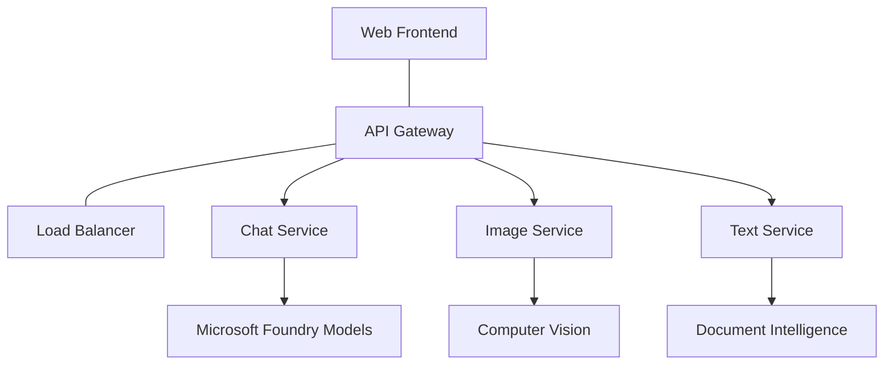

# Cele mai bune practici pentru sarcini de lucru AI în producție cu AZD

**Navigarea capitolelor:**
- **📚 Acasă curs**: [AZD Pentru Începători](../../README.md)
- **📖 Capitolul curent**: Capitolul 8 - Modele pentru Producție & Întreprinderi
- **⬅️ Capitol anterior**: [Capitolul 7: Depanare](../chapter-07-troubleshooting/debugging.md)
- **⬅️ De asemenea relevant**: [Laborator Workshop AI](../chapter-02-ai-development/ai-workshop-lab.md)
- **🎯 Curs complet**: [AZD Pentru Începători](../../README.md)

## Prezentare generală

Acest ghid explică modele de proiectare AI pentru producție folosind Azure Developer CLI (AZD). Este o referință de proiectare, nu o aplicație implementabilă sau o certificare de producție.

**Limitele exemplului:** Cu excepția cazului în care este descris explicit ca fiind complet, fragmentele Bicep presupun parametrii și resursele referențiate dintr-un șablon conținut. Ele omit imagini/gazde, identități, alocări de roluri, DNS, ieșiri și alte integrări necesare. Căile serviciilor YAML și scripturile hook/test sunt fișiere ilustrative de creat în **propria ta aplicație**; nu sunt furnizate de acest curs. Folosește un exemplu funcțional AZD ca bază, compilează infrastructura completă și testeaz-o într-un mediu izolat înainte de producție.

## Provocări cheie abordate

Probleme comune în producție includ implementări multi-serviciu, gestionarea identităților și secretelor, scalare, controlul costurilor și monitorizare. Nu se afirmă o prevalență măsurată aici.

## Modele de arhitectură pentru AI în producție

### Model 1: Arhitectura AI pe microservicii

**Când se folosește**: Aplicații AI complexe cu multiple capabilități



**Implementare AZD**:

```yaml
# azure.yaml
name: enterprise-ai-platform
services:
  web:
    project: ./web
    host: staticwebapp
  api-gateway:
    project: ./api-gateway
    host: containerapp
  chat-service:
    project: ./services/chat
    host: containerapp
  vision-service:
    project: ./services/vision
    host: containerapp
  text-service:
    project: ./services/text
    host: containerapp
```

### Model 2: Procesare AI bazată pe evenimente

**Când se folosește**: Procesare batch, analiză de documente, fluxuri de lucru asincrone

```bicep
// Event Hub for AI processing pipeline
resource eventHub 'Microsoft.EventHub/namespaces@2024-01-01' = {
  name: eventHubNamespaceName
  location: location
  sku: {
    name: 'Standard'
    tier: 'Standard'
    capacity: 1
  }
}

// Service Bus for reliable message processing
resource serviceBus 'Microsoft.ServiceBus/namespaces@2024-01-01' = {
  name: serviceBusNamespaceName
  location: location
  sku: {
    name: 'Premium'
    tier: 'Premium'
    capacity: 1
  }
}

// Function App for processing
resource functionApp 'Microsoft.Web/sites@2023-01-01' = {
  name: functionAppName
  location: location
  kind: 'functionapp,linux'
  properties: {
    siteConfig: {
      appSettings: [
        {
          name: 'FUNCTIONS_EXTENSION_VERSION'
          value: '~4'
        }
        {
          name: 'AZURE_OPENAI_ENDPOINT'
          value: '@Microsoft.KeyVault(VaultName=${keyVault.name};SecretName=openai-endpoint)'
        }
      ]
    }
  }
}
```

Aceasta creează fragmente de namespace, nu hub-uri, cozi, abonamente sau triggeri de Funcție. O Funcție rulabilă are nevoie și de un plan de găzduire, configurare runtime/stocare, o identitate atașată, RBAC și acces la rețea. Referința Key Vault are nevoie de permisiunea de a citi secretul; un URL endpoint nu este o acreditare.

## Gânduri despre sănătatea agentului AI

Când o aplicație web tradițională se strică, simptomele sunt familiare: o pagină nu se încarcă, un API returnează o eroare sau o implementare eșuează. Aplicațiile AI pot să se defecteze în toate aceste moduri — dar pot să se comporte și subtil, fără mesaje evidente de eroare.

Această secțiune te ajută să construiești un model mental pentru monitorizarea sarcinilor AI astfel încât să știi unde să cauți când ceva nu pare în regulă.

### Cum diferă sănătatea agentului de cea a aplicației tradiționale

Aplicațiile tradiționale pot avea și ele erori subtile de corectitudine. Un agent AI adaugă calitate nondeterministă a răspunsului la preocupările obișnuite privind disponibilitatea și corectitudinea. Gândește sănătatea agentului în două straturi:

| Stratul | Ce să urmărești | Unde să cauți |
|-------|--------------|---------------|
| **Sănătatea infrastructurii** | Serviciul rulează? Resursele sunt provisionate? Endpointurile sunt accesibile? | `azd monitor`, sănătatea resurselor în Azure Portal, jurnalele containerului/aplicației |
| **Sănătatea comportamentului** | Agentul răspunde corect? Răspunsurile sunt la timp? Modelul este apelat corect? | Urmăririle din Application Insights, metrici de latență apel model, jurnale de calitate a răspunsului |

Sănătatea infrastructurii este cunoscută — e aceeași pentru orice aplicație azd. Sănătatea comportamentului este stratul nou introdus de sarcinile AI.

### Unde să cauți când aplicațiile AI nu se comportă cum te aștepți

Dacă aplicația ta AI nu produce rezultatele așteptate, iată o listă conceptuală:

1. **Începe cu elementele de bază.** Aplicația rulează? Poate accesa dependențele? Verifică `azd monitor` și sănătatea resurselor la fel ca pentru orice aplicație.
2. **Verifică conexiunea cu modelul.** Aplicația ta apelează cu succes modelul AI? Apelurile eșuate sau care au expirat sunt cea mai comună cauză a problemelor aplicațiilor AI și vor apărea în jurnalele aplicației.
3. **Inspectează intrarea și bazarea în mod sigur.** Răspunsurile greșite pot rezulta din recuperare, instrucțiuni, limitări ale modelului sau execuția uneltelor. Folosește date de diagnostic controlate prin acces, redactate; nu activa jurnalizarea prompturilor/răspunsurilor în mod nediscriminatoriu în producție.
4. **Revizuiește latența răspunsului.** Apelurile modelului AI sunt mai lente decât apelurile tipice API. Dacă aplicația se simte lentă, verifică dacă timpul de răspuns al modelului a crescut — asta poate indica throttling, limite de capacitate sau congestie la nivel de regiune.
5. **Urmărește semnalele de cost.** Creșteri neașteptate în utilizarea tokenilor sau apelurile API pot indica o buclă, un prompt configurat greșit sau încercări excesive.

Nu trebuie să stăpânești imediat uneltele de observabilitate. Principalul este că aplicațiile AI au un strat suplimentar de comportament de monitorizat, iar monitorizarea integrată azd (`azd monitor`) îți oferă un punct de plecare pentru investigarea ambelor straturi.

---

## Cele mai bune practici de securitate

### 1. Model de securitate Zero-Trust

**Strategie de implementare**:
- Nicio comunicare serviciu-la-serviciu fără autentificare
- Toate apelurile API folosesc identități gestionate
- Izolare de rețea cu endpoint-uri private
- Controale de acces cu privilegii minime

```bicep
// Managed Identity for each service
resource chatServiceIdentity 'Microsoft.ManagedIdentity/userAssignedIdentities@2023-01-31' = {
  name: 'chat-service-identity'
  location: location
}

// Role assignments with minimal permissions
resource openAIUserRole 'Microsoft.Authorization/roleAssignments@2022-04-01' = {
  scope: openAIAccount
  name: guid(openAIAccount.id, chatServiceIdentity.id, '5e0bd9bd-7b93-4f28-af87-19fc36ad61bd')
  properties: {
    roleDefinitionId: subscriptionResourceId('Microsoft.Authorization/roleDefinitions', '5e0bd9bd-7b93-4f28-af87-19fc36ad61bd')
    principalId: chatServiceIdentity.properties.principalId
    principalType: 'ServicePrincipal'
  }
}
```

### 2. Gestionare securizată a secretelor

**Model de integrare cu Key Vault**:

```bicep
// Key Vault with proper access policies
resource keyVault 'Microsoft.KeyVault/vaults@2023-02-01' = {
  name: keyVaultName
  location: location
  properties: {
    tenantId: tenant().tenantId
    sku: {
      family: 'A'
      name: 'standard' // Premium is needed for HSM-backed keys, not ordinary secrets
    }
    enableRbacAuthorization: true  // Use RBAC instead of access policies
    enablePurgeProtection: true    // Prevent accidental deletion
    enableSoftDelete: true
    softDeleteRetentionInDays: 90
  }
}

// Optional legacy key-auth alternative; omit when using Entra ID.
resource openAIKeySecret 'Microsoft.KeyVault/vaults/secrets@2023-02-01' = {
  parent: keyVault
  name: 'openai-api-key'
  properties: {
    value: openAIAccount.listKeys().key1
    attributes: {
      enabled: true
    }
  }
}
```

Atribuie identitatea runtime `Key Vault Secrets User` la nivelul corespunzător și atașeaz-o gazdei; `enableRbacAuthorization` singur nu acordă acces. Preferă autentificarea cu identitate gestionată OpenAI cu `disableLocalAuth: true`. Secretul cheie opțional are sens doar pentru un cont intenționat activat cu cheie, iar principalul de aprovizionare are nevoie și de permisiunea de a scrie secrete.

### 3. Securitatea rețelei

**Configurarea endpoint-urilor private**:

```bicep
// Virtual Network for AI services
resource virtualNetwork 'Microsoft.Network/virtualNetworks@2023-04-01' = {
  name: vnetName
  location: location
  properties: {
    addressSpace: {
      addressPrefixes: ['10.0.0.0/16']
    }
    subnets: [
      {
        name: 'ai-services-subnet'
        properties: {
          addressPrefix: '10.0.1.0/24'
          privateEndpointNetworkPolicies: 'Disabled'
        }
      }
      {
        name: 'app-services-subnet'
        properties: {
          addressPrefix: '10.0.2.0/24'
          delegations: [
            {
              name: 'Microsoft.Web/serverFarms'
              properties: {
                serviceName: 'Microsoft.Web/serverFarms'
              }
            }
          ]
        }
      }
    ]
  }
}

// Private endpoints for all AI services
resource openAIPrivateEndpoint 'Microsoft.Network/privateEndpoints@2023-04-01' = {
  name: '${openAIAccountName}-pe'
  location: location
  properties: {
    subnet: {
      id: virtualNetwork.properties.subnets[0].id
    }
    privateLinkServiceConnections: [
      {
        name: 'openai-connection'
        properties: {
          privateLinkServiceId: openAIAccount.id
          groupIds: ['account']
        }
      }
    ]
  }
}
```

Endpoint-urile private necesită, de asemenea, grupuri de zone DNS private/legături VNet și integrarea VNet a aplicației. Nu blochează automat accesul public: dezactivează explicit accesul public al contului AI după validarea conectivității private și a accesului la implementare.

## Performanță și scalare

### 1. Strategii de auto-scalare

**Auto-scalare pentru Container Apps**:

```bicep
resource containerApp 'Microsoft.App/containerApps@2023-05-01' = {
  name: containerAppName
  location: location
  properties: {
    configuration: {
      ingress: {
        external: true
        targetPort: 8000
        transport: 'http'
      }
    }
    template: {
      scale: {
        minReplicas: 2  // Always have 2 instances minimum
        maxReplicas: 50 // Scale up to 50 for high load
        rules: [
          {
            name: 'http-scaling'
            http: {
              metadata: {
                concurrentRequests: '20'  // Scale when >20 concurrent requests
              }
            }
          }
          {
            name: 'cpu-scaling'
            custom: {
              type: 'cpu'
              metadata: {
                type: 'Utilization'
                value: '70'  // Scale when CPU >70%
              }
            }
          }
        ]
      }
    }
  }
}
```

### 2. Strategii de caching

**Cache Redis pentru răspunsuri AI**:

```bicep
// Legacy Azure Cache for Redis example (not recommended for new deployments)
resource redisCache 'Microsoft.Cache/redis@2023-04-01' = {
  name: redisCacheName
  location: location
  properties: {
    sku: {
      name: 'Premium'
      family: 'P'
      capacity: 1
    }
    enableNonSslPort: false
    minimumTlsVersion: '1.2'
    redisConfiguration: {
      'maxmemory-policy': 'allkeys-lru'
    }
    // Sharding distributes data; replication/failover provides availability.
    shardCount: 2
  }
}

// Cache configuration in application
var cacheConnectionString = '${redisCache.properties.hostName}:6380,password=${redisCache.listKeys().primaryKey},ssl=True,abortConnect=False'
```

Azure Cache pentru Redis Basic/Standard/Premium este pe o [cale de retragere](https://learn.microsoft.com/azure/azure-cache-for-redis/retirement-faq). Folosește Azure Managed Redis pentru proiecte noi și configurarea documentată a SKU, identității și TLS, în loc să copiezi această resursă moștenită într-un sistem nou de producție. Linia connection-string este un substituent nefuncțional, nu o acreditare. Partitionează cheile cache după autorizare, model/instrucțiuni și versiunea de recuperare, cu expirare; o cache partajată doar pentru interogări poate expune datele altui utilizator.

### 3. Echilibrare de încărcare și gestionarea traficului

**Application Gateway cu WAF**:

```bicep
// Application Gateway with Web Application Firewall
resource applicationGateway 'Microsoft.Network/applicationGateways@2023-04-01' = {
  name: appGatewayName
  location: location
  properties: {
    sku: {
      name: 'WAF_v2'
      tier: 'WAF_v2'
      capacity: 2
    }
    webApplicationFirewallConfiguration: {
      enabled: true
      firewallMode: 'Prevention'
      ruleSetType: 'OWASP'
      ruleSetVersion: '3.2'
    }
    // Backend pools for AI services
    backendAddressPools: [
      {
        name: 'ai-services-pool'
        properties: {
          backendAddresses: [
            {
              fqdn: '${containerApp.properties.configuration.ingress.fqdn}'
            }
          ]
        }
      }
    ]
  }
}
```

Aceasta este o resursă parțială de gateway: o implementare reală necesită și subnet/IP gateway, IP-uri și porturi front-end, ascultători/certificate TLS, setări HTTP/backend, sonde, reguli de rutare și priorități, și o politică WAF revizuită. Numele de gazdă/SNI TLS și autentificarea trebuie să corespundă backend-ului Container App.

## 💰 Optimizarea costurilor

### 1. Dimensionarea corectă a resurselor

**Configurații specifice mediului**:

Aceste nume sunt **inputuri ilustrative pentru șabloane personalizate**, nu setări automate AZD. Mapă fiecare în `infra/main.parameters.json`/Bicep și configurația gazdei mai întâi. De exemplu, exemplul RAG folosește `AZURE_SEARCH_SERVICE_SKU` și `AZURE_OPENAI_CHATGPT_DEPLOYMENT_CAPACITY`, nu numele generice de mai jos. Oferă memorie Container Apps o unitate suportată precum `1Gi` în resursa efectivă. Aplică schimbările de infrastructură cu `azd up` sau `azd provision`; `azd deploy` singur nu aplică modificările Bicep.

```bash
# Development environment
azd env new development
azd env set AZURE_OPENAI_SKU "S0"
azd env set AZURE_OPENAI_CAPACITY 10
azd env set AZURE_SEARCH_SKU "basic"
azd env set CONTAINER_CPU 0.5
azd env set CONTAINER_MEMORY 1.0

# Production environment  
azd env new production
azd env set AZURE_OPENAI_SKU "S0"
azd env set AZURE_OPENAI_CAPACITY 100
azd env set AZURE_SEARCH_SKU "standard"
azd env set CONTAINER_CPU 2.0
azd env set CONTAINER_MEMORY 4.0
```

### 2. Monitorizarea costurilor și bugetelor

```bicep
// Supply the first day of the current UTC month, e.g. 2026-11-01T00:00:00Z.
param budgetStartDate string

// Cost management and budgets
resource budget 'Microsoft.Consumption/budgets@2024-08-01' = {
  name: 'ai-workload-budget'
  properties: {
    timePeriod: {
      startDate: budgetStartDate
    }
    timeGrain: 'Monthly'
    amount: 2000  // In the billing currency, not necessarily USD
    category: 'Cost'
    notifications: {
      warning: {
        enabled: true
        operator: 'GreaterThan'
        threshold: 80
        contactEmails: [
          'finance@company.com'
          'engineering@company.com'
        ]
        contactRoles: [
          'Owner'
          'Contributor'
        ]
      }
      critical: {
        enabled: true
        operator: 'GreaterThan'
        threshold: 95
        contactEmails: [
          'cto@company.com'
        ]
      }
    }
  }
}
```

Înlocuiește destinatarii exemplu și verifică domeniul/permisii. Alerta bugetelor folosește date de facturare întârziate și nu impune o limită de cheltuieli.

### 3. Optimizarea utilizării tokenilor

**Gestionarea costurilor OpenAI**:

Aceasta este doar o euristică bazată pe caractere pentru o previzualizare UI, **nu** un validator de limită de tokeni model. Codul de producție trebuie să folosească un tokenizer potrivit modelului implementat și să țină cont de instrucțiunile sistemului, schemele uneltelor, istoricul și bugetul de output. Respinge un mesaj utilizator oversized în loc să îl trunchiezi silențios.

```typescript
// Application-level token optimization
class TokenOptimizer {
  private readonly maxTokens = 4000;
  private readonly reserveTokens = 500;
  
  optimizePrompt(userInput: string, context: string): string {
    const availableTokens = this.maxTokens - this.reserveTokens;
    if (this.estimateTokens(userInput) + 8 >= availableTokens) {
      throw new Error("User input exceeds the illustrative prompt budget");
    }
    const estimatedTokens = this.estimateTokens(userInput + context) + 8;
    
    if (estimatedTokens > availableTokens) {
      // Truncate context, not user input
      context = this.truncateContext(context, Math.max(0, availableTokens - this.estimateTokens(userInput) - 8));
    }
    
    return `${context}\n\nUser: ${userInput}`;
  }
  
  private estimateTokens(text: string): number {
    // Rough estimation: 1 token ≈ 4 characters
    return Math.ceil(text.length / 4);
  }

  private truncateContext(text: string, estimatedBudget: number): string {
    return text.slice(0, Math.max(0, estimatedBudget) * 4);
  }
}
```

## Monitorizare și observabilitate

### 1. Application Insights cuprinzător

```bicep
// Application Insights with advanced features
resource applicationInsights 'Microsoft.Insights/components@2020-02-02' = {
  name: applicationInsightsName
  location: location
  kind: 'web'
  properties: {
    Application_Type: 'web'
    WorkspaceResourceId: logAnalyticsWorkspace.id
    SamplingPercentage: 100  // Ingestion setting; review cost and SDK sampling separately
    DisableIpMasking: false  // Retain IP masking
  }
}

// Custom metrics for AI operations
resource aiMetricAlerts 'Microsoft.Insights/metricAlerts@2018-03-01' = {
  name: 'ai-high-error-rate'
  location: 'global'
  properties: {
    description: 'Alert when failed request count exceeds 10 in five minutes'
    severity: 2
    enabled: true
    scopes: [
      applicationInsights.id
    ]
    evaluationFrequency: 'PT1M'
    windowSize: 'PT5M'
    criteria: {
      'odata.type': 'Microsoft.Azure.Monitor.SingleResourceMultipleMetricCriteria'
      allOf: [
        {
          name: 'high-error-rate'
          metricName: 'requests/failed'
          operator: 'GreaterThan'
          threshold: 10
          timeAggregation: 'Count'
        }
      ]
    }
  }
}
```

### 2. Monitorizare specific AI

**Dashboards personalizate pentru metrici AI**:

```json
{
  "dashboard": {
    "name": "AI Application Monitoring",
    "tiles": [
      {
        "name": "OpenAI Request Volume",
        "query": "dependencies | where target contains 'openai' | summarize count() by bin(timestamp, 5m)"
      },
      {
        "name": "AI Response Latency",
        "query": "dependencies | where target contains 'openai' | summarize avg(duration) by bin(timestamp, 5m)"
      },
      {
        "name": "Token Usage",
        "query": "customMetrics | where name == 'openai_tokens_used' | summarize sum(value) by bin(timestamp, 1h)"
      },
      {
        "name": "Cost per Hour",
        "query": "customMetrics | where name == 'openai_cost' | summarize sum(value) by bin(timestamp, 1h)"
      }
    ]
  }
}
```

Acest JSON este o schiță definită de aplicație, nu un schema de dashboard importabil în portalul Azure. Interogările pentru token/cost necesită ca aplicația ta să emită acei metrici personalizați exacți; nu sunt creați de AZD. Adaptează filtrele de dependență pentru endpoint/span-urile modelului tău real.

### 3. Verificări de sănătate și monitorizare uptime

```bicep
// Application Insights availability tests
resource availabilityTest 'Microsoft.Insights/webtests@2022-06-15' = {
  name: 'ai-app-availability-test'
  location: location
  tags: {
    'hidden-link:${applicationInsights.id}': 'Resource'
  }
  properties: {
    SyntheticMonitorId: 'ai-app-availability-test'
    Name: 'AI Application Availability Test'
    Description: 'Tests AI application endpoints'
    Enabled: true
    Frequency: 300  // 5 minutes
    Timeout: 120    // 2 minutes
    Kind: 'standard'
    Locations: [
      {
        Id: 'us-east-2-azr'
      }
      {
        Id: 'us-west-2-azr'
      }
    ]
    Request: {
      RequestUrl: 'https://${webApp.properties.defaultHostName}/health'
      HttpVerb: 'GET'
      FollowRedirects: true
      ParseDependentRequests: false
    }
    ValidationRules: {
      ExpectedHttpStatusCode: 200
      SSLCheck: true
      SSLCertRemainingLifetimeCheck: 7
    }
  }
}
```

## Recuperarea după dezastru și disponibilitatea ridicată

Testul precedent presupune un App Service existent `webApp` și o resursă Application Insights. Testele standard de disponibilitate sunt facturabile și necesită un endpoint accesibil; aplicațiile private-only necesită un design adecvat de monitorizare privată. Testele ping URL sunt depreciate; folosește [teste standard de disponibilitate](https://learn.microsoft.com/azure/azure-monitor/app/availability).

### 1. Implementarea multi-regională

```yaml
# azure.yaml - Multi-region configuration
name: ai-app-multiregion
services:
  api-primary:
    project: ./api
    host: containerapp
    env:
      AZURE_REGION: eastus
  api-secondary:
    project: ./api
    host: containerapp
    env:
      AZURE_REGION: westus2
```

```bicep
// Separate App Service topology, not the Container Apps declarations above
resource trafficManager 'Microsoft.Network/trafficManagerProfiles@2022-04-01' = {
  name: trafficManagerProfileName
  location: 'global'
  properties: {
    profileStatus: 'Enabled'
    trafficRoutingMethod: 'Priority'
    dnsConfig: {
      relativeName: trafficManagerProfileName
      ttl: 30
    }
    monitorConfig: {
      protocol: 'HTTPS'
      port: 443
      path: '/health'
      intervalInSeconds: 30
      toleratedNumberOfFailures: 3
      timeoutInSeconds: 10
    }
    endpoints: [
      {
        name: 'primary-endpoint'
        type: 'Microsoft.Network/trafficManagerProfiles/azureEndpoints'
        properties: {
          targetResourceId: primaryAppService.id
          endpointStatus: 'Enabled'
          priority: 1
        }
      }
      {
        name: 'secondary-endpoint'
        type: 'Microsoft.Network/trafficManagerProfiles/azureEndpoints'
        properties: {
          targetResourceId: secondaryAppService.id
          endpointStatus: 'Enabled'
          priority: 2
        }
      }
    ]
  }
}
```

Variabilele de mediu nu aleg locațiile resurselor. IaC trebuie să provisioneze gazde regionale distincte și să lege fiecare serviciu cu tagurile `resourceName` sau `azd-service-name`. Exemplul Traffic Manager este o **topologie separată App Service** (`primaryAppService`/`secondaryAppService`), nu rutare pentru declarațiile Container Apps. Container Apps necesită un endpoint extern/corect configurat, rutare TLS/domeniu personalizat și sonde de sănătate.

### 2. Backup și recuperare date

```bicep
// Backup configuration for critical data
resource backupVault 'Microsoft.DataProtection/backupVaults@2023-05-01' = {
  name: backupVaultName
  location: location
  identity: {
    type: 'SystemAssigned'
  }
  properties: {
    storageSettings: [
      {
        datastoreType: 'VaultStore'
        type: 'LocallyRedundant'
      }
    ]
  }
}

```

Doar vault-ul nu face backup. Configurează o **politică și instanță de backup suportate specifice sarcinii**, permisiuni sursă, retenție și teste de restaurare folosind [matricele de suport Azure Backup](https://learn.microsoft.com/azure/backup/backup-support-matrix). Nu există o politică generică Azure Backup pentru implementările model OpenAI găzduit. Păstrează definițiile infrastructură/model în controlul sursei; protejează documentele încărcate, datele aplicației și artefactele de fine-tuning folosind facilitățile suportate de backup/export ale fiecărui serviciu de backing. Definește și testează explicit RPO/RTO.

## Integrare DevOps și CI/CD

### 1. Workflow GitHub Actions

```yaml
# .github/workflows/deploy-ai-app.yml
name: Deploy AI Application

on:
  push:
    branches: [main]
  pull_request:
    branches: [main]

jobs:
  test:
    runs-on: ubuntu-latest
    steps:
      - uses: actions/checkout@v4
      
      - name: Setup Python
        uses: actions/setup-python@v4
        with:
          python-version: '3.11'
          
      - name: Install dependencies
        run: |
          pip install -r requirements.txt
          pip install pytest
          
      - name: Run tests
        run: pytest tests/
        
      - name: AI Safety Tests
        run: |
          python scripts/test_ai_safety.py
          python scripts/validate_prompts.py

```

Aceasta este **partea doar de testare** a unui workflow și presupune că ai creat `requirements.txt`, `tests/` și cele două scripturi de siguranță. Adaugă joburile de aprovizionare/implementare autentificate OIDC din [Configurarea Pipeline-ului CI/CD](#cicd-pipeline-configuration), cu `needs: test`, un trigger de push/manual de încredere și medii GitHub protejate. Nu implementa cod neîncrezut din pull-request cu acreditări cloud. Un runner nou nu are selectat mediu AZD local; furnizează inputurile de mediu/abonament/locație și folosește `azd auth login`, nu doar `azure/login`.

### 2. Validarea infrastructurii

```bash
# scripts/validate_infrastructure.sh
#!/bin/bash
set -euo pipefail

echo "Validating AI infrastructure deployment..."

# Requires Azure CLI login and the resource group selected explicitly.
: "${AZURE_RESOURCE_GROUP:?Set AZURE_RESOURCE_GROUP}"
: "${AZURE_OPENAI_NAME:?Set AZURE_OPENAI_NAME}"
: "${AZURE_OPENAI_CHAT_DEPLOYMENT:?Set the actual deployment name}"

# A successful empty list is not proof that resources exist.
types=("Microsoft.CognitiveServices/accounts" "Microsoft.Search/searchServices"
       "Microsoft.Storage/storageAccounts" "Microsoft.KeyVault/vaults")
for resource_type in "${types[@]}"; do
    count=$(az resource list --resource-group "$AZURE_RESOURCE_GROUP" \
        --resource-type "$resource_type" --query "length(@)" -o tsv)
    if [[ "$count" -lt 1 ]]; then
        echo "ERROR: No $resource_type found in $AZURE_RESOURCE_GROUP"
        exit 1
    fi
done

# Validate OpenAI model deployments
echo "Validating OpenAI model deployments..."
state=$(az cognitiveservices account deployment show \
  --name "$AZURE_OPENAI_NAME" --resource-group "$AZURE_RESOURCE_GROUP" \
  --deployment-name "$AZURE_OPENAI_CHAT_DEPLOYMENT" \
  --query "properties.provisioningState" -o tsv)
if [[ "$state" != "Succeeded" ]]; then
    echo "ERROR: Required model deployment is not provisioned successfully"
    exit 1
fi

echo "Infrastructure validation completed successfully!"
```

Așteptat: ieșire zero și mesaj de finalizare doar când toate tipurile așteptate există și implementarea modelului numit este provisionată. Acesta verifică starea inventar/provisionare, **nu** sănătatea resurselor, topologia exactă, RBAC, accesibilitatea rețelei sau comportamentul modelului. Adaptează tipurile așteptate pentru arhitectura ta, apoi fă un test separat autenticat de pregătire a aplicației.

## Checklist pentru pregătirea producției

### Securitate ✅
- [ ] Toate serviciile utilizează identități gestionate
- [ ] Secrete stocate în Key Vault
- [ ] Endpoint-uri private configurate
- [ ] Grupuri de securitate rețea implementate
- [ ] RBAC cu privilegii minime
- [ ] WAF activat pe endpoint-urile publice

### Performanță ✅
- [ ] Auto-scalare configurată
- [ ] Caching implementat
- [ ] Echilibrare de încărcare configurată
- [ ] CDN pentru conținut static
- [ ] Pooling al conexiunilor bazei de date
- [ ] Optimizarea utilizării tokenilor

### Monitorizare ✅
- [ ] Application Insights configurat
- [ ] Metrici personalizate definite
- [ ] Reguli de alertare configurate
- [ ] Dashboard creat
- [ ] Verificări de sănătate implementate
- [ ] Politici de retenție a jurnalelor

### Fiabilitate ✅
- [ ] Implementare multi-regională
- [ ] Plan de backup și recuperare
- [ ] Circuite de siguranță implementate
- [ ] Politici de retry configurate
- [ ] Degradare grațioasă
- [ ] Endpoint-uri pentru verificarea sănătății

### Gestionarea costurilor ✅
- [ ] Alerta bugetelor configurate
- [ ] Dimensionarea corectă a resurselor
- [ ] Discounturi dezvoltare/test aplicate
- [ ] Instanțe rezervate achiziționate
- [ ] Dashboard de monitorizare a costurilor
- [ ] Recenzii regulate ale costurilor

### Conformitate ✅
- [ ] Cerințele de rezidență a datelor îndeplinite
- [ ] Jurnalizare de audit activată
- [ ] Politici de conformitate aplicate
- [ ] Baseline-uri de securitate implementate
- [ ] Evaluări regulate de securitate
- [ ] Plan de răspuns la incidente

## Repere de performanță

### Ținte ilustrative pentru producție

Acestea sunt exemple de SLO-uri pentru negociere și testare la încărcare, nu repere măsurate sau garanții. Latența răspunsului depinde de model/lungimea outputului; cheltuiala lunară cu tokeni depinde de trafic și prețuri, nu doar de numărul de tokeni.

| Metrică | Țintă | Monitorizare |
|--------|--------|------------|
| **Timp de răspuns** | < 2 secunde | Application Insights |
| **Disponibilitate** | 99.9% | Monitorizare uptime |
| **Rata erorilor** | < 0.1% | Jurnale aplicație |
| **Cheltuieli model** | < 500$/lună (buget exemplu) | Gestionarea costurilor |
| **Utilizatori concurenți** | 1000+ | Testare la încărcare |
| **Timp de recuperare** | < 1 oră | Teste de recuperare în caz de dezastru |

### Testare de încărcare

Următorul este un schiț al interfeței pentru un script de testare a încărcării **pe care trebuie să îl implementați**; acest depozit nu furnizează `scripts/load_test.py`. Definiți conținutul cererii, autentificarea, sarcinile de lucru reprezentative, aserțiunile privind latența/erorile percentilice și o limită de cheltuieli în instrumentul ales de testare a încărcării înainte de a rula:

```bash
# Load testing script for AI applications
python scripts/load_test.py \
  --endpoint https://your-ai-app.azurewebsites.net \
  --concurrent-users 100 \
  --duration 300 \
  --ramp-up 60
```

## 🤝 Cele mai bune practici ale comunității

Pe baza feedback-ului comunității Microsoft Foundry Discord:

### Recomandările principale din partea comunității:

1. **Porniți în mic, scalați treptat**: Începeți cu SKU-uri de bază și scalați în funcție de utilizarea efectivă
2. **Monitorizați tot**: Configurați monitorizare cuprinzătoare de la prima zi
3. **Automatizați securitatea**: Folosiți infrastructura ca cod pentru securitate consistentă
4. **Testați temeinic**: Includeți testare specifică AI în pipeline-ul vostru
5. **Planificați costurile**: Monitorizați utilizarea tokenurilor și setați alerte de buget de timpuriu

### Capcane comune de evitat:

- ❌ Hardcodarea cheilor API în cod
- ❌ Nepregătirea monitorizării corespunzătoare
- ❌ Ignorarea optimizării costurilor
- ❌ Nepregătirea scenariilor de eșec
- ❌ Implementarea fără verificări de sănătate

## Comenzi și extensii AZD AI CLI

AZD include un set în creștere de comenzi și extensii specifice AI care simplifică fluxurile de lucru AI în producție. Aceste unelte fac legătura între dezvoltarea locală și implementarea în producție pentru sarcini AI.

> **Actualizare Foundry GA (2026-11-09):** Pachetul `microsoft.foundry` a atins **1.0 / disponibilitate generală** pe [5 noiembrie 2026](https://devblogs.microsoft.com/azure-sdk/microsoft-foundry-azure-developer-cli-ga/). Folosiți **`azd >= 1.37.0`** pentru acest flux de lucru. Revizuirea anterioară `azd 1.37.2`, agenți beta.23 și evaluări beta.2 este păstrată mai jos ca istoric al migrării, nu ca versiune curentă a pachetului. Aceasta este o revizuire de documentație/sursă, nu o validare a implementării live sau o afirmație că toate extensiile opționale, API-urile sau funcțiile preview sunt GA.

### Extensii AZD pentru AI

AZD folosește un sistem de extensii pentru a adăuga capabilități specifice AI. Instalați și gestionați extensiile cu:

```bash
# List all available extensions (including AI)
azd extension list

# Inspect installed versions
azd version
azd ext list --installed

# Install the GA Foundry bundle
azd ext install microsoft.foundry

# Install the separate Foundry evaluations extension
azd extension install azure.ai.evaluations

# Install the fine-tuning extension
azd extension install azure.ai.finetune

# Install the custom models extension
azd extension install azure.ai.models

# Upgrade the Foundry bundle
azd ext upgrade microsoft.foundry
```

**Extensii AI disponibile:**

| Extensie | Scop | Stare |
|-----------|---------|--------|
| `microsoft.foundry` | Metapachet care instalează cele șapte extensii principale de mai jos; nu are grup de comenzi propriu | Pachet GA 1.0 |
| `azure.ai.agents` | `azd ai agent`: configurare agenți, execuție locală și operațiuni | Inclus; versiuni independente |
| `azure.ai.connections` | `azd ai connection`: conexiuni de proiect | Inclus; versiuni independente |
| `azure.ai.inspector` | `azd ai inspector`: interfață Agent Inspector locală | Inclus; versiuni independente |
| `azure.ai.projects` | `azd ai project`: resurse de proiect și implementări de modele | Inclus; versiuni independente |
| `azure.ai.routines` | `azd ai routine`: programe și declanșatoare | Inclus; versiuni independente |
| `azure.ai.skills` | `azd ai skill`: linii directoare comportamentale reutilizabile | Inclus; versiuni independente |
| `azure.ai.toolboxes` | `azd ai toolbox`: colecții de unelte versionate | Inclus; versiuni independente |
| `azure.ai.evaluations` | Seturi de date pentru evaluare, evaluatori, grupuri evaluare și rulări | Instalare/release separată |
| `azure.ai.dataset` | Înregistrarea și versiunea seturilor de date | Instalare/release separată |
| `azure.ai.finetune` | Fine-tuning modelele Foundry | Instalare/release separată |
| `azure.ai.models` | Modele personalizate Foundry | Instalare/release separată |

Instalarea individuală a `azure.ai.agents` rămâne suportată și instalează dependențele; pachetul este presetarea cursului pentru fluxul GA. GA pachet nu garantează statutul de lansare pentru toate funcțiile opționale ale componentelor sale. Consultați [împachetarea și verificarea extensiilor](https://learn.microsoft.com/azure/foundry/agents/how-to/install-cli-foundry-extensions) și verificați ajutorul comenzilor instalate înainte de utilizare.

> Actualizați mai întâi CLI-ul principal cu `azd update` sau metoda corespunzătoare de [instalare/actualizare](https://learn.microsoft.com/azure/developer/azure-developer-cli/install-azd), apoi rulați `azd ext upgrade microsoft.foundry`. Actualizați manual evaluările instalate separat după cum este nevoie cu `azd ext upgrade azure.ai.evaluations`. Nu există o comandă principală `azd upgrade`. Înregistrați și revizuiți extensiile cu versiuni independente în automatizarea producției; o actualizare nu migrează automat configurația veche.

### Schimbări și corecții recente ale versiunii

| Versiune | Ce se schimbă pentru acest curs |
|---------|------------------------------|
| `microsoft.foundry` 1.0 GA (2026-11-05) | Implicit setează pachetul cu cele șapte extensii, păstrează setările agent/deployment în `azure.yaml`, testează local cu Agent Inspector și încarcă cod pentru build-ul Foundry la distanță. Instalează separat evaluările și reinstalează extensiile necesare pe runner-ele CI. |
| `azd 1.37.0` | Adaugă API-uri stabile pentru previzualizarea implementării și repară editările extensiilor care suprascriau setările `azure.yaml` nelegate. |
| `azd 1.37.1` | Remediază propagarea Ctrl+C prin extensii și diferențiază anulările/timeout-urile de erorile generice. |
| `azd 1.37.2` | Îmbunătățește validarea provisioning-ului: avertismente critice implicite la **Nu**, eșuează fără confirmare în rulări fără operator, iar anularea saltă hook-urile post-provisioning. De asemenea, remediază valori de mediu nerezolvate în listele de excludere Deployment Stack când acea funcție alfa este activată. |
| Agenți `beta.22` | Migrează evaluarea către `azd ai eval`, schimbă optimizarea la API-ul GA v1, cere formele de plural `toolboxes` și separă gestionarea harness, voce și opt-in-urile de previzualizare pe termen lung. Corectează selecția modelului specific mediului și autentificarea toolbox-ului. |
| Agenți `beta.23` | Expune `init --harness`; repară afișarea răspunsurilor A2A 0.3, căile/modulul prompt-agent invalide între straturile de infrastructură, diagnosticările timeout-ului de activare și avertismentele RBAC persistente ale dezvoltatorului. |
| Evaluări `beta.2` | Solicită configurare evaluări camelCase, adaugă autorat static/simulat al conversațiilor și surse explicite de fișiere locale, și remediază gestionarea identității/versiunii seturilor de date, numărarea porților de calitate și diagnosticările rulărilor eșuate. |

Un timeout de activare agent **nu** demonstrează un eșec al implementării: inspectați versiunea încercată și starea acesteia înainte de a reîncerca. Avertismentele RBAC pentru dezvoltatori pot rămâne chiar dacă provisioning-ul a fost un succes; rezolvați lipsa accesului înainte de a invoca ca acel dezvoltator.

Rândurile beta de mai sus descriu corecții anterioare și limitele de migrare, nu o cerință de a fixa proiecte noi la acele versiuni.

Surse: [anunț Foundry GA](https://devblogs.microsoft.com/azure-sdk/microsoft-foundry-azure-developer-cli-ga/), [lansări AZD](https://github.com/Azure/azure-dev/releases), [lansare agenți beta.23](https://github.com/Azure/azure-dev/releases/tag/azd-ext-azure-ai-agents_1.0.0-beta.23), [migrare agenți beta.22](https://github.com/Azure/azure-dev/releases/tag/azd-ext-azure-ai-agents_1.0.0-beta.22), și [lansare evaluări beta.2](https://github.com/Azure/azure-dev/releases/tag/azd-ext-azure-ai-evaluations_1.0.0-beta.2).

**Ce sunt extensiile `skills` și `connections` incluse?**

Acestea sunt instalate cu pachetul de bază, dar au scopuri diferite:

- **`azure.ai.skills`** — Un **skill** reprezintă un pachet de ghiduri comportamentale reutilizabile pentru agenți. Partajați instrucțiuni revizuite între agenți în loc să le copiați. Un skill nu implementează un instrument sau nu oferă acces la date; folosiți cutiile de instrumente și codul aplicației pentru execuția instrumentelor.
- **`azure.ai.connections`** — O **conexiune** este un link gestionat de la proiectul Foundry către o resursă externă de care au nevoie agenții dvs.—o sursă de date (precum Azure AI Search), un punct final al unui instrument sau un alt serviciu. Conexiunile centralizează *unde* și *cum* agenții accesează datele, astfel încât acreditările și punctele finale sunt păstrate într-un singur loc guvernat, nu împrăștiate prin cod.

Nu trebuie să configurați fiecare capabilitate din pachet pentru a lansa primul agent. Apelați la skills când agenții partajează ghiduri comportamentale și la conexiuni când partajează resurse externe.

### Inițializarea proiectelor de agenți cu `azd ai agent init`

Comanda `azd ai agent init` creează scheletul unui proiect de agent Microsoft Foundry. Pentru un exemplu funcțional de implementare cod cu Python 3.13+ și uv curent, urmați [tutorialul GA pentru agent găzduit](../chapter-02-ai-development/microsoft-foundry-integration.md#hosted-agent-walkthrough-ga). Comenzile de mai jos ilustrează adoptarea **propriului** șablon curent `azure.yaml`; șablonul local menționat nu este furnizat de acest curs:

```bash
# Initialize a new agent project from a local project template
azd ai agent init --template ./templates/support-agent/azure.yaml

# Initialize and target a specific Foundry project
azd ai agent init --template ./templates/support-agent/azure.yaml --project-id <foundry-project-id>

# Adopt the template into a different directory
azd ai agent init --template ./templates/support-agent/azure.yaml --src ./agents/my-agent
```

**Flaguri cheie:**

| Flag | Descriere |
|------|-------------|
| `-t, --template` | Cale sau URI GitHub suportat către un document de proiect `azure.yaml` |
| `-p, --project-id` | ID existent de Proiect Microsoft Foundry pentru mediul dvs. azd |
| `-s, --src` | Director sursă pentru agenții generați sau director țintă când adoptați un proiect |
| `--deploy-mode code` | Sursă de upload pentru o construire Foundry la distanță în loc de construire locală |
| `--model-deployment` | Reutilizează o implementare de model existentă numită în timpul inițierii |
| `--kind` | Inițializează un agent `hosted`, `prompt` sau în previzualizare `prompt-voice` |
| `--harness` | Mediu de execuție opțional pentru `--kind prompt`; necesită participare opțională la previzualizare |
| `-e, --environment` | Mediul azd care va fi folosit |

`--manifest`/`-m` este un alias depreciat pentru `--template`/`-t`; redenumirea flagului nu convertește un manifest vechi într-un document de proiect curent. `--host containerapp` nu este un flag curent pentru agent-init. Pentru o aplicație obișnuită Container Apps, folosiți `azd init --template` cu un șablon care declară `host: containerapp`.

Pentru un proiect existent cu exact un serviciu `azure.ai.project`, `azd ai agent add support-agent --file ./agents/support-agent.yaml` adaugă sau actualizează o definiție directă a agentului fără a face provisonare sau implementare. Comenzile runtime resping definiții `agent.yaml`/AgentManifest implicite și serviciile `config:` imbricate de tip legacy; migrați-le către un serviciu `azure.ai.agent` curent. Când init afișează un pas următor `cd`, executați-l înainte de `azd up`: init nu schimbă directorul shell-ului dvs.

**Sfat pentru producție**: Folosiți `--project-id` pentru a vă conecta direct la un proiect Foundry existent, păstrând codul agentului și resursele cloud legate de la început.

#### Funcționalități opționale în previzualizare

Mediu gestionat, voce și invocare de durată lungă sunt dezactivate implicit independent. Setează doar comutatorul pentru caracteristica necesară în **mediul procesului shell/CI**, nu cu `azd env set`:

| Caracteristică | Variabilă de mediu proces |
|---------|------------------------------|
| Mediu gestionat (`init --kind prompt --harness ...`) | `AZD_ALPHA_ENABLE_AGENTS_MANAGED_HARNESS=true` |
| Voce (`init --kind prompt-voice`) | `AZD_ALPHA_ENABLE_AGENTS_VOICE=true` |
| Invocare de durată lungă | `AZD_ALPHA_ENABLE_AGENTS_LONG_RUNNING=true` |

De exemplu, folosiți `export AZD_ALPHA_ENABLE_AGENTS_MANAGED_HARNESS=true` în Bash sau `$env:AZD_ALPHA_ENABLE_AGENTS_MANAGED_HARNESS = "true"` în PowerShell înainte de a rula comanda relevantă. Un comutator nu activează pe celelalte. Consultați [README-ul agenților lansați](https://github.com/Azure/azure-dev/blob/azd-ext-azure-ai-agents_1.0.0-beta.23/cli/azd/extensions/azure.ai.agents/README.md) pentru toate comutatoarele de previzualizare și limitări.

### Gestionarea ciclului de viață al agentului

Extensia `azure.ai.agents` din pachet suportă testarea locală și operațiunile agentului implementat. Instalați `azure.ai.evaluations` separat pentru a măsura calitatea:

```bash
# Start the local agent and Agent Inspector (leave running)
azd ai agent run

# From a second terminal in the project directory
azd ai agent invoke --local "Explain how this agent is deployed."

# Invoke a deployed agent and view server response timing
# (total latency and time to first byte)
azd ai agent invoke

# Show the live endpoint configuration before changing it
azd ai agent endpoint show

# Download the deployed source of a code-based hosted agent
# (with SHA-256 verification)
azd ai agent code download

# Delete a hosted agent and all of its versions
# (--force terminates active sessions)
azd ai agent delete --force
```

**Ciclul de viață în rezumat:**

| Etapă | Comandă | Utilizare în producție |
|-------|---------|----------------|
| Test local | `azd ai agent run`, apoi `azd ai agent invoke --local "Test prompt"` | Inspectați cererile și răspunsurile înainte de implementare; apelurile către modele Azure tot generează costuri |
| Implementare | `azd deploy` | În modul cod, construiți sursa uploadată la distanță în Foundry |
| Testare | `azd ai agent invoke` | Validarea răspunsurilor și măsurarea latenței înainte de lansare |
| Diagnosticare | `azd ai agent doctor`, `azd ai agent monitor --follow` | Verificați configurarea/permisii și urmăriți jurnalele agentului |
| Inspectare | `azd ai agent endpoint show` | Revizuiți autentificarea/configurația punctului final; detectați devreme schimbări care pot cauza erori |
| Măsurare | `azd ai eval init`, `generate`, `run start` | Definiți, implementați și executați evaluări repetabile |
| Îmbunătățire | `azd ai agent optimize --eval <evaluation-name> --optimize-model <optimizer-deployment>` | Reutilizați o evaluare compatibilă pentru a optimiza agentul |
| Recuperare | `azd ai agent code download` | Recuperează sursa exactă implementată pentru audit/rollback |
| Retragere | `azd ai agent delete --force` | Dezafectarea curată a unui agent și versiunilor acestuia |

> Rulați `azd ai agent --help` pentru a inspecta comenzile din versiunea instalată. Pachetul este GA; funcționalitățile opt-in pentru previzualizare sunt încă independente. Înainte de curățare, distingeți ștergerea agentului de ștergerea proiectului: `azd down` șterge grupul de resurse al unui proiect nou creat, dar păstrează resursele proiectului reutilizat. Urmați [instrucțiunile de curățare](../chapter-02-ai-development/microsoft-foundry-integration.md#7-clean-up-deliberately).

`endpoint show` suportă agenți găzduiți, prompt și vocal, dar actualizările punctelor finale sunt doar pentru găzduiți; agenții de tip workflow nu sunt susținuți. Descărcarea codului și exemplul de retragere agent găzduit de mai sus nu sunt operațiuni generice pentru orice tip de agent.

#### Migrarea evaluărilor și verificările de calitate

Începând cu agenții **1.0.0-beta.22 (2026-10-23)**, comenzile `azd ai agent eval` vechi oferă îndrumări pentru migrare în loc de vechiul flux de lucru de evaluare. Nu copiați exemplele vechi `eval generate --dataset ...`: evaluarea se află acum sub **`azd ai eval`**.

Într-un proiect agent inițializat, autentifică-te cu `azd auth login`, confirmă mediul/proiectul Foundry selectat și instalează `azure.ai.evaluations`. Este necesară o implementare a unui model judecător pentru evaluarea bazată pe model; generarea și simularea conversațiilor pot necesita selecții proprii de modele și pot implica costuri suplimentare.

```bash
# Generate a draft rubric and dataset from the deployed agent
azd ai eval generate

# After reviewing the assets, configure a named evaluation
azd ai eval init --name quality

# Review generated files, then register datasets, evaluators, and eval groups
azd up

# Start an evaluation and wait for its results
azd ai eval run start --eval quality --wait

# Inspect runs and available test-case output
azd ai eval run list
azd ai eval run show <run-id>
azd ai eval run output list <run-id>
```

Pentru exemplul anunțului GA, selectează **Dataset and evaluator** și **Turn** în timpul generării, apoi selectează activele revizuite și un model judecător în timpul inițializării. Urmează pașii imprimați în loc să presupui că activele generate sunt deja înregistrate. Poți de asemenea să inițializezi folosind un set de date/rubrică revizuită existentă, fără a genera date noi. Configurația evaluării se află de obicei în `evals/azure.eval.yaml`, referențiată de serviciul `azure.ai.eval` în `azure.yaml`. Cheile sunt în **camelCase** (`evaluationLevel`, `maxSamples`, `initializationParameters`, `dataMapping`); cheile vechi în snake_case sunt respinse. Căile din cadrul unei configurații referențiate se rezolvă relativ la acel fișier, nu la rădăcina depozitului.

Pentru evaluările conversațiilor, alege **static** pentru a evalua transcripturi completate fără a apela un agent, sau **simulation** pentru a genera conversații din semințe de scenarii. Simularea necesită o țintă agent, un model simulator și o selecție separată de model judecător. Pentru comenzi automate, furnizează intrările listate de `azd ai eval init --help` și `azd ai eval generate --help`; nu presupune că modelul de generare este și judecătorul sau simulatorul.

Pentru CI, configurează o politică de calitate explicită folosind `azd ai eval run start --help` (`--fail-on`) și consideră o ieșire a gazdei nenulă ca eșec. O execuție completă nu echivalează automat cu trecerea calității. Revizuiește rândurile eșuate/eroate și diagnosticele; lipsa sau inconsistența numerelor de rezultate nu constituie dovezi de succes. Seturile de date înregistrate își păstrează identitatea/versiunea serviciului; `--max-samples` nu poate face subset dintr-un set de date înregistrat. Publică deliberat un set de date mai mic sau folosește o sursă locală de fișiere suportată.

```bash
# Example CI policy: at least 90% of all test cases must pass
azd ai eval run start --eval quality --wait --no-prompt --fail-on "pass-rate=0.9"
```

Poarta ratei de trecere folosește cazurile de test trecute împărțite la totalul cazurilor de test; rândurile eșuate, eroate, sărite și cele fără trecere sunt calculate împotriva acesteia. Nu combina o poartă cu `--no-wait`, care returnează înainte ca un verdict să fie disponibil.

#### Migrarea Configurației de Optimizare

Optimizarea folosește acum API-ul GA v1. Pentru a reutiliza o evaluare compatibilă **la nivel de tura, susținută de set de date** din fluxul de lucru nou:

```bash
# Replace placeholders with the evaluation name and optimizer model deployment
azd ai agent optimize --eval-config ./evals/azure.eval.yaml --eval <evaluation-name> --optimize-model <optimizer-deployment>
```

`--eval` selectează o evaluare; `--eval-config` selectează fișierul său de configurare (inclusiv definițiile susținute de fișier). `--config` ia în schimb o **cerere API de optimizare independentă** în YAML sau JSON. Nu transmite un vechi `eval.yaml` al agentului sau noul `azure.eval.yaml` la `--config`, și nu combina `--config` cu `--eval`/`--eval-config`. Evaluările conversaționale, susținute de trasări, sau de simulare nu sunt interschimbabile cu scurtătura de optimizare susținută de setul de date; folosește formatul cererii de optimizare suportat pentru aceste scenarii. Revizuiește candidații înainte de a-i aplica sau implementa.

Vezi [referința evaluărilor pentru versiunea revizuită](https://github.com/Azure/azure-dev/blob/azd-ext-azure-ai-evaluations_1.0.0-beta.2/cli/azd/extensions/azure.ai.evaluations/README.md) și [sursa comenzii de optimizare pentru versiunea revizuită](https://github.com/Azure/azure-dev/blob/azd-ext-azure-ai-agents_1.0.0-beta.23/cli/azd/extensions/azure.ai.agents/internal/cmd/optimize.go) pentru opțiuni exacte.

#### Previziune Implementare Agent Găzduit cu Acces Doar în Citire

Pentru un mediu legat de Foundry existent cu un serviciu unificat `azure.ai.agent` de `kind: hosted`, compară configurarea suportată înainte de implementare:

```bash
azd deploy <service-name> --preview --no-prompt
```

Această previziune nu implementează agentul. Nu este o diferență completă de infrastructură/securitate: agenții de prompt/voce/workflow, layout-urile de configurație vechi și unele setări găzduite sunt în afara domeniului său. Un rezultat `unknown` nu este o aprobare pentru implementare. Nu există o comandă `azd ai agent deploy` independentă sau agent `--dry-run`; folosește fluxul principal de implementare.

### Protocolul Contextului Modelului (MCP) cu `azd mcp`

AZD include suport integrat pentru serverul MCP (Alpha), permițând agenților AI și uneltelor să interacționeze cu resursele tale Azure printr-un protocol standardizat:

```bash
# Start the MCP server for your project
azd mcp start

# Review current Copilot consent rules for tool execution
azd copilot consent list
```

Serverul MCP expune contextul proiectului tău azd — medii, servicii și resurse Azure — către unelte de dezvoltare asistate de AI. Aceasta permite:

- **Implementare asistată de AI**: Agenții de codare pot interoga starea proiectului tău și pot declanșa implementări
- **Descoperirea resurselor**: Uneltele AI pot descoperi ce resurse Azure folosește proiectul tău
- **Gestionarea mediului**: Agenții pot comuta între mediile dev/staging/production

### Generarea Infrastructurii cu `azd infra generate`

Pentru sarcini AI de producție, poți genera și personaliza Infrastructura ca și Cod în loc să te bazezi pe aprovizionarea automată:

```bash
# Generate supported infrastructure for this project type
azd infra generate
```

Suportul depinde de proiect/host și furnizorii instalați; aceasta nu este o comandă generală de inginerie inversă pentru resurse arbitrari Azure sau o promisiune de a genera atât Bicep cât și Terraform. Rulează `azd infra generate --help` și inspectează formatul generat. Acolo unde este suportat, scrierea IaC pe disc îți permite:
- Revizuiești și auditezi infrastructura înainte de implementare
- Adaugi politici personalizate de securitate (reguli de rețea, puncte finale private)
- Integrezi cu procesele existente de revizuire IaC
- Controlezi versiuni pentru schimbările infrastructurii separat de codul aplicației

### Cârlige pentru Ciclu de Viață în Producție

Cârligele AZD îți permit să injectezi logică personalizată în fiecare etapă a ciclului de viață al implementării — critic pentru fluxuri AI în producție:

```yaml
# azure.yaml - Production hooks example
name: ai-production-app
hooks:
  preprovision:
    shell: sh
    run: scripts/validate-quotas.sh    # Check AI model quota before provisioning
  postprovision:
    shell: sh
    run: scripts/verify-networking.sh  # Verify IaC-provisioned private connectivity
  predeploy:
    shell: sh
    run: scripts/run-ai-safety-tests.sh  # Run prompt safety checks
  postdeploy:
    shell: sh
    run: scripts/smoke-test.sh           # Verify agent responses post-deploy
services:
  agent-api:
    project: ./src/agent
    host: containerapp
    hooks:
      predeploy:
        shell: sh
        run: scripts/validate-model-access.sh  # Per-service hook
```

```bash
# Run a specific hook manually during development
azd hooks run predeploy
```

**Cârlige recomandate pentru producție în sarcinile AI:**

| Cârlig | Caz de utilizare |
|------|----------|
| `preprovision` | Validează cotele abonamentului pentru capacitatea modelului AI |
| `postprovision` | Verifică conectivitatea privată și ieșirile resurselor necesare |
| `predeploy` | Rulează teste de siguranță AI, validează șabloanele de prompt |
| `postdeploy` | Test de fum pentru răspunsurile agentului, verifică conectivitatea modelului |

### Configurarea Pipeline-ului CI/CD

Mai întâi validează proiectul local și finalizează cu succes un `azd up`. Apoi folosește `azd pipeline config` pentru a-l conecta la GitHub Actions sau Azure Pipelines cu autentificare securizată Azure:

```bash
# Configure CI/CD pipeline (interactive)
azd pipeline config

# Configure with a specific provider
azd pipeline config --provider github
```

Această comandă:
- Creează sau configurează o identitate pipeline; revizuiește domeniul/permisiunile rolului generate în loc să presupui minimul privilegiilor
- Configurează acreditări federate (fără secrete stocate)
- Generează sau actualizează fișierul de definiție al pipeline-ului tău
- Setează variabilele de mediu necesare în sistemul tău CI/CD

#### Pas cu pas: primul tău pipeline GitHub Actions

Iată ghidul complet de la un proiect azd funcțional la implementări automatizate la fiecare push.

**1. Asigură-te că proiectul tău este pe GitHub**

```bash
git init
git add .
git commit -m "Initial azd project"
gh repo create my-ai-app --private --source=. --push
```

**2. Rulează configurarea pipeline-ului**

```bash
azd pipeline config --provider github
```

azd va, interactiv:
- Întreba ce abonament Azure și ce mediu să fie țintit
- Creează o **înregistrare aplicație + principal de serviciu** Entra pentru pipeline
- Configurează **acreditări federate (OIDC)** — astfel GitHub se autentifică la Azure cu token-uri temporare și **nu se stochează secrete**
- Trimite **variabilele** necesare în depozitul tău GitHub (`AZURE_CLIENT_ID`, `AZURE_TENANT_ID`, `AZURE_SUBSCRIPTION_ID`, `AZURE_ENV_NAME`, `AZURE_LOCATION`)

**3. Înțelege workflow-ul generat**

Pentru un șablon acceptat, configurează/revezi `.github/workflows/azure-dev.yml`. Exemplul Foundry următor păstrează pașii de checkout, autentificare OIDC și setările pentru mediul țintă și instalează pachetul GA plus evaluările pe runner. Adaugă cerințele toolchain-ului aplicației și ale furnizorului de infrastructură; pentru Terraform, păstrează configurația generată, starea remote și pașii de autentificare. Alege și fixează o versiune AZD revizuită la sau peste 1.37.0; acest fragment folosește minimul anunțat.

```yaml
# .github/workflows/azure-dev.yml
on:
  push:
    branches: [ main ]
  workflow_dispatch:        # lets you run it manually too

permissions:
  id-token: write           # required for OIDC federated login
  contents: read

concurrency:
  group: foundry-production-deployment
  cancel-in-progress: false

jobs:
  build:
    runs-on: ubuntu-latest
    env:
      AZURE_CLIENT_ID: ${{ vars.AZURE_CLIENT_ID }}
      AZURE_TENANT_ID: ${{ vars.AZURE_TENANT_ID }}
      AZURE_SUBSCRIPTION_ID: ${{ vars.AZURE_SUBSCRIPTION_ID }}
      AZURE_ENV_NAME: ${{ vars.AZURE_ENV_NAME }}
      AZURE_LOCATION: ${{ vars.AZURE_LOCATION }}
    steps:
      - uses: actions/checkout@v4
      - name: Install azd
        uses: Azure/setup-azd@v2
        with:
          version: 1.37.0
      - name: Install Foundry extensions
        run: azd ext install microsoft.foundry azure.ai.evaluations
      - name: Log in with OIDC
        run: azd auth login --client-id "$AZURE_CLIENT_ID" --federated-credential-provider "github" --tenant-id "$AZURE_TENANT_ID"
      - name: Provision infrastructure
        run: azd provision --no-prompt
      - name: Deploy application
        run: azd deploy --no-prompt
      - name: Evaluate deployed agent
        run: azd ai eval run start --eval quality --wait --no-prompt --fail-on "pass-rate=0.9"
```

Pasul de evaluare necesită un `evals/azure.eval.yaml` comis, referința sa în `azure.yaml`, resurse test non-secrete revizuite și acces în pipeline la seturile de date, evaluatorii și implementările de modele referite. Configurează evaluarea `quality` înainte de a activa acest pas; omite atât pasul cât și instalarea evaluărilor dacă proiectul tău nu îl folosește. O rulare finalizată singură nu este un prag de calitate: acest exemplu cere cel puțin 90% din toate cazurile să treacă.

Folosește un mediu AZD separat și aprobările corespunzătoare pentru fiecare etapă. Grupul de concurență serializează numai acest workflow, nu și alte unelte sau depozite care actualizează același agent. Acordă permisiunile necesare de resurse și Foundry identității din pipeline și stochează orice credențiale de runtime necesare în secrete, nu în configurație comisă. Vezi [ghidul complet Foundry CI/CD](https://learn.microsoft.com/azure/foundry/agents/how-to/set-up-ci-cd-cli) pentru cerințe specifice furnizorului.

**4. Verifică dacă funcționează**

```bash
# Push a change to trigger the pipeline
git commit -am "Trigger pipeline" --allow-empty
git push
```

Deschide fila **Actions** în depozitul tău GitHub și urmărește rularea workflow-ului `azd provision` și `azd deploy` automat.

> **De ce contează credențialele federate:** pipeline-urile mai vechi stocau un secret client în GitHub. Credențialele federate OIDC elimină complet acel secret—GitHub solicită un token cu durată scurtă în timpul execuției, care este mai sigur și nu necesită rotație sau risc de scurgere. Aceasta este configurarea implicită a `azd pipeline config`.

> **Secrete vs. variabile:** identificatorii nesensibili (`AZURE_CLIENT_ID`, etc.) se pun în **variabile** în repo. Dacă aplicația ta are cu adevărat nevoie de un secret la build, adaugă-l ca **secret** GitHub și fă referire la el cu `${{ secrets.NAME }}`—dar preferă Key Vault + identitate gestionată la runtime (vezi [Capitolul 3](../chapter-03-configuration/authsecurity.md)).

**Workflow de producție cu configurare pipeline:**

```bash
# 1. Set up production environment
azd env new production
azd env set AZURE_OPENAI_CAPACITY 100

# 2. Configure the pipeline
azd pipeline config --provider github

# 3. Review the generated trigger, provisioning/deployment steps, and approvals
```

#### Pas cu pas: Azure DevOps Pipelines

Preferi Azure DevOps în locul GitHub Actions? azd îl suportă nativ cu providerul `azdo`. Fluxul este aproape identic—azd generează fișierul pipeline, creează o conexiune de serviciu și configurează autentificarea.

**1. Asigură-te că ai un proiect Azure DevOps**

Ai nevoie de o organizație și un proiect în `https://dev.azure.com/<your-org>`. Generează un Personal Access Token (PAT) cu permisiunile **Build (Read & execute)**, **Code (Read & write)** și **Service Connections (Read, query & manage)**—azd îți va cere acest token.

**2. Configurează pipeline-ul**

```bash
azd pipeline config --provider azdo
```

azd va:
- Solicita organizația și proiectul Azure DevOps
- Crea (sau reutiliza) o **conexiune de serviciu** către Azure folosind un principal de serviciu
- Configura **federarea identității workload (OIDC)** astfel încât niciun secret client să nu fie stocat
- Configura o definiție de pipeline (de obicei `.azdo/pipelines/azure-dev.yml`) din șablonul pipeline-ului proiectului

**3. Revizuiește pipeline-ul generat**

Folosește pipeline-ul generat al proiectului, incluzând **conexiunea de serviciu Azure și pașii de autentificare AZD**. Ghidul oficial [Azure Pipelines setup guide](https://learn.microsoft.com/azure/developer/azure-developer-cli/pipeline-azure-pipelines) arată fragmentul de instalare de mai jos; aceasta este **doar instalare**, nu un workflow de implementare autentificat executabil:

```yaml
# .azdo/pipelines/azure-dev.yml (installer fragment only)
trigger:
  - main

pool:
  vmImage: ubuntu-latest

steps:
  - task: setup-azd@0
    displayName: Install azd
```

Instalează extensia AZD Azure DevOps dacă această sarcină nu este disponibilă în organizația ta. Pentru joburile Foundry, verifică AZD 1.37.0+ și instalează `microsoft.foundry` pe runner, plus `azure.ai.evaluations` când sunt necesare evaluări. Nu copia pașii `azd provision`/`azd deploy` goi fără autentificare: configurarea unei conexiuni de serviciu nu autentifică automat fiecare proces în AZD. Urmează autentificarea OIDC și contextul task-ului autorizat din șablonul generat și furnizează mediul/abonamentul/locația selectate.

**4. De unde provin variabilele**

azd stochează valorile mediului (`AZURE_ENV_NAME`, `AZURE_LOCATION`, `AZURE_SUBSCRIPTION_ID`) ca un **grup de variabile** în Azure DevOps pentru ca pipeline-ul să le poată citi. Le poți vizualiza și edita sub **Pipelines → Library**.

> **Același beneficiu OIDC ca GitHub:** providerul `azdo` configurează, de asemenea, federarea identității workload implicit, deci niciun secret client nu este salvat în conexiunea de serviciu—Azure DevOps schimbă un token cu durată scurtă la runtime. Transmite `--auth-type client-credentials` doar dacă organizația ta nu poate folosi încă OIDC.

**5. Rulează-l**

```bash
git commit -am "Add Azure DevOps pipeline" --allow-empty
git push
```

Deschide **Pipelines** în Azure DevOps pentru a urmări rulările `azd provision` și `azd deploy`.

### Adăugarea componentelor cu `azd add`

Adaugă incremental servicii Azure unui proiect existent:

```bash
# Add a new service component interactively
azd add
```

Aceasta este utilă în special pentru extinderea aplicațiilor AI de producție—de exemplu, adăugarea unui serviciu de căutare vectorială, un nou punct final agent sau o componentă de monitorizare pentru o implementare existentă.

## Resurse suplimentare

- **Azure Well-Architected Framework**: [Ghid pentru sarcina AI](https://learn.microsoft.com/azure/well-architected/ai/)
- **Microsoft Foundry Documentation**: [Documentație oficială](https://learn.microsoft.com/azure/ai-studio/)
- **Șabloane Comunitare**: [Mostre Azure](https://github.com/Azure-Samples)
- **Comunitatea Discord**: [Canal #Azure](https://discord.gg/microsoft-azure)
- **Competențe Agent pentru Azure**: [microsoft/github-copilot-for-azure pe skills.sh](https://skills.sh/microsoft/github-copilot-for-azure) - Competențe reutilizabile ale agentului pentru Azure AI, Foundry, implementare, optimizare costuri și diagnosticare. Instalează-le în editorul tău:
  ```bash
  npx skills add microsoft/github-copilot-for-azure
  ```

---

**Navigarea Capitolelor:**
- **📚 Acasă Curs**: [AZD Pentru Începători](../../README.md)
- **📖 Capitolul Curent**: Capitolul 8 - Modele pentru Producție și Întreprinderi
- **⬅️ Capitolul anterior**: [Capitolul 7: Depanare](../chapter-07-troubleshooting/debugging.md)
- **⬅️ De asemenea, legat**: [Laborator AI Workshop](../chapter-02-ai-development/ai-workshop-lab.md)
- **🎯 Curs finalizat**: [AZD Pentru Începători](../../README.md)

**Amintește-ți**: Sarcinile AI din producție necesită planificare atentă, monitorizare și optimizare continuă. Începe cu aceste modele și adaptează-le la cerințele tale specifice.

---

<!-- CO-OP TRANSLATOR DISCLAIMER START -->
**Declinare a responsabilității**:
Acest document a fost tradus folosind serviciul de traducere AI [Co-op Translator](https://github.com/Azure/co-op-translator). În timp ce ne străduim pentru acuratețe, vă rugăm să rețineți că traducerile automate pot conține erori sau inexactități. Documentul original în limba sa nativă trebuie considerat sursa autorizată. Pentru informații critice, se recomandă traducerea profesională realizată de un om. Nu ne asumăm responsabilitatea pentru eventualele neînțelegeri sau interpretări greșite care decurg din utilizarea acestei traduceri.
<!-- CO-OP TRANSLATOR DISCLAIMER END -->