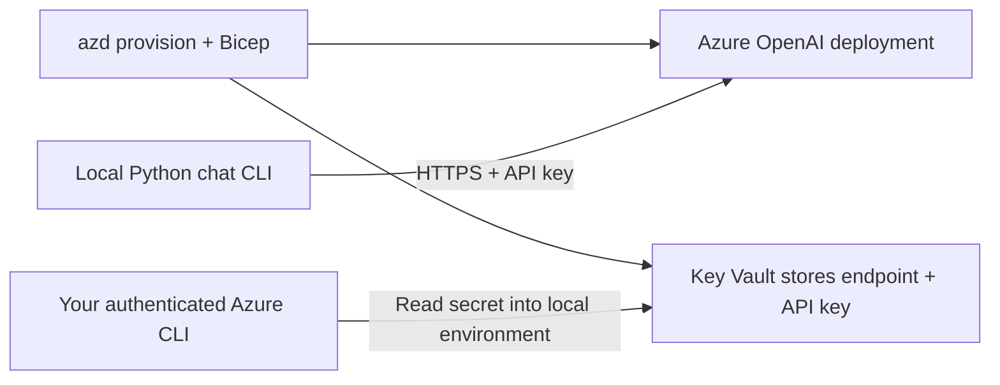

# Azure OpenAI Chat — CLI local și infrastructură AZD

**Nivel:** Intermediar · **Timp:** 35–60 minute inclusiv configurarea

Acest exemplu configurează un **resource Azure OpenAI și Key Vault**, apoi rulează un
CLI interactiv de chat Python **pe mașina ta**. Nu găzduiește o aplicație web
sau o aplicație Container App. Modelul implicit este `gpt-4.1`, versiunea `2025-04-14`, cu
capacitate de implementare `GlobalStandard` 20. Verifică disponibilitatea curentă și cota în
regiunea selectată înainte de implementare; datele ciclului de viață al modelului se pot schimba.

## Obiective de învățare

- Provisionarea infrastructurii modelului cu Bicep și azd.
- Obținerea unei chei API din Key Vault fără a o introduce în rezultatele implementării.
- Trimiterea cererilor de completări Chat și menținerea istoricului conversației.
- Interpretarea numărului de tokeni și limitările estimărilor de cost.



Nu există integrare runtime cu identitate gestionată, failover multi-regiune, limitator de rată
personalizat, mod streaming sau calcul găzduit în acest exemplu. SDK-ul OpenAI
efectuează până la două retry-uri pentru eșecuri retry-abile; CLI raportează erorile rămase.

## Cerințe prealabile

- O versiune stabilă curentă [azd](https://learn.microsoft.com/azure/developer/azure-developer-cli/install-azd)
  (versiune publicată la momentul revizuirii: 1.37.2).
- [Azure CLI](https://learn.microsoft.com/cli/azure/install-azure-cli).
- Python **3.10+** (3.11 recomandat) și un mediu virtual.
- Un abonament Azure cu permisiunea de a crea servicii Cognitive Services și Key Vault
  resurse, de a implementa modele și de a citi secretele din vault.
- Disponibilitate regională și cotă `GlobalStandard` pentru `gpt-4.1`. Cerințele de acces
  depind de abonament și funcționalitate; nu există un timp garantat de aprobare.

```bash
azd version
az version
python --version
azd auth login
az login
```

Acestea sunt sesiuni de autentificare separate. Selectați același abonament în ambele
unelte înainte de a rula comenzile de mai jos.

## Pornire rapidă (Bash)

Rulați din rădăcina depozitului:

```bash
cd examples/azure-openai-chat
azd env new myopenai
azd provision
```

Alegeți o regiune susținută. Provisionarea creează un grup de resurse, cont OpenAI,
implementarea modelului, Key Vault și secretele `openai-endpoint`/`openai-api-key`.
Nu există **servicii de implementat** în `azure.yaml`.

Încărcați ieșirile non-secrete și preluați secretul în shell-ul curent:

```bash
export AZURE_OPENAI_ENDPOINT="$(azd env get-value AZURE_OPENAI_ENDPOINT)"
export AZURE_OPENAI_MODEL="$(azd env get-value AZURE_OPENAI_MODEL)"
KV_NAME="$(azd env get-value AZURE_KEY_VAULT_NAME)"
export AZURE_OPENAI_API_KEY="$(az keyvault secret show \
  --vault-name "$KV_NAME" --name openai-api-key --query value --output tsv)"

python -m venv .venv
source .venv/bin/activate
python -m pip install -r src/requirements.txt
python src/chat.py
```

În PowerShell, activează cu `.\.venv\Scripts\Activate.ps1` și atribuie variabile de mediu
cu `$env:AZURE_OPENAI_ENDPOINT = azd env get-value AZURE_OPENAI_ENDPOINT`
(și similar pentru model). Obține cheia API folosind
`$env:AZURE_OPENAI_API_KEY = az keyvault secret show --vault-name $KV_NAME --name openai-api-key --query value -o tsv`.
Setează `$KV_NAME = azd env get-value AZURE_KEY_VAULT_NAME` primul.

Nu imprimați, nu trimiteți și nu lipiți cheia API în rapoartele de probleme. Interfața de linie de comandă citește procesul
variabile de mediu; **nu** preia secretele din Key Vault sau încarcă fișiere `.env`.
`config.py` validează endpoint-ul, limita de tokeni și temperatura la pornire.

Rezultatul așteptat (conținut și utilizare variază):

```text
Azure OpenAI Chat Application
Model: gpt-4.1
...
You: Say hello in one sentence.
Assistant: Hello! How can I help you today?
[Tokens: ... | Cost: $...]
```

Comenzi: `stats` arată totalurile, `clear` șterge istoricul conversației, și
`quit`/`exit` încheie sesiunea. Nu există comenzi `--stream`, `--show-tokens`, `tokens`,
sau `cost`.

## Verifică implementarea

După încărcarea variabilelor shell de mai sus:

```bash
curl --fail-with-body \
  "${AZURE_OPENAI_ENDPOINT%/}/openai/deployments/${AZURE_OPENAI_MODEL}/chat/completions?api-version=2024-10-21" \
  -H "Content-Type: application/json" \
  -H "api-key: $AZURE_OPENAI_API_KEY" \
  -d '{"messages":[{"role":"user","content":"Say hello!"}],"max_tokens":50}'

az keyvault secret list --vault-name "$KV_NAME" --query "[].name" -o table
```

Succes: API-ul returnează HTTP 200 cu `choices[0].message.content` și `usage`;
se afișează `openai-api-key` și `openai-endpoint` din vault. O implementare ARM reușită
singură nu verifică inferența.

## Fișiere și configurare

```text
azure.yaml                         # Infrastructure-only AZD project
infra/main.bicep                   # Subscription deployment
infra/main.parameters.json         # Environment, location, principal ID
infra/resources/openai.bicep       # Account + model
infra/resources/keyvault.bicep     # Vault + deploying user's secret access policy
infra/resources/secrets.bicep      # Writes secrets, no key output
src/chat.py                        # Interactive CLI
src/config.py                      # Environment validation
src/requirements.txt               # Python packages
```

Pentru a schimba modelul/versionarea/capacitatea aprovizionată, editează valorile implicite în
`infra/main.bicep` și rulează `azd provision`. Setarea `AZURE_OPENAI_MODEL` în
shell-ul tău selectează doar un **nume de implementare existent**; nu implementează un alt model.

| Variabilă runtime | Implicit / sursă |
|---|---|
| `AZURE_OPENAI_ENDPOINT` | Obligatoriu; ieșire ne-secretă azd |
| `AZURE_OPENAI_API_KEY` | Obligatoriu; preluat din Key Vault |
| `AZURE_OPENAI_MODEL` | `gpt-4.1`; nume de implementare Azure |
| `AZURE_OPENAI_MAX_TOKENS` | 800 (interval de validare 1–4096) |
| `AZURE_OPENAI_TEMPERATURE` | 0.7 (interval 0–2) |
| `AZURE_OPENAI_INPUT_PRICE_PER_1K` | 0.002 USD; rată ilustrativă pentru intrare nesalvată în cache |
| `AZURE_OPENAI_OUTPUT_PRICE_PER_1K` | 0.008 USD; rată ilustrativă pentru ieșire |

## Costuri și limitări de securitate

Afișarea costurilor este o **estimare**, nu facturarea Azure. Multiplică utilizarea de tokeni API
cu tarifele configurate și nu ia în considerare reducerile pentru intrări salvate în cache,
diferențele regionale/SKU, taxe, modificări de preț sau apeluri eșuate/reîncercate.
Suprascrie **ambele tarife** atunci când folosești alt model sau SKU și verifică
[prețurile Azure OpenAI](https://azure.microsoft.com/pricing/details/cognitive-services/openai-service/) actuale.

Pentru ilustrare, 100 de cereri folosind fiecare 500 tokeni de intrare nesalvată și 200 output
la tarifele implicite costă `100 × (500/1000 × .002 + 200/1000 × .008) = $0.26`.
Operațiunile/stocarea în Key Vault implică costuri separate. Nu există o taxă fixă de $50/lună
pentru acest CLI local și nu există calcul găzduit în șablon.

Vault-ul folosește o politică de acces pentru principalul care face implementarea; nu este un exemplu
de RBAC sau aplicație cu identitate gestionată. Endpoint-urile publice și autentificarea cu cheie API
sunt folosite pentru predare. Limitează permisiunile și adaugă controale adecvate de identitate/rețea
înainte de a-l adapta pentru producție.

## Exerciții practice

### 1. Verifică contextul și resetează-l

**Începe:** rulează CLI-ul. **Scop:** observă istoricul.
Spune „Amintește-ți cuvântul cedru,” apoi întreabă „Ce cuvânt ți-am cerut să-ți amintești?”
Rulează `stats`; două răspunsuri reușite ar trebui să conteze ca două mesaje schimbate.
Rulează `clear` și `stats`; mesajele schimbate ar trebui să fie zero (totalurile de tokeni rămân).
Formula exactă a modelului nu este deterministă.

### 2. Schimbă limita de răspuns

**Începe:** ieși din CLI păstrând același shell.
Rulează `export AZURE_OPENAI_MAX_TOKENS=100`, repornește `python src/chat.py`, și cere
o scurtă explicație a azd. Verificați dacă bannerul afișează 100.
Restaurare cu `unset AZURE_OPENAI_MAX_TOKENS`. O limită de răspuns mai mică nu
reduce tokenii de istoric deja trimiși.

### Probleme comune

- **Variabile de mediu lipsă:** aprovizionarea nu exportă valorile shell;
  repetați pașii de export. Un terminal nou le necesită din nou.
- **403 la citirea Key Vault:** verificați abonamentul/autentificarea Azure CLI și principalul
  din politica de acces a seifului. Modificările politicii pot necesita timp pentru a se propaga.
- **404 inferență:** verificați numele implementării, punctul final și starea implementării.
- **429 inferență:** așteptați resetarea limitelor de rată; verificați cota modelului regional.
  CLI elimină tururile eșuate din istoric astfel încât reluarea nu le dublează.
- **Lungimea contextului:** exemplul nu taie conversațiile lungi; folosiți `clear`.
- **Model indisponibil/retras:** consultați disponibilitatea curentă a modelului și actualizați
  modelul/versiunea/SKU împreună; versiunea API și versiunea modelului sunt setări diferite.

## Curățare și pași următori

```bash
azd down
unset AZURE_OPENAI_API_KEY
```

Reținerea ștergerii soft a Key Vault este de șapte zile; ștergerea permanentă necesită permisiuni separate.
Nu există un set de teste dedicat; nu rulați o comandă `pytest tests/` inexistentă.
Adăugați teste API simulate înainte de a extinde codul.

[Exemple de containere](../../../../examples/container-app) · [Plan de arhitectură retail](../retail-scenario.md) ·
[Pagina cursului](../../README.md) · [Raportați o problemă](https://github.com/microsoft/AZD-for-beginners/issues)

---

<!-- CO-OP TRANSLATOR DISCLAIMER START -->
**Declinare a responsabilității**:
Acest document a fost tradus folosind serviciul de traducere AI [Co-op Translator](https://github.com/Azure/co-op-translator). În timp ce ne străduim pentru acuratețe, vă rugăm să rețineți că traducerile automate pot conține erori sau inexactități. Documentul original în limba sa nativă trebuie considerat sursa autorizată. Pentru informații critice, se recomandă traducerea profesională realizată de un om. Nu ne asumăm responsabilitatea pentru eventualele neînțelegeri sau interpretări greșite care decurg din utilizarea acestei traduceri.
<!-- CO-OP TRANSLATOR DISCLAIMER END -->