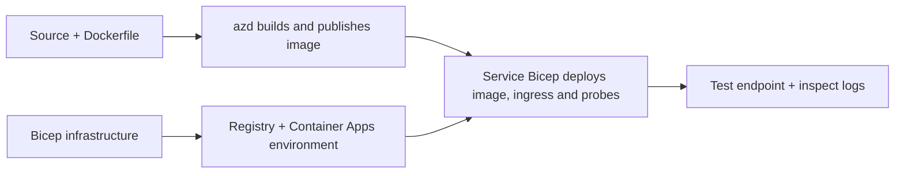

# Exemple de implementare a aplicațiilor container cu AZD

Acest director conține două mostre de învățare cu cod sursă, Dockerfile-uri,
infrastructură Bicep și `azure.yaml`. Nici una nu este pregătită pentru producție.

## Alegeți un exemplu

| Mostră | Ce este implementat | Precondiție |
|---|---|---|
| [API Flask simplu](../../../../examples/container-app/simple-flask-api) | API CRUD Python unic, elemente în memorie, sonde de sănătate, scalare HTTP | Cunoștințe de bază CLI și HTTP |
| [Microservicii cu două servicii](../../../../examples/container-app/microservices) | Gateway Node.js, serviciu intern Python doar citire pentru produs, telemetrie și scalare | Completați mai întâi mostra cu un singur serviciu |

Alocați 30–60 de minute incluzând configurarea și verificarea. Timpurile de aprovizionare Azure variază.

## Precondiții

- [Azure Developer CLI](https://learn.microsoft.com/azure/developer/azure-developer-cli/install-azd)
- [Azure CLI](https://learn.microsoft.com/cli/azure/install-azure-cli) pentru comenzile de verificare
- Docker cu daemon-ul său pornit pentru construirea acestor imagini de container
- Un abonament Azure cu permisiuni de creare resurse și cotă regională suficientă
- Bash pentru exemplele din shell, sau comenzi echivalente PowerShell

```bash
azd version
az version
docker info
azd auth login
az login
```

Cele două unelte au sesiuni de autentificare separate. Folosiți o versiune stabilă curentă azd; 
versiunea publicată curent la momentul revizuirii este 1.37.2. Cerințele de versiune minimă mai vechi
nu sunt o garanție de compatibilitate.

## Pornire rapidă

Din rădăcina depozitului:

```bash
cd examples/container-app/simple-flask-api
azd env new flask-demo
azd up
API_URL=$(azd env get-value API_ENDPOINT)
curl --fail-with-body "${API_URL}/health"
```

Așteptat: HTTP 200 cu `"status": "healthy"`. Urmați exemplul din README pentru a crea,
citi, actualiza și șterge un element, și pentru a inspecta jurnalele.



Provisionarea inițială folosește o imagine publică hello-world pe portul 80. Fișierele de parametri specifice serviciului
Bicep permit lui `azd deploy` să o înlocuiască cu imaginea aplicației construite
și cu portul/probele aplicației corecte (8000 pentru Flask/product, 8080 pentru gateway).
Păstrează aceste fișiere cu setările lor `azure.yaml` `module`.

## Configurare: ce modifică ce

`azure.yaml` selectează directoarele sursă, limbajele, gazdele și modulele de implementare.
CPU/memoria containerului, ingress, probele, numărul de replici și regulile de scalare sunt definite
în **Bicep**, nu în proprietăți arbitrare `resources`, `scale` sau `regions` ale serviciului.

`azd env set SOME_VALUE ...` stochează o valoare locală. Aceasta schimbă o
resursă implementată doar când un parametru, o mapare de mediu sau un hook consumă în mod explicit acea
valoare. Aceste exemple nu consumă `MAX_REPLICAS`, `SCALE_TO_ZERO_TIMEOUT`,
`CONTAINER_APP_REPLICA_TYPE` sau setări personalizate de canary din valorile mediului azd.
Editează fișierul Bicep relevant și rulează `azd up` pentru a reproviziona și implementa din nou.

Nu pune codul sursă al aplicației sub `infra/`. `project` trebuie să indice către directorul
sursă care conține Dockerfile și manifestul dependențelor.

## Monitorizare și costuri

- `azd monitor --logs` deschide o vizualizare portal; nu este un flux de jurnal terminal.
  Folosiți `az containerapp logs show --follow` cu numele real al resursei.
- API-ul simplu scrie jurnale stdout colectate prin Container Apps/Log Analytics.
  Resursa Application Insights aprovizionată nu este instrumentată automat.
- Gateway-ul microserviciilor folosește SDK-ul Node.js Application Insights; serviciul Python
  exportă urme de jurnal de aplicație. Urmărirea completă a cererilor/dependențelor Python
  nu este configurată.
- Scale-to-zero poate reduce taxele de calcul, dar registrul și ingestia/stocarea jurnalelor
  pot costa în continuare bani. Setările implicite pentru microservicii mențin replicile active.
  Estimați regiunea și utilizarea în
  [calculatorul de prețuri Azure](https://azure.microsoft.com/pricing/calculator/).

## Modele avansate — implementări neincluse

Acestea sunt direcții de proiectare, nu proiecte locale suplimentare sau fragmente de cod gata de rulare:

- **Date persistente și autentificare:** înlocuiți stocările în memorie și adăugați
  autentificare/autorizare Microsoft Entra ID înainte de producție.
- **Blue-green/canary:** utilizați modul cu mai multe revizuiri al Container Apps, etichete de revizuire,
  ponderi de trafic, verificări de sănătate și proceduri de revenire.
  Nu există o configurare `deploymentStrategy: canary` azd în aceste exemple.
  Consultați [gestionarea reviziilor](https://learn.microsoft.com/azure/container-apps/revisions).
- **Multi-regiune:** creați medii și aplicații separate în Bicep și proiectați
  rutare globală și consistență a datelor. O listă de servicii `regions` nu este un mecanism de implementare azd.
- **Lucrători în coadă:** adăugați sursa lucrătorului, dependențe, resurse de coadă, un serviciu gestionat
- **Lucrători în coadă:** adăugați sursa lucrătorului, dependențele, resursele cozii, un gestionat
  identitate cu roluri pe planul de date și o regulă de scalare autentificată. Nu copia
  o cale `src/worker` goală și să te aștepți la un proiect ce poate fi rulat.
- **Dapr:** provisionați componentele, configurați sidecar-ul, instalați SDK-ul corespunzător,
  și implementați gestionarea erorilor pentru state/pub-sub.
- **Secrete:** utilizați identitate gestionată și atribuirile de rol acolo unde este posibil. Simplul
  fapt de a crea un Key Vault nu oferă aplicațiilor acces sau încărcarea secretelor.

## Curățare

Din directorul exemplului:

```bash
azd down
```

Revizuiți solicitările de ștergere și confirmați că grupul de resurse dedicat este eliminat.
Nu utilizați aceste exemple ca bază pentru producție fără un design și teste suplimentare.

[Indexul exemplelor](../README.md) · [Pagina cursului](../../README.md) ·
[Documentația Container Apps](https://learn.microsoft.com/azure/container-apps/) ·
[Raportați o problemă](https://github.com/microsoft/AZD-for-beginners/issues)

---

<!-- CO-OP TRANSLATOR DISCLAIMER START -->
**Declinare a responsabilității**:
Acest document a fost tradus folosind serviciul de traducere AI [Co-op Translator](https://github.com/Azure/co-op-translator). În timp ce ne străduim pentru acuratețe, vă rugăm să rețineți că traducerile automate pot conține erori sau inexactități. Documentul original în limba sa nativă trebuie considerat sursa autorizată. Pentru informații critice, se recomandă traducerea profesională realizată de un om. Nu ne asumăm responsabilitatea pentru eventualele neînțelegeri sau interpretări greșite care decurg din utilizarea acestei traduceri.
<!-- CO-OP TRANSLATOR DISCLAIMER END -->