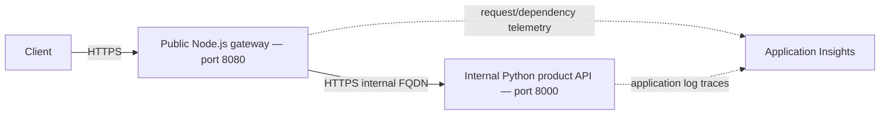

# Microservicii cu două servicii — Azure Container Apps

**Nivel:** Intermediar · **Durată:** 45–60 minute inclusiv configurarea

Acest exemplu de învățare implementează un **Node.js API Gateway** și un **Serviciu Python
Product doar în citire**. Sunt incluse codul sursă, Dockerfiles, Bicep și configurația azd.
Nu este un sistem pregătit pentru producție.

## Ce vei învăța

- Cum să implementezi două servicii independent.
- Cum să folosești un FQDN backend intern peste HTTPS.
- Cum să verifici răspunsurile de succes, neidentificat, și serviciu indisponibil.
- Cum să înțelegi telemetria și limitele de scalare independente.



Catalogul de produse conține cinci produse fixe în memorie. Nu există **handleri POST,
PUT sau DELETE**, baze de date, Service Bus, servicii de comandă/utilizator/notificare,
cod C# sau Go. Acestea sunt idei de dezvoltare viitoare, nu caracteristici incluse.
Gateway-ul nu autentifică utilizatorii; accesul intern nu înlocuiește
autorizarea aplicației.

## Cerințe preliminare

Finalizează mai întâi [API-ul Flask simplu](../../../../../examples/container-app/simple-flask-api).
Instalează o versiune stabilă curentă azd (release publicat la momentul revizuirii: 1.37.2), Azure CLI,
și Docker cu daemon-ul activ. Ai nevoie de un abonament Azure, permisiuni pentru
crearea resurselor și cotă regională pentru Container Apps.

```bash
azd version
az version
docker info
azd auth login
az login
```

Folosește același abonament în ambele instrumente CLI. Comenzile de mai jos sunt în Bash.

## Implementare și verificare

Din directorul rădăcină al depozitului:

```bash
cd examples/container-app/microservices
azd env new microservices-demo
azd up
GATEWAY_URL=$(azd env get-value API_GATEWAY_URL)
RG_NAME=$(azd env get-value AZURE_RESOURCE_GROUP)
GATEWAY_NAME=$(azd env get-value API_GATEWAY_NAME)
PRODUCT_NAME=$(azd env get-value PRODUCT_SERVICE_NAME)

curl --fail-with-body "${GATEWAY_URL}/health"
curl --fail-with-body "${GATEWAY_URL}/api/products"
curl --fail-with-body "${GATEWAY_URL}/api/products/1"
curl -i "${GATEWAY_URL}/api/products/999"
```

**Succes:** health 200; list 200 cu **cinci** produse; produsul 1 este un Laptop
la prețul de 999.99 cu stoc 50; produsul necunoscut returnează 404.
Descrierile sunt incluse în răspunsuri; marcajele temporale variază.

Provisionarea inițială folosește imagini publice hello-world pe portul 80 astfel încât
să nu încerce să tragă imagini inexistente dintr-un registru gol. Modulele Bicep
și fișierele de parametri specifice serviciului le înlocuiesc cu imagini construite și porturile/probele aplicației în timpul
`azd deploy`. Parametrii principali păstrează numele imaginilor publicate pentru provisioning-ul ulterior.

## Servicii și rețelistică

| Serviciu | Endpoint-uri expuse | Resurse implicite |
|---|---|---|
| Gateway | GET `/`, `/health`, `/api/products`, `/api/products/:id` | 1 vCPU, 2 GiB, 2–20 replici |
| Product | GET `/`, `/health`, `/products`, `/products/<id>` | 0.5 vCPU, 1 GiB, 1–10 replici |

Ingresul pentru produs are `external: false` și `allowInsecure: false`. Bicep injectează
`PRODUCT_SERVICE_URL=https://<actual-internal-fqdn>` în gateway. HTTP ar
redirect; HTTPS corespunde ingress-ului configurat. Un nume DNS scurt trebuie să corespundă
**numele real al Container App**, nu cheii logice a serviciului `product-service`.
Nu încercați să apelați direct URL-ul intern de pe laptopul dvs.

Gateway-ul are un timp de așteptare de cinci secunde pentru apelurile de produs. ID-urile de produs lipsă
se propagatează ca 404; eșecurile de transport/alte eșecuri backend returnează 503. Gateway-ul
`/health` verifică doar gateway-ul, nu disponibilitatea backend-ului.

## Fișiere și configurare

```text
azure.yaml
infra/main.bicep
infra/main.parameters.json
infra/abbreviations.json
infra/core/container-apps-environment.bicep
infra/core/monitor.bicep
infra/app/api-gateway.bicep
infra/app/api-gateway.parameters.json
infra/app/product-service.bicep
infra/app/product-service.parameters.json
src/api-gateway/{app.js,package.json,Dockerfile}
src/product-service/{main.py,requirements.txt,Dockerfile}
```

Scalarea, CPU/memorie, porturile și probele sunt setate în `infra/app/*.bicep`. Modificați acele
fișiere și rulați `azd up` pentru a aplica infrastructura și a redeploya. Nu există
un parametru de variabilă de mediu `GATEWAY_MAX_REPLICAS` în acest exemplu.

Pentru modificări numai de cod:

```bash
azd deploy product-service
azd deploy api-gateway
```

Imaginea Node folosește Node 22; imaginea Python folosește Python 3.11. Ambele leagă la
`0.0.0.0`. Ingress/probe folosesc port 8080 (gateway) și 8000 (produs), respectiv.

## Dezvoltare locală cu Docker

Rulați din acest director exemplu. Folosiți o rețea definită de utilizator, **nu `localhost`
pentru ca un container să ajungă la celălalt**:

```bash
docker network create azd-microservices-demo
docker build -t local-product ./src/product-service
docker build -t local-gateway ./src/api-gateway
docker run -d --name azd-product --network azd-microservices-demo local-product
docker run -d --name azd-gateway --network azd-microservices-demo \
  -p 8080:8080 -e PRODUCT_SERVICE_URL=http://azd-product:8000 local-gateway
curl --fail-with-body http://localhost:8080/api/products
```

Așteptat: cinci produse. HTTP este folosit numai pentru această rețea locală Docker.

```bash
docker stop azd-product azd-gateway
docker rm azd-product azd-gateway
docker network rm azd-microservices-demo
```

## Monitorizare

```bash
az containerapp logs show --name "$GATEWAY_NAME" --resource-group "$RG_NAME" --follow
# In a separate terminal:
az containerapp logs show --name "$PRODUCT_NAME" --resource-group "$RG_NAME" --tail 100
```

`azd monitor --logs` deschide o vizualizare portal; nu transmite fluxuri de jurnal terminal.
SDK-ul Node colectează solicitările/dependențele gateway-ului. `AzureLogHandler` Python
exportă **urmăriri de log**, nu solicitări automate Flask, dependențe SQL sau urmăririle
distribuite complete. OpenCensus este un SDK moștenit; preferați Azure Monitor OpenTelemetry
când extindeți acest exemplu.

În Application Insights Logs, generați solicitări și inspectați:

```kusto
requests
| where timestamp > ago(1h)
| where name contains "products"
| summarize RequestCount=count(), AvgDuration=avg(duration) by bin(timestamp, 5m)
```

Pentru mesajele aplicației Python:

```kusto
traces
| where timestamp > ago(1h)
| where message contains "products"
| project timestamp, message, severityLevel
```

Permiteți întârzierea ingestiei și eșantionarea; nu vă așteptați la un număr exact de solicitări sau o
latență garantată. Nu sunt configurate alerte personalizate sau tablouri de bord.

## Exerciții practice

### Exercițiul 1: Modificați catalogul

**Punct de plecare:** `src/product-service/main.py`.
**Scop:** verificați implementarea serviciului independent.
Schimbați stocul Laptopului de la 50 la 49 în lista fixă `products`, rulați
`azd deploy product-service`, apoi solicitați `${GATEWAY_URL}/api/products/1`.

**Criterii de succes / soluție:** HTTP 200 cu `"stock":49`. Restaurați 50 și redeployați.
**Problemă frecventă:** editarea gateway-ului în locul serviciului care deține catalogul.
Aceasta modifică datele sursă, nu o bază de date persistentă de inventar.

### Exercițiul 2: Verificați configurarea replicilor

**Punct de plecare:** `infra/app/product-service.bicep`.
**Scop:** observați o modificare de infrastructură fără a ghici autoscalarea.
Schimbați `minReplicas: 1` la `minReplicas: 2`, rulați `azd up`, apoi:

```bash
az containerapp show --name "$PRODUCT_NAME" --resource-group "$RG_NAME" \
  --query properties.template.scale -o json
```

**Criterii de succes:** minimul configurat este 2 și maximul rămâne 10.
Restaurați minimul la 1 și rulați `azd up`.
**Problemă frecventă:** `azd deploy` singur nu aplică modificările infrastructurii partajate fără legătură.
Nu setați `maxReplicas` la zero ca simulare a unui eșec.
Acest lucru verifică configurația, nu un test de încărcare sau un număr garantat instantaneu de replici.

### Exercițiul 3: Testați gestionarea serviciului indisponibil local

**Punct de plecare:** ambele containere locale Docker de mai sus rulează.
**Scop:** distingeți eșecul backend de un produs lipsă.
Opriți doar containerul produs:

```bash
docker stop azd-product
curl -i http://localhost:8080/api/products
docker start azd-product
curl --fail-with-body http://localhost:8080/api/products
```

**Criterii de succes:** în timp ce este oprit, gateway-ul returnează 503 cu
`"error":"Product service unavailable"`; după repornire, lista returnează 200.
Reîncercați după o scurtă întârziere de pornire dacă este necesar.
**Problemă frecventă:** oprirea gateway-ului testează un eșec diferit (fără răspuns HTTP).

## Costuri și lacune în producție

Replicile minime implicite mențin compute-ul activ. Registry și monitorizarea implică, de asemenea,
costuri. Nu există un total fix validat de 50$ pe lună: estimați CPU/memorie regională,
ore de replici, solicitări, registry și păstrarea jurnalelor în
[calculatorul de prețuri Azure](https://azure.microsoft.com/pricing/calculator/).
Ștergeți resursele de învățare prompt.

Munca de producție include autentificare/autorizare, identități gestionate pe domenii,
date persistente, validarea inputului/răspunsului, instrumentație de observabilitate suportată,
testarea încărcării/eșecului, CI/CD, alerte și proceduri de recuperare. Adăugarea unui serviciu
de comandă, coadă sau bază de date este o sarcină de implementare separată, nu un exercițiu finalizat
sau o funcționalitate deja disponibilă aici.

## Depanare și curățare

- **Imaginea nu a fost găsită în timpul primei furnizări:** bootstrap ar trebui să folosească imaginea publică;
  verificați valorile implicite ale parametrilor imaginii principale și mapările modulului de implementare.
- **Produse 503:** verificați jurnalele produsului, revizia imaginii și URL-ul intern HTTPS injectat.
- **404 cale neașteptată:** API-ul de produs este doar în citire; verificați ruta, nu un handler CRUD inexistent.
- **Fără telemetrie:** inspectați șirurile de conexiune runtime fără a le expune și
  permiteți întârzierea ingestiei. Tabelele de solicitări Python nu sunt populate de handler-ul său de log.

Din acest director exemplu:

```bash
azd down
```

Revizuiți solicitările de ștergere și verificați că grupul de resurse dedicat este eliminat.

[Anterior: Flask API](../../../../../examples/container-app/simple-flask-api) · [Următor: Aplicație bază de date](../../../../../examples/database-app) ·
[Dezvoltare AI](../../../docs/chapter-02-ai-development/README.md) ·
[Pagina principală a cursului](../../../README.md) · [Raportați o problemă](https://github.com/microsoft/AZD-for-beginners/issues)

---

<!-- CO-OP TRANSLATOR DISCLAIMER START -->
**Declinare a responsabilității**:
Acest document a fost tradus folosind serviciul de traducere AI [Co-op Translator](https://github.com/Azure/co-op-translator). În timp ce ne străduim pentru acuratețe, vă rugăm să rețineți că traducerile automate pot conține erori sau inexactități. Documentul original în limba sa nativă trebuie considerat sursa autorizată. Pentru informații critice, se recomandă traducerea profesională realizată de un om. Nu ne asumăm responsabilitatea pentru eventualele neînțelegeri sau interpretări greșite care decurg din utilizarea acestei traduceri.
<!-- CO-OP TRANSLATOR DISCLAIMER END -->