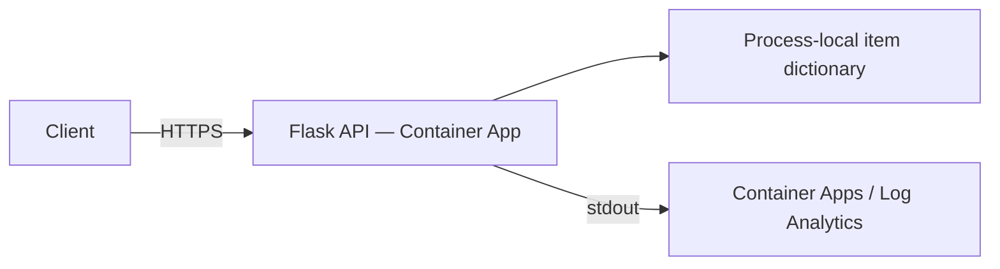

# API Flask simplu — Azure Container Apps

**Nivel:** Începător · **Timp:** 30–45 minute inclusiv configurarea

Implementați o API Python Flask CRUD cu Azure Developer CLI (azd). Sunt incluse sursa, Dockerfile,
Bicep și parametrii de implementare. Aceasta este un **exemplu de învățare**, nu
o API gata pentru producție.

## Ce vei învăța

- Construiește și publică un container prin azd.
- Configurează ingress și probe de liveness/readiness.
- Verifică răspunsurile CRUD și inspectează jurnalele aplicației.
- Înțelege de ce datele în memorie nu sunt adecvate pentru aplicații durabile.



**Important:** elementele sunt stocate într-un singur proces. Implicit este **un singur worker Gunicorn,
0–1 replici**, evitând în mod intenționat date inconsistente între workers/replici.
Elementele se pierd la restart, schimbarea reviziei sau scalarea la zero. Creșterea numărului de replici
necesită stocare persistentă partajată. API-ul nu are autentificare sau autorizare.

## Cerințe preliminare

- [azd stabil curent](https://learn.microsoft.com/azure/developer/azure-developer-cli/install-azd)
  (versiunea publicată la momentul revizuirii: 1.37.2).
- [Azure CLI](https://learn.microsoft.com/cli/azure/install-azure-cli) pentru verificare.
- Docker cu daemonul său pornit; este necesar pentru construirea implicită a imaginii local.
- Abonament Azure, permisiuni de creare resurse și cotă regională Container Apps.
- Bash pentru comenzile de mai jos (sau echivalent PowerShell).
- Python 3.11 pentru dezvoltare locală opțională.

```bash
azd version
az version
docker info
azd auth login
az login
```

Uneltele CLI au sesiuni de conectare separate. Folosește același abonament în ambele.

## Pornire rapidă

Din rădăcina depozitului:

```bash
cd examples/container-app/simple-flask-api
azd env new flask-demo
azd up
API_URL=$(azd env get-value API_ENDPOINT)
RG_NAME=$(azd env get-value AZURE_RESOURCE_GROUP)
API_NAME=$(azd env get-value API_NAME)
curl --fail-with-body "${API_URL}/health"
```

Așteptat: HTTP 200 și JSON cu `"status":"healthy"`,
`"service":"simple-flask-api"` și un timestamp UTC curent.
Provizionarea și construirea imaginii durează de obicei câteva minute; durata variază.

Provizionarea inițială folosește o imagine hello-world publică ascultând pe portul 80.
`azure.yaml` selectează `infra/app/api.bicep` și fișierul său de parametri corespunzător pentru
implementarea serviciului, care schimbă imaginea, ingress-ul și probele la portul 8000.
Nu șterge acei parametri de implementare.

## Verifică CRUD

Rulează următoarele în ordine în timp ce aceeași replică rămâne activă:

```bash
# Create: HTTP 201; note the returned id (1 for a fresh process).
curl -i -X POST "${API_URL}/api/items" \
  -H "Content-Type: application/json" \
  -d '{"name":"Test Item","description":"My first item"}'

# Read list: HTTP 200, total 1 in a fresh process.
curl --fail-with-body "${API_URL}/api/items"

# Replace 1 if your create response returned another id.
curl --fail-with-body "${API_URL}/api/items/1"
curl -i -X PUT "${API_URL}/api/items/1" \
  -H "Content-Type: application/json" -d '{"name":"Updated Item"}'
curl -i -X DELETE "${API_URL}/api/items/1"
curl -i "${API_URL}/api/items/1"
```

Succes: POST 201, citiri/PUT 200, DELETE 204 fără conținut, apoi 404 pentru element lipsă.
JSON formatat greșit/non-obiect sau un nume gol returnează 400.
Dacă un element dispare între cereri, verifică un restart sau scalare la zero;
aceasta este o limitare intenționată în memorie, nu persistență.

| Endpoint | Metode |
|---|---|
| `/` | GET — informații despre serviciu |
| `/health` | GET — liveness/readiness |
| `/api/items` | GET, POST |
| `/api/items/{id}` | GET, PUT, DELETE |

## Jurnale și configurare

```bash
az containerapp logs show --name "$API_NAME" --resource-group "$RG_NAME" --follow
```

Așteptat: pornire Gunicorn, jurnale de acces cereri și mesaje ale aplicației.
`azd monitor --logs` deschide o vizualizare portal; nu transmite în terminal.
Application Insights este provisionat, dar **nu este instrumentat de acest cod Flask**;
folosește Container Apps/Log Analytics pentru jurnalele stdout.

Editează `infra/app/api.bicep` pentru CPU/memorie, limite replici sau reguli de scalare, apoi
rulează `azd up`. Implicit sunt 0.5 vCPU, 1 GiB, minimum 0 / maximum 1 replică, și un
prag HTTP de 50 cereri concurente. Scalarea la zero poate adăuga latență la pornire rece.

Valori arbitrare `azd env set MAX_REPLICAS`, `API_KEY`, `LOG_LEVEL` sau
Valorile `SCALE_TO_ZERO_TIMEOUT` **nu sunt conectate la acest șablon sau aplicație**.
Setarea unei valori nu o face automat o variabilă de mediu la rulare.
Imaginea leagă portul 8000 în mod explicit; actualizați Dockerfile, Bicep ingress și probele
împreună dacă schimbați portul.

## Fișiere

```text
azure.yaml
infra/main.bicep
infra/main.parameters.json
infra/app/container-apps.bicep       # Environment, registry, monitoring
infra/app/api.bicep                  # App, ingress, probes, scale settings
infra/app/api.parameters.json        # Image and resource values for azd deploy
src/app.py
src/Dockerfile
src/requirements.txt
```

## Dezvoltare locală

Din acest director exemplu:

```bash
python -m venv .venv
source .venv/bin/activate  # PowerShell: .\.venv\Scripts\Activate.ps1
python -m pip install -r src/requirements.txt
python src/app.py
```

Într-un alt terminal, testați `http://localhost:8000/health` și punctele finale CRUD.
Sau construiți și rulați imaginea efectivă:

```bash
docker build -t flask-api:local ./src
docker run --rm -p 8000:8000 flask-api:local
```

Pentru modificări doar de cod după prima implementare, rulați `azd deploy api`.
Pentru modificări Bicep, rulați `azd up` pentru reprovisionare și implementare.

## Exerciții practice

### 1. Validarea respingerii intrărilor

**Punct de plecare:** API implementat, `API_URL` mai sus.
**Scop:** verificați că API respinge forme JSON invalide și lipsa numelor.

```bash
curl -i -X POST "${API_URL}/api/items" \
  -H "Content-Type: application/json" -d '[]'
curl -i -X POST "${API_URL}/api/items" \
  -H "Content-Type: application/json" -d '{"name":""}'
```

**Criterii de succes / soluție:** ambele returnează 400 cu o eroare JSON, nu 500.
**Problemă comună:** omiterea antetului content-type JSON.

### 2. Adăugați un punct final doar pentru citire

**Punct de plecare:** `src/app.py`. **Scop:** extindeți și reimplementați API-ul.
Adăugați asta înainte de blocul `if __name__ == '__main__':`:

```python
@app.route('/version', methods=['GET'])
def version():
    return jsonify({'version': '1.0.0'})
```

Rulați `azd deploy api`, apoi `curl --fail-with-body "${API_URL}/version"`.
**Criterii de succes:** HTTP 200 și `{"version":"1.0.0"}`.
**Problemă comună:** plasarea rutei după apelul blocant `app.run()` când
testați cu `python src/app.py`.

### Punct de verificare a cunoștințelor

De ce un singur worker este insuficient pentru date durabile? Pentru că chiar și un proces pierde
dicționarul său la repornire. O versiune de producție are nevoie de stocare partajată persistentă,
autentificare, autorizare, migrații, teste și monitorizare operațională.

## Costuri și depanare

Aceasta nu este o implementare garantată $0: registrul Basic și stocarea/ingestia de jurnale
pot genera taxe chiar și atunci când calculul aplicației este zero. Folosiți
[calculatorul de prețuri](https://azure.microsoft.com/pricing/calculator/) pentru regiunea dvs.

- **Eșec la construire Docker:** confirmați `docker info`, accesul la rețea și dependențele.
- **Aplicație nesănătoasă:** inspectați jurnalele de consolă/sistem și verificați portul imaginii, ingress-ul,
  și probele să fie concordante. Un element de rezervă nu trebuie să fie examinat pe portul Flask.
- **403/permisiuni:** confirmați permisiunile pentru abonament și creare resurse.
- **Elemente dispar:** starea în memorie se resetează la repornire/simulare-zero; adăugați o bază de date
  pentru comportament durabil.

## Curățare și pași următori

```bash
azd down
```

Revizuiți solicitarea de ștergere și verificați dacă grupul de resurse dedicat este eliminat.
Nu utilizați curățare distructivă asupra unui grup de resurse care conține date nelegate.

[Următorul: Aplicație bază de date](../../../../../examples/database-app) · [Microservicii](../../../../../examples/container-app/microservices) ·
[Prezentare generalăContainer](../README.md) · [Pagina cursului](../../../README.md) ·
[Raportați o problemă](https://github.com/microsoft/AZD-for-beginners/issues)

---

<!-- CO-OP TRANSLATOR DISCLAIMER START -->
**Declinare a responsabilității**:
Acest document a fost tradus folosind serviciul de traducere AI [Co-op Translator](https://github.com/Azure/co-op-translator). În timp ce ne străduim pentru acuratețe, vă rugăm să rețineți că traducerile automate pot conține erori sau inexactități. Documentul original în limba sa nativă trebuie considerat sursa autorizată. Pentru informații critice, se recomandă traducerea profesională realizată de un om. Nu ne asumăm responsabilitatea pentru eventualele neînțelegeri sau interpretări greșite care decurg din utilizarea acestei traduceri.
<!-- CO-OP TRANSLATOR DISCLAIMER END -->