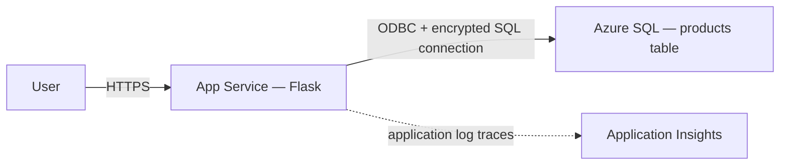

# Flask și Azure SQL pe App Service

**Nivel:** Intermediar · **Timp:** 30–60 minute, inclusiv prerechizite

Acest exemplu implementează un API de citire Python Flask pe **Linux App Service** și o bază de date Azure SQL Basic.
Sursa, Bicep și configurația azd sunt incluse. Este o aplicație de învățare, nu o arhitectură de bază de date gata pentru producție.


## Ce vei învăța

- Provisionează resurse App Service, SQL și de monitorizare cu Bicep.
- Configurează conectivitatea SQL criptată fără a introduce credențiale.
- Inițializează un schema înainte de a porni lucrătorii Gunicorn.
- Verifică datele inițiale, răspunsurile de tip not-found și sănătatea bazei de date.



Resurse: grup de resurse dedicat, plan App Service Linux B1, aplicație Web Python 3.11
App, server SQL și bază de date Basic de 2 GB, Application Insights și Log Analytics.
Aplicația Web folosește **deployare prin source/ZIP și instalare de dependențe Oryx**;
`azd deploy` nu construiește sau nu distribuie Dockerfile opțional.

## Cerințe preliminare

- Versiunea stabilă curentă [azd](https://learn.microsoft.com/azure/developer/azure-developer-cli/install-azd)
  (versiunea publicată la momentul revizuirii: 1.37.2).
- [Azure CLI](https://learn.microsoft.com/cli/azure/install-azure-cli) pentru verificare.
- Abonament Azure, permisiuni pentru a crea resursele listate și cotă regională.
- Python **3.11** pentru dezvoltare locală; `pyodbc==5.0.1` folosit poate necesita
  unelte native de compilare pe versiunile mai noi de Python.
- Microsoft ODBC Driver 18 (sau 17) pentru SQL Server pe mașinile locale. `pip install
  pyodbc` nu instalează driverul de sistem. Vezi
  [instalarea ODBC](https://learn.microsoft.com/sql/connect/odbc/download-odbc-driver-for-sql-server).
- Docker doar dacă se testează opțional containerul local.

```bash
azd version
az version
azd auth login
az login
```

Folosește același abonament în ambele unelte. Comenzile de mai jos folosesc Bash.

## Implementare

Din rădăcina repository-ului:

```bash
cd examples/database-app
azd env new sql-demo
azd provision
azd deploy
WEB_URL=$(azd env get-value WEB_APP_URI)
WEB_NAME=$(azd env get-value WEB_APP_NAME)
RG_NAME=$(azd env get-value AZURE_RESOURCE_GROUP)
```

Alege o regiune suportată. `sqlAdminLogin` implicit este `sqladmin`; parametrul
`sqlAdminPassword` este unul securizat. Introdu o parolă puternică când ți se cere.
Păstrează acreditările de implementare în afara Git și rapoartelor de probleme. Interpolarea
curentă a șirului de conexiune se așteaptă la o parolă fără delimitatori precum
`;`; adaptează mecanismele de scăpare înainte de a folosi astfel de valori.

Bicep setează o comandă de pornire care rulează `init_database()` **înainte ca** lucrătorii Gunicorn
să pornească. Acest lucru este necesar deoarece importarea `app:app` nu execută
blocul `if __name__ == '__main__'` din Python. La o bază de date proaspătă, inițializarea
creează `products` și inserează cinci rânduri. Este o sămânță simplă de instruire, nu un
cadru de migrare concurentă; folosește migrații adecvate înainte de a scala instanțele.

Aplicația selectează Microsoft ODBC Driver 18 instalat, apoi 17, dacă șirul de conexiune
nu specifică în mod explicit un driver. Dacă nici unul nu există, pornirea eșuează cu
o eroare acționabilă de instalare. Verifică disponibilitatea driverului în runtime-ul
App Service selectat, nu presupune că este acolo.

## Verificare

```bash
curl --fail-with-body "${WEB_URL}/"
curl --fail-with-body "${WEB_URL}/health"
curl --fail-with-body "${WEB_URL}/products"
curl --fail-with-body "${WEB_URL}/products/1"
curl -i "${WEB_URL}/products/999"
```

Așteptat:

- `/` returnează informații despre endpoint.
- `/health` returnează 200 cu `{"status":"healthy","database":"connected"}`.
- `/products` returnează cinci produse însămânțate pe o bază de date proaspătă.
- `/products/1` returnează Laptop cu preț 1299.99.
- Un produs inexistent returnează 404 cu `{"error":"Product not found"}`.

API-ul este doar pentru citire. Nu există rută POST/PUT/DELETE sau interfață browser.
Eșecul conectivității la baza de date returnează 503 din `/health`; nu este succes.

## Fișiere și configurare

```text
azure.yaml                         # Python App Service source deployment
infra/main.bicep
infra/main.parameters.json
infra/abbreviations.json
infra/resources/sql-server.bicep
infra/resources/sql-database.bicep
infra/resources/app-service-plan.bicep
infra/resources/web-app.bicep       # Settings + initialization/startup command
infra/resources/app-insights.bicep
src/web/app.py
src/web/requirements.txt
src/web/Dockerfile                 # Optional local container, not the azd target
.env.sample
```

`SQL_CONNECTION_STRING` este transmis ca parametru securizat Bicep către modulul Web App
și stocat în setările App Service, nu în output-urile implementării.
`APPLICATIONINSIGHTS_CONNECTION_STRING` configurează exportul jurnalelor.
`SCM_DO_BUILD_DURING_DEPLOYMENT=true` activează instalarea dependentelor pe server.
Setarea unor valori arbitrare `azd env` nu alterează automat setările aplicației.

Regula `0.0.0.0` a firewall-ului SQL permite conexiuni din **serviciile Azure,
inclusiv abonamentele altor clienți**, supuse autentificării SQL. Nu este
restricționată la această aplicație sau abonament. Accesul public la rețeaua SQL este activat.
Folosește rețele cu domeniu limitat și o identitate a aplicației non-admin înainte de producție.

## Dezvoltare locală

Folosește Python 3.11 și un driver Microsoft SQL ODBC instalat:

```bash
python -m venv .venv
source .venv/bin/activate  # PowerShell: .\.venv\Scripts\Activate.ps1
python -m pip install -r src/web/requirements.txt
export SQL_CONNECTION_STRING='Server=tcp:YOUR_SERVER.database.windows.net,1433;Database=YOUR_DATABASE;UID=YOUR_USER;PWD=YOUR_PASSWORD;Encrypt=yes;TrustServerCertificate=no;Connection Timeout=30;'
python src/web/app.py
```

Înlocuiește substituenții în mod securizat. Un fișier `.env` copiat **nu este încărcat automat**
de această aplicație. În schimb, exportă variabilele în shell-ul curent.
Pentru Azure SQL de pe un laptop, permite temporar doar propria ta adresă IP publică:

```bash
SQL_SERVER=$(azd env get-value SQL_SERVER_NAME)
MY_IP=YOUR_PUBLIC_IP
az sql server firewall-rule create -g "$RG_NAME" -s "$SQL_SERVER" \
  -n AllowMyLearningIP --start-ip-address "$MY_IP" --end-ip-address "$MY_IP"
```

Elimină regula după testare:

```bash
az sql server firewall-rule delete -g "$RG_NAME" -s "$SQL_SERVER" -n AllowMyLearningIP
```

Test opțional de container din acest director de exemplu:

```bash
docker build -t sql-flask:local src/web
docker run --rm -p 8000:8000 -e SQL_CONNECTION_STRING sql-flask:local
```

Această imagine instalează Driver 18 folosind depozitul de pachete Debian 12 corespunzător
bazei Bookworm, inițializează baza de date o singură dată, apoi pornește Gunicorn.

## Monitorizare și depanare

Activează/urmărește jurnalele aplicației sistemului de fișiere App Service când diagnostichezi pornirea:

```bash
az webapp log config --name "$WEB_NAME" --resource-group "$RG_NAME" \
  --application-logging filesystem --level information
az webapp log tail --name "$WEB_NAME" --resource-group "$RG_NAME"
```

Acest cod exportă **trasee de logare** printr-un handler OpenCensus legacy.
Nu configurează urmărirea automată a cererilor/dependențelor Flask, Live Metrics,
audit SQL, setări diagnostice sau alerte. Acestea necesită configurări separate.
Pentru instrumentații noi, preferă Azure Monitor OpenTelemetry.

În Application Insights Logs, după efectuarea cererilor API:

```kusto
traces
| where timestamp > ago(1h)
| where message contains "products" or message contains "Health check"
| project timestamp, message, severityLevel
```

Permite un întârziere pentru ingestie. Activitatea tabelului de cereri sau Live Metrics nu este criteriu
de finalizare pentru această instrumentare doar de logare.

- **Driver lipsește:** inspectează `pyodbc.drivers()` în runtime și instalează un
  driver Microsoft ODBC suportat. Un pachet Python singur nu este suficient.
- **Eșecul conexiunii:** verifică setările SQL, acreditările, firewall-ul și abonamentul selectat.
  Nu dezactiva criptarea pentru a ocoli o eroare.
- **Tabelul de produse lipsește:** confirmă că comanda Bicep de pornire a fost implementată;
  rularea doar `gunicorn app:app` sărind inițializarea.
- **Eșec la construirea pachetului:** folosește Python 3.11 sau asigură precondiții native de build.
- **Date cu preț zero:** zero este un preț decimal valid; trebuie să se serializa ca 0.0,
  nu `null`.

## Exerciții practice

### Exercițiul 1: Verifică comportamentul pentru produsul inexistent

**Punct de pornire:** API implementat și `WEB_URL` mai sus.
**Scop:** diferențiază un rând lipsă de o bază de date defectă.
Cere `/health` și `/products/999` folosind comenzile de mai sus.
**Criterii de succes / răspuns:** stare 200, produs inexistent 404 (nu 500 sau 503).
**Problemă comună:** a presupune că un răspuns not-found dovedește că conexiunea SQL este defectă.

### Exercițiul 2: Schimbă o valoare însămânțată

**Punct de pornire:** Editorul de query Azure SQL, conectat la baza de date exemplu.
**Scop:** arată că datele API sunt stocate în SQL, nu în memoria procesului.

```sql
UPDATE products SET price = 0 WHERE id = 1;
SELECT id, name, price FROM products WHERE id = 1;
```

Cere `${WEB_URL}/products/1`. **Criterii de succes:** prețul este `0.0`, nu `null`.
Restaurează valoarea:

```sql
UPDATE products SET price = 1299.99 WHERE id = 1;
```

**Problemă comună:** editarea listei Python de seed nu actualizează rândurile deja în SQL.
Nu rula exerciții de schemă/date pe o bază de producție.

### Exercițiul 3: Adaugă un endpoint de numărare read-only

**Punct de pornire:** `src/web/app.py`.
**Scop:** extinde API-ul folosind o interogare agregată fără parametri.
Adaugă asta înaintea blocului `if __name__ == '__main__':`:

```python
@app.route('/product-count')
def product_count():
    from contextlib import closing
    with closing(get_db_connection()) as conn, closing(conn.cursor()) as cursor:
        cursor.execute("SELECT COUNT(*) FROM products")
        return jsonify({'count': cursor.fetchone()[0]})
```

Rulează `azd deploy web`, apoi cere `${WEB_URL}/product-count`.
**Criterii de succes:** 200 cu `{"count":5}` pe baza de date țintuită neatinsă.
**Problemă comună:** schimbarea rutei dar uitarea să se redeploy-eze.
Pentru producție, adaugă tratare erori/teste; acest exercițiu scurt se concentrează pe query.

## Costuri, lacune în producție și curățare

Serviciul App B1 și baza de date Basic sunt facturate cât timp sunt furnizate. Oprirea
aplicației Web **nu** oprește facturarea planului App Service. Jurnalele și stocarea pot adăuga costuri.
Folosește [calculatorul de prețuri Azure](https://azure.microsoft.com/pricing/calculator/)
pentru prețuri regionale actuale. Trecerea la F1 necesită și dezactivarea `alwaysOn`;
nu este un înlocuitor rapid. SQL serverless nu este automat gratuit.

Munca în producție include o identitate aplicațională cu privilegii minime (nu admin SQL),
autentificare/autorizare, rețea privată, migrații sigure, pool-uri de conexiuni/revizuit ciclul de viață,
telemetrie, audit, alerte, teste și proceduri de recuperare.
Caching Redis și tabele suplimentare sunt idei de dezvoltare, nu exerciții implementate.

Din acest director exemplu:

```bash
azd down
```

Verifică promptul de ștergere și asigură-te că grupul de resurse dedicat a fost eliminat.
Nu șterge grupuri care conțin date nelegate.

[Exemple container](../../../../examples/container-app) ·
[Dezvoltare AI](../../docs/chapter-02-ai-development/README.md) ·
[Pagina cursului](../../README.md) · [Raportează o problemă](https://github.com/microsoft/AZD-for-beginners/issues)

---

<!-- CO-OP TRANSLATOR DISCLAIMER START -->
**Declinare a responsabilității**:
Acest document a fost tradus folosind serviciul de traducere AI [Co-op Translator](https://github.com/Azure/co-op-translator). În timp ce ne străduim pentru acuratețe, vă rugăm să rețineți că traducerile automate pot conține erori sau inexactități. Documentul original în limba sa nativă trebuie considerat sursa autorizată. Pentru informații critice, se recomandă traducerea profesională realizată de un om. Nu ne asumăm responsabilitatea pentru eventualele neînțelegeri sau interpretări greșite care decurg din utilizarea acestei traduceri.
<!-- CO-OP TRANSLATOR DISCLAIMER END -->