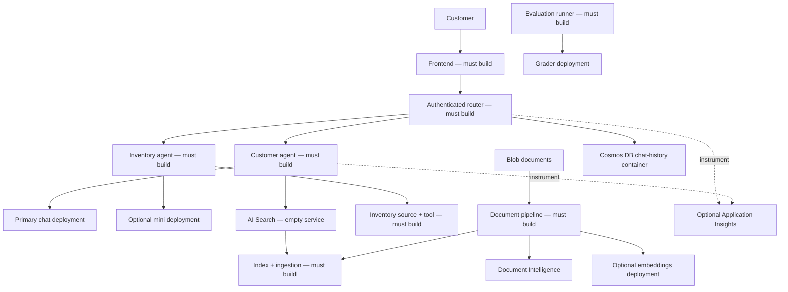

# Suport Clienți Multi-Agent — Planul de arhitectură pentru Retail

**Capitolul 5: Soluții AI Multi-Agent**

- [Pagina cursului](../README.md)
- [Capitolul 5](../docs/chapter-05-multi-agent/README.md)
- [Precondiție: integrare AI](../docs/chapter-02-ai-development/microsoft-foundry-integration.md)
- [Următorul: Planificarea capacității](../docs/chapter-06-pre-deployment/capacity-planning.md)
- [Scheletul infrastructurii ARM](retail-multiagent-arm-template/README.md)

> **Ghid de arhitectură, nu o aplicație funcțională.** Singurele fișiere
> de implementări retail sunt `azuredeploy.json`, `azuredeploy.parameters.json` și `deploy.sh` în
> `retail-multiagent-arm-template/`. Containerele router/frontend sunt marcaje de tip hello-world.
> Nu există local niciun agent retail, UI, pipeline de ingerare, evaluator, scanner sau
> suită de teste a aplicației.

## Prezentare generală

**Scop:** să proiecteze un sistem de suport clienți cu un agent client și un agent de inventar,
să identifice ce furnizează infrastructura și să planifice contractele lipsă ale aplicației
și verificarea acestora.

**Public țintă:** dezvoltatori care au finalizat exemplul local
[chat sample](../../../examples/azure-openai-chat) și [exemplul containerului cu două servicii](../../../examples/container-app/microservices).
Alocați 2–3 ore pentru studiul arhitectural. Construirea aplicației este un proiect separat:
estimarea planificativă pentru dezvoltatori experimentați este de 80–120 ore de dezvoltare,
**nu o promisiune de livrare**; consolidarea pentru producție, teste,
recenzie de securitate și operațiuni necesită muncă suplimentară.

### Rezultate învățare

- Explicarea rutării, fundamentării, permisiunilor uneltelor și proprietății conversației.
- Distincția între identificatorii modelelor, numele deplasărilor, versiunile API și versiunile ARM.
- Proiectarea ingestorului și recuperării documentelor cu dimensiuni vectoriale corespunzătoare.
- Definirea cerințelor funcționale verificabile, de evaluare și de recuperare după eșec.
- Separarea obiectivelor opționale ale arhitecturii de resursele efectiv alocate.

## Arhitectura soluției



Aceasta este o **arhitectură țintă a aplicației**, nu un diagram al serviciilor agent care rulează.
Scheletul ARM creează doar serviciile de bază și două containere marcaj.
Front Door, registru, identități gestionate, alocări de roluri,
puncte finale private, failover, instrumentare a aplicației și alerte nu sunt incluse.

### Responsabilități și contracte

| Componentă | Comportament necesar | Dovezi înainte de a considera finalizat |
|---|---|---|
| Frontend | Autentifică utilizatorii, afișează chat, încarcă documente în siguranță | Teste UI și de încărcare, erori accesibile |
| Router | Autorizează cereri, alege agent, limitează apeluri/timeout-uri unelte | Teste de rutare, verificări de autorizare, teste de eșec |
| Agent client | Fundamentarea răspunsurilor de politică/produs în surse aprobate | Citări corecte, abținerea când lipsesc datele |
| Unealtă inventar | Citește stocul autoritar cu permisiuni limitate | Teste deterministe ale stocului; fără disponibilitate inventată |
| Pipeline documente | Extrage, fragmentă, încorporează, indexează, actualizează/șterge | Fixture-uri indexate și comportament de retry/dead-letter |
| Stocare conversație | Izolează utilizatorii, aplică reținerea | Teste de autorizare inter-utilizatori și TTL |
| Executor evaluare | Compară rezultatele cu adevărul de bază și rubrica | Acoperire, număr de eșecuri, rapoarte reproductibile |

Gândiți-vă la router ca la un birou de recepție și la unelte ca la sisteme interne restricționate:
alegerea unui specialist nu înseamnă autorizarea accesului la toate dosarele clienților.
Aplicați identitatea și permisiunile în codul aplicației și serviciile de date, nu în solicitări.

## Infrastructură vs. Aplicație

Citiți [README scheletului](retail-multiagent-arm-template/README.md) înainte
de implementare. Listează resursele exacte, modurile, costurile și limitările.

| Utilizare logică | Nume implementare ARM | Model / versiune | Regiune implicită |
|---|---|---|---|
| Chat client | `gpt-4.1-chat` | `gpt-4.1` / `2025-04-14` | `eastus2` |
| Inventar | `gpt-4.1-mini-inventory` | `gpt-4.1-mini` / `2025-04-14` | `westus2`, opțional |
| Încorporări | `text-embedding-ada-002` | `text-embedding-ada-002` / `2` | `francecentral`, opțional |
| Evaluare | `gpt-4.1-grader` | `gpt-4.1` / `2025-04-14` | Regiunea principală implicită |

Verificați disponibilitatea modelului/versiunii/SKU și cota în **fiecare regiune**. Chat/mini/grader
folosesc `GlobalStandard`; încorporările folosesc `Standard`. Mapeările unităților de capacitate la TPM
sunt specifice modelului. Nu adăugați unități de capacitate diferite ca garanție de cotă universală.

Argumentul `model` al unei cereri Azure OpenAI este **numele implementării**, nu
neapărat identificatorul modelului din catalog. Versiunea API a planului de date `2024-10-21`
este distinctă de versiunea modelului `2025-04-14` și resursa ARM `apiVersion`.
Nu se poate rezolva un model indisponibil doar schimbând versiunea API a planului de date.

`--no-multi-region` exclude conturile secundare și cele de încorporări. Rămân un chat primar și
un cont evaluator independent. Conturile de model separate nu oferă failover automat;
asta necesită rutare aplicațională, implementări compatibile, verificări de sănătate,
limite de retry și revizuirea reședinței datelor.

## Plan de implementare

### 1. Începeți cu o interacțiune testată

Înainte de a implementa scheletul mare, folosiți exemplul local de chat pentru a stabili
conectivitatea pentru inferență. Definiți o întrebare reprezentativă a clientului, sursa aprobată
de răspuns, citarea așteptată și comportamentul la eșec când sursa lipseste.

### 2. Definiți rutarea și limitele uneltelor

Creați propriul cod sursă pentru router, manifest de dependențe, Dockerfile și teste. Un
contract ilustrativ ar putea fi `POST /chat` cu `{"message":"...","conversation_id":"..."}`.
**Acest endpoint este o propunere de design; nu este implementat de șablonul ARM.**

Validați tipurile/limitele corpului, derivați identitatea utilizatorului din autentificare, aplicați
proprietatea conversației, aplicați timeout-uri la cereri și returnați coduri de eroare relevante.
Nu tratați eșecurile HTTP sau răspunsurile goale ca rezultate reușite ale agentului.

### 3. Implementați fundamentarea și ingerarea

Șablonul ARM nu creează un index de căutare. Aceasta este o **fragment JSON de referință
de adaptat în propria definiție a indexului**, nu un fișier deja în repo:

```json
{
  "name": "retail-product-index",
  "fields": [
    {"name": "id", "type": "Edm.String", "key": true},
    {"name": "title", "type": "Edm.String", "searchable": true},
    {"name": "content", "type": "Edm.String", "searchable": true},
    {"name": "category", "type": "Edm.String", "filterable": true},
    {
      "name": "content_vector",
      "type": "Collection(Edm.Single)",
      "searchable": true,
      "dimensions": 1536,
      "vectorSearchProfile": "retail-profile"
    }
  ],
  "vectorSearch": {
    "algorithms": [{"name": "retail-hnsw", "kind": "hnsw"}],
    "profiles": [{"name": "retail-profile", "algorithm": "retail-hnsw"}]
  }
}
```

Profilul leagă câmpul vectorial de algoritmul său. Dimensiunile trebuie să corespundă
ieșirii efective a încorporării (1536 pentru această implementare `ada-002`). Pentru recuperare Python,
folosiți `azure.search.documents.models.VectorizedQuery` în loc de un dicționar incomplet,
lipsit de tipul de interogare vectorială:

```python
# Reference function only: supply an authenticated async SearchClient and an embedding.
from azure.search.documents.models import VectorizedQuery

async def retrieve(search_client, embedding):
    results = await search_client.search(
        search_text=None,
        vector_queries=[VectorizedQuery(
            vector=embedding,
            k_nearest_neighbors=5,
            fields="content_vector"
        )],
        select=["id", "title", "content"]
    )
    return [document async for document in results]
```

Creați o implementare separată de ingerare care:

1. Autorizează accesul la încărcare și validează tipul și mărimea conținutului.
2. Citește blob-uri private folosind apeluri SDK autentificate. Un URL de blob privat singur
   **nu** este un input citibil pentru Document Intelligence; trimiteți octeții descărcați cu
   `AnalyzeDocumentRequest(bytes_source=...)` sau folosiți un SAS cu drepturi corespunzătoare,
   temporar, după revizuirea cerințelor de acces.
3. Extrage text, îl fragmentează pentru a se potrivi limitelor de încorporare și generează încorporări.
4. Creează chei stabile valide pentru documente și încarcă fragmente cu vectori corespunzători.
5. Verifică rezultatele indexării per document, gestionează retry-urile și actualizează/șterge datele învechite.

Nu interpolati chei/valori arbitrare ale utilizatorului în filtre OData. Listați explicit câmpurile permise,
validați tipurile valorilor și scăpați ghilimelele stringurilor. Filtrele boolean și numerice necesită
literali tipați, nu stringuri între ghilimele.

### 4. Fundamentare web

**Bing Search v7 a fost retras pe 11 august 2025.** Vechiul `Microsoft.Bing/accounts`
resursă și exemplele `api.bing.microsoft.com/v7.0/search` nu sunt o cale de implementare suportată.
Evaluați o integrare de fundamentare suportată în prezent în
Microsoft Foundry și SDK-ul său, permisiunile, facturarea și cerințele de citare;
niciuna nu este implementată aici. Nu este un înlocuitor direct pentru endpoint-ul retras.

### 5. Adăugați telemetrie și evaluare

Crearea Application Insights nu instrumentează codul. Folosiți instrumentarea suportată Azure Monitor
OpenTelemetry când construiți o aplicație nouă, propagați contextul de trasabilitate
între servicii și evitați logarea prompturilor clienților, documentelor sau secretelor.
Truncarea unei interogări **nu** o anonimizează.

Măsurați durata cererilor, erorile de rutare/unelte, relevanța recuperării, corectitudinea
citărilor, utilizarea token-urilor și abținerea. Stocați faptele din inventarul/regulile de bază
alături de cazurile de evaluare: un evaluator nu poate determina fiabil acuratețea factuală
doar dintr-o întrebare și un răspuns.

O implementare de evaluator nu este un runner de evaluare. Implementați un rubrică versionată,
validarea ieșirii structurate/schema, verificări ale intervalului de scoruri, număr de erori de transport
și cazuri revizuite de oameni. Raportați cazurile incomplete/eroare separat; nu le convertiți
în note de succes sau nu le includeți tăcut ca răspunsuri de calitate zero ale modelului.

De asemenea, câteva verificări de cuvinte-cheie nu reprezintă o certificare de securitate. O cerere HTTP eșuată,
o strategie de testare lipsă sau un răspuns gol trebuie să facă ca un test să fie **inconcludent sau
eșuat**, nu să genereze un scor de „100% sigur”. Realizați testare autorizată cu unelte
adecvate și revizuire umană înaintea oricărei afirmații de pregătire pentru producție.

### 6. Implementați aplicația dvs.

Creați propriile directoare sursă, manifeste, teste, registru și permisiuni pentru extragerea imaginilor.
Înlocuiți substituenții cu imaginile construite și actualizați ingress/probe pentru a
corespunde portului de ascultare al fiecărei aplicații. Configurați variabilele de mediu de runtime în Bicep
sau o mapare explicită de mediu azd suportată.

Nu există un dicționar generic `config` sub un serviciu azd care să creeze automat
variabile runtime de mediu. `azd env set` modifică doar resursele care
consumă explicit aceste valori. Nu este implementat niciun canar, listă de regiuni sau hook de fine-tuning
în această schelă.

## Exerciții practice de proiectare

Acestea sunt **exerciții de arhitectură**, nu afirmații de cod executabil gata pentru retail.

### Exercițiul 1: Verificați limita

**Punct de plecare:** cele trei fișiere în `retail-multiagent-arm-template/`.
**Scop:** distingeți provisioning-ul de funcționalitatea aplicației.
Deschideți `azuredeploy.json`, localizați atât imaginile container cât și valorile `targetPort`,
apoi listați componentele aplicației care lipsesc din depozit.

**Criterii de succes / răspuns:** ambele imagini sunt substituenți hello-world care ascultă
pe portul 80; agenții, interfața de chat, handler-ele de rutare, indexarea/ingestionarea, evaluatorul și scanerul
lipsesc. O cerere rădăcină reușită de substituent nu validează `/chat`.
**Problemă comună:** interpretarea numelor de resurse precum `retail-router` ca fiind cod funcțional.

### Exercițiul 2: Urmăriți configurația vectorului

**Punct de plecare:** indexul JSON de mai sus.
**Scop:** înțelegeți relația câmp → profil → algoritm.
Identificați ce valori trebuie schimbate când se trece la un model embedding cu o
dimensiune de ieșire diferită, apoi inspectați funcția `retrieve`.

**Criterii de succes / răspuns:** schimbați câmpul `dimensions` la lungimea reală a vectorului;
păstrați `vectorSearchProfile` aliniat la un profil declarat și algoritmul său;
interogarea `fields` trebuie să numească câmpul vector. Regenerați vectorii documentelor existente
când modelul embedding se schimbă.
**Problemă comună:** schimbarea doar a numelui modelului păstrând vectori incompatibili.

### Exercițiul 3: Definiți un test de eșec

**Punct de plecare:** tabelul responsabilităților.
**Scop:** preveniți succesul fals.
Scrieți comportamentul așteptat pentru un API de inventar indisponibil, un index de căutare fără
documente potrivite și o cerere de evaluare care returnează HTTP 503.

**Criterii de succes / răspuns:** fără valori inventate de inventar; abținere explicită sau
escaladare atunci când contextul lipsește; evaluarea raportează o eroare de transport mai degrabă
decât un rezultat de calitate sau securitate. Adăugați teste executabile când construiți aplicația.
**Problemă comună:** captarea fiecărei excepții și continuarea cu un răspuns vid.

## Costuri, depanare și curățare

- Infrastructura are costuri continue chiar și cu indexuri de căutare goale și aplicații substituente.
  Folosiți prețurile regionale curente; nici „minimal” nici multi-regiune nu înseamnă gratuit.
- Costurile token-urilor depind de model, input cache-uit/necache-uit, output și SKU de implementare.
  Rutarea poate economisi bani numai dacă volumul și rezultatele calității măsurate o justifică;
  o economisire fixă de 60–80% nu este garantată.
- Verificați disponibilitatea modelului și cota înainte de provisioning; distingeți eroarea de permisiuni,
  eroarea de nume implementare, regiune, versiune model și versiune API.
- Nu rulați comenzi `setup-data.sh` lipsă, CLI-uri evaluator sau comenzi `pytest tests/`.
  Implementările lor fac parte din backlog-ul vostru de dezvoltare.
- Schela este doar ARM: urmați instrucțiunile de
  [verificare și curățare](retail-multiagent-arm-template/README.md).
  `azd down` nu gestionează aceste resurse.

## Resurse conexe

- [Exemplu local de chat funcțional](../../../examples/azure-openai-chat)
- [Exemplu funcțional cu două servicii containerizate](../../../examples/container-app/microservices)
- [Indexuri vectoriale AI Search](https://learn.microsoft.com/azure/search/vector-search-how-to-create-index)
- [Documentație Container Apps](https://learn.microsoft.com/azure/container-apps/)
- [Depanare](../docs/chapter-07-troubleshooting/common-issues.md)
- [Raportați o problemă](https://github.com/microsoft/AZD-for-beginners/issues)

---

<!-- CO-OP TRANSLATOR DISCLAIMER START -->
**Declinare a responsabilității**:
Acest document a fost tradus folosind serviciul de traducere AI [Co-op Translator](https://github.com/Azure/co-op-translator). În timp ce ne străduim pentru acuratețe, vă rugăm să rețineți că traducerile automate pot conține erori sau inexactități. Documentul original în limba sa nativă trebuie considerat sursa autorizată. Pentru informații critice, se recomandă traducerea profesională realizată de un om. Nu ne asumăm responsabilitatea pentru eventualele neînțelegeri sau interpretări greșite care decurg din utilizarea acestei traduceri.
<!-- CO-OP TRANSLATOR DISCLAIMER END -->