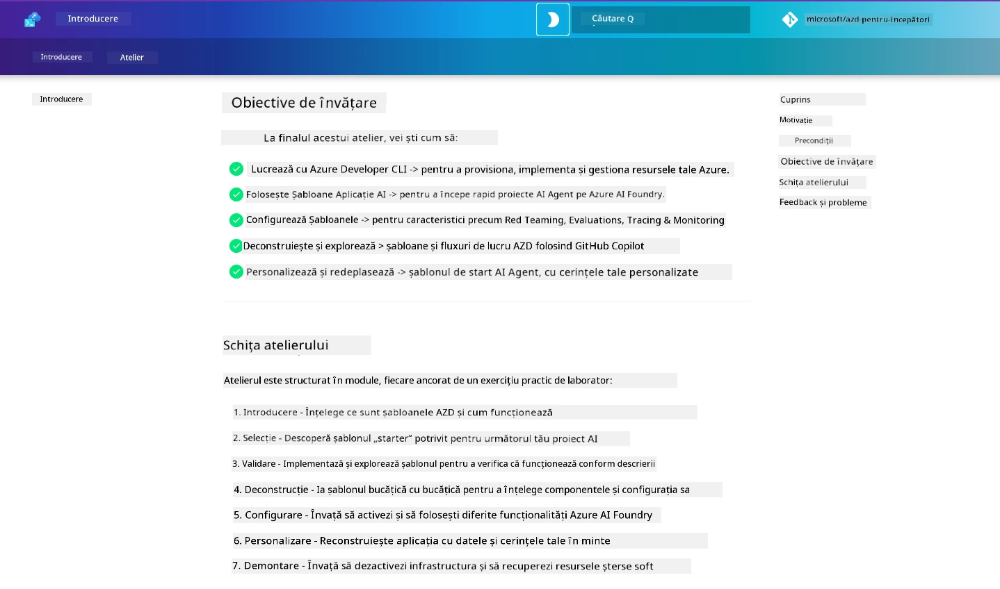

<div align="center">
  <div style="background: linear-gradient(135deg, #0078d4, #106ebe); border-radius: 10px; padding: 20px; margin: 20px 0; box-shadow: 0 4px 15px rgba(0, 120, 212, 0.3); border: 2px solid #005a9e;">
    <h2 style="color: white; margin: 0; font-size: 24px; text-shadow: 1px 1px 2px rgba(0,0,0,0.3);">
      🎯 Atelier AZD pentru Dezvoltatori AI
    </h2>
    <p style="color: white; margin: 10px 0 0 0; font-size: 16px; text-shadow: 1px 1px 2px rgba(0,0,0,0.3);">
      <strong>Un atelier practic pentru crearea aplicațiilor AI cu Azure Developer CLI.</strong><br>
      Completează 7 module pentru a stăpâni șabloanele AZD și fluxurile de lucru pentru implementarea AI.
    </p>
    <div style="margin-top: 15px;">
      <span style="background: rgba(255,255,255,0.2); padding: 5px 10px; border-radius: 15px; color: white; font-size: 14px;">
        📅 Ghid sursă revizuit: Noiembrie 2026
      </span>
    </div>
  </div>
</div>

# Atelier AZD pentru Dezvoltatori AI

Bine ați venit la atelierul practic pentru învățarea Azure Developer CLI (AZD) cu accent pe implementarea aplicațiilor AI. Acest atelier te ajută să dobândești o înțelegere aplicată a șabloanelor AZD în 3 pași:

1. **Descoperire** - găsește șablonul potrivit pentru tine.
1. **Implementare** - implementează și validează că funcționează
1. **Personalizare** - modifică și iterează pentru a-l face al tău!

Pe parcursul acestui atelier, vei fi introdus și în principalele unelte și fluxuri de lucru pentru dezvoltatori, pentru a-ți simplifica călătoria completă de dezvoltare.

<br/>

## Ghid bazat pe browser

Lecțiile atelierului sunt în Markdown. Le poți naviga direct în GitHub - sau poți deschide o previzualizare în browser, așa cum este arătat în captură de ecran de mai jos.



Pentru a folosi această opțiune - fă un fork al depozitului în profilul tău și lansează GitHub Codespaces. Odată ce terminalul VS Code este activ, tastează această comandă:

Această previzualizare în browser funcționează în GitHub Codespaces, containere de dezvoltare sau un clon local cu Python și MkDocs instalate.

```bash title="" linenums="0"
python -m pip install -r requirements-dev.txt
python -m mkdocs serve --config-file workshop/mkdocs.yml
```

Rulează aceste comenzi din **rădăcina depozitului cursului**, nu din exemplul AI inițializat separat. Păstrează previzualizarea în prim-plan pentru ca erorile să fie vizibile; oprește cu Ctrl+C. Pentru a verifica site-ul fără a-l servi, rulează `python -m mkdocs build --strict --config-file workshop/mkdocs.yml`.

În câteva secunde vei vedea un dialog pop-up. Selectează opțiunea `Open in browser`. Ghidul web se va deschide acum într-un tab nou al browserului. Unele beneficii ale acestei previzualizări:

1. **Căutare încorporată** - găsește rapid cuvinte cheie sau lecții.
1. **Iconița de copiere** - treci cu mouse-ul peste blocurile de cod pentru a vedea această opțiune
1. **Comutare temă** - schimbă între temele deschisă și întunecată
1. **Obține ajutor** - apasă pe iconița Discord din footer pentru a te alătura!

<br/>

## Privire de ansamblu a atelierului

**Durată:** 3-4 ore  
**Nivel:** Începător până la Intermediar  
**Precondiții:** Familiarizare cu Azure, concepte AI, VS Code și unelte de linie de comandă.

Acesta este un atelier practic unde înveți făcând. După ce ai completat exercițiile, recomandăm revizuirea curriculumului AZD Pentru Începători pentru a continua parcursul de învățare către bune practici de Securitate și Productivitate.

| Timp| Modul  | Obiectiv |
|:---|:---|:---|
| 15 min | [Introducere](docs/instructions/0-Introduction.md) | Setează scena, înțelege obiectivele |
| 30 min | [Selectează Șablon AI](docs/instructions/1-Select-AI-Template.md) | Explorează opțiunile și alege un început | 
| 30 min | [Validează Șablon AI](docs/instructions/2-Validate-AI-Template.md) | Implementează soluția implicită pe Azure |
| 30 min | [Deconstruiește Șablon AI](docs/instructions/3-Deconstruct-AI-Template.md) | Explorează structura și configurația |
| 30 min | [Configurează Șablon AI](docs/instructions/4-Configure-AI-Template.md) | Activează și încearcă funcționalitățile disponibile |
| 30 min | [Personalizează Șablon AI](docs/instructions/5-Customize-AI-Template.md) | Adaptează șablonul la nevoile tale |
| 30 min | [Demontare Infrastructură](docs/instructions/6-Teardown-Infrastructure.md) | Curățare și eliberare resurse |
| 15 min | [Concluzii & Pași Următori](docs/instructions/7-Wrap-up.md) | Resurse de învățare, provocarea atelierului |

<br/>

## Ce vei învăța

Gândește-te la Șablonul AZD ca la un spațiu de învățare pentru a explora diverse capabilități și unelte pentru dezvoltare completă pe Microsoft Foundry. La finalul acestui atelier, ar trebui să ai o intuiție legată de diverse unelte și concepte în acest context.

| Concept  | Obiectiv |
|:---|:---|
| **Azure Developer CLI** | Înțelege comenzile și fluxurile de lucru ale uneltei |
| **Șabloane AZD**| Înțelege structura proiectului și configurația |
| **Agent AI Azure**| Proiectare și implementare proiect Microsoft Foundry |
| **Căutare AI Azure**| Activează ingineria contextului cu agenți |
| **Observabilitate**| Explorează urmărire, monitorizare și evaluări |
| **Testare în echipă roșie**| Explorează testarea adversarială și mitigările |

<br/>

## Structura atelierului

Atelierul este structurat să te ducă într-o călătorie de la descoperirea de șabloane, la implementare, deconstruire și personalizare - folosind șablonul oficial [Getting Started with AI Agents](https://github.com/Azure-Samples/get-started-with-ai-agents) ca bază.

### [Modul 1: Selectează Șablon AI](docs/instructions/1-Select-AI-Template.md) (30 min)

- Ce sunt șabloanele AI?
- Unde pot găsi șabloane AI?
- Cum pot începe să construiesc agenți AI?
- **Laborator**: Pornire rapidă în Codespaces sau container de dezvoltare

### [Modul 2: Validează Șablon AI](docs/instructions/2-Validate-AI-Template.md) (30 min)

- Care este arhitectura șablonului AI?
- Care este fluxul de dezvoltare AZD?
- Cum pot primi ajutor pentru dezvoltarea AZD?
- **Laborator**: Implementare și validare șablon AI Agents

### [Modul 3: Deconstruiește Șablon AI](docs/instructions/3-Deconstruct-AI-Template.md) (30 min)

- Explorează mediul în `.azure/` 
- Explorează configurarea resurselor în `infra/` 
- Explorează configurația AZD în `azure.yaml`s
- **Laborator**: Modifică variabile de mediu și implementează din nou

### [Modul 4: Configurează Șablon AI](docs/instructions/4-Configure-AI-Template.md) (30 min)
- Explorează: Generare augmentată prin recuperare
- Explorează: Evaluarea Agenților și echipa roșie
- Explorează: Urmărire și monitorizare
- **Laborator**: Explorează Agentul AI + Observabilitatea

### [Modul 5: Personalizează Șablon AI](docs/instructions/5-Customize-AI-Template.md) (30 min)
- Definește: PRD cu cerințe de scenariu
- Configurează: Variabile de mediu pentru AZD
- Implementează: Hook-uri pe parcursul ciclului de viață pentru sarcini suplimentare
- **Laborator**: Personalizează șablonul pentru scenariul meu

### [Modul 6: Demontare Infrastructură](docs/instructions/6-Teardown-Infrastructure.md) (30 min)
- Recapitulare: Ce sunt șabloanele AZD?
- Recapitulare: De ce să folosești Azure Developer CLI?
- Pași următori: Încearcă un alt șablon!
- **Laborator**: Deprovisionare infrastructură și curățare

<br/>

## Provocarea atelierului

Vrei să te provoci să faci mai mult? Iată câteva sugestii de proiect - sau împărtășește-ne ideile tale!!

| Proiect | Descriere |
|:---|:---|
|1. **Deconstruiește un șablon AI complex** | Folosește fluxul de lucru și uneltele descrise și vezi dacă poți implementa, valida și personaliza un alt șablon de soluție AI. _Ce ai învățat?_|
|2. **Personalizează cu scenariul tău**  | Încearcă să scrii un PRD (Document de Cerințe ale Produsului) pentru un scenariu diferit. Apoi folosește GitHub Copilot în depozitul șablonului în Agent Model - și cere să genereze un flux de lucru de personalizare pentru tine. _Ce ai învățat? Cum ai putea îmbunătăți aceste sugestii?_|
| | |

## Ai feedback?

1. Postează o problemă în acest depozit - taguieste-o cu `Workshop` pentru comoditate.
1. Alătură-te Discord Microsoft Foundry - conectează-te cu colegii tăi!


| | | 
|:---|:---|
| **📚 Pagina cursului**| [AZD Pentru Începători](../README.md)|
| **📖 Documentație** | [Începe cu șabloanele AI](https://learn.microsoft.com/en-us/azure/ai-foundry/how-to/develop/ai-template-get-started)|
| **🛠️Șabloane AI** | [Șabloane Microsoft Foundry](https://ai.azure.com/templates) |
|**🚀 Pași următori** | [Începe atelierul](#workshop-overview) |
| | |

<br/>

---

**Navigare:** [Curs principal](../README.md) | [Introducere](docs/instructions/0-Introduction.md) | [Modul 1: Selectează Șablon](docs/instructions/1-Select-AI-Template.md)

**Ești gata să începi să construiești aplicații AI cu AZD?**

[Începe atelierul: Introducere →](docs/instructions/0-Introduction.md)

---

<!-- CO-OP TRANSLATOR DISCLAIMER START -->
**Declinare a responsabilității**:
Acest document a fost tradus folosind serviciul de traducere AI [Co-op Translator](https://github.com/Azure/co-op-translator). În timp ce ne străduim pentru acuratețe, vă rugăm să rețineți că traducerile automate pot conține erori sau inexactități. Documentul original în limba sa nativă trebuie considerat sursa autorizată. Pentru informații critice, se recomandă traducerea profesională realizată de un om. Nu ne asumăm responsabilitatea pentru eventualele neînțelegeri sau interpretări greșite care decurg din utilizarea acestei traduceri.
<!-- CO-OP TRANSLATOR DISCLAIMER END -->