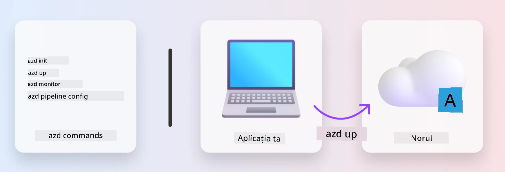
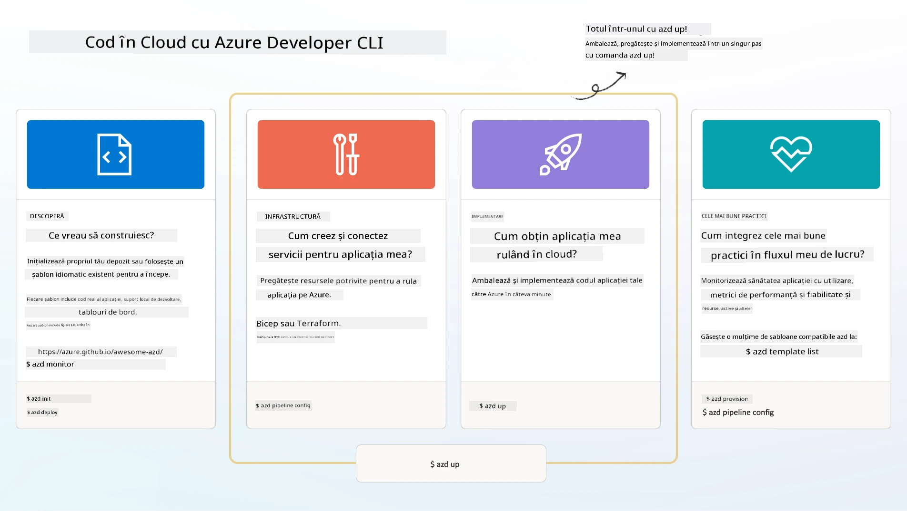

# 1. Selectați un șablon

!!! tip "LA SFÂRȘITUL ACESTUI MODUL VEȚI PUTEA"

    - [ ] Describe what AZD templates are
    - [ ] Discover and use AZD templates for AI
    - [ ] Get started with the AI Agents template
    - [ ] **Lab 1:** AZD Quickstart in Codespaces or a dev container

---

## 1. O analogie cu un constructor

Construirea unei aplicații AI moderne, pregătită pentru companii, _de la zero_ poate fi intimidantă. Este puțin ca și cum ți-ai construi singur o casă nouă, cărămidă cu cărămidă. Da, se poate face! Dar nu este cea mai eficientă modalitate de a obține rezultatul dorit!

În schimb, de multe ori începem cu un _plan de proiectare_ existent și lucrăm cu un arhitect pentru a-l personaliza conform cerințelor noastre. Și exact aceasta este abordarea pe care trebuie să o adoptăm când construim aplicații inteligente. Mai întâi, găsește o arhitectură de design bună care se potrivește problemei tale. Apoi colaborează cu un arhitect de soluții pentru a personaliza și dezvolta soluția pentru scenariul tău specific.

Dar unde putem găsi acele planuri de proiectare? Și cum găsim un arhitect dispus să ne învețe cum să personalizăm și să implementăm aceste planuri pe cont propriu? În acest atelier, răspundem la aceste întrebări prezentându-vă trei tehnologii:

1. [Azure Developer CLI](https://aka.ms/azd) - un instrument open-source care accelerează traseul dezvoltatorului de la dezvoltarea locală (build) la implementarea în cloud (ship).
1. [Microsoft Foundry Templates](https://ai.azure.com/templates) - depozite open-source standardizate care conțin cod exemplu, fișiere de infrastructură și configurare pentru implementarea unei arhitecturi de soluții AI.
1. [GitHub Copilot Agent Mode](https://code.visualstudio.com/docs/copilot/chat/chat-agent-mode) - un agent de codare bazat pe cunoștințe Azure, care ne poate ghida în navigarea bazei de cod și în efectuarea modificărilor – folosind limbaj natural.

Cu aceste instrumente în mână, putem acum să _descoperim_ șablonul potrivit, să îl _implementăm_ pentru a valida că funcționează și să îl _personalizăm_ pentru a se potrivi scenariilor noastre specifice. Haideți să învățăm cum funcționează acestea.


---

## 2. Azure Developer CLI

Instrumentul de linie de comandă [Azure Developer CLI](https://learn.microsoft.com/en-us/azure/developer/azure-developer-cli/) (sau `azd`) este un instrument open-source care poate accelera parcursul tău de la cod la cloud cu un set de comenzi prietenoase pentru dezvoltatori care funcționează în mod consecvent atât în mediul IDE (dezvoltare), cât și în mediul CI/CD (devops).

Cu `azd`, călătoria ta de implementare poate fi la fel de simplă ca:

- `azd init` - Inițializează un nou proiect AI pornind de la un șablon AZD existent.
- `azd up` - Provoacă infrastructura și implementează aplicația ta într-un singur pas.
- `azd monitor` - Obține monitorizare și diagnostic în timp real pentru aplicația ta implementată.
- `azd pipeline config` - Configurează pipeline-uri CI/CD pentru a automatiza implementarea în Azure.

**🎯 | EXERCIȚIU**: <br/> Explorează acum instrumentul de linie de comandă `azd` în mediul curent de workshop. Acesta poate fi GitHub Codespaces, un container de dezvoltare sau un clone local cu prerechizitele instalate. Începe prin a tasta această comandă pentru a vedea ce poate face instrumentul:

```bash title="" linenums="0"
azd help
```



---

## 3. Șablonul AZD

Pentru ca `azd` să realizeze acest lucru, trebuie să cunoască infrastructura de provisionat, setările de configurare de aplicat și aplicația de implementat. Aici intervin [șabloanele AZD](https://learn.microsoft.com/en-us/azure/developer/azure-developer-cli/azd-templates?tabs=csharp).

Șabloanele AZD sunt depozite open-source care combină codul de exemplu cu fișierele de infrastructură și configurare necesare pentru implementarea arhitecturii soluției.
Prin utilizarea unei abordări _Infrastructure-as-Code_ (IaC), acestea permit ca definițiile resurselor din șabloane și setările de configurare să fie controlate prin versiuni (la fel ca și codul sursă al aplicației) - creând fluxuri de lucru reutilizabile și consistente între utilizatorii acelui proiect.

Atunci când creezi sau reutilizezi un șablon AZD pentru scenariul _tău_, ia în considerare următoarele întrebări:

1. Ce construiești? → Există un șablon care are cod de pornire pentru acel scenariu?
1. Cum este arhitecturată soluția ta? → Există un șablon care conține resursele necesare?
1. Cum este implementată soluția ta? → Gândește-te la `azd deploy` cu hook-uri de pre/post-procesare!
1. Cum poți optimiza și mai mult? → Gândește-te la monitorizare încorporată și la pipeline-uri de automatizare!

**🎯 | EXERCIȚIU**: <br/> 
Vizitează galeria [Awesome AZD](https://azure.github.io/awesome-azd/) și folosește filtrele pentru a explora cele peste 250 de șabloane disponibile în prezent. Vezi dacă poți găsi unul care se aliniază cerințelor scenariului _tău_.



---

## 4. Șabloane pentru Aplicații AI

Pentru aplicațiile bazate pe AI, Microsoft oferă șabloane specializate care includ **Microsoft Foundry** și **Foundry Agents**. Aceste șabloane accelerează drumul tău către construirea aplicațiilor inteligente, gata pentru producție.

### Șabloane Microsoft Foundry & Foundry Agents

Selectează un șablon de mai jos pentru a-l implementa. Fiecare șablon este disponibil pe [Awesome AZD](https://azure.github.io/awesome-azd/) și poate fi inițializat cu o singură comandă.

| Șablon | Descriere | Comandă de implementare |
|----------|-------------|----------------|
| **[Chat AI cu RAG](https://github.com/Azure-Samples/azure-search-openai-demo)** | Aplicație de chat bazată pe căutare | `azd init -t Azure-Samples/azure-search-openai-demo .` |
| **[Începe cu Agenți AI](https://github.com/Azure-Samples/get-started-with-ai-agents)** | Aplicație de chat susținută de agenți; utilizată pe parcursul acestui atelier | `azd init -t Azure-Samples/get-started-with-ai-agents .` |
| **[Începe cu Chat AI](https://github.com/Azure-Samples/get-started-with-ai-chat)** | Aplicație de chat AI de început | `azd init -t Azure-Samples/get-started-with-ai-chat .` |

Acestea sunt alternativele: inițializează **un** șablon într-un director gol propriu. Sufixul `.` selectează acel director; omiterea acestuia în versiunile curente AZD creează un subdirector cu numele șablonului. Inițializarea descarcă un proiect; `azd up` realizează implementarea facturabilă după ce revizuiești cerințele prealabile, resursele, suportul pentru regiuni și cota.

### Început rapid

1. **Răsfoiește șabloanele**: Vizitează [https://azure.github.io/awesome-azd/](https://azure.github.io/awesome-azd/) și filtrează după `AI`, `Agents`, sau `Microsoft Foundry`
2. **Selectează șablonul tău**: Alege unul care corespunde scenariului tău de utilizare
3. **Inițializează**: Rulează comanda `azd init` pentru șablonul ales
4. **Implementează**: Rulează `azd up` pentru a provisiona și implementa

**🎯 | EXERCIȚIU**: <br/>
Selectează unul dintre șabloanele de mai sus pe baza scenariului tău:

- **Continuarea acestui atelier?** → Alege **Începe cu Agenți AI**
- **Construiești un chat susținut de căutare?** → Explorează separat **Chat AI cu RAG**
- **Ai nevoie de o altă arhitectură?** → Caută în galerie și verifică repository-ul real, statusul implementării și cerințele prealabile

```bash title="Initialize the workshop template in an empty directory" linenums="0"
azd init -t Azure-Samples/get-started-with-ai-agents .
azd auth login
azd up
```

!!! info "Explorează mai multe șabloane"
    Galeria [Awesome AZD](https://azure.github.io/awesome-azd/) conține peste 250 de șabloane. Folosește filtrele pentru a găsi șabloane care se potrivesc cerințelor tale specifice privind limbajul, cadrul de dezvoltare și serviciile Azure.

---

<!-- CO-OP TRANSLATOR DISCLAIMER START -->
**Declinare a responsabilității**:
Acest document a fost tradus folosind serviciul de traducere AI [Co-op Translator](https://github.com/Azure/co-op-translator). În timp ce ne străduim pentru acuratețe, vă rugăm să rețineți că traducerile automate pot conține erori sau inexactități. Documentul original în limba sa nativă trebuie considerat sursa autorizată. Pentru informații critice, se recomandă traducerea profesională realizată de un om. Nu ne asumăm responsabilitatea pentru eventualele neînțelegeri sau interpretări greșite care decurg din utilizarea acestei traduceri.
<!-- CO-OP TRANSLATOR DISCLAIMER END -->