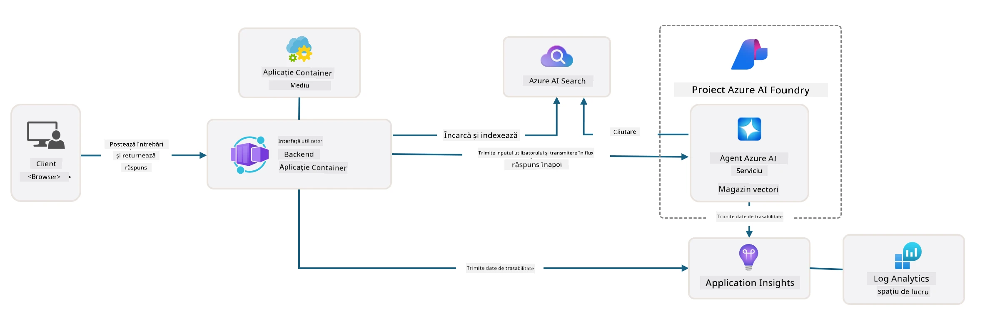
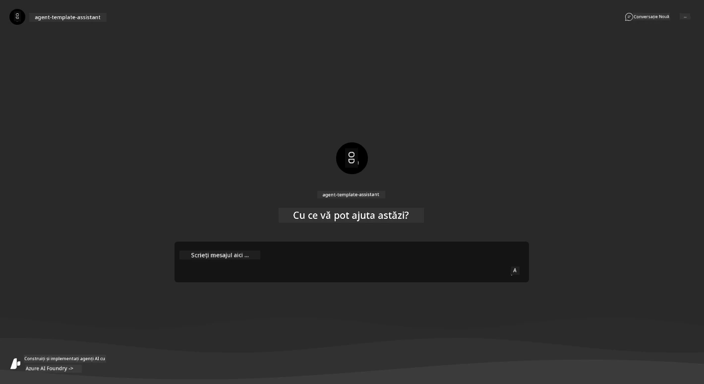

# 2. Validarea unui șablon

> Ghidul sursă revizuit conform AZD 1.37.2 și eșantionului curent la 4 noiembrie 2026. Capturile de ecran sunt ilustrative; navigarea în portal, setările implicite ale șablonului și disponibilitatea serviciului se pot schimba. Această revizuire nu a efectuat o implementare live în Azure.

!!! tip "LA FINALUL ACESTUI MODUL VEI FI CAPABIL SĂ"

    - [ ] Identify the sample's prerequisites and intended resources
    - [ ] Deploy the selected template into an intentional environment
    - [ ] Verify the application and agent behavior separately from deployment success
    - [ ] **Lab 2:** Record evidence of a working baseline, or an actionable deployment blocker

---

## 1. Verifică prerechizitele

Interfața de linie de comandă [Azure Developer CLI](https://learn.microsoft.com/azure/developer/azure-developer-cli/) gestionează implementarea aplicațiilor folosind configurația, infrastructura și codul din șablon. Verifică versiunea instalată:

```bash
azd version
```

Folosește [instrucțiunile actuale de instalare/actualizare](https://learn.microsoft.com/azure/developer/azure-developer-cli/install-azd), dacă este necesar. Exemplul revizuit declară AZD `>=1.14.0`, dar se recomandă o versiune curentă acceptată. Extensiile opționale AI au cerințe separate de versiune; fluxul de lucru normal `azd up` din acest exemplu nu necesită extensia pentru agenți.

Înainte de aprovizionare, citește [configurarea contului Azure](https://github.com/Azure-Samples/get-started-with-ai-agents/blob/main/docs/azure_account_setup.md) și [ghidul de implementare](https://github.com/Azure-Samples/get-started-with-ai-agents/blob/main/docs/deployment.md) din exemplu. Confirmă abonamentul, permisiunile, disponibilitatea modelului, cota regională și taxele estimate. Un cont gratuit Azure nu garantează acces sau utilizare gratuită pentru fiecare serviciu necesar.

## 2. Deschide exemplul selectat

Folosește depozitul [Get Started with AI Agents](https://github.com/Azure-Samples/get-started-with-ai-agents) inițializat în Modulul 1. Dacă nu l-ai inițializat, alege una dintre aceste alternative:

- Deschide un [Codespace pentru exemplu](https://github.com/codespaces/new/Azure-Samples/get-started-with-ai-agents).
- Clonează exemplul și urmează instrucțiunile pentru configurarea locală/dev-container.
- Într-un **director gol**, execută:

```bash
azd init --template Azure-Samples/get-started-with-ai-agents .
```

Nu inițializa un al doilea șablon peste un proiect existent. Execută comenzile următoare din rădăcina exemplului care conține `azure.yaml`, nu din rădăcina depozitului cursului.

Exemplul găzduiește o aplicație de chat cu agenți în Container Apps și aprovizionarea resurselor Foundry suport. Revizuiește arhitectura curentă și serviciile opționale, în loc să tratezi o captură de ecran veche ca inventarul exact al resurselor.



## 3. Implementați intenționat

```bash
azd auth login
azd up
```

Revizuiți prompturile:

1. Alegeți un nume unic pentru mediul AZD.
2. Selectați abonamentul dorit, nu pur și simplu pe cel oferit primul.
3. Selectați o regiune suportată de modelul/versiunea/SKU-ul necesar și de cota dumneavoastră.
4. Citiți rezultatul aprovizionării, implementării și post-implementării hook.

Valorile implicite revizuite includ `gpt-5-mini`, versiunea `2025-08-07` și `GlobalStandard`. Verificați șablonul inițializat și [combinațiile de model/regiune suportate](https://learn.microsoft.com/azure/ai-services/agents/concepts/model-region-support). Nicio regiune nu este garantată universal să funcționeze.

Durata implementării variază. Dacă aprovizionarea eșuează, păstrați eroarea și remediați cauza înainte de a încerca din nou. Nu ștergeți implementarea sau nu eliminați permanent resursele ca pas generic de depanare.

## 4. Validați aplicația

```bash
azd show
```

Deschideți punctul final pentru `api_and_frontend` sau găsiți Container App în grupul de resurse al implementării, în [portalul Azure](https://portal.azure.com/). Urmați instrucțiunile de acces/autentificare din exemplu dacă este necesară autentificarea; nu dezactivați autentificarea pentru a trece un test simplu.



Încercați câteva [întrebări exemplu](https://github.com/Azure-Samples/get-started-with-ai-agents/blob/main/docs/sample_questions.md):

- O întrebare generală factuala.
- O întrebare al cărei răspuns ar trebui să fie prezent în documentele încărcate în exemplar.
- O întrebare la care nu se poate răspunde din acele documente.

Verificați dacă interfața utilizatorului se încarcă, API-ul răspunde, recuperarea folosește datele așteptate, citările corespund conținutului sursă și întrebările neacceptate sunt gestionate corespunzător. Un mesaj `azd up` reușit singur nu stabilește aceste rezultate.

## 5. Inspectați agentul implementat

Deschideți proiectul în [portalul Foundry](https://ai.azure.com/). În fluxul portalului revizuit, selectați **Build**, apoi **Agents**, și localizați agentul creat de exemplu. Etichetele de navigare pot varia.

Notați:

- Numele și versiunea agentului.
- Modelul de implementare configurat.
- Instrucțiunile reale și uneltele activate.
- Care fișiere sau indexuri de căutare sunt conectate și dacă configurarea s-a finalizat cu succes.

Exemplul revizuit folosește un identificator de agent în forma `agent_name:agent_version` pentru testele de evaluare. Nu copiați un identificator clasic de agent/thread dintr-o captură veche într-un flux API mai nou.

Comparați documentele încărcate cu `src/files/` în revizia inițializată. Capturile anterioare arătau 32 de fișiere; acest număr nu este o valoare implicită garantată. Verificați orice răspuns referitor la clienții/produsele din exemplu față de datele sintetice reale sursă și nu încărcați date reale ale clienților pentru acest exercițiu.

## 6. Comparați cu playground-ul

Deschideți playground-ul agentului selectat în Foundry și puneți aceeași întrebare de recuperare. Comparați versiunea agentului configurat, uneltele, citările și calitatea răspunsului cu aplicația implementată.

Răspunsurile sunt probabilistice; potrivirea cuvânt cu cuvânt nu este criteriul. Dacă rezultatele diferă substanțial, verificați dacă aplicația și playground-ul țintesc același proiect, agent/versiune și sursă de cunoștințe.

## 7. Verificați cerințele de observabilitate

Ghidul de [observabilitate](https://github.com/Azure-Samples/get-started-with-ai-agents/blob/main/docs/observability.md) al exemplului este sursa de adevăr pentru configurarea trasabilității, evaluării și red-teaming.

În setările implicite ale infrastructurii revizuite, Application Insights este activat, dar **trasabilitatea clientului este dezactivată** (`ENABLE_AZURE_MONITOR_TRACING=false`). Crearea unei resurse de monitorizare nu dovedește că aplicația exportă trasabilitate. Modulul 5 tratează activarea trasabilității și generarea unei cereri de test.

Folosește jurnalele aplicației din Container App pentru a investiga erorile de pornire/API. În Foundry, inspectează vizualizările disponibile ale agentului pentru trasabilitate și monitorizare. Intrările de evaluare necesită configurația relevantă, evaluatori/regiune suportată și cereri reale; acestea nu sunt garantate să apară automat la fiecare execuție.

Lasă capturarea conținutului prompt/răspuns dezactivată, cu excepția cazului în care cerințele privind confidențialitatea, păstrarea, accesul și redactarea au fost revizuite.

## 8. Înțelegerea valorilor mediului

AZD stochează mediul selectat sub `.azure/<environment-name>/`. Intrările persistente și rezultatele implementării pot fi citite cu:

```bash
azd env list
azd env get-value AZURE_ENV_NAME
azd env get-value AZURE_LOCATION
```

`azd env get-values` listează toate valorile, care pot include configurații sensibile. Nu lipi această ieșire în probleme sau jurnale publice.

AZD folosește mediul selectat când rulează comenzile/cârligele sale, în timp ce variabilele de mediu ale procesului pot influența și ele comenzile și șabloanele. Acest lucru **nu** exportă valorile în shell-ul părinte sau în fiecare proces Python pornit independent. Urmează instrucțiunile de [dezvoltare locală](https://github.com/Azure-Samples/get-started-with-ai-agents/blob/main/docs/local_development.md) din exemplu.

Valorile implicite ale șablonului pot fi aplicate în `infra/main.parameters.json` fără a apărea ca valori locale explicite. Setarea unei variabile arbitrare nu schimbă infrastructura decât dacă șablonul o consumă.

De exemplu, pentru a selecta explicit valorile implicite ale modelului revizuit:

```bash
azd env set AZURE_AI_AGENT_MODEL_NAME gpt-5-mini
azd env set AZURE_AI_AGENT_MODEL_VERSION 2025-08-07
azd env set AZURE_AI_AGENT_DEPLOYMENT_SKU GlobalStandard
azd provision --preview
azd up
```

Revizuiți mai întâi compatibilitatea, capacitatea, disponibilitatea și modificările planificate. Actualizările infrastructurii necesită aprovizionare; `azd deploy` singur nu este suficient. Modificările modelelor suportate, în mod normal, nu necesită demontarea întregii aplicații.

`azd env refresh` recuperează rezultatele implementării pentru un mediu accesibil; nu reconstruiește toate intrările personalizate, nu sincronizează secretele și nu înlocuiește managementul configurației.

## 9. Înregistrați-vă linia de bază

- [ ] Mediu corect, abonament, regiune și model verificate.
- [ ] Aprovizionare, implementare și hook-uri de configurare necesare finalizate fără erori nerezolvate.
- [ ] Accesul la aplicație, chat, recuperarea și citările verificate.
- [ ] Agent/versiune și sursa de cunoștințe identificate.
- [ ] Prerogativele de observabilitate și orice blocaje rămase documentate.

Continuați către [Deconstruirea unui Șablon](3-Deconstruct-AI-Template.md).

---

<!-- CO-OP TRANSLATOR DISCLAIMER START -->
**Declinare a responsabilității**:
Acest document a fost tradus folosind serviciul de traducere AI [Co-op Translator](https://github.com/Azure/co-op-translator). În timp ce ne străduim pentru acuratețe, vă rugăm să rețineți că traducerile automate pot conține erori sau inexactități. Documentul original în limba sa nativă trebuie considerat sursa autorizată. Pentru informații critice, se recomandă traducerea profesională realizată de un om. Nu ne asumăm responsabilitatea pentru eventualele neînțelegeri sau interpretări greșite care decurg din utilizarea acestei traduceri.
<!-- CO-OP TRANSLATOR DISCLAIMER END -->