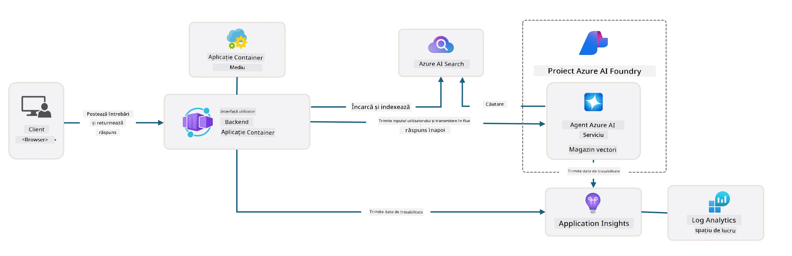

# 3. Deconstruirea unui Șablon

!!! tip "LA FINALUL ACESTUI MODUL VEI FI CAPABIL SĂ"

    - [ ] Use GitHub Copilot and optional MCP tools for Azure documentation and read-only exploration
    - [ ] Identify the template's application, infrastructure, configuration, and test entry points
    - [ ] Verify generated explanations against actual repository files
    - [ ] **Lab 3:** Trace one request and one configuration input through the project

---

## 1. Activează GitHub Copilot

Deschide exemplul AI inițializat în VS Code și activează [GitHub Copilot](https://code.visualstudio.com/docs/copilot/chat/chat-agent-mode). Autentifică-te cu un cont care are un plan eligibil; limitele de utilizare variază. Cere lui Copilot să explice depozitul înainte de a autoriza modificările.

### Servere MCP opționale

Aceste servicii pot oferi instrumente suplimentare:

- [Server Azure MCP](https://learn.microsoft.com/azure/developer/azure-mcp-server/overview)
- [Server Microsoft Learn MCP](https://learn.microsoft.com/training/support/mcp)

În VS Code, consultă [ghidul de configurare MCP](https://code.visualstudio.com/docs/copilot/chat/mcp-servers) și creează `.vscode/mcp.json` dacă este nevoie:

```json
{
  "servers": {
    "Azure MCP Server": {
      "type": "stdio",
      "command": "npx",
      "args": ["-y", "@azure/mcp@latest", "server", "start"]
    },
    "microsoft.docs.mcp": {
      "type": "http",
      "url": "https://learn.microsoft.com/api/mcp"
    }
  }
}
```

Comanda `npx` necesită o instalare suportată Node.js/npm și descarcă cod executabil. Consultă pachetul și fixează o versiune aprobată pentru o configurare reproductibilă în echipă. Pornește serverele folosind controalele MCP din VS Code și inspectează instrumentele disponibile; numele pot varia între versiuni.

**Autentificarea este separată.** Folosește `azd auth login` pentru AZD. Urmează fluxul de autentificare documentat al Azure MCP pentru instrumentele sale; autentificarea AZD singură nu stabilește o sesiune MCP. Folosește `az login` separat când un exercițiu sau hook apelează Azure CLI.

Încearcă prompturi doar în citire:

1. „Folosește Microsoft Learn MCP pentru a găsi documentația de configurare Azure Developer CLI.”
2. „Explică `azure.yaml` al acestui depozit; citează fișierele care implementează fiecare hook.”
3. „Folosește instrumentele Azure MCP disponibile pentru a lista resursele mele implementate fără a modifica nimic.”

Verifică locatarul/abonamentul selectat și fiecare apel propus de instrument. Nu aproba crearea, ștergerea sau modificarea accesului la resurse doar pentru a explora arhitectura.

## 2. Înțelege arhitectura

Exemplul găzduiește un backend Python FastAPI și un frontend React/TypeScript în Azure Container Apps. Backend-ul comunică cu un agent dintr-un proiect Microsoft Foundry. Recuperarea și observabilitatea depind de caracteristicile șablonului activate și de configurarea corectă; acestea nu sunt garantate doar pentru că aplicația a fost implementată.



Compară acest diagram cu [ghidul actual de implementare upstream](https://github.com/Azure-Samples/get-started-with-ai-agents/blob/main/docs/deployment.md) și cu resursele tale reale. Verifică configurarea implementării modelului, uneltele agentului, identitatea gestionată, rolurile atribuite și resursele opționale AI Search/Application Insights.

**Exercițiu:** Cere lui Copilot să urmărească o cerere de chat din frontend prin API către Foundry, cu referințe la fișiere și funcții. Deschide acele referințe și verifică explicația. Nu deduce autentificarea, rutarea sau autorizarea implementată doar dintr-un diagram.

## 3. Structura depozitului

Următoarele căi selectate au fost verificate față de exemplul din 4 noiembrie 2026. Revizia ta inițializată rămâne sursa adevărului:

```text
get-started-with-ai-agents/
  azure.yaml
  docker-compose.yaml
  requirements-dev.txt
  .devcontainer/
  infra/
    main.bicep
    main.parameters.json
    api.bicep
    core/
  src/
    Dockerfile
    pyproject.toml
    requirements.txt
    api/
      main.py
      routes.py
      search_index_manager.py
    frontend/
      package.json
      src/
    files/
  scripts/
    validate_env_vars.sh
    validate_env_vars.ps1
    postdeploy.sh
    postdeploy.ps1
  tests/
    test_evaluation.py
    test_red_teaming.py
  docs/
    deployment.md
    deploy_customization.md
    ai_search.md
    observability.md
    local_development.md
    troubleshooting.md
```

### Infrastructură și configurare

`infra/main.bicep` orchestralizează resurse; `main.parameters.json` leagă intrările șablonului de valorile mediului AZD. `azure.yaml` selectează serviciul aplicației și hook-urile ciclului de viață. Urmărește o intrare precum `USE_AZURE_AI_SEARCH_SERVICE` prin aceste fișiere pentru a găsi ce se schimbă efectiv.

### Aplicație și identitate

Citește `src/api/` și `src/frontend/` împreună. Identifică unde este creat sau preluat agentul, unde sunt configurate instrucțiunile/uneltele și ce identitate folosește fiecare apel Azure. Fișierele exemplu din `src/files/` sunt date de demonstrație, nu un catalog de producție sau model de autorizare.

### Teste și observabilitate

Punctele actuale de evaluare și red-teaming sunt sub `tests/`; referințele mai vechi din directoarele `evals/` și `airedteaming/` sunt învechite pentru acest exemplu. Citește `docs/observability.md` pentru condițiile prealabile și costuri înainte de a rula testele în cloud. Aceste teste Python sunt separate de extensia AZD opțională `azure.ai.evaluations`.

## 4. Verifică concluziile tale

- Identifică ruta API, interacțiunea agentului și codul de recuperare pentru o întrebare de exemplu.
- Explică ce identitate accesează Foundry și ce configurare selectează endpoint-ul său.
- Găsește scripturile reale pre-up și post-deploy și comportamentul lor de gestionare a erorilor.
- Listează orice dependențe sau caracteristici opționale absente din implementarea ta.

Continuă către [Configurează un Șablon](4-Configure-AI-Template.md).

---

<!-- CO-OP TRANSLATOR DISCLAIMER START -->
**Declinare a responsabilității**:
Acest document a fost tradus folosind serviciul de traducere AI [Co-op Translator](https://github.com/Azure/co-op-translator). În timp ce ne străduim pentru acuratețe, vă rugăm să rețineți că traducerile automate pot conține erori sau inexactități. Documentul original în limba sa nativă trebuie considerat sursa autorizată. Pentru informații critice, se recomandă traducerea profesională realizată de un om. Nu ne asumăm responsabilitatea pentru eventualele neînțelegeri sau interpretări greșite care decurg din utilizarea acestei traduceri.
<!-- CO-OP TRANSLATOR DISCLAIMER END -->