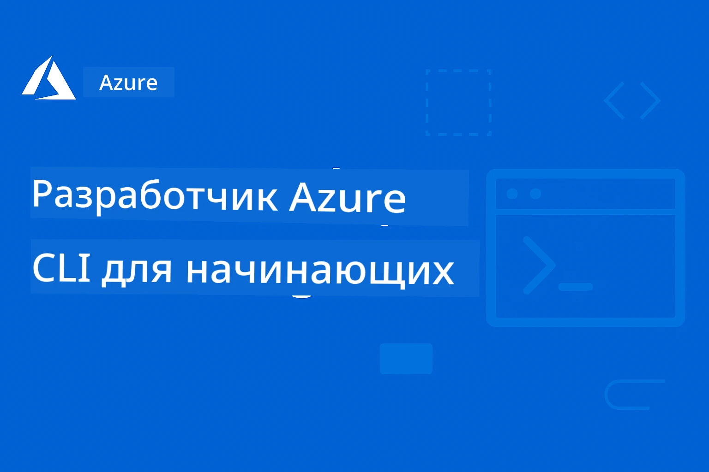

# AZD для начинающих: структурированное обучение

 

[](https://github.com/microsoft/AZD-for-beginners)
[](https://GitHub.com/microsoft/azd-for-beginners/network/)
[](https://github.com/microsoft/AZD-for-beginners)

[](https://discord.com/invite/nkVh3dp)
[](https://discord.gg/nTYy5BXMWG)

---

### Автоматические переводы (всегда актуальные)

<!-- CO-OP TRANSLATOR LANGUAGES TABLE START -->
[Арабский](../ar/README.md) | [Бенгальский](../bn/README.md) | [Болгарский](../bg/README.md) | [Бирманский (Мьянма)](../my/README.md) | [Китайский (упрощенный)](../zh-CN/README.md) | [Китайский (традиционный, Гонконг)](../zh-HK/README.md) | [Китайский (традиционный, Макао)](../zh-MO/README.md) | [Китайский (традиционный, Тайвань)](../zh-TW/README.md) | [Хорватский](../hr/README.md) | [Чешский](../cs/README.md) | [Датский](../da/README.md) | [Голландский](../nl/README.md) | [Эстонский](../et/README.md) | [Финский](../fi/README.md) | [Французский](../fr/README.md) | [Немецкий](../de/README.md) | [Греческий](../el/README.md) | [Иврит](../he/README.md) | [Хинди](../hi/README.md) | [Венгерский](../hu/README.md) | [Индонезийский](../id/README.md) | [Итальянский](../it/README.md) | [Японский](../ja/README.md) | [Каннада](../kn/README.md) | [Кхмерский](../km/README.md) | [Корейский](../ko/README.md) | [Литовский](../lt/README.md) | [Малайский](../ms/README.md) | [Малаялам](../ml/README.md) | [Маратхи](../mr/README.md) | [Непальский](../ne/README.md) | [Нигерийский пиджин](../pcm/README.md) | [Норвежский](../no/README.md) | [Персидский (фарси)](../fa/README.md) | [Польский](../pl/README.md) | [Португальский (Бразилия)](../pt-BR/README.md) | [Португальский (Португалия)](../pt-PT/README.md) | [Пенджаби (Гурмукхи)](../pa/README.md) | [Румынский](../ro/README.md) | [Русский](./README.md) | [Сербский (кириллица)](../sr/README.md) | [Словацкий](../sk/README.md) | [Словенский](../sl/README.md) | [Испанский](../es/README.md) | [Свахили](../sw/README.md) | [Шведский](../sv/README.md) | [Тагалог (филиппинский)](../tl/README.md) | [Тамильский](../ta/README.md) | [Телугу](../te/README.md) | [Тайский](../th/README.md) | [Турецкий](../tr/README.md) | [Украинский](../uk/README.md) | [Урду](../ur/README.md) | [Вьетнамский](../vi/README.md)

> **Предпочитаете клонировать локально?**
>
> Этот репозиторий включает переводы более чем на 50 языков, что значительно увеличивает размер загрузки. Чтобы клонировать без переводов, используйте sparse checkout:
>
> **Bash / macOS / Linux:**
> ```bash
> git clone --filter=blob:none --sparse https://github.com/microsoft/AZD-for-beginners.git
> cd AZD-for-beginners
> git sparse-checkout set --no-cone '/*' '!translations' '!translated_images'
> ```
>
> **CMD (Windows):**
> ```cmd
> git clone --filter=blob:none --sparse https://github.com/microsoft/AZD-for-beginners.git
> cd AZD-for-beginners
> git sparse-checkout set --no-cone "/*" "!translations" "!translated_images"
> ```
>
> Это даст вам всё необходимое для прохождения курса с гораздо более быстрой загрузкой.
<!-- CO-OP TRANSLATOR LANGUAGES TABLE END -->

## 🆕 Что нового в azd сегодня

> 📌 **Обзор релиза AI CLI (2026-11-04):** Рекомендации проверены на основе опубликованной документации/исходников **`azd 1.37.2`**, **агентов `1.0.0-beta.23`** и **оценок `1.0.0-beta.2`**. Используйте `azd >= 1.37.0` для объединённого рабочего процесса. Запустите `azd version` и [обновите основное CLI](https://learn.microsoft.com/azure/developer/azure-developer-cli/install-azd) перед расширениями. Смотрите [изменения и исправления релиза](docs/chapter-08-production/production-ai-practices.md#recent-release-changes-and-fixes). Это не проверка живого развертывания всего курса.

Azure Developer CLI поддерживает многие типы приложений, включая веб-приложения, API и AI-агенты, через поддерживаемые хосты, шаблоны и расширения.

Что это значит для вас:

- **AI-агенты теперь полноценные рабочие нагрузки azd.** Вы можете инициализировать, развертывать и управлять проектами AI-агентов с помощью того же рабочего процесса `azd init` → `azd up`, который вы уже знаете.
- **Жизненный цикл агента через два расширения.** Используйте `azure.ai.agents` для инициализации, вызова, оптимизации и списания агентов. Установите **`azure.ai.evaluations`** отдельно для `azd ai eval init`, `generate` и `run start`. Бета-версия агентов beta.22 заменила устаревший рабочий процесс оценки и изменила конфигурацию оптимизации; следуйте [гайду по миграции](docs/chapter-08-production/production-ai-practices.md#evaluation-migration-and-quality-checks).
- **Больше блоков для AI.** Новые превью-расширения — `azure.ai.skills` и `azure.ai.connections` — позволяют управлять повторно используемыми навыками агентов и соединениями Foundry непосредственно через azd.
- **Интеграция с Microsoft Foundry** обеспечивает развертывание моделей, хостинг агентов и конфигурацию AI-сервисов прямо в экосистеме шаблонов azd.
- **Более плавные базовые операции.** Последние релизы сделали `azd init` идемпотентным (безопасным для повторного запуска), `azd auth login` автоматически очищает устаревшие токены и добавили дружественный `azd tool` запрос при первом запуске.
- **Основной рабочий процесс не изменился.** Независимо от того, развертываете ли вы приложение todo, микросервис или мультиагентное AI-решение, команды остаются прежними.

> **Примечание для пользователей Aspire:** Microsoft теперь называет продукт просто **Aspire** (ранее ".NET Aspire"). Поддержка Aspire в azd не изменилась — изменилось только имя.

Если вы уже пользовались azd, поддержка AI — естественное расширение, а не отдельный инструмент или продвинутый курс. Если начинаете с нуля, вы изучите один рабочий процесс, который подходит для всего.

---

## 🚀 Что такое Azure Developer CLI (azd)?

**Azure Developer CLI (azd)** — инструмент командной строки, ориентированный на разработчиков, который упрощает развертывание приложений в Azure. Вместо ручного создания и подключения десятков ресурсов Azure, вы можете развернуть целые приложения одной командой.

### Магия `azd up`

```bash
# This single command does everything:
# ✅ Creates all Azure resources  
# ✅ Configures networking and security
# ✅ Builds your application code
# ✅ Deploys to Azure
# ✅ Gives you a working URL
azd up
```

Шаблон предоставляет конфигурацию приложения и инфраструктуры. Успешное развертывание требует поддерживаемых сервисов/моделей, достаточных квот и разрешений, корректных входных данных и проверки развернутого приложения. `azd up` не делает шаблон автоматически безопасным, соответствующим стандартам и готовым к продакшену.

---

## ❓ Azure Developer CLI и Azure CLI: в чём разница?

Это самый распространённый вопрос среди новичков. Вот простой ответ:

| Особенность | **Azure CLI (`az`)** | **Azure Developer CLI (`azd`)** |
|---------|---------------------|--------------------------------|
| **Назначение** | Управление отдельными ресурсами Azure | Развертывание целых приложений |
| **Подход** | Ориентирован на инфраструктуру | Ориентирован на приложения |
| **Пример** | `az webapp create --name myapp...` | `azd up` |
| **Кривая обучения** | Нужно знать сервисы Azure | Нужно знать только своё приложение |
| **Лучше подходит для** | DevOps, инфраструктура | Разработчики, прототипирование |

### Простая аналогия

- **Azure CLI** — это как иметь все инструменты для строительства дома — молотки, пилы, гвозди. Можно построить что угодно, но нужно знать строительство.
- **Azure Developer CLI** — это как нанять подрядчика — вы описываете, что хотите, а он занимается строительством.

### Когда что использовать

| Ситуация | Используйте это |
|----------|----------|
| «Хочу быстро развернуть веб-приложение» | `azd up` |
| «Мне нужно создать только учетную запись хранилища» | `az storage account create` |
| «Я строю полноценное AI-приложение» | `azd init --template azure-search-openai-demo` |
| «Мне нужно отладить конкретный ресурс Azure» | `az resource show` |
| «Хочу развернуть в своей настроенной продакшен-среде» | Проверьте конфигурацию, доступ, стоимость и операционные требования перед `azd up --environment production` |

### Они работают вместе!

AZD и Azure CLI имеют отдельную аутентификацию и конфигурацию. Используйте `azd auth login` для AZD и `az login`, когда явно требуется Azure CLI для хуков или команд диагностики. Вы можете использовать оба:
```bash
# Deploy your app with AZD
azd up

# Then fine-tune specific resources with Azure CLI
az webapp config set --name myapp --always-on true
```

---

## 🌟 Найдите шаблоны в Awesome AZD

Не начинайте с нуля! **Awesome AZD** — сообщество с коллекцией готовых к развертыванию шаблонов:

| Ресурс | Описание |
|----------|-------------|
| 🔗 [**Галерея Awesome AZD**](https://azure.github.io/awesome-azd/) | Просмотр 200+ шаблонов с развертыванием в один клик |
| 🔗 [**Добавить шаблон**](https://github.com/Azure/awesome-azd/issues) | Внесите свой вклад, добавив шаблон в сообщество |
| 🔗 [**Репозиторий GitHub**](https://github.com/Azure/awesome-azd) | Поставьте звезду и изучите исходники |

### Популярные AI-шаблоны из Awesome AZD

Выберите один шаблон в отдельной пустой папке; приведённые ниже команды — альтернативы. Завершающий `.` инициализирует эту папку.

```bash
# RAG Chat with Microsoft Foundry Models + AI Search
azd init --template azure-search-openai-demo .

# Quick AI Chat Application
azd init --template openai-chat-app-quickstart .

# AI Agents with Foundry Agents
azd init --template get-started-with-ai-agents .
```

---

## 🎯 Начало работы за 3 шага

Перед началом убедитесь, что ваша машина готова для выбранного шаблона:

**Windows:**
```powershell
.\validate-setup.ps1
```

**macOS / Linux:**
```bash
bash ./validate-setup.sh
```

Если какое-либо требование не выполняется, исправьте это перед дальнейшими действиями.

### Шаг 1: Установите AZD (2 минуты)

**Windows:**
```powershell
winget install microsoft.azd
```

**macOS:**
```bash
brew tap azure/azd && brew install azd
```

**Linux:**
```bash
curl -fsSL https://aka.ms/install-azd.sh | bash
```

### Шаг 2: Аутентификация для AZD

```bash
# Optional if you plan to use Azure CLI commands directly in this course
az login

# Required for AZD workflows
azd auth login
```

Если вы не уверены, что именно нужно, пройдите полный процесс настройки в [Installation & Setup](docs/chapter-01-foundation/installation.md#authentication-setup).

### Шаг 3: Разверните ваше первое приложение

```bash
# Initialize from a template
azd init --template todo-nodejs-mongo .

# Deploy to Azure (creates everything!)
azd up
```

**🎉 Готово!** Ваше приложение теперь работает в Azure.

### Очистка (не забудьте!)

```bash
# Remove all resources when done experimenting
azd down --force --purge
```

---

## 📚 Как использовать этот курс

Этот курс предназначен для **пошагового обучения** — начните с того, что вам комфортно, и продвигайтесь дальше:

| Ваш опыт | Начинайте здесь |
|-----------------|------------|
| **Совсем новый в Azure** | [Глава 1: Основы](#-chapter-1-foundation--quick-start) |
| **Знаете Azure, новичок в AZD** | [Глава 1: Основы](#-chapter-1-foundation--quick-start) |
| **Хотите развернуть AI-приложения** | [Глава 2: Разработка с AI в центре внимания](#-chapter-2-ai-first-development-recommended-for-ai-developers) |
| **Хотите практические занятия** | [🎓 Интерактивный воркшоп](workshop/README.md) — 3-4 часа с руководством |
| **Требуются производственные шаблоны** | [Глава 8: Производство и корпоративное использование](#-chapter-8-production--enterprise-patterns) |

### Быстрая настройка

1. **Форкните этот репозиторий**: [](https://GitHub.com/microsoft/azd-for-beginners/fork)
2. **Клонируйте его**: `git clone https://github.com/YOUR-USERNAME/azd-for-beginners.git`
3. **Получите помощь**: [Сообщество Azure Discord](https://discord.com/invite/ByRwuEEgH4)

> **Предпочитаете клонировать локально?**

> Этот репозиторий включает переводы более чем на 50 языков, что значительно увеличивает размер загрузки. Чтобы клонировать без переводов, используйте sparse checkout:
> ```bash
> git clone --filter=blob:none --sparse https://github.com/microsoft/AZD-for-beginners.git
> cd AZD-for-beginners
> git sparse-checkout set --no-cone '/*' '!translations' '!translated_images'
> ```
> Это даст вам всё необходимое для прохождения курса с гораздо более быстрой загрузкой.


## Обзор курса

Освойте Azure Developer CLI (azd) с помощью структурированных глав, предназначенных для последовательного обучения. **Особое внимание уделяется развертыванию AI-приложений с интеграцией Microsoft Foundry.**

### Почему этот курс важен для современных разработчиков

Разработчики, развёртывающие AI-нагрузки, обычно нуждаются в руководстве по:
- Сложным многосервисным AI-архитектурам
- Лучшему практическому опыту развертывания AI в производстве
- Интеграции и конфигурированию Azure AI-сервисов
- Оптимизации затрат на AI-нагрузки
- Устранению проблем при развертывании, специфичных для AI

### Цели обучения

Пройдя этот структурированный курс, вы сможете:
- **Овладеть основами AZD**: Ключевые понятия, установка и конфигурация
- **Разворачивать AI-приложения**: Использовать AZD с Microsoft Foundry
- **Реализовать инфраструктуру как код**: Управлять ресурсами Azure с помощью Bicep-шаблонов
- **Устранять неполадки развертывания**: Решать распространённые проблемы и отлаживать ошибки
- **Оптимизировать для производства**: Безопасность, масштабирование, мониторинг и управление затратами
- **Создавать многоагентные решения**: Разворачивать сложные AI-архитектуры

## Перед началом: аккаунты, доступ и предположения

Прежде чем начать главу 1, убедитесь, что у вас есть все необходимые условия. Шаги установки в дальнейшем руководстве предполагают, что эти базовые моменты уже учтены.

- **Подписка Azure**: Можно использовать существующую подписку на работе или свою собственную, либо создать [бесплатную пробную версию](https://aka.ms/azurefreetrial) для старта.
- **Разрешения на создание ресурсов Azure**: Для большинства упражнений у вас должен быть уровень доступа **Участник** как минимум на целевой подписке или группе ресурсов. В некоторых главах предполагается возможность создавать группы ресурсов, управляемые идентичности и назначения RBAC.
- [**Аккаунт GitHub**](https://github.com): Это удобно для форка репозитория, отслеживания своих изменений и использования GitHub Codespaces для мастер-класса.
- **Предварительные требования для шаблонов**: Некоторые шаблоны требуют локальных инструментов, таких как Node.js, Python, Java или Docker. Запустите проверку установки перед началом, чтобы вовремя обнаружить отсутствующие инструменты.
- **Базовые навыки работы с терминалом**: Не обязательно быть экспертом, но стоит уверенно выполнять команды вроде `git clone`, `azd auth login` и `azd up`.

> **Работаете в корпоративной подписке?**
> Если ваше Azure-среда управляется администратором, заранее подтвердите, что вы можете развёртывать ресурсы в подписке или группе ресурсов, которую планируете использовать. Если нет, попросите песочницу или доступ Участника.

> **Новички в Azure?**
> Начните с собственной пробной или оплатной посуточно подписки Azure на https://aka.ms/azurefreetrial, чтобы пройти упражнения полностью без ожидания одобрения на уровне арендатора.

## 🗺️ Карта курса: Быстрая навигация по главам

Каждая глава содержит отдельный README с целями обучения, быстрым стартом и упражнениями:

| Глава | Тема | Уроки | Время | Сложность |
|---------|-------|---------|----------|------------|
| **[Гл 1: Основа](docs/chapter-01-foundation/README.md)** | Начало работы | [Основы AZD](docs/chapter-01-foundation/azd-basics.md) &#124; [Установка](docs/chapter-01-foundation/installation.md) &#124; [Первый проект](docs/chapter-01-foundation/first-project.md) | 30-45 мин | ⭐ |
| **[Гл 2: Разработка AI](docs/chapter-02-ai-development/README.md)** | AI-первоочередные приложения | [Интеграция Foundry](docs/chapter-02-ai-development/microsoft-foundry-integration.md) &#124; [AI агенты](docs/chapter-02-ai-development/agents.md) &#124; [Развертывание моделей](docs/chapter-02-ai-development/ai-model-deployment.md) &#124; [Мастер-класс](docs/chapter-02-ai-development/ai-workshop-lab.md) | 1-2 ч | ⭐⭐ |
| **[Гл 3: Конфигурация](docs/chapter-03-configuration/README.md)** | Аутентификация и безопасность | [Настройка](docs/chapter-03-configuration/configuration.md) &#124; [Аутентификация и безопасность](docs/chapter-03-configuration/authsecurity.md) | 45-60 мин | ⭐⭐ |
| **[Гл 4: Инфраструктура](docs/chapter-04-infrastructure/README.md)** | IaC и развертывание | [Руководство по развертыванию](docs/chapter-04-infrastructure/deployment-guide.md) &#124; [Provisioning](docs/chapter-04-infrastructure/provisioning.md) | 1-1.5 ч | ⭐⭐⭐ |
| **[Гл 5: Многоагентные решения](docs/chapter-05-multi-agent/README.md)** | AI-агентные решения | [Сценарий розницы](examples/retail-scenario.md) &#124; [Паттерны координации](docs/chapter-06-pre-deployment/coordination-patterns.md) | 2-3 ч | ⭐⭐⭐⭐ |
| **[Гл 6: Предварительное развертывание](docs/chapter-06-pre-deployment/README.md)** | Планирование и валидация | [Проверки перед запуском](docs/chapter-06-pre-deployment/preflight-checks.md) &#124; [Планирование ёмкости](docs/chapter-06-pre-deployment/capacity-planning.md) &#124; [Выбор SKU](docs/chapter-06-pre-deployment/sku-selection.md) &#124; [Application Insights](docs/chapter-06-pre-deployment/application-insights.md) | 1 ч | ⭐⭐ |
| **[Гл 7: Устранение неполадок](docs/chapter-07-troubleshooting/README.md)** | Отладка и исправление | [Распространённые проблемы](docs/chapter-07-troubleshooting/common-issues.md) &#124; [Отладка](docs/chapter-07-troubleshooting/debugging.md) &#124; [AI-проблемы](docs/chapter-07-troubleshooting/ai-troubleshooting.md) | 1-1.5 ч | ⭐⭐ |
| **[Гл 8: Производство](docs/chapter-08-production/README.md)** | Корпоративные паттерны | [Практики производства](docs/chapter-08-production/production-ai-practices.md) | 2-3 ч | ⭐⭐⭐⭐ |
| **[🎓 Мастер-класс](workshop/README.md)** | Практический курс | [Введение](workshop/docs/instructions/0-Introduction.md) &#124; [Выбор](workshop/docs/instructions/1-Select-AI-Template.md) &#124; [Валидация](workshop/docs/instructions/2-Validate-AI-Template.md) &#124; [Анализ](workshop/docs/instructions/3-Deconstruct-AI-Template.md) &#124; [Конфигурация](workshop/docs/instructions/4-Configure-AI-Template.md) &#124; [Кастомизация](workshop/docs/instructions/5-Customize-AI-Template.md) &#124; [Демонтаж](workshop/docs/instructions/6-Teardown-Infrastructure.md) &#124; [Завершение](workshop/docs/instructions/7-Wrap-up.md) | 3-4 ч | ⭐⭐ |

**Общее время курса:** ~10-14 часов | **Прогресс навыков:** Начинающий → Готовый к производству

---

## 📚 Учебные главы

*Выберите свой учебный путь в зависимости от уровня опыта и целей*

### 🚀 Глава 1: Основы и быстрый старт
**Требования**: Подписка Azure, базовые знания командной строки  
**Время**: 30-45 минут  
**Сложность**: ⭐

#### Что вы изучите
- Понимание основ Azure Developer CLI
- Установку AZD на вашу платформу
- Ваше первое успешное развертывание

#### Учебные материалы
- **🎯 Начните здесь**: [Что такое Azure Developer CLI?](#-what-is-azure-developer-cli-azd)
- **📖 Теория**: [Основы AZD](docs/chapter-01-foundation/azd-basics.md) - Ключевые понятия и терминология
- **⚙️ Установка**: [Руководство по установке](docs/chapter-01-foundation/installation.md) - Руководство по платформам
- **🛠️ Практика**: [Ваш первый проект](docs/chapter-01-foundation/first-project.md) - Пошаговое руководство
- **📋 Быстрая справка**: [Справочник команд](resources/cheat-sheet.md)

#### Практические упражнения
```bash
# Quick installation check
azd version

# Deploy your first application
azd init --template todo-nodejs-mongo .
azd up
```

**💡 Результат главы**: Успешно развернуть простое веб-приложение в Azure с помощью AZD

**✅ Критерии успеха:**
```bash
# After completing Chapter 1, you should be able to:
azd version              # Shows installed version
azd init --template todo-nodejs-mongo  # Initializes project
azd up                  # Deploys to Azure
azd show                # Displays running app URL
# Application opens in browser and works
azd down --force --purge  # Cleans up resources
```

**📊 Время на выполнение:** 30-45 минут  
**📈 Уровень навыков после:** Способность самостоятельно разворачивать базовые приложения

---

### 🤖 Глава 2: Разработка AI-первичных приложений (Рекомендуется разработчикам AI)
**Требования**: Завершение главы 1  
**Время**: 1-2 часа  
**Сложность**: ⭐⭐

#### Что вы изучите
- Интеграцию Microsoft Foundry с AZD
- Развертывание AI-приложений
- Понимание конфигураций AI-сервисов

#### Учебные материалы
- **🎯 Начните здесь**: [Интеграция Microsoft Foundry](docs/chapter-02-ai-development/microsoft-foundry-integration.md)
- **🤖 AI агенты**: [Руководство по AI агентам](docs/chapter-02-ai-development/agents.md) - Развёртывание интеллектуальных агентов с AZD
- **📖 Паттерны**: [Развертывание AI моделей](docs/chapter-02-ai-development/ai-model-deployment.md) - Развертывание и управление AI-моделями
- **🛠️ Мастер-класс**: [Лаборатория AI](docs/chapter-02-ai-development/ai-workshop-lab.md) - Подготовка AI-решений для AZD
- **🎥 Интерактивное руководство**: [Материалы мастер-класса](workshop/README.md) - Обучение через браузер с MkDocs * DevContainer
- **📋 Шаблоны**: [Шаблоны Microsoft Foundry](#featured-microsoft-foundry-templates)
- **📝 Примеры**: [Примеры развертывания AZD](examples/README.md)

#### Практические упражнения
```bash
# Deploy your first AI application
azd init --template azure-search-openai-demo .
azd up

# Try additional AI templates
azd init --template openai-chat-app-quickstart .
azd init --template agent-openai-python-prompty .
```

**💡 Результат главы**: Развернуть и настроить AI-чат с возможностями RAG

**✅ Критерии успеха:**
```bash
# After Chapter 2, you should be able to:
azd init --template azure-search-openai-demo .
azd up
# Test the AI chat interface
# Ask questions and get AI-powered responses with sources
# Verify search integration works
azd monitor  # Check Application Insights shows telemetry
azd down --force --purge
```

**📊 Время на выполнение:** 1-2 часа  
**📈 Уровень навыков после:** Умение разворачивать AI-приложения и выявлять дополнительные требования для готовности к производству
**💰 Осведомлённость о затратах:** Понимание затрат $80-150/месяц в разработке, $300-3500/месяц в производстве

#### 💰 Расходы на AI-развертывания

**Среда разработки (примерно $80-150/месяц):**
- Модели Microsoft Foundry (оплата по факту): $0-50/месяц (в зависимости от использования токенов)
- AI Search (базовый уровень): $75/месяц
- Container Apps (по потреблению): $0-20/месяц
- Хранение (стандартное): $1-5/месяц

**Производственная среда (примерно $300-3,500+/месяц):**
- Модели Microsoft Foundry (PTU для стабильной производительности): от $3,000/месяц ИЛИ оплата по факту при большом объёме
- AI Search (стандартный уровень): $250/месяц
- Container Apps (выделенные): $50-100/месяц
- Application Insights: $5-50/месяц
- Хранение (премиум): $10-50/месяц

**💡 Советы по оптимизации затрат:**
- Проверьте цены на инференс моделей и кредиты, привязанные к аккаунту; в Azure OpenAI нет универсального ежемесячного лимита в 50 000 токенов бесплатно
- Запускайте `azd down` для удаления ресурсов после использования, предварительно проверив выбранную среду
- Начинайте с биллинга по потреблению, переходите на PTU только для производства
- Используйте `azd provision --preview` для просмотра планируемой инфраструктуры, затем оцените ресурсы в Калькуляторе цен Azure
- Включите авто-масштабирование: платите только за фактическое использование

**Мониторинг затрат:**
```bash
# Inspect planned resources (this does not calculate prices)
azd provision --preview

# Monitor actual costs in Azure Portal
az consumption budget list --resource-group <your-rg>
```

---

### ⚙️ Глава 3: Конфигурация и аутентификация
**Требования**: Завершение главы 1  
**Время**: 45-60 минут  
**Сложность**: ⭐⭐

#### Что вы изучите
- Конфигурацию и управление средами
- Лучшие практики аутентификации и безопасности
- Именование и организация ресурсов

#### Учебные материалы
- **📖 Конфигурация**: [Руководство по конфигурации](docs/chapter-03-configuration/configuration.md) - Настройка среды
- **🔐 Безопасность**: [Паттерны аутентификации и управляемая идентичность](docs/chapter-03-configuration/authsecurity.md) - Паттерны аутентификации
- **📝 Примеры**: [Пример приложения с базой данных](examples/database-app/README.md) - Примеры AZD для баз данных

#### Практические упражнения
- Настройка нескольких сред (dev, staging, prod)
- Настройка аутентификации с помощью управляемых идентичностей
- Реализация среды-специфичных конфигураций

**💡 Результат главы**: Управление несколькими средами с надлежащей аутентификацией и безопасностью

---

### 🏗️ Глава 4: Инфраструктура как код и развертывание
**Требования**: Завершение глав 1-3  
**Время**: 1-1.5 часа  
**Сложность**: ⭐⭐⭐

#### Что вы изучите
- Продвинутые паттерны развертывания
- Инфраструктуру как код с Bicep
- Стратегии провижининга ресурсов

#### Учебные материалы
- **📖 Развертывание**: [Руководство по развертыванию](docs/chapter-04-infrastructure/deployment-guide.md) - Полные рабочие процессы
- **🏗️ Провижининг**: [Provisioning ресурсов](docs/chapter-04-infrastructure/provisioning.md) - Управление ресурсами Azure
- **📝 Примеры**: [Пример Container App](../../examples/container-app) - Развертывание в контейнерах

#### Практические упражнения
- Создание пользовательских шаблонов Bicep
- Разворачивание многосервисных приложений
- Внедрение стратегий blue-green развертывания

**💡 Результат главы**: Разворачивать сложные многосервисные приложения с помощью пользовательских инфраструктурных шаблонов

---

### 🎯 Глава 5: Многоагентные AI-решения (Продвинутый уровень)
**Требования**: Завершение глав 1-2  
**Время**: 2-3 часа  
**Сложность**: ⭐⭐⭐⭐

#### Что вы изучите
- Паттерны многоагентной архитектуры
- Оркестрацию и координацию агентов
- Готовые к производству AI-развертывания

#### Учебные материалы
- **🤖 Представленный дизайн**: [Многоагентное решение для розницы](examples/retail-scenario.md) - Архитектурный план, не полное приложение
- **🛠️ ARM Templates**: [ARM Template Package](../../examples/retail-multiagent-arm-template) - Каркас инфраструктуры; проверьте предварительные условия и отсутствующие компоненты приложения
- **📖 Architecture**: [Multi-agent coordination patterns](docs/chapter-06-pre-deployment/coordination-patterns.md) - Паттерны

#### Практические упражнения
```bash
# Inspect the retail infrastructure scaffold before choosing to deploy it
cd examples/retail-multiagent-arm-template
cat README.md

# After an intentional deployment, inspect infrastructure state
az deployment group show --resource-group <rg-name> --name <deployment-name>
```

**💡 Результат главы**: Понять дизайн мультиагентов и определить работу по реализации, валидации и эксплуатации, необходимую сверх каркаса инфраструктуры

---

### 🔍 Глава 6: Валидация и планирование перед развертыванием
**Предварительные условия**: Глава 4 завершена  
**Продолжительность**: 1 час  
**Сложность**: ⭐⭐

#### Чему вы научитесь
- Планирование мощности и проверка ресурсов
- Стратегии выбора SKU
- Проверки перед запуском и автоматизация

#### Ресурсы для обучения
- **📊 Планирование**: [Capacity Planning](docs/chapter-06-pre-deployment/capacity-planning.md) - Проверка ресурсов
- **💰 Выбор**: [SKU Selection](docs/chapter-06-pre-deployment/sku-selection.md) - Оптимальные с точки зрения стоимости варианты
- **✅ Валидация**: [Pre-flight Checks](docs/chapter-06-pre-deployment/preflight-checks.md) - Автоматизированные скрипты

#### Практические упражнения
- Запуск скриптов проверки мощности
- Оптимизация выбора SKU с точки зрения стоимости
- Реализация автоматизированных проверок перед развертыванием

**💡 Результат главы**: Проверить и оптимизировать развертывания перед их выполнением

---

### 🚨 Глава 7: Устранение неполадок и отладка
**Предварительные условия**: Любая глава по развертыванию завершена  
**Продолжительность**: 1-1.5 часа  
**Сложность**: ⭐⭐

#### Чему вы научитесь
- Систематические подходы к отладке
- Распространённые проблемы и решения
- Особенности устранения неполадок AI

#### Ресурсы для обучения
- **🔧 Распространённые проблемы**: [Common Issues](docs/chapter-07-troubleshooting/common-issues.md) - FAQ и решения
- **🕵️ Отладка**: [Debugging Guide](docs/chapter-07-troubleshooting/debugging.md) - Пошаговые стратегии
- **🤖 Проблемы AI**: [AI-Specific Troubleshooting](docs/chapter-07-troubleshooting/ai-troubleshooting.md) - Проблемы сервисов AI

#### Практические упражнения
- Диагностика сбоев развертывания
- Решение проблем с аутентификацией
- Отладка подключения к AI сервисам

**💡 Результат главы**: Независимо диагностировать и решать распространённые проблемы развертывания

---

### 🏢 Глава 8: Продакшн и корпоративные паттерны
**Предварительные условия**: Главы 1-4 завершены  
**Продолжительность**: 2-3 часа  
**Сложность**: ⭐⭐⭐⭐

#### Чему вы научитесь
- Стратегии продакшн-развертывания
- Корпоративные паттерны безопасности
- Мониторинг и оптимизация затрат

#### Ресурсы для обучения
- **🏭 Продакшн**: [Production AI Best Practices](docs/chapter-08-production/production-ai-practices.md) - Корпоративные паттерны
- **📝 Примеры**: [Microservices Example](../../examples/microservices) - Сложные архитектуры
- **📊 Мониторинг**: [Application Insights integration](docs/chapter-06-pre-deployment/application-insights.md) - Мониторинг

#### Практические упражнения
- Реализация корпоративных паттернов безопасности
- Настройка комплексного мониторинга
- Развертывание в продакшн с соблюдением управления

**💡 Результат главы**: Развертывать корпоративные приложения с полным продакшн-функционалом

---

## 🎓 Обзор воркшопа: Практический учебный опыт

> **⚠️ СТАТУС ВОРКШОПА: Активная разработка**  
> Материалы воркшопа в настоящее время разрабатываются и совершенствуются. Основные модули функционируют, но некоторые продвинутые разделы пока не завершены. Мы активно работаем над полным созданием контента. [Отслеживать прогресс →](workshop/README.md)

### Интерактивные материалы воркшопа
**Всестороннее практическое обучение с браузерными инструментами и управляемыми упражнениями**

Наши материалы воркшопа предлагают структурированный, интерактивный учебный опыт, дополняющий учебный план по главам выше. Воркшоп рассчитан как на самостоятельное обучение, так и на занятия с инструктором.

#### 🛠️ Особенности воркшопа
- **Браузерный интерфейс**: Полный воркшоп на базе MkDocs с поиском, копированием и функциями темы
- **Интеграция GitHub Codespaces**: Настройка среды разработки в один клик
- **Структурированный путь обучения**: 8 модулей с управляемыми упражнениями (всего 3-4 часа)
- **Прогрессивная методология**: Введение → Выбор → Валидация → Деконструкция → Конфигурация → Кастомизация → Завершение → Итоги
- **Интерактивная среда DevContainer**: Предварительно настроенные инструменты и зависимости

#### 📚 Структура модулей воркшопа
Воркшоп следует **8-модульной прогрессивной методологии**, которая ведёт вас от изучения до мастерства развертывания:

| Модуль | Тема | Что вы сделаете | Продолжительность |
|--------|-------|----------------|----------|
| **0. Введение** | Обзор воркшопа | Понять учебные цели, предварительные условия и структуру воркшопа | 15 мин |
| **1. Выбор** | Поиск шаблонов | Изучить шаблоны AZD и выбрать подходящий шаблон AI для вашего сценария | 20 мин |
| **2. Валидация** | Развернуть и проверить | Развернуть шаблон с `azd up` и проверить работу инфраструктуры | 30 мин |
| **3. Деконструкция** | Понять структуру | Использовать GitHub Copilot для изучения архитектуры шаблона, файлов Bicep и организации кода | 30 мин |
| **4. Конфигурация** | Глубокое изучение azure.yaml | Освоить конфигурацию `azure.yaml`, хуки жизненного цикла и переменные окружения | 30 мин |
| **5. Кастомизация** | Сделать под себя | Включить AI Search, трассировку, оценку и кастомизировать под ваш сценарий | 45 мин |
| **6. Завершение** | Очистка | Безопасно деинсталлировать ресурсы с помощью `azd down --purge` | 15 мин |
| **7. Итоги** | Следующие шаги | Подвести итоги, повторить ключевые концепции и продолжить обучение | 15 мин |

**Схема воркшопа:**
```
Introduction → Selection → Validation → Deconstruction → Configuration → Customization → Teardown → Wrap-up
     ↓            ↓           ↓              ↓               ↓              ↓            ↓           ↓
  Overview    Find the     Deploy &      Explore        Master         Customize     Clean up    Review &
             right        verify        code &        azure.yaml      for your      resources   next steps
             template                   structure                     scenario
```

#### 🚀 Начало работы с воркшопом
```bash
# Option 1: GitHub Codespaces (Recommended)
# Click "Code" → "Create codespace on main" in the repository

# Option 2: Local Development
git clone https://github.com/microsoft/azd-for-beginners.git
cd azd-for-beginners/workshop
# Follow the setup instructions in workshop/README.md
```

#### 🎯 Учебные результаты воркшопа
Завершив воркшоп, участники смогут:
- **Развертывать производственные AI приложения**: Использовать AZD с сервисами Microsoft Foundry
- **Освоить мультиагентные архитектуры**: Реализовывать координированные решения AI агентов
- **Внедрять лучшие практики безопасности**: Настраивать аутентификацию и контроль доступа
- **Оптимизировать масштабируемость**: Проектировать экономичные и производительные развертывания
- **Устранение неполадок развертываний**: Самостоятельно решать распространённые проблемы

#### 📖 Ресурсы воркшопа
- **🎥 Интерактивный гид**: [Workshop Materials](workshop/README.md) - Обучающая среда в браузере
- **📋 Инструкции по модулям**:
  - [0. Введение](workshop/docs/instructions/0-Introduction.md) - Обзор воркшопа и цели
  - [1. Выбор](workshop/docs/instructions/1-Select-AI-Template.md) - Поиск и выбор AI шаблонов
  - [2. Валидация](workshop/docs/instructions/2-Validate-AI-Template.md) - Развертывание и проверка шаблонов
  - [3. Деконструкция](workshop/docs/instructions/3-Deconstruct-AI-Template.md) - Изучение архитектуры шаблона
  - [4. Конфигурация](workshop/docs/instructions/4-Configure-AI-Template.md) - Освоение azure.yaml
  - [5. Кастомизация](workshop/docs/instructions/5-Customize-AI-Template.md) - Кастомизация под ваш сценарий
  - [6. Завершение](workshop/docs/instructions/6-Teardown-Infrastructure.md) - Очистка ресурсов
  - [7. Итоги](workshop/docs/instructions/7-Wrap-up.md) - Итоги и дальнейшие шаги
- **🛠️ Лаборатория AI воркшопа**: [AI Workshop Lab](docs/chapter-02-ai-development/ai-workshop-lab.md) - Упражнения, ориентированные на AI
- **💡 Быстрый старт**: [Workshop Setup Guide](workshop/README.md#browser-based-guide) - Настройка окружения

**Подходит для**: Корпоративного обучения, университетских курсов, самостоятельного обучения и буткемпов для разработчиков.

---

## 📖 Глубокое погружение: Возможности AZD

Помимо основ, AZD предоставляет мощные функции для продакшн-развертываний:

- **Развертывания на основе шаблонов** - Используйте готовые шаблоны для распространённых паттернов приложений
- **Инфраструктура как код** - Управляйте ресурсами Azure с помощью Bicep или Terraform  
- **Интегрированные рабочие процессы** - Бесшовное обеспечение, развертывание и мониторинг приложений
- **Удобство для разработчиков** - Оптимизировано для продуктивности и удобства разработчиков

### **AZD + Microsoft Foundry: Идеально для AI-развертываний**

**Почему AZD для AI решений?** AZD решает ключевые проблемы, с которыми сталкиваются разработчики AI:

- **AI-готовые шаблоны** - Преднастроенные шаблоны для Microsoft Foundry Models, Azure AI Services и ML нагрузок
- **Безопасные AI-развертывания** - Встроенные паттерны безопасности для AI служб, API ключей и конечных точек моделей  
- **Паттерны продакшн AI** - Лучшие практики масштабируемых и экономичных AI приложений
- **Полные AI рабочие процессы** - От разработки модели до продакшн-развертывания с соответствующим мониторингом
- **Оптимизация затрат** - Умное распределение ресурсов и стратегии масштабирования AI нагрузок
- **Интеграция с Microsoft Foundry** - Бесшовное соединение с каталогом моделей и конечными точками Microsoft Foundry

---

## 🎯 Библиотека шаблонов и примеров

### Особое внимание: шаблоны Microsoft Foundry
**Начните здесь, если разворачиваете AI приложения!**

> **Примечание:** Эти шаблоны демонстрируют различные AI паттерны. Некоторые из них — внешние Azure Samples, другие — локальные реализации.

| Шаблон | Глава | Сложность | Сервисы | Тип |
|----------|---------|------------|----------|------|
| [**Начало работы с AI чатами**](https://github.com/Azure-Samples/get-started-with-ai-chat) | Глава 2 | ⭐⭐ | AzureOpenAI + Azure AI Model Inference API + Azure AI Search + Azure Container Apps + Application Insights | Внешний |
| [**Начало работы с AI агентами**](https://github.com/Azure-Samples/get-started-with-ai-agents) | Глава 2 | ⭐⭐ | Foundry Agents + AzureOpenAI + Azure AI Search + Azure Container Apps + Application Insights| Внешний |
| [**Демонстрация Azure Search + OpenAI**](https://github.com/Azure-Samples/azure-search-openai-demo) | Глава 2 | ⭐⭐ | Azure OpenAI + Azure AI Search + Container Apps (по умолчанию) + Storage | Внешний |
| [**Quickstart OpenAI Chat App**](https://github.com/Azure-Samples/openai-chat-app-quickstart) | Глава 2 | ⭐ | AzureOpenAI + Container Apps + Application Insights | Внешний |
| [**Agent OpenAI Python Prompty**](https://github.com/Azure-Samples/agent-openai-python-prompty) | Глава 5 | ⭐⭐⭐ | AzureOpenAI + Azure Functions + Prompty | Внешний |
| [**Contoso Chat RAG**](https://github.com/Azure-Samples/contoso-chat) | Глава 8 | ⭐⭐⭐⭐ | AzureOpenAI + AI Search + Cosmos DB + Container Apps | Внешний |
| [**Retail Multi-Agent Solution**](examples/retail-scenario.md) | Глава 5 | ⭐⭐⭐⭐ | Предложенная архитектура и каркас инфраструктуры; требуется реализация приложения | **Локальный шаблон** |

### Особое внимание: Полные учебные сценарии
**Шаблоны приложений готовых к продакшну, привязанные к учебным главам**

| Шаблон | Учебная глава | Сложность | Ключевые навыки |
|----------|------------------|------------|--------------|
| [**openai-chat-app-quickstart**](https://github.com/Azure-Samples/openai-chat-app-quickstart) | Глава 2 | ⭐ | Базовые паттерны развертывания AI |
| [**azure-search-openai-demo**](https://github.com/Azure-Samples/azure-search-openai-demo) | Глава 2 | ⭐⭐ | Реализация RAG с Azure AI Search |
| [**get-started-with-ai-agents**](https://github.com/Azure-Samples/get-started-with-ai-agents) | Глава 2 | ⭐⭐ | Чат с поддержкой агентов и специфические тесты оценки |
| [**agent-openai-python-prompty**](https://github.com/Azure-Samples/agent-openai-python-prompty) | Глава 5 | ⭐⭐⭐ | Фреймворк агента и вызовы функций |
| [**contoso-chat**](https://github.com/Azure-Samples/contoso-chat) | Глава 8 | ⭐⭐⭐ | Корпоративная оркестрация AI |
| [**retail-multi-agent-solution**](examples/retail-scenario.md) | Глава 5 | ⭐⭐⭐⭐ | Мульти-агентная архитектура с агентами клиентов и инвентаря |

### Обучение по типу примера

> **📌 Локальные и внешние примеры:**  
> **Локальные примеры** (в этом репозитории) = Изучайте README примера для статуса реализации и предварительных условий
> **Внешние примеры** (Azure Samples) = Клонируйте из связанных репозиториев

#### Локальные примеры (готовы к использованию)
- [**Retail Multi-Agent Solution**](examples/retail-scenario.md) - Архитектурный шаблон с каркасом инфраструктуры ARM
  - Предложенные роли агентов Клиента и Инвентаря
  - Мониторинг, оценка и код приложения должны быть реализованы и проверены
  - Одно лишь обеспечение ресурсов не создаёт работающее ритейл-приложение

#### Локальные примеры - Контейнерные приложения (Главы 2-5)
**Всесторонние примеры развертывания контейнеров в этом репозитории:**
- [**Примеры контейнерных приложений**](examples/container-app/README.md) - Полное руководство по контейнеризованным развертываниям
  - [Простой Flask API](../../examples/container-app/simple-flask-api) - Базовый REST API с масштабированием до нуля
  - [Архитектура микросервисов](../../examples/container-app/microservices) - Образец с двумя сервисами; продакшн-заточки — дополнительная работа
  - Быстрый старт, продакшн и продвинутые паттерны развертывания
  - Руководство по мониторингу, безопасности и оптимизации затрат

#### Внешние примеры - Простые приложения (Главы 1-2)
**Клонируйте эти репозитории Azure Samples для начала работы:**
- [Простое веб-приложение - Node.js + MongoDB](https://github.com/Azure-Samples/todo-nodejs-mongo) - Базовые паттерны развертывания
- [Статический сайт - React SPA](https://github.com/Azure-Samples/todo-csharp-sql-swa-func) - Развертывание статического контента
- [Контейнерное приложение - Python Flask](https://github.com/Azure-Samples/container-apps-store-api-microservice) - Развертывание REST API

#### Внешние примеры - Интеграция с базами данных (Главы 3-4)  
- [Приложение с базой данных - C# + SQL](https://github.com/Azure-Samples/todo-csharp-sql) - Шаблоны подключения к базе данных
- [Функции + Cosmos DB](https://github.com/Azure-Samples/todo-python-mongo-swa-func) - Безсерверные рабочие процессы с данными

#### Внешние примеры - Расширенные шаблоны (главы 4-8)
- [Java Микросервисы](https://github.com/Azure-Samples/java-microservices-aca-lab) - Мультисервисные архитектуры
- [Container Apps Jobs](https://github.com/Azure-Samples/container-apps-jobs) - Фоновая обработка  
- [Энтерпрайз MLOps Pipeline](https://github.com/Azure/mlops-v2) - Референсные шаблоны MLOps; не является готовым шаблоном AZD

### Внешние коллекции шаблонов
- [**Официальная галерея шаблонов AZD**](https://azure.github.io/awesome-azd/) - Курируемая коллекция официальных и пользовательских шаблонов
- [**Шаблоны Azure Developer CLI**](https://learn.microsoft.com/en-us/azure/developer/azure-developer-cli/azd-templates) - Документация по шаблонам Microsoft Learn
- [**Каталог примеров**](examples/README.md) - Локальные обучающие примеры с подробными объяснениями

---

## 📚 Ресурсы для обучения и ссылки

### Быстрые ссылки
- [**Шпаргалка по командам**](resources/cheat-sheet.md) - Основные команды azd, организованные по главам
- [**Глоссарий**](resources/glossary.md) - Терминология Azure и azd  
- [**Часто задаваемые вопросы**](resources/faq.md) - Распространённые вопросы по главам обучения
- [**Учебное руководство**](resources/study-guide.md) - Всеобъемлющие практические упражнения

### Практические мастер-классы
- [**Лаборатория AI Workshop**](docs/chapter-02-ai-development/ai-workshop-lab.md) - Сделайте свои AI-решения развертываемыми с AZD (2-3 часа)
- [**Интерактивный мастер-класс**](workshop/README.md) - 8-модульные пошаговые упражнения с MkDocs и GitHub Codespaces
  - Последовательность: Введение → Выбор → Проверка → Декомпозиция → Конфигурация → Настройка → Завершение → Итоги

### Внешние ресурсы для обучения
- [Документация Azure Developer CLI](https://learn.microsoft.com/en-us/azure/developer/azure-developer-cli/)
- [Центр архитектуры Azure](https://learn.microsoft.com/en-us/azure/architecture/)
- [Калькулятор цен Azure](https://azure.microsoft.com/pricing/calculator/)
- [Статус Azure](https://status.azure.com/)

### Навыки AI-агентов для вашего редактора
- [**Навыки Microsoft Azure на skills.sh**](https://skills.sh/microsoft/github-copilot-for-azure) - 37 открытых навыков агентов для Azure AI, Foundry, развертывания, диагностики, оптимизации затрат и многое другое. Установите их в GitHub Copilot, Cursor, Claude Code или любом поддерживаемом агенте:
  ```bash
  npx skills add microsoft/github-copilot-for-azure
  ```

---

## 🔧 Быстрый гид по устранению проблем

**Распространённые проблемы, с которыми сталкиваются начинающие, и быстрые решения:**

<details>
<summary><strong>❌ "azd: команда не найдена"</strong></summary>

```bash
# Install AZD first
# Windows (PowerShell):
winget install microsoft.azd

# macOS:
brew tap azure/azd && brew install azd

# Linux:
curl -fsSL https://aka.ms/install-azd.sh | bash

# Verify installation
azd version
```
</details>

<details>
<summary><strong>❌ "Подписка не найдена" или "Подписка не установлена"</strong></summary>

```bash
# List available subscriptions
az account list --output table

# Set default subscription
az account set --subscription "<subscription-id-or-name>"

# Set for AZD environment
azd env set AZURE_SUBSCRIPTION_ID "<subscription-id>"

# Verify
az account show
```
</details>

<details>
<summary><strong>❌ "Недостаточно квоты" или "Превышена квота"</strong></summary>

```bash
# Try different Azure region
azd env set AZURE_LOCATION "westus2"
azd up

# Or use smaller SKUs in development
# Edit infra/main.parameters.json:
{
  "sku": "B1"  // Instead of "P1V2"
}
```
</details>

<details>
<summary><strong>❌ "azd up" завершается с ошибкой на полпути</strong></summary>

```bash
# Option 1: Inspect the error and retry after correcting its cause
azd show
azd up --debug

# Option 2: Just fix infrastructure
azd provision

# Option 3: Check detailed status
azd show

# Option 4: Check logs in Azure Monitor
azd monitor --logs
```
</details>

<details>
<summary><strong>❌ "Ошибка аутентификации" или "Токен истёк"</strong></summary>

```bash
# Re-authenticate for AZD
azd auth logout
azd auth login

# Optional: refresh Azure CLI too if you are running az commands
az logout
az login

# Verify authentication
az account show
```
</details>

<details>
<summary><strong>❌ "Ресурс уже существует" или конфликты имён</strong></summary>

```bash
# Inspect the conflicting resource before changing or deleting anything.
# For an isolated new deployment, create a separate environment:
azd env new dev-v2
azd up
```
</details>

<details>
<summary><strong>❌ Развёртывание шаблона занимает слишком много времени</strong></summary>

**Нормальное время ожидания:**
- Простое веб-приложение: 5-10 минут
- Приложение с базой данных: 10-15 минут
- AI-приложения: 15-25 минут (Provisioning OpenAI происходит медленно)

```bash
# Check progress
azd show

# If stuck >30 minutes, check Azure Portal:
azd monitor --overview
# Look for failed deployments
```
</details>

<details>
<summary><strong>❌ "Доступ запрещён" или "Запрещено"</strong></summary>

```bash
# Check your Azure role
az role assignment list --assignee $(az account show --query user.name -o tsv)

# You need at least "Contributor" role
# Ask your Azure admin to grant:
# - Contributor (for resources)
# - User Access Administrator (for role assignments)
```
</details>

<details>
<summary><strong>❌ Не удаётся найти URL развернутого приложения</strong></summary>

```bash
# Show all service endpoints
azd show

# Or open Azure Portal
azd monitor

# Check specific service
azd env get-values
# Look for *_URL variables
```
</details>

### 📚 Полные ресурсы по устранению неполадок

- **Руководство по общим проблемам:** [Подробные решения](docs/chapter-07-troubleshooting/common-issues.md)
- **Проблемы, связанные с AI:** [Устранение неполадок AI](docs/chapter-07-troubleshooting/ai-troubleshooting.md)
- **Руководство по отладке:** [Пошаговая отладка](docs/chapter-07-troubleshooting/debugging.md)
- **Получить помощь:** [Azure Discord](https://discord.gg/microsoft-azure) #azure-developer-cli

---

## 🎓 Завершение курса и сертификация

### Отслеживание прогресса
Следите за своим обучением по каждой главе:

- [ ] **Глава 1**: Основы и быстрый старт ✅
- [ ] **Глава 2**: AI-первый подход к разработке ✅  
- [ ] **Глава 3**: Конфигурация и аутентификация ✅
- [ ] **Глава 4**: Инфраструктура как код и развёртывание ✅
- [ ] **Глава 5**: Мультиагентные AI-решения ✅
- [ ] **Глава 6**: Предварительная проверка и планирование развёртывания ✅
- [ ] **Глава 7**: Устранение неполадок и отладка ✅
- [ ] **Глава 8**: Производственные и корпоративные шаблоны ✅

### Проверка знаний
После завершения каждой главы подтвердите свои знания, выполнив:
1. **Практическое задание**: Выполните практическое развёртывание по главе
2. **Проверка знаний**: Просмотрите раздел FAQ по вашей главе
3. **Обсуждение в сообществе**: Поделитесь опытом в Azure Discord
4. **Следующая глава**: Перейдите к следующему уровню сложности

### Преимущества завершения курса
После завершения всех глав вы получите:
- **Опыт в продакшене**: Развернутые реальные AI-приложения в Azure
- **Профессиональные навыки**: Навыки развёртывания уровня предприятия  
- **Признание в сообществе**: Активное членство в сообществе разработчиков Azure
- **Карьера**: Востребованная экспертиза в AZD и AI-развёртывании

---

## 🤝 Сообщество и поддержка

### Получить помощь и поддержку
- **Технические проблемы**: [Сообщить об ошибках и запросить функции](https://github.com/microsoft/azd-for-beginners/issues)
- **Вопросы по обучению**: [Сообщество Microsoft Azure Discord](https://discord.gg/microsoft-azure) и [](https://discord.gg/nTYy5BXMWG)
- **Помощь по AI**: Присоединяйтесь к [](https://discord.gg/nTYy5BXMWG)
- **Документация**: [Официальная документация Azure Developer CLI](https://learn.microsoft.com/en-us/azure/developer/azure-developer-cli/)

### Мнение сообщества из Microsoft Foundry Discord

**Темы, обсуждаемые сообществом:**
- Мультисервисные развёртывания, управление учётными данными и готовность к продакшену
- AI-специфичные шаблоны, руководства по устранению проблем и лучшие практики

**Присоединяйтесь к нашему сообществу, чтобы:**
- Поделитесь своими опытами с AZD + AI и получите помощь
- Получите ранний доступ к новым AI-шаблонам
- Вносите вклад в лучшие практики развёртывания AI
- Влияйте на развитие будущих функций AI + AZD

### Вклад в курс
Мы приветствуем вклад! Пожалуйста, ознакомьтесь с нашим [Руководством по вкладу](CONTRIBUTING.md) для информации о:
- **Улучшение контента**: Повышайте качество глав и примеров
- **Новые примеры**: Добавляйте реальные сценарии и шаблоны  
- **Перевод**: Помогайте поддерживать многоязычность
- **Сообщения об ошибках**: Повышайте точность и ясность
- **Стандарты сообщества**: Следуйте нашим инклюзивным правилам сообщества

---

## 📄 Информация о курсе

### Лицензия
Этот проект лицензирован под лицензией MIT - смотрите файл [LICENSE](../../LICENSE) для подробностей.

### Связанные учебные ресурсы Microsoft

Наша команда создаёт и другие комплексные учебные курсы:

<!-- CO-OP TRANSLATOR OTHER COURSES START -->
### LangChain
[](https://aka.ms/langchain4j-for-beginners)
[](https://aka.ms/langchainjs-for-beginners?WT.mc_id=m365-94501-dwahlin)
[](https://github.com/microsoft/langchain-for-beginners?WT.mc_id=m365-94501-dwahlin)
---

### Azure / Edge / MCP / Агенты
[](https://github.com/microsoft/AZD-for-beginners?WT.mc_id=academic-105485-koreyst)
[](https://github.com/microsoft/edgeai-for-beginners?WT.mc_id=academic-105485-koreyst)
[](https://github.com/microsoft/mcp-for-beginners?WT.mc_id=academic-105485-koreyst)
[](https://github.com/microsoft/ai-agents-for-beginners?WT.mc_id=academic-105485-koreyst)

---
 
### Серия по генеративному AI
[](https://github.com/microsoft/generative-ai-for-beginners?WT.mc_id=academic-105485-koreyst)
[-9333EA?style=for-the-badge&labelColor=E5E7EB&color=9333EA)](https://github.com/microsoft/Generative-AI-for-beginners-dotnet?WT.mc_id=academic-105485-koreyst)
[-C084FC?style=for-the-badge&labelColor=E5E7EB&color=C084FC)](https://github.com/microsoft/generative-ai-for-beginners-java?WT.mc_id=academic-105485-koreyst)
[-E879F9?style=for-the-badge&labelColor=E5E7EB&color=E879F9)](https://github.com/microsoft/generative-ai-with-javascript?WT.mc_id=academic-105485-koreyst)

---
 
### Основное обучение
[](https://aka.ms/ml-beginners?WT.mc_id=academic-105485-koreyst)
[](https://aka.ms/datascience-beginners?WT.mc_id=academic-105485-koreyst)
[](https://aka.ms/ai-beginners?WT.mc_id=academic-105485-koreyst)
[](https://github.com/microsoft/Security-101?WT.mc_id=academic-96948-sayoung)
[](https://aka.ms/webdev-beginners?WT.mc_id=academic-105485-koreyst)
[](https://aka.ms/iot-beginners?WT.mc_id=academic-105485-koreyst)
[](https://github.com/microsoft/xr-development-for-beginners?WT.mc_id=academic-105485-koreyst)

---
 
### Серия Copilot
[](https://aka.ms/GitHubCopilotAI?WT.mc_id=academic-105485-koreyst)
[](https://github.com/microsoft/mastering-github-copilot-for-dotnet-csharp-developers?WT.mc_id=academic-105485-koreyst)
[](https://github.com/microsoft/CopilotAdventures?WT.mc_id=academic-105485-koreyst)
<!-- CO-OP TRANSLATOR OTHER COURSES END -->

---

## 🗺️ Навигация по курсу

**🚀 Готовы начать обучение?**

**Начинающие**: Начните с [Глава 1: Основы и быстрый старт](#-chapter-1-foundation--quick-start)  
**AI-разработчики**: Перейдите к [Глава 2: AI-первый подход](#-chapter-2-ai-first-development-recommended-for-ai-developers)  
**Опытные разработчики**: Начните с [Глава 3: Конфигурация и аутентификация](#️-chapter-3-configuration--authentication)

**Следующие шаги**: [Начать главу 1 — Основы AZD](docs/chapter-01-foundation/azd-basics.md) →

---

<!-- CO-OP TRANSLATOR DISCLAIMER START -->
**Отказ от ответственности**:
Этот документ был переведен с использованием сервиса машинного перевода [Co-op Translator](https://github.com/Azure/co-op-translator). Несмотря на наши усилия по обеспечению точности, имейте в виду, что автоматический перевод может содержать ошибки или неточности. Оригинальный документ на его исходном языке следует считать авторитетным источником. Для получения критически важной информации рекомендуется обратиться к профессиональному человеческому переводу. Мы не несем ответственности за любые недоразумения или неправильные толкования, возникшие в результате использования этого перевода.
<!-- CO-OP TRANSLATOR DISCLAIMER END -->