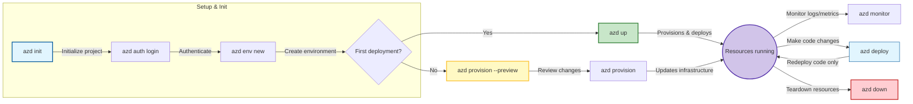
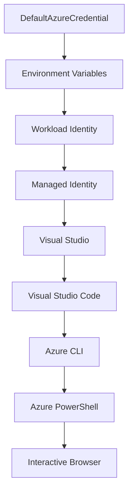

# Основы AZD — ключевые концепции и основы

**Навигация по главам:**
- **📚 Главная курса**: [AZD для начинающих](../../README.md)
- **📖 Текущая глава**: Глава 1 — Основы и быстрый старт
- **⬅️ Предыдущая**: [Обзор курса](../../README.md#-chapter-1-foundation--quick-start)
- **➡️ Следующая**: [Установка и настройка](installation.md)
- **🚀 Следующая глава**: [Глава 2: AI-First разработка](../chapter-02-ai-development/microsoft-foundry-integration.md)

## Введение

> Проверено по `azd 1.37.2` (ноябрь 2026). Команды Bash используют кавычки с заполнителями, которые нужно заменить. Шаблонные рабочие процессы используют `.` для инициализации текущей директории; без аргумента директории шаблон создает поддиректорию и не меняет рабочую директорию вашего шелла. Продвинутые сниппеты иллюстративны, а не полноценные проекты.

Этот урок познакомит вас с Azure Developer CLI (azd) — мощным инструментом командной строки, который ускоряет ваш путь от локальной разработки до развертывания в Azure. Вы изучите фундаментальные понятия, основные функции и поймете, как azd упрощает развертывание облачных приложений.

## Цели обучения

К концу урока вы:
- Поймете, что такое Azure Developer CLI и его основное назначение
- Изучите ключевые концепции шаблонов, окружений и сервисов
- Ознакомитесь с ключевыми функциями, включая разработку на основе шаблонов и инфраструктуру как код
- Поймете структуру проектов azd и рабочий процесс
- Будете готовы установить и настроить azd для вашей среды разработки

## Результаты обучения

После прохождения урока вы сможете:
- Объяснить роль azd в современных облачных рабочих процессах разработки
- Определить компоненты структуры проекта azd
- Описать, как шаблоны, окружения и сервисы взаимодействуют
- Понять преимущества инфраструктуры как кода с azd
- Узнавать разные команды azd и их назначение

## Что такое Azure Developer CLI (azd)?

Azure Developer CLI (azd) — это инструмент командной строки, созданный для ускорения вашего пути от локальной разработки до развертывания в Azure. Он упрощает процесс создания, развертывания и управления облачными приложениями на платформе Azure.

### Что вы можете развернуть с azd?

azd поддерживает широкий спектр нагрузок — и список постоянно расширяется. Сегодня вы можете использовать azd для развертывания:

| Тип нагрузки | Примеры | Один и тот же процесс? |
|---------------|----------|----------------|
| **Традиционные приложения** | Веб-приложения, REST API, статические сайты | ✅ `azd up` |
| **Сервисы и микросервисы** | Container Apps, Function Apps, многоуровневые бэкенды | ✅ `azd up` |
| **Приложения с AI** | Чат-приложения с Microsoft Foundry Models, RAG-решения с AI Search | ✅ `azd up` |
| **Интеллектуальные агенты** | Агенты на базе Foundry, оркестрация многократных агентов | ✅ `azd up` |

Главное понять, что **жизненный цикл azd остается одинаковым вне зависимости от развертываемого приложения**. Вы инициализируете проект, создаете инфраструктуру, деплоите код, контролируете приложение и освобождаете ресурсы — будь то простой сайт или сложный AI-агент.

Эта согласованность сделана специально. azd рассматривает возможности AI как еще один сервис, который ваше приложение может использовать, а не как нечто принципиально другое. Точка обмена сообщениями с поддержкой Microsoft Foundry Models — в глазах azd это просто еще один сервис для настройки и развертывания.

### 🎯 Почему использовать AZD? Реальное сравнение

Давайте сравним развертывание простого веб-приложения с базой данных:

#### ❌ БЕЗ AZD: Ручное развертывание Azure (более 30 минут)

**Иллюстративное сравнение на Bash, не предназначено для запуска приложения.** Предполагается наличие кода приложения, уникальных имен ресурсов, аутентификации Azure CLI и необходимых расширений CLI. Для полной поддержки используйте шаблонные упражнения ниже.

```bash
# Step 1: Create resource group
az group create --name myapp-rg --location eastus

# Step 2: Create App Service Plan
az appservice plan create --name myapp-plan \
  --resource-group myapp-rg \
  --sku B1 --is-linux

# Step 3: Create Web App
az webapp create --name myapp-web-unique123 \
  --resource-group myapp-rg \
  --plan myapp-plan \
  --runtime "NODE:22-lts"

# Step 4: Create Cosmos DB account (10-15 minutes)
az cosmosdb create --name myapp-cosmos-unique123 \
  --resource-group myapp-rg \
  --kind MongoDB

# Step 5: Create database
az cosmosdb mongodb database create \
  --account-name myapp-cosmos-unique123 \
  --resource-group myapp-rg \
  --name tododb

# Step 6: Create collection
az cosmosdb mongodb collection create \
  --account-name myapp-cosmos-unique123 \
  --resource-group myapp-rg \
  --database-name tododb \
  --name todos

# Step 7: Get connection string
CONN_STR=$(az cosmosdb keys list \
  --name myapp-cosmos-unique123 \
  --resource-group myapp-rg \
  --type connection-strings \
  --query "connectionStrings[0].connectionString" -o tsv)

# Step 8: Configure app settings
az webapp config appsettings set \
  --name myapp-web-unique123 \
  --resource-group myapp-rg \
  --settings MONGODB_URI="$CONN_STR"

# Step 9: Enable logging
az webapp log config --name myapp-web-unique123 \
  --resource-group myapp-rg \
  --application-logging filesystem \
  --detailed-error-messages true

# Step 10: Set up Application Insights
az monitor app-insights component create \
  --app myapp-insights \
  --location eastus \
  --resource-group myapp-rg

# Step 11: Link App Insights to Web App
INSTRUMENTATION_KEY=$(az monitor app-insights component show \
  --app myapp-insights \
  --resource-group myapp-rg \
  --query "instrumentationKey" -o tsv)

az webapp config appsettings set \
  --name myapp-web-unique123 \
  --resource-group myapp-rg \
  --settings APPINSIGHTS_INSTRUMENTATIONKEY="$INSTRUMENTATION_KEY"

# Step 12: Build application locally
npm install
npm run build

# Step 13: Create deployment package
zip -r app.zip . -x "*.git*" "node_modules/*"

# Step 14: Deploy application
az webapp deployment source config-zip \
  --resource-group myapp-rg \
  --name myapp-web-unique123 \
  --src app.zip

# Step 15: Wait and pray it works 🙏
# (No automated validation, manual testing required)
```

**Проблемы:**
- ❌ Нужно запомнить и выполнить более 15 команд по порядку
- ❌ От 30 до 45 минут ручной работы
- ❌ Легко допустить ошибки (опечатки, неправильные параметры)
- ❌ Требуется явная обработка учетных данных; логи отладки и трассировка шелла могут раскрыть их
- ❌ Нет автоматического отката при ошибках
- ❌ Трудно воспроизвести для членов команды
- ❌ Каждый раз по-разному (не воспроизводимо)

#### ✅ С AZD: Автоматизированное развертывание (5 команд, 10-15 минут)

```bash
# Step 1: Initialize from template
azd init --template todo-nodejs-mongo .

# Step 2: Authenticate
azd auth login

# Step 3: Select the environment created during init
azd env select dev

# Step 4: Preview changes (optional but recommended)
azd provision --preview

# Step 5: Deploy everything
azd up

# ✨ Done! Everything is deployed, configured, and monitored
```

**Преимущества:**
- ✅ **5 команд** против 15+ ручных шагов
- ✅ **10-15 минут** общего времени (в основном ожидание Azure)
- ✅ **Меньше ошибок вручную** — последовательный, основанный на шаблонах рабочий процесс
- ✅ **Безопасное управление секретами** — многие шаблоны используют Azure-управляемое хранилище секретов
- ✅ **Повторяемость развертываний** — одинаковый процесс каждый раз
- ✅ **Повторяемое описание инфраструктуры** — зависит от квот, доступности регионов и версий шаблонов
- ✅ **Готовность для команды** — любой может развернуть теми же командами
- ✅ **Инфраструктура как код** — версии Bicep шаблонов под контролем версий
- ✅ **Мониторинг, заданный шаблоном** — Application Insights если включён в шаблон

### Время и надёжность

Указанные времена — оценки, а не эталоны. azd сокращает количество команд для координации, но не гарантирует длительность развертывания, не устраняет ошибки и не предоставляет автоматический откат приложения/базы. Сохраняйте рабочие версии в системе контроля версий и тестируйте процедуры восстановления.

## Основные концепции

### Шаблоны
Шаблоны — основа azd. Они содержат:
- **Код приложения** — ваш исходный код и зависимости
- **Определения инфраструктуры** — ресурсы Azure, описанные в Bicep или Terraform
- **Файлы конфигурации** — настройки и переменные окружения
- **Скрипты развертывания** — автоматизированные рабочие процессы развертывания

### Окружения
Окружения представляют разные целевые среды развертывания:
- **Development** — для тестирования и разработки
- **Staging** — предпроизводственная среда
- **Production** — живая продуктивная среда

Каждое окружение поддерживает:
- Имя окружения и значения; изоляция ресурсов зависит от шаблона инфраструктуры
- Настройки конфигурации
- Состояние развертывания

### Сервисы
В `azure.yaml` сервисы описывают компоненты приложения, которые можно развернуть:
- **Frontend** — веб-приложения, SPA
- **Backend** — API, микросервисы

Базы данных и хранилища обычно создаются как ресурсы инфраструктуры, а не как сервисы типа `host: postgres`.

## Ключевые функции

### 1. Разработка на основе шаблонов
```bash
# Browse available templates
azd template list

# Initialize from a template
azd init --template "<template-name>" .
```

### 2. Инфраструктура как код
- **Bicep** — доменно-специфический язык Azure
- **Terraform** — мультиоблачный инструмент инфраструктуры
- Bicep компилируется в ARM шаблоны; чистый JSON ARM не является отдельным встроенным `infra.provider`.

### 3. Интегрированные рабочие процессы
```bash
# Complete deployment workflow
azd up            # Provision + Deploy this is hands off for first time setup

# 🧪 NEW: Preview infrastructure changes before deployment (SAFE)
azd provision --preview    # Simulate infrastructure deployment without making changes

azd provision     # Create Azure resources if you update the infrastructure use this
azd deploy        # Deploy application code or redeploy application code once update
azd down          # Clean up resources
```

#### 🛡️ Безопасное планирование инфраструктуры с помощью предпросмотра
Команда `azd provision --preview` — революция для безопасных развертываний:
- **Анализ без выполнения** — показывает, что будет создано, изменено или удалено
- **Без применения инфраструктуры** — просматривает изменения провайдера; сначала проверьте хуки проекта, так как они могут запускать команды с побочными эффектами
- **Совместная работа команды** — делитесь результатами предпросмотра перед развертыванием
- **Входные данные для планирования затрат** — просмотрите предлагаемые SKU, затем оцените с помощью Azure Pricing Calculator; предпросмотр не рассчитывает цены

```bash
# Example preview workflow
azd provision --preview           # See what will change
# Review the output, discuss with team
azd provision                     # Apply changes with confidence
```

### 📊 Визуализация: рабочий процесс разработки AZD



**Объяснение рабочего процесса:**
1. **Инициализация (Init)** — старт с шаблона или нового проекта
2. **Аутентификация (Auth)** — вход в Azure
3. **Окружение (Environment)** — создание изолированного окружения развертывания
4. **Предпросмотр (Preview)** — 🆕 всегда сначала оценивайте изменения инфраструктуры (безопасно)
5. **Провизия (Provision)** — создание/обновление ресурсов Azure
6. **Развертывание (Deploy)** — загрузка кода вашего приложения
7. **Мониторинг (Monitor)** — наблюдение за производительностью приложения
8. **Итерация (Iterate)** — внесение изменений и повторное развертывание кода
9. **Очистка (Cleanup)** — удаление ресурсов после завершения

### 4. Управление окружениями
```bash
# Create and manage environments
azd env new "<environment-name>"
azd env select "<environment-name>"
azd env list
```

### 5. Расширения и AI-команды

azd использует систему расширений для добавления возможностей сверх основного CLI. Особенно полезно для AI-нагрузок:

```bash
# List available extensions
azd extension list

# Install the GA Foundry bundle (requires azd >= 1.37.0)
azd ext install microsoft.foundry

# Initialize an AI agent project interactively
azd ai agent init

# Test a deployed agent (shows latency and time-to-first-byte)
azd ai agent invoke

# Start the MCP server for AI-assisted development (Alpha)
azd mcp start
```

**Жизненный цикл агента от начала до конца.** Пакет GA `microsoft.foundry` включает `azure.ai.agents` и шесть других основных расширений. Устанавливайте `azure.ai.evaluations` отдельно для оценки. Используйте `azd >= 1.37.0` для этого рабочего процесса. Не нужно сразу все расширения:

| Этап | Команда | Назначение |
|-------|---------|--------------|
| **Создание каркаса** | `azd ai agent init --template <path-to-azure.yaml>` | Использовать текущий шаблон проекта агента |
| **Запуск локально** | `azd ai agent run`, потом `azd ai agent invoke --local "Test prompt"` в другом терминале | Просмотр локальной активности в Agent Inspector; вызовы моделей по-прежнему используют Azure |
| **Развертывание** | `azd deploy` | Для агентов в режиме кода загрузить исходники для удалённой сборки Foundry |
| **Тестирование** | `azd ai agent invoke` | Вызвать агента и посмотреть время отклика |
| **Измерение** | `azd ai eval init`, `generate`, `run start` | Настроить, развернуть и выполнить оценки с помощью отдельного расширения |
| **Улучшение** | `azd ai agent optimize --eval <evaluation-name> --optimize-model <optimizer-deployment>` | Повторно использовать совместимые оценки для оптимизации агента |
| **Инспекция** | `azd ai agent endpoint show` | Просмотреть конфигурацию живой конечной точки |
| **Очистка** | `azd ai agent delete` | Удалить хостингового агента и все его версии |

> Начните с [GA hosted-agent walkthrough](../chapter-02-ai-development/microsoft-foundry-integration.md#hosted-agent-walkthrough-ga), который рассматривает предварительные условия, провизию и безопасную очистку. Расширения освещены подробнее в справочнике [AZD AI CLI Commands](../chapter-08-production/production-ai-practices.md#azd-ai-cli-commands-and-extensions).

## 📁 Структура проекта

Типичная структура проекта azd:
```
my-app/
├── .azure/                  # Local environments and selected-environment config
│   ├── config.json
│   └── dev/.env
├── .devcontainer/          # Development container config
├── .github/workflows/      # GitHub Actions
├── .vscode/               # VS Code settings
├── infra/                 # Infrastructure code
│   ├── main.bicep        # Main infrastructure template
│   ├── main.parameters.json
│   └── modules/          # Reusable modules
├── src/                  # Application source code
│   ├── api/             # Backend services
│   └── web/             # Frontend application
├── azure.yaml           # azd project configuration
└── README.md
```

## 🔧 Файлы конфигурации

### azure.yaml
Основной файл конфигурации проекта:
```yaml
name: my-awesome-app
metadata:
  template: my-template@1.0.0

services:
  web:
    project: ./src/web
    language: js
    host: appservice
  api:
    project: ./src/api
    language: js
    host: appservice

hooks:
  preprovision:
    shell: pwsh
    run: echo "Preparing to provision..."
```

### .azure/config.json
Локальный выбор среды по умолчанию для проекта (иллюстративно; управляется azd):
```json
{
  "defaultEnvironment": "dev"
}
```

## 🎪 Общие рабочие процессы с практическими упражнениями

> **💡 Совет по обучению:** Следуйте упражнениям в порядке для постепенного освоения AZD.

### 🎯 Упражнение 1: Инициализация первого проекта

**Цель:** Создать проект AZD и изучить его структуру

**Шаги:**
```bash
# Use a proven template
mkdir azd-basics-practice
cd azd-basics-practice
# Choose "dev" for the environment name when prompted
azd init --template todo-nodejs-mongo .

# Explore the generated files
ls -la  # View all files including hidden ones

# Key files created:
# - azure.yaml (main config)
# - infra/ (infrastructure code)
# - src/ (application code)
```

**✅ Успех:** У вас есть файлы azure.yaml, директории infra/ и src/

---

### 🎯 Упражнение 2: Развертывание в Azure

**Цель:** Выполнить развертывание от начала до конца

**Шаги:**
```bash
# 1. Authenticate
azd auth login

# 2. Select the dev environment created in Exercise 1
azd env select dev
azd env set AZURE_LOCATION eastus

# 3. Preview changes (RECOMMENDED)
azd provision --preview

# 4. Deploy everything
azd up

# 5. Verify deployment
azd show    # View your app URL
```

**Расчетное время:** 10-15 минут  
**✅ Успех:** URL приложения открывается в браузере

---

### 🎯 Упражнение 3: Несколько окружений

**Цель:** Развернуть в dev и staging

**Шаги:**
```bash
# Already have dev, create staging
azd env new staging
azd env set AZURE_LOCATION westus2
azd up

# Switch between them
azd env list
azd env select dev
```

**✅ Успех:** Две отдельные группы ресурсов в Azure Portal

**Очистка:** Упражнение 3 создает второе тарифицируемое развертывание. Удалите оба по окончании:

```bash
azd down --environment dev
azd down --environment staging
```

---

### 🛡️ Разрушительная очистка: `azd down --force --purge`

Когда вы намеренно хотите удалить Azure ресурсы выбранного окружения:

```bash
azd down --force --purge
```

**Что делает:**
- `--force`: Без запросов подтверждения
- `--purge`: Также навсегда удаляет поддерживаемые мягко удалённые ресурсы (например, Key Vaults), если разрешена защита от очистки. Не удаляет локальную директорию `.azure/`.

**Используйте когда:** закончите с временным окружением. Не рассматривайте разрушительную очистку как первую реакцию на ошибки аутентификации, квот или конфигурации.

---

## 🎪 Оригинальный справочник по рабочему процессу

### Начало нового проекта
```bash
# Method 1: Use existing template
azd init --template todo-nodejs-mongo .

# Method 2: Start from scratch
azd init

# Method 3: Use current directory
azd init .
```

### Цикл разработки
```bash
# Set up development environment
azd auth login
azd env new dev
azd env select dev

# Deploy everything
azd up

# Make changes and redeploy
azd deploy

# Clean up when done
azd down --force --purge # Deletes this environment's discovered Azure resources; review before forcing deletion.
```

## Понимание `azd down --force --purge`
Команда `azd down --force --purge` — мощный способ полностью удалить ваше azd окружение и все связанные ресурсы. Вот разбор параметров:
```
--force
```
- Пропускает запросы подтверждения.
- Полезно для автоматизации или скриптов, где ручной ввод невозможен.
- Не обходит разрешения, защиту от очистки или ошибки удаления.

```
--purge
```
Навсегда удаляет поддерживаемые ресурсы Azure с мягким удалением без дополнительного подтверждения. Защита от очистки и разрешения по-прежнему применяются. Это **не** удаляет локальные окружения или папку `.azure/`.


### Почему использовать оба?
Используйте оба только когда вы намерены удалить ресурсы Azure выбранного окружения и очистить восстанавливаемые ресурсы. Это разрушительная очистка, а не общее восстановление или сброс локального состояния.

Особенно полезно после ручного удаления ресурсов в портале Azure или при смене шаблонов, окружений или соглашений об именах групп ресурсов.


### Управление несколькими окружениями
```bash
# Create staging environment
azd env new staging
azd env select staging
azd up

# Switch back to dev
azd env select dev

# Compare environments
azd env list
```

## 🔐 Аутентификация и учётные данные

Разграничьте аутентификацию для развертывания (`azd auth login`) и аутентификацию SDK приложения (`DefaultAzureCredential`). Они отдельные. azd по умолчанию не использует учётные данные Azure CLI.

### Аутентификация Azure CLI (`az login`)

Выполните `azd auth login` для azd. Следующие команды Azure CLI необязательны и аутентифицируют команды `az` отдельно:

```bash
# Interactive login (opens browser)
az login

# Login with specific tenant
az login --tenant "<tenant-id>"

# Login with service principal
az login --service-principal -u "<app-id>" -p "<password>" --tenant "<tenant-id>"

# Check current login status
az account show

# List available subscriptions
az account list --output table

# Set default subscription
az account set --subscription "<subscription-id>"
```

### Последовательность аутентификации
1. **Интерактивный вход**: Открывает ваш браузер по умолчанию для аутентификации
2. **Поток кода устройства**: Для сред без доступа к браузеру
3. **Сервисный принципал**: Для автоматизации и сценариев CI/CD
4. **Управляемая идентичность**: Для приложений, размещённых в Azure

### Цепочка DefaultAzureCredential

`DefaultAzureCredential` — это тип учётных данных, который обеспечивает упрощённый опыт аутентификации, автоматически пытаясь использовать несколько источников учётных данных в определённом порядке:

#### Цепочка учётных данных SDK приложения

Точная цепочка зависит от языка Azure Identity SDK, версии, установленных плагинов и параметров. Эта диаграмма концептуальна, а не фиксированная последовательность аутентификации azd; в последних SDK также могут включаться учётные данные Azure Developer CLI.


#### 1. Переменные окружения
```bash
# Set environment variables for service principal
export AZURE_CLIENT_ID="<app-id>"
export AZURE_CLIENT_SECRET="<password>"
export AZURE_TENANT_ID="<tenant-id>"
```

#### 2. Идентичность нагрузки (Kubernetes/GitHub Actions)
Используется автоматически в:
- Azure Kubernetes Service (AKS) с управляемой идентичностью нагрузки
- GitHub Actions с федерацией OIDC
- Других сценарииях с федерацией идентичности

#### 3. Управляемая идентичность
Для ресурсов Azure, таких как:
- Виртуальные машины
- App Service
- Azure Functions
- Экземпляры контейнеров

```bash
# Inspect a deployed Container App's configured identity (requires az login)
az containerapp show --name "<app-name>" --resource-group "<rg-name>" --query identity
```

#### 4. Интеграция с инструментами для разработчиков
- **Visual Studio**: Автоматически использует вошедший в систему аккаунт
- **VS Code**: Поддержка зависит от SDK и настроенного брокера/плагина
- **Azure CLI**: Использует учётные данные `az login` (самый распространённый способ для локальной разработки)

### Настройка аутентификации AZD

```bash
# Method 1: Direct azd authentication (recommended)
azd auth login

# Method 2: Direct azd authentication
azd auth login --use-device-code  # For headless environments

# Method 3: Check authentication status
azd auth login --check-status

# Method 4: Logout and re-authenticate
azd auth logout
azd auth login
```

### Лучшие практики аутентификации

#### Для локальной разработки
```bash
# 1. Log in to azd
azd auth login

# 2. Select the subscription for this initialized environment
azd env set AZURE_SUBSCRIPTION_ID "<subscription-id>"

# 3. Check azd sign-in details (read the status message)
azd auth login --check-status
```

#### Для CI/CD пайплайнов
```yaml
# Partial GitHub Actions steps: assumes checkout, azd installation,
# required AZURE_* environment values, and pipeline secret configuration.
- name: Deploy with azd
  run: |
    azd auth login --client-id ${{ secrets.AZURE_CLIENT_ID }} \
                    --client-secret ${{ secrets.AZURE_CLIENT_SECRET }} \
                    --tenant-id ${{ secrets.AZURE_TENANT_ID }}
    azd up --no-prompt
```

#### Для продуктивных сред
- Используйте **управляемую идентичность** при запуске на ресурсах Azure
- Используйте **сервисный принципал** для сценариев автоматизации
- Избегайте хранения учётных данных в коде или конфигурационных файлах
- Используйте **Azure Key Vault** для конфиденциальных настроек

### Распространённые проблемы аутентификации и решения

#### Проблема: "Подписка не найдена"
```bash
# Solution: Set default subscription
az account list --output table
az account set --subscription "<subscription-id>"
azd env set AZURE_SUBSCRIPTION_ID "<subscription-id>"
```

#### Проблема: "Недостаточно прав"
```bash
# Solution: Check and assign required roles
az role assignment list --assignee $(az account show --query user.name --output tsv)

# Common required roles:
# - Contributor (for resource management)
# - User Access Administrator (for role assignments)
```

#### Проблема: "Токен истёк"
```bash
# Solution: Re-authenticate
az logout
az login
azd auth logout
azd auth login
```

### Аутентификация в разных сценариях

#### Локальная разработка
```bash
# Personal development account
az login
azd auth login
```

#### Совместная разработка
```bash
# Use specific tenant for organization
az login --tenant contoso.onmicrosoft.com
azd auth login --tenant-id "<tenant-id>"
```

#### Мультенантные сценарии
```bash
# Switch between tenants
az login --tenant tenant1.onmicrosoft.com
azd auth login --tenant-id "<tenant-1-id>"
# Select an environment configured with tenant 1's subscription
azd env select tenant1-dev
# Deploy to tenant 1
azd up

az login --tenant tenant2.onmicrosoft.com  
azd auth login --tenant-id "<tenant-2-id>"
azd env select tenant2-dev
# Deploy to tenant 2
azd up
```

### Вопросы безопасности

1. **Хранение учётных данных**: Никогда не храните учётные данные в исходном коде
2. **Ограничение области действия**: Используйте принцип наименьших привилегий для сервисных принципалов
3. **Ротация токенов**: Регулярно обновляйте секреты сервисных принципалов
4. **Аудит**: Отслеживайте аутентификационные и развертыванные действия
5. **Безопасность сети**: Используйте приватные конечные точки, когда возможно

### Устранение неполадок аутентификации

```bash
# Debug authentication issues
azd auth login --check-status
az account show
az account get-access-token

# Common diagnostic commands
whoami                          # Current user context
az ad signed-in-user show      # Microsoft Entra ID user details
az group list                  # Test resource access
```

## Обнаружение команд

### Обнаружение
```bash
azd template list              # Browse templates
azd template list --help       # Template discovery options
azd init --help               # Initialization options
```

### Управление проектом
```bash
azd show                     # Project overview
azd env list                # Available environments and selected default
azd config show            # Configuration settings
```

### Мониторинг
```bash
azd monitor                  # Open Azure portal monitoring
azd monitor --logs           # View application logs
azd monitor --live           # View live metrics
azd pipeline config          # Set up CI/CD
```

## Лучшие практики

### 1. Используйте осмысленные имена
```bash
# Good
azd env new production-east
azd init --template todo-nodejs-mongo .

# Avoid
azd env new env1
azd init --template template1 .
```

### 2. Используйте шаблоны
- Начните с существующих шаблонов
- Настраивайте под свои нужды
- Создавайте переиспользуемые шаблоны для вашей организации

### 3. Изоляция окружений
- Используйте отдельные окружения для dev/staging/prod
- Никогда не развёртывайте напрямую в продакшн с локальной машины
- Используйте CI/CD пайплайны для продакшн-развёртываний

### 4. Управление конфигурациями
- Используйте управляемую идентичность и Key Vault для секретов; обычные `azd env set` значения — локальный открытый текст
- Храните конфигурацию в системе контроля версий
- Документируйте настройки, специфичные для окружения

## Прогресс в обучении

### Начинающий (1-2 недели)
1. Установить azd и пройти аутентификацию
2. Развернуть простой шаблон
3. Понять структуру проекта
4. Изучить базовые команды (up, down, deploy)

### Средний уровень (3-4 недели)
1. Настраивать шаблоны
2. Управлять несколькими окружениями
3. Понимать инфраструктурный код
4. Настроить CI/CD пайплайны

### Продвинутый уровень (5+ недель)
1. Создавать кастомные шаблоны
2. Продвинутые инфраструктурные паттерны
3. Мультирегиональные развертывания
4. Конфигурации корпоративного уровня

## Следующие шаги

**📖 Продолжите изучение главы 1:**
- [Установка и настройка](installation.md) - Установка и конфигурация azd
- [Ваш первый проект](first-project.md) - Практический учебник
- [Руководство по конфигурации](../chapter-03-configuration/configuration.md) - Расширенные опции настройки

**🎯 Готовы к следующей главе?**
- [Глава 2: Разработка с приоритетом ИИ](../chapter-02-ai-development/microsoft-foundry-integration.md) - Начало создания ИИ-приложений

## Дополнительные ресурсы

- [Обзор Azure Developer CLI](https://learn.microsoft.com/en-us/azure/developer/azure-developer-cli/)
- [Галерея шаблонов](https://azure.github.io/awesome-azd/)
- [Образцы сообщества](https://github.com/Azure-Samples)

---

## 🙋 Часто задаваемые вопросы

### Общие вопросы

**В: В чём разница между AZD и Azure CLI?**

О: Azure CLI (`az`) предназначена для управления отдельными ресурсами Azure. AZD (`azd`) предназначена для управления целыми приложениями:

```bash
# Azure CLI - Low-level resource management
az webapp create --name myapp --resource-group rg
az sql server create --name myserver --resource-group rg
# ...many more commands needed

# AZD - Application-level management
azd up  # Deploys entire app with all resources
```

**Представьте это так:**
- `az` = Работа с отдельными кирпичиками Lego
- `azd` = Работа с готовыми наборами Lego

---

**В: Нужно ли знать Bicep или Terraform для работы с AZD?**

О: Нет! Начинайте с шаблонов:
```bash
# Use existing template - no IaC knowledge needed
azd init --template todo-nodejs-mongo .
azd up
```

Позже можно изучить Bicep для настройки инфраструктуры. Шаблоны дают рабочие примеры для обучения.

---

**В: Сколько стоит запуск шаблонов AZD?**

О: Стоимость варьируется в зависимости от региона, SKU, времени работы, режима базы данных и использования моделей. Среда разработки может приводить к существенным ежемесячным расходам даже в простое; не рассчитывайте на универсальный диапазон $50-150:

```bash
# Preview resource changes (not prices)
azd provision --preview

# Always cleanup when not using
azd down --force --purge  # Removes all resources
```

**Профессиональный совет:** Используйте бесплатные уровни, где доступны:
- App Service: уровень F1 (бесплатно)
- Azure OpenAI: нет общего гарантированного бесплатного ежемесячного лимита токенов; проверьте текущую модель и ценовое предложение
- Cosmos DB: в провиженных аккаунтах с пропускной способностью доступен бесплатный уровень; серверлесс-шаблоны не подходят автоматически

---

**В: Могу ли я использовать AZD с существующими ресурсами Azure?**

О: Да, но легче начинать с чистого листа. AZD лучше всего работает, управляя полным жизненным циклом. Для существующих ресурсов:

```bash
# Option 1: Import existing resources (advanced)
azd init
# Then modify infra/ to reference existing resources

# Option 2: Start fresh (recommended)
azd init --template "<verified-template-name>" .
azd up  # Creates new environment
```

---

**В: Как поделиться проектом с коллегами?**

О: Зафиксируйте проект AZD в Git (но НЕ папку .azure):

```bash
# Already in .gitignore by default
.azure/        # Contains secrets and environment data
*.env          # Environment variables

# Team members then:
git clone "<your-repo>"
# Change into the cloned repository before running the remaining commands.
azd auth login
azd env new "<their-name>-dev"
azd up
```

Все получают одинаковую инфраструктуру из одних и тех же шаблонов.

---

### Вопросы по устранению неполадок

**В: Команда "azd up" не завершилась. Что делать?**

О: Проверьте ошибку, исправьте её и попробуйте снова:

```bash
# Capture detailed diagnostics (redact sensitive values before sharing)
azd up --debug

# Common fixes:

# 1. If quota exceeded:
azd env set AZURE_LOCATION "westus2"  # Try different region

# 2. If resource name conflict:
azd down --force --purge  # Clean slate
azd up  # Retry

# 3. If auth expired:
az login
azd auth login
azd up
```

**Самая распространённая проблема:** выбран неправильный подписочный аккаунт Azure
```bash
az account list --output table
az account set --subscription "<correct-subscription>"
azd env set AZURE_SUBSCRIPTION_ID "<correct-subscription-id>"
```

---

**В: Как развернуть только изменения кода без повторного создания инфраструктуры?**

О: Используйте `azd deploy` вместо `azd up`:

```bash
azd up          # First time: provision + deploy (slow)

# Make code changes...

azd deploy      # Subsequent times: deploy only (fast)
```

Сравнение по времени:
- `azd up`: 10-15 минут (создаёт инфраструктуру)
- `azd deploy`: 2-5 минут (только код)

---

**В: Можно ли настроить шаблоны инфраструктуры?**

О: Да! Редактируйте Bicep-файлы в `infra/`:

```bash
# After azd init
cd infra/
code main.bicep  # Edit in VS Code

# Preview changes
azd provision --preview

# Apply changes
azd provision
```

**Совет:** Начинайте с малого — сначала измените SKU:
```bicep
// infra/main.bicep
sku: {
  name: 'B1'  // Change to 'P1V2' for production
}
```

---

**В: Как удалить всё, что создал AZD?**

О: Одна команда удалит все ресурсы:

```bash
azd down --force --purge

# This deletes:
# - Azure resources/resource groups discovered for the selected environment
# - Supported soft-deleted resources, if purge protection allows
# Local .azure files remain; shared/external resources may remain too.
```

**Всегда запускайте её, когда:**
- Закончите тестирование шаблона
- Переходите к другому проекту
- Хотите начать заново

**Проверьте стоимость:** Подтвердите удаление в Azure и проверьте сохранённые/общие ресурсы. Ранее начисленные платежи остаются.

---

**В: Что делать, если я случайно удалил ресурсы через Azure Portal?**

О: Состояние AZD может рассинхронизироваться. Подход «чистого листа»:

```bash
# 1. Delete remaining resources only if that is your intent
azd down --force --purge

# 2. Start fresh
azd up

# Alternative: Let AZD detect and fix
azd provision  # Will create missing resources
```

---

### Сложные вопросы

**В: Можно ли использовать AZD в CI/CD пайплайнах?**

О: Да! Пример GitHub Actions:

```yaml
# .github/workflows/deploy.yml
name: Deploy with AZD

on:
  push:
    branches: [main]

jobs:
  deploy:
    runs-on: ubuntu-latest
    steps:
      - uses: actions/checkout@v4
      
      - name: Install azd
        run: curl -fsSL https://aka.ms/install-azd.sh | bash
      
      - name: Azure Login
        run: |
          azd auth login \
            --client-id ${{ secrets.AZURE_CLIENT_ID }} \
            --client-secret ${{ secrets.AZURE_CLIENT_SECRET }} \
            --tenant-id ${{ secrets.AZURE_TENANT_ID }}
      
      - name: Deploy
        env:
          AZURE_ENV_NAME: dev
          AZURE_LOCATION: ${{ vars.AZURE_LOCATION }}
          AZURE_SUBSCRIPTION_ID: ${{ vars.AZURE_SUBSCRIPTION_ID }}
        run: azd up --no-prompt
```

---

**В: Как работать с секретами и конфиденциальными данными?**

О: Используйте Key Vault явно. `azd env set` записывает обычные значения в локальный файл окружения; он не создаёт автоматически хранилище, не назначает роли и не внедряет секреты в приложение.

```bash
# Interactive: create/select a Key Vault secret and save its reference
azd env set-secret DATABASE_PASSWORD
```

Необходимо иметь соответствующие разрешения на хранилище. Ваша инфраструктура/приложение должны связать секрет с потребителем и дать доступ идентичности выполнения. Не выводите разрешённые секретные значения в логи.

**Никогда не коммитьте:**
- папку `.azure/` (содержит данные окружения)
- файлы `.env` (локальные секреты)
- Строки подключения

---

**В: Можно ли делать деплой в несколько регионов?**

О: Да, создавайте окружение на регион:

```bash
# East US environment
azd env new prod-eastus
azd env set AZURE_LOCATION eastus
azd up

# West Europe environment
azd env new prod-westeurope
azd env set AZURE_LOCATION westeurope
azd up

# Each environment is independent
azd env list
```

Для настоящих мультирегиональных приложений настройте Bicep-шаблоны для одновременного развертывания в нескольких регионах.

---

**В: Где я могу получить помощь, если застрял?**

1. **Документация AZD:** https://learn.microsoft.com/azure/developer/azure-developer-cli/
2. **GitHub Issues:** https://github.com/Azure/azure-dev/issues
3. **Discord:** [Azure Discord](https://discord.gg/microsoft-azure) — канал #azure-developer-cli
4. **Stack Overflow:** Тег `azure-developer-cli`
5. **Этот курс:** [Руководство по устранению неполадок](../chapter-07-troubleshooting/common-issues.md)

**Профессиональный совет:** Перед тем как задать вопрос, выполните:
```bash
azd show       # Shows current state
azd version    # Shows your version
```
Включите эту информацию в ваш вопрос для быстрого получения помощи.

---

## 🎓 Что дальше?

Теперь вы понимаете основы AZD. Выберите свой путь:

### 🎯 Для начинающих:
1. **Далее:** [Установка и настройка](installation.md) — Установите AZD на свою машину
2. **Затем:** [Ваш первый проект](first-project.md) — Разверните своё первое приложение
3. **Практика:** Выполните все 3 упражнения этого урока

### 🚀 Для разработчиков ИИ:
1. **Перейти к:** [Глава 2: Разработка с приоритетом ИИ](../chapter-02-ai-development/microsoft-foundry-integration.md)
2. **Развернуть:** В пустой директории проекта начните с `azd init --template get-started-with-ai-chat .`
3. **Учиться:** Создавайте во время развертывания

### 🏗️ Для опытных разработчиков:
1. **Изучить:** [Руководство по конфигурации](../chapter-03-configuration/configuration.md) — Расширенные настройки
2. **Исследовать:** [Инфраструктура как код](../chapter-04-infrastructure/provisioning.md) — Глубокий разбор Bicep
3. **Создавать:** Создавайте кастомные шаблоны для вашего стека

---

**Навигация по главам:**
- **📚 Главная курса**: [AZD для начинающих](../../README.md)
- **📖 Текущая глава**: Глава 1 - Основы и быстрый старт  
- **⬅️ Предыдущая**: [Обзор курса](../../README.md#-chapter-1-foundation--quick-start)
- **➡️ Следующая**: [Установка и настройка](installation.md)
- **🚀 Следующая глава**: [Глава 2: Разработка с приоритетом ИИ](../chapter-02-ai-development/microsoft-foundry-integration.md)

---

<!-- CO-OP TRANSLATOR DISCLAIMER START -->
**Отказ от ответственности**:
Этот документ был переведен с использованием сервиса машинного перевода [Co-op Translator](https://github.com/Azure/co-op-translator). Несмотря на наши усилия по обеспечению точности, имейте в виду, что автоматический перевод может содержать ошибки или неточности. Оригинальный документ на его исходном языке следует считать авторитетным источником. Для получения критически важной информации рекомендуется обратиться к профессиональному человеческому переводу. Мы не несем ответственности за любые недоразумения или неправильные толкования, возникшие в результате использования этого перевода.
<!-- CO-OP TRANSLATOR DISCLAIMER END -->