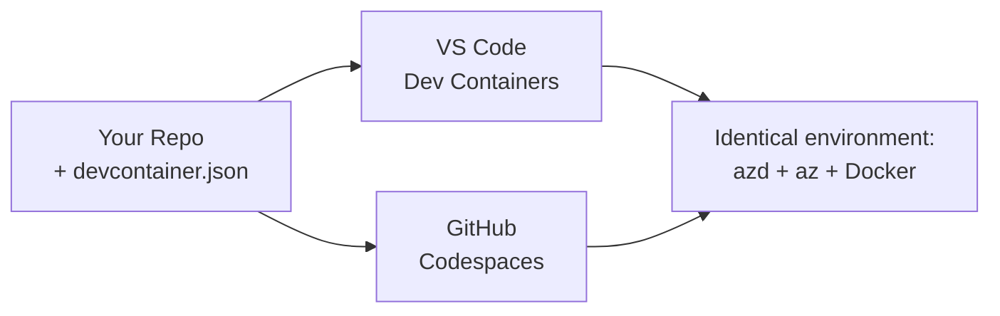

# Контейнеры для разработки и GitHub Codespaces для azd

**Навигация по главам:**
- **📚 Главная курса**: [AZD для начинающих](../../README.md)
- **📖 Текущая глава**: Глава 1 - Основы и быстрый старт
- **⬅️ Предыдущая**: [Использование собственного приложения](bring-your-own-app.md)
- **🚀 Следующая глава**: [Глава 2: Разработка с приоритетом AI](../chapter-02-ai-development/README.md)

> Цель обзора команд и конфигурации: `azd 1.37.2` (ноябрь 2026). Сборки контейнеров и развертывание в Azure не выполнялись в рамках этого обзора.

## Введение

Установка azd, нужной среды выполнения языка, Docker и Azure CLI на каждой машине — это утомительно, и именно по этой причине урок «работает у меня» не срабатывает у других. **Контейнер для разработки** решает эту проблему, описывая всю вашу инструментальную цепочку в файле. Любой, кто откроет проект в VS Code или GitHub Codespaces, получит точно такую же среду с готовым установленным azd. В этом уроке показано, как добавить такой контейнер.

## Цели обучения

К концу этого урока вы:
- Поймёте, что такое контейнер для разработки и почему он помогает с azd
- Добавите минимальный `.devcontainer/devcontainer.json` в проект
- Включите azd, Azure CLI и Docker через *функции* Dev Container
- Откроете проект в GitHub Codespaces или VS Code

## Результаты обучения

После завершения этого урока вы сможете:
- Создавать `devcontainer.json` для проекта azd
- Добавлять azd и инструменты Azure без ручной установки
- Запускать `azd up` изнутри контейнера или Codespace

---

## Что такое контейнер для разработки?

Контейнер для разработки — это среда разработки на базе Docker, определяемая файлом `.devcontainer/devcontainer.json` в вашем репозитории. Когда вы открываете проект:

- **VS Code** (с расширением Dev Containers) собирает контейнер и подключается к нему.
- **GitHub Codespaces** строит тот же контейнер в облаке и предоставляет браузерный редактор.

В любом случае у каждого участника одинаковые инструменты — никаких проблем «ты установил azd?».



---

## Шаг 1: Создание файла devcontainer

Создайте `.devcontainer/devcontainer.json` в корне вашего проекта:

```json
{
  "name": "azd-project",
  "image": "mcr.microsoft.com/devcontainers/base:bookworm",
  "features": {
    "ghcr.io/devcontainers/features/azure-cli:1": {},
    "ghcr.io/azure/azure-dev/azd:0": { "version": "1.37.2" },
    "ghcr.io/devcontainers/features/docker-in-docker:2": {},
    "ghcr.io/devcontainers/features/node:1": {}
  },
  "customizations": {
    "vscode": {
      "extensions": [
        "ms-azuretools.azure-dev",
        "ms-azuretools.vscode-bicep"
      ]
    }
  },
  "forwardPorts": [3000],
  "postCreateCommand": "azd version"
}
```

Значение каждой части:

| Ключ | Назначение |
|-----|------------|
| `image` | Базовая ОС для контейнера |
| `features` | Предварительно настроенные инсталляторы — здесь: Azure CLI, **azd**, Docker и Node.js |
| `customizations.vscode.extensions` | Автоматическая установка расширений VS Code для azd и Bicep |
| `forwardPorts` | Открывает порт вашего приложения в браузер |
| `postCreateCommand` | Запускается один раз после сборки контейнера (здесь — проверка работоспособности) |

> Версия функции (`azd:0`) и установленная версия CLI различаются. Чтобы зафиксировать CLI, установите опцию `version` функции в `"1.37.2"`; не используйте версию CLI как тег функции.

---

## Шаг 2: Подберите функцию под язык вашего приложения

Замените функцию `node` на ту, что используется в вашем приложении:

```jsonc
// Python project
"ghcr.io/devcontainers/features/python:1": {},

// .NET project
"ghcr.io/devcontainers/features/dotnet:2": {},

// Java project
"ghcr.io/devcontainers/features/java:1": {},

// Go project
"ghcr.io/devcontainers/features/go:1": {}
```

Оставьте `docker-in-docker` при локальной сборке образов. Альтернативой может быть настроенная удалённая сборка ACR (`docker.remoteBuild: true`); тип хоста сам по себе не всегда требует локального Docker.

---

## Шаг 3: Откройте проект

**В VS Code:**
1. Установите расширение **Dev Containers**.
2. Откройте папку проекта.
3. Нажмите **Reopen in Container**, когда предложит (или запустите *Dev Containers: Reopen in Container*).

**В GitHub Codespaces:**
1. Запушьте репозиторий в GitHub.
2. Кликните **Code → Codespaces → Create codespace on main**.
3. Подождите сборки контейнера — azd будет готов в терминале.

---

## Шаг 4: Развертывание из контейнера

Контейнер содержит предустановленный azd, поэтому обычный рабочий процесс просто работает:

```bash
azd auth login --use-device-code   # device code is handy inside Codespaces
azd up
```

> **Почему `--use-device-code`?** В удалённом контейнере или Codespace нет локального браузера для перенаправления, поэтому вход через device-code — надёжный путь. Вы вставите код в браузер на вкладке для завершения входа.

---

## Частые ошибки

| Ошибка | Исправление |
|--------|-----------|
| `azd up` не может собрать образ | Добавьте функцию `docker-in-docker` |
| В Codespaces зависает вход через браузер | Используйте `azd auth login --use-device-code` |
| Инструменты отличаются у коллег | Зафиксируйте версию CLI через опцию `version` функции azd и зафиксируйте языковые среды выполнения |
| Приложение недоступно в браузере | Добавьте порт в `forwardPorts` |

---

## Итог

- Контейнер для разработки делает вашу цепочку инструментов azd воспроизводимой для всех.
- Добавьте azd, Azure CLI и Docker через *функции* Dev Container.
- Подберите функцию по языку вашего приложения и сохраняйте `docker-in-docker` для хостов контейнеров.
- Используйте вход через device-code при запуске в Codespaces.

---

## 🔗 Навигация

| Направление | Ресурс |
|------------|--------|
| **Предыдущая** | [Использование собственного приложения](bring-your-own-app.md) |
| **Главная главы** | [Глава 1: Основы и быстрый старт](README.md) |
| **Следующая глава** | [Глава 2: Разработка с приоритетом AI](../chapter-02-ai-development/README.md) |

## 📖 Связанные ресурсы

- [Установка и настройка](installation.md)
- [Шпаргалка команд](../../resources/cheat-sheet.md)
- [Официальная спецификация Dev Containers](https://containers.dev/)
- [Функция dev container для azd](https://github.com/Azure/azure-dev/tree/main/ext/devcontainer)

---

<!-- CO-OP TRANSLATOR DISCLAIMER START -->
**Отказ от ответственности**:
Этот документ был переведен с использованием сервиса машинного перевода [Co-op Translator](https://github.com/Azure/co-op-translator). Несмотря на наши усилия по обеспечению точности, имейте в виду, что автоматический перевод может содержать ошибки или неточности. Оригинальный документ на его исходном языке следует считать авторитетным источником. Для получения критически важной информации рекомендуется обратиться к профессиональному человеческому переводу. Мы не несем ответственности за любые недоразумения или неправильные толкования, возникшие в результате использования этого перевода.
<!-- CO-OP TRANSLATOR DISCLAIMER END -->