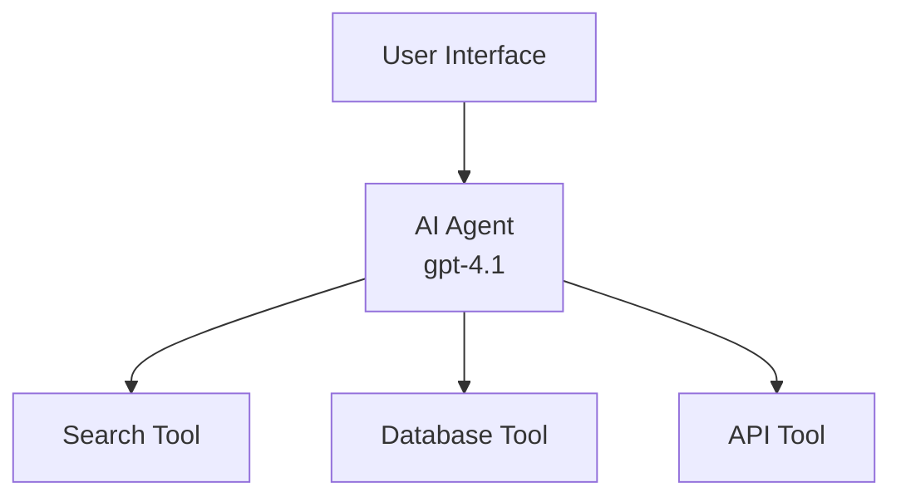
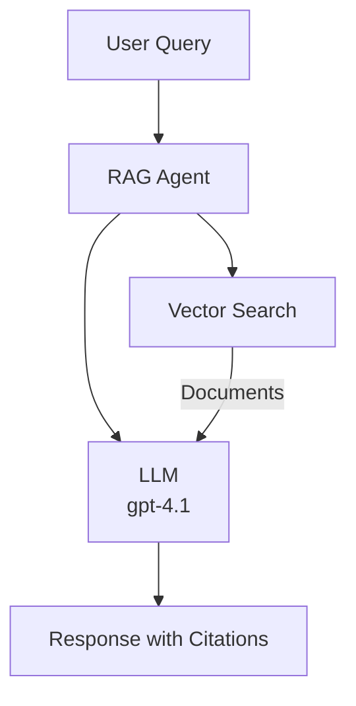
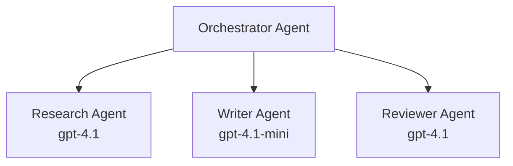

# Агенты ИИ с Azure Developer CLI

**Навигация по главам:**
- **📚 Главная страница курса**: [AZD для начинающих](../../README.md)
- **📖 Текущая глава**: Глава 2 - Разработка с приоритетом ИИ
- **⬅️ Предыдущая**: [Интеграция Microsoft Foundry](microsoft-foundry-integration.md)
- **➡️ Следующая**: [Развертывание модели ИИ](ai-model-deployment.md)
- **🚀 Продвинутые**: [Решения с несколькими агентами](../../examples/retail-scenario.md)

---

## Введение

Агенты ИИ — это автономные программы, которые способны воспринимать окружающую среду, принимать решения и совершать действия для достижения конкретных целей. В отличие от простых чат-ботов, которые отвечают на запросы, агенты могут:

- **Использовать инструменты** – вызывать API, искать в базах данных, выполнять код
- **Планировать и рассуждать** – разбивать сложные задачи на этапы
- **Учиться из контекста** – хранить память и адаптировать поведение
- **Сотрудничать** – работать с другими агентами (многоагентные системы)

В этом руководстве показано, как развернуть агентов ИИ в Azure с помощью Azure Developer CLI (azd).

Использование контекста беседы не является обучением модели: постоянная память, контроль доступа и сохранение должны быть реализованы/настроены приложением.

> **Обновление Foundry GA (2026-11-09):** Установите общедоступный пакет `microsoft.foundry` версии 1.0 с помощью `azd >= 1.37.0`. Оценки устанавливаются отдельно; опциональные функции предварительного просмотра и классический SDK-фрагмент ниже не переведены в GA по объявлению пакета. Это руководство основано на [объявлении GA](https://devblogs.microsoft.com/azure-sdk/microsoft-foundry-azure-developer-cli-ga/) и документации, а не на живом развертывании в Azure.

## Цели обучения

Пройдя это руководство, вы сможете:
- Понять, что такое агенты ИИ и чем они отличаются от чат-ботов
- Развернуть готовые шаблоны агентов ИИ с помощью AZD
- Настроить Foundry Agents для кастомных агентов
- Реализовать базовые шаблоны агентов (использование инструментов, RAG, многоагентные системы)
- Мониторить и отлаживать развернутых агентов

## Результаты обучения

После завершения вы сможете:
- Развернуть приложения агентов ИИ в Azure одной командой
- Настраивать инструменты и возможности агента
- Реализовать генерацию с расширением за счет поиска (RAG) с агентами
- Проектировать многоагентные архитектуры для сложных рабочих процессов
- Устранять распространенные проблемы развертывания агентов

---

## 🤖 Чем агент отличается от чат-бота?

| Особенность | Чат-бот | Агент ИИ |
|---------|---------|----------|
| **Поведение** | Отвечает на запросы | Выполняет автономные действия |
| **Инструменты** | Может использовать поиск или инструменты | Обычно использует инструменты в целенаправленном цикле |
| **Память** | Зависит от приложения | Постоянная память только при явной реализации |
| **Планирование** | Одно ответное действие | Многозадачное рассуждение |
| **Сотрудничество** | Один объект | Может работать с другими агентами |

### Простая аналогия

- **Чат-бот** = Помощник, отвечающий на вопросы на информационной стойке
- **Агент ИИ** = Личный ассистент, который может звонить, записывать встречи и выполнять задачи для вас

---

## 🚀 Быстрый старт: разверните своего первого агента

Выберите один из вариантов в **новой пустой рабочей директории**. Итоговый `.` инициализируется там; без явного указания пути текущий AZD может создать поддиректорию с именем шаблона и не изменяет директорию в командной строке. Храните разные шаблоны/окружения в отдельных директориях.

Приведенные ниже временные/стоимостные оценки являются иллюстративными, а не точными. Перед развёртыванием проверьте текущие требования, цены, квоты на модели и опциональные сервисы для каждого примера.

### Вариант 1: Шаблон Foundry Agents (Рекомендуется)

```bash
# Initialize the AI agents template
azd init --template get-started-with-ai-agents .

# Deploy to Azure
azd up
```

**Что развертывается:** Текущая инфраструктура примера и выбранные опции определяют модель, инструменты, хостинг и ресурсы мониторинга. Ознакомьтесь с README и `infra/` перед развертыванием; не предполагается, что каждый шаблон агента включает Поиск или веб-интерфейс.

**Время:** ~15-20 минут
**Стоимость:** ~100-150 долларов в месяц (разработка)

### Вариант 2: Агенты творческого письма с Prompty

```bash
# Initialize the Prompty-based agent template
azd init --template https://github.com/Azure-Samples/contoso-creative-writer .

# Deploy to Azure
azd up
```

**Что развертывается:** Пример FastAPI/Prompty с многозадачными агентами для письма с использованием Azure OpenAI, Bing Grounding и Azure AI Search. Предыдущий репозиторий `agent-openai-python-prompty` перенаправляет сюда; это не минимальный шаблон агента погоды на Azure Functions. Следуйте текущему README для хостинга, квоты модели и требований Bing Grounding.

**Время:** ~10-15 минут
**Стоимость:** ~50-100 долларов в месяц (разработка)

### Вариант 3: Агент RAG для чата

```bash
# Initialize RAG chat template
azd init --template azure-search-openai-demo .

# Deploy to Azure
azd up
```

**Что развертывается:**
- ✅ Модели Microsoft Foundry
- ✅ Azure AI Search с примерными данными
- ✅ Конвейер обработки документов
- ✅ Чат-интерфейс с цитатами

**Время:** ~15-25 минут
**Стоимость:** ~80-150 долларов в месяц (разработка)

### Вариант 4: Развертывание агента с GA Foundry Bundle

Используйте [полное пошаговое руководство для host-agent](microsoft-foundry-integration.md#hosted-agent-walkthrough-ga) для базового примера API Responses Python Agent Framework. Этот путь развертывания кода требует Python 3.13+, актуальный uv, права Foundry и региональную квоту моделей. Аутентифицируйте локальные вызовы SDK отдельно при использовании учетных данных Azure CLI.

```bash
azd auth login
azd ext install microsoft.foundry
```

В пустой директории инициализируйте пример:

```text
azd ai agent init --template https://github.com/microsoft-foundry/foundry-samples/blob/main/samples/python/hosted-agents/agent-framework/responses/01-basic/azure.yaml --deploy-mode code --src .
```

Выберите новый или существующий проект, ознакомьтесь с `azure.yaml` и выполните `azd provision`. Используйте `azd ai agent run` для открытия Agent Inspector, а из другого терминала в этой же директории выполните `azd ai agent invoke --local "Explain how this agent is hosted."`. После локальной проверки используйте `azd deploy` и `azd ai agent invoke "Explain how this agent is hosted."` для сравнения развернутого ответа. Foundry удаленно собирает загруженный исходный код; локальная сборка контейнера не требуется.

**Когда использовать `azd ai agent init` и когда `azd init --template`:**

| Подход | Лучшее для | Как работает |
|----------|----------|------|
| `azd init --template` | Начало с рабочего примера приложения | Клонирует полный репозиторий шаблона с кодом + инфраструктурой |
| `azd ai agent init --template` | Принятие текущего проекта Foundry | Использует проектный документ `azure.yaml` и его определения |

> **Совет:** Варианты 1-3 стартуют с полных шаблонов приложений; Вариант 4 обучает рабочему процессу hosted-agent GA. Ни одна из команд инициализации не мигрирует старые манифесты агентов автоматически. Для добавления прямого определения агента в существующий проект смотрите [руководство по инициализации и миграции](../chapter-08-production/production-ai-practices.md#initializing-agent-projects-with-azd-ai-agent-init).

Устанавливайте `azure.ai.evaluations` отдельно для генерации и проверки тестовых данных/критериев, настройки оценки и её запуска с помощью `azd ai eval`. Оптимизация может переиспользовать совместимую оценку; изучите кандидатов перед явным развёртыванием. Следуйте [рабочему процессу оценки](../chapter-08-production/production-ai-practices.md#evaluation-migration-and-quality-checks) и [миграции оптимизации](../chapter-08-production/production-ai-practices.md#optimization-configuration-migration) перед переиспользованием старых примеров. Для очистки ресурсы переиспользуемого проекта Foundry остаются после `azd down`; ресурсная группа нового проекта удаляется. Смотрите [руководство по очистке](microsoft-foundry-integration.md#7-clean-up-deliberately).

---

## 🏗️ Шаблоны архитектуры агентов

### Шаблон 1: Один агент с инструментами

Самый простой шаблон агента — один агент с возможностью использования нескольких инструментов.



**Лучше всего подходит для:**
- Ботов поддержки клиентов
- Помощников в исследовательской работе
- Агентов анализа данных

**Связанный пример приложения:** `azure-search-openai-demo` демонстрирует RAG, а не общий цикл агента с произвольными инструментами.

### Шаблон 2: Агент RAG (генерация с расширением за счёт поиска)

Агент, который извлекает релевантные документы перед генерацией ответов.



**Лучше всего подходит для:**
- Корпоративных баз знаний
- Систем вопросов и ответов по документам
- Соблюдения требований и юридических исследований

**Шаблон AZD:** `azure-search-openai-demo`

### Шаблон 3: Многоагентная система

Несколько специализированных агентов, работающих вместе над сложными задачами.



**Лучше всего подходит для:**
- Генерации сложного контента
- Многошаговых рабочих процессов
- Задач, требующих разных областей экспертизы

**Узнайте больше:** [Шаблоны координации многоагентных систем](../chapter-06-pre-deployment/coordination-patterns.md)

---

## ⚙️ Настройка инструментов агента

Агенты становятся мощными, когда могут использовать инструменты. Вот как настроить распространённые инструменты:

### Конфигурация инструментов в Foundry Agents

Этот **классический фрагмент SDK Agent Service** ориентирован на `azure-ai-projects==1.0.0` и `azure-ai-agents==1.1.0` с `azure-identity`. Это не новая версия версионированного агента/Responses API, используемая некоторыми текущими шаблонами Foundry, и не расширение `azure.ai.agents` AZD (разный пакет). Не смешивайте поколения API. Установите `PROJECT_ENDPOINT` в классическую конечную точку проекта Foundry и `MODEL_DEPLOYMENT_NAME` в существующее поддерживаемое развертывание модели; аутентифицируйтесь локально через `az login` и предоставьте необходимые разрешения проекта.

```python
# agent_config.py
import os
from azure.ai.projects import AIProjectClient
from azure.ai.agents.models import FunctionTool
from azure.identity import DefaultAzureCredential

def search_knowledge_base(query: str) -> str:
    """Search the demonstration knowledge base.

    :param query: Search text.
    :return: Matching demonstration information.
    """
    # Local fixture only, not a production search implementation.
    return "Demo policy: returns are accepted within 30 days."

project_client = AIProjectClient(
    endpoint=os.environ["PROJECT_ENDPOINT"],
    credential=DefaultAzureCredential(),
)
search_tool = FunctionTool(functions={search_knowledge_base})
project_client.agents.enable_auto_function_calls(search_tool)
agent = project_client.agents.create_agent(
    model=os.environ["MODEL_DEPLOYMENT_NAME"],
    name="Support Agent",
    instructions="Use search_knowledge_base for policy questions. Label results as demo data.",
    tools=search_tool.definitions,
)
```

Регистрация схемы функции не запускает Python на сервисе. В этом SDK вызов `enable_auto_function_calls` вместе с `agents.runs.create_and_process(...)` запускает зарегистрированные обратные вызовы в вашем процессе клиента. Смотрите [пример SDK по релизу](https://github.com/Azure/azure-sdk-for-python/blob/azure-ai-agents_1.1.0/sdk/ai/azure-ai-agents/samples/agents_tools/sample_agents_auto_function_call.py). После использования закрывайте клиента и удаляйте демонстрационные агенты/потоки.

### Конфигурация окружения

Следующие имена являются **иллюстративными входными данными пользовательского шаблона**, а не встроенными параметрами AZD. Сначала пропустите каждое значение через `infra/main.parameters.json`, инфраструктуру и код приложения. Один только `azd env set` не меняет инструменты или инструкции агента.

```bash
# Set up agent-specific environment variables
azd env set AZURE_OPENAI_MODEL "gpt-4.1"
azd env set AGENT_INSTRUCTIONS "You are a helpful assistant..."
azd env set ENABLE_CODE_INTERPRETER "true"
azd env set ENABLE_FILE_SEARCH "true"

# Apply wired infrastructure and application changes
azd up
```

---

## 📊 Мониторинг агентов

### Интеграция Application Insights

Если в выбранном шаблоне предусмотрена установка Application Insights и настройка инструментирования:

```bash
# Open monitoring dashboard
azd monitor --overview

# Open the Application Insights logs view (not a streaming log tail)
azd monitor --logs

# View live metrics
azd monitor --live
```

### Основные метрики для отслеживания

| Метрика | Описание | Цель |
|--------|-------------|--------|
| Задержка ответа | Время генерации ответа | < 5 секунд |
| Использование токенов | Токены на запрос | Отслеживайте затраты |
| Успешность вызовов инструментов | % успешных выполнений инструментов | > 95% |
| Ошибки | Неудачные запросы агента | < 1% |
| Удовлетворённость пользователей | Оценки обратной связи | > 4.0/5.0 |

### Кастомный лог для агентов

```python
import os
from azure.monitor.opentelemetry import configure_azure_monitor
from opentelemetry import trace

# Configure Azure Monitor with OpenTelemetry
configure_azure_monitor(
    connection_string=os.environ["APPLICATIONINSIGHTS_CONNECTION_STRING"]
)

tracer = trace.get_tracer(__name__)

def log_agent_interaction(user_query, agent_response, tools_used, latency_ms):
    with tracer.start_as_current_span("agent_interaction") as span:
        span.set_attributes({
            "query_length": len(user_query),  # Do not log raw prompts or personal data
            "response_length": len(agent_response),
            "tools_used": tools_used,
            "latency_ms": latency_ms
        })
```

> **Примечание:** Установите необходимый пакет: `pip install azure-monitor-opentelemetry`. Он приносит зависимости OpenTelemetry; импорт пространства имён не является требованием для установки пакета с именем `opentelemetry`.

---

## 💰 Вопросы стоимости

### Оценочные ежемесячные затраты по шаблонам

Это иллюстративные диапазоны планирования, а не котировки или лимиты расходов. Регион, токены модели, SKU для поиска/вычислений, сессии инструментов, хранилище и трафик могут превышать их. Проверьте руководство по затратам и цены Azure перед `azd up`.

| Шаблон | Среда разработки | Производство |
|---------|-----------------|------------|
| Один агент | $50-100 | $200-500 |
| Агент RAG | $80-150 | $300-800 |
| Многоагентная система (2-3 агента) | $150-300 | $500-1,500 |
| Корпоративная многоагентная система | $300-500 | $1,500-5,000+ |

### Советы по оптимизации стоимости

1. **Используйте gpt-4.1-mini для простых задач** (только если ваш шаблон использует этот ввод)
   ```bash
   azd env set AZURE_OPENAI_MODEL "gpt-4.1-mini"
   ```

2. **Реализуйте scoped-кеширование для безопасных повторных запросов.** Включите в ключ кеша авторизацию арендатора/пользователя, развертывание модели, инструкции и версию поиска; установите время истечения. Не делитесь приватными ответами беседы через общий кеш только для запросов в процессе. Объект агента SDK не имеет универсального метода `agent.run()`.

3. **Установите лимиты токенов на запуск**
   ```python
   # Set max_completion_tokens when running the agent, not during creation
   run = project_client.agents.runs.create_and_process(
       thread_id=thread.id,
       agent_id=agent.id,
       max_completion_tokens=1000  # Budget across the run; may finish as incomplete
   )
   ```

4. **Масштабируйте Container Apps до нуля, когда не используется**
   ```bash
   # Custom-template input: must map to template.scale.minReplicas
   azd env set MIN_REPLICAS "0"
   ```
 Применяйте изменение инфраструктуры с помощью `azd provision` или `azd up`. Масштабирование до нуля требует подходящего триггера и не останавливает затраты на поиск, хранилище или модель/инструменты.

---

## 🔧 Устранение неполадок агентов

### Распространённые проблемы и решения

<details>
<summary><strong>❌ Агент не отвечает на вызовы инструментов</strong></summary>

```bash
# Inspect the application deployment (not the agent's registered tools)
azd show

# Verify OpenAI deployment
az cognitiveservices account deployment list \
  --name $AZURE_OPENAI_NAME \
  --resource-group $RG_NAME

# Check agent logs
azd monitor --logs
```

**Распространённые причины:**
- Несовпадение сигнатуры функции инструмента
- Отсутствие необходимых разрешений
- Точка API недоступна
</details>

<details>
<summary><strong>❌ Высокая задержка ответов агента</strong></summary>

```bash
# Check Application Insights for bottlenecks
azd monitor --live

# Consider using a faster model
azd env set AZURE_OPENAI_MODEL "gpt-4.1-mini"
azd up
```

**Советы по оптимизации:**
- Используйте потоковые ответы
- Реализуйте кеширование ответов
- Уменьшите размер контекстного окна
</details>

<details>
<summary><strong>❌ Агент возвращает неправильную или галлюцинирующую информацию</strong></summary>

```python
# Improve with better system prompts
instructions = """
You are a helpful assistant. IMPORTANT:
- Only answer based on provided context
- If you don't know, say "I don't know"
- Always cite your sources
- Never make up information
"""

# Use these instructions in the agent definition.
# For classic file search, first upload/index documents in a vector store,
# then use FileSearchTool(vector_store_ids=[...]) and pass both its
# .definitions and .resources when creating the agent.
```
Инструкции и поиск снижают риск; ни один из них не гарантирует фактические ответы. Оценивайте вопросы с реальной основой и выходящие за рамки на основе известных ответов.
</details>

<details>
<summary><strong>❌ Ошибки превышения лимита токенов</strong></summary>

```python
# Implement context window management
def truncate_context(messages, max_tokens=8000, model="gpt-4.1"):
    """Approximate content-only budget for objects with .content strings."""
    import tiktoken
    encoding = tiktoken.encoding_for_model(model)
    total_tokens = 0
    truncated = []
    
    for msg in reversed(messages):
        msg_tokens = len(encoding.encode(msg.content))
        if total_tokens + msg_tokens > max_tokens:
            break
        truncated.insert(0, msg)
        total_tokens += msg_tokens
    
    return truncated
```
Этот помощник исключает схемы ролей/инструментов, системные инструкции, токены изображений и протокольные накладные расходы. Зарезервируйте место для них и для дополнения; не разбивайте пары вызов/результат инструмента и не удаляйте необходимые системные инструкции. Установите `tiktoken` отдельно. Это не общий валидатор контекстного окна.
</details>

---

## 🎓 Практические упражнения

### Упражнение 1: Развертывание базового агента (20 минут)

**Цель:** Развернуть вашего первого агента ИИ с помощью AZD

```bash
# Step 1: Initialize template
azd init --template get-started-with-ai-agents .

# Step 2: Login to Azure
azd auth login
# If you work across tenants, add --tenant-id <tenant-id>

# Step 3: Deploy
azd up

# Step 4: Test the agent
# Expected output after deployment:
#   Deployment Complete!
#   Endpoint: https://<app-name>.<region>.azurecontainerapps.io
# Open the URL shown in the output and try asking a question

# Step 5: View monitoring
azd monitor --overview

# Step 6: Review the listed resources and confirm cleanup
azd down
```

**Критерии успеха:**
- [ ] Агент отвечает на вопросы
- [ ] Имеется доступ к панели мониторинга через `azd monitor`
- [ ] Ресурсы успешно очищены

### Упражнение 2: Добавление пользовательского инструмента (30 минут)

**Цель:** Расширить агента с помощью пользовательского инструмента

**Исходная точка:** Используйте классический SDK клиент из [Конфигурация инструмента](#tool-configuration-in-foundry-agents), а не произвольный шаблон с другим поколением SDK.

1. Добавьте этот детерминированный фикстуру в `agent_config.py`:
   ```python
   def get_weather(location: str) -> str:
       """Return demonstration weather, not live conditions.

       :param location: City name.
       :return: A clearly labelled fixture.
       """
       print(f"TOOL_CALLED: {location}")
       return f"Demo weather in {location}: Sunny, 72°F (fixture, not live)"
   ```
2. Замените блок регистрации и создания search-tool на:
   ```python
   weather_tool = FunctionTool(functions={get_weather})
   project_client.agents.enable_auto_function_calls(weather_tool)
   agent = project_client.agents.create_agent(
       model=os.environ["MODEL_DEPLOYMENT_NAME"],
       name="Weather Agent",
       instructions="Call get_weather for weather questions; explain that it returns demo data.",
       tools=weather_tool.definitions,
   )
   thread = project_client.agents.threads.create()
   try:
       project_client.agents.messages.create(
           thread_id=thread.id, role="user", content="Use get_weather for Seattle."
       )
       run = project_client.agents.runs.create_and_process(
           thread_id=thread.id, agent_id=agent.id
       )
       if run.status != "completed":
           raise RuntimeError(f"Run status: {run.status}; error: {run.last_error}")
       for message in project_client.agents.messages.list(thread_id=thread.id):
           for text in message.text_messages:
               print(text.text.value)
   finally:
       project_client.agents.threads.delete(thread.id)
       project_client.agents.delete_agent(agent.id)
       project_client.close()
   ```
3. Запустите локально (это вызовет существующий проект Azure и приведет к расходам на модель):
   ```bash
   python agent_config.py
   # Expected: TOOL_CALLED: Seattle, then a completed answer labelled demo data.
   ```

**Критерии успеха:**
- [ ] Агент распознаёт запросы, связанные с погодой
- [ ] Инструмент вызывается корректно
- [ ] Ответ включает информацию о погоде

### Упражнение 3: Создание RAG агента (45 минут)

**Цель:** Создать агента, который отвечает на вопросы на основе ваших документов

```bash
# Step 1: Deploy RAG template
azd init --template azure-search-openai-demo .
azd up

# Step 2: Upload your documents
# For the sample's local ingestion path, place supported files in data/.
# Run from the sample root after following its Python environment setup:
./scripts/prepdocs.sh
# Windows PowerShell equivalent: .\\scripts\\prepdocs.ps1

# Step 3: Test with domain-specific questions
# Open the web app URL from the azd up output
# Ask questions about your uploaded documents
# Responses should include citation references like [doc.pdf]
```

**Критерии успеха:**
- [ ] Агент отвечает на основе загруженных документов
- [ ] Ответы содержат ссылки на источники
- [ ] Вопросы вне области компетенции обрабатываются без неподдерживаемых утверждений (не гарантия для всех будущих вопросов)

Если `USE_CLOUD_INGESTION=true`, вместо этого используйте пример рабочего процесса загрузки/ингестирования в облаке; локальная обёртка намеренно пропускает инжест. После тестирования выполните `azd down` в среде RAG и проверьте ресурсы для удаления.

---

## 📚 Следующие шаги

Теперь, когда вы понимаете AI-агентов, изучите эти продвинутые темы:

| Тема | Описание | Ссылка |
|-------|-------------|------|
| **Мультиагентные системы** | Создание систем с несколькими сотрудничающими агентами | [Пример мультиагентов для розничной торговли](../../examples/retail-scenario.md) |
| **Паттерны координации** | Изучение паттернов оркестрации и коммуникации | [Паттерны координации](../chapter-06-pre-deployment/coordination-patterns.md) |
| **Развёртывание в продакшене** | Готовое к корпоративному использованию развёртывание агентов | [Практики AI в продакшене](../chapter-08-production/production-ai-practices.md) |
| **Оценка агентов** | Тестирование и оценка производительности агентов | [Отладка AI](../chapter-07-troubleshooting/ai-troubleshooting.md) |
| **Лаборатория AI Workshop** | Практическая работа: подготовка решения AI к AZD | [Лаборатория AI Workshop](ai-workshop-lab.md) |

---

## 📖 Дополнительные ресурсы

### Официальная документация
- [Сервис агентов Microsoft Foundry](https://learn.microsoft.com/azure/ai-services/agents/)
- [Руководство по быстрому старту сервиса Microsoft Foundry Agent](https://learn.microsoft.com/azure/ai-services/agents/quickstart)
- [Фреймворк Semantic Kernel Agent](https://learn.microsoft.com/semantic-kernel/)

### Шаблоны AZD для агентов
- [Начало работы с AI агентами](https://github.com/Azure-Samples/get-started-with-ai-agents)
- [Агенты творческого письма с Prompty](https://github.com/Azure-Samples/contoso-creative-writer)
- [Демо Azure Search OpenAI](https://github.com/Azure-Samples/azure-search-openai-demo)

### Ресурсы сообщества
- [Отличный AZD - шаблоны агентов](https://azure.github.io/awesome-azd/?tags=ai-agents)
- [Azure AI Discord](https://discord.gg/microsoft-azure)
- [Microsoft Foundry Discord](https://discord.gg/nTYy5BXMWG)

### Навыки агентов для вашего редактора
- [**Навыки агентов Microsoft Azure**](https://skills.sh/microsoft/github-copilot-for-azure) - Установите повторно используемые навыки AI агентов для разработки в Azure в GitHub Copilot, Cursor или любом поддерживаемом агенте. Включает навыки для [Azure AI](https://skills.sh/microsoft/github-copilot-for-azure/azure-ai), [Microsoft Foundry](https://skills.sh/microsoft/github-copilot-for-azure/microsoft-foundry), [развёртывания](https://skills.sh/microsoft/github-copilot-for-azure/azure-deploy), и [диагностики](https://skills.sh/microsoft/github-copilot-for-azure/azure-diagnostics):
  ```bash
  npx skills add microsoft/github-copilot-for-azure
  ```

---

**Навигация**
- **Предыдущий урок**: [Интеграция Microsoft Foundry](microsoft-foundry-integration.md)
- **Следующий урок**: [Развёртывание AI модели](ai-model-deployment.md)

---

<!-- CO-OP TRANSLATOR DISCLAIMER START -->
**Отказ от ответственности**:
Этот документ был переведен с использованием сервиса машинного перевода [Co-op Translator](https://github.com/Azure/co-op-translator). Несмотря на наши усилия по обеспечению точности, имейте в виду, что автоматический перевод может содержать ошибки или неточности. Оригинальный документ на его исходном языке следует считать авторитетным источником. Для получения критически важной информации рекомендуется обратиться к профессиональному человеческому переводу. Мы не несем ответственности за любые недоразумения или неправильные толкования, возникшие в результате использования этого перевода.
<!-- CO-OP TRANSLATOR DISCLAIMER END -->