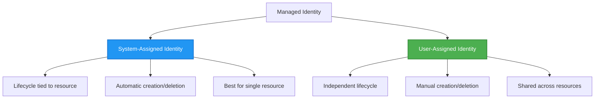

# Шаблоны аутентификации и управляемая идентичность

⏱️ **Оценочное время**: 45-60 минут чтения; учитывайте дополнительное время на выполнение упражнений | 💰 **Стоимость**: Идентичность/RBAC бесплатны; оплачиваются развернутые вычисления, хранилище и Key Vault | ⭐ **Сложность**: Средний уровень

> Проверено на `azd 1.37.2` (ноябрь 2026). В этом уроке приведены **иллюстративные фрагменты интеграции, а не полный скачиваемый шаблон `secure-app`**. Создайте указанные файлы, предоставьте соответствующую инфраструктуру и замените заполнители перед развертыванием. Во время проверки ресурсы Azure не создавались.

**📚 Учебный путь:**
- ← Предыдущий: [Управление конфигурацией](configuration.md) - Управление переменными окружения и секретами
- 🎯 **Вы здесь**: Аутентификация и безопасность (управляемая идентичность, Key Vault, безопасные паттерны)
- → Следующий: [Инфраструктура как код](../chapter-04-infrastructure/README.md) - Создание и развертывание ресурсов
- 🏠 [Главная страница курса](../../README.md)

---

## Чему вы научитесь

Пройдя этот урок, вы:
- Поймете шаблоны аутентификации Azure (ключи, строки подключения, управляемая идентичность)
- Реализуете **управляемую идентичность** для аутентификации без пароля
- Обеспечите защиту секретов с интеграцией **Azure Key Vault**
- Настроите **управление доступом на основе ролей (RBAC)** для развертываний AZD
- Примените лучшие практики безопасности в Container Apps и сервисах Azure
- Выполните миграцию с аутентификации на основе ключей к аутентификации на основе идентичности

## Почему важна управляемая идентичность

### Проблема: традиционная аутентификация

**До управляемой идентичности:**
```javascript
// ❌ SECURITY RISK: Hardcoded secrets in code
const connectionString = "Server=mydb.database.windows.net;User=admin;Password=P@ssw0rd123";
const storageKey = "xK7mN9pQ2wR5tY8uI0oP3aS6dF1gH4jK...";
const cosmosKey = "C2x7B9n4M1p8Q5w3E6r0T2y5U8i1O4p7...";
```

**Проблемы:**
- 🔴 **Секреты открыты** в коде, конфигурационных файлах, переменных окружения
- 🔴 **Вращение учетных данных** требует изменения кода и повторного развертывания
- 🔴 **Проблемы с аудитом** — кто что и когда получил
- 🔴 **Разброс** — секреты разбросаны по множеству систем
- 🔴 **Риски соответствия** — не проходят проверки безопасности

### Решение: управляемая идентичность

**После управляемой идентичности:**
```javascript
// ✅ SECURE: No secrets in code
const credential = new DefaultAzureCredential();
const client = new BlobServiceClient(
  "https://mystorageaccount.blob.core.windows.net",
  credential  // Azure automatically handles authentication
);
```

**Преимущества:**
- ✅ **Отсутствие секретов** в коде и конфигурации
- ✅ **Автоматическое вращение** — Azure управляет этим
- ✅ **Полный журнал аудита** в логах Microsoft Entra ID
- ✅ **Централизованная безопасность** — управление в Azure Portal
- ✅ **Готовность к аудиту соответствия** — соответствует стандартам безопасности

**Аналогия**: традиционная аутентификация как ношение множества физических ключей для разных дверей. Управляемая идентичность — как пропуск, который автоматически предоставляет доступ на основе вашей личности — не нужно терять, копировать или менять ключи.

---

## Обзор архитектуры

### Поток аутентификации с управляемой идентичностью

```mermaid
sequenceDiagram
    participant App as Your Application<br/>(Container App)
    participant MI as Managed Identity<br/>(Microsoft Entra ID)
    participant KV as Key Vault
    participant Storage as Azure Storage
    participant DB as Azure SQL
    
    App->>MI: Request access token<br/>(automatic)
    MI->>MI: Verify identity<br/>(no password needed)
    MI-->>App: Return token for requested audience<br/>(lifetime varies)
    
    App->>KV: Get secret<br/>(using token)
    KV->>KV: Check RBAC permissions
    KV-->>App: Return secret value
    
    App->>Storage: Upload blob<br/>(using token)
    Storage->>Storage: Check RBAC permissions
    Storage-->>App: Success
    
    App->>DB: Query data<br/>(using token)
    DB->>DB: Check SQL permissions
    DB-->>App: Return results
    
    Note over App,DB: Request a separate token for each service audience;<br/>SDK credentials handle caching and renewal
```

### Виды управляемых идентичностей



| Особенность | Системно назначенная | Пользовательски назначенная |
|------------|--------------------|------------------------|
| **Жизненный цикл** | Привязана к ресурсу | Независимая |
| **Создание** | Автоматическое с ресурсом | Создается вручную |
| **Удаление** | Удаляется вместе с ресурсом | Сохраняется после удаления ресурса |
| **Совместное использование** | Только один ресурс | Несколько ресурсов |
| **Применение** | Простые сценарии | Сложные сценарии с несколькими ресурсами |
| **Выбор шаблона** | Задается в инфраструктуре | Задается в инфраструктуре |

---

## Предварительные требования

### Необходимые инструменты

Вы должны уже иметь их установленные из предыдущих уроков:

```bash
# Verify Azure Developer CLI
azd version
# ✅ Expected: azd version 1.0.0 or higher

# Verify Azure CLI
az --version
# ✅ Expected: azure-cli 2.50.0 or higher
```

### Требования Azure

- Активная подписка Azure
- Разрешения на:
  - Создание управляемых идентичностей
  - Назначение ролей RBAC
  - Создание ресурсов Key Vault
  - Развертывание Container Apps

### Предварительные знания

Вы должны пройти:
- [Руководство по установке](../chapter-01-foundation/installation.md) - Настройка AZD
- [Основы AZD](../chapter-01-foundation/azd-basics.md) - Основные концепции
- [Управление конфигурацией](configuration.md) - Переменные окружения

---

## Урок 1: Понимание шаблонов аутентификации

### Шаблон 1: строки подключения (устарело — избегать)

**Как работает:**
```bash
# Connection string contains credentials
STORAGE_CONNECTION_STRING="DefaultEndpointsProtocol=https;AccountName=myaccount;AccountKey=xK7mN9pQ2wR5..."
COSMOS_CONNECTION_STRING="AccountEndpoint=https://myaccount.documents.azure.com:443/;AccountKey=C2x7..."
SQL_CONNECTION_STRING="Server=myserver.database.windows.net;User=admin;Password=P@ssw0rd..."
```

**Проблемы:**
- ❌ Секреты видны в переменных окружения
- ❌ Логируются в системах развертывания
- ❌ Трудно обновлять
- ❌ Нет аудита доступа

**Когда использовать:** Когда целевой сервис требует аутентификации на основе ключа. Отдавайте предпочтение идентичности, если поддерживается; иначе безопасно храните ключи и обновляйте их, включая продуктив.

---

### Шаблон 2: ссылки на Key Vault (лучше)

**Как работает:**
**Частичные фрагменты Bicep:** необходимые поля для vault, идентичность Container App и его `configuration.secrets` не показаны. `secretRef` — имя секрета Container App; это **не URI Key Vault**. Чтобы использовать Key Vault, определите этот секрет с помощью `keyVaultUrl` и разрешенной `identity`.

```bicep
// Store secret in Key Vault
resource keyVault 'Microsoft.KeyVault/vaults@2023-02-01' = {
  name: 'mykv'
  properties: {
    enableRbacAuthorization: true
  }
}

// Reference in Container App
env: [
  {
    name: 'STORAGE_KEY'
    secretRef: 'storage-key'  // References Key Vault
  }
]
```

**Преимущества:**
- ✅ Секреты хранятся безопасно в Key Vault
- ✅ Централизованное управление секретами
- ✅ Вращение без изменений кода

**Ограничения:**
- ⚠️ Все еще используются ключи/пароли
- ⚠️ Нужно управлять доступом к Key Vault

**Когда использовать:** Шаг перехода от строк подключения к управляемой идентичности.

---

### Шаблон 3: управляемая идентичность (лучший подход)

**Как работает:**
**Частичный Bicep:** объедините блок идентичности в полный контейнерный апп и предоставьте `storageAccount` и определение роли. Для назначения роли нужен еще и детерминированный `name`.

```bicep
// Enable managed identity
resource containerApp 'Microsoft.App/containerApps@2023-05-01' = {
  name: 'myapp'
  identity: {
    type: 'SystemAssigned'  // Automatically creates identity
  }
}

// Grant permissions
resource roleAssignment 'Microsoft.Authorization/roleAssignments@2022-04-01' = {
  name: guid(storageAccount.id, containerApp.id, storageBlobDataContributorRole)
  scope: storageAccount
  properties: {
    roleDefinitionId: storageBlobDataContributorRole
    principalId: containerApp.identity.principalId
    principalType: 'ServicePrincipal'
  }
}
```

**Код приложения:**
```javascript
// No secrets needed!
const { DefaultAzureCredential } = require('@azure/identity');
const { BlobServiceClient } = require('@azure/storage-blob');

const credential = new DefaultAzureCredential();
const blobServiceClient = new BlobServiceClient(
  'https://mystorageaccount.blob.core.windows.net',
  credential
);
```

**Преимущества:**
- ✅ Нет секретов в коде/конфигурации
- ✅ Автоматическое обновление учетных данных
- ✅ Полный аудит доступа
- ✅ Разрешения на основе RBAC
- ✅ Готовность к соответствию требованиям безопасности

**Когда использовать:** Предпочтительно для приложений в Azure, обращающихся к сервисам, поддерживающим аутентификацию Microsoft Entra.

---

### Шаблон 4: сервисные принципы (CI/CD и автоматизация)

Управляемая идентичность — золотой стандарт *для ресурсов, работающих внутри Azure*. Но что делать с тем, что работает **вне** Azure — например, конвейер CI/CD на агенте сборки или скрипт на вашем ноутбуке, который не может использовать интерактивный вход? Здесь на помощь приходит **сервисный принципал**: не человек с собственными учетными данными, под которыми может войти автоматический процесс.

**Как работает:**

Создайте сервисный принципал с областью действия на группу ресурсов (минимальные права):

```bash
az ad sp create-for-rbac \
  --name "myapp-cicd" \
  --role contributor \
  --scopes "/subscriptions/<sub-id>/resourceGroups/<rg-name>"
```

Это выведет client ID, client secret и tenant ID. azd может войти с ними без участия пользователя:

```bash
azd auth login \
  --client-id "<appId>" \
  --client-secret "<password>" \
  --tenant-id "<tenant>"
```

**Предпочтительнее федеративные учетные данные (OIDC), а не секреты.** Вместо долговременного клиентского секрета настройте федеративные учетные данные, чтобы конвейер обменивал короткоживущий токен — нечего раскрывать или менять:

```bash
azd auth login \
  --client-id "<appId>" \
  --federated-credential-provider "github" \
  --tenant-id "<tenant>"
```

> `azd pipeline config` настроит это автоматически. См. пошаговые инструкции CI/CD в [главе 8](../chapter-08-production/production-ai-practices.md).

**Преимущества:**
- ✅ Работает вне Azure (агенты сборки, локальные серверы, другие облака)
- ✅ Можно ограничить одной группой ресурсов и одной ролью
- ✅ Федеративный (OIDC) вариант не использует сохраненный секрет

**Недостатки:**
- ⚠️ Вариант на основе секретов требует аккуратного хранения и обновления
- ⚠️ Утекший секрет дает полный доступ по права сервиса — ограничивайте зону действия

**Когда использовать:** Конвейеры CI/CD и автоматизация, которая не может использовать управляемую идентичность. Всегда предпочитайте вариант **federated/OIDC** вместо client secret и управляемую идентичность, когда рабочая нагрузка выполняется внутри Azure.

**Безопасное хранение учетных данных:**
- Никогда не коммитьте секреты — используйте хранилище секретов вашего конвейера (секреты GitHub Actions, группы переменных Azure DevOps / Key Vault).
- Ограничьте сервисный принципал на минимально необходимые роль и группу ресурсов.
- Установите срок действия и обновляйте секреты или полностью уберите секреты с помощью OIDC.

---

## Урок 2: Реализация управляемой идентичности с AZD

### Пошаговая реализация

Следующие фрагменты показывают, как интегрировать управляемую идентичность в проект Container App. Это **не готовый к запуску стартер**: модуль хранилища, полная инфраструктура управляемой среды/реестра, Dockerfile и параметрический файл не представлены полностью. Начните с работающего шаблона Container Apps и интегрируйте эти шаблоны, сохранив конфигурацию реестра и теги сервисов.

### Структура проекта

```
secure-app/
├── azure.yaml                 # AZD configuration
├── infra/
│   ├── main.bicep            # Main infrastructure
│   ├── core/
│   │   ├── identity.bicep    # Managed identity setup
│   │   ├── keyvault.bicep    # Key Vault configuration
│   │   └── storage.bicep     # Storage with RBAC
│   └── app/
│       └── container-app.bicep
└── src/
    ├── app.js                # Application code
    ├── package.json
    └── Dockerfile
```

### 1. Настройка AZD (azure.yaml)

```yaml
name: secure-app
metadata:
  template: secure-app@1.0.0

services:
  api:
    project: ./src
    language: js
    host: containerapp

# Managed identity must be enabled in the infrastructure, not by this YAML.
```

### 2. Инфраструктура: включение управляемой идентичности

**Файл: `infra/main.bicep`**

```bicep
targetScope = 'subscription'

param environmentName string
param location string = 'eastus'
param containerAppsEnvironmentId string
param containerImage string

var tags = { 'azd-env-name': environmentName }

// Resource group
resource rg 'Microsoft.Resources/resourceGroups@2021-04-01' = {
  name: 'rg-${environmentName}'
  location: location
  tags: tags
}

// Storage Account
module storage './core/storage.bicep' = {
  name: 'storage'
  scope: rg
  params: {
    name: 'st${uniqueString(rg.id)}'
    location: location
    tags: tags
  }
}

// Key Vault
module keyVault './core/keyvault.bicep' = {
  name: 'keyvault'
  scope: rg
  params: {
    name: 'kv-${uniqueString(rg.id)}'
    location: location
    tags: tags
  }
}

// Container App with Managed Identity
module containerApp './app/container-app.bicep' = {
  name: 'container-app'
  scope: rg
  params: {
    name: 'ca-${environmentName}'
    location: location
    tags: tags
    storageAccountName: storage.outputs.name
    keyVaultName: keyVault.outputs.name
    containerAppsEnvironmentId: containerAppsEnvironmentId
    containerImage: containerImage
  }
}

// Grant Container App access to Storage
module storageRoleAssignment './core/role-assignment.bicep' = {
  name: 'storage-role'
  scope: rg
  params: {
    principalId: containerApp.outputs.identityPrincipalId
    roleDefinitionId: 'ba92f5b4-2d11-453d-a403-e96b0029c9fe'  // Storage Blob Data Contributor
    targetResourceType: 'storage'
    targetResourceName: storage.outputs.name
  }
}

// Grant Container App access to Key Vault
module kvRoleAssignment './core/role-assignment.bicep' = {
  name: 'kv-role'
  scope: rg
  params: {
    principalId: containerApp.outputs.identityPrincipalId
    roleDefinitionId: '4633458b-17de-408a-b874-0445c86b69e6'  // Key Vault Secrets User
    targetResourceType: 'keyvault'
    targetResourceName: keyVault.outputs.name
  }
}

// Outputs
output AZURE_STORAGE_ACCOUNT_NAME string = storage.outputs.name
output AZURE_KEY_VAULT_NAME string = keyVault.outputs.name
output APP_URL string = containerApp.outputs.url
```

### 3. Container App с системно назначенной идентичностью

**Файл: `infra/app/container-app.bicep`**

```bicep
param name string
param location string
param tags object = {}
param storageAccountName string
param keyVaultName string
param containerAppsEnvironmentId string
param containerImage string

resource containerApp 'Microsoft.App/containerApps@2023-05-01' = {
  name: name
  location: location
  tags: union(tags, { 'azd-service-name': 'api' })
  identity: {
    type: 'SystemAssigned'  // 🔑 Enable managed identity
  }
  properties: {
    managedEnvironmentId: containerAppsEnvironmentId
    configuration: {
      ingress: {
        external: true
        targetPort: 3000
      }
    }
    template: {
      containers: [
        {
          name: 'api'
          image: containerImage // Must exist; configure registry credentials for private images
          resources: {
            cpu: json('0.5')
            memory: '1Gi'
          }
          env: [
            {
              name: 'AZURE_STORAGE_ACCOUNT_NAME'
              value: storageAccountName
            }
            {
              name: 'AZURE_KEY_VAULT_NAME'
              value: keyVaultName
            }
            // 🔑 No secrets - managed identity handles authentication!
          ]
        }
      ]
    }
  }
}

// Output the identity for RBAC assignments
output identityPrincipalId string = containerApp.identity.principalId
output id string = containerApp.id
output url string = 'https://${containerApp.properties.configuration.ingress.fqdn}'
```

### 4. Модуль назначения ролей RBAC

**Файл: `infra/core/role-assignment.bicep`**

```bicep
param principalId string
param roleDefinitionId string  // Azure built-in role ID
@allowed(['storage', 'keyvault'])
param targetResourceType string
param targetResourceName string

// Typed existing resources give Bicep a valid resource scope, not a string ID.
resource storageTarget 'Microsoft.Storage/storageAccounts@2023-01-01' existing = {
  name: targetResourceName
}
resource vaultTarget 'Microsoft.KeyVault/vaults@2023-02-01' existing = {
  name: targetResourceName
}

resource storageAssignment 'Microsoft.Authorization/roleAssignments@2022-04-01' = if (targetResourceType == 'storage') {
  name: guid(storageTarget.id, principalId, roleDefinitionId)
  scope: storageTarget
  properties: {
    roleDefinitionId: subscriptionResourceId('Microsoft.Authorization/roleDefinitions', roleDefinitionId)
    principalId: principalId
    principalType: 'ServicePrincipal'
  }
}

resource vaultAssignment 'Microsoft.Authorization/roleAssignments@2022-04-01' = if (targetResourceType == 'keyvault') {
  name: guid(vaultTarget.id, principalId, roleDefinitionId)
  scope: vaultTarget
  properties: {
    roleDefinitionId: subscriptionResourceId('Microsoft.Authorization/roleDefinitions', roleDefinitionId)
    principalId: principalId
    principalType: 'ServicePrincipal'
  }
}

// This module assigns at the target resource scope, not the whole resource group.
```

### 5. Код приложения с управляемой идентичностью

**Файл: `src/app.js`**

```javascript
const express = require('express');
const { DefaultAzureCredential } = require('@azure/identity');
const { BlobServiceClient } = require('@azure/storage-blob');
const { SecretClient } = require('@azure/keyvault-secrets');

const app = express();
const PORT = process.env.PORT || 3000;

// 🔑 Initialize credential (works automatically with managed identity)
const credential = new DefaultAzureCredential();

// Azure Storage setup
const storageAccountName = process.env.AZURE_STORAGE_ACCOUNT_NAME;
const blobServiceClient = new BlobServiceClient(
  `https://${storageAccountName}.blob.core.windows.net`,
  credential  // No keys needed!
);

// Key Vault setup
const keyVaultName = process.env.AZURE_KEY_VAULT_NAME;
const secretClient = new SecretClient(
  `https://${keyVaultName}.vault.azure.net`,
  credential  // No keys needed!
);

// Health check
app.get('/health', (req, res) => {
  res.json({ status: 'healthy', authentication: 'managed-identity' });
});

// Upload file to blob storage
app.post('/upload', async (req, res) => {
  try {
    const containerClient = blobServiceClient.getContainerClient('uploads');
    await containerClient.createIfNotExists();
    
    const blobName = `file-${Date.now()}.txt`;
    const blockBlobClient = containerClient.getBlockBlobClient(blobName);
    
    const content = 'Hello from managed identity!';
    await blockBlobClient.upload(content, Buffer.byteLength(content));
    
    res.json({
      success: true,
      blobName: blobName,
      message: 'File uploaded using managed identity!'
    });
  } catch (error) {
    console.error('Upload error:', error);
    res.status(500).json({ error: error.message });
  }
});

// Get secret from Key Vault
app.get('/secret/:name', async (req, res) => {
  try {
    const secretName = req.params.name;
    const secret = await secretClient.getSecret(secretName);
    
    res.json({
      name: secretName,
      retrieved: secret.value !== undefined, // Never return the secret value to callers
      message: 'Secret retrieved using managed identity!'
    });
  } catch (error) {
    console.error('Secret error:', error);
    res.status(500).json({ error: error.message });
  }
});

// List blob containers (demonstrates read access)
app.get('/containers', async (req, res) => {
  try {
    const containers = [];
    for await (const container of blobServiceClient.listContainers()) {
      containers.push(container.name);
    }
    
    res.json({
      containers: containers,
      count: containers.length,
      message: 'Containers listed using managed identity!'
    });
  } catch (error) {
    console.error('List error:', error);
    res.status(500).json({ error: error.message });
  }
});

app.listen(PORT, () => {
  console.log(`Secure API listening on port ${PORT}`);
  console.log('Authentication: Managed Identity (passwordless)');
});
```

**Файл: `src/package.json`**

```json
{
  "name": "secure-app",
  "version": "1.0.0",
  "dependencies": {
    "express": "^4.18.2",
    "@azure/identity": "^4.0.0",
    "@azure/storage-blob": "^12.17.0",
    "@azure/keyvault-secrets": "^4.7.0"
  },
  "scripts": {
    "start": "node app.js"
  }
}
```

### 6. Развертывание и тестирование

Выполняйте эти команды **только после** завершения недостающей инфраструктуры, Dockerfile и соответствующего `main.parameters.json` в вашем проекте. Аутентифицируйте azd с `azd auth login`; войдите отдельно с `az login` для последующих проверок Azure CLI. Показанные конечные точки — для демонстрации и требуют соответствующих средств контроля доступа перед публичным использованием.

```bash
# Initialize AZD environment
azd init

# Deploy infrastructure and application
azd up

# Get the app URL
APP_URL=$(azd env get-value APP_URL)

# Test health check
curl $APP_URL/health
```

**✅ Ожидаемый вывод:**
```json
{
  "status": "healthy",
  "authentication": "managed-identity"
}
```

**Тест загрузки blob:**
```bash
curl -X POST $APP_URL/upload
```

**✅ Ожидаемый вывод:**
```json
{
  "success": true,
  "blobName": "file-1700404800000.txt",
  "message": "File uploaded using managed identity!"
}
```

**Тест списка контейнеров:**
```bash
curl $APP_URL/containers
```

**✅ Ожидаемый вывод:**
```json
{
  "containers": ["uploads"],
  "count": 1,
  "message": "Containers listed using managed identity!"
}
```

---

## Распространенные роли Azure RBAC

### Встроенные ID ролей для управляемой идентичности

| Сервис | Название роли | ID роли | Разрешения |
|--------|--------------|---------|------------|
| **Storage** | Storage Blob Data Reader | `2a2b9908-6ea1-4ae2-8e65-a410df84e7d1` | Чтение blob и контейнеров |
| **Storage** | Storage Blob Data Contributor | `ba92f5b4-2d11-453d-a403-e96b0029c9fe` | Чтение, запись, удаление blob |
| **Storage** | Storage Queue Data Contributor | `974c5e8b-45b9-4653-ba55-5f855dd0fb88` | Чтение, запись, удаление очередей/сообщений |
| **Key Vault** | Key Vault Secrets User | `4633458b-17de-408a-b874-0445c86b69e6` | Чтение секретов |
| **Key Vault** | Key Vault Secrets Officer | `b86a8fe4-44ce-4948-aee5-eccb2c155cd7` | Чтение, запись, удаление секретов |
| **Cosmos DB** | Cosmos DB Built-in Data Reader | `00000000-0000-0000-0000-000000000001` | Чтение данных Cosmos DB |
| **Cosmos DB** | Cosmos DB Built-in Data Contributor | `00000000-0000-0000-0000-000000000002` | Чтение, запись данных Cosmos DB |
| **SQL Database** | SQL DB Contributor | `9b7fa17d-e63e-47b0-bb0a-15c516ac86ec` | Управление ресурсами базы данных; не даёт доступа к данным SQL |
| **Service Bus** | Azure Service Bus Data Owner | `090c5cfd-751d-490a-894a-3ce6f1109419` | Отправка, получение, управление сообщениями |

### Как найти ID ролей

Два ID Cosmos DB для NoSQL выше — это **родные определения ролей на уровне данных Cosmos**, а не подписные ID ролей Azure RBAC. Присваивайте их с `az cosmosdb sql role assignment create` (или `Microsoft.DocumentDB/databaseAccounts/sqlRoleAssignments`), а не `az role assignment create`. Доступ к данным SQL требует пользователя базы данных Entra и соответствующих SQL разрешений.

```bash
# List all built-in roles
az role definition list --query "[].{Name:roleName, ID:name}" --output table

# Search for specific role
az role definition list --query "[?contains(roleName, 'Storage Blob')].{Name:roleName, ID:name}" --output table

# Get role details
az role definition list --name "Storage Blob Data Contributor"
```

---

## Практические упражнения

**Предварительные условия для всех трех упражнений:** работающий шаблон Container App в вашем проекте, совпадающие ресурсы Bicep, вход в Azure CLI/azd и право назначать нужные роли. Это адаптированные руководства, а не самостоятельные стартеры; замените примерные имена ресурсов на свои развернутые.

### Упражнение 1: Включение управляемой идентичности для существующего приложения ⭐⭐ (Средний уровень)

**Цель**: Добавить управляемую идентичность в существующее развертывание Container App

**Сценарий**: у вас есть Container App, использующий строки подключения. Преобразуйте его под управляемую идентичность.

**Стартовая точка**: Container App с такой конфигурацией:

```bicep
// ❌ Current: Using connection string
env: [
  {
    name: 'STORAGE_CONNECTION_STRING'
    secretRef: 'storage-connection'
  }
]
```

**Шаги**:

1. **Включите управляемую идентичность в Bicep:**

```bicep
resource containerApp 'Microsoft.App/containerApps@2023-05-01' = {
  name: 'myapp'
  identity: {
    type: 'SystemAssigned'  // Add this
  }
  // ... rest of configuration
}
```

2. **Предоставьте доступ к Storage:**

```bicep
// Get storage account reference
resource storageAccount 'Microsoft.Storage/storageAccounts@2023-01-01' existing = {
  name: storageAccountName
}

// Assign role
resource roleAssignment 'Microsoft.Authorization/roleAssignments@2022-04-01' = {
  name: guid(containerApp.id, 'ba92f5b4-2d11-453d-a403-e96b0029c9fe', storageAccount.id)
  scope: storageAccount
  properties: {
    roleDefinitionId: subscriptionResourceId('Microsoft.Authorization/roleDefinitions', 'ba92f5b4-2d11-453d-a403-e96b0029c9fe')
    principalId: containerApp.identity.principalId
    principalType: 'ServicePrincipal'
  }
}
```

3. **Обновите код приложения:**

**Раньше (строка подключения):**
```javascript
const { BlobServiceClient } = require('@azure/storage-blob');

const blobServiceClient = BlobServiceClient.fromConnectionString(
  process.env.STORAGE_CONNECTION_STRING
);
```

**Теперь (управляемая идентичность):**
```javascript
const { DefaultAzureCredential } = require('@azure/identity');
const { BlobServiceClient } = require('@azure/storage-blob');

const credential = new DefaultAzureCredential();
const blobServiceClient = new BlobServiceClient(
  `https://${process.env.STORAGE_ACCOUNT_NAME}.blob.core.windows.net`,
  credential
);
```

4. **Обновите переменные окружения:**

```bicep
env: [
  {
    name: 'STORAGE_ACCOUNT_NAME'
    value: storageAccountName  // Just the name, no secrets!
  }
  // Remove STORAGE_CONNECTION_STRING
]
```

5. **Разверните и протестируйте:**

```bash
# Redeploy
azd up

# Test that it still works
APP_URL=$(azd show --output json | jq -er '.services.api.ingressUrl')
curl --fail -X POST "$APP_URL/upload"
```

**✅ Критерии успеха:**
- ✅ Приложение развернуто без ошибок
- ✅ Операции Storage работают (загрузка, список, скачивание)
- ✅ В переменных окружения нет строк подключения
- ✅ Идентичность видна в Azure Portal на вкладке «Identity»

**Проверка:**

```bash
# Check managed identity is enabled
az containerapp show \
  --name myapp \
  --resource-group rg-myapp \
  --query "identity.type"
# ✅ Expected: "SystemAssigned"

# Check role assignment
az role assignment list \
  --assignee $(az containerapp show --name myapp --resource-group rg-myapp --query "identity.principalId" -o tsv) \
  --scope /subscriptions/{sub-id}/resourceGroups/rg-myapp/providers/Microsoft.Storage/storageAccounts/mystorageaccount
# ✅ Expected: Shows "Storage Blob Data Contributor" role
```

**Время:** 20-30 минут

---

### Упражнение 2: Доступ нескольких сервисов с помощью пользовательской идентичности ⭐⭐⭐ (Продвинутый уровень)

**Цель**: Создать пользовательскую управляемую идентичность, используемую несколькими Container Apps

**Сценарий**: у вас есть 3 микросервиса, которым нужен доступ к одному аккаунту Storage и одному Key Vault.

**Шаги**:

1. **Создайте пользовательскую управляемую идентичность:**

**Файл: `infra/core/identity.bicep`**

```bicep
param name string
param location string
param tags object = {}

resource userAssignedIdentity 'Microsoft.ManagedIdentity/userAssignedIdentities@2023-01-31' = {
  name: name
  location: location
  tags: tags
}

output id string = userAssignedIdentity.id
output principalId string = userAssignedIdentity.properties.principalId
output clientId string = userAssignedIdentity.properties.clientId
```

2. **Назначьте роли для пользовательской идентичности:**

```bicep
// In main.bicep
module userIdentity './core/identity.bicep' = {
  name: 'user-identity'
  scope: rg
  params: {
    name: 'id-${environmentName}'
    location: location
    tags: tags
  }
}

// Grant Storage access
resource storageRoleAssignment 'Microsoft.Authorization/roleAssignments@2022-04-01' = {
  name: guid(storageAccount.id, environmentName, 'storage-contributor')
  scope: storageAccount
  properties: {
    roleDefinitionId: subscriptionResourceId('Microsoft.Authorization/roleDefinitions', 'ba92f5b4-2d11-453d-a403-e96b0029c9fe')
    principalId: userIdentity.outputs.principalId
    principalType: 'ServicePrincipal'
  }
}

// Grant Key Vault access
resource kvRoleAssignment 'Microsoft.Authorization/roleAssignments@2022-04-01' = {
  name: guid(keyVault.id, environmentName, 'kv-secrets-user')
  scope: keyVault
  properties: {
    roleDefinitionId: subscriptionResourceId('Microsoft.Authorization/roleDefinitions', '4633458b-17de-408a-b874-0445c86b69e6')
    principalId: userIdentity.outputs.principalId
    principalType: 'ServicePrincipal'
  }
}
```

3. **Назначение идентификатора нескольким Container Apps:**

```bicep
resource apiGateway 'Microsoft.App/containerApps@2023-05-01' = {
  name: 'api-gateway'
  identity: {
    type: 'UserAssigned'
    userAssignedIdentities: {
      '${userIdentity.outputs.id}': {}
    }
  }
  // ... rest of config
}

resource productService 'Microsoft.App/containerApps@2023-05-01' = {
  name: 'product-service'
  identity: {
    type: 'UserAssigned'
    userAssignedIdentities: {
      '${userIdentity.outputs.id}': {}
    }
  }
  // ... rest of config
}

resource orderService 'Microsoft.App/containerApps@2023-05-01' = {
  name: 'order-service'
  identity: {
    type: 'UserAssigned'
    userAssignedIdentities: {
      '${userIdentity.outputs.id}': {}
    }
  }
  // ... rest of config
}
```

4. **Код приложения (все сервисы используют один и тот же шаблон):**

```javascript
const { ManagedIdentityCredential } = require('@azure/identity');
const { BlobServiceClient } = require('@azure/storage-blob');

// For user-assigned identity, specify the client ID
const credential = new ManagedIdentityCredential(
  process.env.AZURE_CLIENT_ID  // User-assigned identity client ID
);

// Alternative (choose ONE credential declaration):
// const { DefaultAzureCredential } = require('@azure/identity');
// const credential = new DefaultAzureCredential({
//   managedIdentityClientId: process.env.AZURE_CLIENT_ID
// });

const blobServiceClient = new BlobServiceClient(
  `https://${process.env.STORAGE_ACCOUNT_NAME}.blob.core.windows.net`,
  credential
);
```

Установите для каждого Container App значение времени выполнения `AZURE_CLIENT_ID` в `userIdentity.outputs.clientId` и `STORAGE_ACCOUNT_NAME` в ваше имя хранилища в Bicep. Просто назначить идентификатор или выполнить `azd env set` недостаточно для настройки этих значений времени выполнения.

5. **Разверните и проверьте:**

```bash
azd up

# Test all services can access storage
# Replace with the actual ingress URLs reported for your three services
curl --fail -X POST "$API_GATEWAY_URL/upload"
curl --fail -X POST "$PRODUCT_SERVICE_URL/upload"
curl --fail -X POST "$ORDER_SERVICE_URL/upload"
```

**✅ Критерии успеха:**
- ✅ Один идентификатор для 3 сервисов
- ✅ Все сервисы имеют доступ к Storage и Key Vault
- ✅ Идентификатор сохраняется при удалении одного сервиса
- ✅ Централизованное управление разрешениями

**Преимущества идентификатора, назначенного пользователем:**
- Один идентификатор для управления
- Единообразные разрешения для всех сервисов
- Сохраняется при удалении сервиса
- Лучше подходит для сложных архитектур

**Время**: 30-40 минут

---

### Упражнение 3: Реализация ротации секретов Key Vault ⭐⭐⭐ (Продвинутый уровень)

**Цель**: Хранить сторонние API ключи в Key Vault и получать к ним доступ с помощью управляемой идентичности

**Сценарий**: Ваше приложение должно вызывать внешний API (OpenAI, Stripe, SendGrid), который требует API ключи.

**Шаги**:

1. **Создайте Key Vault с RBAC:**

**Файл: `infra/core/keyvault.bicep`**

```bicep
param name string
param location string
param tags object = {}

resource keyVault 'Microsoft.KeyVault/vaults@2023-02-01' = {
  name: name
  location: location
  tags: tags
  properties: {
    enableRbacAuthorization: true  // Use RBAC instead of access policies
    sku: {
      family: 'A'
      name: 'standard'
    }
    tenantId: subscription().tenantId
    enableSoftDelete: true
    softDeleteRetentionInDays: 90
  }
}

// Allow Container App to read secrets
output id string = keyVault.id
output name string = keyVault.name
output uri string = keyVault.properties.vaultUri
```

2. **Сохраните секреты в Key Vault:**

```bash
# Get Key Vault name
KV_NAME=$(azd env get-value AZURE_KEY_VAULT_NAME)

# Store third-party API keys
az keyvault secret set \
  --vault-name $KV_NAME \
  --name "OpenAI-ApiKey" \
  --value "sk-proj-xxxxxxxxxxxxx"

az keyvault secret set \
  --vault-name $KV_NAME \
  --name "Stripe-ApiKey" \
  --value "sk_live_xxxxxxxxxxxxx"

az keyvault secret set \
  --vault-name $KV_NAME \
  --name "SendGrid-ApiKey" \
  --value "SG.xxxxxxxxxxxxx"
```

3. **Код приложения для получения секретов:**

**Файл: `src/config.js`**

```javascript
const { DefaultAzureCredential } = require('@azure/identity');
const { SecretClient } = require('@azure/keyvault-secrets');

class Config {
  constructor() {
    this.credential = new DefaultAzureCredential();
    this.secretClient = new SecretClient(
      `https://${process.env.AZURE_KEY_VAULT_NAME}.vault.azure.net`,
      this.credential
    );
    this.cache = {};
  }

  async getSecret(secretName) {
    // Check cache first
    if (this.cache[secretName]) {
      return this.cache[secretName];
    }

    try {
      const secret = await this.secretClient.getSecret(secretName);
      this.cache[secretName] = secret.value;
      console.log(`✅ Retrieved secret: ${secretName}`);
      return secret.value;
    } catch (error) {
      console.error(`❌ Failed to get secret ${secretName}:`, error.message);
      throw error;
    }
  }

  async getOpenAIKey() {
    return this.getSecret('OpenAI-ApiKey');
  }

  async getStripeKey() {
    return this.getSecret('Stripe-ApiKey');
  }

  async getSendGridKey() {
    return this.getSecret('SendGrid-ApiKey');
  }
}

module.exports = new Config();
```

4. **Используйте секреты в приложении:**

**Файл: `src/app.js`**

Этот **фрагмент приложения для замены** требует `npm install openai`, реальный сторонний ключ, доступную модель и инфраструктуру из вашего рабочего проекта. Он вызывает OpenAI напрямую, а не развертывание Azure OpenAI. Ниже приведён пример ключей-заглушек, которые не авторизуют запрос.

```javascript
const express = require('express');
const config = require('./config');
const { OpenAI } = require('openai');

const app = express();

// Initialize OpenAI with key from Key Vault
let openaiClient;

async function initializeServices() {
  const openaiKey = await config.getOpenAIKey();
  openaiClient = new OpenAI({ apiKey: openaiKey });
  console.log('✅ Services initialized with secrets from Key Vault');
}

app.post('/chat', async (req, res) => {
  try {
    const completion = await openaiClient.chat.completions.create({
      model: 'gpt-4.1',
      messages: [{ role: 'user', content: 'Hello!' }]
    });
    
    res.json({
      response: completion.choices[0].message.content,
      authentication: 'Key from Key Vault via Managed Identity'
    });
  } catch (error) {
    res.status(500).json({ error: error.message });
  }
});

// Start listening only after initialization succeeds.
initializeServices().then(() => {
  app.listen(3000, () => console.log('Key Vault demo running'));
}).catch(error => {
  console.error('Initialization failed:', error.message);
  process.exitCode = 1;
});
```

5. **Разверните и протестируйте:**

```bash
azd up

# Test that API keys work
curl -X POST https://myapp.azurecontainerapps.io/chat \
  -H "Content-Type: application/json" \
  -d '{"message":"Hello AI"}'
```

**✅ Критерии успеха:**
- ✅ Нет API ключей в коде или переменных окружения
- ✅ Приложение получает ключи из Key Vault
- ✅ Сторонние API работают корректно
- ✅ Можно менять ключи без изменений кода

**Поверните секрет:**

```bash
# Update secret in Key Vault
az keyvault secret set \
  --vault-name $KV_NAME \
  --name "OpenAI-ApiKey" \
  --value "sk-proj-NEW_KEY_HERE"

# Find the active revision name, then restart it to clear the in-process cache
az containerapp revision list --name myapp --resource-group rg-myapp --output table
az containerapp revision restart \
  --name myapp \
  --resource-group rg-myapp \
  --revision "<active-revision-name>"
```

**Время**: 25-35 минут

---

## Контрольный вопрос знаний

### 1. Шаблоны аутентификации ✓

Проверьте свои знания:

- [ ] **В1**: Какие три основных шаблона аутентификации? 
  - **Ответ**: Строки подключения (устаревшие), ссылки на Key Vault (переходные), Управляемая идентичность (лучший вариант)

- [ ] **В2**: Почему управляемая идентичность лучше строк подключения?
  - **Ответ**: Нет секретов в коде, автоматическая ротация, полный аудит, RBAC разрешения

- [ ] **В3**: Когда использовать user-assigned identity вместо system-assigned?
  - **Ответ**: При совместном использовании идентичности между несколькими ресурсами или если жизненный цикл идентичности независим от жизненного цикла ресурса

**Практическая проверка:**
```bash
# Check what type of identity your app uses
az containerapp show \
  --name myapp \
  --resource-group rg-myapp \
  --query "identity.type"

# List all role assignments for the identity
az role assignment list \
  --assignee $(az containerapp show --name myapp --resource-group rg-myapp --query "identity.principalId" -o tsv)
```

---

### 2. RBAC и разрешения ✓

Проверьте свои знания:

- [ ] **В1**: Какой ID роли для "Storage Blob Data Contributor"?
  - **Ответ**: `ba92f5b4-2d11-453d-a403-e96b0029c9fe`

- [ ] **В2**: Какие разрешения даёт "Key Vault Secrets User"?
  - **Ответ**: Доступ только для чтения секретов (нельзя создавать, обновлять или удалять)

- [ ] **В3**: Как предоставить Container App доступ к Azure SQL?
  - **Ответ**: Настроить аутентификацию Microsoft Entra, создать идентичность как пользователя базы данных и дать необходимые разрешения SQL. Роль "SQL DB Contributor" управляет только ресурсами Azure; она не авторизует SQL-запросы.

**Практическая проверка:**
```bash
# Find specific role
az role definition list --name "Storage Blob Data Contributor"

# Check what roles are assigned to your identity
PRINCIPAL_ID=$(az containerapp show --name myapp --resource-group rg-myapp --query "identity.principalId" -o tsv)
az role assignment list --assignee $PRINCIPAL_ID --output table
```

---

### 3. Интеграция с Key Vault ✓

Проверьте свои знания:

- [ ] **В1**: Как включить RBAC для Key Vault вместо политик доступа?
  - **Ответ**: Установить `enableRbacAuthorization: true` в Bicep

- [ ] **В2**: Какая библиотека Azure SDK обрабатывает аутентификацию с управляемой идентичностью?
  - **Ответ**: `@azure/identity` с классом `DefaultAzureCredential`

- [ ] **В3**: Сколько времени секреты Key Vault остаются в кэше?
  - **Ответ**: Зависит от приложения; реализуйте собственную стратегию кэширования

**Практическая проверка:**
```bash
# Test Key Vault access
az keyvault secret show \
  --vault-name $KV_NAME \
  --name "OpenAI-ApiKey" \
  --query "{name:name,enabled:attributes.enabled}"

# Check RBAC is enabled
az keyvault show \
  --name $KV_NAME \
  --query "properties.enableRbacAuthorization"
# ✅ Expected: true
```

---

## Лучшие практики безопасности

### ✅ ДЕЛАЙТЕ:

1. **Всегда используйте управляемую идентичность в продакшене**
   ```bicep
   identity: {
     type: 'SystemAssigned'
   }
   ```

2. **Используйте RBAC роли с минимально необходимыми привилегиями**
   - При возможности используйте роли "Reader"
   - Избегайте ролей "Owner" или "Contributor", если не нужно

3. **Храните сторонние ключи в Key Vault**
   ```javascript
   const apiKey = await secretClient.getSecret('ThirdPartyApiKey');
   ```

4. **Включайте аудит (фрагмент ресурса; объедините с вашими объявлениями vault и workspace)**
   ```bicep
   resource vaultDiagnostics 'Microsoft.Insights/diagnosticSettings@2021-05-01-preview' = {
     name: 'vault-audit'
     scope: keyVault
     properties: {
       workspaceId: logAnalytics.id
       logs: [{ category: 'AuditEvent', enabled: true }]
     }
   }
   ```

5. **Используйте разные идентичности для dev/staging/prod**
   ```bash
   azd env new dev
   azd env new staging
   azd env new prod
   ```

6. **Регулярно обновляйте секреты**
   - Устанавливайте дату истечения для секретов Key Vault
   - Автоматизируйте ротацию с помощью Azure Functions

### ❌ НЕ ДЕЛАЙТЕ:

1. **Никогда не хардкодьте секреты**
   ```javascript
   // ❌ BAD
   const apiKey = "sk-proj-xxxxxxxxxxxxx";
   ```

2. **Не используйте строки подключения в продакшене**
   ```javascript
   // ❌ BAD
   BlobServiceClient.fromConnectionString(process.env.STORAGE_CONNECTION_STRING)
   ```

3. **Не давайте чрезмерные разрешения**
   ```bicep
   // ❌ BAD - too much access
   roleDefinitionId: subscriptionResourceId('Microsoft.Authorization/roleDefinitions', '8e3af657-a8ff-443c-a75c-2fe8c4bcb635')
   
   // ✅ GOOD - least privilege
   roleDefinitionId: subscriptionResourceId('Microsoft.Authorization/roleDefinitions', '2a2b9908-6ea1-4ae2-8e65-a410df84e7d1')
   ```

4. **Не логируйте секреты**
   ```javascript
   // ❌ BAD
   console.log('API Key:', apiKey);
   
   // ✅ GOOD
   console.log('API Key retrieved successfully');
   ```

5. **Не используйте одни и те же идентичности в разных окружениях продакшена**
   ```bicep
   // ❌ BAD - same identity for dev and prod
   // ✅ GOOD - separate identities per environment
   ```

---

## Руководство по устранению проблем

### Проблема: "Unauthorized" при доступе к Azure Storage

**Симптомы:**
```
Error: Unauthorized (403)
AuthorizationPermissionMismatch: This request is not authorized to perform this operation
```

**Диагноз:**

```bash
# Check if managed identity is enabled
az containerapp show \
  --name myapp \
  --resource-group rg-myapp \
  --query "identity.type"
# ✅ Expected: "SystemAssigned" or "UserAssigned"

# Check role assignments
PRINCIPAL_ID=$(az containerapp show --name myapp --resource-group rg-myapp --query "identity.principalId" -o tsv)
az role assignment list --assignee $PRINCIPAL_ID

# Expected: Should see "Storage Blob Data Contributor" or similar role
```

**Решения:**

1. **Назначьте правильную роль RBAC:**
```bash
STORAGE_ID=$(az storage account show --name mystorageaccount --resource-group rg-myapp --query "id" -o tsv)
az role assignment create \
  --assignee $PRINCIPAL_ID \
  --role "Storage Blob Data Contributor" \
  --scope $STORAGE_ID
```

2. **Подождите распространения изменений (может занять 5-10 минут):**
```bash
# Check role assignment status
az role assignment list --assignee $PRINCIPAL_ID --scope $STORAGE_ID
```

3. **Проверьте, что код приложения использует правильные учетные данные:**
```javascript
// Make sure you're using DefaultAzureCredential
const credential = new DefaultAzureCredential();
```

---

### Проблема: Отказ в доступе к Key Vault

**Симптомы:**
```
Error: Forbidden (403)
The user, group or application does not have secrets get permission
```

**Диагноз:**

```bash
# Check Key Vault RBAC is enabled
az keyvault show \
  --name $KV_NAME \
  --query "properties.enableRbacAuthorization"
# ✅ Expected: true

# Check role assignments
az role assignment list \
  --assignee $PRINCIPAL_ID \
  --scope /subscriptions/{sub-id}/resourceGroups/rg-myapp/providers/Microsoft.KeyVault/vaults/$KV_NAME
```

**Решения:**

1. **Включите RBAC для Key Vault:**
```bash
az keyvault update \
  --name $KV_NAME \
  --enable-rbac-authorization true
```

2. **Назначьте роль Key Vault Secrets User:**
```bash
KV_ID=$(az keyvault show --name $KV_NAME --query "id" -o tsv)
az role assignment create \
  --assignee $PRINCIPAL_ID \
  --role "Key Vault Secrets User" \
  --scope $KV_ID
```

---

### Проблема: DefaultAzureCredential не работает локально

**Симптомы:**
```
Error: DefaultAzureCredential failed to retrieve a token
CredentialUnavailableError: No credential available
```

**Диагноз:**

```bash
# Check if you're logged in
az account show

# Check Azure CLI authentication
az ad signed-in-user show
```

**Решения:**

1. **Войдите в Azure CLI:**
```bash
az login
```

2. **Выберите подписку Azure:**
```bash
az account set --subscription "Your Subscription Name"
```

3. **Для локальной разработки используйте переменные окружения:**
```bash
export AZURE_TENANT_ID="your-tenant-id"
export AZURE_CLIENT_ID="your-client-id"
export AZURE_CLIENT_SECRET="your-client-secret"
```

4. **Или используйте другую систему учётных данных локально:**
```javascript
const { DefaultAzureCredential, AzureCliCredential } = require('@azure/identity');

// Use AzureCliCredential for local dev
const credential = process.env.NODE_ENV === 'production' 
  ? new DefaultAzureCredential()
  : new AzureCliCredential();
```

---

### Проблема: Назначение роли занимает слишком много времени для распространения

**Симптомы:**
- Роль назначена успешно
- Всё ещё появляются ошибки 403
- Нестабильный доступ (иногда работает, иногда нет)

**Объяснение:**
Изменения в Azure RBAC могут распространяться по всему миру от 5 до 10 минут.

**Решение:**

```bash
# Wait and retry
echo "Waiting for RBAC propagation..."
sleep 300  # Wait 5 minutes

# Test access
curl --fail -X POST "$APP_URL/upload"

# If still failing, restart the app
az containerapp revision restart \
  --name myapp \
  --resource-group rg-myapp \
  --revision "<active-revision-name>"
```

---

## Вопросы стоимости

### Стоимость управляемой идентичности

| Ресурс | Стоимость |
|----------|------|
| **Управляемая идентичность** | 🆓 **БЕСПЛАТНО** - Без оплаты |
| **Назначения ролей RBAC** | 🆓 **БЕСПЛАТНО** - Без оплаты |
| **Запросы токенов Microsoft Entra ID** | 🆓 **БЕСПЛАТНО** - Включено |
| **Операции Key Vault** | $0.03 за 10,000 операций |
| **Хранение секретов Key Vault** | Проверьте актуальные цены; не предполагайте ежемесячную оплату за каждый секрет |

**Управляемая идентичность экономит деньги за счёт:**
- ✅ Исключения операций Key Vault для аутентификации между сервисами
- ✅ Снижения количества инцидентов безопасности (нет утечек учетных данных)
- ✅ Снижения операционных затрат (нет ручной ротации)

Количество запросов приложения не равно количеству операций Key Vault: стоимость операций чтения секретов зависит от кэширования и стратегий ротации. Идентичность не отменяет плату за вычисления/хранение. Проверьте [цены Key Vault](https://azure.microsoft.com/pricing/details/key-vault/) и калькулятор цен Azure для вашего региона, а не делайте выводы о ежемесячной экономии лишь на основе количества запросов.

---

## Узнайте больше

### Официальная документация
- [Azure Managed Identity](https://learn.microsoft.com/entra/identity/managed-identities-azure-resources/overview)
- [Azure RBAC](https://learn.microsoft.com/azure/role-based-access-control/overview)
- [Azure Key Vault](https://learn.microsoft.com/azure/key-vault/general/overview)
- [DefaultAzureCredential](https://learn.microsoft.com/dotnet/api/azure.identity.defaultazurecredential)

### Документация SDK
- [@azure/identity (Node.js)](https://www.npmjs.com/package/@azure/identity)
- [Azure.Identity (C#)](https://www.nuget.org/packages/Azure.Identity/)
- [azure-identity (Python)](https://pypi.org/project/azure-identity/)

### Следующие шаги в этом курсе
- ← Предыдущий: [Управление конфигурацией](configuration.md)
- → Следующий: [Инфраструктура как код](../chapter-04-infrastructure/README.md)
- 🏠 [Домашняя страница курса](../../README.md)

### Связанные примеры
- [Пример чата Microsoft Foundry Models](../../../../examples/azure-openai-chat) - Использует управляемую идентичность для Microsoft Foundry Models
- [Пример микросервисов](../../../../examples/microservices) - Шаблоны аутентификации для нескольких сервисов

---

## Резюме

**Вы научились:**
- ✅ Трем шаблонам аутентификации (строки подключения, Key Vault, управляемая идентичность)
- ✅ Как включать и настраивать управляемую идентичность в AZD
- ✅ Назначениям ролей RBAC для сервисов Azure
- ✅ Интеграции с Key Vault для сторонних секретов
- ✅ Разнице между user-assigned и system-assigned идентичностями
- ✅ Лучшим практикам безопасности и устранению проблем

**Ключевые выводы:**
1. **Всегда используйте управляемую идентичность в продакшене** - Нет секретов, автоматическая ротация
2. **Используйте роли RBAC с минимально необходимыми правами** - Давайте только нужные разрешения
3. **Храните сторонние ключи в Key Vault** - Централизованное управление секретами
4. **Разделяйте идентичности для разных окружений** - Изоляция dev, staging, prod
5. **Включайте аудит** - Отслеживайте, кто и к чему обращался

**Следующие шаги:**
1. Выполните практические упражнения выше
2. Мигрируйте существующее приложение с использования строк подключения на управляемую идентичность
3. Пересмотрите начальный сценарий развертывания: [Первый проект](../chapter-01-foundation/first-project.md)

---

<!-- CO-OP TRANSLATOR DISCLAIMER START -->
**Отказ от ответственности**:
Этот документ был переведен с использованием сервиса машинного перевода [Co-op Translator](https://github.com/Azure/co-op-translator). Несмотря на наши усилия по обеспечению точности, имейте в виду, что автоматический перевод может содержать ошибки или неточности. Оригинальный документ на его исходном языке следует считать авторитетным источником. Для получения критически важной информации рекомендуется обратиться к профессиональному человеческому переводу. Мы не несем ответственности за любые недоразумения или неправильные толкования, возникшие в результате использования этого перевода.
<!-- CO-OP TRANSLATOR DISCLAIMER END -->