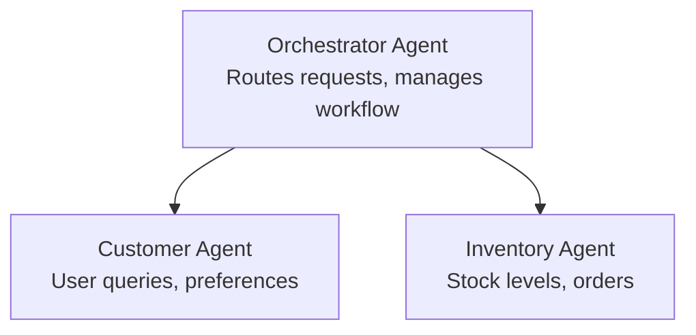

# Глава 5: Многоагентные AI-решения

**📚 Курс**: [AZD для начинающих](../../README.md) | **⏱️ Длительность**: 2-3 часа | **⭐ Сложность**: Продвинутый

---

## Обзор

Эта глава охватывает продвинутые архитектурные паттерны многоагентных систем, оркестровку агентов и готовые к производству AI-развёртывания для сложных сценариев.

> Руководство по командам проверено относительно опубликованного справочника `azd 1.37.2`. Развёртывания в облаке не выполнялись.

## Цели обучения

Пройдя эту главу, вы:
- Поймёте архитектурные паттерны многоагентных систем
- Научитесь развёртывать координированные системы AI-агентов
- Реализуете взаимодействие агентов между собой
- Создадите готовые к производству многоагентные решения

---

## 📚 Уроки

| # | Урок | Описание | Время |
|---|--------|-------------|------|
| 1 | [Основы многоагентных систем](multi-agent-basics.md) | Практика: разверните работающую многоагентную программу с `azd up` | 45 мин |
| 2 | [Паттерны координации](../chapter-06-pre-deployment/coordination-patterns.md) | Стратегии оркестровки агентов (продолжается в главе 6) | 30 мин |
| 3 | [Развёртывание с ARM-шаблоном](../../examples/retail-multiagent-arm-template/README.md) | Пример развёртывания в один клик | 30 мин |

> **Начните с урока 1.** Это единственный полностью практический урок с развёртыванием в этой главе. Урок 2 находится в главе 6 (он общ с планированием до развёртывания), а [Розничное многоагентное решение](../../examples/retail-scenario.md) — это архитектурный шаблон — проектная ссылка, а не шаблон для одной команды.

---

## 🚀 Быстрый старт

```bash
# Option 1: Deploy the multi-agent template used in Lesson 1
azd init --template Azure-Samples/contoso-creative-writer .
azd up

# Option 2: Initialize a Foundry agent interactively (requires azure.ai.agents)
azd extension install azure.ai.agents
azd ai agent init
azd up
```

> **Какой подход выбрать?** Используйте `azd init --template`, чтобы начать с рабочего примера. Используйте `azd ai agent init` интерактивно, или `azd ai agent init --template <path-to-azure.yaml>`, чтобы принять текущий проект агента. Смотрите [справочник AZD AI CLI](../chapter-08-production/production-ai-practices.md#azd-ai-cli-commands-and-extensions) для требований к версии и миграции оценки.

Запускайте эти варианты в отдельных пустых папках. Расширение агентов `1.0.0-beta.23` требует `azd >= 1.37.0`; его интерактивный режим не генерирует кастомизированный Service Bus конвейер в уроке координации.

---

## 🤖 Архитектура многоагентных систем



---

## 🎯 Избранное решение: Розничное многоагентное

Решение [Retail Multi-Agent Solution](../../examples/retail-scenario.md) демонстрирует:

- **Агент клиента**: Обрабатывает взаимодействие с пользователем и предпочтения
- **Агент запасов**: Управляет запасами и обработкой заказов
- **Оркестратор**: Координирует работу между агентами
- **Общая память**: Управление контекстом между агентами

### Используемые сервисы

| Сервис | Назначение |
|---------|---------|
| Microsoft Foundry Models | Понимание языка |
| Azure AI Search | Каталог продуктов |
| Cosmos DB | Состояние и память агента |
| Container Apps | Хостинг агентa |
| Application Insights | Мониторинг |

---

## 🔗 Навигация

| Направление | Глава |
|-----------|---------|
| **Предыдущая** | [Глава 4: Инфраструктура](../chapter-04-infrastructure/README.md) |
| **Следующая** | [Глава 6: Предварительное развертывание](../chapter-06-pre-deployment/README.md) |

---

## 📖 Связанные ресурсы

- [Руководство по AI агентам](../chapter-02-ai-development/agents.md)
- [Практики AI в производстве](../chapter-08-production/production-ai-practices.md)
- [Устранение неисправностей AI](../chapter-07-troubleshooting/ai-troubleshooting.md)

---

<!-- CO-OP TRANSLATOR DISCLAIMER START -->
**Отказ от ответственности**:
Этот документ был переведен с использованием сервиса машинного перевода [Co-op Translator](https://github.com/Azure/co-op-translator). Несмотря на наши усилия по обеспечению точности, имейте в виду, что автоматический перевод может содержать ошибки или неточности. Оригинальный документ на его исходном языке следует считать авторитетным источником. Для получения критически важной информации рекомендуется обратиться к профессиональному человеческому переводу. Мы не несем ответственности за любые недоразумения или неправильные толкования, возникшие в результате использования этого перевода.
<!-- CO-OP TRANSLATOR DISCLAIMER END -->