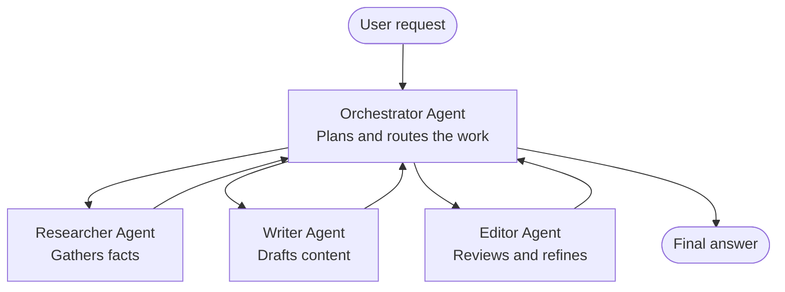

# Основы мультиагентных систем - Развертывание вашей первой согласованной AI-системы

**Навигация по главе:**
- **📚 Домашняя страница курса**: [AZD для начинающих](../../README.md)
- **📖 Текущая глава**: Глава 5 - Решения с мультиагентным AI
- **⬅️ Предыдущая**: [Глава 4: Инфраструктура](../chapter-04-infrastructure/README.md)
- **➡️ Следующая**: [Паттерны координации](../chapter-06-pre-deployment/coordination-patterns.md)

> Команды проверены по сравнению с опубликованным справочником `azd 1.37.2`. Развертывания в облаке не выполнялись.

## Введение

В предыдущих главах вы развернули одно приложение — а в главе 2 вы запустили одного AI-агента. В этом уроке мы сделаем следующий шаг: развернем **мультиагентную систему**, в которой несколько специализированных агентов работают вместе, чтобы решить задачу, с которой не справился бы один агент в одиночку.

Хорошая новость для начинающих: **новые команды не нужны.** Мультиагентное решение по-прежнему является проектом azd. Вы будете `azd init`, `azd up`, тестировать и `azd down` — это тот же рабочий процесс, который вы уже знаете. Изменяется только *внутренняя структура* приложения.

## Цели обучения

К концу этого урока вы:
- Поймете, что значит «мультиагентный» и когда стоит использовать дополнительную сложность
- Распознаете общие роли в мультиагентной системе (оркестратор + специалисты)
- Развернете реальный, рабочий мультиагентный шаблон с помощью `azd up`
- Поймете, какие ресурсы Azure поддерживают мультиагентное приложение
- Узнаете, как проверить, настроить и корректно удалить решение

## Результаты обучения

После завершения урока вы сможете:
- Объяснить разницу между одним агентом и мультиагентной системой
- Выбрать между одним агентом с инструментами и настоящим мультиагентным дизайном
- Развернуть и протестировать мультиагентный шаблон полностью с помощью azd
- Определить, где выполняется каждый агент и как они обмениваются данными
- Очистить все ресурсы, чтобы избежать дальнейших расходов

---

## Что такое мультиагентная система?

Один AI-агент — это одна модель с набором инструкций и (опционально) несколькими инструментами. Это хорошо работает для узконаправленных задач. Но по мере роста задачи — исследование, затем написание, потом редактирование и проверка фактов — попытка вместить всё в один запрос делает агента медленнее, менее надежным и сложнее для отладки.

**Мультиагентная система** разбивает работу на специалистов, каждый из которых хорошо выполняет одну задачу, а координацией занимается оркестратор:



### Две роли, которые вы всегда увидите

| Роль | Задача | Пример |
|------|--------|---------|
| **Оркестратор** | Решает, *что происходит дальше*, и распределяет работу между агентами | «Сначала исследование, затем написание, потом редактирование» |
| **Специалист** | Выполняет одну узкую задачу и возвращает результат | «Исследователь», который только собирает факты |

### Действительно ли вам нужны несколько агентов?

Начинайте с простого. Мультиагентная система нужна **только** если выполняется хотя бы одно из этих условий:

- ✅ Задача имеет **четкие этапы**, которым нужны разные инструкции (исследование vs. написание vs. проверка)
- ✅ Вы хотите, чтобы специалисты работали **параллельно** для экономии времени
- ✅ Разным этапам требуются **разные инструменты или источники данных**
- ✅ Каждый этап должен быть **независимо протестирован и отлажен**

Если ваша задача — простой вопрос и ответ или вызов инструмента, то **один агент с инструментами** (Глава 2) проще, дешевле и удобнее в эксплуатации.

> **Совет для начинающих:** «Больше агентов» не значит «лучше». Каждый агент добавляет задержку, стоимость и требует мониторинга. Добавляйте агентов только когда задача явно разбивается на части.

---

## Два способа создания мультиагентной системы на Azure

| Подход | Что это | Лучшее применение |
|--------|---------|------------------|
| **Один агент + инструменты** | Один Foundry агент, вызывающий функции/инструменты | Простые рабочие процессы, начало работы |
| **Несколько координируемых агентов** | Несколько агентов с оркестратором | Разделение на этапы, параллельная работа, специализация |

Этот урок сосредоточен на втором подходе с использованием **готового шаблона**, чтобы вы могли увидеть реальную мультиагентную систему в действии перед созданием собственной.

---

## Практика: развертывание работающего мультиагентного приложения

Мы развернем **Contoso Creative Writer**, официальный пример Azure, который координирует агентов для исследований, продуктового анализа, написания и редактирования для создания статьи. Перед началом ознакомьтесь с [требованиями и стоимостью примера](https://github.com/Azure-Samples/contoso-creative-writer#azure-account-requirements): нужны квоты модели, Azure AI Search, доступ к Bing Grounding, Python, Docker и совместимые с Bash хуки. Доступность моделей и регионов зависит от подписки; развертывание не гарантировано при выборе конкретного региона.

### Шаг 1: Инициализация шаблона

```bash
# Create a working folder
mkdir creative-writer && cd creative-writer

# Initialize from the official multi-agent template
azd init --template Azure-Samples/contoso-creative-writer .
```

> В любое время можно просмотреть другие мультиагентные шаблоны в [галерее Awesome AZD AI](https://azure.github.io/awesome-azd/?tags=ai). Другие доступные для начинающих варианты включают `get-started-with-ai-agents` и `azure-ai-travel-agents`.

### Шаг 2: Аутентификация

```bash
# Required for azd workflows
azd auth login

# Also required by this sample's Azure CLI hooks
az login
```

### Шаг 3: Проверка окружения

```bash
# init normally creates/selects an environment; confirm it before proceeding
azd env list
# Only if you need an additional environment:
# azd env new dev
```

### Шаг 4: Предварительный просмотр, затем развертывание

```bash
# See what will be created before spending anything (recommended)
azd provision --preview

# Provision infrastructure and deploy all agents in one step
azd up
```

`azd up` запросит недостающие параметры подписки и региона, затем выполнит выделение ресурсов и развертывание приложения. Предварительный просмотр не резервирует квоты и не гарантирует успех; хуки шаблона могут выполняться во время предварительного просмотра развертывания, поэтому проверьте их сначала. Чтобы увеличить время ожидания азд для каждого **развертывания сервиса** (не для выделения модели):

```bash
azd deploy --timeout 1800
```

Таймаут прекращает ожидание azd, но не отменяет развертывание в Azure. Проверьте состояние ресурса перед повторной попыткой.

> **Внимание касательно затрат и емкости:** Мультиагентные приложения разворачивают AI-модели, которые потребляют квоту и требуют оплаты. Если `azd up` не хватает квоты по модели, смотрите [Устранение проблем AI](../chapter-07-troubleshooting/ai-troubleshooting.md) для исправления региональных и квотных проблем, а также главу 6 [Планирование емкости](../chapter-06-pre-deployment/capacity-planning.md).

---

## Понимание того, что вы развернули

Типичное мультиагентное приложение такого типа выделяет набор ресурсов Azure, которые соответствуют ответственностям из диаграммы выше:

| Ресурс | Зачем он нужен |
|--------|----------------|
| **Microsoft Foundry / Модели** | Хостит языковые модели, используемые каждым агентом |
| **Azure AI Search** | Предоставляет агенту-исследователю заземленные данные для поиска |
| **Container Apps** (или App Service) | Хостит код оркестратора и агентов |
| **Cosmos DB** (в некоторых примерах) | Хранит общее состояние/память, передаваемую между агентами |
| **Application Insights** | Отслеживает запросы *между* агентами для отладки потока |

### Как агенты общаются друг с другом

В большинстве примеров azd мультиагентных систем **оркестратор работает в вашем коде приложения** (например, с использованием Semantic Kernel или Microsoft Agent Framework). Оркестратор вызывает специалистов по очереди, передает результаты и собирает итоговый ответ. Агенты обмениваются контекстом через:

- **Вызовы функций/инструментов** — оркестратор вызывает специалиста и получает результат
- **Общую память** — база данных (часто Cosmos DB) содержит состояние, доступное для чтения обоим агентам
- **Сообщения/события** — для более свободной связи агенты обмениваются сообщениями через очередь или Service Bus

> **Почему это важно для отладки:** поскольку каждый шаг отделен, Application Insights показывает, *какой* агент работал медленно или завершился с ошибкой. Это важная причина разделять работу между агентами.

---

## Проверка развертывания

Убедитесь, что система работает, прежде чем двигаться дальше:

```bash
# Show the deployed endpoints
azd show

# Open the app's monitoring dashboard
azd monitor

# Open Application Insights Logs (not a terminal log stream)
azd monitor --logs
```

Затем откройте URL приложения из `azd show` и запросите короткую статью. Используйте отладочный режим примера для просмотра рабочего процесса агентов. Поисковый запрос Application Insights может показать отдельные шаги только если пример реализует и связывает их; azd автоматически не добавляет распределенные трассировки агентов.

**Критерии успеха:**
- ✅ `azd show` показывает доступный конечный пункт
- ✅ Запрос возвращает результат, явно прошедший через несколько этапов
- ✅ Отладочный режим показывает несколько шагов агентов; при включенной трассировке проверьте соответствующую телеметрию после загрузки

---

## Настройка: добавление или изменение агента

Поскольку каждый агент — это просто набор инструкций и инструментов, настройка проста:

1. **Найдите определения агентов** в шаблоне (часто набор файлов `prompts/`, `agents/` или `*.prompty`).
2. **Настройте инструкции агента** — например, скажите редактору соблюдать определенный тон или количество слов.
3. **Повторно разверните только код** (инфраструктура не меняется):

   ```bash
   azd deploy
   ```

Чтобы двигаться дальше со своим *собственным* проектом Foundry агента, пользуйтесь интерактивной инициализацией расширения агента:

```bash
azd extension install azure.ai.agents
azd ai agent init
azd up
azd ai agent invoke      # test, with response timing
```

Смотрите [Главу 2: Агенты](../chapter-02-ai-development/agents.md) и [справочник AZD AI CLI](../chapter-08-production/production-ai-practices.md#azd-ai-cli-commands-and-extensions) для полного жизненного цикла: создание агента `invoke`, отдельный рабочий процесс оценки расширения `azd ai eval`, обучение агента `optimize` и отладка агента `delete`.

---

## Очистка

Мультиагентные приложения запускают несколько оплачиваемых сервисов. Удаляйте всё, когда закончите:

```bash
# Review the resources and confirm deletion interactively
azd down
```

Удаление необратимо. Для лабораторных заданий `azd down --force --purge` пропускает удаление и подтверждения мягкого удаления; очистка необратима при поддержке и может быть заблокирована защитой от очистки. Мягкое удаление — это вопрос восстановления или повторного использования имен, а не доказательство продолжающихся затрат. Проверьте оставшиеся ресурсы и начисления после очистки.

---

## Примечание о производственных мультиагентных системах

Решение [Retail Multi-Agent Solution](../../examples/retail-scenario.md) в этом репозитории — это **архитектурный план**, а не шаблон с одной командой — оно описывает, как *может* быть построена производственная розничная система (и ясно указывает, что полный разбор — это значительные усилия). Используйте его как справочник по дизайну *после* того, как развернете работающий пример здесь. Для производственных вопросов (надежность, стоимость, мониторинг, управление) продолжайте с [Глава 8: Производственные практики ИИ](../chapter-08-production/production-ai-practices.md).

---

## Краткое содержание

- Мультиагентная система распределяет работу между специалистами, координируемыми оркестратором.
- Используйте её только если задача имеет четкие этапы, параллелизм или разные инструменты для каждого шага — иначе предпочтите одного агента.
- Рабочий процесс azd не изменён: `azd init` → `azd up` → test → `azd down`.
- Реальный шаблон, как `contoso-creative-writer`, позволяет сегодня видеть и настраивать работающее мультиагентное приложение.
- Трассировка Application Insights между агентами — одно из главных практических преимуществ мультиагентного дизайна.

---

## 🔗 Навигация

| Направление | Урок |
|-----------|--------|
| **Предыдущий** | [Глава 4: Инфраструктура](../chapter-04-infrastructure/README.md) |
| **Следующий** | [Паттерны координации](../chapter-06-pre-deployment/coordination-patterns.md) |

## 📖 Связанные ресурсы

- [Руководство по AI агентам](../chapter-02-ai-development/agents.md)
- [Паттерны координации](../chapter-06-pre-deployment/coordination-patterns.md)
- [Практики Production AI](../chapter-08-production/production-ai-practices.md)
- [Поиск и устранение неполадок AI](../chapter-07-troubleshooting/ai-troubleshooting.md)

---

<!-- CO-OP TRANSLATOR DISCLAIMER START -->
**Отказ от ответственности**:
Этот документ был переведен с использованием сервиса машинного перевода [Co-op Translator](https://github.com/Azure/co-op-translator). Несмотря на наши усилия по обеспечению точности, имейте в виду, что автоматический перевод может содержать ошибки или неточности. Оригинальный документ на его исходном языке следует считать авторитетным источником. Для получения критически важной информации рекомендуется обратиться к профессиональному человеческому переводу. Мы не несем ответственности за любые недоразумения или неправильные толкования, возникшие в результате использования этого перевода.
<!-- CO-OP TRANSLATOR DISCLAIMER END -->