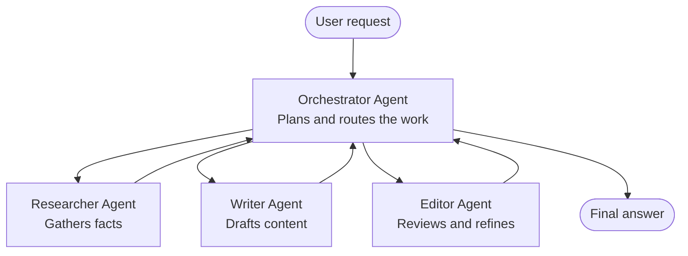

# Основы мультиагентных систем — разверните свою первую скоординированную систему ИИ

**Навигация по главам:**
- **📚 Главная курса**: [AZD для начинающих](../../README.md)
- **📖 Текущая глава**: Глава 5 — Мультиагентные ИИ-решения
- **⬅️ Предыдущая**: [Глава 4: Инфраструктура](../chapter-04-infrastructure/README.md)
- **➡️ Следующая**: [Паттерны координации](../chapter-06-pre-deployment/coordination-patterns.md)

> Руководство по командам основано на опубликованной справке `azd 1.37.2`. Облачные развертывания не выполнялись.

## Введение

В предыдущих главах вы развернули одно приложение — а во главе 2 — одного ИИ-агента. Этот урок — следующий шаг: развертывание **мультиагентной системы**, в которой несколько специализированных агентов работают совместно, решая задачи, которые один агент не смог бы эффективно выполнить самостоятельно.

Хорошая новость для начинающих: **вам не нужны новые команды.** Мультиагентное решение все еще остается проектом azd. Вы будете `azd init`, `azd up`, тестировать и `azd down` — ровно тот же рабочий процесс, который вы уже знаете. Меняется только *структура* приложения внутри.

## Цели обучения

К концу этого урока вы:
- Поймете, что такое "мультиагентная система" и когда оправдана дополнительная сложность
- Опознаете типичные роли в мультиагентной системе (оркестратор + специалисты)
- Развернете реальный работающий шаблон мультиагентной системы с помощью `azd up`
- Поймете, какие ресурсы Azure лежат в основе мультиагентного приложения
- Узнаете, как проверять, настраивать и безопасно удалять решение

## Результаты обучения

После завершения урока вы сможете:
- Объяснить отличие одиночного агента от мультиагентной системы
- Выбрать между одиночным агентом с инструментами и полноценным мультиагентным дизайном
- Развернуть и протестировать мультиагентный шаблон с azd «от и до»
- Определить, где работает каждый агент и как они взаимодействуют
- Очистить все ресурсы, чтобы избежать дальнейших затрат

---

## Что такое мультиагентная система?

Один ИИ-агент — это одна модель с набором инструкций и (опционально) некоторыми инструментами. Это хорошо для узконаправленных задач. Но по мере роста задачи — исследования, затем написание, затем редактирование, затем проверка фактов — попытка уместить всё в один промпт делает агента медленнее, менее надежным и сложнее в отладке.

**Мультиагентная система** разбивает работу на специалистов, каждый из которых хорошо выполняет одну задачу, а координирует их оркестратор:



### Две роли, которые вы всегда увидите

| Роль | Задача | Пример |
|------|--------|---------|
| **Оркестратор** | Решает, *что будет дальше*, и распределяет работу между агентами | "Сначала исследования, затем написание, затем редактирование" |
| **Специалист** | Выполняет одну узкую задачу и возвращает результат | "исследователь", который только собирает факты |

### Вам действительно нужны несколько агентов?

Начинайте с простого. Обращайтесь к мультиагентной системе **только если** выполнено одно из условий:

- ✅ Задача имеет **четкие этапы**, которым выгодно разные инструкции (исследование, написание, проверка)
- ✅ Хотите, чтобы специалисты работали **параллельно** для экономии времени
- ✅ Разные этапы требуют **разных инструментов или источников данных**
- ✅ Нужно, чтобы каждый этап был **отдельно тестируемым и отлаживаемым**

Если ваша задача — одиночный вопрос-ответ или простой вызов инструмента, **один агент с инструментами** (Глава 2) проще, дешевле и удобнее в эксплуатации.

> **Совет для начинающих:** "Больше агентов" — не значит "лучше". Каждый агент добавляет задержку, стоимость и новую точку мониторинга. Добавляйте агентов только если задача явно делится на части.

---

## Два способа создать мультиагентную систему на Azure

| Подход | Что это | Лучшее применение |
|--------|---------|-----------------|
| **Один агент + инструменты** | Один агент Foundry, вызывающий функции/инструменты | Простые рабочие процессы, начало работы |
| **Несколько координируемых агентов** | Несколько агентов с оркестратором | Явные этапы, параллельная работа, специализация |

Этот урок сосредоточен на втором подходе с использованием **готового шаблона**, чтобы вы могли увидеть реальную мультиагентную систему в работе до того, как создадите свою.

---

## Практика: развертывание работающего мультиагентного приложения

Мы развернем **Contoso Creative Writer**, официальный пример Azure, который координирует агентов для исследований, продуктовой разработки, написания и редактирования для создания статьи. Перед началом проверьте [требования и затраты примера](https://github.com/Azure-Samples/contoso-creative-writer#azure-account-requirements): требуется квота модели, Azure AI Search, доступ к Bing Grounding, Python, Docker и совместимые с Bash хуки. Наличие модели и региона зависит от вашей подписки; выбор региона не гарантирует развертывание.

### Шаг 1: Инициализация шаблона

```bash
# Create a working folder
mkdir creative-writer && cd creative-writer

# Initialize from the official multi-agent template
azd init --template Azure-Samples/contoso-creative-writer .
```

> В любое время можно просмотреть больше мультиагентных шаблонов в [галерее Awesome AZD AI](https://azure.github.io/awesome-azd/?tags=ai). Среди других удобных для начинающих вариантов — `get-started-with-ai-agents` и `azure-ai-travel-agents`.

### Шаг 2: Аутентификация

```bash
# Required for azd workflows
azd auth login

# Also required by this sample's Azure CLI hooks
az login
```

### Шаг 3: Проверка окружения

```bash
# init normally creates/selects an environment; confirm it before proceeding
azd env list
# Only if you need an additional environment:
# azd env new dev
```

### Шаг 4: Предварительный просмотр, затем развертывание

```bash
# See what will be created before spending anything (recommended)
azd provision --preview

# Provision infrastructure and deploy all agents in one step
azd up
```

`azd up` запросит отсутствующие настройки подписки и региона, затем создаст ресурсы и развернет приложение. Предварительный просмотр не резервирует квоту и не гарантирует успех; хуки шаблона могут запускаться и во время предварительного просмотра, поэтому сначала их проверьте. Чтобы увеличить время ожидания azd для каждого **развертывания сервиса** (не для предоставления модели):

```bash
azd deploy --timeout 1800
```

Тайм-аут прекращает ожидание azd; он не отменяет развертывание в Azure. Проверьте состояние ресурса перед повторной попыткой.

> **Предупреждение о стоимости и емкости:** Мультиагентные приложения разворачивают ИИ-модели, которые потребляют квоту и влияют на стоимость. Если `azd up` не удается получить квоту модели, смотрите [решение проблем ИИ](../chapter-07-troubleshooting/ai-troubleshooting.md) для исправления регионов и квот, а также главу 6 [Планирование емкости](../chapter-06-pre-deployment/capacity-planning.md).

---

## Понимание того, что вы развернули

Типичное мультиагентное приложение, как это, создает набор ресурсов Azure, которые напрямую соответствуют ролям на диаграмме выше:

| Ресурс | Зачем он нужен |
|--------|---------------|
| **Microsoft Foundry / Models** | Хостит языковые модели, используемые каждым агентом |
| **Azure AI Search** | Предоставляет агенту-исследователю обоснованные данные для поиска |
| **Container Apps** (или App Service) | Хостит код оркестратора и агентов |
| **Cosmos DB** (в некоторых примерах) | Хранит общее состояние/память, передаваемую между агентами |
| **Application Insights** | Отслеживает запросы *между* агентами для отладки потока |

### Как агенты общаются друг с другом

В большинстве мультиагентных azd-примеров **оркестратор работает в вашем коде приложения** (например, используя фреймворк Semantic Kernel или Microsoft Agent Framework). Оркестратор последовательно вызывает каждого специалиста, передает результаты и формирует финальный ответ. Агенты обмениваются контекстом через:

- **Вызовы функций/инструментов** — оркестратор вызывает специалиста и получает результат
- **Общую память** — база данных (часто Cosmos DB) хранит состояние, доступное обоим агентам
- **Сообщения/события** — для более слабой связности агенты общаются через очередь или Service Bus

> **Почему это важно для отладки:** поскольку каждый этап отдельно, Application Insights показывает, *какой* агент работал медленно или не справился. Это одна из главных причин разделять работу между агентами.

---

## Проверка развертывания

Убедитесь, что система действительно работает, прежде чем продолжать:

```bash
# Show the deployed endpoints
azd show

# Open the app's monitoring dashboard
azd monitor

# Open Application Insights Logs (not a terminal log stream)
azd monitor --logs
```

Затем откройте URL приложения из `azd show` и запросите короткую статью. Используйте отладочный просмотр примера, чтобы исследовать его рабочий процесс агентов. Поиск транзакций в Application Insights может показать отдельные шаги только если пример их инструментирует и коррелирует; azd автоматически не добавляет агентские спаны.

**Критерии успешности:**
- ✅ `azd show` показывает доступную конечную точку
- ✅ Запрос выдает результат, который явно прошел несколько этапов
- ✅ В отладочном просмотре видны несколько шагов агентов; если трассировка включена, проверьте соответствующую телеметрию после обработки

---

## Настройка: добавление или изменение агента

Поскольку каждый агент — это просто инструкции плюс инструменты, настройка удобна:

1. **Найдите определения агента** в шаблоне (часто это набор файлов `prompts/`, `agents/` или `*.prompty`).
2. **Настройте инструкции агента** — например, скажите агенту-редактору использовать определенный тон или объем слов.
3. **Перезадеплойте только код** (инфраструктура не меняется):

   ```bash
   azd deploy
   ```

Чтобы пойти дальше с *своим* проектом агента Foundry, используйте GA-бандл с AZD 1.37.0+ в отдельной пустой папке:

```bash
azd ext install microsoft.foundry
azd ai agent init
azd up
azd ai agent invoke      # test, with response timing
```

Смотрите [гайд по GA hosted-agent](../chapter-02-ai-development/microsoft-foundry-integration.md#hosted-agent-walkthrough-ga) для локального тестирования с Agent Inspector, удаленного развертывания кода и управления очисткой. Справочник [AZD AI CLI](../chapter-08-production/production-ai-practices.md#azd-ai-cli-commands-and-extensions) также описывает расширение отдельной оценки, оптимизации и удаления агента.

---

## Очистка

Мультиагентные приложения запускают несколько оплачиваемых сервисов. Удаляйте всё после завершения работы:

```bash
# Review the resources and confirm deletion interactively
azd down
```

Удаление — это необратимая операция. Для одноразовой лабораторной работы `azd down --force --purge` пропускает удаление и поддерживает подтверждения мягкого удаления; удаление с мягким режимом возможно восстановить и не является доказательством текущих затрат. Проверьте сохраненные ресурсы и счета после очистки.

Если вы также инициализировали хостинг агента для существующего проекта Foundry, `azd down` оставляет агент и другие ресурсы этого проекта на месте. Удаляйте только ненужные ресурсы, которыми вы владеете отдельно. Для нового проекта Foundry, созданного его AZD окружением, `azd down` удаляет группу ресурсов и все содержимое.

---

## Примечание о мультиагентных системах в производстве

Решение [Retail Multi-Agent Solution](../../examples/retail-scenario.md) в этом репозитории — это **архитектурный blueprint**, а не шаблон для запуска одной командой — оно описывает, как *можно* построить промышленную ритейл-систему (и прямо указывает, что полный билд — это значительное усилие). Используйте его как справочник по дизайну *после* того, как задеплоите здесь рабочий пример. Для вопросов эксплуатации (устойчивость, стоимость, мониторинг, управление) переходите к [Глава 8: Практики производственного ИИ](../chapter-08-production/production-ai-practices.md).

---

## Краткое содержание

- Мультиагентная система разделяет работу между специалистами, координируемыми оркестратором.
- Используйте её только если задание имеет четкие этапы, параллелизм или разные инструменты для каждого шага — в противном случае предпочтите одного агента.
- Работа azd не меняется: `azd init` → `azd up` → test → `azd down`.
- Реальный шаблон, как `contoso-creative-writer`, позволяет вам сегодня увидеть и настроить работающее мультиагентное приложение.
- Трассировка Application Insights между агентами — одно из самых больших практических преимуществ мультиагентного дизайна.

---

## 🔗 Навигация

| Направление | Урок |
|-----------|--------|
| **Предыдущий** | [Глава 4: Инфраструктура](../chapter-04-infrastructure/README.md) |
| **Следующий** | [Паттерны координации](../chapter-06-pre-deployment/coordination-patterns.md) |

## 📖 Связанные ресурсы

- [Руководство по AI агентам](../chapter-02-ai-development/agents.md)
- [Паттерны координации](../chapter-06-pre-deployment/coordination-patterns.md)
- [Практики производства AI](../chapter-08-production/production-ai-practices.md)
- [Устранение неполадок AI](../chapter-07-troubleshooting/ai-troubleshooting.md)

---

<!-- CO-OP TRANSLATOR DISCLAIMER START -->
**Отказ от ответственности**:
Этот документ был переведен с использованием сервиса машинного перевода [Co-op Translator](https://github.com/Azure/co-op-translator). Несмотря на наши усилия по обеспечению точности, имейте в виду, что автоматический перевод может содержать ошибки или неточности. Оригинальный документ на его исходном языке следует считать авторитетным источником. Для получения критически важной информации рекомендуется обратиться к профессиональному человеческому переводу. Мы не несем ответственности за любые недоразумения или неправильные толкования, возникшие в результате использования этого перевода.
<!-- CO-OP TRANSLATOR DISCLAIMER END -->