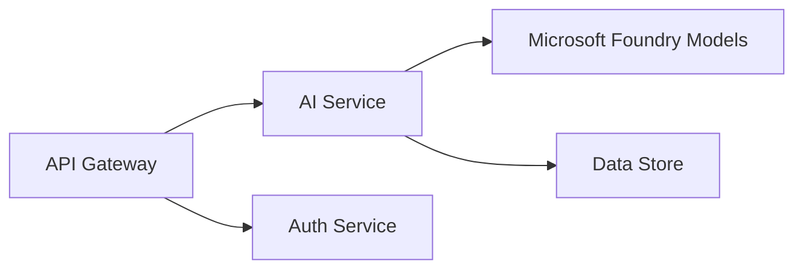

# Глава 8: Производственные и корпоративные шаблоны

**📚 Курс**: [AZD для начинающих](../../README.md) | **⏱️ Продолжительность**: 2-3 часа | **⭐ Сложность**: Продвинутый

---

## Обзор

В этой главе рассматриваются шаблоны развертывания, готовые для корпоративного использования, усиление безопасности, мониторинг и оптимизация затрат для производственных ИИ нагрузок.

Это архитектурное руководство, а не полный шаблон для развертывания. Примеры опускают детали интеграции, которые должны быть реализованы и протестированы в вашем собственном приложении; просмотр чеклиста не подтверждает готовность к продакшену.

> **Обзор релиза (2026-11-04):** Руководство по AI CLI проверено относительно `azd 1.37.2`, агентов `1.0.0-beta.23` и документации/исходного кода оценок `1.0.0-beta.2`. См. [изменения и исправления релиза](production-ai-practices.md#recent-release-changes-and-fixes) для требований совместимости и деталей миграции; это не валидация живого развертывания.

## Цели обучения

Освоив эту главу, вы научитесь:
- Разворачивать отказоустойчивые приложения в нескольких регионах
- Внедрять корпоративные шаблоны безопасности
- Настраивать комплексный мониторинг
- Оптимизировать затраты в масштабе
- Настраивать CI/CD пайплайны с AZD

---

## 📚 Уроки

| № | Урок | Описание | Время |
|---|--------|-------------|------|
| 1 | [Производственные практики ИИ](production-ai-practices.md) | Корпоративные шаблоны развертывания | 90 мин |

---

## 🚀 Чеклист для продакшена

- [ ] Развертывание в нескольких регионах для устойчивости
- [ ] Управляемая идентичность для аутентификации (без ключей)
- [ ] Application Insights для мониторинга
- [ ] Настроены бюджеты и оповещения по затратам
- [ ] Включено сканирование безопасности
- [ ] Интеграция с CI/CD пайплайнами
- [ ] План восстановления при авариях

---

## 🏗️ Архитектурные шаблоны

### Шаблон 1: Микросервисы для ИИ



### Шаблон 2: Событийно-ориентированный ИИ


---

## 🔐 Лучшие практики безопасности

```bicep
// Illustrative properties from different resources, NOT a standalone Bicep file.
// Attach identity to the application host:
identity: {
  type: 'SystemAssigned'
}

// AI account properties (also require private endpoints, DNS and app connectivity):
properties: {
  publicNetworkAccess: 'Disabled'
  networkAcls: {
    defaultAction: 'Deny'
  }
}
```

---

## 💰 Оптимизация затрат

| Стратегия | Основное ограничение |
|----------|---------|
| Масштабирование до нуля (Container Apps) | Требуется подходящий триггер; другие сервисы всё ещё генерируют затраты |
| Использование уровней потребления для разработки | Сравнение цен выбранного сервиса и нагрузки |
| Плановое масштабирование | Масштабирование через поддерживаемую инфраструктуру/автоматизацию |
| Резервации/предварительно выделённая емкость | Только при поддержке; обязательства могут увеличить неиспользуемые затраты |

Используйте [полный шаблон бюджета ресурсов](production-ai-practices.md#2-cost-monitoring-and-budgets) с действительной датой начала, областью выставления счетов, получателями и разрешениями. Бюджет отправляет оповещения; он не ограничивает расходы. Экономия зависит от измеренного использования и не является гарантированной.

---

## 📊 Настройка мониторинга

```bash
# Open the Application Insights logs view (requires configured monitoring)
azd monitor --logs

# Check Application Insights
azd monitor --overview

# View metrics
az monitor metrics list --resource <resource-id>
```

---

## 🔗 Навигация

| Направление | Глава |
|-----------|---------|
| **Предыдущая** | [Глава 7: Устранение неполадок](../chapter-07-troubleshooting/README.md) |
| **Курс завершён** | [Главная курса](../../README.md) |

---

## 📖 Сопутствующие ресурсы

- [Руководство по агентам ИИ](../chapter-02-ai-development/agents.md)
- [Application Insights](../chapter-06-pre-deployment/application-insights.md)
- [Решения с несколькими агентами](../chapter-05-multi-agent/README.md)
- [Пример микросервисов](../../examples/microservices/README.md)

---

<!-- CO-OP TRANSLATOR DISCLAIMER START -->
**Отказ от ответственности**:
Этот документ был переведен с использованием сервиса машинного перевода [Co-op Translator](https://github.com/Azure/co-op-translator). Несмотря на наши усилия по обеспечению точности, имейте в виду, что автоматический перевод может содержать ошибки или неточности. Оригинальный документ на его исходном языке следует считать авторитетным источником. Для получения критически важной информации рекомендуется обратиться к профессиональному человеческому переводу. Мы не несем ответственности за любые недоразумения или неправильные толкования, возникшие в результате использования этого перевода.
<!-- CO-OP TRANSLATOR DISCLAIMER END -->