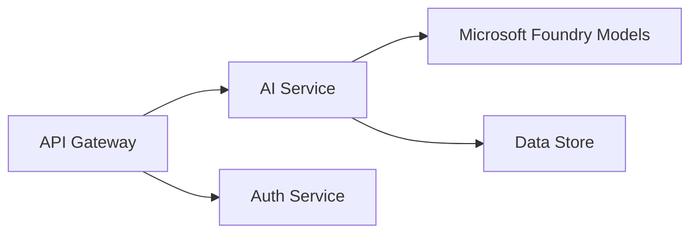
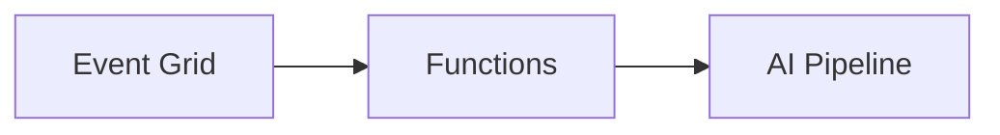

# Глава 8: Производственные и корпоративные шаблоны

**📚 Курс**: [AZD для начинающих](../../README.md) | **⏱️ Продолжительность**: 2-3 часа | **⭐ Сложность**: Продвинутый уровень

---

## Обзор

В этой главе рассматриваются шаблоны развертывания, готовые для корпоративного использования, усиление безопасности, мониторинг и оптимизация затрат для производственных AI-нагрузок.

Это архитектурное руководство, а не полностью готовый к развертыванию производственный шаблон. В примерах опущены детали интеграции, которые должны быть добавлены и протестированы в вашем приложении; чтение чек-листа не гарантирует готовность к продакшену.

> **Обновление Foundry GA (2026-11-09):** Используйте `azd >= 1.37.0` и общедоступный пакет `microsoft.foundry` 1.0 для workflow Foundry; оценки устанавливаются отдельно. Смотрите [область выпуска и миграцию](production-ai-practices.md#recent-release-changes-and-fixes) и [пример аутентифицированного пайплайна](production-ai-practices.md#cicd-pipeline-configuration). Это обзор документации, а не проверка развертывания в реальном времени или универсальный статус GA для опциональных функций предварительного просмотра.

## Цели обучения

По завершении этой главы вы сможете:
- Развертывать отказоустойчивые приложения в нескольких регионах
- Реализовать корпоративные шаблоны безопасности
- Настроить комплексный мониторинг
- Оптимизировать затраты в масштабе
- Настроить CI/CD пайплайны с помощью AZD

---

## 📚 Уроки

| № | Урок | Описание | Время |
|---|--------|-------------|------|
| 1 | [Производственные практики AI](production-ai-practices.md) | Корпоративные шаблоны развертывания | 90 мин |

---

## 🚀 Чек-лист для продакшена

- [ ] Много региональное развертывание для отказоустойчивости
- [ ] Управляемая идентичность для аутентификации (без ключей)
- [ ] Application Insights для мониторинга
- [ ] Настроены бюджеты затрат и оповещения
- [ ] Включено сканирование безопасности
- [ ] Интеграция в CI/CD пайплайн
- [ ] План восстановления после сбоев

---

## 🏗️ Архитектурные шаблоны

### Шаблон 1: Микросервисы AI



### Шаблон 2: Событийно-ориентированный AI



---

## 🔐 Лучшие практики безопасности

```bicep
// Illustrative properties from different resources, NOT a standalone Bicep file.
// Attach identity to the application host:
identity: {
  type: 'SystemAssigned'
}

// AI account properties (also require private endpoints, DNS and app connectivity):
properties: {
  publicNetworkAccess: 'Disabled'
  networkAcls: {
    defaultAction: 'Deny'
  }
}
```

---

## 💰 Оптимизация затрат

| Стратегия | Основное ограничение |
|----------|---------|
| Масштабирование до нуля (Container Apps) | Требуется подходящий триггер; другие сервисы всё ещё создают затраты |
| Использование модели потребления для разработки | Сравнивайте стоимость выбранного сервиса и нагрузку |
| Плановое масштабирование | Масштабирование через поддерживаемую инфраструктуру/автоматизацию |
| Резервирование/предоставленная ёмкость | Только если поддерживается; обязательства могут увеличить холостой расход |

Используйте [полный шаблон ресурса бюджета](production-ai-practices.md#2-cost-monitoring-and-budgets) с действительной датой начала, областью выставления счетов, получателями и разрешениями. Бюджет посылает оповещения; он не ограничивает расходы. Экономия зависит от измеренного использования и не гарантируется в процентах.

---

## 📊 Настройка мониторинга

```bash
# Open the Application Insights logs view (requires configured monitoring)
azd monitor --logs

# Check Application Insights
azd monitor --overview

# View metrics
az monitor metrics list --resource <resource-id>
```

---

## 🔗 Навигация

| Направление | Глава |
|-----------|---------|
| **Предыдущая** | [Глава 7: Устранение неполадок](../chapter-07-troubleshooting/README.md) |
| **Курс завершён** | [Главная страница курса](../../README.md) |

---

## 📖 Связанные ресурсы

- [Руководство по AI-агентам](../chapter-02-ai-development/agents.md)
- [Application Insights](../chapter-06-pre-deployment/application-insights.md)
- [Решения с несколькими агентами](../chapter-05-multi-agent/README.md)
- [Пример микросервисов](../../examples/microservices/README.md)

---

<!-- CO-OP TRANSLATOR DISCLAIMER START -->
**Отказ от ответственности**:
Этот документ был переведен с использованием сервиса машинного перевода [Co-op Translator](https://github.com/Azure/co-op-translator). Несмотря на наши усилия по обеспечению точности, имейте в виду, что автоматический перевод может содержать ошибки или неточности. Оригинальный документ на его исходном языке следует считать авторитетным источником. Для получения критически важной информации рекомендуется обратиться к профессиональному человеческому переводу. Мы не несем ответственности за любые недоразумения или неправильные толкования, возникшие в результате использования этого перевода.
<!-- CO-OP TRANSLATOR DISCLAIMER END -->