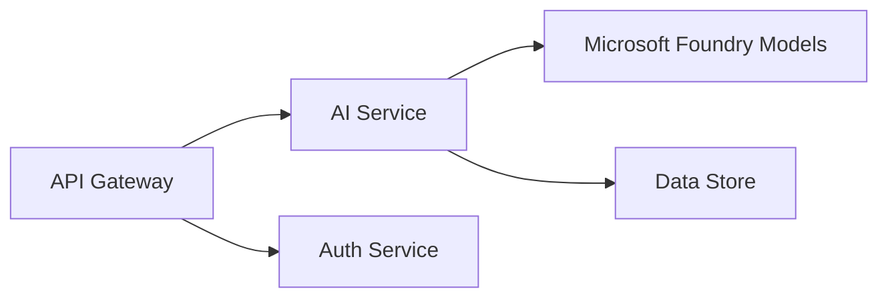

# Глава 8: Шаблоны для производства и предприятий

**📚 Курс**: [AZD для начинающих](../../README.md) | **⏱️ Продолжительность**: 2-3 часа | **⭐ Сложность**: Продвинутый

---

## Обзор

В этой главе рассматриваются шаблоны развертывания, готовые к использованию в предприятиях, усиление безопасности, мониторинг и оптимизация расходов для производственных AI-рабочих нагрузок.

> Проверено с помощью `azd 1.27.1` в июле 2026 года.

## Цели обучения

По завершении этой главы вы сможете:
- Развертывать отказоустойчивые приложения в нескольких регионах
- Внедрять корпоративные шаблоны безопасности
- Настраивать комплексный мониторинг
- Оптимизировать расходы в масштабе
- Настроить CI/CD-пайплайны с AZD

---

## 📚 Уроки

| № | Урок | Описание | Время |
|---|--------|-------------|------|
| 1 | [Практики Production AI](production-ai-practices.md) | Корпоративные шаблоны развертывания | 90 мин |

---

## 🚀 Контрольный список для производства

- [ ] Много региональное развертывание для устойчивости
- [ ] Управляемая идентификация для аутентификации (без ключей)
- [ ] Application Insights для мониторинга
- [ ] Настроены бюджеты расходов и оповещения
- [ ] Включено сканирование безопасности
- [ ] Интеграция с CI/CD-пайплайном
- [ ] План аварийного восстановления

---

## 🏗️ Шаблоны архитектуры

### Шаблон 1: Майкросервисы AI



### Шаблон 2: Событийно-ориентированный AI


---

## 🔐 Лучшие практики безопасности

```bicep
// Use managed identity
identity: {
  type: 'SystemAssigned'
}

// Private endpoints for AI services
properties: {
  publicNetworkAccess: 'Disabled'
  networkAcls: {
    defaultAction: 'Deny'
  }
}
```

---

## 💰 Оптимизация затрат

| Стратегия | Экономия |
|----------|---------|
| Масштабирование до нуля (Container Apps) | 60-80% |
| Использование тарифных планов по потреблению для разработки | 50-70% |
| Плановое масштабирование | 30-50% |
| Зарезервированная емкость | 20-40% |

```bash
# Set budget alerts
az consumption budget create \
  --budget-name "AI-Budget" \
  --amount 500 \
  --category Cost \
  --time-grain Monthly
```

---

## 📊 Настройка мониторинга

```bash
# Stream logs
azd monitor --logs

# Check Application Insights
azd monitor --overview

# View metrics
az monitor metrics list --resource <resource-id>
```

---

## 🔗 Навигация

| Направление | Глава |
|-----------|---------|
| **Предыдущая** | [Глава 7: Поиск и устранение неисправностей](../chapter-07-troubleshooting/README.md) |
| **Курс завершён** | [Домашняя страница курса](../../README.md) |

---

## 📖 Связанные ресурсы

- [Руководство по AI-агентам](../chapter-02-ai-development/agents.md)
- [Application Insights](../chapter-06-pre-deployment/application-insights.md)
- [Решения с несколькими агентами](../chapter-05-multi-agent/README.md)
- [Пример микросервисов](../../examples/microservices/README.md)

---

<!-- CO-OP TRANSLATOR DISCLAIMER START -->
**Отказ от ответственности**:
Этот документ был переведен с использованием сервиса машинного перевода [Co-op Translator](https://github.com/Azure/co-op-translator). Несмотря на наши усилия по обеспечению точности, имейте в виду, что автоматический перевод может содержать ошибки или неточности. Оригинальный документ на его исходном языке следует считать авторитетным источником. Для получения критически важной информации рекомендуется обратиться к профессиональному человеческому переводу. Мы не несем ответственности за любые недоразумения или неправильные толкования, возникшие в результате использования этого перевода.
<!-- CO-OP TRANSLATOR DISCLAIMER END -->