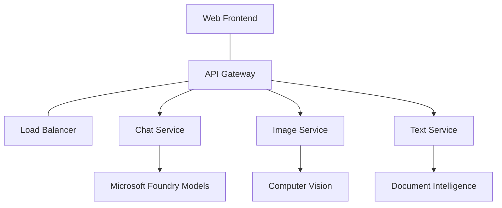

# Лучшие практики для производительных AI нагрузок с AZD

**Навигация по главам:**
- **📚 Домашняя страница курса**: [AZD для начинающих](../../README.md)
- **📖 Текущая глава**: Глава 8 - Производственные и корпоративные шаблоны
- **⬅️ Предыдущая глава**: [Глава 7: Поиск и устранение неисправностей](../chapter-07-troubleshooting/debugging.md)
- **⬅️ Также связанные**: [AI Workshop Lab](../chapter-02-ai-development/ai-workshop-lab.md)
- **🎯 Курс завершён**: [AZD для начинающих](../../README.md)

## Обзор

В этом руководстве объясняются шаблоны проектирования производственного AI с использованием Azure Developer CLI (AZD). Это справочник по проектированию, а не готовое к развертыванию приложение или сертификация для производства.

**Примерные границы:** Если явно не указано, что является завершённым, фрагменты Bicep предполагают параметры и ссылающиеся ресурсы из содержащего шаблона. Они опускают изображения/планы хоста, идентичности, назначения ролей, DNS, выходные данные и другую необходимую интеграцию. Пути сервисов YAML и сценарии хука/теста — это иллюстративные файлы для создания в **вашем собственном приложении**; они не предоставляются в этом курсе. Используйте работающий пример AZD как основу, скомпилируйте полную инфраструктуру и протестируйте её в изолированной среде перед запуском в производство.

## Основные решаемые задачи

Общие проблемы в производстве включают развертывания с несколькими сервисами, управление идентификацией и секретами, масштабирование, контроль затрат и мониторинг. Здесь не указывается измеренное распространение.

## Архитектурные шаблоны для производственного AI

### Шаблон 1: Архитектура AI на основе микросервисов

**Когда использовать**: Сложные AI-приложения с несколькими возможностями



**Реализация в AZD**:

```yaml
# azure.yaml
name: enterprise-ai-platform
services:
  web:
    project: ./web
    host: staticwebapp
  api-gateway:
    project: ./api-gateway
    host: containerapp
  chat-service:
    project: ./services/chat
    host: containerapp
  vision-service:
    project: ./services/vision
    host: containerapp
  text-service:
    project: ./services/text
    host: containerapp
```

### Шаблон 2: Событийно-ориентированная обработка AI

**Когда использовать**: Пакетная обработка, анализ документов, асинхронные рабочие процессы

```bicep
// Event Hub for AI processing pipeline
resource eventHub 'Microsoft.EventHub/namespaces@2024-01-01' = {
  name: eventHubNamespaceName
  location: location
  sku: {
    name: 'Standard'
    tier: 'Standard'
    capacity: 1
  }
}

// Service Bus for reliable message processing
resource serviceBus 'Microsoft.ServiceBus/namespaces@2024-01-01' = {
  name: serviceBusNamespaceName
  location: location
  sku: {
    name: 'Premium'
    tier: 'Premium'
    capacity: 1
  }
}

// Function App for processing
resource functionApp 'Microsoft.Web/sites@2023-01-01' = {
  name: functionAppName
  location: location
  kind: 'functionapp,linux'
  properties: {
    siteConfig: {
      appSettings: [
        {
          name: 'FUNCTIONS_EXTENSION_VERSION'
          value: '~4'
        }
        {
          name: 'AZURE_OPENAI_ENDPOINT'
          value: '@Microsoft.KeyVault(VaultName=${keyVault.name};SecretName=openai-endpoint)'
        }
      ]
    }
  }
}
```

Это создает фрагменты пространства имён, а не хабы, очереди, подписки или триггеры Function. Рабочей функции также нужен хостинг-план, конфигурация времени выполнения/хранения, присоединённая идентичность, RBAC и сетевой доступ. Ссылка на Key Vault требует разрешения на чтение секрета; сама URL конечной точки не является учетными данными.

## Рассуждения о состоянии AI-агента

Когда традиционное веб-приложение ломается, симптомы знакомы: страница не загружается, API возвращает ошибку или развертывание неудачно. AI-приложения могут ломаться всеми этими способами — но также могут работать некорректно более тонкими способами, которые не вызывают очевидных сообщений об ошибках.

Этот раздел помогает выстроить ментальную модель мониторинга AI-рабочих нагрузок, чтобы вы знали, куда смотреть, когда что-то идет не так.

### Чем здоровье агента отличается от здоровья традиционного приложения

Традиционные приложения также могут иметь тонкие ошибки корректности. AI-агент добавляет недетерминированное качество ответов к обычным проблемам доступности и корректности. Рассматривайте здоровье агента по двум уровням:

| Уровень | За чем следить | Где смотреть |
|---------|----------------|-------------|
| **Здоровье инфраструктуры** | Сервис работает? Ресурсы доступны? Конечные точки доступны? | `azd monitor`, состояние ресурсов в Azure Portal, журналы контейнеров/приложений |
| **Здоровье поведения** | Агент отвечает точно? Ответы своевременны? Модель вызывается корректно? | трассировки Application Insights, метрики задержки вызовов модели, журналы качества ответов |

Здоровье инфраструктуры знакомо — оно одинаково для любого приложения azd. Здоровье поведения — новый уровень, который вводят AI нагрузочные задачи.

### Куда смотреть, если AI-приложения ведут себя не так, как ожидалось

Если ваше AI-приложение не даёт ожидаемых результатов, вот концептуальный чек-лист:

1. **Начните с основ.** Работает ли приложение? Может ли оно получить доступ к своим зависимостям? Проверьте `azd monitor` и состояние ресурсов, как для любого приложения.
2. **Проверьте подключение к модели.** Успешно ли ваше приложение вызывает AI-модель? Неудачные или тайм-аут вызовы модели — самая частая причина проблем AI-приложений и будут отображаться в логах приложения.
3. **Безопасно проверьте ввод и основы.** Неправильные ответы могут быть вызваны ошибочным поиском, инструкциями, ограничениями модели или выполнением инструментов. Используйте контролируемые по доступу, редактированные диагностические данные; не включайте произвольное логирование подсказок/ответов в продакшне.
4. **Проверьте задержку ответа.** Вызовы AI-модели медленнее типичных API-вызовов. Если приложение кажется медленным, проверьте, увеличилось ли время ответа модели — это может указывать на ограничение, пределы пропускной способности или региональные задержки.
5. **Следите за признаками затрат.** Неожиданные всплески использования токенов или API-вызовов могут свидетельствовать о циклах, неправильной настройке подсказок или избыточных повторных попытках.

Не нужно сразу осваивать инструменты наблюдаемости. Главное — AI-приложения имеют дополнительный уровень поведения для мониторинга, и встроенный мониторинг azd (`azd monitor`) даёт отправную точку для изучения обоих уровней.

---

## Лучшие практики безопасности

### 1. Модель безопасности Zero-Trust

**Стратегия реализации**:
- Без коммуникации между сервисами без аутентификации
- Все вызовы API используют управляемые идентичности
- Сетевая изоляция с помощью приватных конечных точек
- Контроль доступа с минимальными привилегиями

```bicep
// Managed Identity for each service
resource chatServiceIdentity 'Microsoft.ManagedIdentity/userAssignedIdentities@2023-01-31' = {
  name: 'chat-service-identity'
  location: location
}

// Role assignments with minimal permissions
resource openAIUserRole 'Microsoft.Authorization/roleAssignments@2022-04-01' = {
  scope: openAIAccount
  name: guid(openAIAccount.id, chatServiceIdentity.id, '5e0bd9bd-7b93-4f28-af87-19fc36ad61bd')
  properties: {
    roleDefinitionId: subscriptionResourceId('Microsoft.Authorization/roleDefinitions', '5e0bd9bd-7b93-4f28-af87-19fc36ad61bd')
    principalId: chatServiceIdentity.properties.principalId
    principalType: 'ServicePrincipal'
  }
}
```

### 2. Безопасное управление секретами

**Шаблон интеграции с Key Vault**:

```bicep
// Key Vault with proper access policies
resource keyVault 'Microsoft.KeyVault/vaults@2023-02-01' = {
  name: keyVaultName
  location: location
  properties: {
    tenantId: tenant().tenantId
    sku: {
      family: 'A'
      name: 'standard' // Premium is needed for HSM-backed keys, not ordinary secrets
    }
    enableRbacAuthorization: true  // Use RBAC instead of access policies
    enablePurgeProtection: true    // Prevent accidental deletion
    enableSoftDelete: true
    softDeleteRetentionInDays: 90
  }
}

// Optional legacy key-auth alternative; omit when using Entra ID.
resource openAIKeySecret 'Microsoft.KeyVault/vaults/secrets@2023-02-01' = {
  parent: keyVault
  name: 'openai-api-key'
  properties: {
    value: openAIAccount.listKeys().key1
    attributes: {
      enabled: true
    }
  }
}
```

Назначьте идентичность времени выполнения `Key Vault Secrets User` в соответствующей области и прикрепите её к хосту; `enableRbacAuthorization` сама по себе не предоставляет доступа. Предпочитайте аутентификацию управляемой идентичности OpenAI с использованием `disableLocalAuth: true`. Опциональный ключ секрета имеет смысл только для сознательно включённого аккаунта с ключом, и главному субъекту предложения также нужно разрешение на запись секретов.

### 3. Сетевая безопасность

**Настройка приватных конечных точек**:

```bicep
// Virtual Network for AI services
resource virtualNetwork 'Microsoft.Network/virtualNetworks@2023-04-01' = {
  name: vnetName
  location: location
  properties: {
    addressSpace: {
      addressPrefixes: ['10.0.0.0/16']
    }
    subnets: [
      {
        name: 'ai-services-subnet'
        properties: {
          addressPrefix: '10.0.1.0/24'
          privateEndpointNetworkPolicies: 'Disabled'
        }
      }
      {
        name: 'app-services-subnet'
        properties: {
          addressPrefix: '10.0.2.0/24'
          delegations: [
            {
              name: 'Microsoft.Web/serverFarms'
              properties: {
                serviceName: 'Microsoft.Web/serverFarms'
              }
            }
          ]
        }
      }
    ]
  }
}

// Private endpoints for all AI services
resource openAIPrivateEndpoint 'Microsoft.Network/privateEndpoints@2023-04-01' = {
  name: '${openAIAccountName}-pe'
  location: location
  properties: {
    subnet: {
      id: virtualNetwork.properties.subnets[0].id
    }
    privateLinkServiceConnections: [
      {
        name: 'openai-connection'
        properties: {
          privateLinkServiceId: openAIAccount.id
          groupIds: ['account']
        }
      }
    ]
  }
}
```

Приватные конечные точки также требуют групп приватных DNS-зон/связей VNet и интеграции приложения с VNet. Они не блокируют публичный доступ автоматически: явно отключайте публичный сетевой доступ аккаунта AI после проверки приватной связи и доступа развертывания.

## Производительность и масштабирование

### 1. Стратегии автосcaling

**Автоматическое масштабирование Container Apps**:

```bicep
resource containerApp 'Microsoft.App/containerApps@2023-05-01' = {
  name: containerAppName
  location: location
  properties: {
    configuration: {
      ingress: {
        external: true
        targetPort: 8000
        transport: 'http'
      }
    }
    template: {
      scale: {
        minReplicas: 2  // Always have 2 instances minimum
        maxReplicas: 50 // Scale up to 50 for high load
        rules: [
          {
            name: 'http-scaling'
            http: {
              metadata: {
                concurrentRequests: '20'  // Scale when >20 concurrent requests
              }
            }
          }
          {
            name: 'cpu-scaling'
            custom: {
              type: 'cpu'
              metadata: {
                type: 'Utilization'
                value: '70'  // Scale when CPU >70%
              }
            }
          }
        ]
      }
    }
  }
}
```

### 2. Стратегии кэширования

**Redis Cache для AI ответов**:

```bicep
// Legacy Azure Cache for Redis example (not recommended for new deployments)
resource redisCache 'Microsoft.Cache/redis@2023-04-01' = {
  name: redisCacheName
  location: location
  properties: {
    sku: {
      name: 'Premium'
      family: 'P'
      capacity: 1
    }
    enableNonSslPort: false
    minimumTlsVersion: '1.2'
    redisConfiguration: {
      'maxmemory-policy': 'allkeys-lru'
    }
    // Sharding distributes data; replication/failover provides availability.
    shardCount: 2
  }
}

// Cache configuration in application
var cacheConnectionString = '${redisCache.properties.hostName}:6380,password=${redisCache.listKeys().primaryKey},ssl=True,abortConnect=False'
```

Azure Cache for Redis Basic/Standard/Premium находится на [пути к снятию с эксплуатации](https://learn.microsoft.com/azure/azure-cache-for-redis/retirement-faq). Используйте Azure Managed Redis для новых проектов и его документированную конфигурацию SKU, идентичности и TLS, вместо копирования этого устаревшего ресурса в новую производственную систему. Строка подключения — нефункциональный заполнитель, а не учетные данные. Разделяйте ключи кеша по авторизации, модели/инструкциям и версии поиска с истечением срока; общий кеш только для запросов может раскрыть данные другого пользователя.

### 3. Балансировка нагрузки и управление трафиком

**Application Gateway с WAF**:

```bicep
// Application Gateway with Web Application Firewall
resource applicationGateway 'Microsoft.Network/applicationGateways@2023-04-01' = {
  name: appGatewayName
  location: location
  properties: {
    sku: {
      name: 'WAF_v2'
      tier: 'WAF_v2'
      capacity: 2
    }
    webApplicationFirewallConfiguration: {
      enabled: true
      firewallMode: 'Prevention'
      ruleSetType: 'OWASP'
      ruleSetVersion: '3.2'
    }
    // Backend pools for AI services
    backendAddressPools: [
      {
        name: 'ai-services-pool'
        properties: {
          backendAddresses: [
            {
              fqdn: '${containerApp.properties.configuration.ingress.fqdn}'
            }
          ]
        }
      }
    ]
  }
}
```

Это частичный ресурс шлюза: для реального развертывания также необходимы настройка подсети/IP шлюза, IP-адреса и порты фронтенда, TLS слушатели/сертификаты, настройки HTTP/пробы бэкенда, правила маршрутизации и приоритеты, а также проверенная политика WAF. Имя хоста/TLS SNI и аутентификация должны соответствовать бэкенду Container App.

## 💰 Оптимизация затрат

### 1. Правильный подбор ресурсов

**Конфигурации для конкретных окружений**:

Эти имена — **иллюстративные входы в настраиваемый шаблон**, а не автоматические настройки AZD. Сначала сопоставьте каждое с `infra/main.parameters.json`/Bicep и конфигурацией хоста. Например, пример RAG использует `AZURE_SEARCH_SERVICE_SKU` и `AZURE_OPENAI_CHATGPT_DEPLOYMENT_CAPACITY`, а не приведённые ниже общие имена. Укажите память Container Apps в поддерживаемой единице, такой как `1Gi`, в реальном ресурсе. Применяйте изменения инфраструктуры через `azd up` или `azd provision`; `azd deploy` сам по себе не применяет изменения Bicep.

```bash
# Development environment
azd env new development
azd env set AZURE_OPENAI_SKU "S0"
azd env set AZURE_OPENAI_CAPACITY 10
azd env set AZURE_SEARCH_SKU "basic"
azd env set CONTAINER_CPU 0.5
azd env set CONTAINER_MEMORY 1.0

# Production environment  
azd env new production
azd env set AZURE_OPENAI_SKU "S0"
azd env set AZURE_OPENAI_CAPACITY 100
azd env set AZURE_SEARCH_SKU "standard"
azd env set CONTAINER_CPU 2.0
azd env set CONTAINER_MEMORY 4.0
```

### 2. Мониторинг затрат и бюджеты

```bicep
// Supply the first day of the current UTC month, e.g. 2026-11-01T00:00:00Z.
param budgetStartDate string

// Cost management and budgets
resource budget 'Microsoft.Consumption/budgets@2024-08-01' = {
  name: 'ai-workload-budget'
  properties: {
    timePeriod: {
      startDate: budgetStartDate
    }
    timeGrain: 'Monthly'
    amount: 2000  // In the billing currency, not necessarily USD
    category: 'Cost'
    notifications: {
      warning: {
        enabled: true
        operator: 'GreaterThan'
        threshold: 80
        contactEmails: [
          'finance@company.com'
          'engineering@company.com'
        ]
        contactRoles: [
          'Owner'
          'Contributor'
        ]
      }
      critical: {
        enabled: true
        operator: 'GreaterThan'
        threshold: 95
        contactEmails: [
          'cto@company.com'
        ]
      }
    }
  }
}
```

Замените примерных получателей и проверьте область/разрешения. Оповещения бюджета используют данные с задержкой и не ограничивают расходы.

### 3. Оптимизация использования токенов

**Управление затратами OpenAI**:

Это только эвристика на основе символов для превью UI, **не** валидатор лимитов токенов модели. Производственный код должен использовать токенизатор, соответствующий развернутой модели, учитывать системные инструкции, схемы инструментов, историю и бюджет вывода. Отказывайте в приёме слишком больших пользовательских сообщений, а не обрезайте их молча.

```typescript
// Application-level token optimization
class TokenOptimizer {
  private readonly maxTokens = 4000;
  private readonly reserveTokens = 500;
  
  optimizePrompt(userInput: string, context: string): string {
    const availableTokens = this.maxTokens - this.reserveTokens;
    if (this.estimateTokens(userInput) + 8 >= availableTokens) {
      throw new Error("User input exceeds the illustrative prompt budget");
    }
    const estimatedTokens = this.estimateTokens(userInput + context) + 8;
    
    if (estimatedTokens > availableTokens) {
      // Truncate context, not user input
      context = this.truncateContext(context, Math.max(0, availableTokens - this.estimateTokens(userInput) - 8));
    }
    
    return `${context}\n\nUser: ${userInput}`;
  }
  
  private estimateTokens(text: string): number {
    // Rough estimation: 1 token ≈ 4 characters
    return Math.ceil(text.length / 4);
  }

  private truncateContext(text: string, estimatedBudget: number): string {
    return text.slice(0, Math.max(0, estimatedBudget) * 4);
  }
}
```

## Мониторинг и наблюдаемость

### 1. Всеобъемлющий Application Insights

```bicep
// Application Insights with advanced features
resource applicationInsights 'Microsoft.Insights/components@2020-02-02' = {
  name: applicationInsightsName
  location: location
  kind: 'web'
  properties: {
    Application_Type: 'web'
    WorkspaceResourceId: logAnalyticsWorkspace.id
    SamplingPercentage: 100  // Ingestion setting; review cost and SDK sampling separately
    DisableIpMasking: false  // Retain IP masking
  }
}

// Custom metrics for AI operations
resource aiMetricAlerts 'Microsoft.Insights/metricAlerts@2018-03-01' = {
  name: 'ai-high-error-rate'
  location: 'global'
  properties: {
    description: 'Alert when failed request count exceeds 10 in five minutes'
    severity: 2
    enabled: true
    scopes: [
      applicationInsights.id
    ]
    evaluationFrequency: 'PT1M'
    windowSize: 'PT5M'
    criteria: {
      'odata.type': 'Microsoft.Azure.Monitor.SingleResourceMultipleMetricCriteria'
      allOf: [
        {
          name: 'high-error-rate'
          metricName: 'requests/failed'
          operator: 'GreaterThan'
          threshold: 10
          timeAggregation: 'Count'
        }
      ]
    }
  }
}
```

### 2. Специфичный для AI мониторинг

**Пользовательские панели для метрик AI**:

```json
{
  "dashboard": {
    "name": "AI Application Monitoring",
    "tiles": [
      {
        "name": "OpenAI Request Volume",
        "query": "dependencies | where target contains 'openai' | summarize count() by bin(timestamp, 5m)"
      },
      {
        "name": "AI Response Latency",
        "query": "dependencies | where target contains 'openai' | summarize avg(duration) by bin(timestamp, 5m)"
      },
      {
        "name": "Token Usage",
        "query": "customMetrics | where name == 'openai_tokens_used' | summarize sum(value) by bin(timestamp, 1h)"
      },
      {
        "name": "Cost per Hour",
        "query": "customMetrics | where name == 'openai_cost' | summarize sum(value) by bin(timestamp, 1h)"
      }
    ]
  }
}
```

Этот JSON — это эскиз, определённый приложением, а не импортируемая схема панели Azure portal. Запросы токенов/затрат требуют, чтобы приложение испускало именно эти пользовательские метрики; они не создаются AZD. Адаптируйте фильтры зависимостей для ваших реальных имён конечных точек/спанов модели.

### 3. Проверки здоровья и мониторинг доступности

```bicep
// Application Insights availability tests
resource availabilityTest 'Microsoft.Insights/webtests@2022-06-15' = {
  name: 'ai-app-availability-test'
  location: location
  tags: {
    'hidden-link:${applicationInsights.id}': 'Resource'
  }
  properties: {
    SyntheticMonitorId: 'ai-app-availability-test'
    Name: 'AI Application Availability Test'
    Description: 'Tests AI application endpoints'
    Enabled: true
    Frequency: 300  // 5 minutes
    Timeout: 120    // 2 minutes
    Kind: 'standard'
    Locations: [
      {
        Id: 'us-east-2-azr'
      }
      {
        Id: 'us-west-2-azr'
      }
    ]
    Request: {
      RequestUrl: 'https://${webApp.properties.defaultHostName}/health'
      HttpVerb: 'GET'
      FollowRedirects: true
      ParseDependentRequests: false
    }
    ValidationRules: {
      ExpectedHttpStatusCode: 200
      SSLCheck: true
      SSLCertRemainingLifetimeCheck: 7
    }
  }
}
```

## Восстановление после сбоев и высокая доступность

Предыдущий тест предполагает наличие существующего App Service `webApp` и ресурса Application Insights. Стандартные тесты доступности являются платными и требуют достижимой конечной точки; приложения с доступом только через приватную сеть требуют соответствующего приватного дизайна мониторинга. URL ping тесты устарели; используйте [стандартные тесты доступности](https://learn.microsoft.com/azure/azure-monitor/app/availability).

### 1. Развертывание в нескольких регионах

```yaml
# azure.yaml - Multi-region configuration
name: ai-app-multiregion
services:
  api-primary:
    project: ./api
    host: containerapp
    env:
      AZURE_REGION: eastus
  api-secondary:
    project: ./api
    host: containerapp
    env:
      AZURE_REGION: westus2
```

```bicep
// Separate App Service topology, not the Container Apps declarations above
resource trafficManager 'Microsoft.Network/trafficManagerProfiles@2022-04-01' = {
  name: trafficManagerProfileName
  location: 'global'
  properties: {
    profileStatus: 'Enabled'
    trafficRoutingMethod: 'Priority'
    dnsConfig: {
      relativeName: trafficManagerProfileName
      ttl: 30
    }
    monitorConfig: {
      protocol: 'HTTPS'
      port: 443
      path: '/health'
      intervalInSeconds: 30
      toleratedNumberOfFailures: 3
      timeoutInSeconds: 10
    }
    endpoints: [
      {
        name: 'primary-endpoint'
        type: 'Microsoft.Network/trafficManagerProfiles/azureEndpoints'
        properties: {
          targetResourceId: primaryAppService.id
          endpointStatus: 'Enabled'
          priority: 1
        }
      }
      {
        name: 'secondary-endpoint'
        type: 'Microsoft.Network/trafficManagerProfiles/azureEndpoints'
        properties: {
          targetResourceId: secondaryAppService.id
          endpointStatus: 'Enabled'
          priority: 2
        }
      }
    ]
  }
}
```

Переменные окружения не выбирают геолокации ресурсов. IaC должен создавать отдельные региональные хосты и связывать каждый сервис с помощью тегов `resourceName` или `azd-service-name`. Пример Traffic Manager — это **отдельная топология App Service** (`primaryAppService`/`secondaryAppService`), а не маршрутизация для объявлений Container Apps. Container Apps требует надлежащим образом настроенной внешней конечной точки/front door, маршрутизации TLS/пользовательских доменов и проверок здоровья.

### 2. Резервное копирование и восстановление данных

```bicep
// Backup configuration for critical data
resource backupVault 'Microsoft.DataProtection/backupVaults@2023-05-01' = {
  name: backupVaultName
  location: location
  identity: {
    type: 'SystemAssigned'
  }
  properties: {
    storageSettings: [
      {
        datastoreType: 'VaultStore'
        type: 'LocallyRedundant'
      }
    ]
  }
}

```

Сам по себе хранилище не выполняет резервное копирование. Настройте **специфичную для нагрузки поддерживаемую политику и экземпляр резервного копирования**, разрешения источников, хранение и тесты восстановления с использованием [матриц поддержки Azure Backup](https://learn.microsoft.com/azure/backup/backup-support-matrix). Нет универсальной политики Azure Backup для развертываний Azure OpenAI моделей. Храните определения инфраструктуры/моделей в системе контроля версий; защищайте загруженные документы, данные приложения и артефакты дообучения с помощью поддерживаемых каждым сервисом функций резервного копирования/экспорта. Ясно определите и протестируйте RPO/RTO.

## Интеграция DevOps и CI/CD

### 1. GitHub Actions Workflow

```yaml
# .github/workflows/deploy-ai-app.yml
name: Deploy AI Application

on:
  push:
    branches: [main]
  pull_request:
    branches: [main]

jobs:
  test:
    runs-on: ubuntu-latest
    steps:
      - uses: actions/checkout@v4
      
      - name: Setup Python
        uses: actions/setup-python@v4
        with:
          python-version: '3.11'
          
      - name: Install dependencies
        run: |
          pip install -r requirements.txt
          pip install pytest
          
      - name: Run tests
        run: pytest tests/
        
      - name: AI Safety Tests
        run: |
          python scripts/test_ai_safety.py
          python scripts/validate_prompts.py

```

Это **только тестовая часть** workflow и предполагает, что вы создали `requirements.txt`, `tests/` и два скрипта безопасности. Добавьте аутентифицированные задания предоставления/развертывания OIDC из [конфигурации CI/CD Pipeline](#cicd-pipeline-configuration) с `needs: test`, доверенным push/ручным запуском и защищёнными средами GitHub. Не развертывайте недоверенный код pull request с облачными учетными данными. Чистый раннер не имеет выбранного локального окружения AZD; укажите входные данные окружения/подписки/локации и используйте `azd auth login`, а не просто `azure/login`.

### 2. Проверка инфраструктуры

```bash
# scripts/validate_infrastructure.sh
#!/bin/bash
set -euo pipefail

echo "Validating AI infrastructure deployment..."

# Requires Azure CLI login and the resource group selected explicitly.
: "${AZURE_RESOURCE_GROUP:?Set AZURE_RESOURCE_GROUP}"
: "${AZURE_OPENAI_NAME:?Set AZURE_OPENAI_NAME}"
: "${AZURE_OPENAI_CHAT_DEPLOYMENT:?Set the actual deployment name}"

# A successful empty list is not proof that resources exist.
types=("Microsoft.CognitiveServices/accounts" "Microsoft.Search/searchServices"
       "Microsoft.Storage/storageAccounts" "Microsoft.KeyVault/vaults")
for resource_type in "${types[@]}"; do
    count=$(az resource list --resource-group "$AZURE_RESOURCE_GROUP" \
        --resource-type "$resource_type" --query "length(@)" -o tsv)
    if [[ "$count" -lt 1 ]]; then
        echo "ERROR: No $resource_type found in $AZURE_RESOURCE_GROUP"
        exit 1
    fi
done

# Validate OpenAI model deployments
echo "Validating OpenAI model deployments..."
state=$(az cognitiveservices account deployment show \
  --name "$AZURE_OPENAI_NAME" --resource-group "$AZURE_RESOURCE_GROUP" \
  --deployment-name "$AZURE_OPENAI_CHAT_DEPLOYMENT" \
  --query "properties.provisioningState" -o tsv)
if [[ "$state" != "Succeeded" ]]; then
    echo "ERROR: Required model deployment is not provisioned successfully"
    exit 1
fi

echo "Infrastructure validation completed successfully!"
```

Ожидается: нулевой выход и сообщение о завершении только если все ожидаемые типы существуют и указанное развертывание модели выполнено. Проверяет состояние инвентаризации/предоставления, **не** здоровье ресурсов, точную топологию, RBAC, сетевую доступность или поведение модели. Адаптируйте ожидаемые типы под вашу архитектуру, затем выполните отдельный аутентифицированный тест готовности приложения.

## Чек-лист готовности к производству

### Безопасность ✅
- [ ] Все сервисы используют управляемые идентичности
- [ ] Секреты хранятся в Key Vault
- [ ] Приватные конечные точки настроены
- [ ] Группы сетевой безопасности реализованы
- [ ] RBAC с минимальными привилегиями
- [ ] WAF включён на публичных конечных точках

### Производительность ✅
- [ ] Настроено автоматическое масштабирование
- [ ] Реализовано кэширование
- [ ] Настроена балансировка нагрузки
- [ ] CDN для статического контента
- [ ] Пул соединений с базой данных
- [ ] Оптимизация использования токенов

### Мониторинг ✅
- [ ] Настроен Application Insights
- [ ] Определены пользовательские метрики
- [ ] Настроены правила оповещений
- [ ] Создана панель мониторинга
- [ ] Реализованы проверки здоровья
- [ ] Политики хранения журналов

### Надежность ✅
- [ ] Развертывание в нескольких регионах
- [ ] План резервного копирования и восстановления
- [ ] Реализованы предохранители
- [ ] Настроены политики повторных попыток
- [ ] Плавное деградирование
- [ ] Конечные точки проверки здоровья

### Управление затратами ✅
- [ ] Настроены оповещения бюджета
- [ ] Правильный подбор ресурсов
- [ ] Применены скидки для разработки/тестирования
- [ ] Куплены резервированные инстансы
- [ ] Панель мониторинга затрат
- [ ] Регулярные обзоры затрат

### Соответствие требованиям ✅
- [ ] Выполнены требования к размещению данных
- [ ] Включено аудитное логирование
- [ ] Применены политики соответствия
- [ ] Реализованы базовые меры безопасности
- [ ] Регулярные оценки безопасности
- [ ] План реагирования на инциденты

## Эталонные показатели производительности

### Иллюстративные производственные цели

Это примерные SLO для переговоров и нагрузочного тестирования, а не измеренные показатели или гарантии. Задержка ответа зависит от модели/длины вывода; ежемесячные затраты на токены зависят от трафика и цен, а не только от количества токенов.

| Метрика | Цель | Мониторинг |
|---------|-------|-----------|
| **Время ответа** | < 2 секунды | Application Insights |
| **Доступность** | 99.9% | Мониторинг времени работы |
| **Уровень ошибок** | < 0.1% | Журналы приложений |
| **Расходы на модели** | < 500 $/месяц (примерный бюджет) | Управление затратами |
| **Одновременные пользователи** | 1000+ | Нагрузочное тестирование |
| **Время восстановления** | < 1 час | Тесты аварийного восстановления |

### Нагрузочное тестирование

Ниже представлен набросок интерфейса для скрипта нагрузочного тестирования, **который вы должны реализовать**; в этом репозитории `scripts/load_test.py` не предоставляется. Определите полезные нагрузки запросов, аутентификацию, репрезентативные рабочие нагрузки, утверждения по процентилям задержки/ошибок и лимит расходов в выбранном вами инструменте нагрузочного тестирования перед его запуском:

```bash
# Load testing script for AI applications
python scripts/load_test.py \
  --endpoint https://your-ai-app.azurewebsites.net \
  --concurrent-users 100 \
  --duration 300 \
  --ramp-up 60
```

## 🤝 Лучшие практики сообщества

На основе отзывов сообщества Microsoft Foundry Discord:

### Основные рекомендации сообщества:

1. **Начинайте с малого, масштабируйтесь постепенно**: начинать с базовых SKU и масштабировать исходя из фактического использования
2. **Отслеживайте всё**: настройте комплексный мониторинг с первого дня
3. **Автоматизируйте безопасность**: используйте инфраструктуру как код для обеспечения последовательной безопасности
4. **Тестируйте тщательно**: включайте AI-специфические тесты в ваш конвейер
5. **Планируйте расходы**: отслеживайте использование токенов и заранее устанавливайте бюджетные оповещения

### Частые ошибки, которых следует избегать:

- ❌ Жёсткое кодирование API-ключей в коде
- ❌ Отсутствие настройки правильного мониторинга
- ❌ Игнорирование оптимизации расходов
- ❌ Не тестирование сценариев отказа
- ❌ Развертывание без проверок состояния

## Команды и расширения AZD AI CLI

AZD включает растущий набор AI-специфичных команд и расширений, которые упрощают производственные AI-рабочие процессы. Эти инструменты служат мостом между локальной разработкой и производственным развертыванием AI-решений.

> **Обзор релиза (2026-11-04):** Руководство по CLI ниже проверено на соответствие опубликованным версиям `azd` **1.37.2**, `azure.ai.agents` **1.0.0-beta.23** и `azure.ai.evaluations` **1.0.0-beta.2**. Агентам beta.23 требуется `azd >= 1.37.0`; оценкам beta.2 требуется `azd >= 1.33.0`. Используйте минимум версию 1.37.0 для совместного рабочего процесса. Это обзор документации/исходников, не проверка живого развертывания Azure.

### Расширения AZD для AI

AZD использует систему расширений для добавления AI-специфичных возможностей. Устанавливайте и управляйте расширениями с помощью:

```bash
# List all available extensions (including AI)
azd extension list

# Inspect installed extension details
azd version
azd extension show azure.ai.agents

# Install the Foundry agents extension
azd extension install azure.ai.agents

# Install the separate Foundry evaluations extension
azd extension install azure.ai.evaluations

# Install the fine-tuning extension
azd extension install azure.ai.finetune

# Install the custom models extension
azd extension install azure.ai.models

# Upgrade all installed extensions
azd extension upgrade --all
```

**Доступные AI-расширения:**

| Расширение | Назначение | Статус |
|-----------|------------|--------|
| `azure.ai.agents` | Управление службой Foundry Agent | Предварительный просмотр |
| `azure.ai.evaluations` | Наборы данных оценок, оценщики, группы оценки и запуски | Предварительный просмотр |
| `azure.ai.skills` | Повторно используемые навыки агентов | Предварительный просмотр |
| `azure.ai.connections` | Подключения Foundry (источники данных, инструменты) | Предварительный просмотр |
| `azure.ai.finetune` | Тонкая настройка моделей Foundry | Предварительный просмотр |
| `azure.ai.models` | Пользовательские модели Foundry | Предварительный просмотр |
| `azure.coding-agent` | Конфигурация кодирующего агента | Доступно |

> Запустите `azd extension list --installed` и `azd extension show azure.ai.evaluations`, чтобы проверить установленные версии. Сначала обновите основной CLI согласно [инструкциям по установке/обновлению](https://learn.microsoft.com/azure/developer/azure-developer-cli/install-azd) (для установки в Windows через winget: `winget upgrade Microsoft.Azd`), затем выполните `azd extension upgrade --all`. Команды `azd upgrade` в ядре CLI нет. Перед обновлением производственной автоматизации изучите важные изменения; не предполагайте, что обновление расширения сохранит старые форматы команд или конфигурации.

### Недавние изменения и исправления в релизах

| Релиз | Изменения для этого курса |
|--------|--------------------------|
| `azd 1.37.0` | Добавлены стабильные API для preview-развертывания и исправлены изменения расширений, которые переписывали несвязанные настройки `azure.yaml`. |
| `azd 1.37.1` | Исправлена передача Ctrl+C через расширения и различие между отменой/таймаутом и общими ошибками. |
| `azd 1.37.2` | Улучшена проверка подготовки: критические предупреждения по умолчанию в **Нет**, в безнадзорных запусках завершают с ошибкой без подтверждения, отмена пропускает пост-подготовительные хуки. Также исправлены неразрешённые значения окружения в списках отказа Deployment Stacks при включенной альфа-функции. |
| Агентам `beta.22` | Перенос оценки на `azd ai eval`, изменение оптимизации на GA v1 API, требование к плюрализации `toolboxes`, отделение managed-harness, голосовых и долгосрочных preview-опций. Исправлен выбор модели по окружению и аутентификация в toolbox. |
| Агентам `beta.23` | Открыт доступ к `init --harness`; исправлен вывод ответов A2A 0.3, неверные пути/модули prompt-agent в инфраструктуре, диагностика таймаута активации и сохранённые предупреждения RBAC разработчика. |
| Оценкам `beta.2` | Требуется конфигурация с camelCase, добавлено статическое/симуляционное создание разговоров и явные локальные источники файлов, исправлено управление идентичностью/версией наборов данных, подсчёт quality-gate и диагностика неудачных запусков. |

Таймаут активации агента **не** означает ошибку развертывания: проверьте версию и её состояние перед повторной попыткой. Предупреждения RBAC для разработчика могут сохраняться даже при успешном развертывании; решите проблему с доступом до вызова от имени этого разработчика.

Источники: [релизы AZD](https://github.com/Azure/azure-dev/releases), [релиз агентов beta.23](https://github.com/Azure/azure-dev/releases/tag/azd-ext-azure-ai-agents_1.0.0-beta.23), [миграция агентов beta.22](https://github.com/Azure/azure-dev/releases/tag/azd-ext-azure-ai-agents_1.0.0-beta.22) и [релиз оценок beta.2](https://github.com/Azure/azure-dev/releases/tag/azd-ext-azure-ai-evaluations_1.0.0-beta.2).

**Что такое новые расширения `skills` и `connections`?**

Два расширения в превью появились вместе с инструментами агентов и стоит понимать их даже новичкам:

- **`azure.ai.skills`** — **Навык** — это повторно используемая способность (упакованный инструмент или поведение), которую вы можете прикрепить к одному или нескольким агентам вместо повторной реализации. Это как общий строительный блок: один раз определите навык "поиск в документации" или "поиск заказа" и используйте его у разных агентов. Это поддерживает согласованность в мультиагентных системах (Глава 5) и избегает дублирования.
- **`azure.ai.connections`** — **Подключение** — управляемая ссылка из вашего проекта Foundry к внешнему ресурсу, необходимому агентам — источник данных (например, Azure AI Search), конечная точка инструмента или другой сервис. Подключения централизуют *где* и *как* агенты обращаются к данным, поэтому учетные данные и конечные точки живут в одном управляемом месте, а не разбросаны по коду.

Эти расширения не нужны для развертывания первых агентов — придерживайтесь `azure.ai.agents` пока учитесь. Используйте `skills`, когда дублируете один инструмент у нескольких агентов, и `connections`, когда несколько агентов используют один источник данных.

### Инициализация проектов агентов с `azd ai agent init`

Команда `azd ai agent init` создает заготовку проекта агента Microsoft Foundry. Используйте актуальный шаблон проекта `azure.yaml`, а не устаревший неявный манифест агента:

```bash
# Initialize a new agent project from a local project template
azd ai agent init --template ./templates/support-agent/azure.yaml

# Initialize and target a specific Foundry project
azd ai agent init --template ./templates/support-agent/azure.yaml --project-id <foundry-project-id>

# Adopt the template into a different directory
azd ai agent init --template ./templates/support-agent/azure.yaml --src ./agents/my-agent
```

**Основные флаги:**

| Флаг | Описание |
|-------|-----------|
| `-t, --template` | Путь или поддерживаемый URI GitHub к документу проекта `azure.yaml` |
| `-p, --project-id` | Существующий идентификатор проекта Microsoft Foundry для вашей среды azd |
| `-s, --src` | Исходный каталог для сгенерированных агентов или целевой каталог при принятии проекта |
| `--kind` | Инициализация агента `hosted`, `prompt` или preview `prompt-voice` |
| `--harness` | Опциональная среда выполнения для `--kind prompt`; требует опции превью |
| `-e, --environment` | Используемая среда azd |

`--manifest`/`-m` — устаревший псевдоним для `--template`/`-t`; переименование флага не конвертирует старый манифест в текущий проектный документ. `--host containerapp` не является текущим флагом agent-init. Для обычного приложения Container Apps используйте `azd init --template` с шаблоном, объявляющим `host: containerapp`.

Для существующего проекта с ровно одной службой `azure.ai.project`, `azd ai agent add support-agent --file ./agents/support-agent.yaml` добавляет или обновляет прямое определение агента без подготовки или развертывания. Команды времени выполнения отвергают устаревшие неявные определения `agent.yaml`/AgentManifest и вложенных сервисных `config:`; мигрируйте их в текущую службу `azure.ai.agent`. Когда init выводит следующий шаг `cd`, выполните его перед `azd up`: init не меняет текущий каталог оболочки.

**Совет для продакшена**: используйте `--project-id` для прямого подключения к существующему проекту Foundry, чтобы с самого начала связывать ваш код агента и облачные ресурсы.

#### Опциональные функции превью

Управляемая среда выполнения, голос и долгоиграющие вызовы по умолчанию отключены независимо друг от друга. Устанавливайте переключатель только для нужной функции в **окружении процесса оболочки/CI**, а не через `azd env set`:

| Функция | Переменная окружения процесса |
|----------|-------------------------------|
| Управляемая среда (`init --kind prompt --harness ...`) | `AZD_ALPHA_ENABLE_AGENTS_MANAGED_HARNESS=true` |
| Голос (`init --kind prompt-voice`) | `AZD_ALPHA_ENABLE_AGENTS_VOICE=true` |
| Долгоиграющие вызовы | `AZD_ALPHA_ENABLE_AGENTS_LONG_RUNNING=true` |

Например, используйте `export AZD_ALPHA_ENABLE_AGENTS_MANAGED_HARNESS=true` в Bash или `$env:AZD_ALPHA_ENABLE_AGENTS_MANAGED_HARNESS = "true"` в PowerShell перед выполнением соответствующей команды. Один переключатель не включает другие. См. [README выпущенных агентов](https://github.com/Azure/azure-dev/blob/azd-ext-azure-ai-agents_1.0.0-beta.23/cli/azd/extensions/azure.ai.agents/README.md) для всех превью-переключателей и ограничений.

### Управление жизненным циклом агента

Используйте `azure.ai.agents` для тестирования, инспекции, оптимизации и вывода из эксплуатации агентов, и отдельное расширение `azure.ai.evaluations` для измерения качества:

```bash
# Invoke a deployed agent and view server response timing
# (total latency and time to first byte)
azd ai agent invoke

# Show the live endpoint configuration before changing it
azd ai agent endpoint show

# Download the deployed source of a code-based hosted agent
# (with SHA-256 verification)
azd ai agent code download

# Delete a hosted agent and all of its versions
# (--force terminates active sessions)
azd ai agent delete --force
```

**Жизненный цикл вкратце:**

| Этап | Команда | Использование в продакшене |
|-------|---------|---------------------------|
| Тест | `azd ai agent invoke` | Проверка ответов и измерение задержки перед выпуском |
| Инспекция | `azd ai agent endpoint show` | Просмотр аутентификации/конфигурации конечной точки; раннее выявление критических изменений |
| Измерение | `azd ai eval init`, `generate`, `run start` | Определение, развертывание и выполнение повторяемых оценок |
| Улучшение | `azd ai agent optimize --eval <evaluation-name> --optimize-model <optimizer-deployment>` | Повторное использование совместимой оценки для оптимизации агента |
| Восстановление | `azd ai agent code download` | Получение точного развернутого исходного кода для аудита/отката |
| Снятие с эксплуатации | `azd ai agent delete --force` | Корректное удаление агента и его версий |

> Это команды превью и могут изменяться между релизами расширений. Выполните `azd ai agent --help`, чтобы увидеть доступные подкоманды в установленной версии.

`endpoint show` поддерживает хостинг, промпт и голосовых агентов, но обновления конечных точек доступны только для хостинг-агентов; агенты рабочих процессов не поддерживаются. Загрузка кода и приведённый выше пример снятия с эксплуатации хостинг-агента — не универсальные операции для всех типов агентов.

#### Миграция оценок и проверки качества

Начиная с версий агентов **1.0.0-beta.22 (2026-10-23)**, устаревшие команды `azd ai agent eval` предоставляют рекомендации по миграции вместо прежнего рабочего процесса оценки. Не копируйте старые примеры `eval generate --dataset ...`: оценки теперь находятся под **`azd ai eval`**.

В инициализированном проекте агента аутентифицируйтесь с `azd auth login`, подтвердите выбранную среду/проект Foundry и установите `azure.ai.evaluations`. Для модели судьи требуется развертывание; генерация и симуляция разговоров могут требовать отдельного выбора моделей и влечь дополнительные расходы.

```bash
# Scaffold evals/ and wire an azure.ai.eval service into azure.yaml
azd ai eval init

# Optionally synthesize a rubric and dataset from the agent
azd ai eval generate

# Review generated files, then register datasets, evaluators, and eval groups
azd up

# Start an evaluation and wait for its results
azd ai eval run start --wait

# Inspect runs and available test-case output
azd ai eval run list
azd ai eval run show <run-id>
azd ai eval run output list <run-id>
```

Следуйте интерактивному выбору и выводимым следующим шагам, не предполагая, что сгенерированные ресурсы уже зарегистрированы. Конфигурация оценки обычно находится в `evals/azure.eval.yaml`, на которую ссылается служба `azure.ai.eval` в `azure.yaml`. Ключи — **camelCase** (`evaluationLevel`, `maxSamples`, `initializationParameters`, `dataMapping`); старые ключи в snake_case отвергаются. Пути внутри ссылки конфигурации разрешаются относительно этого файла, а не корня репозитория.

Для оценок разговоров выберите **static** для оценки завершённых транскриптов без вызова агента или **simulation** для генерации разговоров из сценариев. Для симуляции нужны целевой агент, модель симулятора и отдельный выбор модели судьи. Для безнадзорных команд предоставьте входные данные, указанные `azd ai eval init --help` и `azd ai eval generate --help`; не предполагается, что модель генерации также является судьей или симулятором.

Для CI настройте явную политику качества с помощью `azd ai eval run start --help` (`--fail-on`) и считайте ненулевой выход хоста ошибкой. Завершённый запуск не гарантирует прохождение качества. Проверьте ошибочные/неудачные строки и диагностику; отсутствующие или несогласованные подсчёты результатов не означают успеха. Зарегистрированные наборы данных сохраняют свою идентичность/версию службы; `--max-samples` не может выделять подмножество зарегистрированного набора. Публикуйте меньший набор целенаправленно или используйте поддерживаемый локальный источник файлов.

```bash
# Example CI policy: at least 90% of all test cases must pass
azd ai eval run start --wait --fail-on "pass-rate=0.9"
```

Шлюз прохождения основан на числе пройденных тестов, делённом на общее число тестов; проваленные, ошибочные, пропущенные и иные непройденные учитываются против прохода. Не сочетайте шлюз с `--no-wait`, которая возвращает результат до доступности вердикта.

#### Миграция конфигурации оптимизации

Оптимизация теперь использует GA v1 API. Чтобы повторно использовать совместимую оценку **уровня хода, основанную на наборе данных** из нового рабочего процесса:

```bash
# Replace placeholders with the evaluation name and optimizer model deployment
azd ai agent optimize --eval-config ./evals/azure.eval.yaml --eval <evaluation-name> --optimize-model <optimizer-deployment>
```

`--eval` выбирает оценку; `--eval-config` выбирает её конфигурационный файл (включая определения на основе файлов). `--config` вместо этого принимает **автономный запрос к API оптимизации** в формате YAML или JSON. Не передавайте старого агента `eval.yaml` или нового `azure.eval.yaml` в `--config`, и не объединяйте `--config` с `--eval`/`--eval-config`. Оценки на основе беседы, трассировки или симуляции не взаимозаменяемы с оптимизацией на основе набора данных; используйте поддерживаемый формат запроса оптимизации для этих сценариев. Проверьте кандидатов перед применением или развертыванием.

См. [справочник по оценкам для рецензируемого релиза](https://github.com/Azure/azure-dev/blob/azd-ext-azure-ai-evaluations_1.0.0-beta.2/cli/azd/extensions/azure.ai.evaluations/README.md) и [исходный код команды оптимизации для рецензируемого релиза](https://github.com/Azure/azure-dev/blob/azd-ext-azure-ai-agents_1.0.0-beta.23/cli/azd/extensions/azure.ai.agents/internal/cmd/optimize.go) для точных опций.

#### Предварительный просмотр развертывания хостинга агента только для чтения

Для существующей среды, привязанной к Foundry, с унифицированным сервисом `azure.ai.agent` из `kind: hosted`, сравните поддерживаемую конфигурацию перед развертыванием:

```bash
azd deploy <service-name> --preview --no-prompt
```

Этот предварительный просмотр не развертывает агента. Это не полный diff по инфраструктуре/безопасности: агенты для запросов/голоса/рабочих процессов, устаревшие макеты конфигурации и некоторые настройки хостинга находятся вне его области. Результат `unknown` не является разрешением на развертывание. Нет автономной команды `azd ai agent deploy` или команды агента `--dry-run`; используйте основной рабочий процесс развертывания.

### Протокол контекста модели (MCP) с `azd mcp`

AZD включает встроенную поддержку MCP-сервера (альфа-версия), позволяющую AI-агентам и инструментам взаимодействовать с вашими ресурсами Azure через стандартизированный протокол:

```bash
# Start the MCP server for your project
azd mcp start

# Review current Copilot consent rules for tool execution
azd copilot consent list
```

MCP-сервер предоставляет вашему azd проектному контексту — среды, сервисы и ресурсы Azure — доступ для инструментов разработки с AI. Это позволяет:

- **Развертывание с поддержкой AI**: Позвольте агентам кода запрашивать состояние вашего проекта и запускать развертывания
- **Обнаружение ресурсов**: AI-инструменты могут выявлять, какие ресурсы Azure использует ваш проект
- **Управление средами**: Агенты могут переключаться между dev/staging/production средами

### Генерация инфраструктуры с помощью `azd infra generate`

Для производительных AI-нагрузок вы можете генерировать и настраивать инфраструктуру как код вместо автоматического предоставления:

```bash
# Generate supported infrastructure for this project type
azd infra generate
```

Поддержка зависит от проекта/хоста и установленных провайдеров; это не общая команда для обратного проектирования произвольных ресурсов Azure и не обещание генерировать одновременно Bicep и Terraform. Запустите `azd infra generate --help` и проверьте сгенерированный формат. Там, где поддерживается, запись IaC на диск позволяет:
- Проверить и провести аудит инфраструктуры перед развертыванием
- Добавлять пользовательские политики безопасности (сетевые правила, приватные конечные точки)
- Интегрировать с существующими процессами ревью IaC
- Версионировать изменения инфраструктуры отдельно от кода приложения

### Хуки жизненного цикла продакшена

Хуки AZD позволяют вставлять пользовательскую логику на каждом этапе жизненного цикла развертывания — критично для рабочих нагрузок AI в продакшене:

```yaml
# azure.yaml - Production hooks example
name: ai-production-app
hooks:
  preprovision:
    shell: sh
    run: scripts/validate-quotas.sh    # Check AI model quota before provisioning
  postprovision:
    shell: sh
    run: scripts/verify-networking.sh  # Verify IaC-provisioned private connectivity
  predeploy:
    shell: sh
    run: scripts/run-ai-safety-tests.sh  # Run prompt safety checks
  postdeploy:
    shell: sh
    run: scripts/smoke-test.sh           # Verify agent responses post-deploy
services:
  agent-api:
    project: ./src/agent
    host: containerapp
    hooks:
      predeploy:
        shell: sh
        run: scripts/validate-model-access.sh  # Per-service hook
```

```bash
# Run a specific hook manually during development
azd hooks run predeploy
```

**Рекомендуемые хуки продакшена для AI-нагрузок:**

| Хук | Сценарий использования |
|------|----------|
| `preprovision` | Проверка квот подписки для мощности AI-моделей |
| `postprovision` | Проверка приватного подключения и необходимых выходных данных ресурсов |
| `predeploy` | Запуск тестов безопасности AI, проверка шаблонов запросов |
| `postdeploy` | Дымовое тестирование ответов агента, проверка подключения моделей |

### Настройка CI/CD конвейера

Используйте `azd pipeline config` для подключения вашего проекта к GitHub Actions или Azure Pipelines с безопасной аутентификацией Azure:

```bash
# Configure CI/CD pipeline (interactive)
azd pipeline config

# Configure with a specific provider
azd pipeline config --provider github
```

Эта команда:
- Создаёт или настраивает личность конвейера; проверьте сгенерированные скоуп/разрешения роли, не полагаясь на минимальные привилегии по умолчанию
- Настраивает федеративные учётные данные (без сохранённых секретов)
- Генерирует или обновляет ваш файл определения конвейера
- Устанавливает необходимые переменные среды в вашей системе CI/CD

#### Пошагово: ваш первый конвейер GitHub Actions

Вот полный пошаговый процесс от работающего проекта azd до автоматических развертываний при каждом пуше.

**1. Убедитесь, что ваш проект на GitHub**

```bash
git init
git add .
git commit -m "Initial azd project"
gh repo create my-ai-app --private --source=. --push
```

**2. Запустите конфигурацию конвейера**

```bash
azd pipeline config --provider github
```

azd интерактивно:
- Спросит, на какую подписку Azure и среду ориентироваться
- Создаст регистрацию приложения Entra **+ сервисный принципал** для конвейера
- Настроит **федеративные учётные данные (OIDC)** — чтобы GitHub аутентифицировался в Azure с помощью краткоживущих токенов и **без хранения секретов**
- Отправит необходимые **переменные** в ваш репозиторий GitHub (`AZURE_CLIENT_ID`, `AZURE_TENANT_ID`, `AZURE_SUBSCRIPTION_ID`, `AZURE_ENV_NAME`, `AZURE_LOCATION`)

**3. Поймите сгенерированный рабочий процесс**

Для поддерживаемого шаблона настройте/проверьте `.github/workflows/azure-dev.yml`. Ключевые части выглядят так (шаблон должен предоставлять цепочку инструментов приложения и параметры среды):

```yaml
# .github/workflows/azure-dev.yml
on:
  push:
    branches: [ main ]
  workflow_dispatch:        # lets you run it manually too

permissions:
  id-token: write           # required for OIDC federated login
  contents: read

jobs:
  build:
    runs-on: ubuntu-latest
    env:
      AZURE_CLIENT_ID: ${{ vars.AZURE_CLIENT_ID }}
      AZURE_TENANT_ID: ${{ vars.AZURE_TENANT_ID }}
      AZURE_SUBSCRIPTION_ID: ${{ vars.AZURE_SUBSCRIPTION_ID }}
      AZURE_ENV_NAME: ${{ vars.AZURE_ENV_NAME }}
      AZURE_LOCATION: ${{ vars.AZURE_LOCATION }}
    steps:
      - uses: actions/checkout@v4
      - name: Install azd
        uses: Azure/setup-azd@v2
      - name: Log in with OIDC
        run: azd auth login --client-id "$AZURE_CLIENT_ID" --federated-credential-provider "github" --tenant-id "$AZURE_TENANT_ID"
      - name: Provision infrastructure
        run: azd provision --no-prompt
      - name: Deploy application
        run: azd deploy --no-prompt
```

**4. Проверьте, что это работает**

```bash
# Push a change to trigger the pipeline
git commit -am "Trigger pipeline" --allow-empty
git push
```

Откройте вкладку **Actions** в вашем репозитории GitHub и наблюдайте, как рабочий процесс запускается `azd provision` и `azd deploy` автоматически.

> **Почему федеративные учётные данные важны:** старые конвейеры хранили клиентский секрет в GitHub. OIDC федеративные учётные данные полностью устраняют этот секрет — GitHub запрашивает кратковременный токен во время выполнения, что безопаснее и не требует ротации или утечек. Это настройка по умолчанию, которую устанавливает `azd pipeline config`.

> **Секреты против переменных:** не чувствительные идентификаторы (`AZURE_CLIENT_ID` и т.д.) должны храниться в **переменных** репозитория. Если вашему приложению действительно нужен секрет во время сборки, добавьте его как **секрет** GitHub и ссылайтесь на него с помощью `${{ secrets.NAME }}` — но предпочтительнее использовать Key Vault + управляемую идентичность во время выполнения (см. [Глава 3](../chapter-03-configuration/authsecurity.md)).

**Производственный рабочий процесс с конфигурацией pipeline:**

```bash
# 1. Set up production environment
azd env new production
azd env set AZURE_OPENAI_CAPACITY 100

# 2. Configure the pipeline
azd pipeline config --provider github

# 3. Review the generated trigger, provisioning/deployment steps, and approvals
```

#### Пошагово: Azure DevOps Pipelines

Предпочитаете Azure DevOps вместо GitHub Actions? azd поддерживает его нативно с помощью провайдера `azdo`. Процесс почти идентичен — azd генерирует файл pipeline, создает сервисное подключение и настраивает аутентификацию.

**1. Убедитесь, что у вас есть проект Azure DevOps**

Вам нужна организация и проект в `https://dev.azure.com/<your-org>`. Сгенерируйте Personal Access Token (PAT) с областью доступа **Build (Read & execute)**, **Code (Read & write)** и **Service Connections (Read, query & manage)** — azd запросит его у вас.

**2. Настройка pipeline**

```bash
azd pipeline config --provider azdo
```

azd выполнит:
- Запросит вашу организацию Azure DevOps и проект
- Создаст (или повторно использует) **сервисное подключение** к Azure с помощью служебного принципала
- Настроит **federation удостоверения рабочей нагрузки (OIDC)**, чтобы не хранить секрет клиента
- Настроит определение pipeline (обычно `.azdo/pipelines/azure-dev.yml`) из шаблона pipeline проекта

**3. Проверьте сгенерированный pipeline**

Используйте сгенерированный pipeline проекта, включая его **сервисное подключение Azure и шаги аутентификации AZD**. Официальное [руководство по настройке Azure Pipelines](https://learn.microsoft.com/azure/developer/azure-developer-cli/pipeline-azure-pipelines) показывает фрагмент установщика ниже; это **только установка**, а не рабочий процесс запуска развертывания с аутентификацией:

```yaml
# .azdo/pipelines/azure-dev.yml (installer fragment only)
trigger:
  - main

pool:
  vmImage: ubuntu-latest

steps:
  - task: setup-azd@0
    displayName: Install azd
```

Установите расширение AZD Azure DevOps, если задача недоступна в вашей организации. Не копируйте голые shell-шаги `azd provision`/`azd deploy` без аутентификации: наличие настроенного сервисного подключения не означает автоматический вход в AZD для каждого процесса. Следуйте OIDC логину и авторизованному контексту задачи из сгенерированного шаблона и указывайте выбранную среду/подписку/локацию.

**4. Откуда берутся переменные**

azd сохраняет значения окружения (`AZURE_ENV_NAME`, `AZURE_LOCATION`, `AZURE_SUBSCRIPTION_ID`) как **группу переменных** в Azure DevOps, чтобы pipeline мог их читать. Вы можете просматривать и редактировать их в разделе **Pipelines → Library**.

> **Та же выгода OIDC, что и в GitHub:** провайдер `azdo` также по умолчанию настраивает federation удостоверения рабочей нагрузки, так что секрет клиента не хранится в сервисном подключении — Azure DevOps обменивается короткоживущим токеном во время выполнения. Передавайте `--auth-type client-credentials` только если ваша организация пока не может использовать OIDC.

**5. Запустите его**

```bash
git commit -am "Add Azure DevOps pipeline" --allow-empty
git push
```

Откройте **Pipelines** в Azure DevOps, чтобы наблюдать выполнение `azd provision` и `azd deploy`.

### Добавление компонентов с помощью `azd add`

Пошагово добавляйте службы Azure в существующий проект:

```bash
# Add a new service component interactively
azd add
```

Это особенно полезно для расширения производственных AI-приложений — например, добавление службы векторного поиска, новой конечной точки агента или компонента мониторинга в существующее развертывание.

## Дополнительные ресурсы

- **Azure Well-Architected Framework**: [Руководство по AI рабочим нагрузкам](https://learn.microsoft.com/azure/well-architected/ai/)
- **Microsoft Foundry Documentation**: [Официальная документация](https://learn.microsoft.com/azure/ai-studio/)
- **Образцы сообщества**: [Образцы Azure](https://github.com/Azure-Samples)
- **Discord сообщество**: [#Azure канал](https://discord.gg/microsoft-azure)
- **Навыки агента для Azure**: [microsoft/github-copilot-for-azure на skills.sh](https://skills.sh/microsoft/github-copilot-for-azure) - Повторно используемые навыки агентов для Azure AI, Foundry, развертывания, оптимизации затрат и диагностики. Установите в вашем редакторе:
  ```bash
  npx skills add microsoft/github-copilot-for-azure
  ```

---

**Навигация по главам:**
- **📚 Домашняя страница курса**: [AZD для начинающих](../../README.md)
- **📖 Текущая глава**: Глава 8 - Производственные и корпоративные шаблоны
- **⬅️ Предыдущая глава**: [Глава 7: Устранение неполадок](../chapter-07-troubleshooting/debugging.md)
- **⬅️ Также связанная**: [Лаборатория AI Workshop](../chapter-02-ai-development/ai-workshop-lab.md)
- **🎯 Курс завершен**: [AZD для начинающих](../../README.md)

**Помните**: Производственные AI рабочие нагрузки требуют тщательного планирования, мониторинга и постоянной оптимизации. Начните с этих шаблонов и адаптируйте их под ваши конкретные требования.

---

<!-- CO-OP TRANSLATOR DISCLAIMER START -->
**Отказ от ответственности**:
Этот документ был переведен с использованием сервиса машинного перевода [Co-op Translator](https://github.com/Azure/co-op-translator). Несмотря на наши усилия по обеспечению точности, имейте в виду, что автоматический перевод может содержать ошибки или неточности. Оригинальный документ на его исходном языке следует считать авторитетным источником. Для получения критически важной информации рекомендуется обратиться к профессиональному человеческому переводу. Мы не несем ответственности за любые недоразумения или неправильные толкования, возникшие в результате использования этого перевода.
<!-- CO-OP TRANSLATOR DISCLAIMER END -->