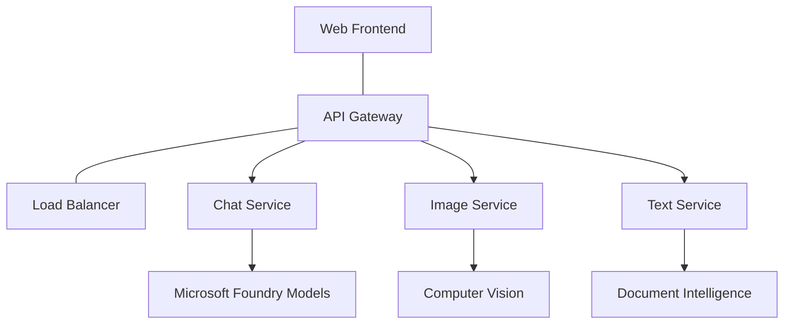

# Лучшие практики рабочей нагрузки AI в производстве с AZD

**Навигация по главам:**
- **📚 Главная курса**: [AZD для начинающих](../../README.md)
- **📖 Текущая глава**: Глава 8 - Производственные и корпоративные шаблоны
- **⬅️ Предыдущая глава**: [Глава 7: Устранение неполадок](../chapter-07-troubleshooting/debugging.md)
- **⬅️ Также связано**: [Лабораторная работа AI Workshop](../chapter-02-ai-development/ai-workshop-lab.md)
- **🎯 Курс завершен**: [AZD для начинающих](../../README.md)

## Обзор

В этом руководстве объясняются шаблоны проектирования AI для производства с использованием Azure Developer CLI (AZD). Это справочник по проектированию, а не развертываемое приложение или сертификация для производства.

**Границы примера:** Если явно не указано как полное, фрагменты Bicep предполагают параметры и ссылки на ресурсы из содержащего шаблона. Они опускают хостовые образы/планы, идентичности, назначения ролей, DNS, выводы и другую необходимую интеграцию. Пути служб YAML и скрипты hooks/тестов — иллюстративные файлы для создания в **вашем собственном приложении**; они не предоставляются этим курсом. Используйте рабочий образец AZD в качестве базы, соберите полную инфраструктуру и протестируйте её в изолированной среде перед использованием в производстве.

## Основные решаемые задачи

Общие проблемы производства включают многосервисное развертывание, управление идентификацией и секретами, масштабирование, контроль затрат и мониторинг. Здесь не заявляется измеряемая распространенность.

## Архитектурные шаблоны для производственного AI

### Шаблон 1: Микросервисная архитектура AI

**Когда использовать**: Сложные AI-приложения с множеством возможностей



**Реализация AZD**:

```yaml
# azure.yaml
name: enterprise-ai-platform
services:
  web:
    project: ./web
    host: staticwebapp
  api-gateway:
    project: ./api-gateway
    host: containerapp
  chat-service:
    project: ./services/chat
    host: containerapp
  vision-service:
    project: ./services/vision
    host: containerapp
  text-service:
    project: ./services/text
    host: containerapp
```

### Шаблон 2: Событийно-ориентированная обработка AI

**Когда использовать**: Пакетная обработка, анализ документов, асинхронные рабочие процессы

```bicep
// Event Hub for AI processing pipeline
resource eventHub 'Microsoft.EventHub/namespaces@2024-01-01' = {
  name: eventHubNamespaceName
  location: location
  sku: {
    name: 'Standard'
    tier: 'Standard'
    capacity: 1
  }
}

// Service Bus for reliable message processing
resource serviceBus 'Microsoft.ServiceBus/namespaces@2024-01-01' = {
  name: serviceBusNamespaceName
  location: location
  sku: {
    name: 'Premium'
    tier: 'Premium'
    capacity: 1
  }
}

// Function App for processing
resource functionApp 'Microsoft.Web/sites@2023-01-01' = {
  name: functionAppName
  location: location
  kind: 'functionapp,linux'
  properties: {
    siteConfig: {
      appSettings: [
        {
          name: 'FUNCTIONS_EXTENSION_VERSION'
          value: '~4'
        }
        {
          name: 'AZURE_OPENAI_ENDPOINT'
          value: '@Microsoft.KeyVault(VaultName=${keyVault.name};SecretName=openai-endpoint)'
        }
      ]
    }
  }
}
```

Это создает фрагменты пространства имен, а не хаб, очереди, подписки или триггеры Function. Для запускной Function также нужен хостинг-план, конфигурация времени выполнения/хранения, подключенная идентичность, RBAC и сетевой доступ. Ссылка Key Vault требует разрешения на чтение секрета; URL самой конечной точки не является учётными данными.

## Размышления о состоянии AI-агента

Когда традиционное веб-приложение ломается, симптомы знакомы: страница не загружается, API возвращает ошибку или развертывание завершается сбоем. AI-приложения могут ломаться всеми этими же способами — но они также могут неправильно себя вести более тонко, без очевидных сообщений об ошибках.

Этот раздел помогает создать ментальную модель для мониторинга AI-рабочих нагрузок, чтобы вы знали, куда смотреть, когда что-то не так.

### Чем здоровье агента отличается от здоровья традиционного приложения

Традиционные приложения тоже могут иметь тонкие ошибки корректности. AI-агент добавляет недетерминированное качество ответов к обычным проблемам доступности и корректности. Рассматривайте здоровье агента в двух слоях:

| Слой | Что контролировать | Где искать |
|-------|--------------|---------------|
| **Здоровье инфраструктуры** | Сервис запущен? Ресурсы выделены? Конечные точки доступны? | `azd monitor`, состояние ресурса в Azure Portal, логи контейнера/приложения |
| **Здоровье поведения** | Агент отвечает точно? Ответы приходят вовремя? Модель вызывается корректно? | Трейсы Application Insights, метрики задержки вызова модели, логи качества ответов |

Здоровье инфраструктуры знакомо — оно одинаково для любого приложения azd. Здоровье поведения — новый слой, который вводят AI-рабочие нагрузки.

### Куда смотреть, когда AI-приложения ведут себя не так, как ожидается

Если ваше AI-приложение не даёт ожидаемых результатов, вот концептуальный чеклист:

1. **Начните с основ.** Приложение запущено? Может ли оно обращаться к своим зависимостям? Проверьте `azd monitor` и состояние ресурсов так же, как для любого приложения.
2. **Проверьте подключение к модели.** Успешно ли ваше приложение вызывает AI-модель? Неудачные или зависшие вызовы моделей — самая частая причина проблем и отображаются в логах приложения.
3. **Изучите ввод и "грунт" безопасно.** Неправильные ответы могут быть вызваны извлечением данных, инструкциями, ограничениями модели или выполнением инструментов. Используйте диагностические данные с контролируемым доступом, не включайте бесконтрольное логирование запросов/ответов в продакшене.
4. **Проверьте задержки ответов.** Вызовы AI-моделей медленнее обычных API. Если приложение медлительно, проверьте, увеличилось ли время отклика модели — это может указывать на ограничение пропускной способности, лимиты ресурсов или заторы на уровне региона.
5. **Следите за сигналами затрат.** Неожиданные всплески использования токенов или вызовов API могут указывать на бесконечный цикл, неправильно настроенный запрос или чрезмерные повторные попытки.

Вам не нужно сразу осваивать инструменты наблюдаемости. Главное — AI-приложения имеют дополнительный слой поведения для мониторинга, а встроенный мониторинг azd (`azd monitor`) даёт отправную точку для исследования обоих слоев.

---

## Лучшие практики безопасности

### 1. Модель безопасности с нулевым доверием

**Стратегия реализации**:
- Без межсервисного общения без аутентификации
- Все API-вызовы используют управляющие идентичности
- Сетевая изоляция с приватными конечными точками
- Контроль доступа с наименьшими правами

```bicep
// Managed Identity for each service
resource chatServiceIdentity 'Microsoft.ManagedIdentity/userAssignedIdentities@2023-01-31' = {
  name: 'chat-service-identity'
  location: location
}

// Role assignments with minimal permissions
resource openAIUserRole 'Microsoft.Authorization/roleAssignments@2022-04-01' = {
  scope: openAIAccount
  name: guid(openAIAccount.id, chatServiceIdentity.id, '5e0bd9bd-7b93-4f28-af87-19fc36ad61bd')
  properties: {
    roleDefinitionId: subscriptionResourceId('Microsoft.Authorization/roleDefinitions', '5e0bd9bd-7b93-4f28-af87-19fc36ad61bd')
    principalId: chatServiceIdentity.properties.principalId
    principalType: 'ServicePrincipal'
  }
}
```

### 2. Безопасное управление секретами

**Паттерн интеграции с Key Vault**:

```bicep
// Key Vault with proper access policies
resource keyVault 'Microsoft.KeyVault/vaults@2023-02-01' = {
  name: keyVaultName
  location: location
  properties: {
    tenantId: tenant().tenantId
    sku: {
      family: 'A'
      name: 'standard' // Premium is needed for HSM-backed keys, not ordinary secrets
    }
    enableRbacAuthorization: true  // Use RBAC instead of access policies
    enablePurgeProtection: true    // Prevent accidental deletion
    enableSoftDelete: true
    softDeleteRetentionInDays: 90
  }
}

// Optional legacy key-auth alternative; omit when using Entra ID.
resource openAIKeySecret 'Microsoft.KeyVault/vaults/secrets@2023-02-01' = {
  parent: keyVault
  name: 'openai-api-key'
  properties: {
    value: openAIAccount.listKeys().key1
    attributes: {
      enabled: true
    }
  }
}
```

Назначьте идентичность времени выполнения `Key Vault Secrets User` на соответствующей области и прикрепите к хосту; `enableRbacAuthorization` самостоятельно не даёт доступа. Предпочитайте аутентификацию с управляющей идентичностью OpenAI с помощью `disableLocalAuth: true`. Опциональный секрет ключа имеет смысл только для намеренно активированного ключа аккаунта, а принципал провиженинга также должен иметь разрешение на запись секретов.

### 3. Сетевая безопасность

**Конфигурация приватных конечных точек**:

```bicep
// Virtual Network for AI services
resource virtualNetwork 'Microsoft.Network/virtualNetworks@2023-04-01' = {
  name: vnetName
  location: location
  properties: {
    addressSpace: {
      addressPrefixes: ['10.0.0.0/16']
    }
    subnets: [
      {
        name: 'ai-services-subnet'
        properties: {
          addressPrefix: '10.0.1.0/24'
          privateEndpointNetworkPolicies: 'Disabled'
        }
      }
      {
        name: 'app-services-subnet'
        properties: {
          addressPrefix: '10.0.2.0/24'
          delegations: [
            {
              name: 'Microsoft.Web/serverFarms'
              properties: {
                serviceName: 'Microsoft.Web/serverFarms'
              }
            }
          ]
        }
      }
    ]
  }
}

// Private endpoints for all AI services
resource openAIPrivateEndpoint 'Microsoft.Network/privateEndpoints@2023-04-01' = {
  name: '${openAIAccountName}-pe'
  location: location
  properties: {
    subnet: {
      id: virtualNetwork.properties.subnets[0].id
    }
    privateLinkServiceConnections: [
      {
        name: 'openai-connection'
        properties: {
          privateLinkServiceId: openAIAccount.id
          groupIds: ['account']
        }
      }
    ]
  }
}
```

Приватные конечные точки также требуют групп зон приватного DNS/связей VNet и интеграции приложения с VNet. Они не блокируют публичный доступ автоматически: явно отключите публичный сетевой доступ аккаунта AI после проверки приватной связности и доступа на развертывание.

## Производительность и масштабирование

### 1. Стратегии автопроскалирования

**Автопроскалирование контейнерных приложений**:

```bicep
resource containerApp 'Microsoft.App/containerApps@2023-05-01' = {
  name: containerAppName
  location: location
  properties: {
    configuration: {
      ingress: {
        external: true
        targetPort: 8000
        transport: 'http'
      }
    }
    template: {
      scale: {
        minReplicas: 2  // Always have 2 instances minimum
        maxReplicas: 50 // Scale up to 50 for high load
        rules: [
          {
            name: 'http-scaling'
            http: {
              metadata: {
                concurrentRequests: '20'  // Scale when >20 concurrent requests
              }
            }
          }
          {
            name: 'cpu-scaling'
            custom: {
              type: 'cpu'
              metadata: {
                type: 'Utilization'
                value: '70'  // Scale when CPU >70%
              }
            }
          }
        ]
      }
    }
  }
}
```

### 2. Стратегии кеширования

**Redis Cache для ответов AI**:

```bicep
// Legacy Azure Cache for Redis example (not recommended for new deployments)
resource redisCache 'Microsoft.Cache/redis@2023-04-01' = {
  name: redisCacheName
  location: location
  properties: {
    sku: {
      name: 'Premium'
      family: 'P'
      capacity: 1
    }
    enableNonSslPort: false
    minimumTlsVersion: '1.2'
    redisConfiguration: {
      'maxmemory-policy': 'allkeys-lru'
    }
    // Sharding distributes data; replication/failover provides availability.
    shardCount: 2
  }
}

// Cache configuration in application
var cacheConnectionString = '${redisCache.properties.hostName}:6380,password=${redisCache.listKeys().primaryKey},ssl=True,abortConnect=False'
```

Azure Cache for Redis Basic/Standard/Premium находится на [пути к устареванию](https://learn.microsoft.com/azure/azure-cache-for-redis/retirement-faq). Используйте Azure Managed Redis для новых проектов и его документированные SKU, идентичность и конфигурацию TLS, а не копируйте этот устаревший ресурс в новую производственную систему. Строка подключения — нефункциональный заполнитель, не учётные данные. Делите ключи кеша по авторизации, модели/инструкциям и версии извлечения, с сроком действия; совместный кеш только для запросов может раскрыть данные другого пользователя.

### 3. Балансировка нагрузки и управление трафиком

**Application Gateway с WAF**:

```bicep
// Application Gateway with Web Application Firewall
resource applicationGateway 'Microsoft.Network/applicationGateways@2023-04-01' = {
  name: appGatewayName
  location: location
  properties: {
    sku: {
      name: 'WAF_v2'
      tier: 'WAF_v2'
      capacity: 2
    }
    webApplicationFirewallConfiguration: {
      enabled: true
      firewallMode: 'Prevention'
      ruleSetType: 'OWASP'
      ruleSetVersion: '3.2'
    }
    // Backend pools for AI services
    backendAddressPools: [
      {
        name: 'ai-services-pool'
        properties: {
          backendAddresses: [
            {
              fqdn: '${containerApp.properties.configuration.ingress.fqdn}'
            }
          ]
        }
      }
    ]
  }
}
```

Это частичный ресурс шлюза: реальное развертывание требует подсети/конфигурации IP шлюза, frontend IP и портов, TLS-листенеров/сертификатов, backend HTTP настроек/проб, правил маршрутизации и приоритетов, а также проверенной политики WAF. TLS hostname/SNI и аутентификация должны соответствовать backend Container App.

## 💰 Оптимизация затрат

### 1. Правильный подбор ресурсов

**Конфигурации, специфичные для среды**:

Эти имена — **иллюстративные пользовательские параметры шаблона**, а не автоматические настройки AZD. Сначала сопоставьте каждое с `infra/main.parameters.json`/Bicep и конфигурацией хоста. Например, пример RAG использует `AZURE_SEARCH_SERVICE_SKU` и `AZURE_OPENAI_CHATGPT_DEPLOYMENT_CAPACITY`, а не универсальные имена ниже. Задайте памяти Container Apps поддерживаемую единицу, например `1Gi` в реальном ресурсе. Применяйте инфраструктурные изменения через `azd up` или `azd provision`; `azd deploy` самостоятельно не применяет изменения Bicep.

```bash
# Development environment
azd env new development
azd env set AZURE_OPENAI_SKU "S0"
azd env set AZURE_OPENAI_CAPACITY 10
azd env set AZURE_SEARCH_SKU "basic"
azd env set CONTAINER_CPU 0.5
azd env set CONTAINER_MEMORY 1.0

# Production environment  
azd env new production
azd env set AZURE_OPENAI_SKU "S0"
azd env set AZURE_OPENAI_CAPACITY 100
azd env set AZURE_SEARCH_SKU "standard"
azd env set CONTAINER_CPU 2.0
azd env set CONTAINER_MEMORY 4.0
```

### 2. Мониторинг затрат и бюджеты

```bicep
// Supply the first day of the current UTC month, e.g. 2026-11-01T00:00:00Z.
param budgetStartDate string

// Cost management and budgets
resource budget 'Microsoft.Consumption/budgets@2024-08-01' = {
  name: 'ai-workload-budget'
  properties: {
    timePeriod: {
      startDate: budgetStartDate
    }
    timeGrain: 'Monthly'
    amount: 2000  // In the billing currency, not necessarily USD
    category: 'Cost'
    notifications: {
      warning: {
        enabled: true
        operator: 'GreaterThan'
        threshold: 80
        contactEmails: [
          'finance@company.com'
          'engineering@company.com'
        ]
        contactRoles: [
          'Owner'
          'Contributor'
        ]
      }
      critical: {
        enabled: true
        operator: 'GreaterThan'
        threshold: 95
        contactEmails: [
          'cto@company.com'
        ]
      }
    }
  }
}
```

Замените пример получателей и проверьте область/разрешения. Оповещения бюджета используют задержанные данные биллинга и не накладывают ограничение расходов.

### 3. Оптимизация использования токенов

**Управление затратами OpenAI**:

Это только эвристика, основанная на символах для предварительного просмотра UI, **а не** валидатор ограничения токенов модели. Производственный код должен использовать токенизатор, соответствующий развернутой модели, и учитывать системные инструкции, схемы инструментов, историю и бюджет вывода. Отклоняйте слишком большие пользовательские сообщения вместо их тихого усечения.

```typescript
// Application-level token optimization
class TokenOptimizer {
  private readonly maxTokens = 4000;
  private readonly reserveTokens = 500;
  
  optimizePrompt(userInput: string, context: string): string {
    const availableTokens = this.maxTokens - this.reserveTokens;
    if (this.estimateTokens(userInput) + 8 >= availableTokens) {
      throw new Error("User input exceeds the illustrative prompt budget");
    }
    const estimatedTokens = this.estimateTokens(userInput + context) + 8;
    
    if (estimatedTokens > availableTokens) {
      // Truncate context, not user input
      context = this.truncateContext(context, Math.max(0, availableTokens - this.estimateTokens(userInput) - 8));
    }
    
    return `${context}\n\nUser: ${userInput}`;
  }
  
  private estimateTokens(text: string): number {
    // Rough estimation: 1 token ≈ 4 characters
    return Math.ceil(text.length / 4);
  }

  private truncateContext(text: string, estimatedBudget: number): string {
    return text.slice(0, Math.max(0, estimatedBudget) * 4);
  }
}
```

## Мониторинг и наблюдаемость

### 1. Комплексный Application Insights

```bicep
// Application Insights with advanced features
resource applicationInsights 'Microsoft.Insights/components@2020-02-02' = {
  name: applicationInsightsName
  location: location
  kind: 'web'
  properties: {
    Application_Type: 'web'
    WorkspaceResourceId: logAnalyticsWorkspace.id
    SamplingPercentage: 100  // Ingestion setting; review cost and SDK sampling separately
    DisableIpMasking: false  // Retain IP masking
  }
}

// Custom metrics for AI operations
resource aiMetricAlerts 'Microsoft.Insights/metricAlerts@2018-03-01' = {
  name: 'ai-high-error-rate'
  location: 'global'
  properties: {
    description: 'Alert when failed request count exceeds 10 in five minutes'
    severity: 2
    enabled: true
    scopes: [
      applicationInsights.id
    ]
    evaluationFrequency: 'PT1M'
    windowSize: 'PT5M'
    criteria: {
      'odata.type': 'Microsoft.Azure.Monitor.SingleResourceMultipleMetricCriteria'
      allOf: [
        {
          name: 'high-error-rate'
          metricName: 'requests/failed'
          operator: 'GreaterThan'
          threshold: 10
          timeAggregation: 'Count'
        }
      ]
    }
  }
}
```

### 2. Специфический мониторинг AI

**Пользовательские панели для метрик AI**:

```json
{
  "dashboard": {
    "name": "AI Application Monitoring",
    "tiles": [
      {
        "name": "OpenAI Request Volume",
        "query": "dependencies | where target contains 'openai' | summarize count() by bin(timestamp, 5m)"
      },
      {
        "name": "AI Response Latency",
        "query": "dependencies | where target contains 'openai' | summarize avg(duration) by bin(timestamp, 5m)"
      },
      {
        "name": "Token Usage",
        "query": "customMetrics | where name == 'openai_tokens_used' | summarize sum(value) by bin(timestamp, 1h)"
      },
      {
        "name": "Cost per Hour",
        "query": "customMetrics | where name == 'openai_cost' | summarize sum(value) by bin(timestamp, 1h)"
      }
    ]
  }
}
```

Этот JSON — набросок, определённый приложением, а не импортируемая схема панели портала Azure. Запросы по токенам/стоимости требуют, чтобы ваше приложение испускало именно эти пользовательские метрики; их не создаёт AZD. Адаптируйте фильтры зависимостей под реальные имена конечных точек/спанов модели.

### 3. Проверки здоровья и мониторинг времени безотказной работы

```bicep
// Application Insights availability tests
resource availabilityTest 'Microsoft.Insights/webtests@2022-06-15' = {
  name: 'ai-app-availability-test'
  location: location
  tags: {
    'hidden-link:${applicationInsights.id}': 'Resource'
  }
  properties: {
    SyntheticMonitorId: 'ai-app-availability-test'
    Name: 'AI Application Availability Test'
    Description: 'Tests AI application endpoints'
    Enabled: true
    Frequency: 300  // 5 minutes
    Timeout: 120    // 2 minutes
    Kind: 'standard'
    Locations: [
      {
        Id: 'us-east-2-azr'
      }
      {
        Id: 'us-west-2-azr'
      }
    ]
    Request: {
      RequestUrl: 'https://${webApp.properties.defaultHostName}/health'
      HttpVerb: 'GET'
      FollowRedirects: true
      ParseDependentRequests: false
    }
    ValidationRules: {
      ExpectedHttpStatusCode: 200
      SSLCheck: true
      SSLCertRemainingLifetimeCheck: 7
    }
  }
}
```

## Восстановление после отказов и высокая доступность

Предыдущее тестирование предполагает существующий App Service `webApp` и ресурс Application Insights. Стандартные тесты доступности являются платными и требуют доступной конечной точки; приложения только с приватным доступом нуждаются в соответствующей приватной схеме мониторинга. URL ping-тесты устарели; используйте [стандартные тесты доступности](https://learn.microsoft.com/azure/azure-monitor/app/availability).

### 1. Развертывание в нескольких регионах

```yaml
# azure.yaml - Multi-region configuration
name: ai-app-multiregion
services:
  api-primary:
    project: ./api
    host: containerapp
    env:
      AZURE_REGION: eastus
  api-secondary:
    project: ./api
    host: containerapp
    env:
      AZURE_REGION: westus2
```

```bicep
// Separate App Service topology, not the Container Apps declarations above
resource trafficManager 'Microsoft.Network/trafficManagerProfiles@2022-04-01' = {
  name: trafficManagerProfileName
  location: 'global'
  properties: {
    profileStatus: 'Enabled'
    trafficRoutingMethod: 'Priority'
    dnsConfig: {
      relativeName: trafficManagerProfileName
      ttl: 30
    }
    monitorConfig: {
      protocol: 'HTTPS'
      port: 443
      path: '/health'
      intervalInSeconds: 30
      toleratedNumberOfFailures: 3
      timeoutInSeconds: 10
    }
    endpoints: [
      {
        name: 'primary-endpoint'
        type: 'Microsoft.Network/trafficManagerProfiles/azureEndpoints'
        properties: {
          targetResourceId: primaryAppService.id
          endpointStatus: 'Enabled'
          priority: 1
        }
      }
      {
        name: 'secondary-endpoint'
        type: 'Microsoft.Network/trafficManagerProfiles/azureEndpoints'
        properties: {
          targetResourceId: secondaryAppService.id
          endpointStatus: 'Enabled'
          priority: 2
        }
      }
    ]
  }
}
```

Переменные окружения не выбирают локации ресурсов. IaC должна создавать отдельные региональные хосты и связывать каждый сервис с тегами `resourceName` или `azd-service-name`. Пример Traffic Manager — это **отдельная топология App Service** (`primaryAppService`/`secondaryAppService`), а не маршрутизация для деклараций Container Apps. Container Apps требуют корректно настроенной внешней конечной точки/front door, маршрутизации TLS/кастомного домена и проверок состояния.

### 2. Резервное копирование и восстановление данных

```bicep
// Backup configuration for critical data
resource backupVault 'Microsoft.DataProtection/backupVaults@2023-05-01' = {
  name: backupVaultName
  location: location
  identity: {
    type: 'SystemAssigned'
  }
  properties: {
    storageSettings: [
      {
        datastoreType: 'VaultStore'
        type: 'LocallyRedundant'
      }
    ]
  }
}

```

Сам vault ничего не резервирует. Настройте **специфичную для рабочей нагрузки поддерживаемую политику и экземпляр резервного копирования**, права источника, хранение и тесты восстановления с помощью [матриц поддержки Azure Backup](https://learn.microsoft.com/azure/backup/backup-support-matrix). Нет общей политики Azure Backup для хостинговых развертываний моделей Azure OpenAI. Храните определения инфраструктуры/развертывания модели в контроле версий; защищайте загруженные документы, данные приложений и артефакты тонкой настройки с помощью функций резервного копирования/экспорта каждой используемой службы. Явно определяйте и тестируйте RPO/RTO.

## Интеграция DevOps и CI/CD

### 1. Рабочий процесс GitHub Actions

```yaml
# .github/workflows/deploy-ai-app.yml
name: Deploy AI Application

on:
  push:
    branches: [main]
  pull_request:
    branches: [main]

jobs:
  test:
    runs-on: ubuntu-latest
    steps:
      - uses: actions/checkout@v4
      
      - name: Setup Python
        uses: actions/setup-python@v4
        with:
          python-version: '3.11'
          
      - name: Install dependencies
        run: |
          pip install -r requirements.txt
          pip install pytest
          
      - name: Run tests
        run: pytest tests/
        
      - name: AI Safety Tests
        run: |
          python scripts/test_ai_safety.py
          python scripts/validate_prompts.py

```

Это **только тестовая часть** рабочего процесса и предполагает, что вы создали `requirements.txt`, `tests/` и два скрипта безопасности. Добавьте аутентифицированные OIDC задания провиженинга/развертывания из [Настройки CI/CD Pipeline](#cicd-pipeline-configuration), с `needs: test`, доверенным push/ручным триггером и защищёнными средами GitHub. Не развертывайте ненадёжный код pull request с облачными учётными данными. Свежий runner не имеет выбранной локальной среды AZD; укажите environment/subscription/location входы и используйте `azd auth login`, а не просто `azure/login`.

### 2. Валидация инфраструктуры

```bash
# scripts/validate_infrastructure.sh
#!/bin/bash
set -euo pipefail

echo "Validating AI infrastructure deployment..."

# Requires Azure CLI login and the resource group selected explicitly.
: "${AZURE_RESOURCE_GROUP:?Set AZURE_RESOURCE_GROUP}"
: "${AZURE_OPENAI_NAME:?Set AZURE_OPENAI_NAME}"
: "${AZURE_OPENAI_CHAT_DEPLOYMENT:?Set the actual deployment name}"

# A successful empty list is not proof that resources exist.
types=("Microsoft.CognitiveServices/accounts" "Microsoft.Search/searchServices"
       "Microsoft.Storage/storageAccounts" "Microsoft.KeyVault/vaults")
for resource_type in "${types[@]}"; do
    count=$(az resource list --resource-group "$AZURE_RESOURCE_GROUP" \
        --resource-type "$resource_type" --query "length(@)" -o tsv)
    if [[ "$count" -lt 1 ]]; then
        echo "ERROR: No $resource_type found in $AZURE_RESOURCE_GROUP"
        exit 1
    fi
done

# Validate OpenAI model deployments
echo "Validating OpenAI model deployments..."
state=$(az cognitiveservices account deployment show \
  --name "$AZURE_OPENAI_NAME" --resource-group "$AZURE_RESOURCE_GROUP" \
  --deployment-name "$AZURE_OPENAI_CHAT_DEPLOYMENT" \
  --query "properties.provisioningState" -o tsv)
if [[ "$state" != "Succeeded" ]]; then
    echo "ERROR: Required model deployment is not provisioned successfully"
    exit 1
fi

echo "Infrastructure validation completed successfully!"
```

Ожидается: нулевой выход и сообщение о завершении только если все ожидаемые типы существуют и именованное развертывание модели провижено. Это проверяет состояние инвентаризации/провиженинга, **не** здоровье ресурсов, точную топологию, RBAC, сетевую доступность или поведение модели. Адаптируйте ожидаемые типы под свою архитектуру, а затем выполните отдельный аутентифицированный тест готовности приложения.

## Чеклист производственной готовности

### Безопасность ✅
- [ ] Все сервисы используют управляющие идентичности
- [ ] Секреты хранятся в Key Vault
- [ ] Настроены приватные конечные точки
- [ ] Реализованы сетевые группы безопасности
- [ ] RBAC с наименьшими правами
- [ ] Включен WAF на публичных конечных точках

### Производительность ✅
- [ ] Настроено автопроскалирование
- [ ] Внедрено кеширование
- [ ] Настроена балансировка нагрузки
- [ ] CDN для статического контента
- [ ] Пул подключений к базе данных
- [ ] Оптимизация использования токенов

### Мониторинг ✅
- [ ] Настроен Application Insights
- [ ] Определены пользовательские метрики
- [ ] Настроены правила оповещений
- [ ] Создана панель мониторинга
- [ ] Реализованы проверки здоровья
- [ ] Политики хранения логов

### Надежность ✅
- [ ] Развертывание в нескольких регионах
- [ ] План резервного копирования и восстановления
- [ ] Внедрены circuit breakers
- [ ] Настроены политики повторных попыток
- [ ] Грациозное деградирование
- [ ] Конечные точки проверки здоровья

### Управление затратами ✅
- [ ] Настроены оповещения бюджета
- [ ] Правильный подбор ресурсов
- [ ] Применены скидки для разработки/тестирования
- [ ] Приобретены резервированные инстансы
- [ ] Панель мониторинга затрат
- [ ] Регулярные обзоры затрат

### Соответствие требованиям ✅
- [ ] Выполнение требований по локализации данных
- [ ] Включено аудит-логирование
- [ ] Применены политики соответствия
- [ ] Реализованы базовые уровни безопасности
- [ ] Регулярные оценки безопасности
- [ ] План реагирования на инциденты

## Бенчмарки производительности

### Иллюстративные производственные цели

Это примерные SLO для согласования и нагрузочного тестирования, а не измеренные показатели или гарантии. Задержка ответа зависит от модели/длины вывода; месячные расходы на токены зависят от трафика и цен, а не только от количества токенов.

| Метрика | Цель | Мониторинг |
|--------|--------|------------|
| **Время отклика** | < 2 секунды | Application Insights |
| **Доступность** | 99.9% | Мониторинг времени безотказной работы |
| **Уровень ошибок** | < 0.1% | Логи приложений |
| **Затраты на модель** | < $500/месяц (примерный бюджет) | Управление затратами |
| **Одновременные пользователи** | 1000+ | Нагрузочное тестирование |
| **Время восстановления** | < 1 часа | Тесты аварийного восстановления |

### Тестирование нагрузки

Ниже приведён эскиз интерфейса для скрипта нагрузочного тестирования, **который вы должны реализовать**; этот репозиторий не предоставляет `scripts/load_test.py`. Определите нагрузочные запросы, аутентификацию, представительные рабочие нагрузки, assertions по перцентилям по задержкам/ошибкам и лимит расходов в выбранном инструменте нагрузочного тестирования перед его запуском:

```bash
# Load testing script for AI applications
python scripts/load_test.py \
  --endpoint https://your-ai-app.azurewebsites.net \
  --concurrent-users 100 \
  --duration 300 \
  --ramp-up 60
```

## 🤝 Лучшие практики сообщества

На основе отзывов сообщества Microsoft Foundry Discord:

### Главные рекомендации от сообщества:

1. **Начинайте с малого, масштабируйтесь постепенно**: начните с базовых SKU и увеличивайте масштаб на основе фактического использования
2. **Мониторьте всё**: настройте комплексный мониторинг с первого дня
3. **Автоматизируйте безопасность**: используйте инфраструктуру как код для обеспечения постоянной безопасности
4. **Тестируйте тщательно**: включите AI-специфичное тестирование в вашу конвейерную разработку
5. **Планируйте расходы**: отслеживайте использование токенов и настройте оповещения по бюджету заранее

### Частые ошибки, которых следует избегать:

- ❌ Жёстко прописывать API-ключи в коде
- ❌ Не настраивать должным образом мониторинг
- ❌ Игнорировать оптимизацию затрат
- ❌ Не тестировать сценарии отказов
- ❌ Развёртывать без проверок здоровья

## Команды и расширения AI CLI AZD

AZD включает расширяющийся набор AI-специфичных команд и расширений, которые упрощают производственные AI-рабочие процессы. Эти инструменты устраняют разрыв между локальной разработкой и производственным развертыванием AI-нагрузок.

> **Обновление Foundry GA (09.11.2026):** Пакет `microsoft.foundry` достиг **версии 1.0 / общего доступа** на [5 ноября 2026](https://devblogs.microsoft.com/azure-sdk/microsoft-foundry-azure-developer-cli-ga/). Используйте **`azd >= 1.37.0`** для этого рабочего процесса. Ранние обзоры `azd 1.37.2`, агентов beta.23 и оценок beta.2 сохранены ниже как история миграции, а не как текущая версия пакета. Это обзор документации/исходников, а не проверка живого развертывания или утверждение, что все необязательные расширения, API или предварительные функции доступны.

### Расширения AZD для AI

AZD использует систему расширений для добавления AI-специфичных возможностей. Устанавливайте и управляйте расширениями с помощью:

```bash
# List all available extensions (including AI)
azd extension list

# Inspect installed versions
azd version
azd ext list --installed

# Install the GA Foundry bundle
azd ext install microsoft.foundry

# Install the separate Foundry evaluations extension
azd extension install azure.ai.evaluations

# Install the fine-tuning extension
azd extension install azure.ai.finetune

# Install the custom models extension
azd extension install azure.ai.models

# Upgrade the Foundry bundle
azd ext upgrade microsoft.foundry
```

**Доступные AI-расширения:**

| Расширение | Назначение | Статус |
|-----------|---------|--------|
| `microsoft.foundry` | Мета-пакет, устанавливающий семь основных расширений ниже; без собственной группы команд | GA пакет 1.0 |
| `azure.ai.agents` | `azd ai agent`: настройка агентов, локальное выполнение и операции | Включено; версия отдельно |
| `azure.ai.connections` | `azd ai connection`: подключения проектов | Включено; версия отдельно |
| `azure.ai.inspector` | `azd ai inspector`: локальный UI инспектора агента | Включено; версия отдельно |
| `azure.ai.projects` | `azd ai project`: ресурсы проектов и развертывания моделей | Включено; версия отдельно |
| `azure.ai.routines` | `azd ai routine`: расписания и триггеры | Включено; версия отдельно |
| `azure.ai.skills` | `azd ai skill`: переиспользуемые поведенческие указания | Включено; версия отдельно |
| `azure.ai.toolboxes` | `azd ai toolbox`: коллекции инструментов с версиями | Включено; версия отдельно |
| `azure.ai.evaluations` | Наборы данных для оценок, оценщики, группы оценок и прогоны | Отдельная установка/релиз |
| `azure.ai.dataset` | Регистрация и версионирование наборов данных | Отдельная установка/релиз |
| `azure.ai.finetune` | Тонкая настройка моделей Foundry | Отдельная установка/релиз |
| `azure.ai.models` | Кастомные модели Foundry | Отдельная установка/релиз |

Отдельная установка `azure.ai.agents` по-прежнему поддерживается и устанавливает зависимости; пакет является настройкой курса по умолчанию для GA рабочего процесса. GA пакета не гарантирует статус выпуска для опциональных функций компонентов. См. [упаковку и проверку расширений](https://learn.microsoft.com/azure/foundry/agents/how-to/install-cli-foundry-extensions) и изучите справку по командам перед использованием.

> Сначала обновите основное CLI с помощью `azd update` или соответствующего [метода установки/обновления](https://learn.microsoft.com/azure/developer/azure-developer-cli/install-azd), затем выполните `azd ext upgrade microsoft.foundry`. При необходимости обновляйте отдельно установленные оценки с помощью `azd ext upgrade azure.ai.evaluations`. Нет основной команды `azd upgrade`. Записывайте и проверяйте версии независимых расширений в автоматизации продакшена; обновление не мигрирует старую конфигурацию автоматически.

### Недавние изменения и исправления релиза

| Релиз | Что изменилось для этого курса |
|---------|------------------------------|
| `microsoft.foundry` 1.0 GA (05.11.2026) | По умолчанию пакет из семи расширений, сохранение настроек агентов/развёртывания в `azure.yaml`, локальное тестирование с Agent Inspector, загрузка кода для удалённой сборки Foundry. Оценки устанавливать отдельно и повторно устанавливать необходимые расширения на CI раннерах. |
| `azd 1.37.0` | Добавляет стабильные API предварительного просмотра развертывания и исправляет переписывание не относящихся к делу настроек `azure.yaml` при редактировании расширений. |
| `azd 1.37.1` | Исправляет распространение Ctrl+C между расширениями и различает отмены/тайм-ауты от общих ошибок. |
| `azd 1.37.2` | Улучшает валидацию provisioning: критические предупреждения по умолчанию **Нет**, ошибки без подтверждения в бесконтрольных запусках, отмена пропускает post-provision хуки. Также исправляет неразрешённые значения среды в списках отказов Deployment Stacks при включённой альфа-функции. |
| Агенты `beta.22` | Мигрирует оценку на `azd ai eval`, меняет оптимизацию на GA API v1, требует множественных `toolboxes`, отделяет managed-harness, голос и долгую подписку в предварительном просмотре. Исправляет выбор модели по среде и аутентификацию toolbox. |
| Агенты `beta.23` | Открывает `init --harness`; исправляет вывод ответов A2A 0.3, недопустимые пути/модули prompt-agent через уровни инфраструктуры, диагностику тайм-аутов активации и сохранённые предупреждения RBAC разработчика. |
| Оценки `beta.2` | Требует camelCase конфигурацию оценки, добавляет статическое/симуляционное написание диалогов и явные локальные файловые источники, исправляет обработку идентичности/версии наборов данных, подсчёт quality-gate и диагностику неудачных прогонов. |

Тайм-аут активации агента **не** доказывает неисправность развертывания: изучите версию и состояние попытки перед повтором. Предупреждения RBAC разработчика могут оставаться даже при успешном provisioning; решите проблему с доступом до вызова от имени этого разработчика.

Строки beta выше описывают ранние исправления и границы миграции, а не требование фиксировать новые проекты на этих версиях.

Источники: [объявление Foundry GA](https://devblogs.microsoft.com/azure-sdk/microsoft-foundry-azure-developer-cli-ga/), [релизы AZD](https://github.com/Azure/azure-dev/releases), [релиз агентов beta.23](https://github.com/Azure/azure-dev/releases/tag/azd-ext-azure-ai-agents_1.0.0-beta.23), [миграция агентов beta.22](https://github.com/Azure/azure-dev/releases/tag/azd-ext-azure-ai-agents_1.0.0-beta.22), и [релиз оценок beta.2](https://github.com/Azure/azure-dev/releases/tag/azd-ext-azure-ai-evaluations_1.0.0-beta.2).

**Что такое включённые в пакет `skills` и `connections` расширения?**

Они устанавливаются с основным пакетом, но служат разным целям:

- **`azure.ai.skills`** — **навык** содержит переиспользуемые поведенческие указания для агентов. Делитесь проверенными инструкциями между агентами вместо копирования. Навык не реализует сам по себе инструмент и не даёт доступа к данным; для выполнения инструментов используйте toolbox и код приложения.
- **`azure.ai.connections`** — **подключение** — это управляемая ссылка вашего проекта Foundry на внешний ресурс, необходимый агентам — источник данных (например, Azure AI Search), конечная точка инструмента или другая служба. Подключения централизуют *где* и *как* агенты получают доступ к данным, поэтому учётные данные и конечные точки находятся в одном управляемом месте, а не разбросаны по коду.

Вам не нужно настраивать каждую функцию из пакета для развертывания первого агента. Используйте навыки, когда агенты делятся поведенческими указаниями, и подключения, когда они делятся внешними ресурсами.

### Инициализация проектов агентов с `azd ai agent init`

Команда `azd ai agent init` создает структуру проекта агента Microsoft Foundry. Для рабочего примера развертывания на Python 3.13+ и текущем uv следуйте [GA walkthrough с размещённым агентом](../chapter-02-ai-development/microsoft-foundry-integration.md#hosted-agent-walkthrough-ga). Ниже команды иллюстрируют принятие **вашего собственного** текущего `azure.yaml` шаблона проекта; указанный локальный шаблон не предоставляется в этом курсе:

```bash
# Initialize a new agent project from a local project template
azd ai agent init --template ./templates/support-agent/azure.yaml

# Initialize and target a specific Foundry project
azd ai agent init --template ./templates/support-agent/azure.yaml --project-id <foundry-project-id>

# Adopt the template into a different directory
azd ai agent init --template ./templates/support-agent/azure.yaml --src ./agents/my-agent
```

**Ключевые флаги:**

| Флаг | Описание |
|------|-------------|
| `-t, --template` | Путь или поддерживаемый URI GitHub до документа проекта `azure.yaml` |
| `-p, --project-id` | Имеющийся Project ID Microsoft Foundry для вашей среды azd |
| `-s, --src` | Каталог исходников для сгенерированных агентов, или целевой каталог при принятии проекта |
| `--deploy-mode code` | Загружать исходники для удалённой сборки Foundry вместо локальной сборки контейнера |
| `--model-deployment` | Повторно использовать именованное существующее развертывание модели при инициализации |
| `--kind` | Инициализация агента `hosted`, `prompt` или предварительного просмотра `prompt-voice` |
| `--harness` | Опциональная среда исполнения для `--kind prompt`; требует предварительного просмотра |
| `-e, --environment` | Среда azd, которую следует использовать |

`--manifest`/`-m` — устаревший псевдоним для `--template`/`-t`; переименование флага не конвертирует старый манифест в текущий документ проекта. `--host containerapp` не является текущим флагом agent-init. Для обычного приложения Container Apps используйте `azd init --template` с шаблоном, объявляющим `host: containerapp`.

Для существующего проекта с ровно одним сервисом `azure.ai.project` команда `azd ai agent add support-agent --file ./agents/support-agent.yaml` добавляет или обновляет прямое определение агента без provisioning или развертывания. Команды рантайма отвергают наследуемые неявные определения `agent.yaml`/AgentManifest и вложенных сервисов `config:`; мигрируйте их в текущий сервис `azure.ai.agent`. При выводе init инструкции `cd` выполните их перед `azd up`: init не меняет директорию оболочки.

**Совет для продакшена**: используйте `--project-id` для прямого подключения к существующему проекту Foundry, поддерживая связь кода агента и облачных ресурсов с самого начала.

#### Опциональные функции предварительного просмотра

Managed harness, голос и долгие вызовы по умолчанию отключены. Устанавливайте переключатель только для нужной функции в **окружении процесса оболочки/CI**, а не с помощью `azd env set`:

| Функция | Переменная окружения процесса |
|---------|------------------------------|
| Managed harness (`init --kind prompt --harness ...`) | `AZD_ALPHA_ENABLE_AGENTS_MANAGED_HARNESS=true` |
| Голос (`init --kind prompt-voice`) | `AZD_ALPHA_ENABLE_AGENTS_VOICE=true` |
| Долгий вызов | `AZD_ALPHA_ENABLE_AGENTS_LONG_RUNNING=true` |

Например, используйте `export AZD_ALPHA_ENABLE_AGENTS_MANAGED_HARNESS=true` в Bash или `$env:AZD_ALPHA_ENABLE_AGENTS_MANAGED_HARNESS = "true"` в PowerShell перед запуском соответствующей команды. Включение одного переключателя не включает остальные. См. [релизное README агентов](https://github.com/Azure/azure-dev/blob/azd-ext-azure-ai-agents_1.0.0-beta.23/cli/azd/extensions/azure.ai.agents/README.md) для всех переключателей предварительного просмотра и ограничений.

### Управление жизненным циклом агента

Расширение `azure.ai.agents` пакета поддерживает локальное тестирование и операции с развернутыми агентами. Установите `azure.ai.evaluations` отдельно для измерения качества:

```bash
# Start the local agent and Agent Inspector (leave running)
azd ai agent run

# From a second terminal in the project directory
azd ai agent invoke --local "Explain how this agent is deployed."

# Invoke a deployed agent and view server response timing
# (total latency and time to first byte)
azd ai agent invoke

# Show the live endpoint configuration before changing it
azd ai agent endpoint show

# Download the deployed source of a code-based hosted agent
# (with SHA-256 verification)
azd ai agent code download

# Delete a hosted agent and all of its versions
# (--force terminates active sessions)
azd ai agent delete --force
```

**Жизненный цикл вкратце:**

| Этап | Команда | Использование в продакшене |
|-------|---------|----------------|
| Локальное тестирование | `azd ai agent run`, затем `azd ai agent invoke --local "Test prompt"` | Проверяйте запросы и ответы перед развертыванием; вызовы моделей Azure всё ещё оплачиваются |
| Развертывание | `azd deploy` | В режиме кода сборка загруженных источников происходит удалённо в Foundry |
| Тестирование | `azd ai agent invoke` | Проверка ответов и измерение задержек перед выпуском |
| Диагностика | `azd ai agent doctor`, `azd ai agent monitor --follow` | Проверка настроек/разрешений и поток логов агента |
| Инспекция | `azd ai agent endpoint show` | Обзор аутентификации/конфигурации конечных точек; выявление критических изменений на ранней стадии |
| Измерение | `azd ai eval init`, `generate`, `run start` | Определение, развертывание и выполнение повторяемых оценок |
| Улучшение | `azd ai agent optimize --eval <evaluation-name> --optimize-model <optimizer-deployment>` | Повторное использование совместимых оценок для оптимизации агента |
| Восстановление | `azd ai agent code download` | Получение точного развернутого исходника для аудита/отката |
| Вывод из эксплуатации | `azd ai agent delete --force` | Чистое удаление агента и его версий |

> Выполните `azd ai agent --help` для просмотра команд в вашей установленной версии. Пакет GA; функции предварительного просмотра с отдельным доступом всё ещё требуют включения. Перед очисткой различайте удаление агента и проекта: `azd down` удаляет группу ресурсов нового проекта, но оставляет ресурсы повторно используемых проектов. Следуйте [инструкции по очистке](../chapter-02-ai-development/microsoft-foundry-integration.md#7-clean-up-deliberately).

`endpoint show` поддерживает размещённых, prompt и голосовых агентов, но обновления конечной точки только для размещённых; рабочие агенты не поддерживаются. Загрузка кода и пример вывода размещённого агента выше не являются универсальными операциями для всех типов агентов.

#### Миграция оценок и проверки качества

Начиная с агентов **1.0.0-beta.22 (23.10.2026)** устаревшие команды `azd ai agent eval` предоставляют руководство по миграции вместо прежнего рабочего процесса оценки. Не копируйте старые примеры `eval generate --dataset ...`: оценка теперь находится в разделе **`azd ai eval`**.

В инициализированном проекте агента выполните аутентификацию с `azd auth login`, подтвердите выбранную среду/проект Foundry и установите `azure.ai.evaluations`. Для оценки на основе модели требуется развертывание модели судьи; генерация и симуляция разговоров могут потребовать собственный выбор модели и повлечь дополнительные расходы.

```bash
# Generate a draft rubric and dataset from the deployed agent
azd ai eval generate

# After reviewing the assets, configure a named evaluation
azd ai eval init --name quality

# Review generated files, then register datasets, evaluators, and eval groups
azd up

# Start an evaluation and wait for its results
azd ai eval run start --eval quality --wait

# Inspect runs and available test-case output
azd ai eval run list
azd ai eval run show <run-id>
azd ai eval run output list <run-id>
```

Для примера объявления GA выберите **Dataset and evaluator** и **Turn** во время генерации, затем выберите проверенные материалы и модель судьи при инициализации. Следуйте напечатанным следующим шагам, а не предполагая, что сгенерированные материалы уже зарегистрированы. Вы также можете инициализировать на основе существующего проверенного набора данных/рубрики без генерации новых данных. Конфигурация оценки обычно находится в `evals/azure.eval.yaml`, на которую ссылается сервис `azure.ai.eval` в `azure.yaml`. Ключи имеют формат **camelCase** (`evaluationLevel`, `maxSamples`, `initializationParameters`, `dataMapping`); старые ключи конфигураций в snake_case не принимаются. Пути внутри ссылаемой конфигурации разрешаются относительно этого файла, а не корня репозитория.

Для оценки разговоров выберите **static** для оценки завершённых транскриптов без вызова агента, или **simulation** для генерации разговоров на основе сценариев. Для симуляции необходимы целевой агент, модель симулятора и отдельный выбор модели судьи. Для команд без присмотра предоставьте входные данные, перечисленные в `azd ai eval init --help` и `azd ai eval generate --help`; не предполагайте, что модель генерации является также моделью судьи или симулятора.

Для CI настройте явную политику качества с помощью `azd ai eval run start --help` (`--fail-on`) и считайте ненулевой выход хоста как ошибку. Завершённый запуск не означает автоматически прохождение по качеству. Проверьте неудачные/ошибочные строки и диагностику; отсутствие или несоответствие количества результатов не является доказательством успеха. Зарегистрированные наборы данных сохраняют свою идентичность/версию сервиса; `--max-samples` не может выделять подмножество зарегистрированного набора данных. Опубликуйте меньший набор данных преднамеренно или используйте поддерживаемый источник с локальным файлом.

```bash
# Example CI policy: at least 90% of all test cases must pass
azd ai eval run start --eval quality --wait --no-prompt --fail-on "pass-rate=0.9"
```

Проходной порог использует количество прошедших тестовых случаев, делённое на общее количество тестовых случаев; неудачные, с ошибками, пропущенные и иные непрошедшие строки учитываются против него. Не комбинируйте порог с `--no-wait`, который возвращается до того, как доступен вердикт.

#### Миграция конфигурации оптимизации

Оптимизация теперь использует API GA v1. Чтобы повторно использовать совместимую оценку **на уровне хода, на основе набора данных** из нового рабочего процесса:

```bash
# Replace placeholders with the evaluation name and optimizer model deployment
azd ai agent optimize --eval-config ./evals/azure.eval.yaml --eval <evaluation-name> --optimize-model <optimizer-deployment>
```

`--eval` выбирает оценку; `--eval-config` выбирает её файл конфигурации (включая определения на основе файлов). `--config` принимает **отдельный запрос к API оптимизации** в YAML или JSON. Не передавайте старый агентский `eval.yaml` или новый `azure.eval.yaml` в `--config` и не комбинируйте `--config` с `--eval`/`--eval-config`. Оценки разговоров, на основе трассировок или симуляций несовместимы с сокращённым вариантом оптимизации на основе набора данных; используйте поддерживаемый формат запроса оптимизации для таких случаев. Проверьте кандидатов перед применением или развертыванием.

Смотрите [справочник по оценкам для проверенного релиза](https://github.com/Azure/azure-dev/blob/azd-ext-azure-ai-evaluations_1.0.0-beta.2/cli/azd/extensions/azure.ai.evaluations/README.md) и [исходник команды оптимизации для проверенного релиза](https://github.com/Azure/azure-dev/blob/azd-ext-azure-ai-agents_1.0.0-beta.23/cli/azd/extensions/azure.ai.agents/internal/cmd/optimize.go) для точных опций.

#### Ознакомительный просмотр развертывания Hosted-Agent только для чтения

Для существующей среды, связанной с Foundry, с объединённым сервисом `azure.ai.agent` `kind: hosted`, сравните поддерживаемую конфигурацию перед развертыванием:

```bash
azd deploy <service-name> --preview --no-prompt
```

Этот просмотр не развертывает агента. Это не полный дифф инфраструктуры/безопасности: агенты prompt/voice/workflow, устаревшие компоновки конфигураций и некоторые хостинговые настройки вне его области. Результат `unknown` не является разрешением на развертывание. Нет отдельной команды `azd ai agent deploy` или агентской `--dry-run`; используйте основной рабочий процесс развертывания.

### Протокол контекста модели (MCP) с `azd mcp`

AZD включает встроенную поддержку MCP сервера (Alpha), позволяющую AI агентам и инструментам взаимодействовать с вашими ресурсами Azure через стандартизованный протокол:

```bash
# Start the MCP server for your project
azd mcp start

# Review current Copilot consent rules for tool execution
azd copilot consent list
```

MCP сервер открывает контекст вашего azd проекта — среды, сервисы и ресурсы Azure — для AI-инструментов разработки. Это позволяет:

- **Поддержка развертывания с помощью AI**: агенты могут запрашивать состояние вашего проекта и запускать развертывания
- **Обнаружение ресурсов**: AI-инструменты могут находить Azure-ресурсы, используемые вашим проектом
- **Управление средами**: агенты могут переключаться между dev/staging/production средами

### Генерация инфраструктуры с `azd infra generate`

Для производственных AI-нагрузок вы можете генерировать и настраивать инфраструктуру как код, а не полагаться на автоматическое снабжение:

```bash
# Generate supported infrastructure for this project type
azd infra generate
```

Поддержка зависит от проекта/хоста и установленных провайдеров; это не универсальная команда реверс-инжиниринга для произвольных ресурсов Azure и не обещание генерации и Bicep, и Terraform. Запустите `azd infra generate --help` и посмотрите сгенерированный формат. При поддержке запись IaC на диск позволяет:
- Проверять и аудитировать инфраструктуру перед развертыванием
- Добавлять пользовательские политики безопасности (сетевые правила, приватные конечные точки)
- Интегрироваться с существующими процессами аудита IaC
- Версионировать изменения инфраструктуры отдельно от кода приложения

### Производственные хуки жизненного цикла

AZD хуки позволяют внедрять пользовательскую логику на каждом этапе жизненного цикла развертывания — критично для производственных AI-рабочих процессов:

```yaml
# azure.yaml - Production hooks example
name: ai-production-app
hooks:
  preprovision:
    shell: sh
    run: scripts/validate-quotas.sh    # Check AI model quota before provisioning
  postprovision:
    shell: sh
    run: scripts/verify-networking.sh  # Verify IaC-provisioned private connectivity
  predeploy:
    shell: sh
    run: scripts/run-ai-safety-tests.sh  # Run prompt safety checks
  postdeploy:
    shell: sh
    run: scripts/smoke-test.sh           # Verify agent responses post-deploy
services:
  agent-api:
    project: ./src/agent
    host: containerapp
    hooks:
      predeploy:
        shell: sh
        run: scripts/validate-model-access.sh  # Per-service hook
```

```bash
# Run a specific hook manually during development
azd hooks run predeploy
```

**Рекомендуемые производственные хуки для AI-нагрузок:**

| Хук | Сценарий использования |
|------|----------|
| `preprovision` | Проверять квоты подписки на ёмкость AI модели |
| `postprovision` | Проверять частную связь и необходимые выходные ресурсы |
| `predeploy` | Запускать тесты безопасности AI, проверять шаблоны prompt |
| `postdeploy` | Smoke тестировать ответы агента, проверять подключение к модели |

### Конфигурация CI/CD конвейера

Сначала локально проверьте проект и успешно выполните `azd up`. Затем используйте `azd pipeline config` для подключения к GitHub Actions или Azure Pipelines с безопасной аутентификацией Azure:

```bash
# Configure CI/CD pipeline (interactive)
azd pipeline config

# Configure with a specific provider
azd pipeline config --provider github
```

Эта команда:
- Создаёт или настраивает личность конвейера; проверьте её сгенерированную область ролей/разрешений, а не предполагайте минимальные привилегии
- Настраивает федеративные учётные данные (без сохранённых секретов)
- Генерирует или обновляет ваш файл определения конвейера
- Устанавливает требуемые переменные окружения в вашей системе CI/CD

#### Пошагово: ваш первый GitHub Actions конвейер

Вот полный пошаговый процесс от рабочего проекта azd до автоматического развертывания при каждом push.

**1. Убедитесь, что ваш проект находится на GitHub**

```bash
git init
git add .
git commit -m "Initial azd project"
gh repo create my-ai-app --private --source=. --push
```

**2. Запустите конфигурацию конвейера**

```bash
azd pipeline config --provider github
```

azd интерактивно:
- Спросит, какую подписку Azure и среду использовать
- Создаст Entra **регистрацию приложения + сервисный принципал** для конвейера
- Настроит **федеративные учётные данные (OIDC)** — чтобы GitHub аутентифицировался в Azure с короткоживущими токенами и **никакие секреты не хранились**
- Отправит необходимые **переменные** в ваш репозиторий GitHub (`AZURE_CLIENT_ID`, `AZURE_TENANT_ID`, `AZURE_SUBSCRIPTION_ID`, `AZURE_ENV_NAME`, `AZURE_LOCATION`)

**3. Поймите созданный рабочий процесс**

Для поддерживаемого шаблона настройте/проверьте `.github/workflows/azure-dev.yml`. Следующий пример Foundry сохраняет checkout, вход OIDC и настройки целевой среды и устанавливает GA пакет и оценки на раннере. Добавьте цепочку инструментов вашего приложения и требования провайдера инфраструктуры; для Terraform сохраните сгенерированную настройку, удалённое состояние и аутентификацию. Выберите и закрепите проверенную версию AZD не ниже 1.37.0; этот пример использует минимальную из объявления.

```yaml
# .github/workflows/azure-dev.yml
on:
  push:
    branches: [ main ]
  workflow_dispatch:        # lets you run it manually too

permissions:
  id-token: write           # required for OIDC federated login
  contents: read

concurrency:
  group: foundry-production-deployment
  cancel-in-progress: false

jobs:
  build:
    runs-on: ubuntu-latest
    env:
      AZURE_CLIENT_ID: ${{ vars.AZURE_CLIENT_ID }}
      AZURE_TENANT_ID: ${{ vars.AZURE_TENANT_ID }}
      AZURE_SUBSCRIPTION_ID: ${{ vars.AZURE_SUBSCRIPTION_ID }}
      AZURE_ENV_NAME: ${{ vars.AZURE_ENV_NAME }}
      AZURE_LOCATION: ${{ vars.AZURE_LOCATION }}
    steps:
      - uses: actions/checkout@v4
      - name: Install azd
        uses: Azure/setup-azd@v2
        with:
          version: 1.37.0
      - name: Install Foundry extensions
        run: azd ext install microsoft.foundry azure.ai.evaluations
      - name: Log in with OIDC
        run: azd auth login --client-id "$AZURE_CLIENT_ID" --federated-credential-provider "github" --tenant-id "$AZURE_TENANT_ID"
      - name: Provision infrastructure
        run: azd provision --no-prompt
      - name: Deploy application
        run: azd deploy --no-prompt
      - name: Evaluate deployed agent
        run: azd ai eval run start --eval quality --wait --no-prompt --fail-on "pass-rate=0.9"
```

Шаг оценки требует закоммиченный `evals/azure.eval.yaml`, ссылку на сервис в `azure.yaml`, проверенные непубличные тестовые материалы и доступ конвейера к ссылаемым наборам данных, оценщикам и развёртываниям моделей. Настройте `quality` оценку до включения этого шага; если проект её не использует, пропустите и шаг, и установку оценок. Завершённый запуск сам по себе не является порогом качества: этот пример требует прохождения как минимум 90% всех случаев.

Используйте отдельную среду AZD и соответствующие разрешения для каждого этапа. Группа параллелизма сериализует только этот рабочий процесс, а не другие инструменты или репозитории, обновляющие того же агента. Предоставьте необходимые разрешения на ресурсы и Foundry личности конвейера и храните нужные учётные данные времени выполнения в секретах, а не в коммитах. Смотрите [полное руководство по Foundry CI/CD](https://learn.microsoft.com/azure/foundry/agents/how-to/set-up-ci-cd-cli) для требований по провайдерам.

**4. Убедитесь, что всё работает**

```bash
# Push a change to trigger the pipeline
git commit -am "Trigger pipeline" --allow-empty
git push
```

Откройте вкладку **Actions** в вашем репозитории GitHub и наблюдайте автоматический запуск рабочего процесса `azd provision` и `azd deploy`.

> **Почему важны федеративные учётные данные:** в старых конвейерах в GitHub хранился секрет клиента. федеративные учётные данные OIDC полностью устраняют этот секрет — GitHub запрашивает короткоживущий токен во время выполнения, что безопаснее и не требует ротации или риска утечки. Это настройка по умолчанию для `azd pipeline config`.

> **Секреты vs. переменные:** не чувствительные идентификаторы (`AZURE_CLIENT_ID` и т. д.) помещаются в **переменные** репозитория. Если вашему приложению действительно нужен секрет на этапе сборки, добавьте его как **секрет** GitHub и обращайтесь к нему через `${{ secrets.NAME }}` — но предпочтительно использовать Key Vault + управляемую идентичность во время выполнения (см. [Глава 3](../chapter-03-configuration/authsecurity.md)).

**Рабочий процесс для продакшена с конфигурацией пайплайна:**

```bash
# 1. Set up production environment
azd env new production
azd env set AZURE_OPENAI_CAPACITY 100

# 2. Configure the pipeline
azd pipeline config --provider github

# 3. Review the generated trigger, provisioning/deployment steps, and approvals
```

#### Пошагово: Azure DevOps Pipelines

Предпочитаете Azure DevOps вместо GitHub Actions? azd поддерживает его из коробки с провайдером `azdo`. Поток почти идентичен — azd генерирует файл пайплайна, создает сервисное подключение и настраивает аутентификацию.

**1. Убедитесь, что у вас есть проект Azure DevOps**

Вам нужна организация и проект в `https://dev.azure.com/<your-org>`. Создайте Personal Access Token (PAT) с областями **Build (Read & execute)**, **Code (Read & write)** и **Service Connections (Read, query & manage)** — azd запросит его у вас.

**2. Настройте пайплайн**

```bash
azd pipeline config --provider azdo
```

azd выполнит:
- Запросит вашу организацию и проект Azure DevOps
- Создаст (или повторно использует) **сервисное подключение** к Azure с использованием сервисного принципала
- Настроит **федерацию идентичности нагрузки (OIDC)**, чтобы не хранить клиентский секрет
- Настроит определение пайплайна (обычно `.azdo/pipelines/azure-dev.yml`) из шаблона пайплайна проекта

**3. Проверьте сгенерированный пайплайн**

Используйте сгенерированный пайплайн проекта, включая его **Azure сервисное подключение и шаги аутентификации AZD**. Официальное [руководство по настройке Azure Pipelines](https://learn.microsoft.com/azure/developer/azure-developer-cli/pipeline-azure-pipelines) показывает фрагмент установщика ниже; это **только установка**, а не рабочий процесс разворачивания с аутентификацией:

```yaml
# .azdo/pipelines/azure-dev.yml (installer fragment only)
trigger:
  - main

pool:
  vmImage: ubuntu-latest

steps:
  - task: setup-azd@0
    displayName: Install azd
```

Установите расширение AZD Azure DevOps, если эта задача отсутствует в вашей организации. Для заданий Foundry проверьте AZD 1.37.0+ и установите `microsoft.foundry` на раннер, а также `azure.ai.evaluations` при необходимости оценок. Не копируйте напрямую `azd provision`/`azd deploy` shell-шага без аутентификации: наличие сервисного подключения не означает автоматический вход в AZD для каждого процесса. Следуйте OIDC-входу и авторизованному контексту задачи в сгенерированном шаблоне, указывая выбранную среду/подписку/регион.

**4. Откуда берутся переменные**

azd хранит значения среды (`AZURE_ENV_NAME`, `AZURE_LOCATION`, `AZURE_SUBSCRIPTION_ID`) как **группу переменных** в Azure DevOps, чтобы пайплайн мог их читать. Вы можете просматривать и редактировать их в **Pipelines → Library**.

> **Такая же выгода OIDC, как и в GitHub:** провайдер `azdo` также по умолчанию настраивает федерацию идентичности нагрузки, поэтому клиентский секрет в сервисном подключении не хранится — Azure DevOps обменивает короткоживущий токен во время выполнения. Передавайте `--auth-type client-credentials` только если ваша организация еще не может использовать OIDC.

**5. Запустите его**

```bash
git commit -am "Add Azure DevOps pipeline" --allow-empty
git push
```

Откройте **Pipelines** в Azure DevOps, чтобы следить за выполнением `azd provision` и `azd deploy`.

### Добавление компонентов с помощью `azd add`

Пошагово добавляйте сервисы Azure в существующий проект:

```bash
# Add a new service component interactively
azd add
```

Это особенно полезно для расширения производственных AI-приложений — например, добавление сервиса векторного поиска, новой конечной точки агента или компонента мониторинга в существующее развертывание.

## Дополнительные ресурсы

- **Azure Well-Architected Framework**: [Руководство по AI нагрузкам](https://learn.microsoft.com/azure/well-architected/ai/)
- **Документация Microsoft Foundry**: [Официальные документы](https://learn.microsoft.com/azure/ai-studio/)
- **Сообщественные шаблоны**: [Образцы Azure](https://github.com/Azure-Samples)
- **Discord сообщество**: [#Azure канал](https://discord.gg/microsoft-azure)
- **Навыки Agenta для Azure**: [microsoft/github-copilot-for-azure на skills.sh](https://skills.sh/microsoft/github-copilot-for-azure) — переиспользуемые навыки agenta для Azure AI, Foundry, развертывания, оптимизации затрат и диагностики. Установите в ваш редактор:
  ```bash
  npx skills add microsoft/github-copilot-for-azure
  ```

---

**Навигация по главам:**
- **📚 Домашняя страница курса**: [AZD для начинающих](../../README.md)
- **📖 Текущая глава**: Глава 8 - Производственные и корпоративные паттерны
- **⬅️ Предыдущая глава**: [Глава 7: Поиск и устранение неисправностей](../chapter-07-troubleshooting/debugging.md)
- **⬅️ Также по теме**: [Лаборатория по ИИ](../chapter-02-ai-development/ai-workshop-lab.md)
- **🎯 Курс завершён**: [AZD для начинающих](../../README.md)

**Помните**: Производственные рабочие нагрузки на базе ИИ требуют тщательного планирования, мониторинга и постоянной оптимизации. Начинайте с этих шаблонов и адаптируйте их к вашим конкретным требованиям.

---

<!-- CO-OP TRANSLATOR DISCLAIMER START -->
**Отказ от ответственности**:
Этот документ был переведен с использованием сервиса машинного перевода [Co-op Translator](https://github.com/Azure/co-op-translator). Несмотря на наши усилия по обеспечению точности, имейте в виду, что автоматический перевод может содержать ошибки или неточности. Оригинальный документ на его исходном языке следует считать авторитетным источником. Для получения критически важной информации рекомендуется обратиться к профессиональному человеческому переводу. Мы не несем ответственности за любые недоразумения или неправильные толкования, возникшие в результате использования этого перевода.
<!-- CO-OP TRANSLATOR DISCLAIMER END -->