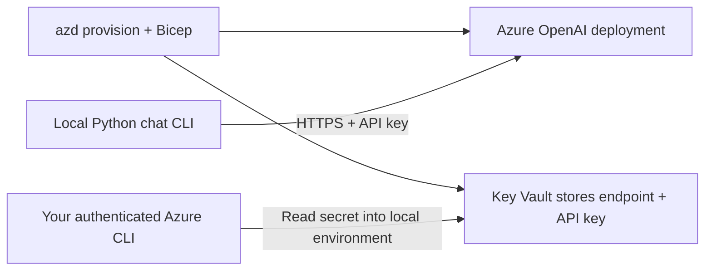

# Azure OpenAI Chat — Локальный CLI и инфраструктура AZD

**Уровень:** Средний · **Время:** 35–60 минут включая настройку

Этот пример развертывает **ресурс Azure OpenAI и Key Vault**, затем запускает
интерактивный Python чат CLI **на вашем компьютере**. Он не размещает веб-приложение
или контейнерное приложение. Модель по умолчанию — `gpt-4.1` версии `2025-04-14`, с
емкостью развертывания `GlobalStandard` 20. Перед развертыванием проверьте
текущую доступность и квоты в выбранном регионе; даты жизненного цикла моделей могут изменяться.

## Цели обучения

- Развернуть инфраструктуру модели с помощью Bicep и azd.
- Получить API-ключ из Key Vault без вывода его в результаты развертывания.
- Отправлять запросы Chat Completions и поддерживать историю разговора.
- Интерпретировать количество токенов и ограничения оценки стоимости.



В этом примере нет интеграции с управляемой идентичностью во время выполнения, отказоустойчивости в нескольких регионах, пользовательского
ограничения скорости, режима потоковой передачи или размещённых вычислений. SDK OpenAI
выполняет до двух повторных попыток при ошибках, допустимых для повторения; CLI сообщает о оставшихся ошибках.

## Требования

- Текущая стабильная версия [azd](https://learn.microsoft.com/azure/developer/azure-developer-cli/install-azd)
  (выпуск на момент обзора: 1.37.2).
- [Azure CLI](https://learn.microsoft.com/cli/azure/install-azure-cli).
- Python **3.10+** (рекомендуется 3.11) и виртуальное окружение.
- Подписка Azure с разрешением на создание ресурсов Cognitive Services и Key Vault,
  развертывание моделей и чтение секретов из хранилища.
- Региональная доступность и квота `GlobalStandard` для `gpt-4.1`. Требования к доступу
  зависят от подписки и функции; нет гарантированного срока одобрения.

```bash
azd version
az version
python --version
azd auth login
az login
```

Это отдельные сессии аутентификации. Перед выполнением приведённых ниже команд выберите одну и ту же подписку в обеих
утилитах.

## Быстрый старт (Bash)

Запустите из корня репозитория:

```bash
cd examples/azure-openai-chat
azd env new myopenai
azd provision
```

Выберите поддерживаемый регион. Создание ресурсов включает группу ресурсов, аккаунт OpenAI,
развертывание модели, Key Vault и секреты `openai-endpoint`/`openai-api-key`.
Нет **сервисов для развертывания** в `azure.yaml`.

Загрузите небезопасные выходные данные и получите секрет в текущую оболочку:

```bash
export AZURE_OPENAI_ENDPOINT="$(azd env get-value AZURE_OPENAI_ENDPOINT)"
export AZURE_OPENAI_MODEL="$(azd env get-value AZURE_OPENAI_MODEL)"
KV_NAME="$(azd env get-value AZURE_KEY_VAULT_NAME)"
export AZURE_OPENAI_API_KEY="$(az keyvault secret show \
  --vault-name "$KV_NAME" --name openai-api-key --query value --output tsv)"

python -m venv .venv
source .venv/bin/activate
python -m pip install -r src/requirements.txt
python src/chat.py
```

В PowerShell активируйте с помощью `.\.venv\Scripts\Activate.ps1` и назначьте окружение
переменные с `$env:AZURE_OPENAI_ENDPOINT = azd env get-value AZURE_OPENAI_ENDPOINT`
(и аналогично для модели). Получите ключ API с помощью
`$env:AZURE_OPENAI_API_KEY = az keyvault secret show --vault-name $KV_NAME --name openai-api-key --query value -o tsv`.
Сначала задайте `$KV_NAME = azd env get-value AZURE_KEY_VAULT_NAME`.

Не выводите, не добавляйте в коммиты и не вставляйте ключ API в отчёты об ошибках. CLI читает переменные окружения процесса;
он **не** получает секреты из Key Vault и не загружает файлы `.env`.
`config.py` проверяет endpoint, лимит токенов и температуру при запуске.

Ожидаемый вывод (содержание и использование варьируются):

```text
Azure OpenAI Chat Application
Model: gpt-4.1
...
You: Say hello in one sentence.
Assistant: Hello! How can I help you today?
[Tokens: ... | Cost: $...]
```

Команды: `stats` показывает итоги, `clear` очищает историю беседы, а
`quit`/`exit` завершает сеанс. Нет команд `--stream`, `--show-tokens`, `tokens`,
или `cost`.

## Проверка развертывания

После загрузки вышеуказанных переменных оболочки:

```bash
curl --fail-with-body \
  "${AZURE_OPENAI_ENDPOINT%/}/openai/deployments/${AZURE_OPENAI_MODEL}/chat/completions?api-version=2024-10-21" \
  -H "Content-Type: application/json" \
  -H "api-key: $AZURE_OPENAI_API_KEY" \
  -d '{"messages":[{"role":"user","content":"Say hello!"}],"max_tokens":50}'

az keyvault secret list --vault-name "$KV_NAME" --query "[].name" -o table
```

Успех: API возвращает HTTP 200 с `choices[0].message.content` и `usage`;
хранилище перечисляет `openai-api-key` и `openai-endpoint`. Успешное развертывание ARM
само по себе не подтверждает вывод результатов.

## Файлы и конфигурация

```text
azure.yaml                         # Infrastructure-only AZD project
infra/main.bicep                   # Subscription deployment
infra/main.parameters.json         # Environment, location, principal ID
infra/resources/openai.bicep       # Account + model
infra/resources/keyvault.bicep     # Vault + deploying user's secret access policy
infra/resources/secrets.bicep      # Writes secrets, no key output
src/chat.py                        # Interactive CLI
src/config.py                      # Environment validation
src/requirements.txt               # Python packages
```

Чтобы изменить предоставленную модель/версию/емкость, отредактируйте значения по умолчанию в
`infra/main.bicep` и запустите `azd provision`. Установка `AZURE_OPENAI_MODEL` в вашей
оболочке выбирает только **существующее имя развертывания**; это не развертывает другую модель.

| Переменная времени выполнения | Значение по умолчанию / источник |
|---|---|
| `AZURE_OPENAI_ENDPOINT` | Обязательно; вывод azd, не секретный |
| `AZURE_OPENAI_API_KEY` | Обязательно; получено из Key Vault |
| `AZURE_OPENAI_MODEL` | `gpt-4.1`; имя развертывания Azure |
| `AZURE_OPENAI_MAX_TOKENS` | 800 (диапазон проверки 1–4096) |
| `AZURE_OPENAI_TEMPERATURE` | 0.7 (диапазон 0–2) |
| `AZURE_OPENAI_INPUT_PRICE_PER_1K` | 0.002 USD; примерная ставка для ввода без кеша |
| `AZURE_OPENAI_OUTPUT_PRICE_PER_1K` | 0.008 USD; примерная ставка для вывода |

## Стоимость и ограничения безопасности

Отображаемая стоимость — это **оценка**, а не фактический счет Azure. Она умножает использование API токенов
на настроенные тарифы и не учитывает скидки на кешированный ввод,
региональные/вариации SKU, налоги, изменения цен или неудачные/повторные вызовы.
Переопределяйте **обе ставки**, если используете другую модель или SKU, и проверьте актуальную
[ценообразование Azure OpenAI](https://azure.microsoft.com/pricing/details/cognitive-services/openai-service/).

Для примера, 100 запросов с 500 токенами ввода без кеша и 200 токенами вывода каждый
при стандартных тарифах обойдутся в `100 × (500/1000 × .002 + 200/1000 × .008) = $0.26`.
Операции и хранение в Key Vault оплачиваются отдельно. Для этого локального CLI нет фиксированной платы $50 в месяц,
и шаблон не использует хостинговые вычисления.

Хранилище использует политику доступа для разворачивающего субъекта; это не RBAC или
пример приложения с управляемой идентичностью. Публичные конечные точки и аутентификация с помощью API-ключа
используются для обучения. Ограничьте права доступа и добавьте соответствующие идентификационные/сетевые
средства контроля перед адаптацией для производства.

## Практические упражнения

### 1. Проверьте контекст и сбросьте его

**Начало:** запуск CLI. **Цель:** наблюдать историю.
Скажите «Запомни слово кедр», затем спросите «Какое слово я попросил тебя запомнить?»
Выполните `stats`; два успешных хода должны засчитаться как два обмена сообщениями.
Выполните `clear` и `stats`; количество обменянных сообщений должно быть нулём (общее количество токенов остаётся).
Точные формулировки модели не являются детерминированными.

### 2. Изменить лимит ответа

**Начало:** выйти из CLI, оставаясь в том же шелле.
Выполните `export AZURE_OPENAI_MAX_TOKENS=100`, перезапустите `python src/chat.py` и попросите
краткое объяснение azd. Проверьте, что баннер показывает 100.
Восстановите с помощью `unset AZURE_OPENAI_MAX_TOKENS`. Меньший лимит ответа не
уменьшает уже отправленные токены истории.

### Распространённые проблемы

- **Отсутствуют переменные окружения:** провиженинг не экспортирует значения в оболочку;
  повторите шаги экспорта. Новый терминал нуждается в них снова.
- **403 при чтении Key Vault:** проверьте подписку/вход в Azure CLI и principal
  в политике доступа к хранилищу. Изменения в политике могут занять время для распространения.
- **404 при inference:** проверьте имя развертывания, конечную точку и статус развертывания.
- **429 при inference:** дождитесь сброса лимитов запросов; проверьте региональную квоту модели.
  CLI удаляет неудачные попытки из истории, поэтому повтор не дублирует их.
- **Длина контекста:** пример не обрезает длинные разговоры; используйте `clear`.
- **Модель недоступна/снята с поддержки:** проверьте текущую доступность модели и обновите
  модель/версию/SKU вместе; версия API и версия модели — разные настройки.

## Очистка и дальнейшие шаги

```bash
azd down
unset AZURE_OPENAI_API_KEY
```

Срок хранения в режиме мягкого удаления Key Vault составляет семь дней; очистка требует отдельных разрешений.
Нет утверждённого тестового набора; не запускайте несуществующую команду `pytest tests/`.
Добавьте имитированные тесты API перед расширением кода.

[Примеры контейнеров](../../../../examples/container-app) · [Шаблон архитектуры розничной торговли](../retail-scenario.md) ·
[Главная курса](../../README.md) · [Сообщить о проблеме](https://github.com/microsoft/AZD-for-beginners/issues)

---

<!-- CO-OP TRANSLATOR DISCLAIMER START -->
**Отказ от ответственности**:
Этот документ был переведен с использованием сервиса машинного перевода [Co-op Translator](https://github.com/Azure/co-op-translator). Несмотря на наши усилия по обеспечению точности, имейте в виду, что автоматический перевод может содержать ошибки или неточности. Оригинальный документ на его исходном языке следует считать авторитетным источником. Для получения критически важной информации рекомендуется обратиться к профессиональному человеческому переводу. Мы не несем ответственности за любые недоразумения или неправильные толкования, возникшие в результате использования этого перевода.
<!-- CO-OP TRANSLATOR DISCLAIMER END -->