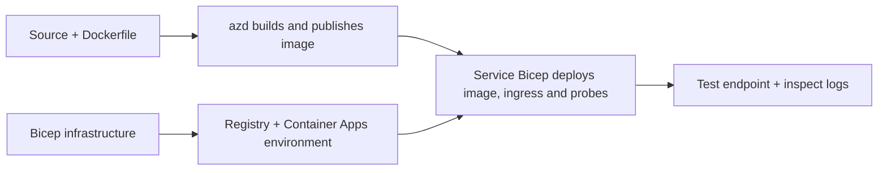

# Примеры развертывания Container App с AZD

Этот каталог содержит два обучающих примера с исходным кодом, Dockerfile,
инфраструктурой Bicep и `azure.yaml`. Ни один из них не предназначен для продакшена.

## Выберите пример

| Пример | Что реализовано | Требования |
|---|---|---|
| [Простой Flask API](../../../../examples/container-app/simple-flask-api) | Один Python CRUD API, элементы в памяти, health probes, HTTP масштабирование | Базовые знания CLI и HTTP |
| [Микросервисы с двумя сервисами](../../../../examples/container-app/microservices) | Node.js шлюз, внутренний сервис продуктов Python только для чтения, телеметрия и масштабирование | Сначала выполните пример с одним сервисом |

Уделите 30–60 минут включая настройку и проверку. Время выделения ресурсов в Azure может варьироваться.

## Требования

- [Azure Developer CLI](https://learn.microsoft.com/azure/developer/azure-developer-cli/install-azd)
- [Azure CLI](https://learn.microsoft.com/cli/azure/install-azure-cli) для команд проверки
- Docker с запущенным демоном для сборки этих образов контейнеров
- Подписка Azure с разрешениями на создание ресурсов и достаточной региональной квотой
- Bash для примеров оболочки или эквивалентные команды PowerShell

```bash
azd version
az version
docker info
azd auth login
az login
```

Эти два инструмента имеют отдельные сеансы входа. Используйте актуальный стабильный azd; текущий
опубликованный релиз на момент проверки – версия 1.37.2. Более старые минимальные версии не являются
гарантией совместимости.

## Быстрый старт

Из корня репозитория:

```bash
cd examples/container-app/simple-flask-api
azd env new flask-demo
azd up
API_URL=$(azd env get-value API_ENDPOINT)
curl --fail-with-body "${API_URL}/health"
```

Ожидается: HTTP 200 с `"status": "healthy"`. Следуйте примеру README для создания,
чтения, обновления и удаления элемента, а также для просмотра логов.



Первоначальное развертывание использует публичный образ hello-world на порту 80. Специфичные для сервиса
файлы параметров Bicep позволяют `azd deploy` заменить его на построенный образ приложения
и правильный порт/пробы приложения (8000 для Flask/product, 8080 для шлюза).
Сохраняйте эти файлы с их `azure.yaml` `module` настройками.

## Конфигурация: что что меняет

`azure.yaml` выбирает исходные директории, языки, хосты и модули развертывания.
CPU/память контейнера, ingress, пробы, количество реплик и правила масштабирования определяются
в **Bicep**, а не произвольными `resources`, `scale` или `regions` свойствами сервиса.

`azd env set SOME_VALUE ...` хранит значение локально. Он изменяет развернутый
ресурс только тогда, когда параметр, отображение окружения или хук явно используют это
значение. В этих примерах не используются `MAX_REPLICAS`, `SCALE_TO_ZERO_TIMEOUT`,
`CONTAINER_APP_REPLICA_TYPE` или пользовательские настройки canary из значений окружения azd.
Измените соответствующий Bicep и выполните `azd up` для повторного развертывания и деплоя.

Не размещайте исходники приложения под `infra/`. `project` должен указывать на исходную
директорию, содержащую Dockerfile и манифест зависимостей.

## Мониторинг и расходы

- `azd monitor --logs` открывает портал; это не поток логов терминала.
  Используйте `az containerapp logs show --follow` с фактическим именем ресурса.
- Простой API записывает stdout логи, собираемые через Container Apps/Log Analytics.
  Развернутый ресурс Application Insights не инструментирован автоматически.
- Шлюз микросервисов использует SDK Node.js Application Insights; сервис на Python
  экспортирует трассировки логов приложения. Полное трассирование запросов/зависимостей Python
  не настроено.
- Масштабирование до нуля может уменьшить затраты на вычисления, но регистрация и прием/хранение логов
  все равно могут стоить денег. Установленные значения микросервисов поддерживают запущенные реплики.
  Оцените свой регион и использование в
  [калькуляторе цен Azure](https://azure.microsoft.com/pricing/calculator/).

## Расширенные паттерны — не включенные реализации

Это направления проектирования, а не дополнительные локальные проекты или сниппеты «скопировать и запустить»:

- **Постоянные данные и аутентификация:** замените in-memory хранилища и добавьте
  аутентификацию/авторизацию Microsoft Entra ID перед производством.
- **Blue-green/canary:** используйте режим нескольких ревизий Container Apps, метки ревизий,
  веса трафика, проверку состояния и процедуры отката.
  В этих примерах нет конфигурации azd `deploymentStrategy: canary`.
  См. [управление ревизиями](https://learn.microsoft.com/azure/container-apps/revisions).
- **Мульти-регион:** создавайте отдельные окружения и приложения в Bicep и проектируйте
  глобальную маршрутизацию и консистентность данных. Список сервисов `regions` не является механизмом развертывания azd.

- **Рабочие очередей:** добавьте исходники воркера, зависимости, ресурсы очередей,
  управляемую идентичность с ролями на уровне данных и аутентифицированное правило масштабирования.
  Не копируйте пустой путь `src/worker` и не ждите запускаемого проекта.
- **Dapr:** создайте компоненты, настройте сайдкар, установите подходящий SDK
  и реализуйте обработку ошибок состояния/pub-sub.
- **Секреты:** используйте управляемую идентичность и назначение ролей, где это возможно.
  Простой создание Key Vault не дает приложениям доступ или загрузку секретов.

## Очистка

Из директории примера:

```bash
azd down
```

Просмотрите запросы на удаление и подтвердите, что выделенная группа ресурсов удалена.
Не используйте эти примеры как основу для продакшена без дополнительного проектирования и тестов.

[Индекс примеров](../README.md) · [Главная страница курса](../../README.md) ·
[Документация Container Apps](https://learn.microsoft.com/azure/container-apps/) ·
[Сообщить о проблеме](https://github.com/microsoft/AZD-for-beginners/issues)

---

<!-- CO-OP TRANSLATOR DISCLAIMER START -->
**Отказ от ответственности**:
Этот документ был переведен с использованием сервиса машинного перевода [Co-op Translator](https://github.com/Azure/co-op-translator). Несмотря на наши усилия по обеспечению точности, имейте в виду, что автоматический перевод может содержать ошибки или неточности. Оригинальный документ на его исходном языке следует считать авторитетным источником. Для получения критически важной информации рекомендуется обратиться к профессиональному человеческому переводу. Мы не несем ответственности за любые недоразумения или неправильные толкования, возникшие в результате использования этого перевода.
<!-- CO-OP TRANSLATOR DISCLAIMER END -->