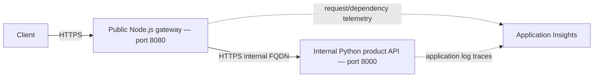

# Микросервисы с двумя сервисами — Azure Container Apps

**Уровень:** Средний · **Время:** 45–60 минут включая настройку

Этот обучающий пример реализует **API-шлюз на Node.js** и **Python-сервис только для чтения продуктов**. Включены исходники, Dockerfile, Bicep и конфигурация azd.

Это не боевой, неготовый к производству система.

## Чему вы научитесь

- Развертывать два сервиса независимо.
- Использовать внутренний FQDN бэкенда по HTTPS.
- Проверять ответы успешных запросов, не найденных и недоступных сервисов.
- Понимать телеметрию и границы независимого масштабирования.



Каталог продуктов содержит пять фиксированных продуктов в памяти. **Обработчиков POST,
PUT или DELETE**, базы данных, Service Bus, сервиса заказов/пользователей/уведомлений,
C# или Go кода нет. Это идеи для будущей разработки, а не включённые функции.
Шлюз не аутентифицирует пользователей; внутренний вход не заменяет
авторизацию в приложении.

## Требования

Сначала завершите [одинарный Flask API](../../../../../examples/container-app/simple-flask-api).
Установите текущую стабильную версию azd (на момент обзора выпущена версия 1.37.2), Azure CLI
и Docker с запущенным демоном. Вам потребуется подписка Azure,
права на создание ресурсов и региональная квота Container Apps.

```bash
azd version
az version
docker info
azd auth login
az login
```

Используйте одну и ту же подписку в обоих CLI-инструментах. Команды ниже используют Bash.

## Развертывание и проверка

Из корня репозитория:

```bash
cd examples/container-app/microservices
azd env new microservices-demo
azd up
GATEWAY_URL=$(azd env get-value API_GATEWAY_URL)
RG_NAME=$(azd env get-value AZURE_RESOURCE_GROUP)
GATEWAY_NAME=$(azd env get-value API_GATEWAY_NAME)
PRODUCT_NAME=$(azd env get-value PRODUCT_SERVICE_NAME)

curl --fail-with-body "${GATEWAY_URL}/health"
curl --fail-with-body "${GATEWAY_URL}/api/products"
curl --fail-with-body "${GATEWAY_URL}/api/products/1"
curl -i "${GATEWAY_URL}/api/products/999"
```

**Успех:** health 200; list 200 с **пятью** продуктами; продукт 1 — это ноутбук
стоимостью 999.99 и запасом 50; неизвестный продукт возвращает 404.
Описания включены в ответы; временные метки варьируются.

Изначальное предоставление использует публичные изображения hello-world на порту 80, чтобы не пытаться
загрузить несуществующие изображения из пустого реестра. Специфичные для сервиса Bicep-модули
и файлы параметров заменяют их на созданные изображения и порты/пробы приложений во время
`azd deploy`. Основные параметры сохраняют имена опубликованных изображений для последующего развертывания.

## Сервисы и сеть

| Сервис | Открытые конечные точки | Ресурсы по умолчанию |
|---|---|---|
| Gateway | GET `/`, `/health`, `/api/products`, `/api/products/:id` | 1 vCPU, 2 GiB, 2–20 реплик |
| Product | GET `/`, `/health`, `/products`, `/products/<id>` | 0.5 vCPU, 1 GiB, 1–10 реплик |

Вход для продукта имеет `external: false` и `allowInsecure: false`. Bicep внедряет
`PRODUCT_SERVICE_URL=https://<actual-internal-fqdn>` в шлюз. HTTP будет
перенаправлять; HTTPS совпадает с настроенным входом. Краткое DNS-имя должно совпадать с
**фактическим именем Container App**, а не логическим ключом сервиса `product-service`.
Не пытайтесь обращаться к внутреннему URL напрямую с вашего ноутбука.

У шлюза есть таймаут в пять секунд для вызовов продукта. Отсутствующие ID продукта
возвращают 404; ошибки транспорта/другие ошибки бэкенда возвращают 503. Шлюз
`/health` проверяет только шлюз, а не доступность бэкенда.

## Файлы и конфигурация

```text
azure.yaml
infra/main.bicep
infra/main.parameters.json
infra/abbreviations.json
infra/core/container-apps-environment.bicep
infra/core/monitor.bicep
infra/app/api-gateway.bicep
infra/app/api-gateway.parameters.json
infra/app/product-service.bicep
infra/app/product-service.parameters.json
src/api-gateway/{app.js,package.json,Dockerfile}
src/product-service/{main.py,requirements.txt,Dockerfile}
```

Масштабирование, CPU/память, порты и пробы задаются в `infra/app/*.bicep`. Измените эти
файлы и выполните `azd up` для применения инфраструктуры и повторного развертывания. В этом примере нет
параметра переменной окружения `GATEWAY_MAX_REPLICAS`.

Для изменений только кода:

```bash
azd deploy product-service
azd deploy api-gateway
```

Node-образ использует Node 22; Python-образ использует Python 3.11. Оба слушают
`0.0.0.0`. Вход/пробы используют порт 8080 (шлюз) и 8000 (продукт) соответственно.

## Локальная разработка с Docker

Запускайте из этой директории примера. Используйте сеть, созданную пользователем, **а не `localhost`,
чтобы один контейнер мог достучаться до другого**:

```bash
docker network create azd-microservices-demo
docker build -t local-product ./src/product-service
docker build -t local-gateway ./src/api-gateway
docker run -d --name azd-product --network azd-microservices-demo local-product
docker run -d --name azd-gateway --network azd-microservices-demo \
  -p 8080:8080 -e PRODUCT_SERVICE_URL=http://azd-product:8000 local-gateway
curl --fail-with-body http://localhost:8080/api/products
```

Ожидается: пять продуктов. HTTP используется только для этой локальной Docker-сети.

```bash
docker stop azd-product azd-gateway
docker rm azd-product azd-gateway
docker network rm azd-microservices-demo
```

## Мониторинг

```bash
az containerapp logs show --name "$GATEWAY_NAME" --resource-group "$RG_NAME" --follow
# In a separate terminal:
az containerapp logs show --name "$PRODUCT_NAME" --resource-group "$RG_NAME" --tail 100
```

`azd monitor --logs` открывает портал; он не стримит логи терминала.
Node SDK собирает запросы/зависимости шлюза. Python `AzureLogHandler`
экспортирует **трейсы логов**, а не автоматические запросы Flask, SQL-зависимости или полные
распределённые трассировки. OpenCensus — устаревший SDK; при расширении этого примера предпочитайте Azure Monitor OpenTelemetry.


```kusto
requests
| where timestamp > ago(1h)
| where name contains "products"
| summarize RequestCount=count(), AvgDuration=avg(duration) by bin(timestamp, 5m)
```

Для сообщений приложений на Python:

```kusto
traces
| where timestamp > ago(1h)
| where message contains "products"
| project timestamp, message, severityLevel
```

Допускается задержка приема и выборки; не ожидается точное количество запросов или
гарантированная задержка. Кастомные оповещения или панели мониторинга не настроены.

## Практические упражнения

### Упражнение 1: Измените каталог

**Исходная точка:** `src/product-service/main.py`.
**Цель:** проверить независимое развертывание сервиса.
Измените запас ноутбука с 50 на 49 в фиксированном списке `products`, запустите
`azd deploy product-service`, затем выполните запрос `${GATEWAY_URL}/api/products/1`.

**Критерии успеха / решение:** HTTP 200 с `"stock":49`. Восстановите 50 и повторно разверните.
**Типичная ошибка:** изменение шлюза вместо сервиса, владеющего каталогом.
Это изменяет исходные данные, а не постоянную базу данных запасов.

### Упражнение 2: Проверьте конфигурацию реплик

**Исходная точка:** `infra/app/product-service.bicep`.
**Цель:** наблюдать за изменением инфраструктуры без предположений по автоскейлингу.
Измените `minReplicas: 1` на `minReplicas: 2`, запустите `azd up`, затем:

```bash
az containerapp show --name "$PRODUCT_NAME" --resource-group "$RG_NAME" \
  --query properties.template.scale -o json
```

**Критерии успеха:** минимальное значение настроено на 2, максимальное остается 10.
Восстановите минимум 1 и запустите `azd up`.
**Типичная ошибка:** `azd deploy` самостоятельно не применяет изменения к нерелевантной общей
инфраструктуре. Не устанавливайте `maxReplicas` в ноль в качестве симуляции отказа.
Это проверка конфигурации, а не нагрузочного теста или гарантированного мгновенного числа реплик.

### Упражнение 3: Локальное тестирование обработки недоступного сервиса

**Исходная точка:** оба локальных контейнера Docker выше запущены.
**Цель:** различить сбой бэкенда и отсутствие продукта.
Остановите только контейнер продукта:

```bash
docker stop azd-product
curl -i http://localhost:8080/api/products
docker start azd-product
curl --fail-with-body http://localhost:8080/api/products
```

**Критерии успеха:** во время остановки шлюз возвращает 503 с
`"error":"Product service unavailable"`; после перезапуска список возвращает 200.
При необходимости повторите после короткой задержки запуска.
**Типичная ошибка:** остановка шлюза тестирует другой сбой (отсутствие HTTP-ответа).

## Расходы и пробелы в производстве

Минимальное количество реплик по умолчанию поддерживает вычисления в работе. Реестр и мониторинг также приводят к
расходам. Нет валидированной фиксированной стоимости $50/месяц: оцените региональные CPU/память,
часы работы реплик, запросы, реестр и хранение журналов в
[калькуляторе цен Azure](https://azure.microsoft.com/pricing/calculator/).
Удаляйте обучающие ресурсы своевременно.

Производственная работа включает аутентификацию/авторизацию, управляемые идентичности с областью действия,
постоянные данные, валидацию входящих/исходящих данных, поддерживаемые инструменты наблюдения,
тестирование нагрузки/отказа, CI/CD, оповещения и процедуры восстановления. Добавление сервиса заказов,
очереди или базы данных – это отдельная задача реализации, а не завершённое
упражнение или уже доступный здесь функционал.

## Устранение неполадок и очистка

- **Образ не найден при первом развертывании:** bootstrap должен использовать публичный образ;
  проверьте значения по умолчанию параметра основного образа и сопоставления модулей развертывания.
- **503 продукты:** проверьте логи продукта, ревизию образа и внедренный внутренний HTTPS URL.
- **404 неожиданный путь:** API продукта только для чтения; проверьте маршрут, а не несуществующий обработчик CRUD.
- **Отсутствие телеметрии:** проверьте строки подключения во время выполнения без их раскрытия и
  допускайте задержку приема. Таблицы запросов Python не заполняются его обработчиком логов.

Из этой примерной директории:

```bash
azd down
```

Ознакомьтесь с запросами на удаление и убедитесь, что выделенная группа ресурсов удалена.

[Предыдущая: Flask API](../../../../../examples/container-app/simple-flask-api) · [Следующая: приложение базы данных](../../../../../examples/database-app) ·
[Разработка ИИ](../../../docs/chapter-02-ai-development/README.md) ·
[Домашняя страница курса](../../../README.md) · [Сообщить о проблеме](https://github.com/microsoft/AZD-for-beginners/issues)

---

<!-- CO-OP TRANSLATOR DISCLAIMER START -->
**Отказ от ответственности**:
Этот документ был переведен с использованием сервиса машинного перевода [Co-op Translator](https://github.com/Azure/co-op-translator). Несмотря на наши усилия по обеспечению точности, имейте в виду, что автоматический перевод может содержать ошибки или неточности. Оригинальный документ на его исходном языке следует считать авторитетным источником. Для получения критически важной информации рекомендуется обратиться к профессиональному человеческому переводу. Мы не несем ответственности за любые недоразумения или неправильные толкования, возникшие в результате использования этого перевода.
<!-- CO-OP TRANSLATOR DISCLAIMER END -->