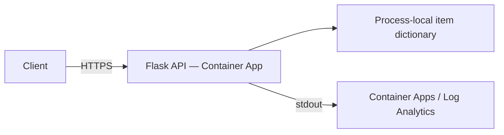

# Простой Flask API — Azure Container Apps

**Уровень:** Начинающий · **Время:** 30–45 минут включая настройку

Разверните Python Flask CRUD API с помощью Azure Developer CLI (azd). Источник, Dockerfile,
Bicep и параметры развертывания включены. Это **образец для изучения**, а не
готовый к продакшен API.

## Чему вы научитесь

- Создавать и публиковать контейнер через azd.
- Настраивать входящий трафик и проверки живости/готовности.
- Проверять ответы CRUD и просматривать логи приложения.
- Понимать, почему данные в памяти не подходят для долговременных приложений.



**Важно:** элементы хранятся в одном процессе. По умолчанию **один воркер Gunicorn,
0–1 реплик**, что специально избегает несогласованных данных между воркерами/репликами.
Данные теряются при перезапуске, изменении ревизии или масштабировании до нуля. Для увеличения числа реплик
требуется общее постоянное хранилище. API не имеет аутентификации и авторизации.

## Требования

- [Текущая стабильная версия azd](https://learn.microsoft.com/azure/developer/azure-developer-cli/install-azd)
  (опубликован релиз на момент проверки: 1.37.2).
- [Azure CLI](https://learn.microsoft.com/cli/azure/install-azure-cli) для проверки.
- Docker с запущенным демоном; требуется для стандартной локальной сборки образа.
- Подписка Azure, разрешения на создание ресурсов и региональная квота Container Apps.
- Bash для команд ниже (или эквивалент PowerShell).
- Python 3.11 для необязательной локальной разработки.

```bash
azd version
az version
docker info
azd auth login
az login
```

CLI инструменты имеют отдельные сессии входа. Используйте одну и ту же подписку в обоих.

## Быстрый старт

Из корня репозитория:

```bash
cd examples/container-app/simple-flask-api
azd env new flask-demo
azd up
API_URL=$(azd env get-value API_ENDPOINT)
RG_NAME=$(azd env get-value AZURE_RESOURCE_GROUP)
API_NAME=$(azd env get-value API_NAME)
curl --fail-with-body "${API_URL}/health"
```

Ожидается: HTTP 200 и JSON с `"status":"healthy"`,
`"service":"simple-flask-api"` и текущим UTC timestamp.
Развертывание и сборка образа обычно занимают несколько минут; время варьируется.

Первоначальное развертывание использует публичный образ hello-world, слушающий порт 80.
`azure.yaml` выбирает `infra/app/api.bicep` и соответствующий файл параметров для
развертывания сервиса, что переключает образ, входящий трафик и проверки на порт 8000.
Не удаляйте эти параметры развертывания.

## Проверка CRUD

Последовательно выполните следующие команды, пока та же реплика активна:

```bash
# Create: HTTP 201; note the returned id (1 for a fresh process).
curl -i -X POST "${API_URL}/api/items" \
  -H "Content-Type: application/json" \
  -d '{"name":"Test Item","description":"My first item"}'

# Read list: HTTP 200, total 1 in a fresh process.
curl --fail-with-body "${API_URL}/api/items"

# Replace 1 if your create response returned another id.
curl --fail-with-body "${API_URL}/api/items/1"
curl -i -X PUT "${API_URL}/api/items/1" \
  -H "Content-Type: application/json" -d '{"name":"Updated Item"}'
curl -i -X DELETE "${API_URL}/api/items/1"
curl -i "${API_URL}/api/items/1"
```

Успех: POST 201, чтение/PUT 200, DELETE 204 без тела, затем отсутствующий элемент 404.
Некорректный или не объект JSON или пустое имя возвращают 400.
Если элемент исчезает между запросами, проверьте перезапуск или масштабирование до нуля;
это преднамеренное ограничение памяти, а не персистентность.

| Endpoint | Методы |
|---|---|
| `/` | GET — информация о сервисе |
| `/health` | GET — проверки живости/готовности |
| `/api/items` | GET, POST |
| `/api/items/{id}` | GET, PUT, DELETE |

## Логи и конфигурация

```bash
az containerapp logs show --name "$API_NAME" --resource-group "$RG_NAME" --follow
```

Ожидается: запуск Gunicorn, логи доступа запросов и сообщения приложения.
`azd monitor --logs` открывает просмотр портала; он не потоковый в терминал.
Application Insights развернут, но **не инструментарий в этом Flask коде**;
используйте Container Apps/Log Analytics для логов stdout.

Отредактируйте `infra/app/api.bicep` для CPU/памяти, лимитов реплик или правил масштабирования, затем
выполните `azd up`. По умолчанию 0.5 vCPU, 1 GiB, минимум 0 / максимум 1 реплика, и
порог HTTP — 50 одновременных запросов. Масштабирование до нуля может вызвать задержку «холодного запуска».

Произвольные `azd env set MAX_REPLICAS`, `API_KEY`, `LOG_LEVEL` или
`SCALE_TO_ZERO_TIMEOUT` значения **не связаны с этим шаблоном или приложением**.
Установка значения не автоматически делает его переменной окружения во время выполнения.
Образ явно привязан к порту 8000; если меняете порт, обновите Dockerfile, Bicep ingress и проверки
вместе.

## Файлы

```text
azure.yaml
infra/main.bicep
infra/main.parameters.json
infra/app/container-apps.bicep       # Environment, registry, monitoring
infra/app/api.bicep                  # App, ingress, probes, scale settings
infra/app/api.parameters.json        # Image and resource values for azd deploy
src/app.py
src/Dockerfile
src/requirements.txt
```

## Локальная разработка

Из этой директории примера:

```bash
python -m venv .venv
source .venv/bin/activate  # PowerShell: .\.venv\Scripts\Activate.ps1
python -m pip install -r src/requirements.txt
python src/app.py
```

В другом терминале протестируйте `http://localhost:8000/health` и CRUD эндпоинты.
Или соберите и запустите реальный образ:

```bash
docker build -t flask-api:local ./src
docker run --rm -p 8000:8000 flask-api:local
```

Для изменений только в коде после первого развертывания выполните `azd deploy api`.
Для изменений в Bicep выполните `azd up` для повторного развертывания.

## Практические упражнения

### 1. Проверка отклонения некорректного ввода

**Исходная точка:** развернутый API, `API_URL` выше.
**Цель:** проверить, что API отклоняет некорректный JSON и отсутствующие имена.

```bash
curl -i -X POST "${API_URL}/api/items" \
  -H "Content-Type: application/json" -d '[]'
curl -i -X POST "${API_URL}/api/items" \
  -H "Content-Type: application/json" -d '{"name":""}'
```

**Критерии успеха / решение:** оба возвращают 400 с JSON ошибкой, а не 500.
**Распространенная проблема:** отсутствие заголовка JSON content-type.

### 2. Добавить эндпоинт только для чтения

**Исходная точка:** `src/app.py`. **Цель:** расширить и снова развернуть API.
Добавьте это перед блоком `if __name__ == '__main__':`:

```python
@app.route('/version', methods=['GET'])
def version():
    return jsonify({'version': '1.0.0'})
```

Запустите `azd deploy api`, затем `curl --fail-with-body "${API_URL}/version"`.
**Критерии успеха:** HTTP 200 и `{"version":"1.0.0"}`.
**Распространенная проблема:** добавление маршрута после блокирующего вызова `app.run()` при
тестировании с `python src/app.py`.

### Проверка знаний

Почему одного воркера недостаточно для долговременных данных? Потому что даже один процесс теряет
свой словарь при перезапуске. Продакшен версия требует постоянного общего хранилища,
аутентификации, авторизации, миграций, тестов и мониторинга.

## Затраты и устранение неполадок

Это не гарантированное развертывание с нулевой стоимостью: Basic реестр и хранение/прием логов
могут привести к расходам даже при вычислениях приложения равных нулю. Используйте
[калькулятор цены](https://azure.microsoft.com/pricing/calculator/) для вашего региона.

- **Неудача сборки Docker:** подтвердите `docker info`, доступ в сеть и зависимости.
- **Нездоровое приложение:** проверьте логи консоли/системы и убедитесь, что порт образа, ingress,
  и проверки совпадают. Заполнитель не должен проверяться на Flask порту.
- **403/права:** подтвердите подписку и разрешения на создание ресурсов.
- **Исчезновение элементов:** состояние в памяти сбрасывается при перезапуске/масштабировании до нуля; добавьте базу данных
  для долговременного поведения.

## Очистка и следующие шаги

```bash
azd down
```

Проверьте запрос на удаление и подтвердите, что выделенная группа ресурсов удалена.
Не используйте разрушительную очистку для группы ресурсов с несвязанными данными.

[Далее: приложение с базой данных](../../../../../examples/database-app) · [Микросервисы](../../../../../examples/container-app/microservices) ·
[Обзор контейнеров](../README.md) · [Главная страница курса](../../../README.md) ·
[Сообщить о проблеме](https://github.com/microsoft/AZD-for-beginners/issues)

---

<!-- CO-OP TRANSLATOR DISCLAIMER START -->
**Отказ от ответственности**:
Этот документ был переведен с использованием сервиса машинного перевода [Co-op Translator](https://github.com/Azure/co-op-translator). Несмотря на наши усилия по обеспечению точности, имейте в виду, что автоматический перевод может содержать ошибки или неточности. Оригинальный документ на его исходном языке следует считать авторитетным источником. Для получения критически важной информации рекомендуется обратиться к профессиональному человеческому переводу. Мы не несем ответственности за любые недоразумения или неправильные толкования, возникшие в результате использования этого перевода.
<!-- CO-OP TRANSLATOR DISCLAIMER END -->