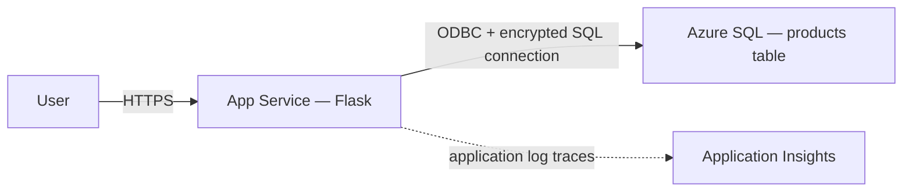

# Flask и Azure SQL на App Service

**Уровень:** Средний · **Время:** 30–60 минут включая подготовительные шаги

Этот пример развертывает Python Flask read API на **Linux App Service** и базу данных Azure SQL Basic.
Включены исходный код, Bicep и конфигурация azd. Это учебное приложение, а не архитектура базы данных для продакшена.


- Настройка зашифрованного подключения к SQL без сохранения учетных данных.
- Инициализация схемы перед запуском рабочих процессов Gunicorn.
- Проверка данных заливки, ответов об отсутствии записи и состояния базы данных.




Ресурсы: выделенная группа ресурсов, тарифный план B1 для Linux App Service, Web-приложение Python 3.11,
SQL сервер и база данных Basic на 2 ГБ, Application Insights и Log Analytics.
Web-приложение использует **деплой из исходников/ZIP и установку зависимостей через Oryx**;
`azd deploy` не строит и не деплоит необязательный Dockerfile.

## Предварительные требования

- Текущая стабильная версия [azd](https://learn.microsoft.com/azure/developer/azure-developer-cli/install-azd)
  (опубликованный релиз на момент проверки: 1.37.2).
- [Azure CLI](https://learn.microsoft.com/cli/azure/install-azure-cli) для проверки.
- Подписка Azure, права на создание перечисленных ресурсов и региональный квот.
- Python **3.11** для локальной разработки; зафиксированный `pyodbc==5.0.1` может требовать
  нативные инструменты сборки для новых версий Python.
- Microsoft ODBC Driver 18 (или 17) для SQL Server на локальных машинах. `pip install
  pyodbc` не устанавливает системный драйвер. Смотрите
  [установку ODBC](https://learn.microsoft.com/sql/connect/odbc/download-odbc-driver-for-sql-server).
- Docker только если тестируете необязательный контейнер локально.

```bash
azd version
az version
azd auth login
az login
```

Используйте одну и ту же подписку в обоих инструментах. В командах ниже используется Bash.

## Деплой

Из корня репозитория:

```bash
cd examples/database-app
azd env new sql-demo
azd provision
azd deploy
WEB_URL=$(azd env get-value WEB_APP_URI)
WEB_NAME=$(azd env get-value WEB_APP_NAME)
RG_NAME=$(azd env get-value AZURE_RESOURCE_GROUP)
```

Выберите поддерживаемый регион. `sqlAdminLogin` по умолчанию равен `sqladmin`; необходимый
`sqlAdminPassword` — безопасный параметр. Введите надежный пароль при запросе.
Не храните учётные данные деплоя в Git и отчетах о проблемах. Текущий интерполированный
строковый параметр ожидает пароль без ограничителей строки подключения, таких как
`;`; при использовании подобных значений адаптируйте экранирование.

Bicep задаёт команду запуска, которая выполняет `init_database()` **до** старта Gunicorn
воркеров. Это необходимо, потому что импорт `app:app` не выполняет
блок Python `if __name__ == '__main__'`. На новой базе данных инициализация
создаёт `products` и вставляет пять записей. Это простая учебная заготовка, а не
система для конкурентной миграции; используйте правильные миграции перед масштабированием инстансов.

Приложение выбирает установленный Microsoft ODBC Driver 18, затем 17, если строка подключения
явно не указывает драйвер. Если ни один из них отсутствует, запуск завершается ошибкой
с предложением установить драйвер. Проверьте доступность драйвера в выбранном
App Service рантайме, не делайте предположений.

## Проверка

```bash
curl --fail-with-body "${WEB_URL}/"
curl --fail-with-body "${WEB_URL}/health"
curl --fail-with-body "${WEB_URL}/products"
curl --fail-with-body "${WEB_URL}/products/1"
curl -i "${WEB_URL}/products/999"
```

Ожидается:

- `/` возвращает информацию об эндпоинте.
- `/health` возвращает 200 с `{"status":"healthy","database":"connected"}`.
- `/products` возвращает пять начальных товаров на новой базе данных.
- `/products/1` возвращает Laptop с ценой 1299.99.
- Несуществующий товар возвращает 404 с `{"error":"Product not found"}`.

API является только для чтения. Нет маршрутов POST/PUT/DELETE и пользовательского интерфейса в браузере.
При ошибке подключения к базе возвращается 503 из `/health`; это не успех.

## Файлы и конфигурация

```text
azure.yaml                         # Python App Service source deployment
infra/main.bicep
infra/main.parameters.json
infra/abbreviations.json
infra/resources/sql-server.bicep
infra/resources/sql-database.bicep
infra/resources/app-service-plan.bicep
infra/resources/web-app.bicep       # Settings + initialization/startup command
infra/resources/app-insights.bicep
src/web/app.py
src/web/requirements.txt
src/web/Dockerfile                 # Optional local container, not the azd target
.env.sample
```

`SQL_CONNECTION_STRING` передаётся как безопасный параметр Bicep в модуль Web App
и хранится в настройках App Service, не в выходных данных деплоя.
`APPLICATIONINSIGHTS_CONNECTION_STRING` настраивает экспорт логов.
`SCM_DO_BUILD_DURING_DEPLOYMENT=true` включает установку зависимостей на стороне сервера.
Установка произвольных значений `azd env` автоматически не изменяет настройки приложения.

Правило `0.0.0.0` SQL брандмауэра разрешает подключения от **служб Azure,
включая подписки других клиентов**, при условии SQL-аутентификации. Это не ограничено
этим приложением или подпиской. Доступ к SQL по публичной сети включён.
Перед производственным использованием применяйте области сетей и идентичность приложения без прав администратора.

## Локальная разработка

Используйте Python 3.11 и установленный Microsoft SQL ODBC драйвер:

```bash
python -m venv .venv
source .venv/bin/activate  # PowerShell: .\.venv\Scripts\Activate.ps1
python -m pip install -r src/web/requirements.txt
export SQL_CONNECTION_STRING='Server=tcp:YOUR_SERVER.database.windows.net,1433;Database=YOUR_DATABASE;UID=YOUR_USER;PWD=YOUR_PASSWORD;Encrypt=yes;TrustServerCertificate=no;Connection Timeout=30;'
python src/web/app.py
```

Безопасно замените заполнители. Скопированный `.env` файл **не загружается автоматически**
этим приложением. Экспортируйте переменные в текущую оболочку.
Для Azure SQL с ноутбука временно разрешите только свой публичный IP:

```bash
SQL_SERVER=$(azd env get-value SQL_SERVER_NAME)
MY_IP=YOUR_PUBLIC_IP
az sql server firewall-rule create -g "$RG_NAME" -s "$SQL_SERVER" \
  -n AllowMyLearningIP --start-ip-address "$MY_IP" --end-ip-address "$MY_IP"
```

Удалите правило после тестирования:

```bash
az sql server firewall-rule delete -g "$RG_NAME" -s "$SQL_SERVER" -n AllowMyLearningIP
```

Тест необязательного контейнера из этой директории примера:

```bash
docker build -t sql-flask:local src/web
docker run --rm -p 8000:8000 -e SQL_CONNECTION_STRING sql-flask:local
```

Этот образ устанавливает Driver 18 с использованием репозитория пакетов Debian 12,
соответствующего его базе Bookworm, один раз инициализирует базу данных, затем запускает Gunicorn.

## Мониторинг и устранение неполадок

Включите и отслеживайте логи приложения файловой системы App Service при диагностике запуска:

```bash
az webapp log config --name "$WEB_NAME" --resource-group "$RG_NAME" \
  --application-logging filesystem --level information
az webapp log tail --name "$WEB_NAME" --resource-group "$RG_NAME"
```

Этот код экспортирует **следы логов** приложения через устаревший OpenCensus обработчик.
Он не настраивает автоматическое трассирование запросов/зависимостей Flask, Live Metrics,
аудит SQL, диагностические настройки или оповещения. Для этого нужна отдельная настройка.
Для новой инструментализации предпочтительнее Azure Monitor OpenTelemetry.

В Application Insights Logs после запросов к API:

```kusto
traces
| where timestamp > ago(1h)
| where message contains "products" or message contains "Health check"
| project timestamp, message, severityLevel
```

Учтите задержку при приёме данных. Активность таблицы запросов или Live Metrics
не является признаком завершения регистрации для этой инструментализации только по логам.

- **Отсутствует драйвер:** проверьте `pyodbc.drivers()` в рантайме и установите
  поддерживаемый драйвер Microsoft ODBC. Один python-пакет недостаточен.
- **Ошибка подключения:** проверьте настройки SQL, учётные данные, брандмауэр и выбранную
  подписку. Не отключайте шифрование, чтобы обойти ошибку.
- **Отсутствует таблица продуктов:** убедитесь, что команда старта Bicep была задеплоена;
  запуск `gunicorn app:app` отдельно пропускает инициализацию.
- **Ошибка сборки пакета:** используйте Python 3.11 или обеспечьте установку нативных сборочных инструментов.
- **Данные с нулевой ценой:** ноль — допустимое десятичное значение цены; оно должно сериализоваться как 0.0,
  а не `null`.

## Практические упражнения

### Упражнение 1: Проверка поведения для отсутствующего продукта

**Старт:** задеплоенное API и `WEB_URL` выше.
**Цель:** различить отсутствие строки и сломанную базу.
Запросите `/health` и `/products/999` используя команды выше.
**Критерии успеха / ответ:** статус 200 для проверки, 404 для отсутствующего продукта (не 500 или 503).
**Распространенная ошибка:** считать, что ответ not-found доказывает отсутствие SQL подключения.

### Упражнение 2: Изменить посеянное значение

**Старт:** Azure SQL Query Editor, подключённый к примерной базе.
**Цель:** показать, что данные API хранятся в SQL, а не в памяти процесса.

```sql
UPDATE products SET price = 0 WHERE id = 1;
SELECT id, name, price FROM products WHERE id = 1;
```

Запросите `${WEB_URL}/products/1`. **Критерии успеха:** цена равна `0.0`, а не `null`.
Восстановите значение:

```sql
UPDATE products SET price = 1299.99 WHERE id = 1;
```

**Распространенная ошибка:** изменение seed-списка Python не обновляет записи уже в SQL.
Не выполняйте упражнения по схеме/данным на боевой базе.

### Упражнение 3: Добавить read-only эндпоинт подсчёта

**Старт:** `src/web/app.py`.
**Цель:** расширить API запросом агрегата без параметров.
Добавьте это перед блоком `if __name__ == '__main__':`:

```python
@app.route('/product-count')
def product_count():
    from contextlib import closing
    with closing(get_db_connection()) as conn, closing(conn.cursor()) as cursor:
        cursor.execute("SELECT COUNT(*) FROM products")
        return jsonify({'count': cursor.fetchone()[0]})
```

Запустите `azd deploy web`, затем запросите `${WEB_URL}/product-count`.
**Критерии успеха:** 200 с `{"count":5}` на нетронутой базе.
**Распространенная ошибка:** изменение маршрута без повторного деплоя.
Для производства добавьте обработку ошибок/тесты; здесь акцент на запросе.

## Затраты, пробелы для продакшена и очистка

App Service B1 и базовая база тарифицируются пока включены. Остановка
Web App **не** останавливает списание за App Service план. Логи и хранилище могут увеличить затраты.
Используйте [калькулятор цен Azure](https://azure.microsoft.com/pricing/calculator/)
для актуальных цен по региону. Переход на F1 также требует отключения `alwaysOn`;
это не простая замена. Серверлесс SQL автоматически не бесплатен.

Для продакшена нужны идентичность приложения с наименьшими правами (не админ SQL),
аутентификация/авторизация, приватные сети, безопасные миграции, пуллинг/жизненный цикл соединений,
телеметрия, аудит, оповещения, тесты и процедуры восстановления.
Кэш Redis и дополнительные таблицы — идеи для разработки, не реализованные упражнения.

Из этой директории примера:

```bash
azd down
```

Проверьте запрос на удаление и убедитесь, что выделенная группа ресурсов удалена.
Не удаляйте группы, содержащие несвязанные данные.

[Примеры контейнеров](../../../../examples/container-app) ·
[Разработка ИИ](../../docs/chapter-02-ai-development/README.md) ·
[Главная курса](../../README.md) · [Сообщить о проблеме](https://github.com/microsoft/AZD-for-beginners/issues)

---

<!-- CO-OP TRANSLATOR DISCLAIMER START -->
**Отказ от ответственности**:
Этот документ был переведен с использованием сервиса машинного перевода [Co-op Translator](https://github.com/Azure/co-op-translator). Несмотря на наши усилия по обеспечению точности, имейте в виду, что автоматический перевод может содержать ошибки или неточности. Оригинальный документ на его исходном языке следует считать авторитетным источником. Для получения критически важной информации рекомендуется обратиться к профессиональному человеческому переводу. Мы не несем ответственности за любые недоразумения или неправильные толкования, возникшие в результате использования этого перевода.
<!-- CO-OP TRANSLATOR DISCLAIMER END -->