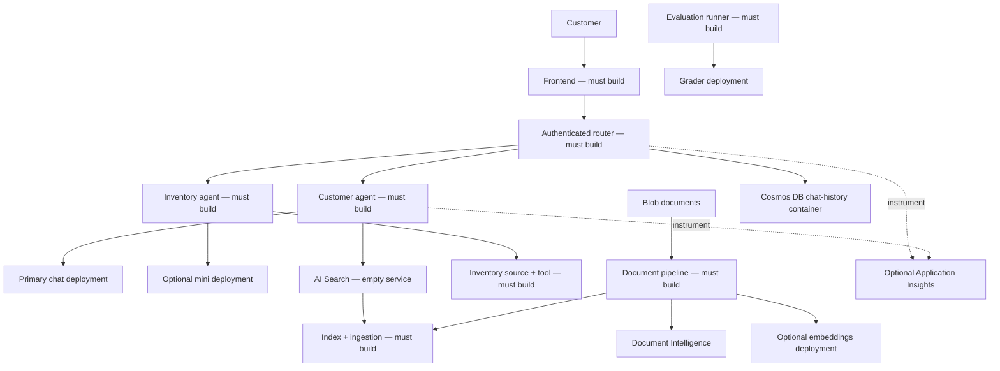

# Многоагентная поддержка клиентов — Архитектурный шаблон розничной торговли

**Глава 5: Многоагентные AI-решения**

- [Домашняя страница курса](../README.md)
- [Глава 5](../docs/chapter-05-multi-agent/README.md)
- [Предварительное условие: интеграция ИИ](../docs/chapter-02-ai-development/microsoft-foundry-integration.md)
- [Далее: планирование мощностей](../docs/chapter-06-pre-deployment/capacity-planning.md)
- [ARM инфраструктурный шаблон](retail-multiagent-arm-template/README.md)

> **Руководство по архитектуре, а не рабочее приложение.** Единственные файлы
> реализации розничной торговли — `azuredeploy.json`, `azuredeploy.parameters.json` и `deploy.sh` в
> `retail-multiagent-arm-template/`. Контейнеры Router/frontend — заглушки hello-world.
> Локально отсутствуют агент розничной торговли, UI, pipeline загрузки, оценщик, сканер и
> тестовый набор для приложения.

## Обзор

**Цель:** спроектировать систему поддержки клиентов с агентом клиента и агрегатором инвентаря,
определить, что предоставляет инфраструктура, и спланировать недостающие контракты
приложения и верификацию.

**Целевая аудитория:** разработчики, завершившие локальный
[пример чата](../../../examples/azure-openai-chat) и [пример контейнера с двумя сервисами](../../../examples/container-app/microservices).
На изучение архитектуры выделите 2–3 часа. Создание приложения — отдельный
проект: 80–120 часов разработки — примерная оценка для опытных разработчиков,
**не обещание доставки**; доработка для продакшена, тесты,
аудит безопасности и эксплуатация требуют дополнительной работы.

### Результаты обучения

- Объяснить маршрутизацию, заземление, разрешения инструментов и владение беседой.
- Различать идентификаторы моделей, имена развертываний, версии API и версии ARM.
- Спроектировать загрузку документов и извлечение с совпадающими размерностями векторов.
- Определить проверяемые функциональные, оценочные и требования по восстановлению после сбоев.
- Отделять необязательные цели архитектуры от реально предоставляемых ресурсов.

## Архитектура решения



Это **целевая архитектура приложения**, а не диаграмма работающих сервисов агентов.
ARM-шаблон создаёт лишь базовые сервисы и два контейнера-заглушки.
Front Door, реестр, управляемые идентичности, назначение ролей,
приватные конечные точки, аварийное переключение, инструментирование приложения и оповещения не включены.

### Обязанности и контракты

| Компонент | Требуемое поведение | Доказательства перед признанием завершённым |
|---|---|---|
| Фронтенд | Аутентификация пользователей, отображение чата, безопасная загрузка документов | Тесты UI и загрузки, доступные ошибки |
| Маршрутизатор | Авторизация запросов, выбор агента, ограничение вызовов/тайм-ауты инструментов | Тесты маршрутизации, проверки авторизации, тесты отказов |
| Агент клиента | Документировать ответы по политике/продукту в утверждённых источниках | Корректные ссылки, воздержание при отсутствии данных |
| Инвентарный инструмент | Чтение достоверных данных о запасах с ограниченными разрешениями | Детеминированные тесты запасов; без вымышленных доступностей |
| Конвейер документов | Извлечение, разбиение на чанки, внедрение, индексирование, обновление/удаление | Индексированные фикстуры и поведение повторных попыток/dead-letter |
| Хранение бесед | Изоляция пользователей, соблюдение политики хранения | Тесты авторизации между пользователями и TTL |
| Запуск оценки | Сравнение результатов с эталоном и рубрикой | Покрытие, количество сбоев, воспроизводимые отчёты |

Представляйте маршрутизатор как ресепшн, а инструменты — как ограниченные внутренние системы:
выбор специалиста — это не разрешение доступа ко всем записям клиента.
Контролируйте идентичность и разрешения в коде приложения и сервисах данных, а не в подсказках.

## Инфраструктура vs. Приложение

Прочитайте [README шаблона](retail-multiagent-arm-template/README.md) перед
созданием ресурсов. Там указаны точные ресурсы, режимы, затраты и ограничения.

| Логическое назначение | Имя развертывания ARM | Модель / версия | Регион по умолчанию |
|---|---|---|---|
| Чат клиента | `gpt-4.1-chat` | `gpt-4.1` / `2025-04-14` | `eastus2` |
| Инвентарь | `gpt-4.1-mini-inventory` | `gpt-4.1-mini` / `2025-04-14` | `westus2`, опционально |
| Внедрения | `text-embedding-ada-002` | `text-embedding-ada-002` / `2` | `francecentral`, опционально |
| Оценка | `gpt-4.1-grader` | `gpt-4.1` / `2025-04-14` | По умолчанию главный регион |

Проверьте доступность модели/версии/SKU и квоты в **каждом регионе**. Чат/мини/оценщик
используют `GlobalStandard`; внедрения используют `Standard`. Соотношения единиц мощности к TPM
зависят от модели. Не добавляйте различные единицы мощности как универсальное гарантирующее квоты.

Аргумент `model` запроса Azure OpenAI — это **имя развертывания**, а не
обязательно идентификатор модели из каталога. Версия API плоскости данных `2024-10-21`
отличается от версии модели `2025-04-14` и ресурса ARM `apiVersion`.
Нельзя исправить отсутствие модели, меняя только версию API плоскости данных.

`--no-multi-region` пропускает вторичные и аккаунты для внедрений. Остаются основной чат и
отдельный аккаунт оценщика. Отдельные аккаунты моделей не обеспечивают автоматическое
аварийное переключение; для этого нужны маршрутизация приложения, совместимые развертывания, проверки здоровья,
ограничения повторных попыток и проверка локализации данных.

## Дорожная карта реализации

### 1. Начните с одного проверенного взаимодействия

Перед созданием большого шаблона используйте локальный пример чата для установления
связи с моделью. Определите один типичный вопрос клиента, утверждённый
источник ответа, ожидаемую ссылку и поведение при отсутствии источника.

### 2. Определите маршрутизацию и границы инструментов

Создайте собственный источник маршрутизатора, манифест зависимостей, Dockerfile и тесты. 
Иллюстративным контрактом может быть `POST /chat` с `{"message":"...","conversation_id":"..."}`.
**Этот конечный пункт является предложением дизайна; он не реализован в ARM-шаблоне.**

Валидируйте типы/ограничения тела, выводите идентичность пользователя из аутентификации, обеспечивайте
владение разговором, применяйте таймауты запросов и возвращайте информативные коды ошибок.
Не рассматривайте HTTP-ошибки или пустые ответы как успешные результаты агента.

### 3. Реализация заземления и приема данных

ARM-шаблон не создает поисковый индекс. Это **образец JSON-фрагмента
для адаптации в вашем определении индекса**, а не файл, уже находящийся в репозитории:

```json
{
  "name": "retail-product-index",
  "fields": [
    {"name": "id", "type": "Edm.String", "key": true},
    {"name": "title", "type": "Edm.String", "searchable": true},
    {"name": "content", "type": "Edm.String", "searchable": true},
    {"name": "category", "type": "Edm.String", "filterable": true},
    {
      "name": "content_vector",
      "type": "Collection(Edm.Single)",
      "searchable": true,
      "dimensions": 1536,
      "vectorSearchProfile": "retail-profile"
    }
  ],
  "vectorSearch": {
    "algorithms": [{"name": "retail-hnsw", "kind": "hnsw"}],
    "profiles": [{"name": "retail-profile", "algorithm": "retail-hnsw"}]
  }
}
```

Профиль связывает векторное поле с его алгоритмом. Размерности должны соответствовать
фактическому выходу эмбеддинга (1536 для этого `ada-002` развертывания). Для извлечения в Python
используйте `azure.search.documents.models.VectorizedQuery` вместо неполного
словаря, в котором отсутствует тип запроса вектора:

```python
# Reference function only: supply an authenticated async SearchClient and an embedding.
from azure.search.documents.models import VectorizedQuery

async def retrieve(search_client, embedding):
    results = await search_client.search(
        search_text=None,
        vector_queries=[VectorizedQuery(
            vector=embedding,
            k_nearest_neighbors=5,
            fields="content_vector"
        )],
        select=["id", "title", "content"]
    )
    return [document async for document in results]
```

Создайте отдельную реализацию приема данных, которая:

1. Авторизует доступ на загрузку и проверяет тип и размер контента.
2. Считывает приватные блобы с помощью аутентифицированных SDK-вызовов. Адрес приватного блоба
   сам по себе **не** является читаемым входом для Document Intelligence; отправляйте загруженные байты с
   использованием `AnalyzeDocumentRequest(bytes_source=...)` или используйте соответствующий,
   краткоживущий SAS после проверки требований к доступу.
3. Извлекает текст, делит его на чанки для соответствия ограничениям эмбеддинга и генерирует эмбеддинги.
4. Создает стабильные валидные ключи документов и загружает чанки с соответствующими векторами.
5. Проверяет результаты индексирования на документ, обрабатывает повторные попытки и обновляет/удаляет устаревшие данные.

Не вставляйте произвольные пользовательские ключи/значения в OData-фильтры. Разрешайте только определённые поля,
проверяйте типы значений и экранируйте кавычки в строках. Булевы и числовые фильтры требуют
типизированных литералов, а не строк в кавычках.

### 4. Веб-заземление

**Bing Search v7 был выведен из эксплуатации 11 августа 2025 года.** Старый ресурс `Microsoft.Bing/accounts`
и примеры `api.bing.microsoft.com/v7.0/search` не являются поддерживаемым
путем реализации. Оцените текущую поддерживаемую интеграцию заземления в
Microsoft Foundry и учитывайте его SDK, разрешения, биллинг и требования к цитированию;
здесь ни один из них не реализован. Это не является прямой заменой для выведенного из эксплуатации конечного пункта.

### 5. Добавьте телеметрию и оценку

Создание Application Insights не обеспечивает инструментирование кода. Используйте поддерживаемое инструментирование OpenTelemetry для Azure Monitor при создании нового приложения, передавайте контекст трассировки между сервисами и избегайте логирования пользовательских запросов, документов или секретов.
Усечение запроса **не** анонимизирует его.

Измеряйте длительность запросов, отказы маршрутизации/инструментов, релевантность извлечения, правильность цитирования, использование токенов и воздержания.

исходя только из вопроса и ответа.

Развертывание оценщика не является средой запуска оценки. Реализуйте версионированную рубрику,
структурированный вывод/валидацию схемы, проверки диапазона баллов, подсчет отказов транспорта

их в успешные оценки или не включайте их молча как ответы модели с нулевым качеством.

Аналогично, нескольких проверок ключевых слов недостаточно для сертификации безопасности. Неудачный HTTP-запрос,
отсутствие стратегии тестирования или пустой ответ должны приводить к тому, что тест считается **нерешенным или неудачным**, а не выдавать оценку «100% безопасно». Выполняйте авторизованное тестирование с соответствующими инструментами и обзором человеком перед любыми заявлениями о готовности к производству.

Точно так же несколько проверок ключевых слов не являются гарантией безопасности. Неудачный HTTP
запрос, отсутствие стратегии тестирования или пустой ответ должны привести к тому, что тест будет **неоднозначным или
проваленным**, а не к результату «100% безопасно». Выполняйте авторизованное тестирование с использованием соответствующих
инструментов и человеческого контроля перед любыми утверждениями о готовности к эксплуатации.

### 6. Разверните ваше приложение

Создайте собственные каталоги исходного кода, манифесты, тесты, реестр и разрешения на
загрузку образов. Замените заполнители на построенные образы и обновите ingress/probes, чтобы
соответствовать порту прослушивания каждого приложения. Настройте переменные среды выполнения в Bicep
или в явном поддерживаемом отображении среды azd.

Нет универсального словаря `config` под сервисом azd, который автоматически
создает переменные окружения во время выполнения. `azd env set` изменяет только ресурсы, которые
явно потребляют эти значения. В этом шаблоне не реализованы canary, список регионов или
механизмы тонкой настройки.

## Практические архитектурные упражнения

Это **архитектурные упражнения**, а не утверждения о готовом к выполнению стартовом коде.

### Упражнение 1: Проверьте границу

**Исходная точка:** три файла в `retail-multiagent-arm-template/`.
**Цель:** отделить обеспечение ресурсов от функциональности приложения.
Откройте `azuredeploy.json`, найдите оба образа контейнеров и значения `targetPort`,
затем перечислите компоненты приложения, отсутствующие в репозитории.

**Критерии успеха / ответ:** оба образа - заглушки hello-world, слушающие
порт 80; агенты, интерфейс чата, обработчики маршрутизатора, индекс/ингестия, оценщик и сканер
отсутствуют. Успешный запрос корневого заполнителя не проверяет `/chat`.
**Распространенная ошибка:** интерпретировать имена ресурсов, такие как `retail-router`, как работающий код.

### Упражнение 2: Отслеживание конфигурации вектора

**Исходная точка:** индекс JSON выше.
**Цель:** понять взаимосвязь поле → профиль → алгоритм.
Определите, какие значения должны измениться при переходе на модель встраивания с
другой размерностью выхода, затем проверьте функцию `retrieve`.

**Критерии успеха / ответ:** измените поле `dimensions` на фактическую длину вектора;
поддерживайте `vectorSearchProfile` в соответствии с объявленным профилем и его алгоритмом;
запрос `fields` должен указывать поле вектора. Перегенерируйте существующие
векторные документы при смене модели встраивания.
**Распространенная ошибка:** менять только имя модели, оставляя несовместимые векторы.

### Упражнение 3: Определите тест на отказ

**Исходная точка:** таблица обязанностей.
**Цель:** предотвратить ложный успех.
Опишите ожидаемое поведение при недоступности API инвентаризации, поисковом индексе
без совпадающих документов и запросе оценки, возвращающем HTTP 503.

**Критерии успеха / ответ:** никаких вымышленных значений инвентаризации; явное воздержание
или эскалация при отсутствии контекста; оценка сообщает о сбое транспорта, а не о
прохождении качества или безопасности. Добавляйте исполняемые тесты при разработке приложения.
**Распространенная ошибка:** перехват всех исключений и продолжение с пустым ответом.

## Затраты, устранение неисправностей и очистка

- Инфраструктура несет постоянные расходы даже с пустыми поисковыми индексами и приложениями-заполнителями.
  Используйте актуальные региональные цены; ни «минимальные», ни многорегиональные варианты не означают бесплатные.
- Стоимость токенов зависит от модели, кешированного/некешированного входа, выхода и SKU развертывания.
  Маршрутизация может сэкономить деньги только если измеренная нагрузка и результаты по качеству это оправдывают;
  фиксированная экономия 60–80% не гарантируется.
- Перед обеспечением ресурсов проверьте доступность модели и квоты; различайте ошибки разрешений,
  имени развертывания, региона, версии модели и версии API.
- Не запускайте отсутствующие `setup-data.sh`, CLI-оценщики или команды `pytest tests/`.
  Их реализации находятся в вашем бэклоге разработки.
- Каркас поддерживает только ARM: следуйте его
  [инструкциям по проверке и очистке](retail-multiagent-arm-template/README.md).
  `azd down` не управляет этими ресурсами.

## Связанные ресурсы

- [Рабочий пример локального чата](../../../examples/azure-openai-chat)
- [Рабочий пример контейнера с двумя сервисами](../../../examples/container-app/microservices)
- [Векторные индексы AI Search](https://learn.microsoft.com/azure/search/vector-search-how-to-create-index)
- [Документация по Container Apps](https://learn.microsoft.com/azure/container-apps/)
- [Устранение неполадок](../docs/chapter-07-troubleshooting/common-issues.md)
- [Сообщить о проблеме](https://github.com/microsoft/AZD-for-beginners/issues)

---

<!-- CO-OP TRANSLATOR DISCLAIMER START -->
**Отказ от ответственности**:
Этот документ был переведен с использованием сервиса машинного перевода [Co-op Translator](https://github.com/Azure/co-op-translator). Несмотря на наши усилия по обеспечению точности, имейте в виду, что автоматический перевод может содержать ошибки или неточности. Оригинальный документ на его исходном языке следует считать авторитетным источником. Для получения критически важной информации рекомендуется обратиться к профессиональному человеческому переводу. Мы не несем ответственности за любые недоразумения или неправильные толкования, возникшие в результате использования этого перевода.
<!-- CO-OP TRANSLATOR DISCLAIMER END -->