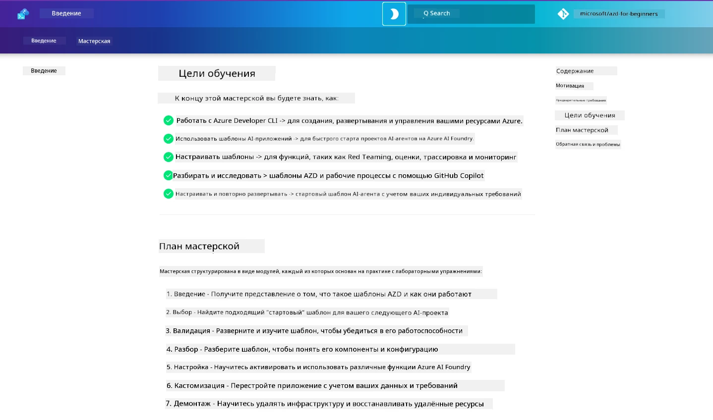

<div align="center">
  <div style="background: linear-gradient(135deg, #0078d4, #106ebe); border-radius: 10px; padding: 20px; margin: 20px 0; box-shadow: 0 4px 15px rgba(0, 120, 212, 0.3); border: 2px solid #005a9e;">
    <h2 style="color: white; margin: 0; font-size: 24px; text-shadow: 1px 1px 2px rgba(0,0,0,0.3);">
      🎯 Мастерская AZD для разработчиков ИИ
    </h2>
    <p style="color: white; margin: 10px 0 0 0; font-size: 16px; text-shadow: 1px 1px 2px rgba(0,0,0,0.3);">
      <strong>Практическая мастерская по созданию ИИ-приложений с использованием Azure Developer CLI.</strong><br>
      Пройдите 7 модулей, чтобы освоить шаблоны AZD и рабочие процессы развертывания ИИ.
    </p>
    <div style="margin-top: 15px;">
      <span style="background: rgba(255,255,255,0.2); padding: 5px 10px; border-radius: 15px; color: white; font-size: 14px;">
        📅 Проверено: ноябрь 2026
      </span>
    </div>
  </div>
</div>

# Мастерская AZD для разработчиков ИИ

Добро пожаловать на практическую мастерскую по изучению Azure Developer CLI (AZD) с акцентом на развертывание ИИ-приложений. Эта мастерская поможет вам получить практическое понимание шаблонов AZD в 3 шага:

1. **Обнаружение** - найдите подходящий для вас шаблон.
1. **Развертывание** - разверните и убедитесь, что всё работает
1. **Настройка** - измените и адаптируйте под себя!

В ходе мастерской вы также познакомитесь с основными инструментами и рабочими процессами разработчика, чтобы упростить ваш сквозной процесс разработки.

<br/>

## Руководство в браузере

Уроки мастерской оформлены в Markdown. Вы можете просматривать их прямо на GitHub или запустить браузерный предпросмотр, как показано на скриншоте ниже.



Чтобы воспользоваться этим вариантом - форкните репозиторий в свой профиль и запустите GitHub Codespaces. После активации терминала VS Code введите следующую команду:

Этот браузерный предпросмотр работает в GitHub Codespaces, dev-контейнерах или локальном клоне с установленными Python и MkDocs.

```bash title="" linenums="0"
python -m pip install -r requirements-dev.txt
python -m mkdocs serve --config-file workshop/mkdocs.yml
```

Выполняйте эти команды из **корневой папки репозитория курса**, а не из отдельно инициализированного примера ИИ. Держите предпросмотр на переднем плане, чтобы видеть ошибки; остановите его сочетанием Ctrl+C. Для проверки сайта без его запуска выполните `python -m mkdocs build --strict --config-file workshop/mkdocs.yml`.

Через несколько секунд появится всплывающее окно. Выберите опцию `Open in browser`. Веб-руководство откроется в новой вкладке браузера. Некоторые преимущества этого предпросмотра:

1. **Встроенный поиск** - быстро находите ключевые слова или уроки.
1. **Иконка копирования** - наведите курсор на блоки кода, чтобы увидеть эту опцию
1. **Переключение темы** - меняйте светлую и тёмную темы
1. **Получить помощь** - нажмите на иконку Discord внизу страницы, чтобы присоединиться!

<br/>

## Обзор мастерской

**Продолжительность:** 3-4 часа  
**Уровень:** от Начинающего до Среднего  
**Требования:** Знакомство с Azure, основами ИИ, VS Code и инструментами командной строки.

Это практическая мастерская, где вы учитесь на практике. После выполнения упражнений мы рекомендуем ознакомиться с учебной программой AZD для начинающих, чтобы продолжить своё обучение лучшим практикам Безопасности и Производительности.

| Время| Модуль  | Цель |
|:---|:---|:---|
| 15 мин | [Введение](docs/instructions/0-Introduction.md) | Установить контекст, понять цели |
| 30 мин | [Выбор AI шаблона](docs/instructions/1-Select-AI-Template.md) | Изучить варианты и выбрать стартовый | 
| 30 мин | [Проверка AI шаблона](docs/instructions/2-Validate-AI-Template.md) | Развернуть решение по умолчанию в Azure |
| 30 мин | [Разбор AI шаблона](docs/instructions/3-Deconstruct-AI-Template.md) | Изучить структуру и конфигурацию |
| 30 мин | [Настройка AI шаблона](docs/instructions/4-Configure-AI-Template.md) | Активировать и опробовать доступные функции |
| 30 мин | [Кастомизация AI шаблона](docs/instructions/5-Customize-AI-Template.md) | Адаптировать шаблон под свои нужды |
| 30 мин | [Очистка инфраструктуры](docs/instructions/6-Teardown-Infrastructure.md) | Убрать и освободить ресурсы |
| 15 мин | [Итоги и следующие шаги](docs/instructions/7-Wrap-up.md) | Ресурсы для обучения, вызов мастерской |

<br/>

## Чему вы научитесь

Рассматривайте шаблон AZD как учебную песочницу для изучения различных возможностей и инструментов сквозной разработки на Microsoft Foundry. К концу мастерской вы получите интуитивное понимание различных инструментов и концепций в этом контексте.

| Концепция  | Цель |
|:---|:---|
| **Azure Developer CLI** | Понять команды и рабочие процессы инструмента |
| **Шаблоны AZD**| Понять структуру проекта и конфигурацию |
| **Azure AI Agent**| Организация и развертывание проекта Microsoft Foundry  |
| **Azure AI Search**| Включить контекстную инженерию с агентами |
| **Наблюдаемость**| Исследование трассировки, мониторинга и оценок |
| **Red Teaming**| Исследование тестирования и мер противодействия |

<br/>

## Структура мастерской

Мастерская организована так, чтобы провести вас от поиска шаблона до развертывания, разбора и настройки — используя официальный стартовый шаблон [Getting Started with AI Agents](https://github.com/Azure-Samples/get-started-with-ai-agents).

### [Модуль 1: Выбор AI шаблона](docs/instructions/1-Select-AI-Template.md) (30 мин)

- Что такое AI шаблоны?
- Где я могу найти AI шаблоны?
- Как начать создавать AI агентов?
- **Практика**: Быстрый старт в Codespaces или dev-контейнере

### [Модуль 2: Проверка AI шаблона](docs/instructions/2-Validate-AI-Template.md) (30 мин)

- Какова архитектура AI шаблона?
- Какой рабочий процесс разработки AZD?
- Где я могу получить помощь по разработке с AZD?
- **Практика**: Развертывание и проверка шаблона AI агентов

### [Модуль 3: Разбор AI шаблона](docs/instructions/3-Deconstruct-AI-Template.md) (30 мин)

- Изучите ваше окружение в `.azure/` 
- Изучите настройку ресурсов в `infra/` 
- Изучите конфигурацию AZD в `azure.yaml`
- **Практика**: Изменить переменные окружения и повторно развернуть

### [Модуль 4: Настройка AI шаблона](docs/instructions/4-Configure-AI-Template.md) (30 мин)
- Исследование: Retrieval Augmented Generation
- Исследование: Оценка агентов и Red Teaming
- Исследование: Трассировка и мониторинг
- **Практика**: Изучение AI агента и наблюдаемости

### [Модуль 5: Кастомизация AI шаблона](docs/instructions/5-Customize-AI-Template.md) (30 мин)
- Определить: PRD с требованиями сценария
- Настроить: переменные окружения для AZD
- Реализовать: хуки жизненного цикла для дополнительных задач
- **Практика**: Настройка шаблона под мой сценарий

### [Модуль 6: Очистка инфраструктуры](docs/instructions/6-Teardown-Infrastructure.md) (30 мин)
- Итоги: Что такое шаблоны AZD?
- Итоги: Почему использовать Azure Developer CLI?
- Следующие шаги: Попробуйте другой шаблон!
- **Практика**: Деактивация инфраструктуры и очистка

<br/>

## Вызов мастерской

Хотите бросить себе вызов и сделать больше? Вот несколько предложений по проектам — или поделитесь своими идеями с нами!

| Проект | Описание |
|:---|:---|
|1. **Разобрать сложный AI шаблон** | Используйте описанный нами рабочий процесс и инструменты, попытайтесь развернуть, проверить и настроить другой шаблон AI решения. _Что вы узнали?_|
|2. **Настроить под свой сценарий**  | Попробуйте написать PRD (Документ требований продукта) для другого сценария. Затем используйте GitHub Copilot в вашем репозитории шаблона в Agent Model — и попросите его создать для вас рабочий процесс кастомизации. _Что вы узнали? Как можно улучшить эти предложения?_|
| | |

## Есть отзывы?

1. Создайте issue в этом репозитории — для удобства отметьте тегом `Workshop`.
1. Присоединяйтесь к Discord Microsoft Foundry — общайтесь с коллегами!


| | | 
|:---|:---|
| **📚 Главная страница курса**| [AZD For Beginners](../README.md)|
| **📖 Документация** | [Начало работы с AI шаблонами](https://learn.microsoft.com/en-us/azure/ai-foundry/how-to/develop/ai-template-get-started)|
| **🛠️ AI Шаблоны** | [Шаблоны Microsoft Foundry](https://ai.azure.com/templates) |
|**🚀 Следующие шаги** | [Начать мастерскую](#workshop-overview) |
| | |

<br/>

---

**Навигация:** [Основной курс](../README.md) | [Введение](docs/instructions/0-Introduction.md) | [Модуль 1: Выбор шаблона](docs/instructions/1-Select-AI-Template.md)

**Готовы начать создавать ИИ-приложения с AZD?**

[Начать мастерскую: Введение →](docs/instructions/0-Introduction.md)

---

<!-- CO-OP TRANSLATOR DISCLAIMER START -->
**Отказ от ответственности**:
Этот документ был переведен с использованием сервиса машинного перевода [Co-op Translator](https://github.com/Azure/co-op-translator). Несмотря на наши усилия по обеспечению точности, имейте в виду, что автоматический перевод может содержать ошибки или неточности. Оригинальный документ на его исходном языке следует считать авторитетным источником. Для получения критически важной информации рекомендуется обратиться к профессиональному человеческому переводу. Мы не несем ответственности за любые недоразумения или неправильные толкования, возникшие в результате использования этого перевода.
<!-- CO-OP TRANSLATOR DISCLAIMER END -->