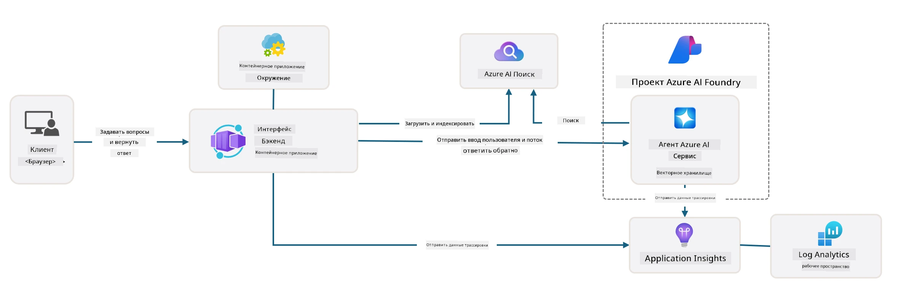
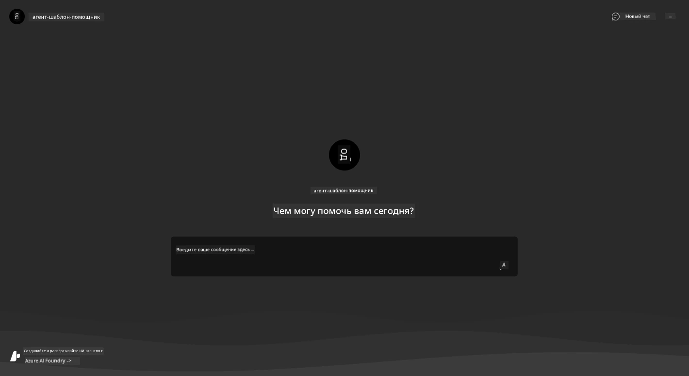

# 2. Проверка шаблона

> Руководство по источнику проверено в соответствии с AZD 1.37.2 и текущим примером на 4 ноября 2026 года. Скриншоты приведены для иллюстрации; навигация по порталу, настройки шаблона и доступность служб могут изменяться. В этом обзоре не выполнялось развертывание Azure в реальном времени.

!!! tip "К КОНЦУ ЭТОГО МОДУЛЯ ВЫ БУДЕТЕ УМЕТЬ"

    - [ ] Identify the sample's prerequisites and intended resources
    - [ ] Deploy the selected template into an intentional environment
    - [ ] Verify the application and agent behavior separately from deployment success
    - [ ] **Lab 2:** Record evidence of a working baseline, or an actionable deployment blocker

---

## 1. Проверка предварительных условий

Команда [Azure Developer CLI](https://learn.microsoft.com/azure/developer/azure-developer-cli/) управляет развертыванием приложения с использованием конфигурации, инфраструктуры и кода шаблона. Проверьте установленную версию:

```bash
azd version
```

При необходимости используйте [текущие инструкции по установке/обновлению](https://learn.microsoft.com/azure/developer/azure-developer-cli/install-azd). В рассмотренном примере объявляется AZD `>=1.14.0`, но рекомендуется использовать текущий поддерживаемый релиз. Опциональные AI расширения имеют отдельные требования к версиям; нормальный рабочий процесс `azd up` в этом примере не требует расширения агентов.

Перед запуском ознакомьтесь с [настройкой учетной записи Azure](https://github.com/Azure-Samples/get-started-with-ai-agents/blob/main/docs/azure_account_setup.md) и [руководством по развертыванию](https://github.com/Azure-Samples/get-started-with-ai-agents/blob/main/docs/deployment.md) в примере. Подтвердите подписку, разрешения, доступность модели, региональные квоты и ожидаемые расходы. Бесплатная учетная запись Azure не гарантирует доступ или бесплатное использование всех требуемых сервисов.

## 2. Откройте выбранный пример

Используйте репозиторий [Get Started with AI Agents](https://github.com/Azure-Samples/get-started-with-ai-agents), инициализированный в Модуле 1. Если вы еще не инициализировали его, выберите один из вариантов:

- Откройте [Codespace для примера](https://github.com/codespaces/new/Azure-Samples/get-started-with-ai-agents).
- Клонируйте пример и следуйте его настройке локального/разработческого контейнера.
- В **пустой директории** выполните:

```bash
azd init --template Azure-Samples/get-started-with-ai-agents .
```

Не инициализируйте второй шаблон поверх существующего проекта. Последующие команды выполняйте из корня примера, содержащего `azure.yaml`, а не из корня репозитория курса.

Пример содержит чат-приложение с поддержкой агентов в Container Apps и обеспечивает необходимые ресурсы Foundry. Ознакомьтесь с текущей архитектурой и опциональными службами, а не воспринимайте старый скриншот как точный перечень ресурсов.



## 3. Развёртывайте целенаправленно

```bash
azd auth login
azd up
```

Проверьте подсказки:

1. Выберите уникальное имя среды AZD.
2. Выберите нужную подписку, а не просто первую предложенную.
3. Выберите регион, поддерживаемый требуемой моделью/версией/SKU и вашей квотой.
4. Ознакомьтесь с выводом процессов Provisioning, Deployment и Post-deployment hook.

Рассмотренные значения по умолчанию включают `gpt-5-mini`, версию `2025-08-07` и `GlobalStandard`. Проверьте ваш инициализированный шаблон и [поддерживаемые комбинации модели/региона](https://learn.microsoft.com/azure/ai-services/agents/concepts/model-region-support). Ни один регион не гарантируется для универсальной работы.

Время развертывания варьируется. Если provisioning не удался, сохраните ошибку и исправьте её причину до повторной попытки. Не удаляйте развертывание и не очищайте ресурсы навсегда как общий шаг устранения неполадок.

## 4. Проверьте приложение

```bash
azd show
```

Откройте endpoint для `api_and_frontend` или найдите Container App в группе ресурсов развертывания в [портале Azure](https://portal.azure.com/). Следуйте инструкциям образца по доступу/аутентификации, если требуется вход; не отключайте аутентификацию для прохождения теста работоспособности.



Попробуйте несколько [примеров вопросов](https://github.com/Azure-Samples/get-started-with-ai-agents/blob/main/docs/sample_questions.md):

- Общий фактологический вопрос.
- Вопрос, на который ответ должен содержаться в загруженных документах образца.
- Вопрос, на который нельзя ответить из этих документов.

Убедитесь, что пользовательский интерфейс загружается, API отвечает, извлечение использует ожидаемые данные, ссылки соответствуют исходному содержанию, а неподдерживаемые вопросы обрабатываются должным образом. Сообщение `azd up` об успешном выполнении само по себе не гарантирует этих результатов.

## 5. Проверьте развернутого агента

Откройте ваш проект в [портале Foundry](https://ai.azure.com/). В изученном потоке портала выберите **Build**, затем **Agents** и найдите агента, созданного примером. Метки навигации могут изменяться.

Запишите:

- Название агента и версия.
- Его настроенное развертывание модели.
- Фактические инструкции и включённые инструменты.
- Какие файлы или индекс поиска подключены и завершена ли установка успешно.

В рассмотренном примере для тестов оценки используется идентификатор агента в виде `agent_name:agent_version`. Не копируйте классический идентификатор агента/потока со старого скриншота в новую API-схему.

Сравните загруженные документы с `src/files/` в вашей инициализированной ревизии. Ранее на скриншотах показывалось 32 файла; это число не является гарантированным текущим значением по умолчанию. Проверьте любые ответы о тестовых клиентах/продуктах сравнительно с фактическими синтетическими исходными данными и не загружайте реальные данные клиентов для этого упражнения.

## 6. Сравните с playground

Откройте playground выбранного агента в Foundry и задайте тот же вопрос по извлечению. Сравните конфигурированную версию агента, инструменты, ссылки и качество ответа с развернутым приложением.

Ответы являются вероятностными; точное слово в слово совпадение не является критерием. Если результаты существенно различаются, проверьте, что приложение и playground нацелены на один и тот же проект, агента/версию и источник знаний.

## 7. Проверьте предварительные условия для наблюдаемости

Руководство по [наблюдаемости](https://github.com/Azure-Samples/get-started-with-ai-agents/blob/main/docs/observability.md) образца является источником правды для настройки трассировки, оценки и red-teaming.

В рассмотренных инфраструктурных настройках по умолчанию включен Application Insights, но **трассировка на клиенте отключена** (`ENABLE_AZURE_MONITOR_TRACING=false`). Создание ресурса мониторинга не доказывает, что приложение экспортирует трассы. Модуль 5 охватывает включение трассировки и создание тестового запроса.

Используйте журналы приложений Container App для расследования ошибок запуска/API. В Foundry изучите доступные у агента представления трассировки и мониторинга. Записи оценки требуют соответствующей конфигурации, поддерживаемых оценщиков/региона и фактических запросов; их появление не гарантируется автоматически для каждого запуска.

Оставьте захват содержимого подсказок/ответов отключенным, если не были рассмотрены требования к конфиденциальности, хранению, доступу и редактированию.

## 8. Понимание значений среды

AZD сохраняет выбранную среду в `.azure/<environment-name>/`. Постоянные входные данные и результаты развертывания можно прочитать с помощью:

```bash
azd env list
azd env get-value AZURE_ENV_NAME
azd env get-value AZURE_LOCATION
```

`azd env get-values` перечисляет все значения, которые могут включать конфиденциальные настройки. Не вставляйте этот вывод в публичные вопросы или логи.

AZD использует выбранную среду при выполнении своих команд/хуков, тогда как переменные окружения процесса также могут влиять на команды и шаблоны. Это **не** экспортирует значения в вашу родительскую оболочку или каждый независимо запущенный процесс Python. Следуйте [инструкциям по локальной разработке](https://github.com/Azure-Samples/get-started-with-ai-agents/blob/main/docs/local_development.md) из примера.

Значения по умолчанию шаблона могут применяться в `infra/main.parameters.json` без появления в явных локальных значениях. Установка произвольной переменной не изменяет инфраструктуру, если шаблон её не использует.

Например, чтобы явно выбрать значения по умолчанию проверенной модели:

```bash
azd env set AZURE_AI_AGENT_MODEL_NAME gpt-5-mini
azd env set AZURE_AI_AGENT_MODEL_VERSION 2025-08-07
azd env set AZURE_AI_AGENT_DEPLOYMENT_SKU GlobalStandard
azd provision --preview
azd up
```

Сначала проверьте совместимость, емкость, доступность и запланированные изменения. Обновления инфраструктуры требуют подготовки; `azd deploy` одного недостаточно. Обычно поддерживаемые изменения модели не требуют разрушения всего приложения.

`azd env refresh` получает выводы развертывания для доступной среды; он не восстанавливает все пользовательские входные данные, не синхронизирует секреты и не заменяет управление конфигурацией.

## 9. Запишите свою базовую линию

- [ ] Проверена правильная среда, подписка, регион и модель.
- [ ] Выполнены подготовка, развертывание и необходимые хуки настройки без неразрешенных ошибок.
- [ ] Проверен доступ к приложению, чат, извлечение и цитаты.
- [ ] Определены агент/версия и источник знаний.
- [ ] Документированы предпосылки наблюдаемости и любые оставшиеся блокирующие факторы.

Продолжите к [Декомпозиции Шаблона](3-Deconstruct-AI-Template.md).

---

<!-- CO-OP TRANSLATOR DISCLAIMER START -->
**Отказ от ответственности**:
Этот документ был переведен с использованием сервиса машинного перевода [Co-op Translator](https://github.com/Azure/co-op-translator). Несмотря на наши усилия по обеспечению точности, имейте в виду, что автоматический перевод может содержать ошибки или неточности. Оригинальный документ на его исходном языке следует считать авторитетным источником. Для получения критически важной информации рекомендуется обратиться к профессиональному человеческому переводу. Мы не несем ответственности за любые недоразумения или неправильные толкования, возникшие в результате использования этого перевода.
<!-- CO-OP TRANSLATOR DISCLAIMER END -->