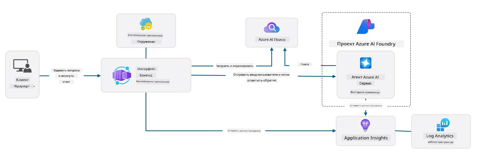

# 3. Декомпозировать шаблон

!!! tip "ПОСЛЕ ПРОХОЖДЕНИЯ ЭТОГО МОДУЛЯ ВЫ СМОЖЕТЕ"

    - [ ] Use GitHub Copilot and optional MCP tools for Azure documentation and read-only exploration
    - [ ] Identify the template's application, infrastructure, configuration, and test entry points
    - [ ] Verify generated explanations against actual repository files
    - [ ] **Lab 3:** Trace one request and one configuration input through the project

---

## 1. Активируйте GitHub Copilot

Откройте инициализированный AI-пример в VS Code и включите [GitHub Copilot](https://code.visualstudio.com/docs/copilot/chat/chat-agent-mode). Войдите с учетной записью, у которой есть подходящий план; лимиты использования различаются. Попросите Copilot объяснить репозиторий перед авторизацией изменений.

### Дополнительные серверы MCP (по желанию)

Эти сервисы могут предоставить дополнительные инструменты:

- [Сервер Azure MCP](https://learn.microsoft.com/azure/developer/azure-mcp-server/overview)
- [Сервер Microsoft Learn MCP](https://learn.microsoft.com/training/support/mcp)

В VS Code ознакомьтесь с [руководством по конфигурации MCP](https://code.visualstudio.com/docs/copilot/chat/mcp-servers) и при необходимости создайте `.vscode/mcp.json`:

```json
{
  "servers": {
    "Azure MCP Server": {
      "type": "stdio",
      "command": "npx",
      "args": ["-y", "@azure/mcp@latest", "server", "start"]
    },
    "microsoft.docs.mcp": {
      "type": "http",
      "url": "https://learn.microsoft.com/api/mcp"
    }
  }
}
```

Команда `npx` требует установленного и поддерживаемого Node.js/npm и скачивает исполняемый код. Изучите пакет и закрепите одобренную версию для воспроизводимой командной настройки. Запускайте серверы с помощью управления MCP в VS Code и проверьте доступные инструменты; названия могут изменяться между версиями.

**Аутентификация происходит отдельно.** Используйте `azd auth login` для AZD. Следуйте документированному процессу аутентификации Azure MCP для его инструментов; одного входа в AZD недостаточно для установления сессии MCP. Используйте `az login` отдельно, когда упражнение или хук вызывают Azure CLI.

Попробуйте запросы только для чтения:

1. «Используйте Microsoft Learn MCP для поиска документации по конфигурации Azure Developer CLI.»
2. «Объясните `azure.yaml` этого репозитория; укажите файлы, реализующие каждый хук.»
3. «С помощью доступных инструментов Azure MCP перечислите мои развернутые ресурсы без внесения изменений.»

Проверьте выбранный арендатор/подписку и каждый предложенный вызов инструмента. Не одобряйте создание ресурсов, удаление или изменения доступа только ради изучения архитектуры.

## 2. Понять архитектуру

В примере размещены бэкенд на Python FastAPI и фронтенд на React/TypeScript в Azure Container Apps. Бэкенд взаимодействует с агентом в проекте Microsoft Foundry. Получение данных и мониторинг зависят от включенных функций шаблона и успешной настройки; они не гарантируются только потому, что приложение развернуто.



Сравните эту диаграмму с [текущим руководством по развертыванию сверху](https://github.com/Azure-Samples/get-started-with-ai-agents/blob/main/docs/deployment.md) и вашими фактическими ресурсами. Проверьте настроенное развертывание модели, инструменты агента, управляемую идентичность, назначения ролей и дополнительные ресурсы AI Search/Application Insights.

**Упражнение:** Попросите Copilot проследить запрос чата с фронтенда через API до Foundry с указанием файлов и функций. Откройте эти ссылки и проверьте объяснение. Не делайте выводов о реализованной аутентификации, маршрутизации или авторизации только по диаграмме.

## 3. Структура репозитория

Следующие выбранные пути проверены на примере 4 ноября 2026 года. Ваш инициализированный релиз остается источником истины:

```text
get-started-with-ai-agents/
  azure.yaml
  docker-compose.yaml
  requirements-dev.txt
  .devcontainer/
  infra/
    main.bicep
    main.parameters.json
    api.bicep
    core/
  src/
    Dockerfile
    pyproject.toml
    requirements.txt
    api/
      main.py
      routes.py
      search_index_manager.py
    frontend/
      package.json
      src/
    files/
  scripts/
    validate_env_vars.sh
    validate_env_vars.ps1
    postdeploy.sh
    postdeploy.ps1
  tests/
    test_evaluation.py
    test_red_teaming.py
  docs/
    deployment.md
    deploy_customization.md
    ai_search.md
    observability.md
    local_development.md
    troubleshooting.md
```

### Инфраструктура и конфигурация

`infra/main.bicep` оркестрирует ресурсы; `main.parameters.json` связывает входные данные шаблона с переменными окружения AZD. `azure.yaml` выбирает сервис приложения и хуки жизненного цикла. Проследите входные данные, например `USE_AZURE_AI_SEARCH_SERVICE`, через эти файлы, чтобы найти фактические изменения.

### Приложение и идентичность

Читайте `src/api/` и `src/frontend/` вместе. Определите, где создается или извлекается агент, где настраиваются инструкции/инструменты и какая идентичность используется для каждого вызова Azure. Файлы примеров под `src/files/` — демонстрационные данные, а не каталог для продакшна или модель авторизации.

### Тесты и мониторинг

Текущие точки входа для оценки и red-teaming находятся под `tests/`; устаревшие ссылки на каталоги `evals/` и `airedteaming/` неактуальны для этого примера. Ознакомьтесь с `docs/observability.md` про требования и затраты перед запуском облачных тестов. Эти Python-тесты отделены от необязательного расширения `azure.ai.evaluations` AZD.

## 4. Подтвердите ваши выводы

- Определите маршрут API, взаимодействие с агентом и код получения для одного примерного вопроса.
- Объясните, какая идентичность обращается к Foundry и какая конфигурация выбирает его конечную точку.
- Найдите фактические скрипты pre-up и post-deploy и их поведение при ошибках.
- Перечислите зависимости или опциональные функции, отсутствующие в вашем развертывании.

Продолжайте к [Настройке шаблона](4-Configure-AI-Template.md).

---

<!-- CO-OP TRANSLATOR DISCLAIMER START -->
**Отказ от ответственности**:
Этот документ был переведен с использованием сервиса машинного перевода [Co-op Translator](https://github.com/Azure/co-op-translator). Несмотря на наши усилия по обеспечению точности, имейте в виду, что автоматический перевод может содержать ошибки или неточности. Оригинальный документ на его исходном языке следует считать авторитетным источником. Для получения критически важной информации рекомендуется обратиться к профессиональному человеческому переводу. Мы не несем ответственности за любые недоразумения или неправильные толкования, возникшие в результате использования этого перевода.
<!-- CO-OP TRANSLATOR DISCLAIMER END -->