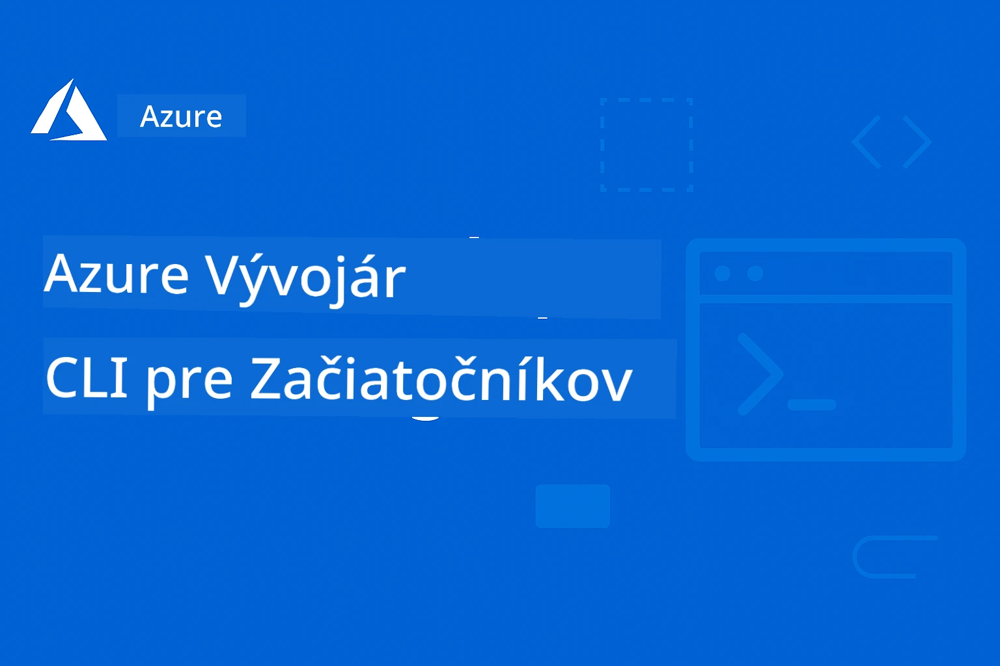

# AZD pre začiatočníkov: Štruktúrovaná vzdelávacia cesta

 

[](https://GitHub.com/microsoft/azd-for-beginners/watchers/)
[](https://GitHub.com/microsoft/azd-for-beginners/network/)
[](https://GitHub.com/microsoft/azd-for-beginners/stargazers/)

[](https://discord.com/invite/nkVh3dp)
[](https://discord.gg/nTYy5BXMWG)

---

### Automatizované preklady (vždy aktuálne)

<!-- CO-OP TRANSLATOR LANGUAGES TABLE START -->
[Arabic](../ar/README.md) | [Bengali](../bn/README.md) | [Bulgarian](../bg/README.md) | [Burmese (Myanmar)](../my/README.md) | [Chinese (Simplified)](../zh-CN/README.md) | [Chinese (Traditional, Hong Kong)](../zh-HK/README.md) | [Chinese (Traditional, Macau)](../zh-MO/README.md) | [Chinese (Traditional, Taiwan)](../zh-TW/README.md) | [Croatian](../hr/README.md) | [Czech](../cs/README.md) | [Danish](../da/README.md) | [Dutch](../nl/README.md) | [Estonian](../et/README.md) | [Finnish](../fi/README.md) | [French](../fr/README.md) | [German](../de/README.md) | [Greek](../el/README.md) | [Hebrew](../he/README.md) | [Hindi](../hi/README.md) | [Hungarian](../hu/README.md) | [Indonesian](../id/README.md) | [Italian](../it/README.md) | [Japanese](../ja/README.md) | [Kannada](../kn/README.md) | [Khmer](../km/README.md) | [Korean](../ko/README.md) | [Lithuanian](../lt/README.md) | [Malay](../ms/README.md) | [Malayalam](../ml/README.md) | [Manipuri (Meitei Mayek)](../mni/README.md) | [Marathi](../mr/README.md) | [Nepali](../ne/README.md) | [Nigerian Pidgin](../pcm/README.md) | [Norwegian](../no/README.md) | [Persian (Farsi)](../fa/README.md) | [Polish](../pl/README.md) | [Portuguese (Brazil)](../pt-BR/README.md) | [Portuguese (Portugal)](../pt-PT/README.md) | [Punjabi (Gurmukhi)](../pa/README.md) | [Romanian](../ro/README.md) | [Russian](../ru/README.md) | [Serbian (Cyrillic)](../sr/README.md) | [Slovak](./README.md) | [Slovenian](../sl/README.md) | [Spanish](../es/README.md) | [Swahili](../sw/README.md) | [Swedish](../sv/README.md) | [Tagalog (Filipino)](../tl/README.md) | [Tamil](../ta/README.md) | [Telugu](../te/README.md) | [Thai](../th/README.md) | [Turkish](../tr/README.md) | [Ukrainian](../uk/README.md) | [Urdu](../ur/README.md) | [Vietnamese](../vi/README.md)

> **Radšej klonovať lokálne?**
>
> Tento repozitár obsahuje preklady do viac ako 50 jazykov, čo výrazne zväčšuje veľkosť na stiahnutie. Ak chcete klonovať bez prekladov, použite sparse checkout:
>
> **Bash / macOS / Linux:**
> ```bash
> git clone --filter=blob:none --sparse https://github.com/microsoft/AZD-for-beginners.git
> cd AZD-for-beginners
> git sparse-checkout set --no-cone '/*' '!translations' '!translated_images'
> ```
>
> **CMD (Windows):**
> ```cmd
> git clone --filter=blob:none --sparse https://github.com/microsoft/AZD-for-beginners.git
> cd AZD-for-beginners
> git sparse-checkout set --no-cone "/*" "!translations" "!translated_images"
> ```
>
> Toto vám poskytne všetko potrebné na dokončenie kurzu s omnoho rýchlejším sťahovaním.
<!-- CO-OP TRANSLATOR LANGUAGES TABLE END -->

## 🆕 Čo je dnes nové v azd

> 📌 Tento kurz je validovaný pre **`azd 1.27.1`** (júl 2026). Spustite `azd version` pre overenie vašej zostavy a `azd upgrade` pre získanie najnovšej verzie.

Azure Developer CLI prerástol tradičné webové aplikácie a API. Dnes je azd jediným nástrojom na nasadzovanie **akýchkoľvek** aplikácií do Azure vrátane aplikácií poháňaných AI a inteligentných agentov.

Toto pre vás znamená:

- **AI agenti sú teraz plnohodnotné azd pracovné záťaže.** Môžete inicializovať, nasadzovať a spravovať AI agent projekty pomocou rovnakého `azd init` → `azd up` pracovného toku, ktorý už poznáte.
- **Kompletný životný cyklus agenta z CLI.** Rozšírenie `azure.ai.agents` teraz pokrýva celú cestu—`azd ai agent init` pre scaffold, `azd ai agent invoke` na testovanie (s výstupom doby odozvy), `azd ai agent eval generate` a `azd ai agent optimize` na meranie a zlepšovanie kvality a `azd ai agent delete` na upratovanie.
- **Viac stavebných blokov AI.** Nové preview rozšírenia—`azure.ai.skills` a `azure.ai.connections`—umožňujú spravovať znovupoužiteľné zručnosti agenta a Foundry prepojenia priamo cez azd.
- **Integrácia Microsoft Foundry** prináša nasadenie modelov, hosting agentov a konfiguráciu AI služieb priamo do ekosystému šablón azd.
- **Plynulejšie každodenné základy.** Nedávne vydania spravili `azd init` idempotentným (bezpečné opakované spustenie), automaticky čistia zastarané tokeny cez `azd auth login` a pridali priateľské uvítacie nastavenie pri prvom spustení cez `azd tool`.
- **Základný pracovný tok sa nezmenil.** Či už nasadzujete todo aplikáciu, mikroslužbu alebo multi-agentné AI riešenie, príkazy sú tie isté.

> **Poznámka pre používateľov Aspire:** Microsoft teraz produkt jednoducho nazýva **Aspire** (predtým ".NET Aspire"). Podpora azd pre Aspire zostáva nezmenená—zmenilo sa iba meno.

Ak ste azd už používali, podpora AI je prirodzeným rozšírením—nie samostatným nástrojom alebo pokročilým kurzom. Ak začínate od začiatku, naučíte sa jeden pracovný tok, ktorý funguje pre všetko.

---

## 🚀 Čo je Azure Developer CLI (azd)?

**Azure Developer CLI (azd)** je užívateľsky prívetivý nástroj príkazového riadku, ktorý zjednodušuje nasadzovanie aplikácií do Azure. Namiesto manuálneho vytvárania a prepájania desiatok Azure zdrojov môžete nasadiť celé aplikácie jediným príkazom.

### Čaro `azd up`

```bash
# This single command does everything:
# ✅ Creates all Azure resources  
# ✅ Configures networking and security
# ✅ Builds your application code
# ✅ Deploys to Azure
# ✅ Gives you a working URL
azd up
```

**A je to!** Žiadne klikanie v Azure Portáli, žiadne učenie zložitých ARM šablón, žiadna manuálna konfigurácia - len funkčné aplikácie v Azure.

---

## ❓ Azure Developer CLI vs Azure CLI: Aký je rozdiel?

Toto je najčastejšia otázka začiatočníkov. Tu je jednoduchá odpoveď:

| Funkcia | **Azure CLI (`az`)** | **Azure Developer CLI (`azd`)** |
|---------|---------------------|--------------------------------|
| **Účel** | Správa jednotlivých Azure zdrojov | Nasadzovanie kompletných aplikácií |
| **Postoj** | Zameranie na infraštruktúru | Zameranie na aplikácie |
| **Príklad** | `az webapp create --name myapp...` | `azd up` |
| **Učebná krivka** | Musíte poznať Azure služby | Stačí poznať vašu aplikáciu |
| **Najvhodnejšie pre** | DevOps, infraštruktúru | Vývojárov, prototypovanie |

### Jednoduchá analógia

- **Azure CLI** je ako mať všetky náradia na stavbu domu - kladivá, píly, nechty. Môžete postaviť čokoľvek, ale musíte ovládať stavebníctvo.
- **Azure Developer CLI** je ako najať stavebnú firmu - vy popíšete, čo chcete, a oni ten dom postavia.

### Kedy použiť ktorý

| Scenár | Použite toto |
|----------|----------|
| "Chcem rýchlo nasadiť moju webovú aplikáciu" | `azd up` |
| "Potrebujem vytvoriť iba storage účet" | `az storage account create` |
| "Staviam kompletnú AI aplikáciu" | `azd init --template azure-search-openai-demo` |
| "Potrebujem debugovať špecifický Azure zdroj" | `az resource show` |
| "Chcem produkčné nasadenie za pár minút" | `azd up --environment production` |

### Spolu fungujú!

AZD využíva Azure CLI pod kapotou. Môžete používať oba:
```bash
# Deploy your app with AZD
azd up

# Then fine-tune specific resources with Azure CLI
az webapp config set --name myapp --always-on true
```

---

## 🌟 Nájdite šablóny v Awesome AZD

Nezačínajte od nuly! **Awesome AZD** je komunitná zbierka šablón pripravených na nasadenie:

| Zdroj | Popis |
|----------|-------------|
| 🔗 [**Awesome AZD Galéria**](https://azure.github.io/awesome-azd/) | Prezrite si 200+ šablón s nasadením na jedno kliknutie |
| 🔗 [**Odošlite šablónu**](https://github.com/Azure/awesome-azd/issues) | Prispievajte vlastnou šablónou pre komunitu |
| 🔗 [**GitHub Repozitár**](https://github.com/Azure/awesome-azd) | Oceňujte a preskúmajte zdrojový kód |

### Populárne AI šablóny z Awesome AZD

```bash
# RAG Chat with Microsoft Foundry Models + AI Search
azd init --template azure-search-openai-demo

# Quick AI Chat Application
azd init --template openai-chat-app-quickstart

# AI Agents with Foundry Agents
azd init --template get-started-with-ai-agents
```

---

## 🎯 Začať v 3 krokoch

Pred začiatkom sa uistite, že váš počítač je pripravený na šablónu, ktorú chcete nasadiť:

**Windows:**
```powershell
.\validate-setup.ps1
```

**macOS / Linux:**
```bash
bash ./validate-setup.sh
```

Ak niektorá požadovaná kontrola neprejde, najskôr ju opravte a potom pokračujte so rýchlym štartom.

### Krok 1: Inštalácia AZD (2 minúty)

**Windows:**
```powershell
winget install microsoft.azd
```

**macOS:**
```bash
brew tap azure/azd && brew install azd
```

**Linux:**
```bash
curl -fsSL https://aka.ms/install-azd.sh | bash
```

### Krok 2: Autentifikácia pre AZD

```bash
# Optional if you plan to use Azure CLI commands directly in this course
az login

# Required for AZD workflows
azd auth login
```

Ak si nie ste istí, ktorú potrebujete, postupujte podľa celého nastavenia v [Inštalácia a nastavenie](docs/chapter-01-foundation/installation.md#authentication-setup).

### Krok 3: Nasadte svoju prvú aplikáciu

```bash
# Initialize from a template
azd init --template todo-nodejs-mongo

# Deploy to Azure (creates everything!)
azd up
```

**🎉 Hotovo!** Vaša aplikácia je teraz živá na Azure.

### Upratovanie (nezabudnite!)

```bash
# Remove all resources when done experimenting
azd down --force --purge
```

---

## 📚 Ako používať tento kurz

Tento kurz je navrhnutý pre **postupné učenie** - začnite tam, kde ste pohodlní, a pokračujte ďalej:

| Vaše skúsenosti | Začnite tu |
|-----------------|------------|
| **Nováčik v Azure** | [Kapitola 1: Základy](#-chapter-1-foundation--quick-start) |
| **Poznáte Azure, ale nie AZD** | [Kapitola 1: Základy](#-chapter-1-foundation--quick-start) |
| **Chcete nasadiť AI aplikácie** | [Kapitola 2: AI-prvý vývoj](#-chapter-2-ai-first-development-recommended-for-ai-developers) |
| **Chcete praktické cvičenie** | [🎓 Interaktívny workshop](workshop/README.md) - 3-4 hodinový vedený laboratórny kurz |
| **Potrebujete produkčné vzory** | [Kapitola 8: Produkcia a podnik](#-chapter-8-production--enterprise-patterns) |

### Rýchle nastavenie

1. **Forknite tento repozitár**: [](https://GitHub.com/microsoft/azd-for-beginners/fork)
2. **Klonujte ho**: `git clone https://github.com/YOUR-USERNAME/azd-for-beginners.git`
3. **Získajte pomoc**: [Azure Discord komunita](https://discord.com/invite/ByRwuEEgH4)

> **Radšej klonovať lokálne?**

> Tento repozitár obsahuje preklady do viac ako 50 jazykov, čo výrazne zväčšuje veľkosť na stiahnutie. Ak chcete klonovať bez prekladov, použite sparse checkout:
> ```bash
> git clone --filter=blob:none --sparse https://github.com/microsoft/AZD-for-beginners.git
> cd AZD-for-beginners
> git sparse-checkout set --no-cone '/*' '!translations' '!translated_images'
> ```
> Toto vám poskytne všetko potrebné na dokončenie kurzu s omnoho rýchlejším sťahovaním.


## Prehľad kurzu

Ovládnite Azure Developer CLI (azd) pomocou štruktúrovaných kapitol navrhnutých pre postupné učenie. **Špeciálny dôraz na nasadzovanie AI aplikácií s integráciou Microsoft Foundry.**

### Prečo je tento kurz nevyhnutný pre moderných vývojárov

Na základe poznatkov z komunity Microsoft Foundry Discord chce **45 % vývojárov používať AZD pre AI pracovné záťaže**, ale stretávajú sa s problémami s:
- Zložité viac-službové AI architektúry
- Najlepšími postupmi nasadenia AI v produkcii  
- Integráciou a konfiguráciou Azure AI služieb
- Optimalizáciou nákladov pre AI pracovné záťaže
- Riešením problémov špecifických pre AI nasadenia

### Ciele učenia

Dokončením tohto štruktúrovaného kurzu:
- **Ovládnete základy AZD**: základné koncepty, inštalácia a konfigurácia
- **Nasadíte AI aplikácie**: použitie AZD s Microsoft Foundry službami
- **Implementujte infraštruktúru ako kód**: Spravujte Azure zdroje pomocou Bicep šablón
- **Riešte problémy s nasadením**: Vyriešte bežné problémy a odlaďte chyby
- **Optimalizujte pre produkciu**: Bezpečnosť, škálovanie, monitorovanie a riadenie nákladov
- **Vytvorte multi-agentné riešenia**: Nasadzujte komplexné AI architektúry

## Pred začiatkom: Účty, prístup a predpoklady

Predtým, než začnete s Kapitolu 1, uistite sa, že máte nasledujúce na mieste. Kroky inštalácie neskôr v tejto príručke predpokladajú, že tieto základné veci sú už vyriešené.

- **Predplatné Azure**: Môžete použiť existujúce predplatné z práce alebo vlastný účet, alebo si vytvoriť [bezplatnú skúšobnú verziu](https://aka.ms/azurefreetrial) na začatie.
- **Oprávnenie na vytváranie Azure zdrojov**: Pre väčšinu cvičení by ste mali mať minimálne prístup **Contributor** na cieľové predplatné alebo skupinu zdrojov. Niektoré kapitoly môžu tiež predpokladať, že môžete vytvárať skupiny zdrojov, spravované identity a RBAC priradenia.
- [**GitHub účet**](https://github.com): Je užitočný na forkovanie repozitára, sledovanie vlastných zmien a používanie GitHub Codespaces pre workshop.
- **Predpoklady pre runtime šablón**: Niektoré šablóny vyžadujú lokálne nástroje ako Node.js, Python, Java alebo Docker. Pred začiatkom spustite validátor nastavenia, aby ste včas odhalili chýbajúce nástroje.
- **Základná znalosť terminálu**: Nemusíte byť expert, ale mali by ste byť pohodlní pri spúšťaní príkazov ako `git clone`, `azd auth login` a `azd up`.

> **Pracujete v podnikateľskom predplatnom?**
> Ak je vaše Azure prostredie spravované administrátorom, vopred si potvrďte, či môžete nasadzovať zdroje v predplatnom alebo skupine zdrojov, ktoré plánujete použiť. Ak nie, požiadajte o sandbox predplatné alebo prístup Contributor pred začatím.

> **Nový v Azure?**
> Začnite so svojím vlastným skúšobným alebo platbou podľa spotreby predplatným na https://aka.ms/azurefreetrial, aby ste mohli dokončiť cvičenia od začiatku do konca bez čakania na schválenie na úrovni tenantu.

## 🗺️ Mapa kurzu: Rýchla navigácia podľa kapitol

Každá kapitola má vlastný README súbor s cieľmi učenia, rýchlym štartom a cvičeniami:

| Kapitola | Téma | Lekcie | Trvanie | Náročnosť |
|---------|-------|---------|----------|------------|
| **[Kap 1: Základy](docs/chapter-01-foundation/README.md)** | Začiatok | [AZD základy](docs/chapter-01-foundation/azd-basics.md) &#124; [Inštalácia](docs/chapter-01-foundation/installation.md) &#124; [Prvý projekt](docs/chapter-01-foundation/first-project.md) | 30-45 min | ⭐ |
| **[Kap 2: Vývoj AI](docs/chapter-02-ai-development/README.md)** | AI-First aplikácie | [Integrácia Foundry](docs/chapter-02-ai-development/microsoft-foundry-integration.md) &#124; [AI agenti](docs/chapter-02-ai-development/agents.md) &#124; [Nasadenie modelov](docs/chapter-02-ai-development/ai-model-deployment.md) &#124; [Workshop](docs/chapter-02-ai-development/ai-workshop-lab.md) | 1-2 hod | ⭐⭐ |
| **[Kap 3: Konfigurácia](docs/chapter-03-configuration/README.md)** | Autentifikácia & bezpečnosť | [Konfigurácia](docs/chapter-03-configuration/configuration.md) &#124; [Autentifikácia & bezpečnosť](docs/chapter-03-configuration/authsecurity.md) | 45-60 min | ⭐⭐ |
| **[Kap 4: Infraštruktúra](docs/chapter-04-infrastructure/README.md)** | IaC & nasadenie | [Príručka nasadenia](docs/chapter-04-infrastructure/deployment-guide.md) &#124; [Provisioning](docs/chapter-04-infrastructure/provisioning.md) | 1-1,5 hod | ⭐⭐⭐ |
| **[Kap 5: Multi-Agent](docs/chapter-05-multi-agent/README.md)** | AI Agentné riešenia | [Scenár maloobchodu](examples/retail-scenario.md) &#124; [Koordinačné vzory](docs/chapter-06-pre-deployment/coordination-patterns.md) | 2-3 hod | ⭐⭐⭐⭐ |
| **[Kap 6: Pred nasadením](docs/chapter-06-pre-deployment/README.md)** | Plánovanie & validácia | [Preflight kontroly](docs/chapter-06-pre-deployment/preflight-checks.md) &#124; [Plánovanie kapacity](docs/chapter-06-pre-deployment/capacity-planning.md) &#124; [Výber SKU](docs/chapter-06-pre-deployment/sku-selection.md) &#124; [App Insights](docs/chapter-06-pre-deployment/application-insights.md) | 1 hod | ⭐⭐ |
| **[Kap 7: Riešenie problémov](docs/chapter-07-troubleshooting/README.md)** | Ladenie & opravy | [Bežné problémy](docs/chapter-07-troubleshooting/common-issues.md) &#124; [Debugging](docs/chapter-07-troubleshooting/debugging.md) &#124; [AI problémy](docs/chapter-07-troubleshooting/ai-troubleshooting.md) | 1-1,5 hod | ⭐⭐ |
| **[Kap 8: Produkcia](docs/chapter-08-production/README.md)** | Podnikové vzory | [Produkčné postupy](docs/chapter-08-production/production-ai-practices.md) | 2-3 hod | ⭐⭐⭐⭐ |
| **[🎓 Workshop](workshop/README.md)** | Praktický lab | [Úvod](workshop/docs/instructions/0-Introduction.md) &#124; [Výber](workshop/docs/instructions/1-Select-AI-Template.md) &#124; [Validácia](workshop/docs/instructions/2-Validate-AI-Template.md) &#124; [Deštrukcia](workshop/docs/instructions/3-Deconstruct-AI-Template.md) &#124; [Konfigurácia](workshop/docs/instructions/4-Configure-AI-Template.md) &#124; [Prispôsobenie](workshop/docs/instructions/5-Customize-AI-Template.md) &#124; [Ukotvenie](workshop/docs/instructions/6-Teardown-Infrastructure.md) &#124; [Zhrnutie](workshop/docs/instructions/7-Wrap-up.md) | 3-4 hod | ⭐⭐ |

**Celková doba kurzu:** ~10-14 hodín | **Postup zručností:** Začiatočník → Pripravený na produkciu

---

## 📚 Učebné kapitoly

*Vyberte si svoju učebnú cestu podľa úrovne skúseností a cieľov*

### 🚀 Kapitola 1: Základy & Rýchly štart
**Predpoklady**: Azure predplatné, základná znalosť príkazového riadku  
**Trvanie**: 30-45 minút  
**Náročnosť**: ⭐

#### Čo sa naučíte
- Pochopenie základov Azure Developer CLI
- Inštalácia AZD na vašej platforme
- Vaše prvé úspešné nasadenie

#### Učebné zdroje
- **🎯 Začnite tu**: [Čo je Azure Developer CLI?](#what-is-azure-developer-cli)
- **📖 Teória**: [Základy AZD](docs/chapter-01-foundation/azd-basics.md) - Základné koncepty a terminológia
- **⚙️ Nastavenie**: [Inštalácia & nastavenie](docs/chapter-01-foundation/installation.md) - Platformovo špecifické návody
- **🛠️ Prakticky**: [Váš prvý projekt](docs/chapter-01-foundation/first-project.md) - Podrobný návod krok za krokom
- **📋 Rýchly prehľad**: [Zoznam príkazov](resources/cheat-sheet.md)

#### Praktické cvičenia
```bash
# Quick installation check
azd version

# Deploy your first application
azd init --template todo-nodejs-mongo
azd up
```

**💡 Výsledok kapitoly**: Úspešne nasadiť jednoduchú webovú aplikáciu do Azure pomocou AZD

**✅ Overenie úspechu:**
```bash
# After completing Chapter 1, you should be able to:
azd version              # Shows installed version
azd init --template todo-nodejs-mongo  # Initializes project
azd up                  # Deploys to Azure
azd show                # Displays running app URL
# Application opens in browser and works
azd down --force --purge  # Cleans up resources
```

**📊 Časová investícia:** 30-45 minút  
**📈 Úroveň zručností po:** Vie nezávisle nasadiť základné aplikácie
**📈 Úroveň zručností po:** Vie nezávisle nasadiť základné aplikácie

---

### 🤖 Kapitola 2: AI-First vývoj (Odporúčané pre AI vývojárov)
**Predpoklady**: Kapitola 1 dokončená  
**Trvanie**: 1-2 hodiny  
**Náročnosť**: ⭐⭐

#### Čo sa naučíte
- Integrácia Microsoft Foundry s AZD
- Nasadzovanie AI-poháňaných aplikácií
- Pochopenie konfigurácií AI služieb

#### Učebné zdroje
- **🎯 Začnite tu**: [Integrácia Microsoft Foundry](docs/chapter-02-ai-development/microsoft-foundry-integration.md)
- **🤖 AI agenti**: [Príručka AI agentov](docs/chapter-02-ai-development/agents.md) - Nasadzujte inteligentných agentov pomocou AZD
- **📖 Vzory**: [Nasadenie AI modelu](docs/chapter-02-ai-development/ai-model-deployment.md) - Nasadzujte a spravujte AI modely
- **🛠️ Workshop**: [AI Workshop Lab](docs/chapter-02-ai-development/ai-workshop-lab.md) - Urobte svoje AI riešenia pripravené pre AZD
- **🎥 Interaktívny sprievodca**: [Workshop materiály](workshop/README.md) - Učenie v prehliadači s MkDocs * DevContainer prostredím
- **📋 Šablóny**: [Microsoft Foundry šablóny](#featured-microsoft-foundry-templates)
- **📝 Príklady**: [Príklady nasadenia AZD](examples/README.md)

#### Praktické cvičenia
```bash
# Deploy your first AI application
azd init --template azure-search-openai-demo
azd up

# Try additional AI templates
azd init --template openai-chat-app-quickstart
azd init --template agent-openai-python-prompty
```

**💡 Výsledok kapitoly**: Nasadiť a nakonfigurovať AI-poháňanú chat aplikáciu s RAG funkciami

**✅ Overenie úspechu:**
```bash
# After Chapter 2, you should be able to:
azd init --template azure-search-openai-demo
azd up
# Test the AI chat interface
# Ask questions and get AI-powered responses with sources
# Verify search integration works
azd monitor  # Check Application Insights shows telemetry
azd down --force --purge
```

**📊 Časová investícia:** 1-2 hodiny  
**📈 Úroveň zručností po:** Vie nasadiť a nakonfigurovať produkčne pripravené AI aplikácie  
**💰 Informácie o nákladoch:** Pochopenie nákladov na vývoj $80-150/mesiac, produkčné náklady $300-3500/mesiac

#### 💰 Úvahy o nákladoch pri AI nasadeniach

**Vývojové prostredie (odhad $80-150/mesiac):**
- Microsoft Foundry modely (Pay-as-you-go): $0-50/mesiac (závisí od použitia tokenov)
- AI Search (Základná úroveň): $75/mesiac
- Container Apps (Spotreba): $0-20/mesiac
- Úložisko (Štandard): $1-5/mesiac

**Produkčné prostredie (odhad $300-3 500+/mesiac):**
- Microsoft Foundry modely (PTU pre stabilný výkon): $3,000+/mesiac ALEBO Pay-as-you-go pri vysokom objeme
- AI Search (Štandardná úroveň): $250/mesiac
- Container Apps (Dedikované): $50-100/mesiac
- Application Insights: $5-50/mesiac
- Úložisko (Prémiové): $10-50/mesiac

**💡 Tipy na optimalizáciu nákladov:**
- Používajte **bezplatnú úroveň** Microsoft Foundry modelov na učenie (Azure OpenAI 50 000 tokenov/mesiac zahrnutých)
- Spúšťajte `azd down` na dealokáciu zdrojov, keď nie ste aktívne vo vývoji
- Začnite s účtovaním podľa spotreby, PTU používajte len pre produkciu
- Použite `azd provision --preview` na odhad nákladov pred nasadením
- Povoliť automatické škálovanie: platíte len za skutočné využitie

**Monitorovanie nákladov:**
```bash
# Check estimated monthly costs
azd provision --preview

# Monitor actual costs in Azure Portal
az consumption budget list --resource-group <your-rg>
```

---

### ⚙️ Kapitola 3: Konfigurácia & autentifikácia
**Predpoklady**: Kapitola 1 dokončená  
**Trvanie**: 45-60 minút  
**Náročnosť**: ⭐⭐

#### Čo sa naučíte
- Konfigurácia a správa prostredia
- Najlepšie praktiky autentifikácie a bezpečnosti
- Pomenovanie zdrojov a organizácia

#### Učebné zdroje
- **📖 Konfigurácia**: [Príručka konfigurácie](docs/chapter-03-configuration/configuration.md) - Nastavenie prostredia
- **🔐 Bezpečnosť**: [Vzory autentifikácie a spravovaná identita](docs/chapter-03-configuration/authsecurity.md) - Vzory autentifikácie
- **📝 Príklady**: [Príklad databázovej aplikácie](examples/database-app/README.md) - AZD databázové príklady

#### Praktické cvičenia
- Konfigurujte viaceré prostredia (dev, staging, prod)
- Nastavte autentifikáciu pomocou spravovanej identity
- Implementujte konfigurácie špecifické pre prostredie

**💡 Výsledok kapitoly**: Spravovať viacero prostredí s riadnou autentifikáciou a bezpečnosťou

---

### 🏗️ Kapitola 4: Infraštruktúra ako kód & nasadenie
**Predpoklady**: Kapitoly 1-3 dokončené  
**Trvanie**: 1-1,5 hodiny  
**Náročnosť**: ⭐⭐⭐

#### Čo sa naučíte
- Pokročilé vzory nasadenia
- Infraštruktúra ako kód pomocou Bicep
- Stratégie provisioningu zdrojov

#### Učebné zdroje
- **📖 Nasadenie**: [Príručka nasadenia](docs/chapter-04-infrastructure/deployment-guide.md) - Kompletné pracovné postupy
- **🏗️ Provisioning**: [Provisioning zdrojov](docs/chapter-04-infrastructure/provisioning.md) - Správa Azure zdrojov
- **📝 Príklady**: [Príklad Container App](../../examples/container-app) - Containerizované nasadenia

#### Praktické cvičenia
- Vytvorte vlastné Bicep šablóny
- Nasadzujte viacslužbové aplikácie
- Implementujte stratégie blue-green nasadenia

**💡 Výsledok kapitoly**: Nasadiť komplexné viacslužbové aplikácie pomocou vlastných infraštruktúrnych šablón

---

### 🎯 Kapitola 5: Multi-agentné AI riešenia (Pokročilé)
**Predpoklady**: Kapitoly 1-2 dokončené  
**Trvanie**: 2-3 hodiny  
**Náročnosť**: ⭐⭐⭐⭐

#### Čo sa naučíte
- Architektonické vzory multi-agenta
- Orchestrace a koordinácia agentov
- Produkčne pripravené AI nasadenia

#### Učebné zdroje
- **🤖 Hlavný projekt**: [Retail Multi-agentné riešenie](examples/retail-scenario.md) - Kompletné implementácie
- **🛠️ ARM šablóny**: [ARM Template balíček](../../examples/retail-multiagent-arm-template) - Nasadenie jedným kliknutím
- **📖 Architektúra**: [Vzory koordinácie multi-agentov](docs/chapter-06-pre-deployment/coordination-patterns.md) - Vzory

#### Praktické cvičenia
```bash
# Deploy the complete retail multi-agent solution
cd examples/retail-multiagent-arm-template
./deploy.sh

# Explore agent configurations
az deployment group show --resource-group <rg-name> --name <deployment-name>
```

**💡 Výsledok kapitoly**: Nasadiť a spravovať produkčne pripravené multi-agentné AI riešenie s agentmi pre zákazníka a inventár

---

### 🔍 Kapitola 6: Validácia & plánovanie pred nasadením
**Predpoklady**: Kapitola 4 dokončená  
**Trvanie**: 1 hodina  
**Náročnosť**: ⭐⭐

#### Čo sa naučíte
- Plánovanie kapacity a validácia zdrojov
- Stratégie výberu SKU
- Pre-flight kontroly a automatizácia

#### Učebné zdroje
- **📊 Plánovanie**: [Plánovanie kapacity](docs/chapter-06-pre-deployment/capacity-planning.md) - Overenie zdrojov
- **💰 Výber**: [Výber SKU](docs/chapter-06-pre-deployment/sku-selection.md) - Nákladovo efektívne možnosti
- **✅ Overenie**: [Predbežné kontroly](docs/chapter-06-pre-deployment/preflight-checks.md) - Automatizované skripty

#### Praktické cvičenia
- Spustite skripty na overenie kapacity
- Optimalizujte výber SKU z hľadiska nákladov
- Implementujte automatizované kontroly pred nasadením

**💡 Výsledok kapitoly**: Overiť a optimalizovať nasadenia pred vykonaním

---

### 🚨 Kapitola 7: Riešenie problémov a ladenie
**Požiadavky**: Dokončená ľubovoľná kapitola o nasadení  
**Trvanie**: 1-1,5 hodiny  
**Zložitosť**: ⭐⭐

#### Čo sa naučíte
- Systematické prístupy k ladeniu
- Bežné problémy a ich riešenia
- Riešenie problémov špecifické pre AI

#### Vzdelávacie zdroje
- **🔧 Bežné problémy**: [Bežné problémy](docs/chapter-07-troubleshooting/common-issues.md) - FAQ a riešenia
- **🕵️ Ladenie**: [Príručka ladenia](docs/chapter-07-troubleshooting/debugging.md) - Krok za krokom stratégie
- **🤖 AI problémy**: [Riešenie problémov AI](docs/chapter-07-troubleshooting/ai-troubleshooting.md) - Problémy s AI službami

#### Praktické cvičenia
- Diagnostikujte zlyhania nasadenia
- Riešte problémy s autentifikáciou
- Ladenie konektivity AI služieb

**💡 Výsledok kapitoly**: Samostatne diagnostikovať a riešiť bežné problémy nasadenia

---

### 🏢 Kapitola 8: Produkčné a podnikové vzory
**Požiadavky**: Dokončené kapitoly 1-4  
**Trvanie**: 2-3 hodiny  
**Zložitosť**: ⭐⭐⭐⭐

#### Čo sa naučíte
- Produkčné stratégie nasadenia
- Podnikové bezpečnostné vzory
- Monitorovanie a optimalizácia nákladov

#### Vzdelávacie zdroje
- **🏭 Produkcia**: [Najlepšie postupy AI pre produkciu](docs/chapter-08-production/production-ai-practices.md) - Podnikové vzory
- **📝 Príklady**: [Príklad mikroslužieb](../../examples/microservices) - Zložité architektúry
- **📊 Monitorovanie**: [Integrácia Application Insights](docs/chapter-06-pre-deployment/application-insights.md) - Monitorovanie

#### Praktické cvičenia
- Implementujte podnikové bezpečnostné vzory
- Nastavte komplexné monitorovanie
- Nasadzujte do produkcie s vhodnou správou

**💡 Výsledok kapitoly**: Nasadiť aplikácie pripravené pre produkciu s plnou funkcionalitou

---

## 🎓 Prehľad workshopu: Praktické učenie

> **⚠️ STAV WORKSHOPU: Aktívny vývoj**  
> Materiály workshopu sa momentálne vyvíjajú a dolaďujú. Základné moduly sú funkčné, no niektoré pokročilé časti sú nedokončené. Aktívne pracujeme na dokončení celého obsahu. [Sledovať pokrok →](workshop/README.md)

### Interaktívne materiály workshopu
**Komplexné praktické učenie s nástrojmi v prehliadači a vedenými cvičeniami**

Naše materiály workshopu poskytujú štruktúrovaný, interaktívny zážitok z učenia, ktorý dopĺňa kapitolový učebný plán vyššie. Workshop je navrhnutý pre samostatné učenie aj vedené kurzy inštruktorom.

#### 🛠️ Vlastnosti workshopu
- **Rozhranie v prehliadači**: Kompletný workshop poháňaný MkDocs s vyhľadávaním, kopírovaním a témami
- **Integrácia s GitHub Codespaces**: Nastavenie vývojového prostredia jediným kliknutím
- **Štruktúrovaná učebná cesta**: 8 modulov vedených cvičení (3-4 hodiny celkom)
- **Postupná metodológia**: Úvod → Výber → Overenie → Demontáž → Konfigurácia → Prispôsobenie → Ukončenie → Zhrnutie
- **Interaktívne prostredie DevContainer**: Prednastavené nástroje a závislosti

#### 📚 Štruktúra modulu workshopu
Workshop nasleduje **8-modulovú progresívnu metodológiu**, ktorá vás prevedie od objavovania po majstrovstvo v nasadení:

| Modul | Téma | Čo budete robiť | Trvanie |
|--------|-------|----------------|----------|
| **0. Úvod** | Prehľad workshopu | Pochopiť učebné ciele, požiadavky a štruktúru workshopu | 15 min |
| **1. Výber** | Objavovanie šablón | Preskúmať šablóny AZD a vybrať vhodnú AI šablónu pre váš scenár | 20 min |
| **2. Overenie** | Nasadenie a overenie | Nasadiť šablónu s `azd up` a overiť funkčnosť infraštruktúry | 30 min |
| **3. Demontáž** | Pochopenie štruktúry | Použiť GitHub Copilot na preskúmanie architektúry šablóny, Bicep súborov a organizácie kódu | 30 min |
| **4. Konfigurácia** | Podrobný náhľad na azure.yaml | Ovládnuť konfiguráciu `azure.yaml`, životné cykly háčikov a premenné prostredia | 30 min |
| **5. Prispôsobenie** | Urobte to svojím | Povoliť AI Search, trasovanie, vyhodnocovanie a prispôsobiť pre váš scenár | 45 min |
| **6. Ukončenie** | Upratanie | Bezpečne odinštalovať zdroje s `azd down --purge` | 15 min |
| **7. Zhrnutie** | Ďalšie kroky | Prehľad dosiahnutých výsledkov, kľúčových konceptov a pokračovanie v učení | 15 min |

**Priebeh workshopu:**
```
Introduction → Selection → Validation → Deconstruction → Configuration → Customization → Teardown → Wrap-up
     ↓            ↓           ↓              ↓               ↓              ↓            ↓           ↓
  Overview    Find the     Deploy &      Explore        Master         Customize     Clean up    Review &
             right        verify        code &        azure.yaml      for your      resources   next steps
             template                   structure                     scenario
```

#### 🚀 Začíname s workshopom
```bash
# Option 1: GitHub Codespaces (Recommended)
# Click "Code" → "Create codespace on main" in the repository

# Option 2: Local Development
git clone https://github.com/microsoft/azd-for-beginners.git
cd azd-for-beginners/workshop
# Follow the setup instructions in workshop/README.md
```

#### 🎯 Výsledky učenia workshopu
Po dokončení workshopu účastníci:
- **Nasadia produkčné AI aplikácie**: Používajú AZD s Microsoft Foundry službami
- **Ovládnu architektúry viacerých agentov**: Implementujú koordinované riešenia AI agentov
- **Aplikujú bezpečnostné najlepšie praktiky**: Konfigurujú autentifikáciu a riadenie prístupu
- **Optimalizujú škálovanie**: Navrhujú nákladovo efektívne a výkonné nasadenia
- **Riešia problémy nasadení**: Samostatne riešia bežné problémy

#### 📖 Zdrojové materiály workshopu
- **🎥 Interaktívny sprievodca**: [Materiály workshopu](workshop/README.md) - Učebné prostredie v prehliadači
- **📋 Inštrukcie po moduloch**:
  - [0. Úvod](workshop/docs/instructions/0-Introduction.md) - Prehľad a ciele workshopu
  - [1. Výber](workshop/docs/instructions/1-Select-AI-Template.md) - Nájdenie a výber AI šablón
  - [2. Overenie](workshop/docs/instructions/2-Validate-AI-Template.md) - Nasadenie a overenie šablón
  - [3. Demontáž](workshop/docs/instructions/3-Deconstruct-AI-Template.md) - Preskúmanie architektúry šablóny
  - [4. Konfigurácia](workshop/docs/instructions/4-Configure-AI-Template.md) - Ovládnutie azure.yaml
  - [5. Prispôsobenie](workshop/docs/instructions/5-Customize-AI-Template.md) - Prispôsobenie scenáru
  - [6. Ukončenie](workshop/docs/instructions/6-Teardown-Infrastructure.md) - Upratanie zdrojov
  - [7. Zhrnutie](workshop/docs/instructions/7-Wrap-up.md) - Prehľad a ďalšie kroky
- **🛠️ AI Workshop Lab**: [AI Workshop Lab](docs/chapter-02-ai-development/ai-workshop-lab.md) - Cvičenia zamerané na AI
- **💡 Rýchly štart**: [Sprievodca nastavením workshopu](workshop/README.md#quick-start) - Konfigurácia prostredia

**Perfektné pre**: Firemné školenia, univerzitné kurzy, samostatné učenie a bootcampy pre vývojárov.

---

## 📖 Hlboký ponor: Možnosti AZD

Okrem základov, AZD poskytuje výkonné funkcie pre produkčné nasadenia:

- **Nasadenia na základe šablón** - Použite predpripravené šablóny pre bežné aplikačné vzory
- **Infrastruktúra ako kód** - Spravujte Azure zdroje pomocou Bicep alebo Terraformu  
- **Integrované pracovné postupy** - Bezproblémové poskytovanie, nasadenie a monitorovanie aplikácií
- **Prívetivé pre vývojárov** - Optimalizované pre produktivitu a skúsenosti vývojárov

### **AZD + Microsoft Foundry: Perfektné pre AI nasadenia**

**Prečo AZD pre AI riešenia?** AZD rieši hlavné výzvy vývojárov AI:

- **AI pripravené šablóny** - Predkonfigurované šablóny pre Microsoft Foundry modely, Azure AI služby a ML záťaže
- **Bezpečné AI nasadenia** - Vstavané bezpečnostné vzory pre AI služby, API kľúče a koncové body modelov  
- **Produkčné AI vzory** - Najlepšie praktiky pre škálovateľné a nákladovo efektívne AI nasadenia
- **Kompletné AI pracovné toky** - Od vývoja modelu po produkčné nasadenie s riadnym monitorovaním
- **Optimalizácia nákladov** - Inteligentné prideľovanie zdrojov a škálovacie stratégie pre AI záťaže
- **Integrácia Microsoft Foundry** - Bezproblémové pripojenie ku katalógu modelov Microsoft Foundry a koncovým bodom

---

## 🎯 Knižnica šablón a príkladov

### Vybrané: Microsoft Foundry šablóny
**Začnite tu, ak nasadzujete AI aplikácie!**

> **Poznámka:** Tieto šablóny demonštrujú rôzne AI vzory. Niektoré sú externé Azure vzorky, iné sú lokálne implementácie.

| Šablóna | Kapitola | Zložitosť | Služby | Typ |
|----------|---------|------------|----------|------|
| [**Začať s AI chatom**](https://github.com/Azure-Samples/get-started-with-ai-chat) | Kapitola 2 | ⭐⭐ | AzureOpenAI + Azure AI Model Inference API + Azure AI Search + Azure Container Apps + Application Insights | Externé |
| [**Začať s AI agentmi**](https://github.com/Azure-Samples/get-started-with-ai-agents) | Kapitola 2 | ⭐⭐ | Foundry Agents + AzureOpenAI + Azure AI Search + Azure Container Apps + Application Insights| Externé |
| [**Azure Search + OpenAI Demo**](https://github.com/Azure-Samples/azure-search-openai-demo) | Kapitola 2 | ⭐⭐ | AzureOpenAI + Azure AI Search + App Service + Storage | Externé |
| [**OpenAI Chat App Rýchly štart**](https://github.com/Azure-Samples/openai-chat-app-quickstart) | Kapitola 2 | ⭐ | AzureOpenAI + Container Apps + Application Insights | Externé |
| [**Agent OpenAI Python Prompty**](https://github.com/Azure-Samples/agent-openai-python-prompty) | Kapitola 5 | ⭐⭐⭐ | AzureOpenAI + Azure Functions + Prompty | Externé |
| [**Contoso Chat RAG**](https://github.com/Azure-Samples/contoso-chat) | Kapitola 8 | ⭐⭐⭐⭐ | AzureOpenAI + AI Search + Cosmos DB + Container Apps | Externé |
| [**Retail Multi-Agent Riešenie**](examples/retail-scenario.md) | Kapitola 5 | ⭐⭐⭐⭐ | AzureOpenAI + AI Search + Storage + Container Apps + Cosmos DB | **Lokálne** |

### Vybrané: Kompletné učebné scenáre
**Aplikačné šablóny pripravené pre produkciu mapované na učebné kapitoly**

| Šablóna | Učebná kapitola | Zložitosť | Kľúčové učenie |
|----------|------------------|------------|--------------|
| [**openai-chat-app-quickstart**](https://github.com/Azure-Samples/openai-chat-app-quickstart) | Kapitola 2 | ⭐ | Základné vzory AI nasadenia |
| [**azure-search-openai-demo**](https://github.com/Azure-Samples/azure-search-openai-demo) | Kapitola 2 | ⭐⭐ | Implementácia RAG s Azure AI Search |
| [**ai-document-processing**](https://github.com/Azure-Samples/ai-document-processing) | Kapitola 4 | ⭐⭐ | Integrácia Document Intelligence |
| [**agent-openai-python-prompty**](https://github.com/Azure-Samples/agent-openai-python-prompty) | Kapitola 5 | ⭐⭐⭐ | Agentný rámec a volanie funkcií |
| [**contoso-chat**](https://github.com/Azure-Samples/contoso-chat) | Kapitola 8 | ⭐⭐⭐ | Podniková AI orchestrácia |
| [**retail-multi-agent-solution**](examples/retail-scenario.md) | Kapitola 5 | ⭐⭐⭐⭐ | Architektúra viacerých agentov so zákazníckymi a inventárnymi agentmi |

### Učenie podľa typu príkladu

> **📌 Lokálne vs. Externé príklady:**  
> **Lokálne príklady** (v tomto repozitári) = Ihneď použiteľné  
> **Externé príklady** (Azure vzorky) = Klonovať z prepojených repozitárov

#### Lokálne príklady (ihneď použiteľné)
- [**Retail Multi-Agent Riešenie**](examples/retail-scenario.md) - Kompletná produkčná implementácia so šablónami ARM
  - Architektúra viacerých agentov (zákazník + inventár)
  - Komplexné monitorovanie a vyhodnocovanie
  - Jednoklikové nasadenie cez ARM šablónu

#### Lokálne príklady - Kontajnerové aplikácie (kapitoly 2-5)
**Komplexné príklady nasadenia kontajnerov v tomto repozitári:**
- [**Príklady kontajnerových aplikácií**](examples/container-app/README.md) - Kompletný sprievodca nasadením kontajnerov
  - [Jednoduché Flask API](../../examples/container-app/simple-flask-api) - Základné REST API so škálovaním na nulu
  - [Architektúra mikroslužieb](../../examples/container-app/microservices) - Produkčné viacslužbové nasadenie
  - Rýchly štart, produkčné a pokročilé vzory nasadenia
  - Monitorovanie, bezpečnosť a usmernenia o optimalizácii nákladov

#### Externé príklady - Jednoduché aplikácie (kapitoly 1-2)
**Klonujte tieto Azure vzorky repozitáre na začiatok:**
- [Jednoduchá webová aplikácia - Node.js + MongoDB](https://github.com/Azure-Samples/todo-nodejs-mongo) - Základné vzory nasadenia
- [Statická webstránka - React SPA](https://github.com/Azure-Samples/todo-csharp-sql-swa-func) - Nasadenie statického obsahu
- [Kontajnerová aplikácia - Python Flask](https://github.com/Azure-Samples/container-apps-store-api-microservice) - Nasadenie REST API

#### Externé príklady - Integrácia databázy (kapitoly 3-4)  
- [Databázová aplikácia - C# + SQL](https://github.com/Azure-Samples/todo-csharp-sql) - Vzory pripojenia k databáze
- [Funkcie + Cosmos DB](https://github.com/Azure-Samples/todo-python-mongo-swa-func) - Serverless dátové pracovné toky

#### Externé príklady - Pokročilé vzory (kapitoly 4-8)
- [Java mikroslužby](https://github.com/Azure-Samples/java-microservices-aca-lab) - Architektúry viacerých služieb
- [Container Apps práce](https://github.com/Azure-Samples/container-apps-jobs) - Spracovanie na pozadí  
- [Podnikový ML pipeline](https://github.com/Azure-Samples/mlops-v2) - Produkčné ML vzory

### Externé kolekcie šablón
- [**Oficiálna AZD galéria šablón**](https://azure.github.io/awesome-azd/) - Usporiadaná kolekcia oficiálnych a komunitných šablón
- [**Azure Developer CLI šablóny**](https://learn.microsoft.com/en-us/azure/developer/azure-developer-cli/azd-templates) - Dokumentácia šablón na Microsoft Learn
- [**Adresár príkladov**](examples/README.md) - Lokálne učebné príklady s podrobnými vysvetleniami

---

## 📚 Vzdelávacie zdroje a odkazy

### Rýchle odkazy
- [**Príkazový prehľad**](resources/cheat-sheet.md) - Základné príkazy azd usporiadané podľa kapitol
- [**Glosár**](resources/glossary.md) - Terminológia Azure a azd  
- [**Často kladené otázky**](resources/faq.md) - Bežné otázky usporiadané podľa učebných kapitol
- [**Študijný sprievodca**](resources/study-guide.md) - Komplexné praktické cvičenia

### Praktické workshopy
- [**AI Workshop Lab**](docs/chapter-02-ai-development/ai-workshop-lab.md) - Urobte svoje AI riešenia nasaditeľné cez AZD (2-3 hodiny)
- [**Interaktívny workshop**](workshop/README.md) - 8 modulov vedených cvičení s MkDocs a GitHub Codespaces
  - Nasleduje: Úvod → Výber → Validácia → Deštrukcia → Konfigurácia → Prispôsobenie → Ukončenie → Zhrnutie

### Externé vzdelávacie zdroje
- [Dokumentácia Azure Developer CLI](https://learn.microsoft.com/en-us/azure/developer/azure-developer-cli/)
- [Azure Architecture Center](https://learn.microsoft.com/en-us/azure/architecture/)
- [Azure Kalkulačka cien](https://azure.microsoft.com/pricing/calculator/)
- [Azure Stav](https://status.azure.com/)

### Schopnosti AI agenta pre váš editor
- [**Microsoft Azure Skills na skills.sh**](https://skills.sh/microsoft/github-copilot-for-azure) - 37 otvorených schopností agenta pre Azure AI, Foundry, nasadenie, diagnostiku, optimalizáciu nákladov a viac. Nainštalujte ich v GitHub Copilot, Cursor, Claude Code alebo akomkoľvek podporovanom agente:
  ```bash
  npx skills add microsoft/github-copilot-for-azure
  ```

---

## 🔧 Rýchly sprievodca riešením problémov

**Bežné problémy, s ktorými sa začiatočníci stretávajú, a okamžité riešenia:**

<details>
<summary><strong>❌ "azd: príkaz sa nenašiel"</strong></summary>

```bash
# Install AZD first
# Windows (PowerShell):
winget install microsoft.azd

# macOS:
brew tap azure/azd && brew install azd

# Linux:
curl -fsSL https://aka.ms/install-azd.sh | bash

# Verify installation
azd version
```
</details>

<details>
<summary><strong>❌ "Nenašiel sa žiadny odber" alebo "Odber nie je nastavený"</strong></summary>

```bash
# List available subscriptions
az account list --output table

# Set default subscription
az account set --subscription "<subscription-id-or-name>"

# Set for AZD environment
azd env set AZURE_SUBSCRIPTION_ID "<subscription-id>"

# Verify
az account show
```
</details>

<details>
<summary><strong>❌ "Nedostatok kvóty" alebo "Kvóta prekročená"</strong></summary>

```bash
# Try different Azure region
azd env set AZURE_LOCATION "westus2"
azd up

# Or use smaller SKUs in development
# Edit infra/main.parameters.json:
{
  "sku": "B1"  // Instead of "P1V2"
}
```
</details>

<details>
<summary><strong>❌ "azd up" zlyhá v polovici</strong></summary>

```bash
# Option 1: Clean and retry
azd down --force --purge
azd up

# Option 2: Just fix infrastructure
azd provision

# Option 3: Check detailed status
azd show

# Option 4: Check logs in Azure Monitor
azd monitor --logs
```
</details>

<details>
<summary><strong>❌ "Neúspešná autentifikácia" alebo "Token expiroval"</strong></summary>

```bash
# Re-authenticate for AZD
azd auth logout
azd auth login

# Optional: refresh Azure CLI too if you are running az commands
az logout
az login

# Verify authentication
az account show
```
</details>

<details>
<summary><strong>❌ "Zdroj už existuje" alebo konflikty v názvoch</strong></summary>

```bash
# AZD generates unique names, but if conflict:
azd down --force --purge

# Then retry with fresh environment
azd env new dev-v2
azd up
```
</details>

<details>
<summary><strong>❌ Nasadenie šablóny trvá príliš dlho</strong></summary>

**Normálne čakacie časy:**
- Jednoduchá webová aplikácia: 5-10 minút
- Aplikácia s databázou: 10-15 minút
- AI aplikácie: 15-25 minút (provízovanie OpenAI je pomalé)

```bash
# Check progress
azd show

# If stuck >30 minutes, check Azure Portal:
azd monitor --overview
# Look for failed deployments
```
</details>

<details>
<summary><strong>❌ "Prístup zamietnutý" alebo "Zakázané"</strong></summary>

```bash
# Check your Azure role
az role assignment list --assignee $(az account show --query user.name -o tsv)

# You need at least "Contributor" role
# Ask your Azure admin to grant:
# - Contributor (for resources)
# - User Access Administrator (for role assignments)
```
</details>

<details>
<summary><strong>❌ Nemožno nájsť URL nasadenej aplikácie</strong></summary>

```bash
# Show all service endpoints
azd show

# Or open Azure Portal
azd monitor

# Check specific service
azd env get-values
# Look for *_URL variables
```
</details>

### 📚 Komplexné zdroje na riešenie problémov

- **Sprievodca bežnými problémami:** [Podrobné riešenia](docs/chapter-07-troubleshooting/common-issues.md)
- **Problémy špecifické pre AI:** [Riešenie problémov AI](docs/chapter-07-troubleshooting/ai-troubleshooting.md)
- **Sprievodca ladením:** [Krok za krokom](docs/chapter-07-troubleshooting/debugging.md)
- **Získajte pomoc:** [Azure Discord](https://discord.gg/microsoft-azure) #azure-developer-cli

---

## 🎓 Dokončenie kurzu & certifikácia

### Sledovanie pokroku
Sledujte svoj pokrok učenia v každej kapitole:

- [ ] **Kapitola 1**: Základy & Rýchly štart ✅
- [ ] **Kapitola 2**: Vývoj orientovaný na AI ✅  
- [ ] **Kapitola 3**: Konfigurácia & Autentifikácia ✅
- [ ] **Kapitola 4**: Infrastruktúra ako kód & Nasadenie ✅
- [ ] **Kapitola 5**: Viacagentové AI riešenia ✅
- [ ] **Kapitola 6**: Validácia & plánovanie pred nasadením ✅
- [ ] **Kapitola 7**: Riešenie problémov & ladenie ✅
- [ ] **Kapitola 8**: Produkčné & podnikové vzory ✅

### Overenie učenia
Po dokončení každej kapitoly overte svoje znalosti:
1. **Praktické cvičenie**: Dokončite praktické nasadenie kapitoly
2. **Kontrola vedomostí**: Prezrite si sekciu FAQ pre vašu kapitolu
3. **Diskusia v komunite**: Zdieľajte svoje skúsenosti na Azure Discorde
4. **Ďalšia kapitola**: Prejdite na nasledujúcu úroveň zložitosti

### Výhody dokončenia kurzu
Po dokončení všetkých kapitol získate:
- **Skúsenosti z produkcie**: Nasadené skutočné AI aplikácie do Azure
- **Profesionálne zručnosti**: Možnosti nasadenia pripravené pre podnik
- **Uznanie v komunite**: Aktívny člen Azure vývojárskej komunity
- **Kariérny rast**: Žiadané znalosti AZD a AI nasadenia

---

## 🤝 Komunita & Podpora

### Získajte pomoc & podporu
- **Technické problémy**: [Nahláste chyby a požiadavky na funkcie](https://github.com/microsoft/azd-for-beginners/issues)
- **Otázky k učeniu**: [Microsoft Azure Discord komunita](https://discord.gg/microsoft-azure) a [](https://discord.gg/nTYy5BXMWG)
- **Pomoc špecifická pre AI**: Pripojte sa k [](https://discord.gg/nTYy5BXMWG)
- **Dokumentácia**: [Oficiálna dokumentácia Azure Developer CLI](https://learn.microsoft.com/en-us/azure/developer/azure-developer-cli/)

### Postrehy z komunity Microsoft Foundry Discord

**Nedávne výsledky prieskumu z kanála #Azure:**
- **45 %** vývojárov chce používať AZD pre AI záťaže
- **Hlavné výzvy**: nasadenia viacerých služieb, správa poverení, pripravenosť na produkciu  
- **Najviac žiadané**: AI šablóny, sprievodcovia riešením problémov, osvedčené postupy

**Pridajte sa k našej komunite, aby ste:**
- Zdieľali svoje skúsenosti s AZD + AI a získali pomoc
- Mali prístup k skorým ukážkam nových AI šablón
- Prispievali k osvedčeným postupom AI nasadenia
- Ovlplyvňovali budúci vývoj AI + AZD funkcií

### Príspevky do kurzu
Radi prijímame príspevky! Prečítajte si náš [Sprievodca prispievaním](CONTRIBUTING.md) pre podrobnosti o:
- **Zlepšenie obsahu**: Vylepšite existujúce kapitoly a príklady
- **Nové príklady**: Pridajte reálne scenáre a šablóny  
- **Preklady**: Pomôžte udržiavať podporu viacerých jazykov
- **Nahlásenia chýb**: Zlepšite presnosť a jasnosť
- **Štandardy komunity**: Dodržiavajte naše inkluzívne komunitné pravidlá

---

## 📄 Informácie o kurze

### Licencia
Tento projekt je licencovaný pod licenciou MIT - viď súbor [LICENSE](../../LICENSE) pre podrobnosti.

### Súvisiace zdroje Microsoft Learning

Náš tím vytvára ďalšie komplexné vzdelávacie kurzy:

<!-- CO-OP TRANSLATOR OTHER COURSES START -->
### LangChain
[](https://aka.ms/langchain4j-for-beginners)
[](https://aka.ms/langchainjs-for-beginners?WT.mc_id=m365-94501-dwahlin)
[](https://github.com/microsoft/langchain-for-beginners?WT.mc_id=m365-94501-dwahlin)
---

### Azure / Edge / MCP / Agenti
[](https://github.com/microsoft/AZD-for-beginners?WT.mc_id=academic-105485-koreyst)
[](https://github.com/microsoft/edgeai-for-beginners?WT.mc_id=academic-105485-koreyst)
[](https://github.com/microsoft/mcp-for-beginners?WT.mc_id=academic-105485-koreyst)
[](https://github.com/microsoft/ai-agents-for-beginners?WT.mc_id=academic-105485-koreyst)

---
 
### Séria Generatívne AI
[](https://github.com/microsoft/generative-ai-for-beginners?WT.mc_id=academic-105485-koreyst)
[-9333EA?style=for-the-badge&labelColor=E5E7EB&color=9333EA)](https://github.com/microsoft/Generative-AI-for-beginners-dotnet?WT.mc_id=academic-105485-koreyst)
[-C084FC?style=for-the-badge&labelColor=E5E7EB&color=C084FC)](https://github.com/microsoft/generative-ai-for-beginners-java?WT.mc_id=academic-105485-koreyst)
[-E879F9?style=for-the-badge&labelColor=E5E7EB&color=E879F9)](https://github.com/microsoft/generative-ai-with-javascript?WT.mc_id=academic-105485-koreyst)

---
 
### Základné učenie
[](https://aka.ms/ml-beginners?WT.mc_id=academic-105485-koreyst)
[](https://aka.ms/datascience-beginners?WT.mc_id=academic-105485-koreyst)
[](https://aka.ms/ai-beginners?WT.mc_id=academic-105485-koreyst)
[](https://github.com/microsoft/Security-101?WT.mc_id=academic-96948-sayoung)
[](https://aka.ms/webdev-beginners?WT.mc_id=academic-105485-koreyst)
[](https://aka.ms/iot-beginners?WT.mc_id=academic-105485-koreyst)
[](https://github.com/microsoft/xr-development-for-beginners?WT.mc_id=academic-105485-koreyst)

---
 
### Séria Copilot
[](https://aka.ms/GitHubCopilotAI?WT.mc_id=academic-105485-koreyst)
[](https://github.com/microsoft/mastering-github-copilot-for-dotnet-csharp-developers?WT.mc_id=academic-105485-koreyst)
[](https://github.com/microsoft/CopilotAdventures?WT.mc_id=academic-105485-koreyst)
<!-- CO-OP TRANSLATOR OTHER COURSES END -->

---

## 🗺️ Navigácia v kurze

**🚀 Pripravení začať sa učiť?**

**Začiatočníci**: Začnite s [Kapitola 1: Základy & Rýchly štart](#-chapter-1-foundation--quick-start)  
**AI vývojári**: Prejdite na [Kapitola 2: Vývoj orientovaný na AI](#-chapter-2-ai-first-development-recommended-for-ai-developers)  
**Skúsení vývojári**: Začnite s [Kapitola 3: Konfigurácia & Autentifikácia](#️-chapter-3-configuration--authentication)

**Ďalšie kroky**: [Začať Kapitolu 1 - Základy AZD](docs/chapter-01-foundation/azd-basics.md) →

---

<!-- CO-OP TRANSLATOR DISCLAIMER START -->
**Vyhlásenie o zodpovednosti**:
Tento dokument bol preložený pomocou AI prekladateľskej služby [Co-op Translator](https://github.com/Azure/co-op-translator). Hoci sa snažíme o presnosť, vezmite prosím na vedomie, že automatické preklady môžu obsahovať chyby alebo nepresnosti. Pôvodný dokument v jeho natívnom jazyku by mal byť považovaný za autoritatívny zdroj. Pre kritické informácie sa odporúča profesionálny ľudský preklad. Nie sme zodpovední za žiadne nedorozumenia alebo nesprávne interpretácie vyplývajúce z použitia tohto prekladu.
<!-- CO-OP TRANSLATOR DISCLAIMER END -->