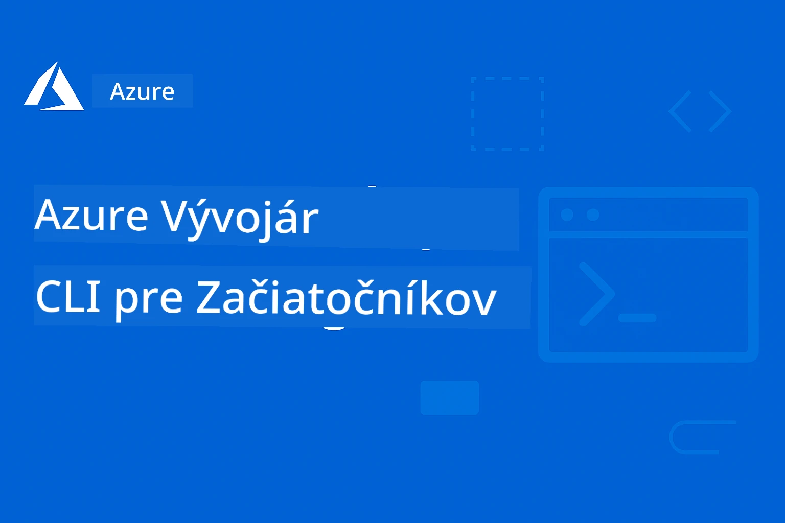

# AZD pre Začiatočníkov: Štruktúrovaná cesta učenia sa

 

[](https://github.com/microsoft/AZD-for-beginners)
[](https://GitHub.com/microsoft/azd-for-beginners/network/)
[](https://github.com/microsoft/AZD-for-beginners)

[](https://discord.com/invite/nkVh3dp)
[](https://discord.gg/nTYy5BXMWG)

---

### Automatizované preklady (vždy aktuálne)

<!-- CO-OP TRANSLATOR LANGUAGES TABLE START -->
[Arabčina](../ar/README.md) | [Bengálčina](../bn/README.md) | [Bulharčina](../bg/README.md) | [Barmčina (Mjanmarsko)](../my/README.md) | [Čínština (zjednodušená)](../zh-CN/README.md) | [Čínština (tradičná, Hongkong)](../zh-HK/README.md) | [Čínština (tradičná, Macao)](../zh-MO/README.md) | [Čínština (tradičná, Taiwan)](../zh-TW/README.md) | [Chorvátčina](../hr/README.md) | [Čeština](../cs/README.md) | [Dánčina](../da/README.md) | [Holandčina](../nl/README.md) | [Estónčina](../et/README.md) | [Fínčina](../fi/README.md) | [Francúzština](../fr/README.md) | [Nemčina](../de/README.md) | [Gréčtina](../el/README.md) | [Hebrejčina](../he/README.md) | [Hindčina](../hi/README.md) | [Maďarčina](../hu/README.md) | [Indonézština](../id/README.md) | [Taliančina](../it/README.md) | [Japončina](../ja/README.md) | [Kannada](../kn/README.md) | [Khmerčina](../km/README.md) | [Kórejčina](../ko/README.md) | [Litovčina](../lt/README.md) | [Malajčina](../ms/README.md) | [Malajalámčina](../ml/README.md) | [Maráthčina](../mr/README.md) | [Nepálčina](../ne/README.md) | [Nigerijský pidžin](../pcm/README.md) | [Nórčina](../no/README.md) | [Perzština (Farsi)](../fa/README.md) | [Poľština](../pl/README.md) | [Portugalčina (Brazília)](../pt-BR/README.md) | [Portugalčina (Portugalsko)](../pt-PT/README.md) | [Pandžábčina (Gurmukhi)](../pa/README.md) | [Rumunčina](../ro/README.md) | [Ruština](../ru/README.md) | [Srbčina (cyrilika)](../sr/README.md) | [Slovenčina](./README.md) | [Slovinčina](../sl/README.md) | [Španielčina](../es/README.md) | [Svahilčina](../sw/README.md) | [Švédčina](../sv/README.md) | [Tagalog (Filipínska)](../tl/README.md) | [Tamilčina](../ta/README.md) | [Telugčina](../te/README.md) | [Thajčina](../th/README.md) | [Turečtina](../tr/README.md) | [Ukrajinčina](../uk/README.md) | [Urdu](../ur/README.md) | [Vietnamčina](../vi/README.md)

> **Preferujete klonovanie lokálne?**
>
> Toto úložisko obsahuje viac ako 50 jazykových prekladov, čo výrazne zväčšuje veľkosť sťahovania. Ak chcete klonovať bez prekladov, použite sparse checkout:
>
> **Bash / macOS / Linux:**
> ```bash
> git clone --filter=blob:none --sparse https://github.com/microsoft/AZD-for-beginners.git
> cd AZD-for-beginners
> git sparse-checkout set --no-cone '/*' '!translations' '!translated_images'
> ```
>
> **CMD (Windows):**
> ```cmd
> git clone --filter=blob:none --sparse https://github.com/microsoft/AZD-for-beginners.git
> cd AZD-for-beginners
> git sparse-checkout set --no-cone "/*" "!translations" "!translated_images"
> ```
>
> Toto vám poskytne všetko potrebné na dokončenie kurzu s oveľa rýchlejším stiahnutím.
<!-- CO-OP TRANSLATOR LANGUAGES TABLE END -->

## 🆕 Čo je nové v azd dnes

> 📌 **Aktualizácia Foundry GA (2026-11-09):** Balík **`microsoft.foundry` 1.0 je všeobecne dostupný**, oznámené [5. novembra 2026](https://devblogs.microsoft.com/azure-sdk/microsoft-foundry-azure-developer-cli-ga/). Použite **`azd >= 1.37.0`** a nainštalujte ho pomocou `azd ext install microsoft.foundry`. Postupujte podľa [prechodu hostovaného agenta](docs/chapter-02-ai-development/microsoft-foundry-integration.md#hosted-agent-walkthrough-ga) pre nastavenie, lokálne testovanie a nasadenie. Táto aktualizácia je založená na zverejnených pokynoch, nie na živej implementácii Azure; GA balík nezabezpečuje všeobecnú dostupnosť každej voliteľnej funkcie, rozšírenia alebo SDK.

Azure Developer CLI podporuje mnoho typov aplikácií, vrátane webových aplikácií, API a AI agentov, prostredníctvom podporovaných hostiteľov, šablón a rozšírení.

Tu je, čo to pre vás znamená:

- **GA balík pre vývoj Foundry.** `microsoft.foundry` inštaluje sedem základných rozšírení, vrátane agentov, projektov a Agent Inspector. Kód agenta a nastavenia nasadenia zostávajú spolu v `azure.yaml`.
- **Testujte lokálne, potom nasadzujte kód.** Použite `azd ai agent init --deploy-mode code`, `azd provision` a `azd ai agent run` na kontrolu lokálnych požiadaviek a odpovedí. Potom použite `azd deploy` pre vzdialenú zostavu v Foundry, bez lokálnej zostavy kontajneru.
- **Merajte kvalitu samostatne.** Nainštalujte **`azure.ai.evaluations`** pre `azd ai eval generate`, `init` a `run start`; nie je súčasťou balíka. Uchovávajte revidované súbory dát a rubriky spolu s vaším kódom. Staršie projekty by mali sledovať [sprievodcu migráciou hodnotenia a optimalizácie](docs/chapter-08-production/production-ai-practices.md#evaluation-migration-and-quality-checks).
- **Znovupoužite konfiguráciu v CI/CD.** Po úspešnom `azd up` nakonfigurujte pipeline s `azd pipeline config`. Nainštalujte balík na runner a uchovajte vygenerované autentifikačné a prostredné nastavenia.
- **Plynulejšia každodenná práca.** Nedávne verzie spravili `azd init` idempotentným (bezpečným na opakované spustenie), automaticky vymazali neplatné tokeny v `azd auth login` a pridali priateľský prompt nastavenia pri prvom spustení v `azd tool`.
- **Základný pracovný tok sa nezmenil.** Či už nasadzujete todo aplikáciu, mikroslužbu alebo multi-agentné AI riešenie, príkazy sú rovnaké.

> **Poznámka pre používateľov Aspire:** Microsoft teraz označuje produkt jednoducho ako **Aspire** (predtým ".NET Aspire"). Podpora Aspire v azd zostáva nezmenená—len sa zmenil názov.

Ak ste predtým používali azd, podpora AI je prirodzeným rozšírením—nie samostatným nástrojom alebo pokročilou cestou. Ak začínate od začiatku, naučíte sa jeden pracovný tok, ktorý funguje pre všetko.

---

## 🚀 Čo je Azure Developer CLI (azd)?

**Azure Developer CLI (azd)** je používateľsky prívetivý nástroj príkazového riadku, ktorý zjednodušuje nasadenie aplikácií do Azure. Namiesto manuálneho vytvárania a prepájania desiatok Azure zdrojov môžete nasadiť celé aplikácie jedným príkazom.

### Magické vlastnosti `azd up`

```bash
# This single command does everything:
# ✅ Creates all Azure resources  
# ✅ Configures networking and security
# ✅ Builds your application code
# ✅ Deploys to Azure
# ✅ Gives you a working URL
azd up
```

Šablóna poskytuje konfiguráciu aplikácie a infraštruktúry. Úspešné nasadenie stále vyžaduje podporované služby/modely, dostatočné kvóty a oprávnenia, správne vstupy a overenie nasadenej aplikácie. `azd up` automaticky nerobí šablónu zabezpečenou, v súlade s normami alebo pripravenou do produkcie.

---

## ❓ Azure Developer CLI vs Azure CLI: Aký je rozdiel?

Toto je najčastejšia otázka, ktorú kladú začiatočníci. Tu je jednoduchá odpoveď:

| Funkcia | **Azure CLI (`az`)** | **Azure Developer CLI (`azd`)** |
|---------|---------------------|--------------------------------|
| **Účel** | Spravovať jednotlivé Azure zdroje | Nasaďovať kompletné aplikácie |
| **Prístup** | Zameranie na infraštruktúru | Zameranie na aplikáciu |
| **Príklad** | `az webapp create --name myapp...` | `azd up` |
| **Učebná krivka** | Musíte poznať Azure služby | Stačí poznať svoju aplikáciu |
| **Najvhodnejšie pre** | DevOps, infraštruktúru | Vývojárov, prototypovanie |

### Jednoduchá analógia

- **Azure CLI** je ako mať všetky nástroje na stavbu domu - kladivá, píly, klince. Môžete postaviť čokoľvek, ale musíte vedieť, ako stavať.
- **Azure Developer CLI** je ako si najať dodávateľa - opíšete, čo chcete, a on sa postará o stavbu.

### Kedy použiť ktorý

| Scenár | Použite toto |
|----------|----------|
| „Chcem rýchlo nasadiť svoju webovú aplikáciu“ | `azd up` |
| „Potrebujem vytvoriť len úložný účet“ | `az storage account create` |
| „Staviam kompletnú AI aplikáciu“ | `azd init --template azure-search-openai-demo` |
| „Potrebujem ladiť konkrétny Azure zdroj“ | `az resource show` |
| „Chcem nasadiť do môjho nakonfigurovaného produkčného prostredia“ | Skontrolujte konfiguráciu, prístup, náklady a prevádzkové opatrenia pred `azd up --environment production` |

### Fungujú spolu!

AZD a Azure CLI majú samostatné overovanie a konfiguráciu. Používajte `azd auth login` pre AZD a `az login`, keď hák alebo diagnostický príkaz explicitne vyžaduje Azure CLI. Môžete použiť oba:
```bash
# Deploy your app with AZD
azd up

# Then fine-tune specific resources with Azure CLI
az webapp config set --name myapp --always-on true
```

---

## 🌟 Nájdenie šablón v Awesome AZD

Nezačínajte od nuly! **Awesome AZD** je komunitná zbierka pripravených na nasadenie šablón:

| Zdroj | Popis |
|----------|-------------|
| 🔗 [**Awesome AZD Galéria**](https://azure.github.io/awesome-azd/) | Prezrite si viac ako 200 šablón s jedným kliknutím na nasadenie |
| 🔗 [**Odošlite šablónu**](https://github.com/Azure/awesome-azd/issues) | Prispievajte vlastnou šablónou do komunity |
| 🔗 [**GitHub Repozitár**](https://github.com/Azure/awesome-azd) | Hviezdičkujte a objavujte zdroj |

### Populárne AI šablóny z Awesome AZD

Vyberte si jednu šablónu v samostatnom prázdnom adresári; príkazy nižšie sú alternatívy. Koncové `.` inicializuje ten adresár.

```bash
# RAG Chat with Microsoft Foundry Models + AI Search
azd init --template azure-search-openai-demo .

# Quick AI Chat Application
azd init --template openai-chat-app-quickstart .

# AI Agents with Foundry Agents
azd init --template get-started-with-ai-agents .
```

---

## 🎯 Začnite v 3 krokoch

Pred začatím sa uistite, že váš počítač je pripravený na šablónu, ktorú chcete nasadiť:

**Windows:**
```powershell
.\validate-setup.ps1
```

**macOS / Linux:**
```bash
bash ./validate-setup.sh
```

Ak niektorá z požadovaných kontrol zlyhá, najprv ju opravte a potom pokračujte s rýchlym začiatkom.

### Krok 1: Inštalácia AZD (2 minúty)

**Windows:**
```powershell
winget install microsoft.azd
```

**macOS:**
```bash
brew tap azure/azd && brew install azd
```

**Linux:**
```bash
curl -fsSL https://aka.ms/install-azd.sh | bash
```

### Krok 2: Overenie pre AZD

```bash
# Optional if you plan to use Azure CLI commands directly in this course
az login

# Required for AZD workflows
azd auth login
```

Ak si nie ste istí, ktorý potrebujete, postupujte podľa celého nastavenia v [Inštalácia a nastavenie](docs/chapter-01-foundation/installation.md#authentication-setup).

### Krok 3: Nasadte svoju prvú aplikáciu

```bash
# Initialize from a template
azd init --template todo-nodejs-mongo .

# Deploy to Azure (creates everything!)
azd up
```

**🎉 Hotovo!** Vaša aplikácia je teraz live na Azure.

### Upratanie (nezabudnite!)

```bash
# Remove all resources when done experimenting
azd down --force --purge
```

---

## 📚 Ako používať tento kurz

Tento kurz je navrhnutý pre **postupné učenie** – začnite tam, kde sa cítite pohodlne, a pokračujte vpred:

| Vaše skúsenosti | Začnite tu |
|-----------------|------------|
| **Nováčik v Azure** | [Kapitola 1: Základy](#-chapter-1-foundation--quick-start) |
| **Poznáte Azure, nový v AZD** | [Kapitola 1: Základy](#-chapter-1-foundation--quick-start) |
| **Chcete nasadzovať AI aplikácie** | [Kapitola 2: Vývoj zameraný na AI](#-chapter-2-ai-first-development-recommended-for-ai-developers) |
| **Chcete praktické cvičenia** | [🎓 Interaktívny workshop](workshop/README.md) – 3-4 hodinové vedené laboratórium |
| **Potrebujete produkčné vzory** | [Kapitola 8: Produkcia a podnik](#-chapter-8-production--enterprise-patterns) |

### Rýchle nastavenie

1. **Forknite si tento repozitár**: [](https://GitHub.com/microsoft/azd-for-beginners/fork)
2. **Skópujte si ho**: `git clone https://github.com/YOUR-USERNAME/azd-for-beginners.git`
3. **Získajte pomoc**: [Azure Discord komunita](https://discord.com/invite/ByRwuEEgH4)

> **Preferujete lokálne klonovanie?**

> Toto úložisko obsahuje viac ako 50 jazykových prekladov, čo výrazne zväčšuje veľkosť sťahovania. Ak chcete klonovať bez prekladov, použite sparse checkout:
> ```bash
> git clone --filter=blob:none --sparse https://github.com/microsoft/AZD-for-beginners.git
> cd AZD-for-beginners
> git sparse-checkout set --no-cone '/*' '!translations' '!translated_images'
> ```
> Toto vám poskytne všetko, čo potrebujete na dokončenie kurzu, s oveľa rýchlejším sťahovaním.


## Prehľad kurzu

Ovládnite Azure Developer CLI (azd) cez štruktúrované kapitoly navrhnuté pre postupné učenie. **Špeciálny dôraz na nasadzovanie AI aplikácií s integráciou Microsoft Foundry.**

### Prečo je tento kurz nevyhnutný pre moderných vývojárov

Vývojári nasadzujúci AI pracovné záťaže často potrebujú návod na:
- Komplexné viac-službové AI architektúry
- Najlepšie postupy pre produkčné nasadenie AI  
- Integráciu a konfiguráciu služieb Azure AI
- Optimalizáciu nákladov pre AI záťaže
- Riešenie špecifických problémov pri nasadzovaní AI

### Ciele učenia

Dokončením tohto štruktúrovaného kurzu:
- **Ovládnete základy AZD**: Kľúčové koncepty, inštalácia a konfigurácia
- **Nasadíte AI aplikácie**: Použijete AZD so službami Microsoft Foundry
- **Implementujete infraštruktúru ako kód**: Spravujete Azure zdroje pomocou Bicep šablón
- **Riešite problémy s nasadením**: Odstránite bežné chyby a debugujete problémy
- **Optimalizujete pre produkciu**: Bezpečnosť, škálovanie, monitorovanie a riadenie nákladov
- **Vytvoríte riešenia s viacerými agentmi**: Nasadíte komplexné AI architektúry

## Pred začiatkom: Účty, prístup a predpoklady

Pred začiatkom 1. kapitoly sa uistite, že máte toto pripravené. Inštalačné kroky v tomto návode predpokladajú, že tieto základy už máte vyriešené.

- **Predplatné Azure**: Môžete použiť existujúce predplatné z práce alebo vlastný účet, alebo vytvoriť si [bezplatnú skúšobnú verziu](https://aka.ms/azurefreetrial) na začatie.
- **Oprávnenie na vytváranie Azure zdrojov**: Pre väčšinu cvičení by ste mali mať aspoň prístup **Contributor** na cieľovom predplatnom alebo skupine zdrojov. Niektoré kapitoly môžu tiež predpokladať, že môžete vytvárať skupiny zdrojov, spravované identity a priradenia RBAC.
- [**GitHub účet**](https://github.com): Je užitočný na forkovanie úložiska, sledovanie vašich zmien a používanie GitHub Codespaces pre workshop.
- **Predpoklady runtime pre šablóny**: Niektoré šablóny vyžadujú lokálne nástroje ako Node.js, Python, Java alebo Docker. Pred začiatkom spustite validátor nastavenia, aby ste včas zachytili chýbajúce nástroje.
- **Základná znalosť terminálu**: Nemusíte byť expert, ale mali by ste byť pohodlní pri spúšťaní príkazov ako `git clone`, `azd auth login` a `azd up`.

> **Pracujete v podnikovej predplatnej zmluve?**
> Ak vaše Azure prostredie spravuje administrátor, vopred si overte, že môžete nasadzovať zdroje v predplatnom alebo skupine zdrojov, ktorú plánujete používať. Ak nie, požiadajte o sandboxové predplatné alebo prístup Contributor pred začiatkom.

> **Nový v Azure?**
> Začnite so svojím vlastným Azure skúšobným alebo pay-as-you-go predplatným na https://aka.ms/azurefreetrial, aby ste mohli vykonať cvičenia od začiatku do konca bez čakania na povolenia na úrovni nájomníka.

## 🗺️ Mapa kurzu: Rýchla navigácia podľa kapitoly

Každá kapitola má samostatný README so vzdelávacími cieľmi, rýchlym štartom a cvičeniami:

| Kapitola | Téma | Lekcie | Trvanie | Zložitosť |
|---------|-------|---------|----------|------------|
| **[Kapitola 1: Základy](docs/chapter-01-foundation/README.md)** | Začíname | [AZD základy](docs/chapter-01-foundation/azd-basics.md) &#124; [Inštalácia](docs/chapter-01-foundation/installation.md) &#124; [Prvý projekt](docs/chapter-01-foundation/first-project.md) | 30-45 min | ⭐ |
| **[Kapitola 2: AI vývoj](docs/chapter-02-ai-development/README.md)** | AI-prvé aplikácie | [Integrácia Foundry](docs/chapter-02-ai-development/microsoft-foundry-integration.md) &#124; [AI agenti](docs/chapter-02-ai-development/agents.md) &#124; [Nasadenie modelu](docs/chapter-02-ai-development/ai-model-deployment.md) &#124; [Workshop](docs/chapter-02-ai-development/ai-workshop-lab.md) | 1-2 hod | ⭐⭐ |
| **[Kapitola 3: Konfigurácia](docs/chapter-03-configuration/README.md)** | Autentifikácia a bezpečnosť | [Konfigurácia](docs/chapter-03-configuration/configuration.md) &#124; [Autentifikácia a bezpečnosť](docs/chapter-03-configuration/authsecurity.md) | 45-60 min | ⭐⭐ |
| **[Kapitola 4: Infraštruktúra](docs/chapter-04-infrastructure/README.md)** | IaC a nasadenie | [Návod na nasadenie](docs/chapter-04-infrastructure/deployment-guide.md) &#124; [Provisioning](docs/chapter-04-infrastructure/provisioning.md) | 1-1,5 hod | ⭐⭐⭐ |
| **[Kapitola 5: Multi-agent](docs/chapter-05-multi-agent/README.md)** | AI agent riešenia | [Scenár maloobchodu](examples/retail-scenario.md) &#124; [Koordinačné vzory](docs/chapter-06-pre-deployment/coordination-patterns.md) | 2-3 hod | ⭐⭐⭐⭐ |
| **[Kapitola 6: Pred nasadením](docs/chapter-06-pre-deployment/README.md)** | Plánovanie a validácia | [Predletové kontroly](docs/chapter-06-pre-deployment/preflight-checks.md) &#124; [Plánovanie kapacity](docs/chapter-06-pre-deployment/capacity-planning.md) &#124; [Výber SKU](docs/chapter-06-pre-deployment/sku-selection.md) &#124; [App Insights](docs/chapter-06-pre-deployment/application-insights.md) | 1 hod | ⭐⭐ |
| **[Kapitola 7: Riešenie problémov](docs/chapter-07-troubleshooting/README.md)** | Debug a opravy | [Bežné problémy](docs/chapter-07-troubleshooting/common-issues.md) &#124; [Debugovanie](docs/chapter-07-troubleshooting/debugging.md) &#124; [AI problémy](docs/chapter-07-troubleshooting/ai-troubleshooting.md) | 1-1,5 hod | ⭐⭐ |
| **[Kapitola 8: Produkcia](docs/chapter-08-production/README.md)** | Podnikové vzory | [Produkčné postupy](docs/chapter-08-production/production-ai-practices.md) | 2-3 hod | ⭐⭐⭐⭐ |
| **[🎓 Workshop](workshop/README.md)** | Praktická laboratória | [Úvod](workshop/docs/instructions/0-Introduction.md) &#124; [Výber](workshop/docs/instructions/1-Select-AI-Template.md) &#124; [Validácia](workshop/docs/instructions/2-Validate-AI-Template.md) &#124; [Dekonštrukcia](workshop/docs/instructions/3-Deconstruct-AI-Template.md) &#124; [Konfigurácia](workshop/docs/instructions/4-Configure-AI-Template.md) &#124; [Prispôsobenie](workshop/docs/instructions/5-Customize-AI-Template.md) &#124; [Zrušenie](workshop/docs/instructions/6-Teardown-Infrastructure.md) &#124; [Záver](workshop/docs/instructions/7-Wrap-up.md) | 3-4 hod | ⭐⭐ |

**Celkové trvanie kurzu:** ~10-14 hodín | **Pokrok v zručnostiach:** Začiatočník → Produkčne pripravený

---

## 📚 Výukové kapitoly

*Vyberte si svoju vzdelávaciu cestu podľa úrovne skúseností a cieľov*

### 🚀 Kapitola 1: Základy a rýchly štart
**Predpoklady**: Azure predplatné, základná znalosť príkazového riadku  
**Trvanie**: 30-45 minút  
**Zložitosť**: ⭐

#### Čo sa naučíte
- Pochopenie základov Azure Developer CLI
- Inštalácia AZD na vašej platforme
- Vaše prvé úspešné nasadenie

#### Vzdelávacie zdroje
- **🎯 Začnite tu**: [Čo je Azure Developer CLI?](#-what-is-azure-developer-cli-azd)
- **📖 Teória**: [AZD základy](docs/chapter-01-foundation/azd-basics.md) - Kľúčové koncepty a terminológia
- **⚙️ Nastavenie**: [Inštalácia a nastavenie](docs/chapter-01-foundation/installation.md) - Návody pre konkrétne platformy
- **🛠️ Prakticky**: [Váš prvý projekt](docs/chapter-01-foundation/first-project.md) - Krok za krokom tutoriál
- **📋 Rýchly odkaz**: [Príkazový cheat sheet](resources/cheat-sheet.md)

#### Praktické cvičenia
```bash
# Quick installation check
azd version

# Deploy your first application
azd init --template todo-nodejs-mongo .
azd up
```

**💡 Výsledok kapitoly**: Úspešne nasadiť jednoduchú webovú aplikáciu do Azure pomocou AZD

**✅ Overenie úspechu:**
```bash
# After completing Chapter 1, you should be able to:
azd version              # Shows installed version
azd init --template todo-nodejs-mongo  # Initializes project
azd up                  # Deploys to Azure
azd show                # Displays running app URL
# Application opens in browser and works
azd down --force --purge  # Cleans up resources
```

**📊 Časová náročnosť:** 30-45 minút  
**📈 Zručnostná úroveň po:** Samostatné nasadenie základných aplikácií

---

### 🤖 Kapitola 2: AI-prvý vývoj (Odporúčané pre AI vývojárov)
**Predpoklady**: Dokončená kapitola 1  
**Trvanie**: 1-2 hodiny  
**Zložitosť**: ⭐⭐

#### Čo sa naučíte
- Integrácia Microsoft Foundry s AZD
- Nasadzovanie AI poháňaných aplikácií
- Pochopenie konfigurácií AI služieb

#### Vzdelávacie zdroje
- **🎯 Začnite tu**: [Integrácia Microsoft Foundry](docs/chapter-02-ai-development/microsoft-foundry-integration.md)
- **🤖 AI agenti**: [Príručka AI agentov](docs/chapter-02-ai-development/agents.md) - Nasadzovanie inteligentných agentov s AZD
- **📖 Vzory**: [Nasadenie AI modelu](docs/chapter-02-ai-development/ai-model-deployment.md) - Nasadzovanie a správa AI modelov
- **🛠️ Workshop**: [AI workshop laboratórium](docs/chapter-02-ai-development/ai-workshop-lab.md) - Pripravte svoje AI riešenia na AZD
- **🎥 Interaktívny sprievodca**: [Materiály z workshopu](workshop/README.md) - Prehliadačové učenie s MkDocs * DevContainer prostredie
- **📋 Šablóny**: [Microsoft Foundry šablóny](#featured-microsoft-foundry-templates)
- **📝 Príklady**: [Príklady nasadenia AZD](examples/README.md)

#### Praktické cvičenia
```bash
# Deploy your first AI application
azd init --template azure-search-openai-demo .
azd up

# Try additional AI templates
azd init --template openai-chat-app-quickstart .
azd init --template agent-openai-python-prompty .
```

**💡 Výsledok kapitoly**: Nasadiť a konfigurovať AI-poháňanú chatovaciu aplikáciu s RAG schopnosťami

**✅ Overenie úspechu:**
```bash
# After Chapter 2, you should be able to:
azd init --template azure-search-openai-demo .
azd up
# Test the AI chat interface
# Ask questions and get AI-powered responses with sources
# Verify search integration works
azd monitor  # Check Application Insights shows telemetry
azd down --force --purge
```

**📊 Časová náročnosť:** 1-2 hodiny  
**📈 Zručnostná úroveň po:** Dokáže nasadiť AI učebné aplikácie a identifikovať ďalšie požiadavky na produkčnú pripravenosť
**💰 Povšimnutie nákladov:** Pochopenie vývojových nákladov $80-150/mesiac, produkčných $300-3500/mesiac

#### 💰 Nákladové úvahy pre AI nasadenia

**Vývojové prostredie (odhad $80-150/mesiac):**
- Microsoft Foundry modely (Pay-as-you-go): $0-50/mesiac (podľa spotreby tokenov)
- AI Search (základná úroveň): $75/mesiac
- Container Apps (Spotrebné): $0-20/mesiac
- Ukladanie (štandard): $1-5/mesiac

**Produkčné prostredie (odhad $300-3 500+/mesiac):**
- Microsoft Foundry modely (PTU pre konzistentný výkon): $3 000+/mesiac ALEBO Pay-as-you-go s vysokým objemom
- AI Search (štandardná úroveň): $250/mesiac
- Container Apps (dedikované): $50-100/mesiac
- Application Insights: $5-50/mesiac
- Ukladanie (prémiové): $10-50/mesiac

**💡 Tipy na optimalizáciu nákladov:**
- Skontrolujte ceny inferencie modelov a kreditné limity účtu; Azure OpenAI nezahŕňa univerzálny mesačný bezplatný limit 50 000 tokenov
- Spustite `azd down` na vymazanie zdrojov, keď už nie sú potrebné, po kontrole vybraného prostredia
- Začnite s účtovaním podľa spotreby, upgradujte na PTU iba pre produkciu
- Použite `azd provision --preview` na kontrolu plánovanej infraštruktúry a potom oceňte zdroje pomocou Azure Pricing Calculator
- Zapnite automatické škálovanie: platíte iba za skutočné využitie

**Monitorovanie nákladov:**
```bash
# Inspect planned resources (this does not calculate prices)
azd provision --preview

# Monitor actual costs in Azure Portal
az consumption budget list --resource-group <your-rg>
```

---

### ⚙️ Kapitola 3: Konfigurácia a autentifikácia
**Predpoklady**: Dokončená kapitola 1  
**Trvanie**: 45-60 minút  
**Zložitosť**: ⭐⭐

#### Čo sa naučíte
- Konfigurácia a správa prostredí
- Najlepšie praktiky autentifikácie a bezpečnosti
- Pomenovanie zdrojov a organizácia

#### Vzdelávacie zdroje
- **📖 Konfigurácia**: [Návod na konfiguráciu](docs/chapter-03-configuration/configuration.md) - Nastavenie prostredia
- **🔐 Bezpečnosť**: [Vzory autentifikácie a spravované identity](docs/chapter-03-configuration/authsecurity.md) - Vzory autentifikácie
- **📝 Príklady**: [Príklad databázovej aplikácie](examples/database-app/README.md) - Príklady databáz v AZD

#### Praktické cvičenia
- Konfigurácia viacerých prostredí (dev, staging, produkcia)
- Nastavenie autentifikácie prostredníctvom spravovanej identity
- Implementácia konfigurácií špecifických pre prostredie

**💡 Výsledok kapitoly**: Spravovať viaceré prostredia s riadnou autentifikáciou a bezpečnosťou

---

### 🏗️ Kapitola 4: Infraštruktúra ako kód a nasadenie
**Predpoklady**: Dokončené kapitoly 1-3  
**Trvanie**: 1-1,5 hodiny  
**Zložitosť**: ⭐⭐⭐

#### Čo sa naučíte
- Pokročilé vzory nasadenia
- Infraštruktúra ako kód pomocou Bicep
- Stratégie provisioning zdrojov

#### Vzdelávacie zdroje
- **📖 Nasadenie**: [Návod na nasadenie](docs/chapter-04-infrastructure/deployment-guide.md) - Kompletné pracovné postupy
- **🏗️ Provisioning**: [Správa Azure zdrojov](docs/chapter-04-infrastructure/provisioning.md) - Správa Azure zdrojov
- **📝 Príklady**: [Príklad Container App](../../examples/container-app) - Kontajnerované nasadenia

#### Praktické cvičenia
- Vytvorte vlastné Bicep šablóny
- Nasadte viac-službové aplikácie
- Implementujte blue-green deployment stratégie

**💡 Výsledok kapitoly**: Nasadiť komplexné viac-službové aplikácie pomocou vlastných infraštruktúrnych šablón

---

### 🎯 Kapitola 5: Multi-agent AI riešenia (pokročilé)
**Predpoklady**: Dokončené kapitoly 1-2  
**Trvanie**: 2-3 hodiny  
**Zložitosť**: ⭐⭐⭐⭐

#### Čo sa naučíte
- Vzory multi-agent architektúr
- Orchestrace a koordinácia agentov
- Produkčne pripravené AI nasadenia

#### Vzdelávacie zdroje
- **🤖 Odporúčaný dizajn**: [Retail Multi-Agent Solution](examples/retail-scenario.md) - Architektonický plán, nie kompletná aplikácia
- **🛠️ ARM šablóny**: [ARM Template Package](../../examples/retail-multiagent-arm-template) - Infrastrukturný základ; skontrolujte predpoklady a chýbajúce komponenty aplikácie
- **📖 Architektúra**: [Multi-agent coordination patterns](docs/chapter-06-pre-deployment/coordination-patterns.md) - Vzory

#### Praktické cvičenia
```bash
# Inspect the retail infrastructure scaffold before choosing to deploy it
cd examples/retail-multiagent-arm-template
cat README.md

# After an intentional deployment, inspect infrastructure state
az deployment group show --resource-group <rg-name> --name <deployment-name>
```

**💡 Výsledok kapitoly**: Pochopiť návrh viacagentových systémov a identifikovať implementačné, validačné a prevádzkové práce potrebné nad rámec infraštrukturálneho základu

---

### 🔍 Kapitola 6: Validácia a plánovanie pred nasadením
**Predpoklady**: Ukončená kapitola 4  
**Dĺžka**: 1 hodina  
**Zložitosť**: ⭐⭐

#### Čo sa naučíte
- Plánovanie kapacity a validácia zdrojov
- Stratégie výberu SKU
- Predletové kontroly a automatizácia

#### Vzdelávacie zdroje
- **📊 Plánovanie**: [Capacity Planning](docs/chapter-06-pre-deployment/capacity-planning.md) - Validácia zdrojov
- **💰 Výber**: [SKU Selection](docs/chapter-06-pre-deployment/sku-selection.md) - Nákladovo efektívne možnosti
- **✅ Validácia**: [Pre-flight Checks](docs/chapter-06-pre-deployment/preflight-checks.md) - Automatizované skripty

#### Praktické cvičenia
- Spustiť skripty na validáciu kapacity
- Optimalizovať výber SKU pre náklady
- Implementovať automatizované kontroly pred nasadením

**💡 Výsledok kapitoly**: Validovať a optimalizovať nasadenia pred vykonaním

---

### 🚨 Kapitola 7: Riešenie problémov a ladenie
**Predpoklady**: Ukončená hociktorá kapitola o nasadení  
**Dĺžka**: 1-1,5 hodiny  
**Zložitosť**: ⭐⭐

#### Čo sa naučíte
- Systematické prístupy k ladeniu
- Bežné problémy a riešenia
- Špecifické riešenie problémov AI

#### Vzdelávacie zdroje
- **🔧 Bežné problémy**: [Common Issues](docs/chapter-07-troubleshooting/common-issues.md) - Často kladené otázky a riešenia
- **🕵️ Ladenie**: [Debugging Guide](docs/chapter-07-troubleshooting/debugging.md) - Postupné stratégie
- **🤖 AI problémy**: [AI-Specific Troubleshooting](docs/chapter-07-troubleshooting/ai-troubleshooting.md) - Problémy služieb AI

#### Praktické cvičenia
- Diagnostikovať zlyhania nasadenia
- Riešiť problémy s autentifikáciou
- Ladiť konektivitu AI služieb

**💡 Výsledok kapitoly**: Samostatne diagnostikovať a riešiť bežné problémy pri nasadení

---

### 🏢 Kapitola 8: Produkčné a podnikové vzory
**Predpoklady**: Ukončené kapitoly 1-4  
**Dĺžka**: 2-3 hodiny  
**Zložitosť**: ⭐⭐⭐⭐

#### Čo sa naučíte
- Stratégie produkčného nasadenia
- Podnikové bezpečnostné vzory
- Monitorovanie a optimalizácia nákladov

#### Vzdelávacie zdroje
- **🏭 Produkcia**: [Production AI Best Practices](docs/chapter-08-production/production-ai-practices.md) - Podnikové vzory
- **📝 Príklady**: [Microservices Example](../../examples/microservices) - Komplexné architektúry
- **📊 Monitorovanie**: [Application Insights integration](docs/chapter-06-pre-deployment/application-insights.md) - Monitorovanie

#### Praktické cvičenia
- Implementovať podnikové bezpečnostné vzory
- Nastaviť komplexné monitorovanie
- Nasadiť do produkcie s riadnou správou

**💡 Výsledok kapitoly**: Nasadiť podnikovú aplikáciu pripravenú na produkciu s plnou funkčnosťou

---

## 🎓 Prehľad workshopu: Praktické učenie

> **⚠️ STAV WORKSHOPU: Aktívny vývoj**  
> Materiály workshopu sú momentálne vyvíjané a dolaďované. Základné moduly sú funkčné, ale niektoré pokročilé časti ešte nie sú dokončené. Aktívne pracujeme na dokončení celého obsahu. [Sledujte pokrok →](workshop/README.md)

### Interaktívne materiály workshopu
**Komplexné praktické učenie s prehliadačovým rozhraním a riadenými cvičeniami**

Naše materiály workshopu poskytujú štruktúrovaný, interaktívny zážitok zo vzdelávania, ktorý dopĺňa vyššie uvedený študijný plán podľa kapitol. Workshop je vytvorený pre samostatné štúdium aj pre vedené kurzy.

#### 🛠️ Funkcie workshopu
- **Prehliadačové rozhranie**: Kompletný workshop poháňaný MkDocs s vyhľadávaním, kopírovaním a témami
- **Integrácia GitHub Codespaces**: Jedným klikom nastaviť vývojové prostredie
- **Štruktúrovaná učebná cesta**: 8 modulov riadených cvičení (3-4 hodiny celkom)
- **Postupná metodológia**: Úvod → Výber → Validácia → Rozbor → Konfigurácia → Prispôsobenie → Ukončenie → Zhrnutie
- **Interaktívne DevContainer prostredie**: Predkonfigurované nástroje a závislosti

#### 📚 Štruktúra modulov workshopu
Workshop nasleduje **postupnú metodológiu v 8 moduloch**, ktorá vás prevedie od objavovania po majstrovstvo nasadenia:

| Modul | Téma | Čo budete robiť | Dĺžka |
|--------|-------|----------------|----------|
| **0. Úvod** | Prehľad workshopu | Pochopiť učebné ciele, predpoklady a štruktúru workshopu | 15 min |
| **1. Výber** | Objav šablón | Preskúmať AZD šablóny a vybrať správnu AI šablónu pre váš scenár | 20 min |
| **2. Validácia** | Nasadiť a overiť | Nasadiť šablónu pomocou `azd up` a overiť fungovanie infraštruktúry | 30 min |
| **3. Rozbor** | Pochopiť štruktúru | Použiť GitHub Copilot na preskúmanie architektúry šablóny, Bicep súborov a organizácie kódu | 30 min |
| **4. Konfigurácia** | Hĺbkový rozbor azure.yaml | Ovládnuť konfiguráciu `azure.yaml`, životné cykly háčikov a premenné prostredia | 30 min |
| **5. Prispôsobenie** | Vytvorte podľa seba | Povoliť AI vyhľadávanie, trasovanie, hodnotenie a prispôsobiť pre váš scenár | 45 min |
| **6. Ukončenie** | Upratať | Bezpečne odobrať zdroje pomocou `azd down --purge` | 15 min |
| **7. Zhrnutie** | Ďalšie kroky | Prehľad úspechov, kľúčových konceptov a pokračovanie v učení | 15 min |

**Priebeh workshopu:**
```
Introduction → Selection → Validation → Deconstruction → Configuration → Customization → Teardown → Wrap-up
     ↓            ↓           ↓              ↓               ↓              ↓            ↓           ↓
  Overview    Find the     Deploy &      Explore        Master         Customize     Clean up    Review &
             right        verify        code &        azure.yaml      for your      resources   next steps
             template                   structure                     scenario
```

#### 🚀 Začíname s workshopom
```bash
# Option 1: GitHub Codespaces (Recommended)
# Click "Code" → "Create codespace on main" in the repository

# Option 2: Local Development
git clone https://github.com/microsoft/azd-for-beginners.git
cd azd-for-beginners/workshop
# Follow the setup instructions in workshop/README.md
```

#### 🎯 Výsledky učenia z workshopu
Po absolvovaní workshopu účastníci:
- **Nasadia produkčné AI aplikácie**: Používajú AZD s Microsoft Foundry službami
- **Ovládnu viacagentové architektúry**: Implementujú koordinované riešenia AI agentov
- **Implementujú bezpečnostné najlepšie praktiky**: Konfigurujú autentifikáciu a riadenie prístupu
- **Optimalizujú pre škálovateľnosť**: Navrhnú nákladovo efektívne, výkonné nasadenia
- **Riešia problémy s nasadením**: Nezávisle vyriešia bežné problémy

#### 📖 Zdroje workshopu
- **🎥 Interaktívny sprievodca**: [Workshop Materials](workshop/README.md) - Prehliadačové učebné prostredie
- **📋 Návody modul po module**:
  - [0. Úvod](workshop/docs/instructions/0-Introduction.md) - Prehľad a ciele workshopu
  - [1. Výber](workshop/docs/instructions/1-Select-AI-Template.md) - Nájsť a vybrať AI šablóny
  - [2. Validácia](workshop/docs/instructions/2-Validate-AI-Template.md) - Nasadiť a overiť šablóny
  - [3. Rozbor](workshop/docs/instructions/3-Deconstruct-AI-Template.md) - Preskúmať architektúru šablón
  - [4. Konfigurácia](workshop/docs/instructions/4-Configure-AI-Template.md) - Ovládnuť azure.yaml
  - [5. Prispôsobenie](workshop/docs/instructions/5-Customize-AI-Template.md) - Prispôsobiť podľa scenára
  - [6. Ukončenie](workshop/docs/instructions/6-Teardown-Infrastructure.md) - Upratať zdroje
  - [7. Zhrnutie](workshop/docs/instructions/7-Wrap-up.md) - Prehľad a ďalšie kroky
- **🛠️ AI Workshop Lab**: [AI Workshop Lab](docs/chapter-02-ai-development/ai-workshop-lab.md) - Cvičenia zamerané na AI
- **💡 Rýchly start**: [Workshop Setup Guide](workshop/README.md#browser-based-guide) - Konfigurácia prostredia

**Ideálne pre**: Firemné školenia, univerzitné kurzy, samostatné štúdium a developerské bootcampy.

---

## 📖 Hlbší pohľad: Možnosti AZD

Okrem základov poskytuje AZD výkonné funkcie pre produkčné nasadenia:

- **Nasadenia založené na šablónach** - Používajte predpripravené šablóny pre bežné vzory aplikácií
- **Infrastruktúra ako kód** - Spravujte Azure zdroje pomocou Bicep alebo Terraform  
- **Integrované pracovné postupy** - Bezproblémové zriaďovanie, nasadzovanie a monitorovanie aplikácií
- **Vývojársky priateľské** - Optimalizované pre produktivitu a skúsenosti vývojárov

### **AZD + Microsoft Foundry: Ideálne pre AI nasadenia**

**Prečo AZD pre AI riešenia?** AZD rieši hlavné výzvy, ktorým čelia AI vývojári:

- **AI pripravené šablóny** - Predkonfigurované šablóny pre Microsoft Foundry modely, Azure AI služby a ML záťaže
- **Bezpečné AI nasadenia** - Vstavané bezpečnostné vzory pre AI služby, API kľúče a modelové endpointy  
- **Produkčné AI vzory** - Najlepšie praktiky pre škálovateľné, nákladovo efektívne AI aplikácie
- **Končené AI pracovné postupy** - Od vývoja modelu po produkčné nasadenie s vhodným monitorovaním
- **Optimalizácia nákladov** - Inteligentné prideľovanie zdrojov a škálovacie stratégie pre AI záťaže
- **Integrácia Microsoft Foundry** - Bezproblémové prepojenie s katalógom modelov a endpointmi Microsoft Foundry

---

## 🎯 Knižnica šablón a príkladov

### Odporúčané: Microsoft Foundry Šablóny
**Začnite tu, ak nasadzujete AI aplikácie!**

> **Poznámka:** Tieto šablóny demonštrujú rôzne AI vzory. Niektoré sú externé Azure Samples, iné lokálne implementácie.

| Šablóna | Kapitola | Zložitosť | Služby | Typ |
|----------|---------|------------|----------|------|
| [**Začať s AI chatom**](https://github.com/Azure-Samples/get-started-with-ai-chat) | Kapitola 2 | ⭐⭐ | AzureOpenAI + Azure AI Model Inference API + Azure AI Search + Azure Container Apps + Application Insights | Externé |
| [**Začať s AI agentmi**](https://github.com/Azure-Samples/get-started-with-ai-agents) | Kapitola 2 | ⭐⭐ | Foundry Agents + AzureOpenAI + Azure AI Search + Azure Container Apps + Application Insights| Externé |
| [**Azure Search + OpenAI demo**](https://github.com/Azure-Samples/azure-search-openai-demo) | Kapitola 2 | ⭐⭐ | Azure OpenAI + Azure AI Search + Container Apps (predvolené) + Storage | Externé |
| [**OpenAI Chat App rýchly štart**](https://github.com/Azure-Samples/openai-chat-app-quickstart) | Kapitola 2 | ⭐ | AzureOpenAI + Container Apps + Application Insights | Externé |
| [**Agent OpenAI Python Prompty**](https://github.com/Azure-Samples/agent-openai-python-prompty) | Kapitola 5 | ⭐⭐⭐ | AzureOpenAI + Azure Functions + Prompty | Externé |
| [**Contoso Chat RAG**](https://github.com/Azure-Samples/contoso-chat) | Kapitola 8 | ⭐⭐⭐⭐ | AzureOpenAI + AI Search + Cosmos DB + Container Apps | Externé |
| [**Retail Multi-Agent Solution**](examples/retail-scenario.md) | Kapitola 5 | ⭐⭐⭐⭐ | Navrhovaná architektúra a infraštruktúrny základ; implementácia aplikácie je potrebná | **Lokálny plán** |

### Odporúčané: Kompletné učenie cez scenáre
**Produkčné šablóny aplikácií mapované na študijné kapitoly**

| Šablóna | Študijná kapitola | Zložitosť | Kľúčové učenie |
|----------|------------------|------------|--------------|
| [**openai-chat-app-quickstart**](https://github.com/Azure-Samples/openai-chat-app-quickstart) | Kapitola 2 | ⭐ | Základné AI nasadenia |
| [**azure-search-openai-demo**](https://github.com/Azure-Samples/azure-search-openai-demo) | Kapitola 2 | ⭐⭐ | Implementácia RAG s Azure AI Search |
| [**get-started-with-ai-agents**](https://github.com/Azure-Samples/get-started-with-ai-agents) | Kapitola 2 | ⭐⭐ | Chat podporený agentmi a hodnotiace testy špecifické pre príklady |
| [**agent-openai-python-prompty**](https://github.com/Azure-Samples/agent-openai-python-prompty) | Kapitola 5 | ⭐⭐⭐ | Agentný rámec a volanie funkcií |
| [**contoso-chat**](https://github.com/Azure-Samples/contoso-chat) | Kapitola 8 | ⭐⭐⭐ | Podniková AI orchestrácia |
| [**retail-multi-agent-solution**](examples/retail-scenario.md) | Kapitola 5 | ⭐⭐⭐⭐ | Viacagentová architektúra s agentmi pre zákazníka a inventár |

### Učenie podľa typu príkladu

> **📌 Lokálne vs. externé príklady:**  
> **Lokálne príklady** (v tomto repozitári) = Skontrolujte README príkladu pre stav implementácie a predpoklady
> **Externé príklady** (Azure Samples) = Klonujte z prepojených repozitárov

#### Lokálne príklady (pripravené na použitie)
- [**Retail Multi-Agent Solution**](examples/retail-scenario.md) - Architektonický plán s infraštruktúrnym základom ARM
  - Navrhované úlohy agentov pre zákazníka a inventár
  - Monitorovanie, hodnotenie a aplikačný kód musia byť implementované a overené
  - Samotné zriadenie zdrojov nevytvára funkčnú maloobchodnú aplikáciu

#### Lokálne príklady - kontajnerové aplikácie (kapitoly 2-5)
**Komplexné príklady nasadenia kontajnerov v tomto repozitári:**
- [**Príklady kontajnerových aplikácií**](examples/container-app/README.md) - Kompletný sprievodca nasadeniami kontajnerov
  - [Jednoduché Flask API](../../examples/container-app/simple-flask-api) - Základné REST API so škálovaním na nulu
  - [Architektúra mikroslužieb](../../examples/container-app/microservices) - Ukážka dvoch služieb; produkčná stabilizácia je ďalšia práca
  - Vzory rýchleho štartu, produkcie a pokročilých nasadení
  - Pokyny pre monitorovanie, bezpečnosť a optimalizáciu nákladov

#### Externé príklady - jednoduché aplikácie (kapitoly 1-2)
**Klonujte tieto Azure Samples repozitáre na začiatok:**
- [Jednoduchá webová aplikácia - Node.js + MongoDB](https://github.com/Azure-Samples/todo-nodejs-mongo) - Základné vzory nasadenia
- [Statická webová stránka - React SPA](https://github.com/Azure-Samples/todo-csharp-sql-swa-func) - Nasadenie statického obsahu
- [Container App - Python Flask](https://github.com/Azure-Samples/container-apps-store-api-microservice) - Nasadenie REST API

#### Externé príklady - Integrácia databázy (kapitoly 3-4)  
- [Database App - C# + SQL](https://github.com/Azure-Samples/todo-csharp-sql) - Vzory pripojenia k databáze
- [Functions + Cosmos DB](https://github.com/Azure-Samples/todo-python-mongo-swa-func) - Serverless dátové workflow

#### Externé príklady - Pokročilé vzory (kapitoly 4-8)
- [Java Microservices](https://github.com/Azure-Samples/java-microservices-aca-lab) - Architektúry viacerých služieb
- [Container Apps Jobs](https://github.com/Azure-Samples/container-apps-jobs) - Spracovanie na pozadí  
- [Enterprise ML Pipeline](https://github.com/Azure/mlops-v2) - Referenčné vzory MLOps; nie je to šablóna AZD pre priame použitie

### Externé kolekcie šablón
- [**Oficiálna galéria šablón AZD**](https://azure.github.io/awesome-azd/) - Starostlivo vybrané oficiálne a komunitné šablóny
- [**Šablóny Azure Developer CLI**](https://learn.microsoft.com/en-us/azure/developer/azure-developer-cli/azd-templates) - Dokumentácia šablón Microsoft Learn
- [**Adresár príkladov**](examples/README.md) - Lokálne vzdelávacie príklady s podrobnými vysvetleniami

---

## 📚 Učebné zdroje a odkazy

### Rýchle odkazy
- [**Cheat sheet príkazov**](resources/cheat-sheet.md) - Kľúčové príkazy azd usporiadané podľa kapitol
- [**Slovník pojmov**](resources/glossary.md) - Terminológia Azure a azd  
- [**FAQ**](resources/faq.md) - Bežné otázky usporiadané podľa učebných kapitol
- [**Študijný sprievodca**](resources/study-guide.md) - Komplexné cvičenia na precvičenie

### Praktické workshopy
- [**AI Workshop Lab**](docs/chapter-02-ai-development/ai-workshop-lab.md) - Urobte svoje AI riešenia nasaditeľné pomocou AZD (2-3 hodiny)
- [**Interaktívny workshop**](workshop/README.md) - 8 modulov s vedenými cvičeniami cez MkDocs a GitHub Codespaces
  - Postup: Úvod → Výber → Validácia → Deštrukcia → Konfigurácia → Prispôsobenie → Ukončenie → Zhrnutie

### Externé učebné zdroje
- [Dokumentácia Azure Developer CLI](https://learn.microsoft.com/en-us/azure/developer/azure-developer-cli/)
- [Azure Architecture Center](https://learn.microsoft.com/en-us/azure/architecture/)
- [Azure Pricing Calculator](https://azure.microsoft.com/pricing/calculator/)
- [Stav služby Azure](https://status.azure.com/)

### AI agentové zručnosti pre váš editor
- [**Microsoft Azure Skills na skills.sh**](https://skills.sh/microsoft/github-copilot-for-azure) - 37 otvorených zručností pre agentov pre Azure AI, Foundry, nasadenie, diagnostiku, optimalizáciu nákladov a ďalšie. Nainštalujte ich v GitHub Copilot, Cursor, Claude Code alebo inom podporovanom agente:
  ```bash
  npx skills add microsoft/github-copilot-for-azure
  ```

---

## 🔧 Rýchly sprievodca riešením problémov

**Bežné problémy začiatočníkov a okamžité riešenia:**

<details>
<summary><strong>❌ "azd: príkaz nebol nájdený"</strong></summary>

```bash
# Install AZD first
# Windows (PowerShell):
winget install microsoft.azd

# macOS:
brew tap azure/azd && brew install azd

# Linux:
curl -fsSL https://aka.ms/install-azd.sh | bash

# Verify installation
azd version
```
</details>

<details>
<summary><strong>❌ "Nenašla sa žiadna predplatné" alebo "Nepretriedené predplatné"</strong></summary>

```bash
# List available subscriptions
az account list --output table

# Set default subscription
az account set --subscription "<subscription-id-or-name>"

# Set for AZD environment
azd env set AZURE_SUBSCRIPTION_ID "<subscription-id>"

# Verify
az account show
```
</details>

<details>
<summary><strong>❌ "Nedostatočná kvóta" alebo "Prekročený limit kvóty"</strong></summary>

```bash
# Try different Azure region
azd env set AZURE_LOCATION "westus2"
azd up

# Or use smaller SKUs in development
# Edit infra/main.parameters.json:
{
  "sku": "B1"  // Instead of "P1V2"
}
```
</details>

<details>
<summary><strong>❌ Príkaz "azd up" zlyhal v polovici</strong></summary>

```bash
# Option 1: Inspect the error and retry after correcting its cause
azd show
azd up --debug

# Option 2: Just fix infrastructure
azd provision

# Option 3: Check detailed status
azd show

# Option 4: Check logs in Azure Monitor
azd monitor --logs
```
</details>

<details>
<summary><strong>❌ "Nepodarilo sa overiť" alebo "Token expiroval"</strong></summary>

```bash
# Re-authenticate for AZD
azd auth logout
azd auth login

# Optional: refresh Azure CLI too if you are running az commands
az logout
az login

# Verify authentication
az account show
```
</details>

<details>
<summary><strong>❌ "Zdroj už existuje" alebo konflikt mien</strong></summary>

```bash
# Inspect the conflicting resource before changing or deleting anything.
# For an isolated new deployment, create a separate environment:
azd env new dev-v2
azd up
```
</details>

<details>
<summary><strong>❌ Nasadenie šablóny trvá príliš dlho</strong></summary>

**Bežné časy čakania:**
- Jednoduchá webová aplikácia: 5-10 minút
- Aplikácia s databázou: 10-15 minút
- AI aplikácie: 15-25 minút (provízia OpenAI je pomalá)

```bash
# Check progress
azd show

# If stuck >30 minutes, check Azure Portal:
azd monitor --overview
# Look for failed deployments
```
</details>

<details>
<summary><strong>❌ "Prístup odmietnutý" alebo "Zakázané"</strong></summary>

```bash
# Check your Azure role
az role assignment list --assignee $(az account show --query user.name -o tsv)

# You need at least "Contributor" role
# Ask your Azure admin to grant:
# - Contributor (for resources)
# - User Access Administrator (for role assignments)
```
</details>

<details>
<summary><strong>❌ Nemožno nájsť URL nasadenej aplikácie</strong></summary>

```bash
# Show all service endpoints
azd show

# Or open Azure Portal
azd monitor

# Check specific service
azd env get-values
# Look for *_URL variables
```
</details>

### 📚 Kompletné zdroje na riešenie problémov

- **Sprievodca bežnými problémami:** [Podrobné riešenia](docs/chapter-07-troubleshooting/common-issues.md)
- **Problémy špecifické pre AI:** [Riešenie problémov s AI](docs/chapter-07-troubleshooting/ai-troubleshooting.md)
- **Sprievodca ladením:** [Postupné ladenie](docs/chapter-07-troubleshooting/debugging.md)
- **Získať pomoc:** [Azure Discord](https://discord.gg/microsoft-azure) #azure-developer-cli

---

## 🎓 Dokončenie kurzu a certifikácia

### Sledovanie pokroku
Sledujte svoj učebný pokrok v každej kapitole:

- [ ] **Kapitola 1**: Základy a rýchly štart ✅
- [ ] **Kapitola 2**: Vývoj orientovaný na AI ✅  
- [ ] **Kapitola 3**: Konfigurácia a overovanie ✅
- [ ] **Kapitola 4**: Infrastructure as Code a nasadenie ✅
- [ ] **Kapitola 5**: Multi-agentné AI riešenia ✅
- [ ] **Kapitola 6**: Validácia a plánovanie pred nasadením ✅
- [ ] **Kapitola 7**: Riešenie problémov a ladenie ✅
- [ ] **Kapitola 8**: Produkčné a podnikové vzory ✅

### Overenie učenia
Po dokončení každej kapitoly overte svoje znalosti:
1. **Praktické cvičenie**: Dokončite praktické nasadenie kapitoly
2. **Kontrola znalostí**: Prejdite sekciu FAQ k danej kapitole
3. **Diskusia v komunite**: Podeľte sa o svoje skúsenosti v Azure Discord
4. **Ďalšia kapitola**: Pokračujte na vyššiu úroveň zložitosti

### Výhody dokončenia kurzu
Po absolvovaní všetkých kapitol získate:
- **Produkčné skúsenosti**: Nasadené reálne AI aplikácie do Azure
- **Profesionálne zručnosti**: Schopnosť nasadenia na podnikovej úrovni  
- **Uznanie v komunite**: Aktívne členstvo v Azure developer komunite
- **Kariérny posun**: Žiadané znalosti AZD a AI nasadenia

---

## 🤝 Komunita a podpora

### Získajte pomoc a podporu
- **Technické problémy**: [Nahláste chyby a požadujte funkcie](https://github.com/microsoft/azd-for-beginners/issues)
- **Otázky k učeniu**: [Microsoft Azure Discord komunita](https://discord.gg/microsoft-azure) a [](https://discord.gg/nTYy5BXMWG)
- **Pomoc špecifická pre AI**: Pripojte sa k [](https://discord.gg/nTYy5BXMWG)
- **Dokumentácia**: [Oficiálna dokumentácia Azure Developer CLI](https://learn.microsoft.com/en-us/azure/developer/azure-developer-cli/)

### Postrehy komunity z Microsoft Foundry Discord

**Témy diskutované komunitou:**
- Nasadenia viacerých služieb, správa poverení a pripravenosť na produkciu
- AI-špecifické šablóny, sprievodcovia riešením problémov a najlepšie postupy

**Pridajte sa do našej komunity, aby ste mohli:**
- Podeľte sa o svoje skúsenosti s AZD + AI a získajte pomoc
- Získať skorý prístup k novým AI šablónam
- Prispieť k najlepším postupom nasadenia AI
- Ovplyvňovať budúci vývoj funkcií AI + AZD

### Príspevky do kurzu
Radi prijímame príspevky! Prečítajte si náš [Sprievodca príspevkami](CONTRIBUTING.md) pre detaily o:
- **Vylepšenie obsahu**: Zlepšite existujúce kapitoly a príklady
- **Nové príklady**: Pridajte reálne scenáre a šablóny  
- **Preklad**: Pomôžte udržiavať podporu viacerých jazykov
- **Nahlásenie chýb**: Zlepšite presnosť a jasnosť
- **Pravidlá komunity**: Dodržiavajte naše inkluzívne komunitné pravidlá

---

## 📄 Informácie o kurze

### Licencia
Tento projekt je licencovaný pod licenciou MIT - pre podrobnosti si pozrite súbor [LICENSE](../../LICENSE).

### Súvisiace učebné zdroje Microsoft Learn

Náš tím vytvára aj ďalšie komplexné učebné kurzy:

<!-- CO-OP TRANSLATOR OTHER COURSES START -->
### LangChain
[](https://aka.ms/langchain4j-for-beginners)
[](https://aka.ms/langchainjs-for-beginners?WT.mc_id=m365-94501-dwahlin)
[](https://github.com/microsoft/langchain-for-beginners?WT.mc_id=m365-94501-dwahlin)
---

### Azure / Edge / MCP / Agenti
[](https://github.com/microsoft/AZD-for-beginners?WT.mc_id=academic-105485-koreyst)
[](https://github.com/microsoft/edgeai-for-beginners?WT.mc_id=academic-105485-koreyst)
[](https://github.com/microsoft/mcp-for-beginners?WT.mc_id=academic-105485-koreyst)
[](https://github.com/microsoft/ai-agents-for-beginners?WT.mc_id=academic-105485-koreyst)

---
 
### Séria Generatívneho AI
[](https://github.com/microsoft/generative-ai-for-beginners?WT.mc_id=academic-105485-koreyst)
[-9333EA?style=for-the-badge&labelColor=E5E7EB&color=9333EA)](https://github.com/microsoft/Generative-AI-for-beginners-dotnet?WT.mc_id=academic-105485-koreyst)
[-C084FC?style=for-the-badge&labelColor=E5E7EB&color=C084FC)](https://github.com/microsoft/generative-ai-for-beginners-java?WT.mc_id=academic-105485-koreyst)
[-E879F9?style=for-the-badge&labelColor=E5E7EB&color=E879F9)](https://github.com/microsoft/generative-ai-with-javascript?WT.mc_id=academic-105485-koreyst)

---
 
### Základné učenie
[](https://aka.ms/ml-beginners?WT.mc_id=academic-105485-koreyst)
[](https://aka.ms/datascience-beginners?WT.mc_id=academic-105485-koreyst)
[](https://aka.ms/ai-beginners?WT.mc_id=academic-105485-koreyst)
[](https://github.com/microsoft/Security-101?WT.mc_id=academic-96948-sayoung)
[](https://aka.ms/webdev-beginners?WT.mc_id=academic-105485-koreyst)
[](https://aka.ms/iot-beginners?WT.mc_id=academic-105485-koreyst)
[](https://github.com/microsoft/xr-development-for-beginners?WT.mc_id=academic-105485-koreyst)

---
 
### Séria Copilot
[](https://aka.ms/GitHubCopilotAI?WT.mc_id=academic-105485-koreyst)
[](https://github.com/microsoft/mastering-github-copilot-for-dotnet-csharp-developers?WT.mc_id=academic-105485-koreyst)
[](https://github.com/microsoft/CopilotAdventures?WT.mc_id=academic-105485-koreyst)
<!-- CO-OP TRANSLATOR OTHER COURSES END -->

---

## 🗺️ Navigácia v kurze

**🚀 Pripravení začať sa učiť?**

**Začiatočníci**: Začnite s [Kapitola 1: Základy a rýchly štart](#-chapter-1-foundation--quick-start)  
**AI vývojári**: Preskočte na [Kapitola 2: Vývoj orientovaný na AI](#-chapter-2-ai-first-development-recommended-for-ai-developers)  
**Skúsenejší vývojári**: Začnite s [Kapitola 3: Konfigurácia a overenie](#️-chapter-3-configuration--authentication)

**Ďalšie kroky**: [Začnite Kapitolu 1 - Základy AZD](docs/chapter-01-foundation/azd-basics.md) →

---

<!-- CO-OP TRANSLATOR DISCLAIMER START -->
**Vyhlásenie o zodpovednosti**:
Tento dokument bol preložený pomocou AI prekladateľskej služby [Co-op Translator](https://github.com/Azure/co-op-translator). Hoci sa snažíme o presnosť, vezmite prosím na vedomie, že automatické preklady môžu obsahovať chyby alebo nepresnosti. Pôvodný dokument v jeho natívnom jazyku by mal byť považovaný za autoritatívny zdroj. Pre kritické informácie sa odporúča profesionálny ľudský preklad. Nie sme zodpovední za žiadne nedorozumenia alebo nesprávne interpretácie vyplývajúce z použitia tohto prekladu.
<!-- CO-OP TRANSLATOR DISCLAIMER END -->