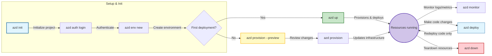
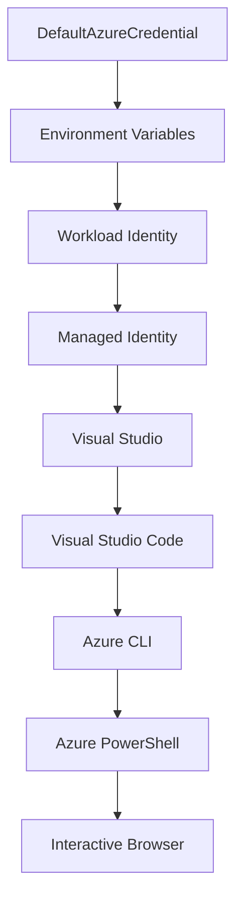

# AZD Základy - Kľúčové koncepty a základy

**Navigácia kapitolou:**
- **📚 Domov kurzu**: [AZD pre začiatočníkov](../../README.md)
- **📖 Aktuálna kapitola**: Kapitola 1 - Základy a rýchly štart
- **⬅️ Predchádzajúca**: [Prehľad kurzu](../../README.md#-chapter-1-foundation--quick-start)
- **➡️ Ďalšia**: [Inštalácia a nastavenie](installation.md)
- **🚀 Ďalšia kapitola**: [Kapitola 2: Vývoj uprednostňujúci AI](../chapter-02-ai-development/microsoft-foundry-integration.md)

## Úvod

> Preskúmané voči `azd 1.37.2` (november 2026). Bash príkazy používajú citované zástupné symboly, ktoré musíte nahradiť. Šablónové workflow používajú `.` na inicializovanie aktuálneho adresára; bez argumentu adresára inicializácia šablóny vytvorí podadresár a nezmení pracovný adresár vášho shellu. Pokročilé snippet-y sú ilustračné, nie kompletné projekty.

Táto lekcia vás zoznámi s Azure Developer CLI (azd), výkonným príkazovým nástrojom, ktorý zrýchľuje vašu cestu od lokálneho vývoja po nasadenie v Azure. Naučíte sa základné koncepty, hlavné funkcie a pochopíte, ako azd zjednodušuje nasadzovanie cloud-native aplikácií.

## Ciele učenia sa

Na konci tejto lekcie budete:
- Rozumieť čo je Azure Developer CLI a jeho hlavnému účelu
- Naučiť sa základné pojmy šablón, prostredí a služieb
- Preskúmať kľúčové funkcie vrátane vývoja založeného na šablónach a Infraštruktúry ako kódu
- Pochopiť štruktúru projektu azd a jeho workflow
- Byť pripravení nainštalovať a nakonfigurovať azd pre vaše vývojové prostredie

## Výsledky učenia

Po dokončení tejto lekcie budete vedieť:
- Vysvetliť úlohu azd v moderných cloudových vývojových workflow
- Identifikovať komponenty štruktúry azd projektu
- Opísať, ako šablóny, prostredia a služby fungujú spolu
- Pochopiť výhody Infraštruktúry ako kódu v azd
- Rozoznať rôzne azd príkazy a ich účely

## Čo je Azure Developer CLI (azd)?

Azure Developer CLI (azd) je príkazový nástroj navrhnutý na zrýchlenie vašej cesty od lokálneho vývoja po nasadenie v Azure. Zjednodušuje proces budovania, nasadzovania a správy cloud-native aplikácií v Azure.

### Čo môžete nasadiť s azd?

azd podporuje širokú škálu pracovných záťaží – a zoznam sa neustále rozširuje. Dnes môžete azd použiť na nasadenie:

| Typ pracovnej záťaže | Príklady | Rovnaké workflow? |
|---------------|----------|----------------|
| **Tradičné aplikácie** | Webové aplikácie, REST API, statické stránky | ✅ `azd up` |
| **Služby a mikroslužby** | Container Apps, Function Apps, viacslužbové backendy | ✅ `azd up` |
| **Aplikácie s podporou AI** | Chat aplikácie s Microsoft Foundry Models, RAG riešenia s AI Search | ✅ `azd up` |
| **Inteligentní agenti** | Agentúry hostované vo Foundry, viacagentné orchestrácie | ✅ `azd up` |

Kľúčovým poznatkom je, že **životný cyklus azd zostáva rovnaký bez ohľadu na to, čo nasadzujete**. Inicializujete projekt, zabezpečíte infraštruktúru, nasadíte kód, monitorujete aplikáciu a potom upratujete – či už ide o jednoduchú webovú stránku alebo sofistikovaného AI agenta.

Táto kontinuita je zámerná. azd považuje AI schopnosti za ďalší druh služby, ktorú môže vaša aplikácia používať, nie za niečo zásadne odlišné. Chatové rozhranie podporované Microsoft Foundry Models je z pohľadu azd len ďalšou službou, ktorú je možné nakonfigurovať a nasadiť.

### 🎯 Prečo používať AZD? Porovnanie z praxe

Porovnajme nasadenie jednoduchej webovej aplikácie s databázou:

#### ❌ BEZ AZD: Manuálne nasadenie do Azure (30+ minút)

**Ilustratívne porovnanie v Bashe, nie spustiteľný aplikátor.** Predpokladá existujúci aplikačný kód, jedinečné názvy zdrojov, autentifikáciu cez Azure CLI a potrebné rozšírenia CLI. Použite šablónové cvičenie nižšie pre podporovanú kompletnú cestu.

```bash
# Step 1: Create resource group
az group create --name myapp-rg --location eastus

# Step 2: Create App Service Plan
az appservice plan create --name myapp-plan \
  --resource-group myapp-rg \
  --sku B1 --is-linux

# Step 3: Create Web App
az webapp create --name myapp-web-unique123 \
  --resource-group myapp-rg \
  --plan myapp-plan \
  --runtime "NODE:22-lts"

# Step 4: Create Cosmos DB account (10-15 minutes)
az cosmosdb create --name myapp-cosmos-unique123 \
  --resource-group myapp-rg \
  --kind MongoDB

# Step 5: Create database
az cosmosdb mongodb database create \
  --account-name myapp-cosmos-unique123 \
  --resource-group myapp-rg \
  --name tododb

# Step 6: Create collection
az cosmosdb mongodb collection create \
  --account-name myapp-cosmos-unique123 \
  --resource-group myapp-rg \
  --database-name tododb \
  --name todos

# Step 7: Get connection string
CONN_STR=$(az cosmosdb keys list \
  --name myapp-cosmos-unique123 \
  --resource-group myapp-rg \
  --type connection-strings \
  --query "connectionStrings[0].connectionString" -o tsv)

# Step 8: Configure app settings
az webapp config appsettings set \
  --name myapp-web-unique123 \
  --resource-group myapp-rg \
  --settings MONGODB_URI="$CONN_STR"

# Step 9: Enable logging
az webapp log config --name myapp-web-unique123 \
  --resource-group myapp-rg \
  --application-logging filesystem \
  --detailed-error-messages true

# Step 10: Set up Application Insights
az monitor app-insights component create \
  --app myapp-insights \
  --location eastus \
  --resource-group myapp-rg

# Step 11: Link App Insights to Web App
INSTRUMENTATION_KEY=$(az monitor app-insights component show \
  --app myapp-insights \
  --resource-group myapp-rg \
  --query "instrumentationKey" -o tsv)

az webapp config appsettings set \
  --name myapp-web-unique123 \
  --resource-group myapp-rg \
  --settings APPINSIGHTS_INSTRUMENTATIONKEY="$INSTRUMENTATION_KEY"

# Step 12: Build application locally
npm install
npm run build

# Step 13: Create deployment package
zip -r app.zip . -x "*.git*" "node_modules/*"

# Step 14: Deploy application
az webapp deployment source config-zip \
  --resource-group myapp-rg \
  --name myapp-web-unique123 \
  --src app.zip

# Step 15: Wait and pray it works 🙏
# (No automated validation, manual testing required)
```

**Problémy:**
- ❌ Viac ako 15 príkazov, ktoré je potrebné si zapamätať a vykonať v poradí
- ❌ 30-45 minút manuálnej práce
- ❌ Ľahko robiť chyby (preklepy, nesprávne parametre)
- ❌ Vyžaduje explicitnú správu poverení; debug logy a trasovanie shellu môžu odhaliť údaje
- ❌ Žiadne automatické vrátenie späť pri chybe
- ❌ Ťažké na replikáciu pre tím
- ❌ Každýkrát iné (nereprodukovateľné)

#### ✅ S AZD: Automatizované nasadenie (5 príkazov, 10-15 minút)

```bash
# Step 1: Initialize from template
azd init --template todo-nodejs-mongo .

# Step 2: Authenticate
azd auth login

# Step 3: Select the environment created during init
azd env select dev

# Step 4: Preview changes (optional but recommended)
azd provision --preview

# Step 5: Deploy everything
azd up

# ✨ Done! Everything is deployed, configured, and monitored
```

**Výhody:**
- ✅ **5 príkazov** oproti 15+ manuálnym krokom
- ✅ **10-15 minút** celkového času (väčšinou čakanie na Azure)
- ✅ **Menej manuálnych chýb** – konzistentné, šablónové workflow
- ✅ **Bezpečné spracovanie tajomstiev** – veľa šablón využíva Azure spravované úložisko tajomstiev
- ✅ **Opakovateľné nasadenia** – rovnaké workflow zakaždým
- ✅ **Opakovateľné infraštruktúrne definície** – podliehajú kvótam, dostupnosti regiónov a verziám šablón
- ✅ **Pripravené pre tím** – ktokoľvek môže nasadiť rovnakými príkazmi
- ✅ **Infraštruktúra ako kód** – verzované Bicep šablóny
- ✅ **Monitorovanie definované v šablóne** – Application Insights, ak je v šablóne zahrnuté

### Čas a spoľahlivosť

Vyššie uvedené časy sú odhadmi, nie benchmarkmi. azd znižuje počet príkazov, ktoré musíte koordinovať, ale nezaručuje trvanie nasadenia, neodstraňuje chyby ani neposkytuje automatické vrátenie aplikácie/databázy späť. Majte funkčné verzie v systéme správy zdrojového kódu a testujte postupy obnovy.

## Kľúčové koncepty

### Šablóny
Šablóny sú základom azd. Obsahujú:
- **Aplikačný kód** – Váš zdrojový kód a závislosti
- **Definície infraštruktúry** – Azure zdroje definované v Bicepe alebo Terraforme
- **Konfiguračné súbory** – Nastavenia a premenné prostredia
- **Skripty nasadenia** – Automatizované workflow nasadenia

### Prostredia
Prostredia predstavujú rôzne cieľové nasadenia:
- **Vývojové** – Na testovanie a vývoj
- **Prípravné (staging)** – Predprodukčné prostredie
- **Produkčné** – Živé produkčné prostredie

Každé prostredie si uchováva vlastné:
- Názov prostredia a jeho hodnoty; izolácia zdrojov závisí od infraštruktúrnej šablóny
- Konfiguračné nastavenia
- Stav nasadenia

### Služby
Služby v `azure.yaml` popisujú nasaditeľné aplikačné komponenty:
- **Frontend** – Webové aplikácie, SPA
- **Backend** – API, mikroslužby

Databázy a úložiská sa zvyčajne zabezpečujú ako infraštruktúrne zdroje, nie ako vymyslení hostitelia služieb ako napríklad `host: postgres`.

## Kľúčové funkcie

### 1. Vývoj založený na šablónach
```bash
# Browse available templates
azd template list

# Initialize from a template
azd init --template "<template-name>" .
```

### 2. Infraštruktúra ako kód
- **Bicep** – Doménovo špecifický jazyk Azure
- **Terraform** – Nástroj pre multi-cloud infraštruktúru
- Bicep sa prekladá do ARM šablón; čistý ARM JSON nie je samostatný vstavaný `infra.provider`.

### 3. Integrované workflow
```bash
# Complete deployment workflow
azd up            # Provision + Deploy this is hands off for first time setup

# 🧪 NEW: Preview infrastructure changes before deployment (SAFE)
azd provision --preview    # Simulate infrastructure deployment without making changes

azd provision     # Create Azure resources if you update the infrastructure use this
azd deploy        # Deploy application code or redeploy application code once update
azd down          # Clean up resources
```

#### 🛡️ Bezpečné plánovanie infraštruktúry s náhľadom
Príkaz `azd provision --preview` je prelomový nástroj pre bezpečné nasadenia:
- **Analýza suchého behu** – Zobrazuje, čo bude vytvorené, zmenené alebo odstránené
- **Bez aplikácie infraštruktúry** – Prehliada zmeny poskytovateľa; najprv skontrolujte projektové hooky, pretože hooky môžu vykonávať príkazy s vedľajšími účinkami
- **Tímová spolupráca** – Zdieľajte výsledky náhľadu pred nasadením
- **Vstup pre plánovanie nákladov** – Skontrolujte navrhované SKU, potom ich ocente pomocou Azure Pricing Calculator; náhľad nevypočítava ceny

```bash
# Example preview workflow
azd provision --preview           # See what will change
# Review the output, discuss with team
azd provision                     # Apply changes with confidence
```

### 📊 Vizualizácia: AZD vývojové workflow



**Vysvetlenie workflow:**
1. **Init** – Začnite so šablónou alebo novým projektom
2. **Auth** – Autentifikujte sa v Azure
3. **Prostredie** – Vytvorte izolované prostredie nasadenia
4. **Preview** – 🆕 Vždy najprv nahliadnite do zmien infraštruktúry (bezpečná prax)
5. **Provision** – Vytvorte/aktualizujte Azure zdroje
6. **Deploy** – Nahrajte váš aplikačný kód
7. **Monitor** – Sledujte výkon aplikácie
8. **Iterate** – Robte zmeny a znova nasadzujte kód
9. **Cleanup** – Odstráňte zdroje po ukončení

### 4. Správa prostredí
```bash
# Create and manage environments
azd env new "<environment-name>"
azd env select "<environment-name>"
azd env list
```

### 5. Rozšírenia a AI príkazy

azd používa systém rozšírení na pridanie funkcií mimo základnej CLI. Toto je obzvlášť užitočné pre AI pracovné zaťaženia:

```bash
# List available extensions
azd extension list

# Install the GA Foundry bundle (requires azd >= 1.37.0)
azd ext install microsoft.foundry

# Initialize an AI agent project interactively
azd ai agent init

# Test a deployed agent (shows latency and time-to-first-byte)
azd ai agent invoke

# Start the MCP server for AI-assisted development (Alpha)
azd mcp start
```

**Životný cyklus agenta od začiatku až do konca.** GA balík `microsoft.foundry` obsahuje `azure.ai.agents` a ďalších šesť základných rozšírení. `azure.ai.evaluations` nainštalujte samostatne na hodnotenie. Použite `azd >= 1.37.0` pre toto workflow. Nemusíte mať všetky v prvý deň:

| Fáza | Príkaz | Čo robí |
|-------|---------|--------------|
| **Scaffold** | `azd ai agent init --template <path-to-azure.yaml>` | Prevziať aktuálnu šablónu projektu agenta |
| **Spustiť lokálne** | `azd ai agent run`, potom `azd ai agent invoke --local "Test prompt"` v inom termináli | Sledovať lokálnu aktivitu v Agent Inspector; volania modelov stále využívajú Azure |
| **Nasadiť** | `azd deploy` | Pre agentov hostovaných v režime kódu, nahrať zdroj pre vzdialenú Foundry zostavu |
| **Testovať** | `azd ai agent invoke` | Zavolať agenta a zobraziť čas odozvy |
| **Merať** | `azd ai eval init`, `generate`, `run start` | Konfigurovať, nasadiť a spustiť vyhodnotenia pomocou samostatného rozšírenia |
| **Zlepšiť** | `azd ai agent optimize --eval <evaluation-name> --optimize-model <optimizer-deployment>` | Znovu použiť kompatibilné vyhodnotenie na optimalizáciu agenta |
| **Skontrolovať** | `azd ai agent endpoint show` | Zobraziť konfiguráciu živého endpointu |
| **Upratať** | `azd ai agent delete` | Odstrániť hostovaného agenta a všetky jeho verzie |

> Začnite s [GA hosted-agent walkthrough](../chapter-02-ai-development/microsoft-foundry-integration.md#hosted-agent-walkthrough-ga), ktorý pokrýva predpoklady, zabezpečenie a bezpečné upratovanie. Rozšírenia sú detailnejšie popísané v [AZD AI CLI Commands](../chapter-08-production/production-ai-practices.md#azd-ai-cli-commands-and-extensions) referencii.

## 📁 Štruktúra projektu

Typická štruktúra azd projektu:
```
my-app/
├── .azure/                  # Local environments and selected-environment config
│   ├── config.json
│   └── dev/.env
├── .devcontainer/          # Development container config
├── .github/workflows/      # GitHub Actions
├── .vscode/               # VS Code settings
├── infra/                 # Infrastructure code
│   ├── main.bicep        # Main infrastructure template
│   ├── main.parameters.json
│   └── modules/          # Reusable modules
├── src/                  # Application source code
│   ├── api/             # Backend services
│   └── web/             # Frontend application
├── azure.yaml           # azd project configuration
└── README.md
```

## 🔧 Konfiguračné súbory

### azure.yaml
Hlavný konfiguračný súbor projektu:
```yaml
name: my-awesome-app
metadata:
  template: my-template@1.0.0

services:
  web:
    project: ./src/web
    language: js
    host: appservice
  api:
    project: ./src/api
    language: js
    host: appservice

hooks:
  preprovision:
    shell: pwsh
    run: echo "Preparing to provision..."
```

### .azure/config.json
Lokálny výber predvoleného prostredia projektu (ilustratívne; spravované azd):
```json
{
  "defaultEnvironment": "dev"
}
```

## 🎪 Bežné workflow s praktickými cvičeniami

> **💡 Tip na učenie:** Nasledujte tieto cvičenia postupne, aby ste si postupne vybudovali zručnosti s AZD.

### 🎯 Cvičenie 1: Inicializujte svoj prvý projekt

**Cieľ:** Vytvoriť AZD projekt a preskúmať jeho štruktúru

**Kroky:**
```bash
# Use a proven template
mkdir azd-basics-practice
cd azd-basics-practice
# Choose "dev" for the environment name when prompted
azd init --template todo-nodejs-mongo .

# Explore the generated files
ls -la  # View all files including hidden ones

# Key files created:
# - azure.yaml (main config)
# - infra/ (infrastructure code)
# - src/ (application code)
```

**✅ Úspech:** Máte adresáre azure.yaml, infra/ a src/

---

### 🎯 Cvičenie 2: Nasadenie do Azure

**Cieľ:** Kompletné nasadenie end-to-end

**Kroky:**
```bash
# 1. Authenticate
azd auth login

# 2. Select the dev environment created in Exercise 1
azd env select dev
azd env set AZURE_LOCATION eastus

# 3. Preview changes (RECOMMENDED)
azd provision --preview

# 4. Deploy everything
azd up

# 5. Verify deployment
azd show    # View your app URL
```

**Očakávaný čas:** 10-15 minút  
**✅ Úspech:** URL aplikácie sa otvorí v prehliadači

---

### 🎯 Cvičenie 3: Viaceré prostredia

**Cieľ:** Nasadiť do dev a staging

**Kroky:**
```bash
# Already have dev, create staging
azd env new staging
azd env set AZURE_LOCATION westus2
azd up

# Switch between them
azd env list
azd env select dev
```

**✅ Úspech:** Dve samostatné skupiny zdrojov v Azure Portáli

**Upratovanie:** Cvičenie 3 vytvára druhé účtovateľné nasadenie. Po dokončení oba vymažte:

```bash
azd down --environment dev
azd down --environment staging
```

---

### 🛡️ Deštruktívne upratovanie: `azd down --force --purge`

Keď chcete zámerne zmazať Azure zdroje vybraného prostredia:

```bash
azd down --force --purge
```

**Čo robí:**
- `--force`: Žiadne potvrdzovacie výzvy
- `--purge`: Trvalo zmaže podporované soft-delete zdroje (napríklad Key Vaults), ak to ochrana purge povolí. Nezmaže lokálny adresár `.azure/`.

**Používajte keď:** ste skončili s dočasným prostredím. Nepoužívajte deštruktívny cleanup ako prvú reakciu na chybu autentifikácie, kvóty alebo konfigurácie.

---

## 🎪 Referencia originálneho workflow

### Začiatok nového projektu
```bash
# Method 1: Use existing template
azd init --template todo-nodejs-mongo .

# Method 2: Start from scratch
azd init

# Method 3: Use current directory
azd init .
```

### Vývojový cyklus
```bash
# Set up development environment
azd auth login
azd env new dev
azd env select dev

# Deploy everything
azd up

# Make changes and redeploy
azd deploy

# Clean up when done
azd down --force --purge # Deletes this environment's discovered Azure resources; review before forcing deletion.
```

## Pochopenie `azd down --force --purge`
Príkaz `azd down --force --purge` je silný nástroj na úplné odstránenie azd prostredia a všetkých súvisiacich zdrojov. Tu je rozpis, čo ktorý parameter robí:
```
--force
```
- Preskočí potvrdzovacie výzvy.
- Užitečné pre automatizáciu alebo skriptovanie, kde manuálny vstup nie je možný.
- Neobchádza povolenia, ochranu purge ani chyby pri mazaní.

```
--purge
```
Natrvalo odstráni podporované Azure zdroje, ktoré boli najprv mäkko odstránené, bez ďalšieho potvrdenia. Ochrana pred vymazaním a oprávnenia stále platia. Neodstráni **lokálne prostredia** alebo priečinok `.azure/`.


### Prečo používať oba?
Používajte oba len vtedy, keď máte v úmysle odstrániť Azure zdroje vybraného prostredia a vyčistiť obnoviteľné zdroje. Toto je destruktívne čistenie, nie bežná oprava alebo reset lokálneho stavu.

Je to obzvlášť užitočné po ručnom odstránení zdrojov v Azure portáli alebo pri prepínaní šablón, prostredí alebo konvencií pomenovania skupín zdrojov.


### Správa viacerých prostredí
```bash
# Create staging environment
azd env new staging
azd env select staging
azd up

# Switch back to dev
azd env select dev

# Compare environments
azd env list
```

## 🔐 Overovanie a poverenia

Rozlišujte overovanie nasadenia (`azd auth login`) od overovania aplikácie SDK (`DefaultAzureCredential`). Sú to samostatné veci. azd predvolene nepoužíva poverenia Azure CLI.

### Overovanie Azure CLI (`az login`)

Spustite `azd auth login` pre azd. Nasledujúce príkazy Azure CLI sú voliteľné a overujú `az` príkazy samostatne:

```bash
# Interactive login (opens browser)
az login

# Login with specific tenant
az login --tenant "<tenant-id>"

# Login with service principal
az login --service-principal -u "<app-id>" -p "<password>" --tenant "<tenant-id>"

# Check current login status
az account show

# List available subscriptions
az account list --output table

# Set default subscription
az account set --subscription "<subscription-id>"
```

### Priebeh overovania
1. **Interaktívne prihlásenie**: Otvorí váš predvolený prehliadač na overenie
2. **Priebeh prihlásenia pomocou zariadenia**: Pre prostredia bez prístupu k prehliadaču
3. **Servisný princíp**: Pre automatizáciu a scenáre CI/CD
4. **Spravovaná identita**: Pre aplikácie hosťované v Azure

### Reťazec DefaultAzureCredential

`DefaultAzureCredential` je typ poverenia, ktorý poskytuje zjednodušený autentifikačný zážitok tým, že automaticky skúša viaceré zdroje poverení v konkrétnom poradí:

#### Reťazec poverení SDK aplikácie

Presný reťazec závisí od jazyka Azure Identity SDK, verzie, inštalovaných zásuvných modulov a možností. Tento diagram je koncepčný, nie pevná sekvencia autentifikácie azd; novšie SDK môžu tiež zahŕňať poverenia Azure Developer CLI.


#### 1. Premenné prostredia
```bash
# Set environment variables for service principal
export AZURE_CLIENT_ID="<app-id>"
export AZURE_CLIENT_SECRET="<password>"
export AZURE_TENANT_ID="<tenant-id>"
```

#### 2. Workload Identity (Kubernetes/GitHub Actions)
Používa sa automaticky v:
- Azure Kubernetes Service (AKS) so službou Workload Identity
- GitHub Actions s federáciou OIDC
- Iné federované identity scenáre

#### 3. Spravovaná identita
Pre Azure zdroje ako:
- Virtuálne stroje
- App Service
- Azure Functions
- Kontajnerové inštancie

```bash
# Inspect a deployed Container App's configured identity (requires az login)
az containerapp show --name "<app-name>" --resource-group "<rg-name>" --query identity
```

#### 4. Integrácia nástrojov pre vývojárov
- **Visual Studio**: Automaticky používa prihlásený účet
- **VS Code**: Podpora závisí na SDK a nastavenej brokerskej/zásuvnej podpore
- **Azure CLI**: Používa poverenia `az login` (najčastejšie pre miestny vývoj)

### Nastavenie autentifikácie AZD

```bash
# Method 1: Direct azd authentication (recommended)
azd auth login

# Method 2: Direct azd authentication
azd auth login --use-device-code  # For headless environments

# Method 3: Check authentication status
azd auth login --check-status

# Method 4: Logout and re-authenticate
azd auth logout
azd auth login
```

### Najlepšie praktiky autentifikácie

#### Pre miestny vývoj
```bash
# 1. Log in to azd
azd auth login

# 2. Select the subscription for this initialized environment
azd env set AZURE_SUBSCRIPTION_ID "<subscription-id>"

# 3. Check azd sign-in details (read the status message)
azd auth login --check-status
```

#### Pre CI/CD pipeline-y
```yaml
# Partial GitHub Actions steps: assumes checkout, azd installation,
# required AZURE_* environment values, and pipeline secret configuration.
- name: Deploy with azd
  run: |
    azd auth login --client-id ${{ secrets.AZURE_CLIENT_ID }} \
                    --client-secret ${{ secrets.AZURE_CLIENT_SECRET }} \
                    --tenant-id ${{ secrets.AZURE_TENANT_ID }}
    azd up --no-prompt
```

#### Pre produkčné prostredia
- Používajte **spravovanú identitu** pri spustení na Azure zdrojoch
- Používajte **servisný princíp** pre automatizáciu
- Vyhýbajte sa ukladaní poverení v kóde alebo konfiguračných súboroch
- Používajte **Azure Key Vault** pre citlivú konfiguráciu

### Bežné problémy s autentifikáciou a riešenia

#### Problém: "Nenašla sa žiadna predplatné"
```bash
# Solution: Set default subscription
az account list --output table
az account set --subscription "<subscription-id>"
azd env set AZURE_SUBSCRIPTION_ID "<subscription-id>"
```

#### Problém: "Nedostatočné oprávnenia"
```bash
# Solution: Check and assign required roles
az role assignment list --assignee $(az account show --query user.name --output tsv)

# Common required roles:
# - Contributor (for resource management)
# - User Access Administrator (for role assignments)
```

#### Problém: "Token expiroval"
```bash
# Solution: Re-authenticate
az logout
az login
azd auth logout
azd auth login
```

### Autentifikácia v rôznych scenároch

#### Miestny vývoj
```bash
# Personal development account
az login
azd auth login
```

#### Tímový vývoj
```bash
# Use specific tenant for organization
az login --tenant contoso.onmicrosoft.com
azd auth login --tenant-id "<tenant-id>"
```

#### Multi-tenant scenáre
```bash
# Switch between tenants
az login --tenant tenant1.onmicrosoft.com
azd auth login --tenant-id "<tenant-1-id>"
# Select an environment configured with tenant 1's subscription
azd env select tenant1-dev
# Deploy to tenant 1
azd up

az login --tenant tenant2.onmicrosoft.com  
azd auth login --tenant-id "<tenant-2-id>"
azd env select tenant2-dev
# Deploy to tenant 2
azd up
```

### Bezpečnostné aspekty

1. **Ukladanie poverení**: Nikdy neukladajte poverenia do zdrojového kódu
2. **Obmedzenie rozsahu**: Používajte princíp najmenších oprávnení pre servisné princípy
3. **Rotácia tokenov**: Pravidelne rotujte tajomstvá servisných princípov
4. **Auditné záznamy**: Sledujte autentifikačné a nasadzovacie aktivity
5. **Sieťová bezpečnosť**: Používajte súkromné koncové body, ak je to možné

### Riešenie problémov s autentifikáciou

```bash
# Debug authentication issues
azd auth login --check-status
az account show
az account get-access-token

# Common diagnostic commands
whoami                          # Current user context
az ad signed-in-user show      # Microsoft Entra ID user details
az group list                  # Test resource access
```

## Objavovanie príkazov

### Objavovanie
```bash
azd template list              # Browse templates
azd template list --help       # Template discovery options
azd init --help               # Initialization options
```

### Správa projektov
```bash
azd show                     # Project overview
azd env list                # Available environments and selected default
azd config show            # Configuration settings
```

### Monitorovanie
```bash
azd monitor                  # Open Azure portal monitoring
azd monitor --logs           # View application logs
azd monitor --live           # View live metrics
azd pipeline config          # Set up CI/CD
```

## Najlepšie praktiky

### 1. Používajte zmysluplné názvy
```bash
# Good
azd env new production-east
azd init --template todo-nodejs-mongo .

# Avoid
azd env new env1
azd init --template template1 .
```

### 2. Využívajte šablóny
- Začnite so existujúcimi šablónami
- Prispôsobte ich podľa svojich potrieb
- Vytvorte znovupoužiteľné šablóny pre vašu organizáciu

### 3. Izolácia prostredí
- Používajte samostatné prostredia pre vývoj/test/produkciu
- Nikdy nevykonávajte deploy priamo do produkcie zo svojho lokálneho stroja
- Používajte CI/CD pipeline-y pre produkčné nasadenia

### 4. Správa konfigurácie
- Používajte spravovanú identitu a Key Vault pre tajomstvá; obyčajné hodnoty `azd env set` sú lokálne v čitateľnom texte
- Uchovávajte konfiguráciu pod správou verzií
- Dokumentujte nastavenia špecifické pre prostredie

## Vývojové etapy učenia

### Začiatočník (týždeň 1-2)
1. Nainštalujte azd a prihláste sa
2. Nasadiť jednoduchú šablónu
3. Pochopiť štruktúru projektu
4. Naučiť sa základné príkazy (up, down, deploy)

### Stredne pokročilý (týždeň 3-4)
1. Prispôsobiť šablóny
2. Správa viacerých prostredí
3. Pochopiť infraštruktúru ako kód
4. Nastaviť CI/CD pipeline-y

### Pokročilý (týždeň 5+)
1. Vytvárať vlastné šablóny
2. Pokročilé infraštruktúrne vzory
3. Nasadenia v viac regiónoch
4. Konfigurácie na podnikovej úrovni

## Ďalšie kroky

**📖 Pokračujte v učení Kapitoly 1:**
- [Inštalácia a nastavenie](installation.md) - Nainštalujte a nastavte azd
- [Váš prvý projekt](first-project.md) - Kompletný praktický tutoriál
- [Sprievodca konfiguráciou](../chapter-03-configuration/configuration.md) - Pokročilé možnosti nastavenia

**🎯 Ste pripravení na ďalšiu kapitolu?**
- [Kapitola 2: AI-prvý vývoj](../chapter-02-ai-development/microsoft-foundry-integration.md) - Začnite budovať AI aplikácie

## Dodatočné zdroje

- [Prehľad Azure Developer CLI](https://learn.microsoft.com/en-us/azure/developer/azure-developer-cli/)
- [Galéria šablón](https://azure.github.io/awesome-azd/)
- [Ukážky z komunity](https://github.com/Azure-Samples)

---

## 🙋 Často kladené otázky

### Všeobecné otázky

**Otázka: Aký je rozdiel medzi AZD a Azure CLI?**

Odpoveď: Azure CLI (`az`) slúži na správu jednotlivých Azure zdrojov. AZD (`azd`) je určený na správu celých aplikácií:

```bash
# Azure CLI - Low-level resource management
az webapp create --name myapp --resource-group rg
az sql server create --name myserver --resource-group rg
# ...many more commands needed

# AZD - Application-level management
azd up  # Deploys entire app with all resources
```

**Predstavte si to takto:**
- `az` = Operovanie s jednotlivými Lego kockami
- `azd` = Práca s kompletnými Lego setmi

---

**Otázka: Potrebujem vedieť Bicep alebo Terraform na používanie AZD?**

Odpoveď: Nie! Začnite so šablónami:
```bash
# Use existing template - no IaC knowledge needed
azd init --template todo-nodejs-mongo .
azd up
```

Bicep sa môžete naučiť neskôr na prispôsobenie infraštruktúry. Šablóny poskytujú funkčné príklady, z ktorých sa môžete učiť.

---

**Otázka: Koľko stojí prevádzka AZD šablón?**

Odpoveď: Náklady sa líšia podľa regiónu, SKU, dostupnosti, režimu databázy a používania modelu. Vývojové prostredie môže spôsobiť značné mesačné náklady aj v nečinnosti; nepredpokladajte univerzálny rozsah 50-150 dolárov:

```bash
# Preview resource changes (not prices)
azd provision --preview

# Always cleanup when not using
azd down --force --purge  # Removes all resources
```

**Profesionálny tip:** Používajte bezplatné úrovne kde sú dostupné:
- App Service: F1 (bezplatná) úroveň
- Azure OpenAI: nie je všeobecný garantovaný mesačný bezplatný počet tokenov; skontrolujte aktuálne ceny modelu a ponuky
- Cosmos DB: oprávnené účty s dodávaným priepustnosťou môžu byť zaregistrované do bezplatnej úrovne; serverless šablóny automaticky nezískajú nárok

---

**Otázka: Môžem používať AZD s existujúcimi Azure zdrojmi?**

Odpoveď: Áno, ale jednoduchšie je začať odznova. AZD funguje najlepšie, keď spravuje celý životný cyklus. Pre existujúce zdroje:

```bash
# Option 1: Import existing resources (advanced)
azd init
# Then modify infra/ to reference existing resources

# Option 2: Start fresh (recommended)
azd init --template "<verified-template-name>" .
azd up  # Creates new environment
```

---

**Otázka: Ako zdieľam svoj projekt s kolegami?**

Odpoveď: Commitnite AZD projekt do Gitu (ale NIE zložku .azure):

```bash
# Already in .gitignore by default
.azure/        # Contains secrets and environment data
*.env          # Environment variables

# Team members then:
git clone "<your-repo>"
# Change into the cloned repository before running the remaining commands.
azd auth login
azd env new "<their-name>-dev"
azd up
```

Všetci dostanú identickú infraštruktúru z rovnakých šablón.

---

### Otázky pri riešení problémov

**Otázka: “azd up” zlyhal v polovici. Čo mám robiť?**

Odpoveď: Skontrolujte chybu, opravte ju a potom skúste znova:

```bash
# Capture detailed diagnostics (redact sensitive values before sharing)
azd up --debug

# Common fixes:

# 1. If quota exceeded:
azd env set AZURE_LOCATION "westus2"  # Try different region

# 2. If resource name conflict:
azd down --force --purge  # Clean slate
azd up  # Retry

# 3. If auth expired:
az login
azd auth login
azd up
```

**Najčastejší problém:** Zvolená nesprávna Azure predplatné
```bash
az account list --output table
az account set --subscription "<correct-subscription>"
azd env set AZURE_SUBSCRIPTION_ID "<correct-subscription-id>"
```

---

**Otázka: Ako nasadím len zmeny v kóde bez reprovízie infraštruktúry?**

Odpoveď: Použite `azd deploy` namiesto `azd up`:

```bash
azd up          # First time: provision + deploy (slow)

# Make code changes...

azd deploy      # Subsequent times: deploy only (fast)
```

Porovnanie rýchlosti:
- `azd up`: 10-15 minút (provízia infraštruktúry)
- `azd deploy`: 2-5 minút (len kód)

---

**Otázka: Môžem prispôsobiť infraštruktúrne šablóny?**

Odpoveď: Áno! Upraviť súbory Bicep v `infra/`:

```bash
# After azd init
cd infra/
code main.bicep  # Edit in VS Code

# Preview changes
azd provision --preview

# Apply changes
azd provision
```

**Tip:** Začnite zmenami SKUs:
```bicep
// infra/main.bicep
sku: {
  name: 'B1'  // Change to 'P1V2' for production
}
```

---

**Otázka: Ako vymažem všetko, čo AZD vytvoril?**

Odpoveď: Jeden príkaz odstráni všetky zdroje:

```bash
azd down --force --purge

# This deletes:
# - Azure resources/resource groups discovered for the selected environment
# - Supported soft-deleted resources, if purge protection allows
# Local .azure files remain; shared/external resources may remain too.
```

**Vždy spustite, keď:**
- Dokončíte testovanie šablóny
- Prechádzate na iný projekt
- Chcete začať odznova

**Kontrola nákladov:** Potvrďte vymazanie v Azure a skontrolujte zachované/zdieľané zdroje. Predtým vzniknuté poplatky platia.

---

**Otázka: Čo ak som omylom vymazal zdroje v Azure Portáli?**

Odpoveď: Stav AZD sa môže nesynchronizovať. Použite čerstvý štart:

```bash
# 1. Delete remaining resources only if that is your intent
azd down --force --purge

# 2. Start fresh
azd up

# Alternative: Let AZD detect and fix
azd provision  # Will create missing resources
```

---

### Pokročilé otázky

**Otázka: Môžem používať AZD v CI/CD pipeline-ach?**

Odpoveď: Áno! Príklad GitHub Actions:

```yaml
# .github/workflows/deploy.yml
name: Deploy with AZD

on:
  push:
    branches: [main]

jobs:
  deploy:
    runs-on: ubuntu-latest
    steps:
      - uses: actions/checkout@v4
      
      - name: Install azd
        run: curl -fsSL https://aka.ms/install-azd.sh | bash
      
      - name: Azure Login
        run: |
          azd auth login \
            --client-id ${{ secrets.AZURE_CLIENT_ID }} \
            --client-secret ${{ secrets.AZURE_CLIENT_SECRET }} \
            --tenant-id ${{ secrets.AZURE_TENANT_ID }}
      
      - name: Deploy
        env:
          AZURE_ENV_NAME: dev
          AZURE_LOCATION: ${{ vars.AZURE_LOCATION }}
          AZURE_SUBSCRIPTION_ID: ${{ vars.AZURE_SUBSCRIPTION_ID }}
        run: azd up --no-prompt
```

---

**Otázka: Ako spravujem tajomstvá a citlivé údaje?**

Odpoveď: Používajte explicitne Key Vault. `azd env set` zapisuje obyčajné hodnoty do lokálneho env súboru; automaticky nevytvára vault, nepriraďuje role ani nevpravuje tajomstvá do aplikácie.

```bash
# Interactive: create/select a Key Vault secret and save its reference
azd env set-secret DATABASE_PASSWORD
```

Potrebujete príslušné povolenia vo vault-e. Vaša infraštruktúra/aplikácia musí stále prepojiť tajomstvo s jeho spotrebiteľom a udeliť runtime identite prístup. Nevypisujte vyriešené hodnoty tajomstiev v logoch.

**Nikdy nezapracujte do commitu:**
- `.azure/` zložku (obsahuje dáta prostredia)
- `.env` súbory (lokálne tajomstvá)
- Pripojenia reťazce

---

**Otázka: Môžem nasadiť do viacerých regiónov?**

Odpoveď: Áno, vytvorte prostredie pre každý región:

```bash
# East US environment
azd env new prod-eastus
azd env set AZURE_LOCATION eastus
azd up

# West Europe environment
azd env new prod-westeurope
azd env set AZURE_LOCATION westeurope
azd up

# Each environment is independent
azd env list
```

Pre skutočné multi-region aplikácie, prispôsobte Bicep šablóny na nasadenie súčasne do viacerých regiónov.

---

**Otázka: Kde môžem získať pomoc, ak uviaznem?**

1. **Dokumentácia AZD:** https://learn.microsoft.com/azure/developer/azure-developer-cli/
2. **GitHub Issues:** https://github.com/Azure/azure-dev/issues
3. **Discord:** [Azure Discord](https://discord.gg/microsoft-azure) - kanál #azure-developer-cli
4. **Stack Overflow:** Tag `azure-developer-cli`
5. **Tento kurz:** [Sprievodca riešením problémov](../chapter-07-troubleshooting/common-issues.md)

**Profesionálny tip:** Pred otázkou spustite:
```bash
azd show       # Shows current state
azd version    # Shows your version
```
Zahrňte tieto informácie do svojej otázky na rýchlejšiu pomoc.

---

## 🎓 Čo ďalej?

Teraz rozumiete základom AZD. Vyberte si svoju cestu:

### 🎯 Pre začiatočníkov:
1. **Ďalšie:** [Inštalácia a nastavenie](installation.md) - Nainštalujte AZD na svoj stroj
2. **Potom:** [Váš prvý projekt](first-project.md) - Nasadiť svoju prvú aplikáciu
3. **Precvičujte:** Dokončite všetky 3 cvičenia v tejto lekcii

### 🚀 Pre AI vývojárov:
1. **Preskočte na:** [Kapitola 2: AI-prvý vývoj](../chapter-02-ai-development/microsoft-foundry-integration.md)
2. **Nasadiť:** V prázdnom adresári projektu začnite s `azd init --template get-started-with-ai-chat .`
3. **Učiť sa:** Budujte počas nasadenia

### 🏗️ Pre skúsených vývojárov:
1. **Prezrieť:** [Sprievodca konfiguráciou](../chapter-03-configuration/configuration.md) - Pokročilé nastavenia
2. **Preskúmať:** [Infra ako kód](../chapter-04-infrastructure/provisioning.md) - Hĺbkový pohľad na Bicep
3. **Vytvoriť:** Vytvárať vlastné šablóny pre svoj stack

---

**Navigácia kapitol:**
- **📚 Domov kurzu**: [AZD pre začiatočníkov](../../README.md)
- **📖 Aktuálna kapitola**: Kapitola 1 - Základy a rýchly začiatok  
- **⬅️ Predchádzajúca**: [Prehľad kurzu](../../README.md#-chapter-1-foundation--quick-start)
- **➡️ Ďalšia**: [Inštalácia a nastavenie](installation.md)
- **🚀 Ďalšia kapitola**: [Kapitola 2: AI-prvý vývoj](../chapter-02-ai-development/microsoft-foundry-integration.md)

---

<!-- CO-OP TRANSLATOR DISCLAIMER START -->
**Vyhlásenie o zodpovednosti**:
Tento dokument bol preložený pomocou AI prekladateľskej služby [Co-op Translator](https://github.com/Azure/co-op-translator). Hoci sa snažíme o presnosť, vezmite prosím na vedomie, že automatické preklady môžu obsahovať chyby alebo nepresnosti. Pôvodný dokument v jeho natívnom jazyku by mal byť považovaný za autoritatívny zdroj. Pre kritické informácie sa odporúča profesionálny ľudský preklad. Nie sme zodpovední za žiadne nedorozumenia alebo nesprávne interpretácie vyplývajúce z použitia tohto prekladu.
<!-- CO-OP TRANSLATOR DISCLAIMER END -->