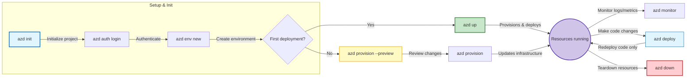
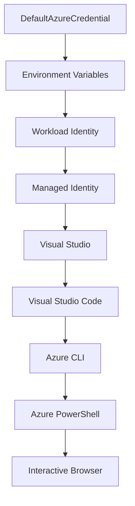

# Základy AZD - Kľúčové koncepty a základy

**Navigácia kapitolou:**
- **📚 Domov kurzu**: [AZD pre začiatočníkov](../../README.md)
- **📖 Aktuálna kapitola**: Kapitola 1 - Základy a rýchly štart
- **⬅️ Predchádzajúce**: [Prehľad kurzu](../../README.md#-chapter-1-foundation--quick-start)
- **➡️ Ďalšie**: [Inštalácia a nastavenie](installation.md)
- **🚀 Ďalšia kapitola**: [Kapitola 2: Vývoj orientovaný na AI](../chapter-02-ai-development/microsoft-foundry-integration.md)

## Úvod

> Revidované podľa `azd 1.37.2` (november 2026). Bash príkazy používajú citované zástupné symboly, ktoré musíte nahradiť. Šablóny pracovných postupov používajú `.` na inicializáciu aktuálneho adresára; bez argumentu adresára inicializácia šablóny vytvorí podsložku a nezmení pracovný adresár shellu. Pokročilé ukážky sú ilustračné, nie kompletné projekty.

Táto lekcia vás zoznámi s Azure Developer CLI (azd), výkonným nástrojom príkazového riadka, ktorý urýchľuje vašu cestu od lokálneho vývoja k nasadeniu na Azure. Naučíte sa základné koncepty, kľúčové funkcie a pochopíte, ako azd zjednodušuje nasadenie cloud-native aplikácií.

## Ciele učenia

Na konci tejto lekcie budete:
- Rozumieť tomu, čo je Azure Developer CLI a aký je jeho hlavný účel
- Naučiť sa základné koncepty šablón, prostredí a služieb
- Preskúmať kľúčové funkcie vrátane vývoja riadeného šablónami a infraštruktúry ako kódu
- Pochopiť štruktúru projektu azd a pracovný postup
- Byť pripravený nainštalovať a nakonfigurovať azd pre svoje vývojové prostredie

## Výsledky učenia

Po dokončení tejto lekcie budete schopní:
- Vysvetliť úlohu azd v moderných pracovných tokoch cloudového vývoja
- Identifikovať komponenty štruktúry projektu azd
- Opísať, ako šablóny, prostredia a služby spolupracujú
- Pochopiť výhody infraštruktúry ako kódu s azd
- Rozpoznať rôzne príkazy azd a ich účely

## Čo je Azure Developer CLI (azd)?

Azure Developer CLI (azd) je nástroj príkazového riadka navrhnutý na urýchlenie vašej cesty od lokálneho vývoja k nasadeniu na Azure. Zjednodušuje proces tvorby, nasadzovania a správy cloud-native aplikácií na Azure.

### Čo môžete nasadiť pomocou azd?

azd podporuje širokú škálu záťaží – a zoznam sa neustále rozrastá. Dnes môžete použiť azd na nasadenie:

| Typ záťaže | Príklady | Rovnaký pracovný tok? |
|---------------|----------|----------------|
| **Tradičné aplikácie** | Webové aplikácie, REST API, statické stránky | ✅ `azd up` |
| **Služby a mikroslužby** | Container Apps, Function Apps, viacslužbové backendy | ✅ `azd up` |
| **Aplikácie poháňané AI** | Chat aplikácie s Microsoft Foundry Models, RAG riešenia s AI Search | ✅ `azd up` |
| **Inteligentní agenti** | Agenti hosťovaní v Foundry, orchestrácie viacerých agentov | ✅ `azd up` |

Kľúčovým poznaním je, že **životný cyklus azd zostáva rovnaký bez ohľadu na to, čo nasadzujete**. Inicializujete projekt, zriaďujete infraštruktúru, nasadíte kód, sledujete aplikáciu a vykonáte čistenie – či už ide o jednoduchý web alebo sofistikovaného AI agenta.

Táto kontinuita je zámerná. azd považuje AI schopnosti za ďalší druh služby, ktorú vaša aplikácia môže používať, nie za niečo fundamentálne odlišné. Chatovacia koncová služba založená na Microsoft Foundry Models je z pohľadu azd len ďalšia služba na konfiguráciu a nasadenie.

### 🎯 Prečo používať AZD? Skutočné porovnanie

Porovnajme si nasadenie jednoduchej webovej aplikácie s databázou:

#### ❌ BEZ AZD: Manuálne nasadenie Azure (30+ minút)

**Ilustratívne porovnanie v Bashi, nie spustiteľný štartér aplikácie.** Predpokladá existujúci aplikačný kód, jedinečné názvy zdrojov, autentifikáciu Azure CLI a všetky požadované rozšírenia CLI. Použite šablónovú úlohu nižšie pre podporovanú end-to-end cestu.

```bash
# Step 1: Create resource group
az group create --name myapp-rg --location eastus

# Step 2: Create App Service Plan
az appservice plan create --name myapp-plan \
  --resource-group myapp-rg \
  --sku B1 --is-linux

# Step 3: Create Web App
az webapp create --name myapp-web-unique123 \
  --resource-group myapp-rg \
  --plan myapp-plan \
  --runtime "NODE:22-lts"

# Step 4: Create Cosmos DB account (10-15 minutes)
az cosmosdb create --name myapp-cosmos-unique123 \
  --resource-group myapp-rg \
  --kind MongoDB

# Step 5: Create database
az cosmosdb mongodb database create \
  --account-name myapp-cosmos-unique123 \
  --resource-group myapp-rg \
  --name tododb

# Step 6: Create collection
az cosmosdb mongodb collection create \
  --account-name myapp-cosmos-unique123 \
  --resource-group myapp-rg \
  --database-name tododb \
  --name todos

# Step 7: Get connection string
CONN_STR=$(az cosmosdb keys list \
  --name myapp-cosmos-unique123 \
  --resource-group myapp-rg \
  --type connection-strings \
  --query "connectionStrings[0].connectionString" -o tsv)

# Step 8: Configure app settings
az webapp config appsettings set \
  --name myapp-web-unique123 \
  --resource-group myapp-rg \
  --settings MONGODB_URI="$CONN_STR"

# Step 9: Enable logging
az webapp log config --name myapp-web-unique123 \
  --resource-group myapp-rg \
  --application-logging filesystem \
  --detailed-error-messages true

# Step 10: Set up Application Insights
az monitor app-insights component create \
  --app myapp-insights \
  --location eastus \
  --resource-group myapp-rg

# Step 11: Link App Insights to Web App
INSTRUMENTATION_KEY=$(az monitor app-insights component show \
  --app myapp-insights \
  --resource-group myapp-rg \
  --query "instrumentationKey" -o tsv)

az webapp config appsettings set \
  --name myapp-web-unique123 \
  --resource-group myapp-rg \
  --settings APPINSIGHTS_INSTRUMENTATIONKEY="$INSTRUMENTATION_KEY"

# Step 12: Build application locally
npm install
npm run build

# Step 13: Create deployment package
zip -r app.zip . -x "*.git*" "node_modules/*"

# Step 14: Deploy application
az webapp deployment source config-zip \
  --resource-group myapp-rg \
  --name myapp-web-unique123 \
  --src app.zip

# Step 15: Wait and pray it works 🙏
# (No automated validation, manual testing required)
```

**Problémy:**
- ❌ Viac ako 15 príkazov, ktoré si treba zapamätať a vykonať v správnom poradí
- ❌ 30-45 minút manuálnej práce
- ❌ Ľahko urobiť chyby (preklepy, nesprávne parametre)
- ❌ Povinné explicitné spracovanie prihlasovacích údajov; debug logy a sledovanie shellu ich môžu odhaliť
- ❌ Žiadna automatická obnova pri chybe
- ❌ Ťažké na replikáciu pre členov tímu
- ❌ Rôzne pri každom spustení (nereprodukovateľné)

#### ✅ S AZD: Automatizované nasadenie (5 príkazov, 10-15 minút)

```bash
# Step 1: Initialize from template
azd init --template todo-nodejs-mongo .

# Step 2: Authenticate
azd auth login

# Step 3: Select the environment created during init
azd env select dev

# Step 4: Preview changes (optional but recommended)
azd provision --preview

# Step 5: Deploy everything
azd up

# ✨ Done! Everything is deployed, configured, and monitored
```

**Výhody:**
- ✅ **5 príkazov** oproti viac než 15 manuálnym krokom
- ✅ **10-15 minút** celkový čas (väčšinou čakanie na Azure)
- ✅ **Menej manuálnych chýb** - konzistentný, šablónami riadený pracovný tok
- ✅ **Bezpečné spracovanie tajomstiev** - mnohé šablóny používajú Azure spravované úložisko tajomstiev
- ✅ **Opakovateľné nasadenia** - rovnaký pracovný tok vždy
- ✅ **Opakovateľné definície infraštruktúry** - podmienené kvótami, dostupnosťou regiónu a verziami šablón
- ✅ **Pripravené pre tím** - ktokoľvek môže nasadiť rovnakými príkazmi
- ✅ **Infraštruktúra ako kód** - verzované Bicep šablóny
- ✅ **Monitoring definovaný v šablóne** - Application Insights ak je zahrnutý v šablóne

### Čas a spoľahlivosť

Vyššie uvedené časy sú odhady, nie benchmarky. azd znižuje počet príkazov, ktoré musíte koordinovať, ale nezaručuje dobu nasadenia, neodstraňuje chyby ani neposkytuje automatickú obnovenie aplikácie/databázy. Uchovávajte funkčné verzie v zdrojovom kóde a testujte postupy obnovy.

## Kľúčové koncepty

### Šablóny
Šablóny sú základom azd. Obsahujú:
- **Kód aplikácie** - váš zdrojový kód a závislosti
- **Definície infraštruktúry** - Azure zdroje definované v Bicep alebo Terrforme
- **Konfiguračné súbory** - nastavenia a premenné prostredia
- **Skripty nasadenia** - automatizované pracovné postupy nasadenia

### Prostredia
Prostredia predstavujú rôzne ciele nasadenia:
- **Vývoj** - na testovanie a vývoj
- **Staging** - predprodukčné prostredie
- **Produkcia** - živé produkčné prostredie

Každé prostredie si udržiava svoje vlastné:
- Názov prostredia a hodnoty; izolácia zdrojov závisí od šablóny infraštruktúry
- Konfiguračné nastavenia
- Stav nasadenia

### Služby
Služby v `azure.yaml` popisujú nasaditeľné komponenty aplikácie:
- **Frontend** - webové aplikácie, SPA
- **Backend** - API, mikroslužby

Databázy a úložiská sú zvyčajne zriaďované ako infraštruktúrne zdroje, nie ako vymyslené hostiteľské služby ako napríklad `host: postgres`.

## Kľúčové funkcie

### 1. Vývoj riadený šablónami
```bash
# Browse available templates
azd template list

# Initialize from a template
azd init --template "<template-name>" .
```

### 2. Infraštruktúra ako kód
- **Bicep** - špecializovaný jazyk Azure
- **Terraform** - nástroj pre multi-cloud infraštruktúru
- Bicep sa prekladá do ARM šablón; surové ARM JSON nie je samostatný zabudovaný `infra.provider`.

### 3. Integrované pracovné postupy
```bash
# Complete deployment workflow
azd up            # Provision + Deploy this is hands off for first time setup

# 🧪 NEW: Preview infrastructure changes before deployment (SAFE)
azd provision --preview    # Simulate infrastructure deployment without making changes

azd provision     # Create Azure resources if you update the infrastructure use this
azd deploy        # Deploy application code or redeploy application code once update
azd down          # Clean up resources
```

#### 🛡️ Bezpečné plánovanie infraštruktúry s náhľadom
Príkaz `azd provision --preview` výrazne zlepšuje bezpečnosť nasadení:
- **Analýza pri suchej skúške** - zobrazuje, čo bude vytvorené, zmenené alebo odstránené
- **Žiadne aplikovanie infraštruktúry** - kontroluje zmeny poskytovateľa; najskôr si prezrite projektové hooky, lebo hooky môžu spúšťať príkazy so sekundárnymi efektmi
- **Tímová spolupráca** - zdieľajte výsledky náhľadu pred nasadením
- **Vstup pre plánovanie nákladov** - skontrolujte navrhované SKU a potom ich ocente pomocou Azure Pricing Calculator; náhľad nepočíta ceny

```bash
# Example preview workflow
azd provision --preview           # See what will change
# Review the output, discuss with team
azd provision                     # Apply changes with confidence
```

### 📊 Vizualizácia: AZD vývojový pracovný tok



**Vysvetlenie pracovného toku:**
1. **Init** - začnite so šablónou alebo novým projektom
2. **Auth** - autentifikácia na Azure
3. **Environment** - vytvorte izolované nasadzovacie prostredie
4. **Preview** - 🆕 vždy najskôr náhľad infraštruktúrnych zmien (bezpečná prax)
5. **Provision** - vytvorenie/aktualizácia Azure zdrojov
6. **Deploy** - nasadenie aplikačného kódu
7. **Monitor** - sledovanie výkonu aplikácie
8. **Iterate** - vykonajte zmeny a znova nasadzujte kód
9. **Cleanup** - odstránenie zdrojov po ukončení práce

### 4. Správa prostredí
```bash
# Create and manage environments
azd env new "<environment-name>"
azd env select "<environment-name>"
azd env list
```

### 5. Rozšírenia a AI príkazy

azd používa systém rozšírení na pridanie schopností nad rámec základného CLI. Je to obzvlášť užitočné pre AI záťaže:

```bash
# List available extensions
azd extension list

# Install the Foundry agents extension
azd extension install azure.ai.agents

# Initialize an AI agent project interactively
azd ai agent init

# Test a deployed agent (shows latency and time-to-first-byte)
azd ai agent invoke

# Start the MCP server for AI-assisted development (Alpha)
azd mcp start
```

**Životný cyklus agenta, krok za krokom.** Použite `azure.ai.agents` pre operácie v životnom cykle agenta a nainštalujte `azure.ai.evaluations` samostatne pre vyhodnotenie. Použite `azd >= 1.37.0` pre kombinovaný pracovný tok. Na prvý deň nepotrebujete všetky tieto príkazy:

| Fáza | Príkaz | Čo robí |
|-------|---------|--------------|
| **Scaffold** | `azd ai agent init --template <path-to-azure.yaml>` | Prevzatie aktuálnej šablóny projektu agenta |
| **Test** | `azd ai agent invoke` | Zavolanie agenta a zobrazenie časovania odpovede |
| **Measure** | `azd ai eval init`, `generate`, `run start` | Konfigurácia, nasadenie a spustenie vyhodnotení pomocou samostatného rozšírenia |
| **Improve** | `azd ai agent optimize --eval <evaluation-name> --optimize-model <optimizer-deployment>` | Znovupoužitie kompatibilného vyhodnotenia na optimalizáciu agenta |
| **Inspect** | `azd ai agent endpoint show` | Zobrazenie konfigurácie živého koncového bodu |
| **Clean up** | `azd ai agent delete` | Vymazanie hosťovaného agenta a všetkých jeho verzií |

> Rozšírenia sú podrobne pokryté v [Kapitole 2: Vývoj orientovaný na AI](../chapter-02-ai-development/agents.md) a v referencii [AZD AI CLI Commands](../chapter-08-production/production-ai-practices.md#azd-ai-cli-commands-and-extensions).

## 📁 Štruktúra projektu

Typická štruktúra projektu azd:
```
my-app/
├── .azure/                  # Local environments and selected-environment config
│   ├── config.json
│   └── dev/.env
├── .devcontainer/          # Development container config
├── .github/workflows/      # GitHub Actions
├── .vscode/               # VS Code settings
├── infra/                 # Infrastructure code
│   ├── main.bicep        # Main infrastructure template
│   ├── main.parameters.json
│   └── modules/          # Reusable modules
├── src/                  # Application source code
│   ├── api/             # Backend services
│   └── web/             # Frontend application
├── azure.yaml           # azd project configuration
└── README.md
```

## 🔧 Konfiguračné súbory

### azure.yaml
Hlavný konfiguračný súbor projektu:
```yaml
name: my-awesome-app
metadata:
  template: my-template@1.0.0

services:
  web:
    project: ./src/web
    language: js
    host: appservice
  api:
    project: ./src/api
    language: js
    host: appservice

hooks:
  preprovision:
    shell: pwsh
    run: echo "Preparing to provision..."
```

### .azure/config.json
Projektový lokálny výber predvoleného prostredia (ilustratívne; spravované azd):
```json
{
  "defaultEnvironment": "dev"
}
```

## 🎪 Bežné pracovné toky s praktickými cvičeniami

> **💡 Tip na učenie:** Nasledujte tieto cvičenia v poradí, aby ste postupne rozvíjali svoje AZD zručnosti.

### 🎯 Cvičenie 1: Inicializujte svoj prvý projekt

**Cieľ:** Vytvoriť projekt AZD a preskúmať jeho štruktúru

**Kroky:**
```bash
# Use a proven template
mkdir azd-basics-practice
cd azd-basics-practice
# Choose "dev" for the environment name when prompted
azd init --template todo-nodejs-mongo .

# Explore the generated files
ls -la  # View all files including hidden ones

# Key files created:
# - azure.yaml (main config)
# - infra/ (infrastructure code)
# - src/ (application code)
```

**✅ Úspech:** Máte adresáre azure.yaml, infra/ a src/

---

### 🎯 Cvičenie 2: Nasadenie na Azure

**Cieľ:** Dokončiť end-to-end nasadenie

**Kroky:**
```bash
# 1. Authenticate
azd auth login

# 2. Select the dev environment created in Exercise 1
azd env select dev
azd env set AZURE_LOCATION eastus

# 3. Preview changes (RECOMMENDED)
azd provision --preview

# 4. Deploy everything
azd up

# 5. Verify deployment
azd show    # View your app URL
```

**Očakávaný čas:** 10-15 minút  
**✅ Úspech:** URL aplikácie sa otvorí v prehliadači

---

### 🎯 Cvičenie 3: Viaceré prostredia

**Cieľ:** Nasadiť do dev a staging

**Kroky:**
```bash
# Already have dev, create staging
azd env new staging
azd env set AZURE_LOCATION westus2
azd up

# Switch between them
azd env list
azd env select dev
```

**✅ Úspech:** Dve samostatné skupiny zdrojov v Azure portáli

**Čistenie:** Cvičenie 3 vytvára druhé zdaniteľné nasadenie. Po skončení zmažte obe:

```bash
azd down --environment dev
azd down --environment staging
```

---

### 🛡️ Destruktívne čistenie: `azd down --force --purge`

Keď chcete úmyselne zmazať Azure zdroje vybraného prostredia:

```bash
azd down --force --purge
```

**Čo robí:**
- `--force`: Žiadne potvrdzovacie výzvy
- `--purge`: Trvale zmaže podporované soft-delete zdroje (napríklad Key Vaulty), kde je povolená ochrana proti vyprázdneniu. Nezmazáva lokálny adresár `.azure/`.

**Používajte keď:** ste skončili s dočasným prostredím. Nezaobchádzajte s destruktívnym čistením ako s prvou reakciou na chyby autentifikácie, kvóty alebo konfigurácie.

---

## 🎪 Pôvodná referencia pracovného toku

### Spustenie nového projektu
```bash
# Method 1: Use existing template
azd init --template todo-nodejs-mongo .

# Method 2: Start from scratch
azd init

# Method 3: Use current directory
azd init .
```

### Vývojový cyklus
```bash
# Set up development environment
azd auth login
azd env new dev
azd env select dev

# Deploy everything
azd up

# Make changes and redeploy
azd deploy

# Clean up when done
azd down --force --purge # Deletes this environment's discovered Azure resources; review before forcing deletion.
```

## Pochopenie `azd down --force --purge`
Príkaz `azd down --force --purge` je silný spôsob, ako úplne odstrániť vaše azd prostredie a všetky súvisiace zdroje. Tu je rozpis, čo jednotlivé prepínače robia:
```
--force
```
- Preskočí potvrdenia.
- Užitočné pre automatizáciu alebo skriptovanie, kde manuálny vstup nie je možný.
- Neobchádza oprávnenia, ochranu proti vyprázdneniu ani neúspechy pri mazaniach.

```
--purge
```
 Trvalo zmaže podporované čiastočne zmazané Azure zdroje bez ďalšieho potvrdenia. Ochrana pred vymazaním a povolenia stále platia. **Neodstraňuje** lokálne prostredia ani priečinok `.azure/`.


### Prečo používať obe?
Používajte obe len vtedy, ak máte v úmysle zmazať Azure zdroje vybraného prostredia a vyčistiť obnoviteľné zdroje. Toto je deštruktívne čistenie, nie všeobecná oprava alebo reset lokálneho stavu.

Je to obzvlášť užitočné po manuálnych zmazaniach zdrojov v Azure portáli alebo pri prepínaní šablón, prostredí alebo konvencií pomenovania skupín zdrojov.


### Správa viacerých prostredí
```bash
# Create staging environment
azd env new staging
azd env select staging
azd up

# Switch back to dev
azd env select dev

# Compare environments
azd env list
```

## 🔐 Overovanie a poverenia

Rozlišujte overovanie nasadenia (`azd auth login`) od overovania pomocou SDK aplikácie (`DefaultAzureCredential`). Sú oddelené. azd predvolene nepoužíva poverenia Azure CLI.

### Overovanie pomocou Azure CLI (`az login`)

Spustite `azd auth login` pre azd. Nasledujúce príkazy Azure CLI sú voliteľné a overujú príkazy `az` samostatne:

```bash
# Interactive login (opens browser)
az login

# Login with specific tenant
az login --tenant "<tenant-id>"

# Login with service principal
az login --service-principal -u "<app-id>" -p "<password>" --tenant "<tenant-id>"

# Check current login status
az account show

# List available subscriptions
az account list --output table

# Set default subscription
az account set --subscription "<subscription-id>"
```

### Tok overovania
1. **Interaktívne prihlásenie**: Otvorí váš predvolený prehliadač pre overenie
2. **Tok s kódom zariadenia**: Pre prostredia bez prístupu k prehliadaču
3. **Servisný princíp**: Pre automatizáciu a scenáre CI/CD
4. **Spravovaná identita**: Pre aplikácie hosťované v Azure

### Reťazec DefaultAzureCredential

`DefaultAzureCredential` je typ poverenia, ktorý poskytuje zjednodušený zážitok z overovania automatickým vyskúšaním viacerých zdrojov poverení v konkrétnom poradí:

#### Reťazec poverení SDK aplikácie

Presný reťazec závisí od jazyka Azure Identity SDK, verzie, nainštalovaných doplnkov a možností. Tento diagram je koncepčný, nie pevné postupové overovanie azd; novšie SDK môžu tiež zahŕňať poverenia Azure Developer CLI.


#### 1. Premenné prostredia
```bash
# Set environment variables for service principal
export AZURE_CLIENT_ID="<app-id>"
export AZURE_CLIENT_SECRET="<password>"
export AZURE_TENANT_ID="<tenant-id>"
```

#### 2. Workload Identity (Kubernetes/GitHub Actions)
Používa sa automaticky v:
- Azure Kubernetes Service (AKS) s Workload Identity
- GitHub Actions s OIDC federáciou
- Iné scenáre federovaného identity

#### 3. Spravovaná identita
Pre Azure zdroje ako:
- Virtuálne stroje
- App Service
- Azure Functions
- Kontajnerové inštancie

```bash
# Inspect a deployed Container App's configured identity (requires az login)
az containerapp show --name "<app-name>" --resource-group "<rg-name>" --query identity
```

#### 4. Integrácia vývojárskych nástrojov
- **Visual Studio**: Automaticky používa prihlásený účet
- **VS Code**: Podpora závisí od SDK a jeho broker/plugin nastavení
- **Azure CLI**: Používa `az login` poverenia (najbežnejšie pre lokálny vývoj)

### Nastavenie overovania AZD

```bash
# Method 1: Direct azd authentication (recommended)
azd auth login

# Method 2: Direct azd authentication
azd auth login --use-device-code  # For headless environments

# Method 3: Check authentication status
azd auth login --check-status

# Method 4: Logout and re-authenticate
azd auth logout
azd auth login
```

### Najlepšie praktiky overovania

#### Pre lokálny vývoj
```bash
# 1. Log in to azd
azd auth login

# 2. Select the subscription for this initialized environment
azd env set AZURE_SUBSCRIPTION_ID "<subscription-id>"

# 3. Check azd sign-in details (read the status message)
azd auth login --check-status
```

#### Pre CI/CD pipeline
```yaml
# Partial GitHub Actions steps: assumes checkout, azd installation,
# required AZURE_* environment values, and pipeline secret configuration.
- name: Deploy with azd
  run: |
    azd auth login --client-id ${{ secrets.AZURE_CLIENT_ID }} \
                    --client-secret ${{ secrets.AZURE_CLIENT_SECRET }} \
                    --tenant-id ${{ secrets.AZURE_TENANT_ID }}
    azd up --no-prompt
```

#### Pre produkčné prostredia
- Používajte **spravovanú identitu** pri spustení na Azure zdrojoch
- Používajte **service principal** pre automatizačné scenáre
- Vyhnite sa ukladaniu poverení v kóde alebo konfiguračných súboroch
- Používajte **Azure Key Vault** pre citlivé konfigurácie

### Bežné problémy s overovaním a ich riešenia

#### Problém: "Nenašiel sa žiadny predplatný program"
```bash
# Solution: Set default subscription
az account list --output table
az account set --subscription "<subscription-id>"
azd env set AZURE_SUBSCRIPTION_ID "<subscription-id>"
```

#### Problém: "Nedostatočné oprávnenia"
```bash
# Solution: Check and assign required roles
az role assignment list --assignee $(az account show --query user.name --output tsv)

# Common required roles:
# - Contributor (for resource management)
# - User Access Administrator (for role assignments)
```

#### Problém: "Token expiroval"
```bash
# Solution: Re-authenticate
az logout
az login
azd auth logout
azd auth login
```

### Overovanie v rôznych scenároch

#### Lokálny vývoj
```bash
# Personal development account
az login
azd auth login
```

#### Tímový vývoj
```bash
# Use specific tenant for organization
az login --tenant contoso.onmicrosoft.com
azd auth login --tenant-id "<tenant-id>"
```

#### Multi-tenant scenáre
```bash
# Switch between tenants
az login --tenant tenant1.onmicrosoft.com
azd auth login --tenant-id "<tenant-1-id>"
# Select an environment configured with tenant 1's subscription
azd env select tenant1-dev
# Deploy to tenant 1
azd up

az login --tenant tenant2.onmicrosoft.com  
azd auth login --tenant-id "<tenant-2-id>"
azd env select tenant2-dev
# Deploy to tenant 2
azd up
```

### Bezpečnostné úvahy

1. **Ukladanie poverení**: Nikdy neukladajte poverenia do zdrojového kódu
2. **Obmedzenie rozsahu**: Používajte princíp najmenších právomocí pre service princípy
3. **Rotácia tokenov**: Pravidelne rotujte tajomstvá service princípov
4. **Auditný záznam**: Monitorujte aktivity overovania a nasadzovania
5. **Sieťová bezpečnosť**: Používajte súkromné koncové body, ak je to možné

### Riešenie problémov s overovaním

```bash
# Debug authentication issues
azd auth login --check-status
az account show
az account get-access-token

# Common diagnostic commands
whoami                          # Current user context
az ad signed-in-user show      # Microsoft Entra ID user details
az group list                  # Test resource access
```

## Objavovanie príkazov

### Objavovanie
```bash
azd template list              # Browse templates
azd template list --help       # Template discovery options
azd init --help               # Initialization options
```

### Správa projektov
```bash
azd show                     # Project overview
azd env list                # Available environments and selected default
azd config show            # Configuration settings
```

### Monitorovanie
```bash
azd monitor                  # Open Azure portal monitoring
azd monitor --logs           # View application logs
azd monitor --live           # View live metrics
azd pipeline config          # Set up CI/CD
```

## Najlepšie praktiky

### 1. Používajte výstižné názvy
```bash
# Good
azd env new production-east
azd init --template todo-nodejs-mongo .

# Avoid
azd env new env1
azd init --template template1 .
```

### 2. Využívajte šablóny
- Začnite s existujúcimi šablónami
- Prispôsobte podľa svojich potrieb
- Vytvárajte opakovane použiteľné šablóny pre svoju organizáciu

### 3. Izolácia prostredia
- Používajte samostatné prostredia pre vývoj/test/produkciu
- Nikdy nenasadzujte priamo do produkcie z lokálneho počítača
- Používajte CI/CD pipeline pre produkčné nasadenia

### 4. Správa konfigurácie
- Používajte spravovanú identitu a Key Vault pre tajomstvá; bežné `azd env set` hodnoty sú lokálne v obyčajnom texte
- Udržiavajte konfiguráciu v verzovacom systéme
- Dokumentujte nastavenia špecifické pre prostredie

## Postup učenia

### Začiatočník (1. – 2. týždeň)
1. Nainštalujte azd a autentifikujte sa
2. Nasadte jednoduchú šablónu
3. Pochopte štruktúru projektu
4. Naučte sa základné príkazy (up, down, deploy)

### Pokročilý (3. – 4. týždeň)
1. Prispôsobte šablóny
2. Spravujte viaceré prostredia
3. Pochopte infraštruktúrny kód
4. Nastavte CI/CD pipeline

### Expert (od 5. týždňa)
1. Vytvorte vlastné šablóny
2. Pokročilé infraštruktúrne vzory
3. Nasadenia v niekoľkých regiónoch
4. Podnikového stupňa konfigurácie

## Ďalšie kroky

**📖 Pokračujte v kapitole 1:**
- [Inštalácia a nastavenie](installation.md) - Nainštalujte a nakonfigurujte azd
- [Váš prvý projekt](first-project.md) - Dokončite praktický tutoriál
- [Sprievodca konfiguráciou](../chapter-03-configuration/configuration.md) - Pokročilé možnosti konfigurácie

**🎯 Pripravení na ďalšiu kapitolu?**
- [Kapitola 2: Vývoj orientovaný na AI](../chapter-02-ai-development/microsoft-foundry-integration.md) - Začnite vytvárať AI aplikácie

## Dodatočné zdroje

- [Prehľad Azure Developer CLI](https://learn.microsoft.com/en-us/azure/developer/azure-developer-cli/)
- [Galéria šablón](https://azure.github.io/awesome-azd/)
- [Vzorky komunity](https://github.com/Azure-Samples)

---

## 🙋 Často kladené otázky

### Všeobecné otázky

**Otázka: Aký je rozdiel medzi AZD a Azure CLI?**

Odpoveď: Azure CLI (`az`) je na správu jednotlivých Azure zdrojov. AZD (`azd`) je na správu celých aplikácií:

```bash
# Azure CLI - Low-level resource management
az webapp create --name myapp --resource-group rg
az sql server create --name myserver --resource-group rg
# ...many more commands needed

# AZD - Application-level management
azd up  # Deploys entire app with all resources
```

**Myslite na to takto:**
- `az` = Práca s jednotlivými Lego kockami
- `azd` = Práca s kompletnými Lego setmi

---

**Otázka: Potrebujem vedieť Bicep alebo Terraform na použitie AZD?**

Odpoveď: Nie! Začnite so šablónami:
```bash
# Use existing template - no IaC knowledge needed
azd init --template todo-nodejs-mongo .
azd up
```

Neskôr sa môžete naučiť Bicep na prispôsobenie infraštruktúry. Šablóny poskytujú funkčné príklady na učenie.

---

**Otázka: Koľko stojí prevádzka AZD šablón?**

Odpoveď: Náklady sa líšia podľa regiónu, SKU, doby prevádzky, režimu databázy a používania modelu. Vývojové prostredie môže mať značné mesačné náklady aj keď je nečinné; nepredpokladajte univerzálny rozsah 50-150 $:

```bash
# Preview resource changes (not prices)
azd provision --preview

# Always cleanup when not using
azd down --force --purge  # Removes all resources
```

**Tip na profesionálov:** Využívajte bezplatné úrovne tam, kde sú dostupné:
- App Service: F1 (bezplatná) úroveň
- Azure OpenAI: nie je garantovaný žiadny mesačný bezplatný počet tokenov; skontrolujte aktuálne ceny modelu a ponuky
- Cosmos DB: zúčastnené účty s vyhradenou priepustnosťou môžu využiť bezplatnú úroveň; serverless šablóny automaticky nesplňujú podmienky

---

**Otázka: Môžem použiť AZD s existujúcimi Azure zdrojmi?**

Odpoveď: Áno, ale jednoduchšie je začať odznova. AZD najlepšie funguje, keď spravuje celý životný cyklus. Pre existujúce zdroje:

```bash
# Option 1: Import existing resources (advanced)
azd init
# Then modify infra/ to reference existing resources

# Option 2: Start fresh (recommended)
azd init --template "<verified-template-name>" .
azd up  # Creates new environment
```

---

**Otázka: Ako zdieľať projekt s tímom?**

Odpoveď: Commitnite AZD projekt do Gitu (ale NIE priečinok .azure):

```bash
# Already in .gitignore by default
.azure/        # Contains secrets and environment data
*.env          # Environment variables

# Team members then:
git clone "<your-repo>"
# Change into the cloned repository before running the remaining commands.
azd auth login
azd env new "<their-name>-dev"
azd up
```

Všetci dostanú identickú infraštruktúru z rovnakých šablón.

---

### Otázky pri riešení problémov

**Otázka: „azd up“ zlyhal v polovici. Čo mám robiť?**

Odpoveď: Skontrolujte chybu, opravte ju a skúste znova:

```bash
# Capture detailed diagnostics (redact sensitive values before sharing)
azd up --debug

# Common fixes:

# 1. If quota exceeded:
azd env set AZURE_LOCATION "westus2"  # Try different region

# 2. If resource name conflict:
azd down --force --purge  # Clean slate
azd up  # Retry

# 3. If auth expired:
az login
azd auth login
azd up
```

**Najčastejší problém:** Vybrané nesprávne Azure predplatné
```bash
az account list --output table
az account set --subscription "<correct-subscription>"
azd env set AZURE_SUBSCRIPTION_ID "<correct-subscription-id>"
```

---

**Otázka: Ako nasadiť iba zmeny v kóde bez reprovízie infraštruktúry?**

Odpoveď: Použite `azd deploy` namiesto `azd up`:

```bash
azd up          # First time: provision + deploy (slow)

# Make code changes...

azd deploy      # Subsequent times: deploy only (fast)
```

Porovnanie rýchlosti:
- `azd up`: 10-15 minút (provízia infraštruktúry)
- `azd deploy`: 2-5 minút (len kód)

---

**Otázka: Môžem prispôsobiť infraštruktúrne šablóny?**

Odpoveď: Áno! Upravte Bicep súbory v `infra/`:

```bash
# After azd init
cd infra/
code main.bicep  # Edit in VS Code

# Preview changes
azd provision --preview

# Apply changes
azd provision
```

**Tip:** Začnite s malými zmenami - najprv SKU:
```bicep
// infra/main.bicep
sku: {
  name: 'B1'  // Change to 'P1V2' for production
}
```

---

**Otázka: Ako vymazať všetko, čo AZD vytvoril?**

Odpoveď: Jeden príkaz odstráni všetky zdroje:

```bash
azd down --force --purge

# This deletes:
# - Azure resources/resource groups discovered for the selected environment
# - Supported soft-deleted resources, if purge protection allows
# Local .azure files remain; shared/external resources may remain too.
```

**Tento príkaz vždy spustite, keď:**
- Skončíte testovanie šablóny
- Prechádzate na iný projekt
- Chcete začať odznova

**Kontrola nákladov:** Potvrďte vymazanie v Azure a skontrolujte, či nezostali uložené/zdielané zdroje. Predtým vzniknuté poplatky stále platia.

---

**Otázka: Čo ak som náhodou vymazal zdroje v Azure Portáli?**

Odpoveď: Stav AZD môže byť nesúladný. Použite prístup s čistým štítom:

```bash
# 1. Delete remaining resources only if that is your intent
azd down --force --purge

# 2. Start fresh
azd up

# Alternative: Let AZD detect and fix
azd provision  # Will create missing resources
```

---

### Pokročilé otázky

**Otázka: Môžem používať AZD v CI/CD pipeline?**

Odpoveď: Áno! Príklad GitHub Actions:

```yaml
# .github/workflows/deploy.yml
name: Deploy with AZD

on:
  push:
    branches: [main]

jobs:
  deploy:
    runs-on: ubuntu-latest
    steps:
      - uses: actions/checkout@v4
      
      - name: Install azd
        run: curl -fsSL https://aka.ms/install-azd.sh | bash
      
      - name: Azure Login
        run: |
          azd auth login \
            --client-id ${{ secrets.AZURE_CLIENT_ID }} \
            --client-secret ${{ secrets.AZURE_CLIENT_SECRET }} \
            --tenant-id ${{ secrets.AZURE_TENANT_ID }}
      
      - name: Deploy
        env:
          AZURE_ENV_NAME: dev
          AZURE_LOCATION: ${{ vars.AZURE_LOCATION }}
          AZURE_SUBSCRIPTION_ID: ${{ vars.AZURE_SUBSCRIPTION_ID }}
        run: azd up --no-prompt
```

---

**Otázka: Ako spravovať tajomstvá a citlivé údaje?**

Odpoveď: Používajte Key Vault explicitne. `azd env set` zapisuje bežné hodnoty do lokálneho súboru prostredia; automaticky nevytvára vault, nepriraďuje roly ani nevkladá tajomstvá do aplikácie.

```bash
# Interactive: create/select a Key Vault secret and save its reference
azd env set-secret DATABASE_PASSWORD
```

Potrebujete príslušné povolenia na vault. Vaša infraštruktúra/aplikácia musí stále prepojiť tajomstvo so svojím spotrebiteľom a udeliť runtime identity prístup. Nevytlačte vyriešené hodnoty tajomstiev v logoch.

**Nikdy nezacvakávajte:**
- priečinok `.azure/` (obsahuje dáta prostredia)
- súbory `.env` (lokálne tajomstvá)
- Pripojovacie reťazce

---

**Otázka: Môžem nasadiť do viacerých regiónov?**

Odpoveď: Áno, vytvorte prostredie pre každý región:

```bash
# East US environment
azd env new prod-eastus
azd env set AZURE_LOCATION eastus
azd up

# West Europe environment
azd env new prod-westeurope
azd env set AZURE_LOCATION westeurope
azd up

# Each environment is independent
azd env list
```

Pre skutočné multi-region aplikácie prispôsobte Bicep šablóny na súčasné nasadenie do viacerých regiónov.

---

**Otázka: Kde môžem získať pomoc, keď som uviazol?**

1. **Dokumentácia AZD:** https://learn.microsoft.com/azure/developer/azure-developer-cli/
2. **GitHub Issues:** https://github.com/Azure/azure-dev/issues
3. **Discord:** [Azure Discord](https://discord.gg/microsoft-azure) - kanál #azure-developer-cli
4. **Stack Overflow:** Tag `azure-developer-cli`
5. **Tento kurz:** [Sprievodca riešením problémov](../chapter-07-troubleshooting/common-issues.md)

**Tip na profesionálov:** Pred otázkou spustite:
```bash
azd show       # Shows current state
azd version    # Shows your version
```
Do svojej otázky zahrňte tieto informácie pre rýchlejšiu pomoc.

---

## 🎓 Čo ďalej?

Teraz rozumiete základom AZD. Vyberte si svoju cestu:

### 🎯 Pre začiatočníkov:
1. **Ďalej:** [Inštalácia a nastavenie](installation.md) - Nainštalujte AZD na váš počítač
2. **Potom:** [Váš prvý projekt](first-project.md) - Nasadte svoju prvú aplikáciu
3. **Precvičovanie:** Dokončite všetky 3 cvičenia v tejto lekcii

### 🚀 Pre AI vývojárov:
1. **Preskočte na:** [Kapitola 2: Vývoj orientovaný na AI](../chapter-02-ai-development/microsoft-foundry-integration.md)
2. **Nasadte:** V prázdnom adresári projektu začnite s `azd init --template get-started-with-ai-chat .`
3. **Učte sa:** Budujte počas nasadzovania

### 🏗️ Pre skúsených vývojárov:
1. **Preštudujte si:** [Sprievodca konfiguráciou](../chapter-03-configuration/configuration.md) - Pokročilé nastavenia
2. **Preskúmajte:** [Infrastruktúra ako kód](../chapter-04-infrastructure/provisioning.md) - Hĺbkový pohľad na Bicep
3. **Stavajte:** Vytvorte vlastné šablóny pre svoj stack

---

**Navigácia kapitol:**
- **📚 Domov kurzu**: [AZD pre začiatočníkov](../../README.md)
- **📖 Aktuálna kapitola**: Kapitola 1 - Základy a rýchly štart  
- **⬅️ Predchádzajúca**: [Prehľad kurzu](../../README.md#-chapter-1-foundation--quick-start)
- **➡️ Ďalšia**: [Inštalácia a nastavenie](installation.md)
- **🚀 Nasledujúca kapitola**: [Kapitola 2: Vývoj orientovaný na AI](../chapter-02-ai-development/microsoft-foundry-integration.md)

---

<!-- CO-OP TRANSLATOR DISCLAIMER START -->
**Vyhlásenie o zodpovednosti**:
Tento dokument bol preložený pomocou AI prekladateľskej služby [Co-op Translator](https://github.com/Azure/co-op-translator). Hoci sa snažíme o presnosť, vezmite prosím na vedomie, že automatické preklady môžu obsahovať chyby alebo nepresnosti. Pôvodný dokument v jeho natívnom jazyku by mal byť považovaný za autoritatívny zdroj. Pre kritické informácie sa odporúča profesionálny ľudský preklad. Nie sme zodpovední za žiadne nedorozumenia alebo nesprávne interpretácie vyplývajúce z použitia tohto prekladu.
<!-- CO-OP TRANSLATOR DISCLAIMER END -->