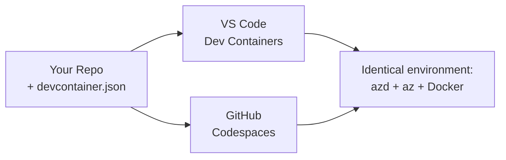

# Vývojárske kontajnery a GitHub Codespaces pre azd

**Navigácia kapitolou:**
- **📚 Domov kurzu**: [AZD pre začiatočníkov](../../README.md)
- **📖 Aktuálna kapitola**: Kapitola 1 - Základy a rýchly štart
- **⬅️ Predchádzajúca**: [Prineste si vlastnú aplikáciu](bring-your-own-app.md)
- **🚀 Ďalšia kapitola**: [Kapitola 2: Vývoj s prioritou AI](../chapter-02-ai-development/README.md)

> Cieľ kontroly príkazu a konfigurácie: `azd 1.37.2` (november 2026). Stavby kontajnerov a nasadenia na Azure neboli súčasťou tejto kontroly.

## Úvod

Inštalácia azd, správneho runtime jazyka, Dockeru a Azure CLI na každý počítač je otrava — a je to hlavný dôvod, prečo tutoriál, ktorý „funguje na mojom počítači“, zlyhá u niekoho iného. **Vývojársky kontajner** to vyrieši tým, že celý váš nástrojový reťazec popisuje v súbore. Každý, kto otvorí projekt vo VS Code alebo GitHub Codespaces, dostane presne rovnaké prostredie s už nainštalovaným azd. Táto lekcia vám ukáže, ako pridať takýto kontajner.

## Ciele učenia

Po absolvovaní tejto lekcie budete:
- Rozumieť čo je vývojársky kontajner a prečo pomáha s azd
- Pridať minimálny `.devcontainer/devcontainer.json` do projektu
- Zahrnúť azd, Azure CLI a Docker cez funkcie vývojárskeho kontajnera
- Otvoriť projekt v GitHub Codespaces alebo VS Code

## Výsledky učenia

Po absolvovaní tejto lekcie budete schopní:
- Vytvoriť `devcontainer.json` pre projekt azd
- Pridať azd a nástroje Azure bez manuálnych inštalácií
- Spustiť `azd up` z kontajnera alebo Codespace

---

## Čo je vývojársky kontajner?

Vývojársky kontajner je Dockerom založené vývojové prostredie definované v súbore `.devcontainer/devcontainer.json` vo vašom repozitári. Keď otvoríte projekt:

- **VS Code** (s rozšírením Dev Containers) postaví kontajner a pripojí sa k nemu.
- **GitHub Codespaces** postaví ten istý kontajner v cloude a ponúkne vám prehliadačový editor.

Každý prispievateľ tak dostane identické nástroje — žiadne „nainštaloval si azd?“ vyriešenie problémov.



---

## Krok 1: Vytvorte súbor devcontainer

Vytvorte `.devcontainer/devcontainer.json` v koreňovom priečinku vášho projektu:

```json
{
  "name": "azd-project",
  "image": "mcr.microsoft.com/devcontainers/base:bookworm",
  "features": {
    "ghcr.io/devcontainers/features/azure-cli:1": {},
    "ghcr.io/azure/azure-dev/azd:0": { "version": "1.37.2" },
    "ghcr.io/devcontainers/features/docker-in-docker:2": {},
    "ghcr.io/devcontainers/features/node:1": {}
  },
  "customizations": {
    "vscode": {
      "extensions": [
        "ms-azuretools.azure-dev",
        "ms-azuretools.vscode-bicep"
      ]
    }
  },
  "forwardPorts": [3000],
  "postCreateCommand": "azd version"
}
```

Čo každá časť robí:

| Kľúč | Účel |
|-----|---------|
| `image` | Základný operačný systém kontajnera |
| `features` | Predinštalované inštalátory — tu: Azure CLI, **azd**, Docker a Node.js |
| `customizations.vscode.extensions` | Automaticky inštaluje rozšírenia VS Code pre azd a Bicep |
| `forwardPorts` | Zverejňuje port vašej aplikácie do prehliadača |
| `postCreateCommand` | Spustí sa raz po postavení kontajnera (tu kontrola sanity) |

> Verzia funkcie (`azd:0`) a nainštalovaná verzia CLI sa líšia. Nastavte možnosť `version` pre funkciu na hodnotu `"1.37.2"`, aby ste prichytávali verziu CLI; nepoužívajte verziu CLI ako značku funkcie.

---

## Krok 2: Prispôsobte funkciu jazyku vašej aplikácii

Vymeňte funkciu `node` za tú, ktorú vaša aplikácia používa:

```jsonc
// Python project
"ghcr.io/devcontainers/features/python:1": {},

// .NET project
"ghcr.io/devcontainers/features/dotnet:2": {},

// Java project
"ghcr.io/devcontainers/features/java:1": {},

// Go project
"ghcr.io/devcontainers/features/go:1": {}
```

Zachovajte `docker-in-docker` pri lokálnom budovaní obrazov. Alternatívou je nakonfigurovaná vzdialená buildácia ACR (`docker.remoteBuild: true`); samotný typ hostiteľa však nevyžaduje vždy lokálny Docker.

---

## Krok 3: Otvorte ho

**Vo VS Code:**
1. Nainštalujte rozšírenie **Dev Containers**.
2. Otvorte priečinok projektu.
3. Kliknite na **Znovu otvoriť v kontajneri**, keď sa zobrazí výzva (alebo spustite *Dev Containers: Reopen in Container*).

**V GitHub Codespaces:**
1. Pushnite repozitár do GitHub.
2. Kliknite na **Code → Codespaces → Vytvoriť codespace na main**.
3. Počkajte na postavenie kontajnera — azd je pripravené v termináli.

---

## Krok 4: Nasadenie zvnútra kontajnera

Kontajner má azd predinštalované, takže bežný pracovný postup jednoducho funguje:

```bash
azd auth login --use-device-code   # device code is handy inside Codespaces
azd up
```

> **Prečo `--use-device-code`?** V vzdialenom kontajneri alebo Codespace nie je lokálny prehliadač na presmerovanie, preto je prihlásenie cez device-code spoľahlivá cesta. Kód vložíte do karty prehliadača na dokončenie prihlásenia.

---

## Bežné úskalia

| Problém | Riešenie |
|---------|-----|
| `azd up` nemôže postaviť obraz | Pridajte funkciu `docker-in-docker` |
| Prihlásenie cez prehliadač v Codespaces zablokované | Použite `azd auth login --use-device-code` |
| Nástroje sa líšia medzi členmi tímu | Prichyťte verziu CLI cez možnosť `version` v azd funkcii a prichyťte runtime jazyka |
| Aplikácia nedostupná v prehliadači | Pridajte port do `forwardPorts` |

---

## Zhrnutie

- Vývojársky kontajner robí váš nástrojový reťazec azd reprodukovateľným pre každého.
- Pridajte azd, Azure CLI a Docker cez funkcie Dev Container.
- Prispôsobte funkciu jazyka vašej aplikácii a zachovajte `docker-in-docker` pre hostiteľov kontajnerov.
- Pri behu v Codespaces používajte device-code prihlásenie.

---

## 🔗 Navigácia

| Smer | Zdroj |
|-----------|----------|
| **Predchádzajúca** | [Prineste si vlastnú aplikáciu](bring-your-own-app.md) |
| **Domov kapitoly** | [Kapitola 1: Základy a rýchly štart](README.md) |
| **Ďalšia kapitola** | [Kapitola 2: Vývoj s prioritou AI](../chapter-02-ai-development/README.md) |

## 📖 Súvisiace zdroje

- [Inštalácia a nastavenie](installation.md)
- [Cheat Sheet pre príkazy](../../resources/cheat-sheet.md)
- [Oficiálna špecifikácia Dev Containers](https://containers.dev/)
- [Funkcia azd Dev Container](https://github.com/Azure/azure-dev/tree/main/ext/devcontainer)

---

<!-- CO-OP TRANSLATOR DISCLAIMER START -->
**Vyhlásenie o zodpovednosti**:
Tento dokument bol preložený pomocou AI prekladateľskej služby [Co-op Translator](https://github.com/Azure/co-op-translator). Hoci sa snažíme o presnosť, vezmite prosím na vedomie, že automatické preklady môžu obsahovať chyby alebo nepresnosti. Pôvodný dokument v jeho natívnom jazyku by mal byť považovaný za autoritatívny zdroj. Pre kritické informácie sa odporúča profesionálny ľudský preklad. Nie sme zodpovední za žiadne nedorozumenia alebo nesprávne interpretácie vyplývajúce z použitia tohto prekladu.
<!-- CO-OP TRANSLATOR DISCLAIMER END -->