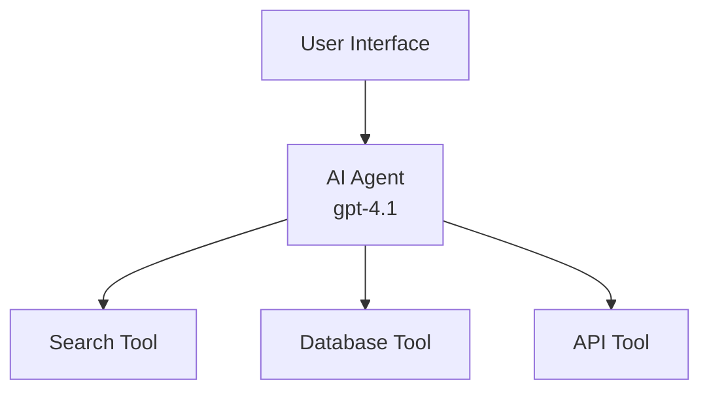
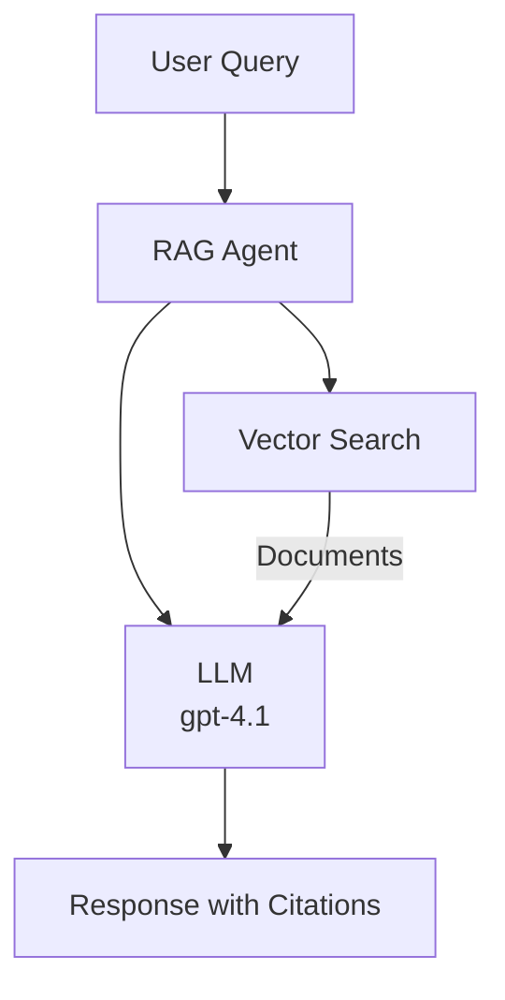
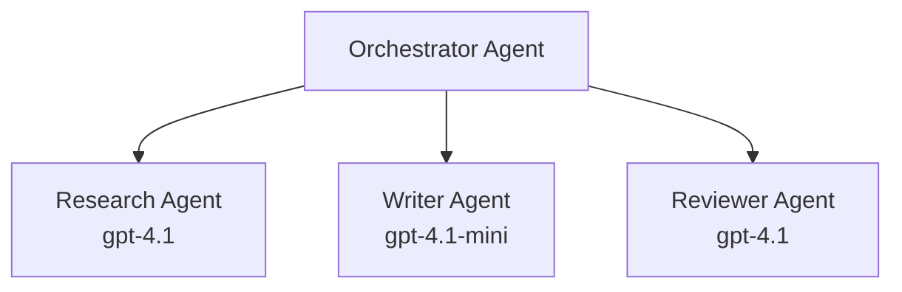

# AI agenti s Azure Developer CLI

**Navigácia kapitolou:**
- **📚 Domov kurzu**: [AZD pre začiatočníkov](../../README.md)
- **📖 Aktuálna kapitola**: Kapitola 2 - Vývoj orientovaný na AI
- **⬅️ Predchádzajúca**: [Integrácia Microsoft Foundry](microsoft-foundry-integration.md)
- **➡️ Ďalšia**: [Nasadenie AI modelov](ai-model-deployment.md)
- **🚀 Pokročilé**: [Riešenia viacerých agentov](../../examples/retail-scenario.md)

---

## Úvod

AI agenti sú autonómne programy, ktoré vnímajú svoje prostredie, prijímajú rozhodnutia a vykonávajú akcie na dosiahnutie konkrétnych cieľov. Na rozdiel od jednoduchých chatbotov, ktoré reagujú na podnety, agenti môžu:

- **Používať nástroje** - volať API, vyhľadávať v databázach, vykonávať kód
- **Plánovať a uvažovať** - rozčleniť zložité úlohy na kroky
- **Učiť sa z kontextu** - udržiavať pamäť a prispôsobovať správanie
- **Spolupracovať** - pracovať s inými agentmi (systémy viacerých agentov)

Tento návod ukazuje, ako nasadiť AI agentov do Azure pomocou Azure Developer CLI (azd).

Používanie kontextu rozhovoru nie je tréning modelu: perzistentná pamäť, kontrola prístupu a uchovávanie musia byť implementované alebo nakonfigurované aplikáciou.

> **Aktualizácia Foundry GA (2026-11-09):** Nainštalujte všeobecne dostupný balík `microsoft.foundry` 1.0 pomocou `azd >= 1.37.0`. Hodnotenia sa inštalujú samostatne; voliteľné náhľadové funkcie a klasický fragment SDK nižšie nie sú balíkom propagované do GA. Toto odporúčanie je založené na [oznámení GA](https://devblogs.microsoft.com/azure-sdk/microsoft-foundry-azure-developer-cli-ga/) a dokumentácii, nie na živej Azure nasadení.

## Ciele učenia

Po dokončení tohto návodu:
- Pochopíte, čo sú AI agenti a ako sa líšia od chatbotov
- Nasadíte predpripravené šablóny AI agentov pomocou AZD
- Nakonfigurujete Foundry agentov na vlastných agentov
- Implementujete základné vzory agentov (použitie nástrojov, RAG, multi-agent)
- Monitorujete a odlaďujete nasadených agentov

## Výsledky učenia

Po dokončení budete vedieť:
- Nasadiť AI agentové aplikácie do Azure jedným príkazom
- Konfigurovať nástroje a schopnosti agentov
- Implementovať retrieval-augmented generation (RAG) s agentmi
- Navrhovať architektúry viacerých agentov pre zložité pracovné toky
- Riešiť bežné problémy s nasadením agentov

---

## 🤖 Čo robí agenta odlišným od chatbota?

| Vlastnosť | Chatbot | AI agent |
|---------|---------|----------|
| **Správanie** | Reaguje na podnety | Vykonáva autonómne akcie |
| **Nástroje** | Môže používať vyhľadávanie alebo nástroje | Zvyčajne používa nástroje v cieľovo orientovanej slučke |
| **Pamäť** | Záleží na aplikácii | Perzistentná pamäť iba ak je explicitne implementovaná |
| **Plánovanie** | Jedna odpoveď | Viacstupňové uvažovanie |
| **Spolupráca** | Jednotlivá entita | Môže spolupracovať s inými agentmi |

### Jednoduchá analógia

- **Chatbot** = Pomocná osoba odpovedajúca na otázky na informačnej recepcii
- **AI agent** = Osobný asistent, ktorý môže telefonovať, dohadovať schôdzky a plniť úlohy za vás

---

## 🚀 Rýchly štart: Nasadte svojho prvého agenta

Vyberte jednu možnosť v **novom prázdnom pracovnom adresári**. Koncový `.` inicializuje tam; bez explicitného cieľa môže aktuálny AZD vytvoriť podadresár podľa názvu šablóny a nemení adresár shellu. Udržiavajte samostatné šablóny/prostredia v samostatných adresároch.

Nižšie uvedené časové/nákladové rozsahy sú ilustračné, nie overené ponuky. Skontrolujte súčasné predpoklady, ceny, kvótu modelu a voliteľné služby pre každý príklad pred nasadením.

### Možnosť 1: Šablóna Foundry agentov (odporúčané)

```bash
# Initialize the AI agents template
azd init --template get-started-with-ai-agents .

# Deploy to Azure
azd up
```

**Čo sa nasadí:** Súčasná infraštruktúra príkladu a vybrané možnosti určujú model, nástroje, hosting a zdroje monitorovania. Prečítajte si jeho README a `infra/` pred provisionovaním; nerátajte s tým, že každá agentová šablóna zahŕňa Search alebo webové rozhranie.

**Čas:** ~15-20 minút
**Náklady:** ~100-150 $/mesiac (vývoj)

### Možnosť 2: Agent kreatívneho písania s Prompty

```bash
# Initialize the Prompty-based agent template
azd init --template https://github.com/Azure-Samples/contoso-creative-writer .

# Deploy to Azure
azd up
```

**Čo sa nasadí:** Príklad viacagentového písania FastAPI/Prompty využívajúci Azure OpenAI, Bing Grounding a Azure AI Search. Predchádzajúce úložisko `agent-openai-python-prompty` presmerováva tu; nie je to minimalistická šablóna počasia Azure Functions agenta. Postupujte podľa aktuálneho README pre hosting, kvótu modelu a požiadavky Bing Grounding.

**Čas:** ~10-15 minút
**Náklady:** ~50-100 $/mesiac (vývoj)

### Možnosť 3: RAG Chat Agent

```bash
# Initialize RAG chat template
azd init --template azure-search-openai-demo .

# Deploy to Azure
azd up
```

**Čo sa nasadí:**
- ✅ Microsoft Foundry modely
- ✅ Azure AI Search s ukážkovými dátami
- ✅ Pipeline spracovania dokumentov
- ✅ Chat rozhranie s citáciami

**Čas:** ~15-25 minút
**Náklady:** ~80-150 $/mesiac (vývoj)

### Možnosť 4: Hostovaný agent so GA Foundry balíkom

Použite [kompletný sprievodca hostovaným agentom](microsoft-foundry-integration.md#hosted-agent-walkthrough-ga) pre základný príklad Python Agent Framework Responses API. Tento spôsob nasadenia kódu vyžaduje Python 3.13+, aktuálny uv, oprávnenia Foundry a regionálnu kvótu modelu. Pri používaní Azure CLI poverení autenticate lokálne SDK volania samostatne.

```bash
azd auth login
azd ext install microsoft.foundry
```

V prázdnom adresári inicializujte príklad:

```text
azd ai agent init --template https://github.com/microsoft-foundry/foundry-samples/blob/main/samples/python/hosted-agents/agent-framework/responses/01-basic/azure.yaml --deploy-mode code --src .
```

Vyberte nový alebo existujúci projekt, skontrolujte `azure.yaml` a spustite `azd provision`. Použite `azd ai agent run` na otvorenie Agent Inspectora a v inom termináli v danom adresári spustite `azd ai agent invoke --local "Explain how this agent is hosted."`. Po lokálnej verifikácii použite `azd deploy` a `azd ai agent invoke "Explain how this agent is hosted."` na porovnanie nasadenej odpovede. Foundry stavia nahraný zdroj vzdialene; lokálna kontajnerová zostava nie je potrebná.

**Kedy použiť `azd ai agent init` vs `azd init --template`:**

| Prístup | Najvhodnejší pre | Ako to funguje |
|----------|----------|------|
| `azd init --template` | Začínanie z funkčnej vzorovej aplikácie | Klonuje celý repozitár šablóny s kódom a infraštruktúrou |
| `azd ai agent init --template` | Adaptácia existujúceho Foundry projektu agentov | Používa dokument projektu `azure.yaml` a jeho definície |

> **Tip:** Možnosti 1-3 začínajú s kompletnými aplikáciami; možnosť 4 učí workflow hostovaného agenta GA. Žiadny inicializačný príkaz automaticky nemigratívna staré manifesty agentov. Pre pridanie priamej definície agenta do existujúceho projektu pozrite [odporúčania na inicializáciu a migráciu](../chapter-08-production/production-ai-practices.md#initializing-agent-projects-with-azd-ai-agent-init).

Nainštalujte `azure.ai.evaluations` samostatne na generovanie a revíziu testovacích dát/rubrík, konfigurujte hodnotenie a spustite ho pomocou `azd ai eval`. Optimalizácia môže opätovne použiť kompatibilné hodnotenie; pred explicitným nasadením si pozrite kandidátov. Dodržujte [workflow hodnotenia](../chapter-08-production/production-ai-practices.md#evaluation-migration-and-quality-checks) a [migráciu optimalizácie](../chapter-08-production/production-ai-practices.md#optimization-configuration-migration) pred opätovným použitím starších príkladov. Na vyčistenie zostávajú zdroje z opätovne použitého projektu Foundry po `azd down`; zdrojová skupina novovytvoreného projektu sa vymaže. Ďalšie informácie v [návode na vyčistenie](microsoft-foundry-integration.md#7-clean-up-deliberately).

---

## 🏗️ Vzory architektúry agentov

### Vzor 1: Jeden agent s nástrojmi

Najjednoduchší vzor agenta - jeden agent, ktorý dokáže používať viaceré nástroje.



**Najvhodnejší pre:**
- Bôtov zákazníckej podpory
- Výskumných asistentov
- Agentov na dátovú analýzu

**Súvisiaci aplikačný príklad:** `azure-search-openai-demo` demonštruje RAG, nie generickú slučku agent-nástroj.

### Vzor 2: RAG agent (retrieval-augmented generation)

Agent, ktorý vyhľadáva relevantné dokumenty pred generovaním odpovedí.



**Najvhodnejší pre:**
- Firemné znalostné bázy
- Systémy otázok a odpovedí na dokumenty
- Výskum súladu a práva

**AZD šablóna:** `azure-search-openai-demo`

### Vzor 3: Systém viacerých agentov

Viacerí špecializovaní agenti spolupracujú na zložitých úlohách.



**Najvhodnejší pre:**
- Generovanie zložitého obsahu
- Viacstupňové pracovné toky
- Úlohy vyžadujúce rôzne odbornosti

**Viac informácií:** [Vzory koordinácie viacerých agentov](../chapter-06-pre-deployment/coordination-patterns.md)

---

## ⚙️ Konfigurácia nástrojov agenta

Agent je silný, keď môže používať nástroje. Tu je návod na konfiguráciu bežných nástrojov:

### Konfigurácia nástrojov v Foundry Agents

Tento **klasický fragment Agent Service SDK** je určený na `azure-ai-projects==1.0.0` a `azure-ai-agents==1.1.0` s `azure-identity`. Nie je to novšia verzia versionovaného agenta/Responses API používaná niektorými súčasnými Foundry šablónami, ani `azure.ai.agents` rozšírenie AZD (iné balíky). Nemiešajte tieto generácie API. Nastavte `PROJECT_ENDPOINT` na klasický endpoint projektu Foundry a `MODEL_DEPLOYMENT_NAME` na existujúce podporované nasadenie modelu; autentifikujte lokálne pomocou `az login` a udeľte potrebné oprávnenia projektu.

```python
# agent_config.py
import os
from azure.ai.projects import AIProjectClient
from azure.ai.agents.models import FunctionTool
from azure.identity import DefaultAzureCredential

def search_knowledge_base(query: str) -> str:
    """Search the demonstration knowledge base.

    :param query: Search text.
    :return: Matching demonstration information.
    """
    # Local fixture only, not a production search implementation.
    return "Demo policy: returns are accepted within 30 days."

project_client = AIProjectClient(
    endpoint=os.environ["PROJECT_ENDPOINT"],
    credential=DefaultAzureCredential(),
)
search_tool = FunctionTool(functions={search_knowledge_base})
project_client.agents.enable_auto_function_calls(search_tool)
agent = project_client.agents.create_agent(
    model=os.environ["MODEL_DEPLOYMENT_NAME"],
    name="Support Agent",
    instructions="Use search_knowledge_base for policy questions. Label results as demo data.",
    tools=search_tool.definitions,
)
```

Registrácia schémy funkcie nevykonáva Python na službe. V tomto SDK `enable_auto_function_calls` plus `agents.runs.create_and_process(...)` spúšťa registrované spätné volania vo vašom klientskom procese. Pozrite si [uvoľnený príklad SDK](https://github.com/Azure/azure-sdk-for-python/blob/azure-ai-agents_1.1.0/sdk/ai/azure-ai-agents/samples/agents_tools/sample_agents_auto_function_call.py). Po dokončení zatvorte klienta a odstráňte ukážkové agentov/vetvy.

### Konfigurácia prostredia

Nasledujúce názvy sú **ilustračné vstupy vlastných šablón**, nie vstavané prepínače AZD. Najprv prepojte každú hodnotu cez `infra/main.parameters.json`, infraštruktúru a aplikačný kód. Samotný `azd env set` nemení nástroje alebo inštrukcie agenta.

```bash
# Set up agent-specific environment variables
azd env set AZURE_OPENAI_MODEL "gpt-4.1"
azd env set AGENT_INSTRUCTIONS "You are a helpful assistant..."
azd env set ENABLE_CODE_INTERPRETER "true"
azd env set ENABLE_FILE_SEARCH "true"

# Apply wired infrastructure and application changes
azd up
```

---

## 📊 Monitorovanie agentov

### Integrácia Application Insights

Ak vybraná šablóna zriaďuje Application Insights a konfiguruje instrumentáciu:

```bash
# Open monitoring dashboard
azd monitor --overview

# Open the Application Insights logs view (not a streaming log tail)
azd monitor --logs

# View live metrics
azd monitor --live
```

### Kľúčové metriky na sledovanie

| Metrika | Popis | Cieľ |
|--------|-------------|--------|
| Latencia odpovede | Čas generovania odpovede | < 5 sekúnd |
| Použitie tokenov | Tokeny na požiadavku | Monitorovať kvôli nákladom |
| Miera úspechu volania nástrojov | % úspešných spustení nástrojov | > 95% |
| Miera chýb | Neúspešné požiadavky agenta | < 1% |
| Spokojnosť používateľov | Hodnotenia spätnej väzby | > 4.0/5.0 |

### Vlastné logovanie pre agentov

```python
import os
from azure.monitor.opentelemetry import configure_azure_monitor
from opentelemetry import trace

# Configure Azure Monitor with OpenTelemetry
configure_azure_monitor(
    connection_string=os.environ["APPLICATIONINSIGHTS_CONNECTION_STRING"]
)

tracer = trace.get_tracer(__name__)

def log_agent_interaction(user_query, agent_response, tools_used, latency_ms):
    with tracer.start_as_current_span("agent_interaction") as span:
        span.set_attributes({
            "query_length": len(user_query),  # Do not log raw prompts or personal data
            "response_length": len(agent_response),
            "tools_used": tools_used,
            "latency_ms": latency_ms
        })
```

> **Poznámka:** Nainštalujte požadovaný balík: `pip install azure-monitor-opentelemetry`. Obsahuje závislosti OpenTelemetry; meno importu nie je požiadavkou na nainštalovanie balíka s názvom `opentelemetry`.

---

## 💰 Nákladové úvahy

### Odhadované mesačné náklady podľa vzoru

Ide o ilustračné plánovacie rozsahy, nie ponuky alebo limity výdavkov. Región, tokeny modelu, SKU Search/výpočtu, relácie nástrojov, úložisko a prevádzka môžu tieto prekročiť. Skontrolujte cenové odporúčania príkladu a Azure ceny pred `azd up`.

| Vzor | Vývojové prostredie | Produkcia |
|---------|-----------------|------------|
| Jeden agent | $50-100 | $200-500 |
| RAG agent | $80-150 | $300-800 |
| Multi-agent (2-3 agenti) | $150-300 | $500-1,500 |
| Firemný multi-agent | $300-500 | $1,500-5,000+ |

### Tipy na optimalizáciu nákladov

1. **Používajte gpt-4.1-mini pre jednoduché úlohy** (iba ak vaša šablóna toto vstupné pole využíva)
   ```bash
   azd env set AZURE_OPENAI_MODEL "gpt-4.1-mini"
   ```

2. **Implementujte scoped caching pre bezpečné opakované dopyty.** Zahrňte autorizáciu nájomníka/používateľa, nasadenie modelu, inštrukcie a verziu vyhľadávania do cache kľúča; nastavte expiráciu. Nesdielajte súkromné konverzačné odpovede cez všeobecnú cache iba na dopyty v procese. Objekt SDK agenta nemá všeobecnú metódu `agent.run()`.

3. **Nastavte limit tokenov za spustenie**
   ```python
   # Set max_completion_tokens when running the agent, not during creation
   run = project_client.agents.runs.create_and_process(
       thread_id=thread.id,
       agent_id=agent.id,
       max_completion_tokens=1000  # Budget across the run; may finish as incomplete
   )
   ```

4. **Škálujte oprávnené Container Apps na nulu, keď sa nepoužívajú**
   ```bash
   # Custom-template input: must map to template.scale.minReplicas
   azd env set MIN_REPLICAS "0"
   ```
   Použite infraštruktúrne zmeny pomocou `azd provision` alebo `azd up`. Škálovanie na nulu vyžaduje vhodný spúšťač a nezastavuje náklady Search, úložiska alebo model/nástroja.

---

## 🔧 Riešenie problémov agentov

### Bežné problémy a riešenia

<details>
<summary><strong>❌ Agent neodpovedá na volania nástrojov</strong></summary>

```bash
# Inspect the application deployment (not the agent's registered tools)
azd show

# Verify OpenAI deployment
az cognitiveservices account deployment list \
  --name $AZURE_OPENAI_NAME \
  --resource-group $RG_NAME

# Check agent logs
azd monitor --logs
```

**Bežné príčiny:**
- Nekompatibilita podpisu funkcie nástroja
- Chýbajúce potrebné oprávnenia
- API endpoint nie je dostupný
</details>

<details>
<summary><strong>❌ Vysoká latencia v odpovediach agenta</strong></summary>

```bash
# Check Application Insights for bottlenecks
azd monitor --live

# Consider using a faster model
azd env set AZURE_OPENAI_MODEL "gpt-4.1-mini"
azd up
```

**Tipy na optimalizáciu:**
- Používajte streamovanie odpovedí
- Implementujte cacheovanie odpovedí
- Znížte veľkosť kontextového okna
</details>

<details>
<summary><strong>❌ Agent vracia nesprávne alebo vymyslené informácie</strong></summary>

```python
# Improve with better system prompts
instructions = """
You are a helpful assistant. IMPORTANT:
- Only answer based on provided context
- If you don't know, say "I don't know"
- Always cite your sources
- Never make up information
"""

# Use these instructions in the agent definition.
# For classic file search, first upload/index documents in a vector store,
# then use FileSearchTool(vector_store_ids=[...]) and pass both its
# .definitions and .resources when creating the agent.
```
Inštrukcie a vyhľadávanie znižujú riziko; žiadny z nich nezaručuje faktické odpovede. Hodnoťte uzemnené a mimo rozsahu otázky voči známym odpovediam.
</details>

<details>
<summary><strong>❌ Chyby prekročenia limitu tokenov</strong></summary>

```python
# Implement context window management
def truncate_context(messages, max_tokens=8000, model="gpt-4.1"):
    """Approximate content-only budget for objects with .content strings."""
    import tiktoken
    encoding = tiktoken.encoding_for_model(model)
    total_tokens = 0
    truncated = []
    
    for msg in reversed(messages):
        msg_tokens = len(encoding.encode(msg.content))
        if total_tokens + msg_tokens > max_tokens:
            break
        truncated.insert(0, msg)
        total_tokens += msg_tokens
    
    return truncated
```
Tento pomocník vylučuje schémy roly/nástroja, systémové inštrukcie, tokeny obrázkov a protokolové režijné náklady. Rezervujte miesto pre ne aj pre dokončenie; nerozdeľujte páry volanie nástroja/výsledok ani nevynechávajte požadované systémové inštrukcie. Nainštalujte samostatne `tiktoken`. Nie je to všeobecný validátor kontextového okna.
</details>

---

## 🎓 Praktické cvičenia

### Cvičenie 1: Nasadenie základného agenta (20 minút)

**Cieľ:** Nasadiť svojho prvého AI agenta pomocou AZD

```bash
# Step 1: Initialize template
azd init --template get-started-with-ai-agents .

# Step 2: Login to Azure
azd auth login
# If you work across tenants, add --tenant-id <tenant-id>

# Step 3: Deploy
azd up

# Step 4: Test the agent
# Expected output after deployment:
#   Deployment Complete!
#   Endpoint: https://<app-name>.<region>.azurecontainerapps.io
# Open the URL shown in the output and try asking a question

# Step 5: View monitoring
azd monitor --overview

# Step 6: Review the listed resources and confirm cleanup
azd down
```

**Kritériá úspechu:**
- [ ] Agent odpovedá na otázky
- [ ] Môže pristupovať k monitorovaciemu panelu cez `azd monitor`
- [ ] Zdroje boli úspešne vyčistené

### Cvičenie 2: Pridajte vlastný nástroj (30 minút)

**Cieľ:** Rozšíriť agenta o vlastný nástroj

**Východiskový bod:** Použite klasického klienta SDK z [Konfigurácia nástrojov](#tool-configuration-in-foundry-agents), nie ľubovoľnú šablónu s inou generáciou SDK.

1. Pridajte túto deterministickú prípravu do `agent_config.py`:
   ```python
   def get_weather(location: str) -> str:
       """Return demonstration weather, not live conditions.

       :param location: City name.
       :return: A clearly labelled fixture.
       """
       print(f"TOOL_CALLED: {location}")
       return f"Demo weather in {location}: Sunny, 72°F (fixture, not live)"
   ```
2. Nahraďte blok registrácie a vytvárania search-tool takto:
   ```python
   weather_tool = FunctionTool(functions={get_weather})
   project_client.agents.enable_auto_function_calls(weather_tool)
   agent = project_client.agents.create_agent(
       model=os.environ["MODEL_DEPLOYMENT_NAME"],
       name="Weather Agent",
       instructions="Call get_weather for weather questions; explain that it returns demo data.",
       tools=weather_tool.definitions,
   )
   thread = project_client.agents.threads.create()
   try:
       project_client.agents.messages.create(
           thread_id=thread.id, role="user", content="Use get_weather for Seattle."
       )
       run = project_client.agents.runs.create_and_process(
           thread_id=thread.id, agent_id=agent.id
       )
       if run.status != "completed":
           raise RuntimeError(f"Run status: {run.status}; error: {run.last_error}")
       for message in project_client.agents.messages.list(thread_id=thread.id):
           for text in message.text_messages:
               print(text.text.value)
   finally:
       project_client.agents.threads.delete(thread.id)
       project_client.agents.delete_agent(agent.id)
       project_client.close()
   ```
3. Spustite lokálne (toto volá existujúci projekt Azure a vznášajú sa poplatky za model):
   ```bash
   python agent_config.py
   # Expected: TOOL_CALLED: Seattle, then a completed answer labelled demo data.
   ```

**Kritériá úspechu:**
- [ ] Agent rozpozná otázky súvisiace s počasím
- [ ] Nástroj je správne volaný
- [ ] Odpoveď obsahuje informácie o počasí

### Cvičenie 3: Vytvorte agenta RAG (45 minút)

**Cieľ:** Vytvoriť agenta, ktorý odpovedá na otázky z vašich dokumentov

```bash
# Step 1: Deploy RAG template
azd init --template azure-search-openai-demo .
azd up

# Step 2: Upload your documents
# For the sample's local ingestion path, place supported files in data/.
# Run from the sample root after following its Python environment setup:
./scripts/prepdocs.sh
# Windows PowerShell equivalent: .\\scripts\\prepdocs.ps1

# Step 3: Test with domain-specific questions
# Open the web app URL from the azd up output
# Ask questions about your uploaded documents
# Responses should include citation references like [doc.pdf]
```

**Kritériá úspechu:**
- [ ] Agent odpovedá z nahraných dokumentov
- [ ] Odpovede obsahujú citácie
- [ ] Otázky mimo rozsahu sa riešia bez nepodporovaných tvrdení (nie záruka pre každú budúcu otázku)

Ak `USE_CLOUD_INGESTION=true`, použite radšej vzorový cloudový pracovný tok ingestie/nahrávania; lokálny wrapper zámerne preskakuje ingestiu. Po testovaní spustite `azd down` v prostredí RAG a skontrolujte zdroje zostávajúce na vymazanie.

---

## 📚 Ďalšie kroky

Keďže rozumiete AI agentom, preskúmajte tieto pokročilé témy:

| Téma | Popis | Odkaz |
|-------|-------------|------|
| **Systémy viacerých agentov** | Budujte systémy s viacerými spolupracujúcimi agentmi | [Príklad maloobchodného systému viacerých agentov](../../examples/retail-scenario.md) |
| **Koordinačné vzory** | Naučte sa vzory orchestrácie a komunikácie | [Koordinačné vzory](../chapter-06-pre-deployment/coordination-patterns.md) |
| **Produkčné nasadenie** | Nasadenie agenta pre podnikové použitie | [Produkčné AI praktiky](../chapter-08-production/production-ai-practices.md) |
| **Hodnotenie agenta** | Testovanie a hodnotenie výkonu agenta | [Riešenie problémov AI](../chapter-07-troubleshooting/ai-troubleshooting.md) |
| **AI workshop lab** | Prakticky: Pripravte svoje AI riešenie na AZD | [AI Workshop Lab](ai-workshop-lab.md) |

---

## 📖 Dodatočné zdroje

### Oficiálna dokumentácia
- [Microsoft Foundry Agent Service](https://learn.microsoft.com/azure/ai-services/agents/)
- [Microsoft Foundry Agent Service Rýchly štart](https://learn.microsoft.com/azure/ai-services/agents/quickstart)
- [Rámec agentov Semantic Kernel](https://learn.microsoft.com/semantic-kernel/)

### AZD šablóny pre agentov
- [Začnite s AI agentmi](https://github.com/Azure-Samples/get-started-with-ai-agents)
- [Agentom na tvorbu textov s Prompty](https://github.com/Azure-Samples/contoso-creative-writer)
- [Azure Search OpenAI Demo](https://github.com/Azure-Samples/azure-search-openai-demo)

### Komunitné zdroje
- [Úžasné AZD - šablóny agentov](https://azure.github.io/awesome-azd/?tags=ai-agents)
- [Azure AI Discord](https://discord.gg/microsoft-azure)
- [Microsoft Foundry Discord](https://discord.gg/nTYy5BXMWG)

### Zručnosti agentov pre váš editor
- [**Zručnosti agentov Microsoft Azure**](https://skills.sh/microsoft/github-copilot-for-azure) - Inštalujte znova použiteľné AI agentové zručnosti pre Azure vývoj v GitHub Copilot, Cursor alebo inom podporovanom agentovi. Obsahuje zručnosti pre [Azure AI](https://skills.sh/microsoft/github-copilot-for-azure/azure-ai), [Microsoft Foundry](https://skills.sh/microsoft/github-copilot-for-azure/microsoft-foundry), [nasadenie](https://skills.sh/microsoft/github-copilot-for-azure/azure-deploy) a [diagnostiku](https://skills.sh/microsoft/github-copilot-for-azure/azure-diagnostics):
  ```bash
  npx skills add microsoft/github-copilot-for-azure
  ```

---

**Navigácia**
- **Predošlá lekcia**: [Integrácia Microsoft Foundry](microsoft-foundry-integration.md)
- **Ďalšia lekcia**: [Nasadenie AI modelu](ai-model-deployment.md)

---

<!-- CO-OP TRANSLATOR DISCLAIMER START -->
**Vyhlásenie o zodpovednosti**:
Tento dokument bol preložený pomocou AI prekladateľskej služby [Co-op Translator](https://github.com/Azure/co-op-translator). Hoci sa snažíme o presnosť, vezmite prosím na vedomie, že automatické preklady môžu obsahovať chyby alebo nepresnosti. Pôvodný dokument v jeho natívnom jazyku by mal byť považovaný za autoritatívny zdroj. Pre kritické informácie sa odporúča profesionálny ľudský preklad. Nie sme zodpovední za žiadne nedorozumenia alebo nesprávne interpretácie vyplývajúce z použitia tohto prekladu.
<!-- CO-OP TRANSLATOR DISCLAIMER END -->