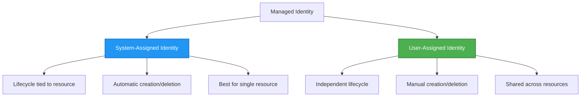

# Vzory overovania a spravovaná identita

⏱️ **Odhadovaný čas**: 45-60 minút čítania; rezervujte si viac času na integráciu cvičení | 💰 **Vplyv na náklady**: Identita/RBAC sú zadarmo; nasadený výpočtový výkon, úložisko a Key Vault sa účtujú | ⭐ **Komplexnosť**: Stredná

> Skontrolované voči `azd 1.37.2` (november 2026). Táto lekcia obsahuje **ilustratívne integračné fragmenty, nie kompletnú stiahnuteľnú šablónu `secure-app`**. Vytvorte referencované súbory, zabezpečte zodpovedajúcu infraštruktúru a nahraďte zástupné symboly pred nasadením. Počas kontroly sa nevytvárali žiadne Azure zdroje.

**📚 Učiaca cesta:**
- ← Predchádzajúca: [Správa konfigurácie](configuration.md) - Správa premenných prostredia a tajomstiev
- 🎯 **Ste tu**: Overovanie a bezpečnosť (spravovaná identita, Key Vault, bezpečné vzory)
- → Ďalšia: [Infrastruktúra ako kód](../chapter-04-infrastructure/README.md) - Provisioning a nasadenie zdrojov
- 🏠 [Domov kurzu](../../README.md)

---

## Čo sa naučíte

Po dokončení tejto lekcie budete vedieť:
- Pochopiť vzory overenia v Azure (kľúče, spojovacie reťazce, spravovaná identita)
- Implementovať **spravovanú identitu** pre overovanie bez hesla
- Zaistiť tajomstvá pomocou integrácie s **Azure Key Vault**
- Konfigurovať **riadovacie prístupy na základe rolí (RBAC)** pre nasadenia pomocou AZD
- Používať bezpečnostné osvedčené postupy v Container Apps a Azure službách
- Migrovať z overenia cez kľúče na overovanie cez identitu

## Prečo je spravovaná identita dôležitá

### Problém: Tradičné overovanie

**Pred spravovanou identitou:**
```javascript
// ❌ SECURITY RISK: Hardcoded secrets in code
const connectionString = "Server=mydb.database.windows.net;User=admin;Password=P@ssw0rd123";
const storageKey = "xK7mN9pQ2wR5tY8uI0oP3aS6dF1gH4jK...";
const cosmosKey = "C2x7B9n4M1p8Q5w3E6r0T2y5U8i1O4p7...";
```

**Problémy:**
- 🔴 **Odkryté tajomstvá** v kóde, konfiguračných súboroch, premenných prostredia
- 🔴 **Rotácia poverení** vyžaduje zmeny v kóde a opätovné nasadenie
- 🔴 **Nočné mory auditov** - kto a kedy čo pristupoval?
- 🔴 **Rozptýlenosť** - tajomstvá uložené v mnohých systémoch
- 🔴 **Riziká súladu** - neprešli bezpečnostnými auditmi

### Riešenie: Spravovaná identita

**Po spravovanej identite:**
```javascript
// ✅ SECURE: No secrets in code
const credential = new DefaultAzureCredential();
const client = new BlobServiceClient(
  "https://mystorageaccount.blob.core.windows.net",
  credential  // Azure automatically handles authentication
);
```

**Výhody:**
- ✅ **Žiadne tajomstvá** v kóde ani konfiguráciách
- ✅ **Automatická rotácia** - spravuje ju Azure
- ✅ **Úplná stopa auditu** v Microsoft Entra ID logoch
- ✅ **Centralizovaná bezpečnosť** - spravuje sa cez Azure Portál
- ✅ **Pripravené na súlad** - vyhovuje bezpečnostným štandardom

**Analógia**: Tradičné overovanie je ako nosiť viacero fyzických kľúčov na rôzne dvere. Spravovaná identita je ako bezpečnostná karta, ktorá automaticky udeľuje prístup podľa toho, kto ste - bez kľúčov na stratu, kopírovanie alebo rotáciu.

---

## Prehľad architektúry

### Tok overovania so spravovanou identitou

```mermaid
sequenceDiagram
    participant App as Your Application<br/>(Container App)
    participant MI as Managed Identity<br/>(Microsoft Entra ID)
    participant KV as Key Vault
    participant Storage as Azure Storage
    participant DB as Azure SQL
    
    App->>MI: Request access token<br/>(automatic)
    MI->>MI: Verify identity<br/>(no password needed)
    MI-->>App: Return token for requested audience<br/>(lifetime varies)
    
    App->>KV: Get secret<br/>(using token)
    KV->>KV: Check RBAC permissions
    KV-->>App: Return secret value
    
    App->>Storage: Upload blob<br/>(using token)
    Storage->>Storage: Check RBAC permissions
    Storage-->>App: Success
    
    App->>DB: Query data<br/>(using token)
    DB->>DB: Check SQL permissions
    DB-->>App: Return results
    
    Note over App,DB: Request a separate token for each service audience;<br/>SDK credentials handle caching and renewal
```

### Typy spravovaných identít



| Vlastnosť | Systémom pridelená | Používateľom pridelená |
|---------|----------------|---------------|
| **Životný cyklus** | Viazaná na zdroj | Nezávislá |
| **Vytvorenie** | Automaticky so zdrojom | Ručné vytvorenie |
| **Zmazanie** | Zmazaná so zdrojom | Pretrváva po zmazaní zdroja |
| **Zdieľanie** | Len pre jeden zdroj | Viac zdrojov |
| **Použitie** | Jednoduché scenáre | Komplexné viaczdrojové scenáre |
| **Voľba šablóny** | Definovaná v infraštruktúre | Definovaná v infraštruktúre |

---

## Predpoklady

### Potrebné nástroje

Mali by ste mať tieto nástroje už nainštalované z predchádzajúcich lekcií:

```bash
# Verify Azure Developer CLI
azd version
# ✅ Expected: azd version 1.0.0 or higher

# Verify Azure CLI
az --version
# ✅ Expected: azure-cli 2.50.0 or higher
```

### Požiadavky na Azure

- Aktívne predplatné Azure
- Oprávnenia na:
  - Vytváranie spravovaných identít
  - Priraďovanie RBAC rolí
  - Vytváranie zdrojov Key Vault
  - Nasadzovanie Container Apps

### Predchádzajúce znalosti

Mali by ste mať dokončené:
- [Inštalačný sprievodca](../chapter-01-foundation/installation.md) - Nastavenie AZD
- [Základy AZD](../chapter-01-foundation/azd-basics.md) - Základné koncepty
- [Správa konfigurácie](configuration.md) - Premenné prostredia

---

## Lekcia 1: Pochopenie vzorov overenia

### Vzor 1: Spojovacie reťazce (dedičstvo - vyhýbať sa)

**Ako to funguje:**
```bash
# Connection string contains credentials
STORAGE_CONNECTION_STRING="DefaultEndpointsProtocol=https;AccountName=myaccount;AccountKey=xK7mN9pQ2wR5..."
COSMOS_CONNECTION_STRING="AccountEndpoint=https://myaccount.documents.azure.com:443/;AccountKey=C2x7..."
SQL_CONNECTION_STRING="Server=myserver.database.windows.net;User=admin;Password=P@ssw0rd..."
```

**Problémy:**
- ❌ Tajomstvá viditeľné v premenných prostredia
- ❌ Logované v systémoch nasadenia
- ❌ Ťažké na rotáciu
- ❌ Žiadna stopa auditu prístupu

**Kedy použiť:** Ak cieľová služba vyžaduje overovanie na základe kľúčov. Preferujte identitu, kde je podporovaná; inak uložte kľúče bezpečne a pravidelne rotujte, vrátane produkcie.

---

### Vzor 2: Referencie do Key Vault (lepšie)

**Ako to funguje:**
**Čiastočné fragmenty Bicep:** požadované polia vaultu, identita Container App a jej položka `configuration.secrets` sú vynechané. `secretRef` označuje tajomstvo Container App; **nie je to samotné** URI kľúča Key Vault. Na použitie Key Vault definujte toto pomenované tajomstvo pomocou `keyVaultUrl` a autorizovaného `identity`.

```bicep
// Store secret in Key Vault
resource keyVault 'Microsoft.KeyVault/vaults@2023-02-01' = {
  name: 'mykv'
  properties: {
    enableRbacAuthorization: true
  }
}

// Reference in Container App
env: [
  {
    name: 'STORAGE_KEY'
    secretRef: 'storage-key'  // References Key Vault
  }
]
```

**Výhody:**
- ✅ Tajomstvá bezpečne uložené v Key Vault
- ✅ Centralizovaná správa tajomstiev
- ✅ Rotácia bez zmien v kóde

**Obmedzenia:**
- ⚠️ stále používa kľúče/heslá
- ⚠️ potrebné spravovať prístup do Key Vault

**Kedy použiť:** Prechodný krok od spojovacích reťazcov k spravovanej identite.

---

### Vzor 3: Spravovaná identita (osvedčený postup)

**Ako to funguje:**
**Čiastočný Bicep:** zlúčte blok identity do kompletného Container App a uveďte `storageAccount` a definíciu roly. Priraďovanie rolí tiež vyžaduje deterministický `name`.

```bicep
// Enable managed identity
resource containerApp 'Microsoft.App/containerApps@2023-05-01' = {
  name: 'myapp'
  identity: {
    type: 'SystemAssigned'  // Automatically creates identity
  }
}

// Grant permissions
resource roleAssignment 'Microsoft.Authorization/roleAssignments@2022-04-01' = {
  name: guid(storageAccount.id, containerApp.id, storageBlobDataContributorRole)
  scope: storageAccount
  properties: {
    roleDefinitionId: storageBlobDataContributorRole
    principalId: containerApp.identity.principalId
    principalType: 'ServicePrincipal'
  }
}
```

**Aplikačný kód:**
```javascript
// No secrets needed!
const { DefaultAzureCredential } = require('@azure/identity');
const { BlobServiceClient } = require('@azure/storage-blob');

const credential = new DefaultAzureCredential();
const blobServiceClient = new BlobServiceClient(
  'https://mystorageaccount.blob.core.windows.net',
  credential
);
```

**Výhody:**
- ✅ Žiadne tajomstvá v kóde/konfigurácii
- ✅ Automatická rotácia poverení
- ✅ Úplná stopa auditu
- ✅ Povolenia založené na RBAC
- ✅ Pripravené na súlad

**Kedy použiť:** Preferujte pre aplikácie hostované v Azure, ktoré pristupujú k službám podporujúcim Microsoft Entra overovanie.

---

### Vzor 4: Service Principals (CI/CD a automatizácia)

Spravovaná identita je zlatý štandard *pre zdroje bežiace v Azure*. Ale čo veci bežiace **mimo** Azure — ako CI/CD pipeline na build agentovi alebo skript na vašom notebooku, ktorý nemôže použiť interaktívne prihlásenie? Tam vstupuje do hry **service principal**: neľudská identita s vlastnými povereniami, za ktorú sa môže automatizovaný proces prihlásiť.

**Ako to funguje:**

Vytvorte service principal, ktorý má právomoci v určitej skupine zdrojov (najmenšie možné oprávnenie):

```bash
az ad sp create-for-rbac \
  --name "myapp-cicd" \
  --role contributor \
  --scopes "/subscriptions/<sub-id>/resourceGroups/<rg-name>"
```

Tento príkaz vypíše client ID, client secret a tenant ID. azd sa môže prihlásiť pomocou nich neinteraktívne:

```bash
azd auth login \
  --client-id "<appId>" \
  --client-secret "<password>" \
  --tenant-id "<tenant>"
```

**Preferujte federované poverenia (OIDC) pred tajomstvami.** Namiesto dlhodobého client secreta nakonfigurujte federované poverenie, takže pipeline vymení krátkodobý token – žiadne tajomstvo na únik alebo rotáciu:

```bash
azd auth login \
  --client-id "<appId>" \
  --federated-credential-provider "github" \
  --tenant-id "<tenant>"
```

> `azd pipeline config` to nastavuje automaticky za vás. Pozrite si CI/CD návody v [kapitole 8](../chapter-08-production/production-ai-practices.md).

**Výhody:**
- ✅ Funguje mimo Azure (build agenty, on-prem, iné cloudy)
- ✅ Môže byť obmedzený na jednu skupinu zdrojov s jednou rolou
- ✅ Federovaná (OIDC) verzia nevyužíva uložené tajomstvo

**Nevýhody:**
- ⚠️ Variant na báze tajomstiev vyžaduje opatrné uloženie a rotáciu
- ⚠️ Únik tajomstva umožňuje všetko, čo SP môže robiť – udržiavajte scope úzke

**Kedy použiť:** CI/CD pipeline a automatizácie, ktoré nemôžu použiť spravovanú identitu. Vždy preferujte **federovanú/OIDC** verziu pred client secretom a keďkoľvek, keď workload beží v Azure, preferujte spravovanú identitu.

**Bezpečné uloženie poverení:**
- Nikdy neukladajte tajomstvá v repozitári — použite úložisko tajomstiev pipeline (GitHub Actions secrets, Azure DevOps variable groups / Key Vault).
- Omezte SP na najmenšiu potrebnú rolu a skupinu zdrojov.
- Nastavte expiráciu a rotujte, alebo úplne eliminujte tajomstvo pomocou OIDC.

---

## Lekcia 2: Implementácia spravovanej identity s AZD

### Krok za krokom implementácia

Nasledujúce fragmenty ukazujú, ako integrovať spravovanú identitu do projektu Container App. Nie sú to **kópie na okamžité spustenie**: modul Storage, kompletná infraštruktúra prostredia/registry, Dockerfile a parameter file nie sú tu všetky zahrnuté. Začnite zo šablóny Container Apps, ktorá funguje, a skombinujte tieto vzory, pričom zachovajte jeho konfiguráciu registry a značky služieb.

### Štruktúra projektu

```
secure-app/
├── azure.yaml                 # AZD configuration
├── infra/
│   ├── main.bicep            # Main infrastructure
│   ├── core/
│   │   ├── identity.bicep    # Managed identity setup
│   │   ├── keyvault.bicep    # Key Vault configuration
│   │   └── storage.bicep     # Storage with RBAC
│   └── app/
│       └── container-app.bicep
└── src/
    ├── app.js                # Application code
    ├── package.json
    └── Dockerfile
```

### 1. Nakonfigurujte AZD (azure.yaml)

```yaml
name: secure-app
metadata:
  template: secure-app@1.0.0

services:
  api:
    project: ./src
    language: js
    host: containerapp

# Managed identity must be enabled in the infrastructure, not by this YAML.
```

### 2. Infraštruktúra: povoliť spravovanú identitu

**Súbor: `infra/main.bicep`**

```bicep
targetScope = 'subscription'

param environmentName string
param location string = 'eastus'
param containerAppsEnvironmentId string
param containerImage string

var tags = { 'azd-env-name': environmentName }

// Resource group
resource rg 'Microsoft.Resources/resourceGroups@2021-04-01' = {
  name: 'rg-${environmentName}'
  location: location
  tags: tags
}

// Storage Account
module storage './core/storage.bicep' = {
  name: 'storage'
  scope: rg
  params: {
    name: 'st${uniqueString(rg.id)}'
    location: location
    tags: tags
  }
}

// Key Vault
module keyVault './core/keyvault.bicep' = {
  name: 'keyvault'
  scope: rg
  params: {
    name: 'kv-${uniqueString(rg.id)}'
    location: location
    tags: tags
  }
}

// Container App with Managed Identity
module containerApp './app/container-app.bicep' = {
  name: 'container-app'
  scope: rg
  params: {
    name: 'ca-${environmentName}'
    location: location
    tags: tags
    storageAccountName: storage.outputs.name
    keyVaultName: keyVault.outputs.name
    containerAppsEnvironmentId: containerAppsEnvironmentId
    containerImage: containerImage
  }
}

// Grant Container App access to Storage
module storageRoleAssignment './core/role-assignment.bicep' = {
  name: 'storage-role'
  scope: rg
  params: {
    principalId: containerApp.outputs.identityPrincipalId
    roleDefinitionId: 'ba92f5b4-2d11-453d-a403-e96b0029c9fe'  // Storage Blob Data Contributor
    targetResourceType: 'storage'
    targetResourceName: storage.outputs.name
  }
}

// Grant Container App access to Key Vault
module kvRoleAssignment './core/role-assignment.bicep' = {
  name: 'kv-role'
  scope: rg
  params: {
    principalId: containerApp.outputs.identityPrincipalId
    roleDefinitionId: '4633458b-17de-408a-b874-0445c86b69e6'  // Key Vault Secrets User
    targetResourceType: 'keyvault'
    targetResourceName: keyVault.outputs.name
  }
}

// Outputs
output AZURE_STORAGE_ACCOUNT_NAME string = storage.outputs.name
output AZURE_KEY_VAULT_NAME string = keyVault.outputs.name
output APP_URL string = containerApp.outputs.url
```

### 3. Container App so systémovou spravovanou identitou

**Súbor: `infra/app/container-app.bicep`**

```bicep
param name string
param location string
param tags object = {}
param storageAccountName string
param keyVaultName string
param containerAppsEnvironmentId string
param containerImage string

resource containerApp 'Microsoft.App/containerApps@2023-05-01' = {
  name: name
  location: location
  tags: union(tags, { 'azd-service-name': 'api' })
  identity: {
    type: 'SystemAssigned'  // 🔑 Enable managed identity
  }
  properties: {
    managedEnvironmentId: containerAppsEnvironmentId
    configuration: {
      ingress: {
        external: true
        targetPort: 3000
      }
    }
    template: {
      containers: [
        {
          name: 'api'
          image: containerImage // Must exist; configure registry credentials for private images
          resources: {
            cpu: json('0.5')
            memory: '1Gi'
          }
          env: [
            {
              name: 'AZURE_STORAGE_ACCOUNT_NAME'
              value: storageAccountName
            }
            {
              name: 'AZURE_KEY_VAULT_NAME'
              value: keyVaultName
            }
            // 🔑 No secrets - managed identity handles authentication!
          ]
        }
      ]
    }
  }
}

// Output the identity for RBAC assignments
output identityPrincipalId string = containerApp.identity.principalId
output id string = containerApp.id
output url string = 'https://${containerApp.properties.configuration.ingress.fqdn}'
```

### 4. Modul priradenia RBAC rolí

**Súbor: `infra/core/role-assignment.bicep`**

```bicep
param principalId string
param roleDefinitionId string  // Azure built-in role ID
@allowed(['storage', 'keyvault'])
param targetResourceType string
param targetResourceName string

// Typed existing resources give Bicep a valid resource scope, not a string ID.
resource storageTarget 'Microsoft.Storage/storageAccounts@2023-01-01' existing = {
  name: targetResourceName
}
resource vaultTarget 'Microsoft.KeyVault/vaults@2023-02-01' existing = {
  name: targetResourceName
}

resource storageAssignment 'Microsoft.Authorization/roleAssignments@2022-04-01' = if (targetResourceType == 'storage') {
  name: guid(storageTarget.id, principalId, roleDefinitionId)
  scope: storageTarget
  properties: {
    roleDefinitionId: subscriptionResourceId('Microsoft.Authorization/roleDefinitions', roleDefinitionId)
    principalId: principalId
    principalType: 'ServicePrincipal'
  }
}

resource vaultAssignment 'Microsoft.Authorization/roleAssignments@2022-04-01' = if (targetResourceType == 'keyvault') {
  name: guid(vaultTarget.id, principalId, roleDefinitionId)
  scope: vaultTarget
  properties: {
    roleDefinitionId: subscriptionResourceId('Microsoft.Authorization/roleDefinitions', roleDefinitionId)
    principalId: principalId
    principalType: 'ServicePrincipal'
  }
}

// This module assigns at the target resource scope, not the whole resource group.
```

### 5. Aplikačný kód so spravovanou identitou

**Súbor: `src/app.js`**

```javascript
const express = require('express');
const { DefaultAzureCredential } = require('@azure/identity');
const { BlobServiceClient } = require('@azure/storage-blob');
const { SecretClient } = require('@azure/keyvault-secrets');

const app = express();
const PORT = process.env.PORT || 3000;

// 🔑 Initialize credential (works automatically with managed identity)
const credential = new DefaultAzureCredential();

// Azure Storage setup
const storageAccountName = process.env.AZURE_STORAGE_ACCOUNT_NAME;
const blobServiceClient = new BlobServiceClient(
  `https://${storageAccountName}.blob.core.windows.net`,
  credential  // No keys needed!
);

// Key Vault setup
const keyVaultName = process.env.AZURE_KEY_VAULT_NAME;
const secretClient = new SecretClient(
  `https://${keyVaultName}.vault.azure.net`,
  credential  // No keys needed!
);

// Health check
app.get('/health', (req, res) => {
  res.json({ status: 'healthy', authentication: 'managed-identity' });
});

// Upload file to blob storage
app.post('/upload', async (req, res) => {
  try {
    const containerClient = blobServiceClient.getContainerClient('uploads');
    await containerClient.createIfNotExists();
    
    const blobName = `file-${Date.now()}.txt`;
    const blockBlobClient = containerClient.getBlockBlobClient(blobName);
    
    const content = 'Hello from managed identity!';
    await blockBlobClient.upload(content, Buffer.byteLength(content));
    
    res.json({
      success: true,
      blobName: blobName,
      message: 'File uploaded using managed identity!'
    });
  } catch (error) {
    console.error('Upload error:', error);
    res.status(500).json({ error: error.message });
  }
});

// Get secret from Key Vault
app.get('/secret/:name', async (req, res) => {
  try {
    const secretName = req.params.name;
    const secret = await secretClient.getSecret(secretName);
    
    res.json({
      name: secretName,
      retrieved: secret.value !== undefined, // Never return the secret value to callers
      message: 'Secret retrieved using managed identity!'
    });
  } catch (error) {
    console.error('Secret error:', error);
    res.status(500).json({ error: error.message });
  }
});

// List blob containers (demonstrates read access)
app.get('/containers', async (req, res) => {
  try {
    const containers = [];
    for await (const container of blobServiceClient.listContainers()) {
      containers.push(container.name);
    }
    
    res.json({
      containers: containers,
      count: containers.length,
      message: 'Containers listed using managed identity!'
    });
  } catch (error) {
    console.error('List error:', error);
    res.status(500).json({ error: error.message });
  }
});

app.listen(PORT, () => {
  console.log(`Secure API listening on port ${PORT}`);
  console.log('Authentication: Managed Identity (passwordless)');
});
```

**Súbor: `src/package.json`**

```json
{
  "name": "secure-app",
  "version": "1.0.0",
  "dependencies": {
    "express": "^4.18.2",
    "@azure/identity": "^4.0.0",
    "@azure/storage-blob": "^12.17.0",
    "@azure/keyvault-secrets": "^4.7.0"
  },
  "scripts": {
    "start": "node app.js"
  }
}
```

### 6. Nasadenie a testovanie

Tieto príkazy spúšťajte **až po** vytvorení chýbajúcej infraštruktúry, Dockerfile a zodpovedajúcej `main.parameters.json` vo vašom projekte. Overte sa pomocou azd s `azd auth login`; samostatne sa prihláste s `az login` pre neskoršie kontroly Azure CLI. Zobrazené endpointy sú demonštračné a pred verejným použitím vyžadujú príslušné kontrolky prístupu.

```bash
# Initialize AZD environment
azd init

# Deploy infrastructure and application
azd up

# Get the app URL
APP_URL=$(azd env get-value APP_URL)

# Test health check
curl $APP_URL/health
```

**✅ Očakávaný výstup:**
```json
{
  "status": "healthy",
  "authentication": "managed-identity"
}
```

**Test nahratia blobu:**
```bash
curl -X POST $APP_URL/upload
```

**✅ Očakávaný výstup:**
```json
{
  "success": true,
  "blobName": "file-1700404800000.txt",
  "message": "File uploaded using managed identity!"
}
```

**Test výpisu kontajnerov:**
```bash
curl $APP_URL/containers
```

**✅ Očakávaný výstup:**
```json
{
  "containers": ["uploads"],
  "count": 1,
  "message": "Containers listed using managed identity!"
}
```

---

## Bežné Azure RBAC role

### Vstavané ID rolí pre spravovanú identitu

| Služba | Názov role | ID roly | Oprávnenia |
|---------|-----------|---------|-------------|
| **Storage** | Storage Blob Data Reader | `2a2b9908-6ea1-4ae2-8e65-a410df84e7d1` | Čítať blob objekty a kontajnery |
| **Storage** | Storage Blob Data Contributor | `ba92f5b4-2d11-453d-a403-e96b0029c9fe` | Čítať, zapisovať, mazať blob objekty |
| **Storage** | Storage Queue Data Contributor | `974c5e8b-45b9-4653-ba55-5f855dd0fb88` | Čítať, zapisovať, mazať fronty/správy |
| **Key Vault** | Key Vault Secrets User | `4633458b-17de-408a-b874-0445c86b69e6` | Čítať tajomstvá |
| **Key Vault** | Key Vault Secrets Officer | `b86a8fe4-44ce-4948-aee5-eccb2c155cd7` | Čítať, zapisovať, mazať tajomstvá |
| **Cosmos DB** | Cosmos DB Built-in Data Reader | `00000000-0000-0000-0000-000000000001` | Čítať údaje Cosmos DB |
| **Cosmos DB** | Cosmos DB Built-in Data Contributor | `00000000-0000-0000-0000-000000000002` | Čítať, zapisovať údaje Cosmos DB |
| **SQL databáza** | SQL DB Contributor | `9b7fa17d-e63e-47b0-bb0a-15c516ac86ec` | Spravovať databázové zdroje; neposkytuje prístup k SQL dátam |
| **Service Bus** | Azure Service Bus Data Owner | `090c5cfd-751d-490a-894a-3ce6f1109419` | Posielať, prijímať, spravovať správy |

### Ako nájsť ID rolí

Dve ID vyššie pre Cosmos DB pre NoSQL sú **nativné Cosmos data-plane definície rolí**, nie Azure RBAC ID rolí predplatného. Priraďujte ich pomocou `az cosmosdb sql role assignment create` (alebo `Microsoft.DocumentDB/databaseAccounts/sqlRoleAssignments`), nie `az role assignment create`. Prístup k SQL dátam vyžaduje používateľa databázy Entra a SQL povolenia.

```bash
# List all built-in roles
az role definition list --query "[].{Name:roleName, ID:name}" --output table

# Search for specific role
az role definition list --query "[?contains(roleName, 'Storage Blob')].{Name:roleName, ID:name}" --output table

# Get role details
az role definition list --name "Storage Blob Data Contributor"
```

---

## Praktické cvičenia

**Podmienky integrácie pre všetky tri cvičenia:** funkčná šablóna Container App vo vašom projekte, zodpovedajúce Bicep zdroje, prihlásenie cez Azure CLI/azd a oprávnenie na priraďovanie potrebných rolí. Sú to usmernené prispôsobenia, nie samostatné lokálne štartéry; nahraďte názvy zdrojov v príklade vlastnými nasadenými názvami.

### Cvičenie 1: Povolenie spravovanej identity pre existujúcu aplikáciu ⭐⭐ (stredné)

**Cieľ**: Pridať spravovanú identitu k existujúcemu nasadeniu Container App

**Scenár**: Máte Container App používajúcu spojovacie reťazce. Preveďte ju na spravovanú identitu.

**východiskový stav**: Container App s touto konfiguráciou:

```bicep
// ❌ Current: Using connection string
env: [
  {
    name: 'STORAGE_CONNECTION_STRING'
    secretRef: 'storage-connection'
  }
]
```

**Kroky**:

1. **Povoliť spravovanú identitu v Bicep:**

```bicep
resource containerApp 'Microsoft.App/containerApps@2023-05-01' = {
  name: 'myapp'
  identity: {
    type: 'SystemAssigned'  // Add this
  }
  // ... rest of configuration
}
```

2. **Prideliť prístup k Storage:**

```bicep
// Get storage account reference
resource storageAccount 'Microsoft.Storage/storageAccounts@2023-01-01' existing = {
  name: storageAccountName
}

// Assign role
resource roleAssignment 'Microsoft.Authorization/roleAssignments@2022-04-01' = {
  name: guid(containerApp.id, 'ba92f5b4-2d11-453d-a403-e96b0029c9fe', storageAccount.id)
  scope: storageAccount
  properties: {
    roleDefinitionId: subscriptionResourceId('Microsoft.Authorization/roleDefinitions', 'ba92f5b4-2d11-453d-a403-e96b0029c9fe')
    principalId: containerApp.identity.principalId
    principalType: 'ServicePrincipal'
  }
}
```

3. **Aktualizovať aplikačný kód:**

**Predtým (spojovací reťazec):**
```javascript
const { BlobServiceClient } = require('@azure/storage-blob');

const blobServiceClient = BlobServiceClient.fromConnectionString(
  process.env.STORAGE_CONNECTION_STRING
);
```

**Následne (spravovaná identita):**
```javascript
const { DefaultAzureCredential } = require('@azure/identity');
const { BlobServiceClient } = require('@azure/storage-blob');

const credential = new DefaultAzureCredential();
const blobServiceClient = new BlobServiceClient(
  `https://${process.env.STORAGE_ACCOUNT_NAME}.blob.core.windows.net`,
  credential
);
```

4. **Aktualizovať premenné prostredia:**

```bicep
env: [
  {
    name: 'STORAGE_ACCOUNT_NAME'
    value: storageAccountName  // Just the name, no secrets!
  }
  // Remove STORAGE_CONNECTION_STRING
]
```

5. **Nasadiť a otestovať:**

```bash
# Redeploy
azd up

# Test that it still works
APP_URL=$(azd show --output json | jq -er '.services.api.ingressUrl')
curl --fail -X POST "$APP_URL/upload"
```

**✅ Kritériá úspechu:**
- ✅ Aplikácia nasadená bez chýb
- ✅ Operácie so Storage fungujú (nahrávanie, výpis, sťahovanie)
- ✅ Žiadne spojovacie reťazce v premenných prostredia
- ✅ Identita viditeľná v Azure Portáli pod listom "Identity"

**Overenie:**

```bash
# Check managed identity is enabled
az containerapp show \
  --name myapp \
  --resource-group rg-myapp \
  --query "identity.type"
# ✅ Expected: "SystemAssigned"

# Check role assignment
az role assignment list \
  --assignee $(az containerapp show --name myapp --resource-group rg-myapp --query "identity.principalId" -o tsv) \
  --scope /subscriptions/{sub-id}/resourceGroups/rg-myapp/providers/Microsoft.Storage/storageAccounts/mystorageaccount
# ✅ Expected: Shows "Storage Blob Data Contributor" role
```

**Čas**: 20-30 minút

---

### Cvičenie 2: Prístup k viacerým službám so používateľsky pridelenou identitou ⭐⭐⭐ (pokročilé)

**Cieľ**: Vytvoriť používateľsky pridelenú identitu zdieľanú naprieč viacerými Container Apps

**Scenár**: Máte 3 mikroslužby, ktoré všetky potrebujú prístup k rovnakému Storage účtu a Key Vault.

**Kroky**:

1. **Vytvorte používateľsky pridelenú identitu:**

**Súbor: `infra/core/identity.bicep`**

```bicep
param name string
param location string
param tags object = {}

resource userAssignedIdentity 'Microsoft.ManagedIdentity/userAssignedIdentities@2023-01-31' = {
  name: name
  location: location
  tags: tags
}

output id string = userAssignedIdentity.id
output principalId string = userAssignedIdentity.properties.principalId
output clientId string = userAssignedIdentity.properties.clientId
```

2. **Priraďte roly používateľsky pridelenej identite:**

```bicep
// In main.bicep
module userIdentity './core/identity.bicep' = {
  name: 'user-identity'
  scope: rg
  params: {
    name: 'id-${environmentName}'
    location: location
    tags: tags
  }
}

// Grant Storage access
resource storageRoleAssignment 'Microsoft.Authorization/roleAssignments@2022-04-01' = {
  name: guid(storageAccount.id, environmentName, 'storage-contributor')
  scope: storageAccount
  properties: {
    roleDefinitionId: subscriptionResourceId('Microsoft.Authorization/roleDefinitions', 'ba92f5b4-2d11-453d-a403-e96b0029c9fe')
    principalId: userIdentity.outputs.principalId
    principalType: 'ServicePrincipal'
  }
}

// Grant Key Vault access
resource kvRoleAssignment 'Microsoft.Authorization/roleAssignments@2022-04-01' = {
  name: guid(keyVault.id, environmentName, 'kv-secrets-user')
  scope: keyVault
  properties: {
    roleDefinitionId: subscriptionResourceId('Microsoft.Authorization/roleDefinitions', '4633458b-17de-408a-b874-0445c86b69e6')
    principalId: userIdentity.outputs.principalId
    principalType: 'ServicePrincipal'
  }
}
```

3. **Priradenie identity viacerým Container Apps:**

```bicep
resource apiGateway 'Microsoft.App/containerApps@2023-05-01' = {
  name: 'api-gateway'
  identity: {
    type: 'UserAssigned'
    userAssignedIdentities: {
      '${userIdentity.outputs.id}': {}
    }
  }
  // ... rest of config
}

resource productService 'Microsoft.App/containerApps@2023-05-01' = {
  name: 'product-service'
  identity: {
    type: 'UserAssigned'
    userAssignedIdentities: {
      '${userIdentity.outputs.id}': {}
    }
  }
  // ... rest of config
}

resource orderService 'Microsoft.App/containerApps@2023-05-01' = {
  name: 'order-service'
  identity: {
    type: 'UserAssigned'
    userAssignedIdentities: {
      '${userIdentity.outputs.id}': {}
    }
  }
  // ... rest of config
}
```

4. **Kód aplikácie (všetky služby používajú rovnaký vzor):**

```javascript
const { ManagedIdentityCredential } = require('@azure/identity');
const { BlobServiceClient } = require('@azure/storage-blob');

// For user-assigned identity, specify the client ID
const credential = new ManagedIdentityCredential(
  process.env.AZURE_CLIENT_ID  // User-assigned identity client ID
);

// Alternative (choose ONE credential declaration):
// const { DefaultAzureCredential } = require('@azure/identity');
// const credential = new DefaultAzureCredential({
//   managedIdentityClientId: process.env.AZURE_CLIENT_ID
// });

const blobServiceClient = new BlobServiceClient(
  `https://${process.env.STORAGE_ACCOUNT_NAME}.blob.core.windows.net`,
  credential
);
```

Nastavte každý runtime Container App `AZURE_CLIENT_ID` na `userIdentity.outputs.clientId` a `STORAGE_ACCOUNT_NAME` na názov vášho úložiska v Bicep. Samotné priradenie identity alebo spustenie `azd env set` nekonfiguruje tieto runtime hodnoty.

5. **Deploynite a overte:**

```bash
azd up

# Test all services can access storage
# Replace with the actual ingress URLs reported for your three services
curl --fail -X POST "$API_GATEWAY_URL/upload"
curl --fail -X POST "$PRODUCT_SERVICE_URL/upload"
curl --fail -X POST "$ORDER_SERVICE_URL/upload"
```

**✅ Kritériá úspechu:**
- ✅ Jedna identita zdieľaná cez 3 služby
- ✅ Všetky služby majú prístup k Storage a Key Vault
- ✅ Identita pretrváva aj po odstránení jednej služby
- ✅ Centralizované riadenie oprávnení

**Výhody identity priradenej používateľom:**
- Jedna identita na správu
- Konzistentné oprávnenia naprieč službami
- Prežije odstránenie služby
- Lepšie pre zložité architektúry

**Čas**: 30-40 minút

---

### Cvičenie 3: Implementácia rotácie tajomstiev v Key Vault ⭐⭐⭐ (Pokročilé)

**Cieľ**: Uchovať API kľúče tretích strán v Key Vault a pristupovať k nim pomocou spravovanej identity

**Scenár**: Vaša aplikácia potrebuje volať externé API (OpenAI, Stripe, SendGrid), ktoré vyžaduje API kľúče.

**Kroky**:

1. **Vytvorte Key Vault s RBAC:**

**Súbor: `infra/core/keyvault.bicep`**

```bicep
param name string
param location string
param tags object = {}

resource keyVault 'Microsoft.KeyVault/vaults@2023-02-01' = {
  name: name
  location: location
  tags: tags
  properties: {
    enableRbacAuthorization: true  // Use RBAC instead of access policies
    sku: {
      family: 'A'
      name: 'standard'
    }
    tenantId: subscription().tenantId
    enableSoftDelete: true
    softDeleteRetentionInDays: 90
  }
}

// Allow Container App to read secrets
output id string = keyVault.id
output name string = keyVault.name
output uri string = keyVault.properties.vaultUri
```

2. **Uložte tajomstvá do Key Vault:**

```bash
# Get Key Vault name
KV_NAME=$(azd env get-value AZURE_KEY_VAULT_NAME)

# Store third-party API keys
az keyvault secret set \
  --vault-name $KV_NAME \
  --name "OpenAI-ApiKey" \
  --value "sk-proj-xxxxxxxxxxxxx"

az keyvault secret set \
  --vault-name $KV_NAME \
  --name "Stripe-ApiKey" \
  --value "sk_live_xxxxxxxxxxxxx"

az keyvault secret set \
  --vault-name $KV_NAME \
  --name "SendGrid-ApiKey" \
  --value "SG.xxxxxxxxxxxxx"
```

3. **Kód aplikácie na získavanie tajomstiev:**

**Súbor: `src/config.js`**

```javascript
const { DefaultAzureCredential } = require('@azure/identity');
const { SecretClient } = require('@azure/keyvault-secrets');

class Config {
  constructor() {
    this.credential = new DefaultAzureCredential();
    this.secretClient = new SecretClient(
      `https://${process.env.AZURE_KEY_VAULT_NAME}.vault.azure.net`,
      this.credential
    );
    this.cache = {};
  }

  async getSecret(secretName) {
    // Check cache first
    if (this.cache[secretName]) {
      return this.cache[secretName];
    }

    try {
      const secret = await this.secretClient.getSecret(secretName);
      this.cache[secretName] = secret.value;
      console.log(`✅ Retrieved secret: ${secretName}`);
      return secret.value;
    } catch (error) {
      console.error(`❌ Failed to get secret ${secretName}:`, error.message);
      throw error;
    }
  }

  async getOpenAIKey() {
    return this.getSecret('OpenAI-ApiKey');
  }

  async getStripeKey() {
    return this.getSecret('Stripe-ApiKey');
  }

  async getSendGridKey() {
    return this.getSecret('SendGrid-ApiKey');
  }
}

module.exports = new Config();
```

4. **Použitie tajomstiev v aplikácii:**

**Súbor: `src/app.js`**

Tento **náhrada fragmentu aplikácie** vyžaduje `npm install openai`, skutočný kľúč tretej strany, prístupný model a infraštruktúru z vášho pracovného projektu. Volá OpenAI priamo, nie Azure OpenAI deployment. Nižšie uvedené zástupné kľúče neoprávňujú k požiadavke.

```javascript
const express = require('express');
const config = require('./config');
const { OpenAI } = require('openai');

const app = express();

// Initialize OpenAI with key from Key Vault
let openaiClient;

async function initializeServices() {
  const openaiKey = await config.getOpenAIKey();
  openaiClient = new OpenAI({ apiKey: openaiKey });
  console.log('✅ Services initialized with secrets from Key Vault');
}

app.post('/chat', async (req, res) => {
  try {
    const completion = await openaiClient.chat.completions.create({
      model: 'gpt-4.1',
      messages: [{ role: 'user', content: 'Hello!' }]
    });
    
    res.json({
      response: completion.choices[0].message.content,
      authentication: 'Key from Key Vault via Managed Identity'
    });
  } catch (error) {
    res.status(500).json({ error: error.message });
  }
});

// Start listening only after initialization succeeds.
initializeServices().then(() => {
  app.listen(3000, () => console.log('Key Vault demo running'));
}).catch(error => {
  console.error('Initialization failed:', error.message);
  process.exitCode = 1;
});
```

5. **Deploynite a otestujte:**

```bash
azd up

# Test that API keys work
curl -X POST https://myapp.azurecontainerapps.io/chat \
  -H "Content-Type: application/json" \
  -d '{"message":"Hello AI"}'
```

**✅ Kritériá úspechu:**
- ✅ Žiadne API kľúče v kóde alebo premenných prostredia
- ✅ Aplikácia získa kľúče z Key Vault
- ✅ Tretie strany API fungujú správne
- ✅ Kľúče je možné rotovať bez zmeny kódu

**Rotácia tajomstva:**

```bash
# Update secret in Key Vault
az keyvault secret set \
  --vault-name $KV_NAME \
  --name "OpenAI-ApiKey" \
  --value "sk-proj-NEW_KEY_HERE"

# Find the active revision name, then restart it to clear the in-process cache
az containerapp revision list --name myapp --resource-group rg-myapp --output table
az containerapp revision restart \
  --name myapp \
  --resource-group rg-myapp \
  --revision "<active-revision-name>"
```

**Čas**: 25-35 minút

---

## Kontrolný bod vedomostí

### 1. Overovacie vzory ✓

Otestujte svoje znalosti:

- [ ] **Otázka 1**: Aké sú tri hlavné overovacie vzory? 
  - **O**: Connection strings (legacy), Key Vault referencie (prechod), Managed Identity (najlepšie)

- [ ] **Otázka 2**: Prečo je managed identity lepšia než connection strings?
  - **O**: Žiadne tajomstvá v kóde, automatická rotácia, plný audit trail, RBAC oprávnenia

- [ ] **Otázka 3**: Kedy by ste použili user-assigned identity namiesto system-assigned?
  - **O**: Keď sa identita zdieľa medzi viacerými zdrojmi alebo keď je životný cyklus identity nezávislý od životného cyklu zdroja

**Praktická overovacia úloha:**
```bash
# Check what type of identity your app uses
az containerapp show \
  --name myapp \
  --resource-group rg-myapp \
  --query "identity.type"

# List all role assignments for the identity
az role assignment list \
  --assignee $(az containerapp show --name myapp --resource-group rg-myapp --query "identity.principalId" -o tsv)
```

---

### 2. RBAC a oprávnenia ✓

Otestujte svoje znalosti:

- [ ] **Otázka 1**: Aký je ID role pre "Storage Blob Data Contributor"?
  - **O**: `ba92f5b4-2d11-453d-a403-e96b0029c9fe`

- [ ] **Otázka 2**: Aké oprávnenia poskytuje "Key Vault Secrets User"?
  - **O**: Iba čítací prístup k tajomstvám (nemôže ich vytvárať, aktualizovať ani mazať)

- [ ] **Otázka 3**: Ako poskytnete Container App prístup k Azure SQL?
  - **O**: Nakonfigurujte Microsoft Entra autentifikáciu, vytvorte identitu ako databázového používateľa a priraďte potrebné SQL oprávnenia. "SQL DB Contributor" spravuje iba Azure zdroje; neautorizuje dotazy.

**Praktická overovacia úloha:**
```bash
# Find specific role
az role definition list --name "Storage Blob Data Contributor"

# Check what roles are assigned to your identity
PRINCIPAL_ID=$(az containerapp show --name myapp --resource-group rg-myapp --query "identity.principalId" -o tsv)
az role assignment list --assignee $PRINCIPAL_ID --output table
```

---

### 3. Integrácia Key Vault ✓

Otestujte svoje znalosti:

- [ ] **Otázka 1**: Ako zapnete RBAC pre Key Vault namiesto prístupových politík?
  - **O**: Nastavte `enableRbacAuthorization: true` v Bicep

- [ ] **Otázka 2**: Ktorá Azure SDK knižnica rieši autentifikáciu pomocou managed identity?
  - **O**: `@azure/identity` s triedou `DefaultAzureCredential`

- [ ] **Otázka 3**: Ako dlho zostávajú tajomstvá Key Vault v cache?
  - **O**: Závisí od aplikácie; implementujte vlastnú stratégiu kešovania

**Praktická overovacia úloha:**
```bash
# Test Key Vault access
az keyvault secret show \
  --vault-name $KV_NAME \
  --name "OpenAI-ApiKey" \
  --query "{name:name,enabled:attributes.enabled}"

# Check RBAC is enabled
az keyvault show \
  --name $KV_NAME \
  --query "properties.enableRbacAuthorization"
# ✅ Expected: true
```

---

## Najlepšie bezpečnostné postupy

### ✅ ROBIŤ:

1. **Vždy používať managed identity v produkcii**
   ```bicep
   identity: {
     type: 'SystemAssigned'
   }
   ```

2. **Používať RBAC role s najmenšími oprávneniami**
   - Používajte "Reader" roly, kde je to možné
   - Vyhnite sa "Owner" alebo "Contributor" ak to nie je nevyhnutné

3. **Ukladať kľúče tretích strán v Key Vault**
   ```javascript
   const apiKey = await secretClient.getSecret('ThirdPartyApiKey');
   ```

4. **Povoliť auditovanie** (čiastočný fragment zdroja; zlúčte ho s vašimi deklaráciami vault a workspace)
   ```bicep
   resource vaultDiagnostics 'Microsoft.Insights/diagnosticSettings@2021-05-01-preview' = {
     name: 'vault-audit'
     scope: keyVault
     properties: {
       workspaceId: logAnalytics.id
       logs: [{ category: 'AuditEvent', enabled: true }]
     }
   }
   ```

5. **Použiť rôzne identity pre dev/staging/prod**
   ```bash
   azd env new dev
   azd env new staging
   azd env new prod
   ```

6. **Rotovať tajomstvá pravidelne**
   - Nastavite expiračné dátumy na tajomstvá v Key Vault
   - Automatizujte rotáciu pomocou Azure Functions

### ❌ NEROBIŤ:

1. **Nikdy nepíšte tajomstvá do kódu**
   ```javascript
   // ❌ BAD
   const apiKey = "sk-proj-xxxxxxxxxxxxx";
   ```

2. **Nepoužívajte connection strings v produkcii**
   ```javascript
   // ❌ BAD
   BlobServiceClient.fromConnectionString(process.env.STORAGE_CONNECTION_STRING)
   ```

3. **Nedávajte príliš veľa oprávnení**
   ```bicep
   // ❌ BAD - too much access
   roleDefinitionId: subscriptionResourceId('Microsoft.Authorization/roleDefinitions', '8e3af657-a8ff-443c-a75c-2fe8c4bcb635')
   
   // ✅ GOOD - least privilege
   roleDefinitionId: subscriptionResourceId('Microsoft.Authorization/roleDefinitions', '2a2b9908-6ea1-4ae2-8e65-a410df84e7d1')
   ```

4. **Nezaznamenávajte tajomstvá do logov**
   ```javascript
   // ❌ BAD
   console.log('API Key:', apiKey);
   
   // ✅ GOOD
   console.log('API Key retrieved successfully');
   ```

5. **Nedávajte produkčné identity zdieľať naprieč prostrediami**
   ```bicep
   // ❌ BAD - same identity for dev and prod
   // ✅ GOOD - separate identities per environment
   ```

---

## Sprievodca riešením problémov

### Problém: "Unauthorized" pri prístupe k Azure Storage

**Príznaky:**
```
Error: Unauthorized (403)
AuthorizationPermissionMismatch: This request is not authorized to perform this operation
```

**Diagnóza:**

```bash
# Check if managed identity is enabled
az containerapp show \
  --name myapp \
  --resource-group rg-myapp \
  --query "identity.type"
# ✅ Expected: "SystemAssigned" or "UserAssigned"

# Check role assignments
PRINCIPAL_ID=$(az containerapp show --name myapp --resource-group rg-myapp --query "identity.principalId" -o tsv)
az role assignment list --assignee $PRINCIPAL_ID

# Expected: Should see "Storage Blob Data Contributor" or similar role
```

**Riešenia:**

1. **Priraďte správnu RBAC rolu:**
```bash
STORAGE_ID=$(az storage account show --name mystorageaccount --resource-group rg-myapp --query "id" -o tsv)
az role assignment create \
  --assignee $PRINCIPAL_ID \
  --role "Storage Blob Data Contributor" \
  --scope $STORAGE_ID
```

2. **Počkajte na propagáciu (môže to trvať 5-10 minút):**
```bash
# Check role assignment status
az role assignment list --assignee $PRINCIPAL_ID --scope $STORAGE_ID
```

3. **Overte, či aplikácia používa správne prihlasovacie údaje:**
```javascript
// Make sure you're using DefaultAzureCredential
const credential = new DefaultAzureCredential();
```

---

### Problém: Prístup k Key Vault odmietnutý

**Príznaky:**
```
Error: Forbidden (403)
The user, group or application does not have secrets get permission
```

**Diagnóza:**

```bash
# Check Key Vault RBAC is enabled
az keyvault show \
  --name $KV_NAME \
  --query "properties.enableRbacAuthorization"
# ✅ Expected: true

# Check role assignments
az role assignment list \
  --assignee $PRINCIPAL_ID \
  --scope /subscriptions/{sub-id}/resourceGroups/rg-myapp/providers/Microsoft.KeyVault/vaults/$KV_NAME
```

**Riešenia:**

1. **Povoľte RBAC na Key Vault:**
```bash
az keyvault update \
  --name $KV_NAME \
  --enable-rbac-authorization true
```

2. **Priraďte rolu Key Vault Secrets User:**
```bash
KV_ID=$(az keyvault show --name $KV_NAME --query "id" -o tsv)
az role assignment create \
  --assignee $PRINCIPAL_ID \
  --role "Key Vault Secrets User" \
  --scope $KV_ID
```

---

### Problém: DefaultAzureCredential zlyháva lokálne

**Príznaky:**
```
Error: DefaultAzureCredential failed to retrieve a token
CredentialUnavailableError: No credential available
```

**Diagnóza:**

```bash
# Check if you're logged in
az account show

# Check Azure CLI authentication
az ad signed-in-user show
```

**Riešenia:**

1. **Prihláste sa do Azure CLI:**
```bash
az login
```

2. **Nastavte Azure subscription:**
```bash
az account set --subscription "Your Subscription Name"
```

3. **Pre lokálny vývoj používajte environmentálne premenné:**
```bash
export AZURE_TENANT_ID="your-tenant-id"
export AZURE_CLIENT_ID="your-client-id"
export AZURE_CLIENT_SECRET="your-client-secret"
```

4. **Alebo použite inú autentifikáciu lokálne:**
```javascript
const { DefaultAzureCredential, AzureCliCredential } = require('@azure/identity');

// Use AzureCliCredential for local dev
const credential = process.env.NODE_ENV === 'production' 
  ? new DefaultAzureCredential()
  : new AzureCliCredential();
```

---

### Problém: Priradenie roly trvá príliš dlho na propagáciu

**Príznaky:**
- Rola bola úspešne priradená
- Stále sa objavujú chyby 403
- Prístup je prerušovaný (niekedy funguje, niekedy nie)

**Vysvetlenie:**
Zmeny v Azure RBAC môžu trvať 5-10 minút, kým sa globálne prejavia.

**Riešenie:**

```bash
# Wait and retry
echo "Waiting for RBAC propagation..."
sleep 300  # Wait 5 minutes

# Test access
curl --fail -X POST "$APP_URL/upload"

# If still failing, restart the app
az containerapp revision restart \
  --name myapp \
  --resource-group rg-myapp \
  --revision "<active-revision-name>"
```

---

## Náklady

### Náklady na Managed Identity

| Zdroje | Náklady |
|----------|------|
| **Managed Identity** | 🆓 **ZDARMA** - Bez poplatku |
| **Priradenia RBAC rolí** | 🆓 **ZDARMA** - Bez poplatku |
| **Požiadavky na token Microsoft Entra ID** | 🆓 **ZDARMA** - V cene zahrnuté |
| **Operácie Key Vault** | 0,03 $ za 10 000 operácií |
| **Ukladanie tajomstiev v Key Vault** | Skontrolujte aktuálne ceny; nepredpokladajte mesačný poplatok za tajomstvo |

**Managed identity šetrí peniaze tým, že:**
- ✅ Odstraňuje potrebu operácií Key Vault pre autentifikáciu služieb medzi sebou
- ✅ Znižuje bezpečnostné incidenty (žiadne uniknuté prihlasovacie údaje)
- ✅ Znižuje prevádzkovú záťaž (žiadna manuálna rotácia)

Počet požiadaviek aplikácie sa nerovná počtu operácií Key Vault: náklady na čítanie tajomstiev závisia od cache a vzorov rotácie. Identita nezbavuje nákladov na výpočty/uloženie. Skontrolujte [Cenník Key Vault](https://azure.microsoft.com/pricing/details/key-vault/) a Azure Pricing Calculator pre váš región namiesto predpokladania mesačných úspor len podľa počtu požiadaviek.

---

## Naučte sa viac

### Oficiálna dokumentácia
- [Azure Managed Identity](https://learn.microsoft.com/entra/identity/managed-identities-azure-resources/overview)
- [Azure RBAC](https://learn.microsoft.com/azure/role-based-access-control/overview)
- [Azure Key Vault](https://learn.microsoft.com/azure/key-vault/general/overview)
- [DefaultAzureCredential](https://learn.microsoft.com/dotnet/api/azure.identity.defaultazurecredential)

### Dokumentácia SDK
- [@azure/identity (Node.js)](https://www.npmjs.com/package/@azure/identity)
- [Azure.Identity (C#)](https://www.nuget.org/packages/Azure.Identity/)
- [azure-identity (Python)](https://pypi.org/project/azure-identity/)

### Ďalšie kroky v tomto kurze
- ← Predchádzajúce: [Riadenie konfigurácie](configuration.md)
- → Ďalšie: [Infrastruktúra ako kód](../chapter-04-infrastructure/README.md)
- 🏠 [Domovská stránka kurzu](../../README.md)

### Súvisiace príklady
- [Príklad chatovania s Microsoft Foundry Models](../../../../examples/azure-openai-chat) - Používa managed identity pre Microsoft Foundry Models
- [Príklad mikroservisov](../../../../examples/microservices) - Overovacie vzory pre viaceré služby

---

## Zhrnutie

**Naučili ste sa:**
- ✅ Tri overovacie vzory (connection strings, Key Vault, managed identity)
- ✅ Ako povoliť a nakonfigurovať managed identity v AZD
- ✅ Priraďovanie RBAC rolí pre Azure služby
- ✅ Integráciu Key Vault pre tajomstvá tretích strán
- ✅ Rozdiel medzi user-assigned a system-assigned identitami
- ✅ Najlepšie bezpečnostné postupy a riešenie problémov

**Kľúčové body:**
1. **Vždy používajte managed identity v produkcii** - Žiadne tajomstvá, automatická rotácia
2. **Používajte RBAC roly s najmenším možným oprávnením** - Udeľujte len nevyhnutné povolenia
3. **Ukladajte kľúče tretích strán v Key Vault** - Centralizovaná správa tajomstiev
4. **Oddelené identity pre každé prostredie** - Izolácia pre dev, staging, prod
5. **Povoľte auditovanie prístupov** - Sledujte, kto čo použil

**Ďalšie kroky:**
1. Dokončite vyššie uvedené praktické cvičenia
2. Migrujte existujúcu aplikáciu z connection strings na managed identity
3. Prejdite si znovu začiatočnícky deployment flow: [Prvý projekt](../chapter-01-foundation/first-project.md)

---

<!-- CO-OP TRANSLATOR DISCLAIMER START -->
**Vyhlásenie o zodpovednosti**:
Tento dokument bol preložený pomocou AI prekladateľskej služby [Co-op Translator](https://github.com/Azure/co-op-translator). Hoci sa snažíme o presnosť, vezmite prosím na vedomie, že automatické preklady môžu obsahovať chyby alebo nepresnosti. Pôvodný dokument v jeho natívnom jazyku by mal byť považovaný za autoritatívny zdroj. Pre kritické informácie sa odporúča profesionálny ľudský preklad. Nie sme zodpovední za žiadne nedorozumenia alebo nesprávne interpretácie vyplývajúce z použitia tohto prekladu.
<!-- CO-OP TRANSLATOR DISCLAIMER END -->