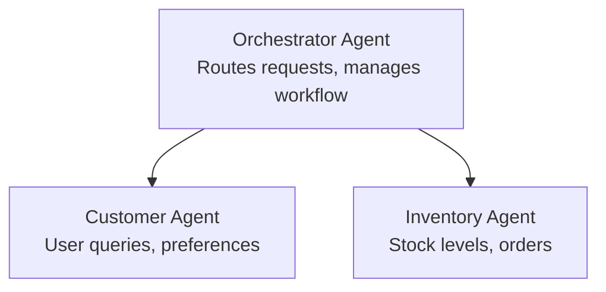

# Kapitola 5: Riešenia AI s viacerými agentmi

**📚 Kurz**: [AZD pre začiatočníkov](../../README.md) | **⏱️ Dĺžka**: 2-3 hodiny | **⭐ Zložitosť**: Pokročilá

---

## Prehľad

Táto kapitola pokrýva pokročilé vzory architektúry viacerých agentov, orchestráciu agentov a produkčne pripravené nasadenia AI pre zložité scenáre.

> Návod na príkazy bol overený voči zverejnenej referencii `azd 1.37.2`. Nasadenia do cloudu neboli vykonané.

## Ciele učenia

Po dokončení tejto kapitoly budete vedieť:
- Pochopiť vzory architektúry viacerých agentov
- Nasadiť koordinované systémy AI agentov
- Implementovať komunikáciu agent-agent
- Vytvoriť produkčne pripravené riešenia s viacerými agentmi

---

## 📚 Lekcie

| # | Lekcia | Popis | Čas |
|---|--------|-------------|------|
| 1 | [Základy viacerých agentov](multi-agent-basics.md) | Praktické: nasadiť fungujúcu aplikáciu s viacerými agentmi pomocou `azd up` | 45 min |
| 2 | [Vzory koordinácie](../chapter-06-pre-deployment/coordination-patterns.md) | Stratégie orchestrácie agentov (pokračuje v Kapitole 6) | 30 min |
| 3 | [Nasadenie ARM šablóny](../../examples/retail-multiagent-arm-template/README.md) | Príklad nasadenia jedným kliknutím | 30 min |

> **Začnite Lekciou 1.** Je to jediná plne praktická, nasaditeľná lekcia v tejto kapitole. Lekcia 2 je v Kapitole 6 (je spoločná s plánovaním pred nasadením) a [Retail Multi-Agent Solution](../../examples/retail-scenario.md) je architektonický plán – návrhová referencia, nie šablóna jedným príkazom.

---

## 🚀 Rýchly štart

```bash
# Option 1: Deploy the multi-agent template used in Lesson 1
azd init --template Azure-Samples/contoso-creative-writer .
azd up

# Option 2: Initialize a Foundry agent interactively (requires azure.ai.agents)
azd extension install azure.ai.agents
azd ai agent init
azd up
```

> **Aký prístup?** Použite `azd init --template` na začatie s fungujúcim príkladom. Použite `azd ai agent init` interaktívne, alebo `azd ai agent init --template <path-to-azure.yaml>` na prevzatie aktuálneho projektu agenta. Pozrite si [AZD AI CLI referenciu](../chapter-08-production/production-ai-practices.md#azd-ai-cli-commands-and-extensions) pre požiadavky na verziu a migráciu hodnotenia.

Spustite tieto alternatívy v samostatných prázdnych priečinkoch. Rozšírenie agentov `1.0.0-beta.23` vyžaduje `azd >= 1.37.0`; jeho interaktívny tok nevytvára vlastný pipeline Service Bus v lekcii koordinácie.

---

## 🤖 Architektúra viacerých agentov



---

## 🎯 Vybraté riešenie: Retail Multi-Agent

Riešenie [Retail Multi-Agent Solution](../../examples/retail-scenario.md) demonštruje:

- **Agent zákazníka**: Spravuje interakcie a preferencie používateľa
- **Inventárny agent**: Riadi sklad a spracovanie objednávok
- **Orchestrátor**: Koordinuje medzi agentmi
- **Zdieľaná pamäť**: Správa kontextu medzi agentmi

### Použité služby

| Služba | Účel |
|---------|---------|
| Microsoft Foundry Models | Porozumenie jazyka |
| Azure AI Search | Katalóg produktov |
| Cosmos DB | Stav a pamäť agenta |
| Container Apps | Hosting agentov |
| Application Insights | Monitorovanie |

---

## 🔗 Navigácia

| Smer | Kapitola |
|-----------|---------|
| **Predchádzajúca** | [Kapitola 4: Infraštruktúra](../chapter-04-infrastructure/README.md) |
| **Nasledujúca** | [Kapitola 6: Pred nasadením](../chapter-06-pre-deployment/README.md) |

---

## 📖 Súvisiace zdroje

- [Sprievodca AI agentmi](../chapter-02-ai-development/agents.md)
- [Produkčné AI postupy](../chapter-08-production/production-ai-practices.md)
- [Riešenie problémov AI](../chapter-07-troubleshooting/ai-troubleshooting.md)

---

<!-- CO-OP TRANSLATOR DISCLAIMER START -->
**Vyhlásenie o zodpovednosti**:
Tento dokument bol preložený pomocou AI prekladateľskej služby [Co-op Translator](https://github.com/Azure/co-op-translator). Hoci sa snažíme o presnosť, vezmite prosím na vedomie, že automatické preklady môžu obsahovať chyby alebo nepresnosti. Pôvodný dokument v jeho natívnom jazyku by mal byť považovaný za autoritatívny zdroj. Pre kritické informácie sa odporúča profesionálny ľudský preklad. Nie sme zodpovední za žiadne nedorozumenia alebo nesprávne interpretácie vyplývajúce z použitia tohto prekladu.
<!-- CO-OP TRANSLATOR DISCLAIMER END -->