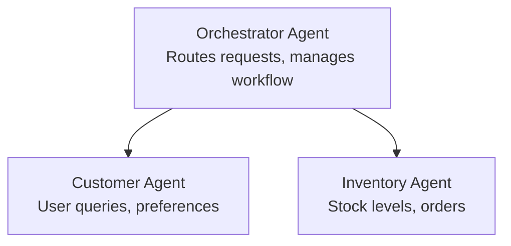

# Kapitola 5: Multi-agentné riešenia AI

**📚 Kurz**: [AZD Pre začiatočníkov](../../README.md) | **⏱️ Trvanie**: 2-3 hodiny | **⭐ Zložitosť**: Pokročilé

---

## Prehľad

Táto kapitola pokrýva pokročilé vzory multi-agentnej architektúry, orchestráciu agentov a produkčne použiteľné nasadenia AI pre zložité scenáre.

> Pokyny ku príkazom boli skontrolované voči vydanému referenčnému manuálu `azd 1.37.2`. Nasadenia do cloudu neboli vykonané.

## Ciele učenia

Po dokončení tejto kapitoly budete:
- Rozumieť vzorom multi-agentnej architektúry
- Nasadzovať koordinované systémy AI agentov
- Implementovať komunikáciu agent-agent
- Vytvárať produkčne pripravené multi-agentné riešenia

---

## 📚 Lekcie

| # | Lekcia | Popis | Čas |
|---|--------|-------------|------|
| 1 | [Základy multi-agentov](multi-agent-basics.md) | Praktické: nasadenie funkčnej multi-agentnej aplikácie s `azd up` | 45 min |
| 2 | [Vzory koordinácie](../chapter-06-pre-deployment/coordination-patterns.md) | Stratégie orchestrácie agentov (pokračuje v kapitole 6) | 30 min |
| 3 | [Nasadenie pomocou ARM šablóny](../../examples/retail-multiagent-arm-template/README.md) | Príklad jedným kliknutím | 30 min |

> **Začnite lekciou 1.** Je to jediná plne praktická lekcia na nasadenie v tejto kapitole. Lekcia 2 je v kapitole 6 (je zdieľaná s plánovaním pred nasadením) a [Retail Multi-Agent Solution](../../examples/retail-scenario.md) je architektonická šablóna – dizajnový referenčný materiál, nie šablóna jedného príkazu.

---

## 🚀 Rýchly štart

```bash
# Option 1: Deploy the multi-agent template used in Lesson 1
azd init --template Azure-Samples/contoso-creative-writer .
azd up

# Option 2: Initialize a Foundry agent interactively with the GA bundle
azd ext install microsoft.foundry
azd ai agent init
azd up
```

> **Ktorý prístup?** Použite `azd init --template` na začatie s funkčným príkladom. Použite `azd ai agent init` interaktívne, alebo `azd ai agent init --template <path-to-azure.yaml>` na prevzatie aktuálneho projektu agenta. Pozrite si [AZD AI CLI reference](../chapter-08-production/production-ai-practices.md#azd-ai-cli-commands-and-extensions) pre požiadavky na verziu a migráciu hodnotenia.

Spustite tieto alternatívy v samostatných prázdnych priečinkoch. Workflow GA Foundry vyžaduje `azd >= 1.37.0`; jeho interaktívny tok negeneruje vlastnú pipeline pre Service Bus v lekcii koordinácie. Pre lokálne testovanie, nasadenie kódu a čistenie nových vs. zrecyklovaných projektov postupujte podľa [hosted-agent walkthrough](../chapter-02-ai-development/microsoft-foundry-integration.md#hosted-agent-walkthrough-ga).

---

## 🤖 Multi-agentná architektúra



---

## 🎯 Predstavené riešenie: Retail Multi-Agent

Riešenie [Retail Multi-Agent Solution](../../examples/retail-scenario.md) demonštruje:

- **Customer Agent**: Spracováva používateľské interakcie a preferencie
- **Inventory Agent**: Spravuje zásoby a spracovanie objednávok
- **Orchestrator**: Koordinuje medzi agentmi
- **Shared Memory**: Riadenie kontextu medzi agentmi

### Použité služby

| Služba | Účel |
|---------|---------|
| Microsoft Foundry Models | Porozumenie jazyka |
| Azure AI Search | Produktový katalóg |
| Cosmos DB | Stav a pamäť agenta |
| Container Apps | Hosting agentov |
| Application Insights | Monitorovanie |

---

## 🔗 Navigácia

| Smer | Kapitola |
|-----------|---------|
| **Predchádzajúca** | [Kapitola 4: Infraštruktúra](../chapter-04-infrastructure/README.md) |
| **Nasledujúca** | [Kapitola 6: Pred nasadením](../chapter-06-pre-deployment/README.md) |

---

## 📖 Súvisiace zdroje

- [Sprievodca AI agentmi](../chapter-02-ai-development/agents.md)
- [Praktiky produkčného AI](../chapter-08-production/production-ai-practices.md)
- [Riešenie problémov AI](../chapter-07-troubleshooting/ai-troubleshooting.md)

---

<!-- CO-OP TRANSLATOR DISCLAIMER START -->
**Vyhlásenie o zodpovednosti**:
Tento dokument bol preložený pomocou AI prekladateľskej služby [Co-op Translator](https://github.com/Azure/co-op-translator). Hoci sa snažíme o presnosť, vezmite prosím na vedomie, že automatické preklady môžu obsahovať chyby alebo nepresnosti. Pôvodný dokument v jeho natívnom jazyku by mal byť považovaný za autoritatívny zdroj. Pre kritické informácie sa odporúča profesionálny ľudský preklad. Nie sme zodpovední za žiadne nedorozumenia alebo nesprávne interpretácie vyplývajúce z použitia tohto prekladu.
<!-- CO-OP TRANSLATOR DISCLAIMER END -->