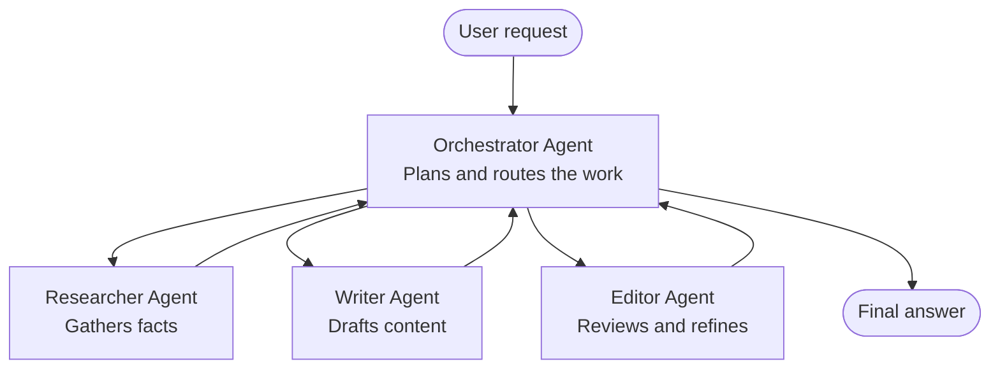

# Základy Multi-Agentov - Nasadte svoj prvý koordinovaný AI systém

**Navigácia kapitolou:**
- **📚 Domov kurzu**: [AZD Pre začiatočníkov](../../README.md)
- **📖 Aktuálna kapitola**: Kapitola 5 - Multi-agentné AI riešenia
- **⬅️ Predchádzajúca**: [Kapitola 4: Infraštruktúra](../chapter-04-infrastructure/README.md)
- **➡️ Nasledujúca**: [Koordinačné vzory](../chapter-06-pre-deployment/coordination-patterns.md)

> Príkazové pokyny preskúmané voči vydanému referenčnému kódu `azd 1.37.2`. Nasadenia do cloudu neboli vykonané.

## Úvod

V predchádzajúcich kapitolách ste nasadili jednu aplikáciu — a v kapitole 2 ste nasadili jedného AI agenta. Táto lekcia robí ďalší krok: nasadenie **multi-agentného systému**, kde niekoľko špecializovaných agentov spolupracuje na vyriešení problému, ktorý jeden agent sám dobre nezvládne.

Dobrá správa pre začiatočníkov: **nepotrebujete nové príkazy.** Multi-agentné riešenie je stále azd projekt. Budete `azd init`, `azd up`, testovať a `azd down` — presne pracovný postup, ktorý už poznáte. Čo sa mení, je *tvar* aplikácie zvnútra.

## Ciele učenia

Na konci tejto lekcie budete:
- Rozumieť, čo znamená "multi-agent“ a kedy sa oplatí jeho vyššia zložitosť
- Rozpoznať bežné úlohy v multi-agentnom systéme (orchestrátor + špecialisti)
- Nasadiť skutočný, funkčný multi-agentný šablónový projekt s `azd up`
- Rozumieť Azure zdrojom, ktoré podporujú multi-agentnú aplikáciu
- Vedieť, ako riešenie bezpečne overiť, prispôsobiť a odstrániť

## Výsledky učenia

Po absolvovaní tejto lekcie budete schopní:
- Vysvetliť rozdiel medzi jedným agentom a multi-agentným systémom
- Vybrať medzi jedným agentom s nástrojmi a pravým multi-agentným dizajnom
- Nasadiť a otestovať multi-agentný šablónový projekt od začiatku do konca s azd
- Určiť, kde každý agent beží a ako komunikujú
- Vyčistiť všetky zdroje, aby ste predišli priebežným poplatkom

---

## Čo je multi-agentný systém?

Jeden AI agent je jeden model so súborom inštrukcií a (voliteľne) nejakými nástrojmi. To dobre funguje pre zamerané úlohy. Ale keď úloha rastie—výskum, potom písanie, potom úprava, potom overovanie faktov—nacpávanie všetkého do jedného promptu spôsobuje, že agent je pomalší, menej spoľahlivý a ťažšie sa debuguje.

**Multi-agentný systém** rozdeľuje prácu na špecialistov, ktorí každý robia jednu prácu dobre, koordinovaní orchestrátorom:



### Dve úlohy, ktoré vždy uvidíte

| Úloha | Práca | Príklad |
|------|-------|---------|
| **Orchestrátor** | Rozhoduje *čo sa bude diať ďalej* a smeruje prácu medzi agentmi | "Najprv výskum, potom písanie, potom úprava" |
| **Špecialista** | Robí jednu zameranú prácu a vracia výsledok | "výskumník", ktorý len zbiera fakty |

### Skutočne potrebujete viacerých agentov?

Začnite jednoducho. Počnite používať multi-agentné riešenie **len** keď platí jedno z týchto:

- ✅ Úloha má **jasné fázy**, ktoré vyžadujú odlišné inštrukcie (výskum vs. písanie vs. kontrola)
- ✅ Chcete, aby špecialisti pracovali **paralelne** a ušetrili tak čas
- ✅ Rôzne kroky potrebujú **rôzne nástroje alebo zdroje dát**
- ✅ Potrebujete, aby každý krok bol **nezávisle testovateľný a debugovateľný**

Ak je vaša úloha jednoduchý dotaz a odpoveď alebo jednoduché volanie nástroja, **jeden agent s nástrojmi** (kapitola 2) je jednoduchší, lacnejší a ľahšie sa spravuje.

> **Tip pre začiatočníkov:** "Viac agentov" nie je "lepšie." Každý agent pridáva latenciu, náklady a ďalšiu vec, ktorú treba monitorovať. Pridávajte agentov len keď sa problém jasne rozdelí na časti.

---

## Dva spôsoby, ako vybudovať multi-agentný systém na Azure

| Prístup | Čo to je | Najvhodnejšie pre |
|--------|----------|------------------|
| **Jeden agent + nástroje** | Jeden Foundry agent, ktorý volá funkcie/nástroje | Jednoduché pracovné postupy, začiatočníci |
| **Viacerí koordinovaní agenti** | Niekoľko agentov s orchestrátorom | Jasné fázy, paralelná práca, špecializácia |

Táto lekcia sa sústreďuje na druhý prístup pomocou **pripraveného šablónového projektu**, aby ste videli skutočný multi-agentný systém v prevádzke predtým, než si svoj vlastný vytvoríte.

---

## Praktické cvičenie: Nasadenie funkčnej multi-agentnej aplikácie

Nasadíme **Contoso Creative Writer**, oficiálny Azure príklad, ktorý koordinuje agentov výskumu, produktov, písania a úprav na vytvorenie článku. Pred pokračovaním skontrolujte [predpoklady a náklady príkladu](https://github.com/Azure-Samples/contoso-creative-writer#azure-account-requirements): potrebuje kvótu na model, Azure AI Search, prístup k Bing Grounding, Python, Docker a Bash-kompatibilné hooky. Dostupnosť modelu a regiónu závisí od vášho predplatného; nasadenie nie je garantované výberom konkrétneho regiónu.

### Krok 1: Inicializácia šablóny

```bash
# Create a working folder
mkdir creative-writer && cd creative-writer

# Initialize from the official multi-agent template
azd init --template Azure-Samples/contoso-creative-writer .
```

> Kedykoľvek si prezerajte viac multi-agentných šablón v [Awesome AZD AI galérii](https://azure.github.io/awesome-azd/?tags=ai). Iné priateľské možnosti pre začiatočníkov zahŕňajú `get-started-with-ai-agents` a `azure-ai-travel-agents`.

### Krok 2: Autentifikácia

```bash
# Required for azd workflows
azd auth login

# Also required by this sample's Azure CLI hooks
az login
```

### Krok 3: Kontrola prostredia

```bash
# init normally creates/selects an environment; confirm it before proceeding
azd env list
# Only if you need an additional environment:
# azd env new dev
```

### Krok 4: Náhľad, potom nasadenie

```bash
# See what will be created before spending anything (recommended)
azd provision --preview

# Provision infrastructure and deploy all agents in one step
azd up
```

`azd up` vyžiada chýbajúce nastavenia predplatného a regiónu, potom pripraví zdroje a nasadí aplikáciu. Náhľad nevyhradzuje kvótu ani nezaručuje úspech; hooky šablóny sa môžu spustiť počas náhľadu nasadenia, preto ich najskôr skontrolujte. Ak chcete predĺžiť dobu, ktorú azd čaká pri každom **nasadení služby** (nie pri poskytovaní modelu):

```bash
azd deploy --timeout 1800
```

Vypršanie časového limitu zastaví čakanie azd; nezruší nasadenie v Azure. Pred opätovným pokusom skontrolujte stav zdroja.

> **Upozornenie na náklady a kapacitu:** Multi-agentné aplikácie nasadzujú AI modely, ktoré spotrebúvajú kvótu a spôsobujú náklady. Ak `azd up` zlyhá na kvótu modelu, pozrite si [AI riešenie problémov](../chapter-07-troubleshooting/ai-troubleshooting.md) pre opravy regiónu a kvóty, a kapitolu 6 [Plánovanie kapacity](../chapter-06-pre-deployment/capacity-planning.md).

---

## Pochopenie nasadenia

Typická multi-agentná aplikácia, ako táto, pripravuje sadu Azure zdrojov, ktoré priamo zodpovedajú zodpovednostiam v diagrame vyššie:

| Zdroje | Prečo tam sú |
|--------|--------------|
| **Microsoft Foundry / Modely** | Hostí jazykové modely, ktoré každý agent používa |
| **Azure AI Search** | Dáva agentovi výskumníkovi zakotvené dáta na vyhľadávanie |
| **Container Apps** (alebo App Service) | Hostí orchestrátor a kód agentov |
| **Cosmos DB** (v niektorých príkladoch) | Ukladá zdieľaný stav/pamäť, ktorá sa prenáša medzi agentmi |
| **Application Insights** | Sleduje požiadavky *cez* agentov, aby ste mohli debugovať tok |

### Ako agenti medzi sebou komunikujú

Vo väčšine azd multi-agentných príkladov **orchestrátor beží vo vašom aplikačnom kóde** (napríklad pomocou frameworku Semantic Kernel alebo Microsoft Agent Framework). Orchestrátor volá postupne každého špecialistu, odovzdáva výsledky a skladá finálnu odpoveď. Agenti zdieľajú kontext cez:

- **Volania funkcií/nástrojov** — orchestrátor vyvolá špecialistu a dostane späť výsledok
- **Zdieľanú pamäť** — databáza (často Cosmos DB) uchováva stav, ktorý obaja agenti čítajú
- **Správy/udalosti** — pre voľnejšie prepojenie agenti komunikujú cez frontu alebo Service Bus

> **Prečo je to dôležité pre ladenie:** pretože každý krok je samostatný, Application Insights vám ukáže *ktorý* agent bol pomalý alebo zlyhal. To je hlavný dôvod, prečo rozdeľovať prácu medzi agentov.

---

## Overte nasadenie

Potvrďte, že systém naozaj funguje predtým, než budete pokračovať:

```bash
# Show the deployed endpoints
azd show

# Open the app's monitoring dashboard
azd monitor

# Open Application Insights Logs (not a terminal log stream)
azd monitor --logs
```

Potom otvorte URL aplikácie z `azd show` a požiadajte o krátky článok. Použite debug zobrazenie príkladu na kontrolu jeho pracovného postupu agentov. Vyhľadávanie transakcií v Application Insights môže ukázať jednotlivé kroky len ak ich príklad zaznamenáva a koreluje; azd nepridáva agentové spans automaticky.

**Kritériá úspechu:**
- ✅ `azd show` zobrazuje prístupný endpoint
- ✅ Požiadavka prináša výsledok, ktorý prešiel viacerými fázami
- ✅ Debug zobrazenie ukazuje viacero krokov agentov; ak je sledovanie zapnuté, overte zodpovedajúcu telemetriu po analýze

---

## Prispôsobenie: Pridajte alebo upravte agenta

Pretože každý agent je len inštrukcie plus nástroje, prispôsobovanie je prístupné:

1. **Nájdite definície agentov** v šablóne (často sú to súbory `prompts/`, `agents/` alebo `*.prompty`).
2. **Ladenie inštrukcií agenta** — napríklad povedzte agentovi editoru, aby presadzoval konkrétny tón alebo dĺžku textu.
3. **Nasadiť len kód znova** (infraštruktúra sa nemení):

   ```bash
   azd deploy
   ```

Ak chcete ísť ďalej so *svojím* Foundry agentným projektom, použite GA balík s AZD 1.37.0+ v samostatnom prázdnom priečinku:

```bash
azd ext install microsoft.foundry
azd ai agent init
azd up
azd ai agent invoke      # test, with response timing
```

Pozrite si [GA hosted-agent walkthrough](../chapter-02-ai-development/microsoft-foundry-integration.md#hosted-agent-walkthrough-ga) pre lokálne testovanie Agent Inspector, diaľkové nasadenie kódu a vlastnícke čistenie. Referencia [AZD AI CLI](../chapter-08-production/production-ai-practices.md#azd-ai-cli-commands-and-extensions) tiež pokrýva samostatné rozšírenia na hodnotenia, optimalizáciu a vymazávanie agentov.

---

## Vyčistenie

Multi-agentné aplikácie prevádzkujú viacero platených služieb. Po skončení všetko odstráňte:

```bash
# Review the resources and confirm deletion interactively
azd down
```

Odstránenie je deštruktívne. Pre jednorazovú laboratóriu `azd down --force --purge` obíde mazanie a podporované potvrdenia mäkkého mazania; čistenie je nevratné tam, kde je podporované a môže byť blokované ochranou čistenia. Mäkké mazanie je záležitosťou obnovy/použitia mena, nie dôkazom priebežných poplatkov. Skontrolujte udržiavané zdroje a fakturáciu po vyčistení.

Ak ste tiež inicializovali hosťovaného agenta proti existujúcemu Foundry projektu, `azd down` ponechá agenta a ostatné zdroje toho projektu nedotknuté. Odstráňte iba nechcené zdroje, ktoré vlastníte samostatne. Pre nový Foundry projekt vytvorený jeho AZD prostredím, `azd down` zmaže skupinu zdrojov a všetko v nej.

---

## Poznámka o produkčných multi-agentných systémoch

Riešenie [Retail Multi-Agent Solution](../../examples/retail-scenario.md) v tomto repozitári je **architektonický náčrt**, nie šablóna na jedno príkazové spustenie – dokumentuje, ako by sa výrobný maloobchodný systém *snažne* postavil (a explicitne uvádza, že úplná zostava je značnou prácou). Použite ho ako referenciu dizajnu *potom*, čo tu nasadíte funkčný vzorový príklad. Pre produkčné záležitosti (odolnosť, náklady, monitorovanie, správu) pokračujte v [kapitole 8: Produkčné AI praktiky](../chapter-08-production/production-ai-practices.md).

---

## Zhrnutie

- Multi-agentový systém rozdeľuje prácu medzi špecialistov koordinovaných orchestrátorom.
- Používajte ho iba vtedy, keď má úloha jasné etapy, paralelizmus alebo rôzne nástroje na každý krok—inak uprednostnite jedného agenta.
- Azd workflow zostáva nezmenený: `azd init` → `azd up` → test → `azd down`.
- Skutočná šablóna ako `contoso-creative-writer` vám dnes umožní vidieť a prispôsobiť funkčnú multi-agentnú aplikáciu.
- Tracing pomocou Application Insights naprieč agentmi je jedným z najväčších praktických prínosov návrhu multi-agentov.

---

## 🔗 Navigácia

| Smer | Lekcia |
|-----------|--------|
| **Predchádzajúca** | [Kapitola 4: Infraštruktúra](../chapter-04-infrastructure/README.md) |
| **Ďalšia** | [Vzory koordinácie](../chapter-06-pre-deployment/coordination-patterns.md) |

## 📖 Súvisiace zdroje

- [Sprievodca AI agentmi](../chapter-02-ai-development/agents.md)
- [Vzory koordinácie](../chapter-06-pre-deployment/coordination-patterns.md)
- [Produkčné AI praktiky](../chapter-08-production/production-ai-practices.md)
- [Riešenie problémov s AI](../chapter-07-troubleshooting/ai-troubleshooting.md)

---

<!-- CO-OP TRANSLATOR DISCLAIMER START -->
**Vyhlásenie o zodpovednosti**:
Tento dokument bol preložený pomocou AI prekladateľskej služby [Co-op Translator](https://github.com/Azure/co-op-translator). Hoci sa snažíme o presnosť, vezmite prosím na vedomie, že automatické preklady môžu obsahovať chyby alebo nepresnosti. Pôvodný dokument v jeho natívnom jazyku by mal byť považovaný za autoritatívny zdroj. Pre kritické informácie sa odporúča profesionálny ľudský preklad. Nie sme zodpovední za žiadne nedorozumenia alebo nesprávne interpretácie vyplývajúce z použitia tohto prekladu.
<!-- CO-OP TRANSLATOR DISCLAIMER END -->