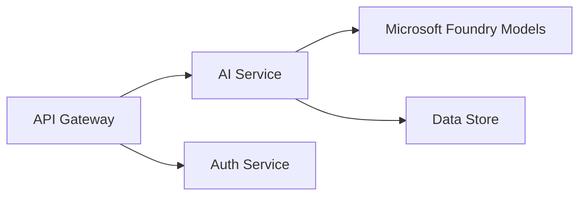
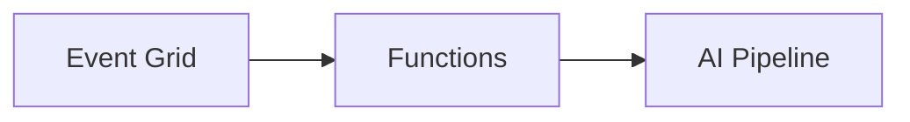

# Kapitola 8: Produkčné a podnikové vzory

**📚 Kurz**: [AZD pre začiatočníkov](../../README.md) | **⏱️ Trvanie**: 2-3 hodiny | **⭐ Zložitosť**: Pokročilý

---

## Prehľad

Táto kapitola pokrýva podnikové vzory nasadzovania pripravené do produkcie, spevňovanie bezpečnosti, monitorovanie a optimalizáciu nákladov pre produkčné AI záťaže.

Toto je architektonický referenčný materiál, nie kompletná šablóna nasaditeľná do produkcie. Príklady vynechávajú integračné detaily, ktoré musia byť dodané a otestované vo vašej vlastnej aplikácii; prečítanie si kontrolného zoznamu nezaručuje pripravenosť na produkciu.

> **Aktualizácia Foundry GA (2026-11-09):** Použite `azd >= 1.37.0` a všeobecne dostupný balík `microsoft.foundry` 1.0 pre Foundry workflow; vyhodnotenia sa inštalujú samostatne. Pozrite si [rozsah vydania a migráciu](production-ai-practices.md#recent-release-changes-and-fixes) a [príklad overeného pipeline](production-ai-practices.md#cicd-pipeline-configuration). Toto je revízia dokumentácie, nie validácia živého nasadenia ani všeobecný GA stav voliteľných náhľadových funkcií.

## Ciele učenia

Dokončením tejto kapitoly budete vedieť:
- Nasadiť viac-regionálne odolné aplikácie
- Implementovať podnikové bezpečnostné vzory
- Konfigurovať komplexné monitorovanie
- Optimalizovať náklady vo veľkom
- Nastaviť CI/CD pipeline pomocou AZD

---

## 📚 Lekcie

| # | Lekcia | Popis | Čas |
|---|--------|-------------|------|
| 1 | [Produkčné AI postupy](production-ai-practices.md) | Podnikové vzory nasadzovania | 90 min |

---

## 🚀 Produkčný kontrolný zoznam

- [ ] Viac-regionálne nasadenie pre odolnosť
- [ ] Spravovaná identita pre autentifikáciu (bez kľúčov)
- [ ] Application Insights pre monitorovanie
- [ ] Nastavené rozpočty a upozornenia na náklady
- [ ] Povolené bezpečnostné skenovanie
- [ ] Integrácia CI/CD pipeline
- [ ] Plán obnovy po havárii

---

## 🏗️ Architektonické vzory

### Vzor 1: AI založená na mikroslužbách



### Vzor 2: Udalosťami riadená AI



---

## 🔐 Najlepšie bezpečnostné postupy

```bicep
// Illustrative properties from different resources, NOT a standalone Bicep file.
// Attach identity to the application host:
identity: {
  type: 'SystemAssigned'
}

// AI account properties (also require private endpoints, DNS and app connectivity):
properties: {
  publicNetworkAccess: 'Disabled'
  networkAcls: {
    defaultAction: 'Deny'
  }
}
```

---

## 💰 Optimalizácia nákladov

| Stratégia | Hlavné obmedzenie |
|----------|---------|
| Škálovanie na nulu (Container Apps) | Vyžaduje vhodný spúšťač; iné služby stále generujú náklady |
| Použitie spotrebných úrovní pre vývoj | Porovnajte ceny vybraných služieb a záťaž |
| Plánované škálovanie | Zabezpečené škálovanie cez podporovanú infraštruktúru/automatizáciu |
| Rezervácie/provízované kapacity | Iba keď podporované; záväzky môžu zvýšiť nečinné náklady |

Použite [kompletný vzor zdrojového rozpočtu](production-ai-practices.md#2-cost-monitoring-and-budgets) s platným dátumom začiatku, rozsahom fakturácie, príjemcami a oprávneniami. Rozpočet posiela upozornenia; neobmedzuje výdavky. Úspory závisia od meranej využiteľnosti a nie sú garantovane v percentách.

---

## 📊 Nastavenie monitorovania

```bash
# Open the Application Insights logs view (requires configured monitoring)
azd monitor --logs

# Check Application Insights
azd monitor --overview

# View metrics
az monitor metrics list --resource <resource-id>
```

---

## 🔗 Navigácia

| Smer | Kapitola |
|-----------|---------|
| **Predchádzajúca** | [Kapitola 7: Riešenie problémov](../chapter-07-troubleshooting/README.md) |
| **Kurz dokončený** | [Domov kurzu](../../README.md) |

---

## 📖 Súvisiace zdroje

- [Sprievodca AI agentmi](../chapter-02-ai-development/agents.md)
- [Application Insights](../chapter-06-pre-deployment/application-insights.md)
- [Riešenia s viacerými agentmi](../chapter-05-multi-agent/README.md)
- [Príklad mikroslužieb](../../examples/microservices/README.md)

---

<!-- CO-OP TRANSLATOR DISCLAIMER START -->
**Vyhlásenie o zodpovednosti**:
Tento dokument bol preložený pomocou AI prekladateľskej služby [Co-op Translator](https://github.com/Azure/co-op-translator). Hoci sa snažíme o presnosť, vezmite prosím na vedomie, že automatické preklady môžu obsahovať chyby alebo nepresnosti. Pôvodný dokument v jeho natívnom jazyku by mal byť považovaný za autoritatívny zdroj. Pre kritické informácie sa odporúča profesionálny ľudský preklad. Nie sme zodpovední za žiadne nedorozumenia alebo nesprávne interpretácie vyplývajúce z použitia tohto prekladu.
<!-- CO-OP TRANSLATOR DISCLAIMER END -->